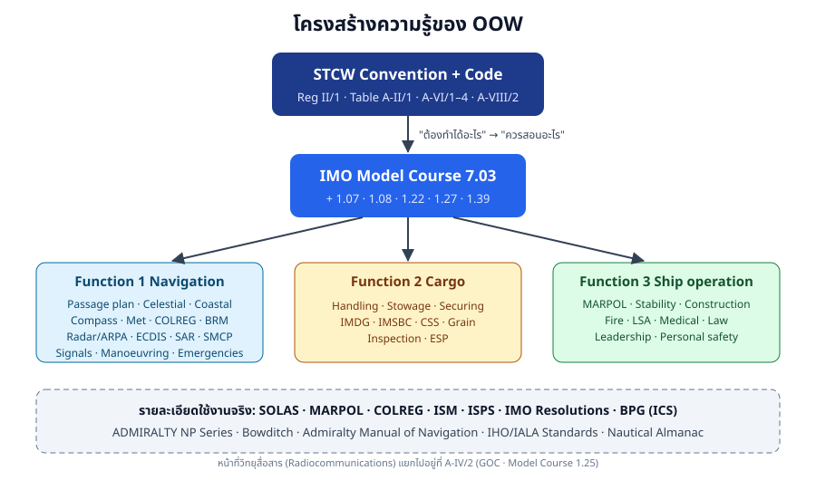

# บทนำ — สมุดเล่มนี้คืออะไร และ STCW กับ IMO Model Course 7.03 เกี่ยวข้องกันอย่างไร

> สมุดบันทึกการฝึกนายประจำเรือฝ่ายเดินเรือ (Officer in Charge of a Navigational Watch – OOW)
> บันทึกโดย **TIRAPHONG NANTAPAN**

---

## ทำไมถึงเริ่มจดสมุดเล่มนี้

ช่วงที่เรียนและฝึกภาคทะเล เราพบว่าความรู้ของคนเดินเรือกระจัดกระจายอยู่ในหนังสือหลายสิบเล่ม เปิด STCW ก็เจอแค่ตารางสมรรถนะ (competence table) เปิด Bowditch ก็ลงลึกทางทฤษฎีจนหลงทาง เปิด Bridge Procedures Guide ก็เป็นเรื่องวิธีปฏิบัติล้วน ๆ ส่วน Model Course 7.03 บอกว่าต้องสอนอะไร แต่ไม่ได้เล่ารายละเอียดให้ครบทุกเรื่อง เวลาจะทบทวนก่อนสอบหรือก่อนสัมภาษณ์งาน ต้องเปิดหนังสือกองโต

สมุดเล่มนี้จึงเกิดจากการจดเอาเองทีละหัวข้อ โดยยึด **ลำดับหัวข้อตาม IMO Model Course 7.03 / ตาราง A-II/1 ของ STCW Code** เป็นแกน แล้วเติมรายละเอียดจากแหล่งอื่นเข้าไป ทั้งอนุสัญญา (SOLAS, MARPOL, COLREG, STCW) ประมวลข้อบังคับ (ISM, ISPS, IMDG, IMSBC ฯลฯ) ข้อมติของ IMO (IMO Resolutions) หนังสือเรียนเดินเรือมาตรฐาน และสิ่งพิมพ์ของ UKHO (ADMIRALTY) จุดประสงค์คืออ่านจบแล้วต้อง "ทำงานได้จริงบนสะพานเดินเรือ" และ "ตอบคำถามสอบปากเปล่า (oral examination) ได้อย่างมีเหตุผล" ไม่ใช่แค่ท่องจำ

สิ่งที่ตั้งใจไว้ตั้งแต่ต้นคือ

1. เขียนให้ครบทุกหัวข้อของ Model Course 7.03 ไม่ข้าม ไม่ตัด
2. อธิบายด้วยภาษาที่ตัวเองอ่านย้อนหลังแล้วเข้าใจ ใช้ศัพท์อังกฤษในวงเล็บเพราะของจริงบนเรือใช้ภาษาอังกฤษทั้งหมด
3. ทุกเรื่องที่คำนวณได้ ต้องมีตัวอย่างจำลองที่ทำให้ดูทีละขั้น (ตัวเลขในตัวอย่างเป็นตัวเลขสมมติที่ตั้งขึ้นเพื่อฝึก แต่คำนวณให้ถูกต้องตามหลักการจริง)
4. มีภาพประกอบในจุดที่ภาพช่วยให้เข้าใจเร็วกว่าตัวหนังสือ
5. ท้ายบทมีคำถามที่มักเจอตอนสอบปากเปล่าและสัมภาษณ์งาน พร้อมแนวคำตอบ

> **ข้อควรระวังในการใช้สมุดเล่มนี้** — สมุดนี้เป็นบันทึกเพื่อการศึกษา ไม่ใช่สิ่งพิมพ์ทางการ เวลาทำงานจริงต้องใช้ฉบับปัจจุบันของอนุสัญญา ประมวลข้อบังคับ แผนที่และสิ่งพิมพ์ที่แก้ไขแล้ว (corrected up to date) ตามที่ SOLAS Chapter V และระบบบริหารความปลอดภัย (SMS) ของบริษัทกำหนดเสมอ

---

## 1. รู้จัก STCW ก่อน

### 1.1 STCW คืออะไร

STCW ย่อมาจาก **International Convention on Standards of Training, Certification and Watchkeeping for Seafarers, 1978** เป็นอนุสัญญาของ IMO ที่กำหนด "มาตรฐานขั้นต่ำ" ของการฝึกอบรม การออกประกาศนียบัตร และการเข้ายาม ให้คนประจำเรือทั่วโลกมีความรู้ความสามารถในระดับเดียวกัน ก่อนมี STCW แต่ละประเทศกำหนดกันเอง เรือลำเดียวกันอาจมีต้นเรือจากประเทศที่ฝึกแค่ไม่กี่เดือนกับอีกประเทศที่ฝึกหลายปี ทำให้มาตรฐานความปลอดภัยต่างกันมาก

พัฒนาการที่ควรจำ

| ปี | เหตุการณ์ | สาระสำคัญ |
|---|---|---|
| 1978 | รับรองอนุสัญญา STCW | รับรอง 7 ก.ค. 1978 มีผลบังคับ 28 เม.ย. 1984 กำหนดมาตรฐานแบบกว้าง ๆ |
| 1995 | แก้ไขใหญ่ (STCW 95) | รับรอง 7 ก.ค. 1995 มีผล 1 ก.พ. 1997 (ช่วงเปลี่ยนผ่านถึง 1 ก.พ. 2002) เพิ่ม **STCW Code** แบ่งเป็น Part A (บังคับ) และ Part B (แนวทางแนะนำ) เปลี่ยนจากการ "ระบุชั่วโมงเรียน" มาเป็น "การประเมินสมรรถนะ" (competence-based) |
| 2010 | Manila Amendments (STCW 2010) | รับรองที่การประชุมมะนิลา 25 มิ.ย. 2010 มีผล 1 ม.ค. 2012 ช่วงเปลี่ยนผ่านถึง 1 ม.ค. 2017 เพิ่มเรื่อง ECDIS, Bridge Resource Management (BRM), ภาวะผู้นำและการทำงานเป็นทีม, ชั่วโมงพักผ่อน (hours of rest) ที่เข้มขึ้น, การป้องกันการใช้แอลกอฮอล์, การฝึกความปลอดภัยทางการรักษาความปลอดภัย (security training) ฯลฯ |
| หลัง 2010 | แก้ไขย่อยต่อเนื่อง | เช่น ข้อกำหนดสำหรับเรือในน่านน้ำขั้วโลก (Polar Code) เรือที่ใช้ IGF Code และเรือโดยสาร — ที่ควรจำ: การฝึกสำหรับเรือที่ใช้ IGF Code (MSC.396(95)/MSC.397(95) มีผล 1 ม.ค. 2017), การฝึกสำหรับเรือในน่านน้ำขั้วโลกและปรับปรุงการฝึกบนเรือโดยสาร (MSC.416(97)/MSC.417(97) มีผล 1 ก.ค. 2018), และ **MSC.560(108)** แก้ STCW Code Part A ตาราง A-VI/1-4 (PSSR) ให้ต้องมีสมรรถนะด้านการป้องกันและรับมือการล่วงละเมิดทางเพศ การกลั่นแกล้ง (bullying) ความรุนแรงและการคุกคาม (violence and harassment) **มีผล 1 ม.ค. 2026** (ตรวจเลขข้อมติกับฉบับปัจจุบัน) |
| ปัจจุบัน | Comprehensive review | IMO กำลังทบทวน STCW ทั้งฉบับ (เริ่มจริงจังในช่วง HTW/MSC ปี 2023–2026) เพื่อรองรับเทคโนโลยีใหม่ เชื้อเพลิงทางเลือก และการเรียนแบบดิจิทัล ต้องติดตามว่าจะมีการแก้ไขอะไรประกาศออกมา — ลำดับเหตุการณ์ (ตรวจ ต.ค. 2026 จากหน้า FAQ ของ IMO): MSC 105 (เม.ย. 2022) สั่งให้ทบทวน → HTW 10 (ก.พ. 2024) วางหลักการ → MSC 108 (พ.ค. 2024) รับวิธีทำงานสองระยะ (หาช่องว่าง แล้วแก้ไข) → ISWG-STCW 1 (ต.ค. 2024) พบช่องว่างกว่า 400 จุด → HTW 11 (ก.พ. 2025) จบระยะที่ 1 → MSC 110 (มิ.ย. 2025) รับ roadmap → HTW 12 (ก.พ. 2026) เริ่มร่างแก้ Chapter II (ฝ่ายเดินเรือ) และ III → เป้าหมายให้เสร็จราวปี 2029–2030 ยังไม่มีวันรับรองหรือวันมีผลที่แน่นอน **ระหว่างนี้ Reg II/1 และตาราง A-II/1 ที่ใช้อยู่ยังเป็นฉบับ Manila 2010 ที่แก้ไขเพิ่มเติมแล้ว** |

### 1.2 โครงสร้างของ STCW

- **ตัวอนุสัญญา (Articles)** – ข้อบทว่าด้วยพันธะของรัฐภาคี
- **ภาคผนวก (Annex) – Regulations** แบ่งเป็น 8 หมวด (Chapter)
  - Chapter I – General provisions
  - Chapter II – Master and deck department
  - Chapter III – Engine department
  - Chapter IV – Radiocommunication and radio operators
  - Chapter V – Special training requirements for personnel on certain types of ships (เรือบรรทุกน้ำมัน เคมี ก๊าซ เรือโดยสาร เรือขั้วโลก ฯลฯ)
  - Chapter VI – Emergency, occupational safety, security, medical care and survival functions
  - Chapter VII – Alternative certification
  - Chapter VIII – Watchkeeping
- **STCW Code Part A** – มาตรฐานบังคับ มีตาราง competence ทุกระดับ
- **STCW Code Part B** – แนวทางแนะนำ (recommended guidance) ไม่บังคับแต่รัฐส่วนใหญ่นำมาใช้

### 1.3 Regulation II/1 – ข้อกำหนดขั้นต่ำสำหรับ OOW บนเรือ 500 GT ขึ้นไป

ผู้ที่จะได้ประกาศนียบัตร OOW ต้อง

1. อายุไม่ต่ำกว่า 18 ปี
2. มีระยะเวลาทำงานในทะเลที่ได้รับการรับรอง (approved seagoing service) **ไม่น้อยกว่า 12 เดือน** ซึ่งเป็นส่วนหนึ่งของหลักสูตรการฝึกที่ได้รับการรับรอง และมีการฝึกบนเรือที่บันทึกลงใน **สมุดบันทึกการฝึก (Training Record Book – TRB)** หรือถ้าไม่ได้อยู่ในหลักสูตรดังกล่าว ต้องมีระยะเวลาในทะเลไม่น้อยกว่า **36 เดือน**
3. ในระหว่างระยะเวลาทำงานในทะเลนั้น ต้องได้ปฏิบัติหน้าที่เข้ายามสะพานเดินเรือภายใต้การกำกับดูแลของนายเรือหรือนายประจำเรือที่มีคุณสมบัติ **ไม่น้อยกว่า 6 เดือน**
4. มีคุณสมบัติตาม Chapter IV สำหรับหน้าที่วิทยุ (ในทางปฏิบัติคือ GMDSS General Operator's Certificate – GOC)
5. ผ่านการศึกษาและฝึกอบรมที่ได้รับการรับรอง และมีสมรรถนะตาม **Section A-II/1** ของ STCW Code
6. มีสมรรถนะตาม Section A-VI/1 วรรค 2 (Basic training), A-VI/2 วรรค 1–4 (Proficiency in survival craft and rescue boats), A-VI/3 วรรค 1–4 (Advanced fire fighting) และ A-VI/4 วรรค 1–3 (Medical first aid)

นอกจากนี้ยังมีข้อกำหนดที่เกี่ยวข้องอีก เช่น ใบรับรองแพทย์ตาม Regulation I/9 การฝึกด้านการรักษาความปลอดภัย (security awareness / designated security duties ตาม A-VI/6) และการต่ออายุใบประกาศ (revalidation) ทุก 5 ปีตาม Regulation I/11

> **จดไว้กันลืม** — Reg II/1 ใช้กับ OOW บนเรือ **500 GT ขึ้นไป** ส่วนเรือเล็กกว่า 500 GT ที่ทำการค้าใกล้ชายฝั่ง (near-coastal voyages) มีข้อกำหนดแยกใน Reg II/3 ซึ่งแต่ละรัฐกำหนดรายละเอียดเองได้ภายใต้ Section A-II/3 และหลัง Manila 2010 ใบรับรองด้าน basic training (A-VI/1), survival craft (A-VI/2) และ advanced fire fighting (A-VI/3) ต้องแสดงหลักฐานว่ายังคงสมรรถนะ (refresher training) ทุก 5 ปีด้วย ไม่ใช่ต่อแค่ CoC อย่างเดียว

ในประเทศไทย หน่วยงานที่ออกประกาศนียบัตรคือ **กรมเจ้าท่า (Marine Department)** ในฐานะ Administration ของรัฐภาคี ส่วนการเรียนการสอนหลักของฝ่ายเดินเรือคือ **ศูนย์ฝึกพาณิชย์นาวี (Merchant Marine Training Centre)** และสถาบันที่ได้รับการรับรอง

### 1.4 ตาราง A-II/1 และ "หน้าที่" (Functions)

STCW แบ่งงานบนเรือเป็น 7 หน้าที่ (functions) — Navigation; Cargo handling and stowage; Controlling the operation of the ship and care for persons on board; Marine engineering; Electrical, electronic and control engineering; Maintenance and repair; Radiocommunications (ดู Section A-I/1 และ Part B-I/1 ของ STCW Code) — และแบ่งระดับความรับผิดชอบเป็น 3 ระดับ คือ ระดับบริหาร (management level) ระดับปฏิบัติการ (operational level) และระดับสนับสนุน (support level) OOW อยู่ใน **ระดับปฏิบัติการ** ซึ่งตาราง A-II/1 กำหนดไว้ 3 หน้าที่

| Function | ชื่อ | เนื้อหาหลัก |
|---|---|---|
| 1 | Navigation at the operational level | วางแผนและเดินทาง หาตำแหน่ง เข้ายาม เรดาร์/ARPA ECDIS เหตุฉุกเฉิน การค้นหาและกู้ภัย ภาษาอังกฤษ สัญญาณภาพ การบังคับเรือ |
| 2 | Cargo handling and stowage at the operational level | การขนถ่าย การจัดวาง การผูกยึดสินค้า การตรวจระวางและถังอับเฉา |
| 3 | Controlling the operation of the ship and care for persons on board at the operational level | ป้องกันมลพิษ เสถียรภาพ โครงสร้างเรือ ดับเพลิง อุปกรณ์ช่วยชีวิต ปฐมพยาบาล กฎหมาย ภาวะผู้นำ ความปลอดภัยส่วนบุคคล |

หน้าที่ด้านวิทยุสื่อสาร (Radiocommunications) แยกไปอยู่ใน A-IV/2 (หลักสูตร GOC – IMO Model Course 1.25)

แต่ละแถวในตารางมี 4 คอลัมน์ ซึ่งควรจำให้ได้เพราะกรรมการสอบชอบถาม

1. **Competence** – สมรรถนะที่ต้องมี เช่น "Plan and conduct a passage and determine position"
2. **Knowledge, understanding and proficiency** – ความรู้และทักษะที่ต้องมีในสมรรถนะนั้น
3. **Methods for demonstrating competence** – วิธีพิสูจน์ว่ามีสมรรถนะ เช่น การสอบ การฝึกในเครื่องจำลอง (simulator) ประสบการณ์บนเรือที่ได้รับการรับรอง
4. **Criteria for evaluating competence** – เกณฑ์ตัดสินว่าผ่านหรือไม่ เช่น "ความคลาดเคลื่อนของตำแหน่งอยู่ในเกณฑ์ที่ยอมรับได้"

---

## 2. IMO Model Course 7.03 คืออะไร

### 2.1 ความหมายของ "Model Course"

IMO ไม่ได้บังคับว่าแต่ละประเทศต้องสอนแบบไหน แต่ทำ "หลักสูตรต้นแบบ" (Model Course) ขึ้นมาเป็นแนวทาง เพื่อให้สถาบันฝึกทั่วโลกสอนได้ครบตามที่ STCW กำหนด **Model Course 7.03 – Officer in Charge of a Navigational Watch** คือหลักสูตรต้นแบบสำหรับ OOW (ฉบับที่ใช้อ้างอิงกันแพร่หลายคือฉบับปรับปรุงปี 2014 ที่จัดทำให้สอดคล้องกับ Manila Amendments)

หลักสูตรต้นแบบแบ่งเป็นส่วนต่าง ๆ ดังนี้

| ส่วน | ชื่อ | ใช้ทำอะไร |
|---|---|---|
| Part A | Course Framework | ขอบเขต วัตถุประสงค์ คุณสมบัติผู้เข้าเรียน อุปกรณ์ที่ต้องมี เอกสารอ้างอิง |
| Part B | Course Outline and Timetable | หัวข้อและชั่วโมงเรียนโดยประมาณ |
| Part C | Detailed Teaching Syllabus | หัวข้อย่อยละเอียดทุกข้อ พร้อม learning objectives (ผู้เรียนต้องอธิบาย/คำนวณ/สาธิตอะไรได้) |
| Part D | Instructor Manual | คำแนะนำสำหรับผู้สอนในแต่ละหัวข้อ |
| Part E | Evaluation and Assessment | วิธีการประเมินผล |
| Appendices | ภาคผนวก | ตัวอย่างแบบฝึกหัด แบบประเมินในเครื่องจำลอง ฯลฯ |

### 2.2 Model Course อื่นที่ต่อยอดกัน

ในการเขียนสมุดนี้ เราดึงเนื้อหาจาก Model Course อื่นที่สอนเรื่องเฉพาะลงลึกมาเสริมด้วย

| Model Course | ชื่อ | เกี่ยวข้องกับหัวข้อ |
|---|---|---|
| 1.07 | Radar Navigation at Operational Level – Radar Observation and Plotting (ฉบับปรับปรุงหลัง Manila ใช้ชื่อรองว่า Radar Navigation, Radar Plotting and Use of ARPA — ตรวจกับฉบับปัจจุบัน) | 1.3 Radar |
| 1.08 | Radar Navigation at Management Level (ARPA / Bridge Teamwork) | 1.3 ARPA |
| 1.22 | Ship Simulator and Bridge Teamwork | 1.2.2 BRM, 1.9 การบังคับเรือ |
| 1.27 | Operational Use of ECDIS | 1.4 ECDIS |
| 1.25 | GMDSS General Operator's Certificate | วิทยุ (อ้างถึงใน 1.5, 1.6) |
| 1.13 / 1.14 / 1.15 / 1.19 / 1.20 / 1.23 | Elementary first aid, Medical first aid, Medical care, Personal survival, Fire prevention and fire fighting, Proficiency in survival craft | 3.3, 3.4, 3.5, 3.8 |
| 1.39 | Leadership and Teamwork | 3.7 |
| 2.03 | Advanced Training in Fire Fighting (A-VI/3 ที่ Reg II/1 กำหนด) | 3.3 |
| 1.21 | Personal Safety and Social Responsibilities (PSSR — หัวข้อ harassment/bullying เพิ่มตาม MSC.560(108)) | 3.8 |
| 1.38 | Marine Environmental Awareness | 3.1 |
| 3.26 / 3.27 | Security training for seafarers with designated security duties / Security awareness training for all seafarers (A-VI/6) | 3.6, 3.8 |
| 1.30 | On-board Assessment (การประเมินบนเรือและการใช้ TRB) | การฝึกภาคทะเล |
| 3.12 | Assessment, examination and certification of seafarers | วิธีการประเมิน |
| 6.09 | Training course for instructors | (สำหรับผู้สอน) |

### 2.3 แผนผังความเชื่อมโยงของเนื้อหาในสมุดเล่มนี้

*ภาพที่ 0-1 ภาพรวมว่า STCW กำหนด "ต้องทำได้อะไร" Model Course กำหนด "ควรสอนอะไร" และหนังสือ/สิ่งพิมพ์อื่น ๆ คือ "รายละเอียดที่ใช้ทำงานจริง"*

---

## 3. แหล่งข้อมูลที่ใช้ประกอบการจด

ทุกบทจะบอกไว้ว่าเนื้อหาส่วนไหนอ้างอิงจากเอกสารอะไร ตรงนี้รวมไว้ภาพรวมก่อน

**อนุสัญญาและประมวลข้อบังคับของ IMO**

- SOLAS 1974 as amended – โดยเฉพาะ Chapter II-1, II-2, III, IV, V, VI, VII, IX (ISM), XI-1, XI-2 (ISPS)
- MARPOL 73/78 Annexes I–VI
- COLREG 1972 as amended
- STCW 1978 as amended และ STCW Code
- Load Lines 1966, Tonnage 1969, BWM 2004, AFS 2001, MLC 2006 (ของ ILO), Hong Kong Ship Recycling Convention (มีผลบังคับ 26 มิ.ย. 2025)
- ISM Code, ISPS Code, IMDG Code, IMSBC Code, Grain Code, CSS Code, LSA Code, FSS Code, FTP Code, IBC Code, IGC Code, Polar Code, ESP Code (2011 ESP Code)
- IAMSAR Manual (ฉบับ 2025 มีผลใช้ 1 ม.ค. 2026 — แก้ไขตาม MSC.1/Circ.1686 ที่ MSC 109 อนุมัติ, SOLAS V/21 ให้เรือมี Volume III ฉบับปัจจุบัน), International Code of Signals, IMO SMCP (Resolution A.918(22))

**ข้อมติและหนังสือเวียนของ IMO ที่ใช้บ่อย**

- Res. A.893(21) Guidelines for Voyage Planning
- Res. A.572(14) as amended – General Provisions on Ships' Routeing
- Res. A.851(20) – General Principles for Ship Reporting Systems
- Res. A.1158(32) – Guidelines for Vessel Traffic Services (แทน A.857(20))
- Res. A.601(15) – Provision and Display of Manoeuvring Information on Board Ships (wheelhouse poster, pilot card, manoeuvring booklet)
- Res. MSC.137(76) – Standards for Ship Manoeuvrability
- Res. MSC.232(82) และ MSC.530(106)/Rev.1 – ECDIS performance standards (MSC.530(106)/Rev.1 รับรองที่ MSC 108 ปี 2024 รองรับ S-100: ECDIS ที่ติดตั้งตั้งแต่ 1 ม.ค. 2026 เลือกตามมาตรฐานเดิมหรือใหม่ได้ ส่วนที่ติดตั้งตั้งแต่ 1 ม.ค. 2029 ต้องเป็นไปตามมาตรฐานใหม่)
- Res. MSC.192(79) – Radar performance standards
- Res. MSC.252(83) – INS performance standards
- Res. MSC.128(75) – BNWAS performance standards
- Res. A.1106(29) – Guidelines for the onboard operational use of AIS
- Res. A.1072(28) – Revised guidelines for a structure of an integrated system of contingency planning for shipboard emergencies
- MSC.1/Circ.1503/Rev.1 – ECDIS – Guidance for good practice
- MSC/Circ.1091 – Issues to be considered when introducing new technology on board ship

**หนังสือและสิ่งพิมพ์อ้างอิง**

- ICS *Bridge Procedures Guide* (6th Edition, 2022)
- *The Admiralty Manual of Navigation* (BR 45) เล่มต่าง ๆ
- Bowditch – *The American Practical Navigator* (NGA Pub. No. 9)
- *Reed's Nautical Almanac* และ *The Nautical Almanac* (HMNAO/USNO, ADMIRALTY NP314)
- ADMIRALTY List of Lights, List of Radio Signals, Sailing Directions, Tide Tables, NP5011, NP100 *The Mariner's Handbook*, NP136 *Ocean Passages for the World*, NP735 IALA Maritime Buoyage System, NP231/NP232/NP5012 (คู่มือ ECDIS)
- IHO S-4 (Chart specifications), S-52 (ECDIS presentation library), S-57 / S-100 / S-101 (ENC data), S-44 (Hydrographic survey standards), S-63 (data protection)
- IALA Recommendations และ IALA Maritime Buoyage System
- Radar/ARPA manual (Bole, Wall & Norris – *Radar and ARPA Manual*)
- *Ship Stability for Masters and Mates* (Barrass & Derrett), *Ship Construction* (Eyres)
- *Meteorology for Seafarers* / *Marine Meteorology* และสิ่งพิมพ์ WMO
- *Bridge Team Management* (A.J. Swift), *Human Factors* และ BRM ในเอกสารของอุตสาหกรรม
- *International Medical Guide for Ships* (WHO 3rd Ed.) และ MFAG (Medical First Aid Guide for Use in Accidents Involving Dangerous Goods)

---

## 4. วิธีอ่านสมุดเล่มนี้

- หัวข้อเรียงตาม Model Course 7.03 ตามลำดับที่ใช้ในตารางสมรรถนะ (1.1 → 3.8)
- ในบทยาว ๆ จะมี **"จดไว้กันลืม"** เป็นกรอบข้อความสำคัญ
- **"ตัวอย่างจำลอง"** คือสถานการณ์หรือการคำนวณที่สร้างขึ้นให้คล้ายของจริง ตัวเลขใช้ฝึกเท่านั้น ห้ามนำไปใช้เดินเรือจริง
- **"คำถามสอบปากเปล่า / สัมภาษณ์"** อยู่ท้ายบท รวบรวมแนวคำถามที่เจอบ่อย
- ภาพประกอบทั้งหมดอยู่ในโฟลเดอร์ `images/`

## 5. ตารางเชื่อมโยงหัวข้อกับไฟล์

| หัวข้อตาม Model Course 7.03 | ไฟล์ |
|---|---|
| 1.1 Plan and conduct a passage and determine position (การวางแผนการเดินทาง) | [1.1.0](../01-navigation/1.1.0-passage-planning.md) |
| 1.1.1 Celestial navigation | [1.1.1](../01-navigation/1.1.1-celestial-navigation.md) |
| 1.1.2 Terrestrial and coastal navigation | [1.1.2-A](../01-navigation/1.1.2-A-terrestrial-coastal-navigation.md), [1.1.2-B](../01-navigation/1.1.2-B-aids-to-navigation-buoyage-lights.md), [1.1.2-C](../01-navigation/1.1.2-C-charts-and-publications.md), [1.1.2-D](../01-navigation/1.1.2-D-tides-and-tidal-streams.md), [1.1.2-E](../01-navigation/1.1.2-E-admiralty-publications-current-editions.md) |
| 1.1.3 Electronic systems of position fixing and navigation | [1.1.3](../01-navigation/1.1.3-electronic-navigation-systems.md) |
| 1.1.4 Echo-sounders | [1.1.4](../01-navigation/1.1.4-echo-sounders.md) |
| 1.1.5 Compass – magnetic and gyro | [1.1.5](../01-navigation/1.1.5-compasses.md) |
| 1.1.6 Steering control system | [1.1.6](../01-navigation/1.1.6-steering-control-system.md) |
| 1.1.7 Meteorology | [1.1.7](../01-navigation/1.1.7-meteorology.md) |
| 1.2.1 Watchkeeping | [COLREG](../01-navigation/1.2.1-A-colregs.md), [หลักการเข้ายาม](../01-navigation/1.2.1-B-watchkeeping-principles.md), [Routeing/Reporting/VTS/Blind pilotage](../01-navigation/1.2.1-C-routeing-reporting-vts-blind-pilotage.md) |
| 1.2.2 Bridge resource management | [1.2.2](../01-navigation/1.2.2-bridge-resource-management.md) |
| 1.3 Radar and ARPA | [1.3-A](../01-navigation/1.3-A-radar-fundamentals.md), [1.3-B](../01-navigation/1.3-B-radar-plotting-and-arpa.md) |
| 1.4 ECDIS | [1.4](../01-navigation/1.4-ecdis.md) |
| 1.5 Emergencies | [1.5](../01-navigation/1.5-emergency-procedures.md) |
| 1.6 Search and rescue | [1.6](../01-navigation/1.6-search-and-rescue.md) |
| 1.7 English / SMCP | [1.7](../01-navigation/1.7-english-and-smcp.md) |
| 1.8 Visual signalling | [1.8](../01-navigation/1.8-visual-signalling.md) |
| 1.9 Ship manoeuvring | [1.9](../01-navigation/1.9-ship-manoeuvring-and-handling.md) |
| 2.1 Cargo handling, stowage and securing | [2.1](../02-cargo/2.1-cargo-handling-stowage-securing.md) |
| 2.2 Inspect and report defects and damage | [2.2](../02-cargo/2.2-inspection-cargo-spaces-hatch-covers-ballast-tanks.md) |
| 3.1 Pollution prevention | [3.1](../03-ship-operation/3.1-pollution-prevention.md) |
| 3.2.1 Ship stability | [3.2.1](../03-ship-operation/3.2.1-ship-stability.md) |
| 3.2.2 Ship construction | [3.2.2](../03-ship-operation/3.2.2-ship-construction.md) |
| 3.3 Fire prevention and fire-fighting | [3.3](../03-ship-operation/3.3-fire-prevention-and-fire-fighting.md) |
| 3.4 Life-saving | [3.4](../03-ship-operation/3.4-life-saving-appliances.md) |
| 3.5 Medical aid | [3.5](../03-ship-operation/3.5-medical-first-aid.md) |
| 3.6 Legislative requirements | [3.6](../03-ship-operation/3.6-legislative-requirements.md) |
| 3.7 Leadership and teamworking | [3.7](../03-ship-operation/3.7-leadership-and-teamwork.md) |
| 3.8 Safety of personnel and ship | [3.8](../03-ship-operation/3.8-safety-of-personnel-and-ship.md) |
| ภาคผนวก | [Admiralty publications](../01-navigation/1.1.2-E-admiralty-publications-current-editions.md), [อภิธานศัพท์](../../appendices/A-glossary.md), [คลังคำถามสอบ](../../appendices/B-oral-exam-question-bank.md), [เอกสารอ้างอิง](../../appendices/C-references.md), [บันทึกการตรวจทาน](../../appendices/D-review-log.md) |

---

## 6. คำถามสอบปากเปล่า / สัมภาษณ์ ที่มักถามในบทนำ

**ถาม:** STCW Reg II/1 ใช้กับเรือขนาดเท่าไร และต้องมีระยะเวลาในทะเลเท่าไร
**แนวตอบ:** ใช้กับ OOW บนเรือ 500 GT ขึ้นไป ต้องมี approved seagoing service ไม่น้อยกว่า 12 เดือนภายใต้หลักสูตรที่ได้รับการรับรองและมี TRB หรือ 36 เดือนถ้าไม่อยู่ในหลักสูตร และต้องเข้ายามสะพานเดินเรือภายใต้การกำกับไม่น้อยกว่า 6 เดือน

**ถาม:** ตาราง A-II/1 มีกี่ function อะไรบ้าง
**แนวตอบ:** 3 function — Navigation, Cargo handling and stowage, Controlling the operation of the ship and care for persons on board ทั้งหมดในระดับ operational level

**ถาม:** STCW Code Part A กับ Part B ต่างกันอย่างไร
**แนวตอบ:** Part A เป็นข้อบังคับ (mandatory) มีตาราง competence และมาตรฐานขั้นต่ำ ส่วน Part B เป็นแนวทางแนะนำ (recommended guidance) ช่วยให้รัฐภาคีนำไปปฏิบัติ

**ถาม:** Manila Amendments 2010 เพิ่มอะไรที่เกี่ยวกับ OOW
**แนวตอบ:** เพิ่ม ECDIS ในตาราง A-II/1, เพิ่ม BRM, ภาวะผู้นำและการทำงานเป็นทีม, ปรับชั่วโมงพักผ่อน (อย่างน้อย 10 ชั่วโมงใน 24 ชั่วโมง และ 77 ชั่วโมงใน 7 วัน), จำกัดแอลกอฮอล์ (BAC ไม่เกิน 0.05% หรือ 0.25 mg/l ในลมหายใจ), security training, และกำหนดให้ต่ออายุประกาศนียบัตรด้วยการพิสูจน์สมรรถนะต่อเนื่อง (หลักการต่ออายุ CoC ทุก 5 ปีตาม Reg I/11 มีมาตั้งแต่ STCW 95 สิ่งที่ Manila เพิ่มชัด ๆ คือต้องแสดงสมรรถนะต่อเนื่องของ basic training, survival craft และ advanced fire fighting ทุก 5 ปี)

**ถาม:** ตอนนี้ (ปี 2026) IMO กำลังทำอะไรกับ STCW และกระทบ OOW อย่างไร
**แนวตอบ:** กำลังทำ comprehensive review ทั้งอนุสัญญาและ Code เริ่มจาก MSC 105 (2022) จบการหาช่องว่างที่ HTW 11 (2025) พบกว่า 400 จุด และเริ่มร่างแก้ Chapter II/III ที่ HTW 12 (ก.พ. 2026) เป้าหมายเสร็จราวปี 2029–2030 ระหว่างนี้ยังใช้ Reg II/1 และตาราง A-II/1 ฉบับปัจจุบัน ส่วนการแก้ที่มีผลแล้วล่าสุดคือ MSC.560(108) เพิ่มหัวข้อป้องกันการล่วงละเมิดทางเพศ การกลั่นแกล้ง และความรุนแรงใน PSSR (A-VI/1-4) มีผล 1 ม.ค. 2026

**ถาม:** STCW แบ่งงานเป็นกี่ function และกี่ระดับ
**แนวตอบ:** 7 function คือ Navigation, Cargo handling and stowage, Controlling the operation of the ship and care for persons on board, Marine engineering, Electrical electronic and control engineering, Maintenance and repair และ Radiocommunications แบ่งเป็น 3 ระดับคือ management, operational และ support OOW อยู่ระดับ operational ใช้ 3 function แรกตามตาราง A-II/1

**ถาม:** นอกจาก CoC ตาม Reg II/1 แล้ว OOW ต้องมีใบรับรองอะไรอีกบ้าง
**แนวตอบ:** ใบรับรองแพทย์ (Reg I/9), basic training ตาม A-VI/1 (PST, FPFF, EFA, PSSR), proficiency in survival craft and rescue boats (A-VI/2), advanced fire fighting (A-VI/3), medical first aid (A-VI/4), security ตาม A-VI/6 และ GOC สำหรับหน้าที่วิทยุ (Chapter IV) บวก ECDIS generic training และ type-specific familiarization ตามที่รัฐเจ้าของธงและบริษัทกำหนด

**ถาม:** Model Course บังคับใช้หรือไม่
**แนวตอบ:** ไม่บังคับ เป็นแนวทางของ IMO ให้สถาบันฝึกนำไปใช้ ข้อบังคับจริงคือ STCW Convention และ STCW Code Part A

---

*หน้าถัดไป → [1.1 การวางแผนการเดินทาง (Passage Planning)](../01-navigation/1.1.0-passage-planning.md)*
