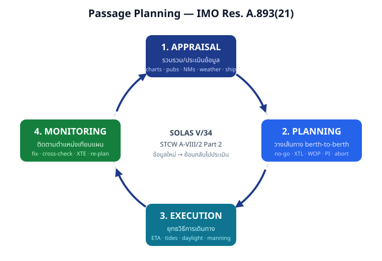
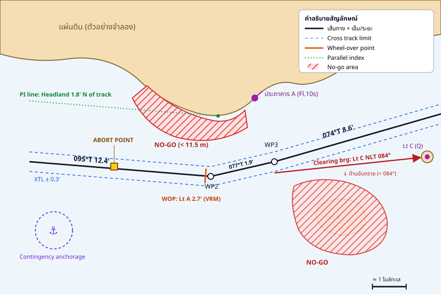
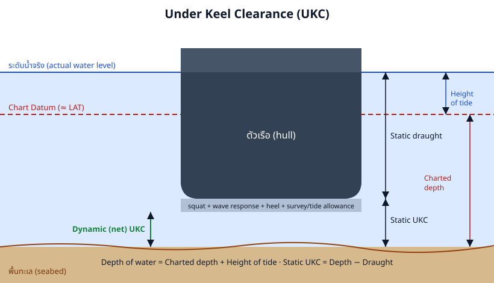

# 1.1 Plan and conduct a passage and determine position — การวางแผนการเดินทาง (Passage Planning)

> สมุดบันทึกการฝึก OOW · TIRAPHONG NANTAPAN
> อ้างอิงหลัก: SOLAS Chapter V (Reg. 27, 34, 34-1), STCW Code A-VIII/2 Part 2 (วรรค 3–7) และ Part 4-1 (วรรค 47–50), IMO Res. A.893(21) *Guidelines for Voyage Planning*, ICS *Bridge Procedures Guide* (6th Ed.), NP100 *The Mariner's Handbook*, NP136 *Ocean Passages for the World*, NP232 *ADMIRALTY Guide to ECDIS Implementation, Policy and Procedures*

---

ก่อนจะลงรายละเอียดหัวข้อย่อยของสมรรถนะ 1.1 (ดาราศาสตร์ เดินเรือชายฝั่ง เครื่องช่วยอิเล็กทรอนิกส์ ฯลฯ) ขอจดเรื่อง "การวางแผนการเดินทาง" ไว้เป็นบทแรก เพราะชื่อสมรรถนะคือ **Plan and conduct a passage and determine position** หัวใจของมันคือต้องวางแผนเป็นก่อน แล้วค่อยใช้เครื่องมือทุกอย่างที่เรียนในหัวข้อถัด ๆ ไปเพื่อเดินตามแผนและหาตำแหน่งเรือให้ได้ตลอดเวลา

ตอนขึ้นเรือฝึกช่วงแรก ต้นหนหรือต้นเรือที่ 2 (Second Officer) มักเป็นคนทำแผนการเดินทาง แต่ OOW ทุกคนต้องอ่านแผน เข้าใจแผน และลงชื่อรับทราบก่อนออกเรือ ตอนสัมภาษณ์งานก็เกือบทุกบริษัทถามว่า "passage plan มีกี่ขั้นตอน แต่ละขั้นทำอะไร" ถ้าตอบได้แค่ชื่อ 4 ขั้นตอนโดยไม่รู้รายละเอียด ก็จะถูกถามต่อจนติด

---

## 1. ทำไมต้องวางแผนการเดินทาง — ฐานทางกฎหมาย

### 1.1 SOLAS Chapter V Regulation 34 — Safe navigation and avoidance of dangerous situations

ใจความสำคัญ

1. ก่อนออกเดินทาง นายเรือต้องดูให้แน่ใจว่าการเดินทางที่ตั้งใจไว้ได้รับการวางแผนแล้ว โดยใช้แผนที่เดินเรือและสิ่งพิมพ์ทางทะเลที่เหมาะสมสำหรับพื้นที่นั้น โดยคำนึงถึงแนวทางและข้อแนะนำที่ IMO จัดทำขึ้น (คือ Res. A.893(21))
2. แผนการเดินทางต้องระบุเส้นทางที่
   - คำนึงถึงระบบจัดเส้นทางเดินเรือ (ships' routeing systems) ที่เกี่ยวข้อง
   - มีที่ว่างทะเลเพียงพอ (sufficient sea room) สำหรับการเดินเรืออย่างปลอดภัยตลอดการเดินทาง
   - คาดการณ์อันตรายต่อการเดินเรือที่รู้แล้วทั้งหมด และสภาพอากาศที่ไม่เอื้ออำนวย
   - คำนึงถึงมาตรการคุ้มครองสิ่งแวดล้อมทางทะเลที่เกี่ยวข้อง และหลีกเลี่ยงการกระทำหรือกิจกรรมที่อาจก่อให้เกิดความเสียหายต่อสิ่งแวดล้อม

### 1.2 SOLAS V/34-1 — Master's discretion

เจ้าของเรือ ผู้เช่าเรือ หรือบริษัทผู้จัดการเรือ **ต้องไม่ขัดขวางหรือจำกัด** นายเรือในการตัดสินใจใด ๆ ที่นายเรือเห็นว่าจำเป็นเพื่อความปลอดภัยของชีวิตในทะเลและการคุ้มครองสิ่งแวดล้อมทางทะเล ตามดุลยพินิจทางวิชาชีพของนายเรือ — ข้อนี้สำคัญตอนเจอสถานการณ์ที่แผนการเดินทางต้องเปลี่ยน เช่น พายุ หรือ charterer กดดันเรื่อง ETA

### 1.3 SOLAS V/27 — Nautical charts and nautical publications

แผนที่และสิ่งพิมพ์ทางทะเล เช่น Sailing Directions, Lists of Lights, Notices to Mariners, Tide Tables และสิ่งพิมพ์อื่นที่จำเป็นสำหรับการเดินทาง ต้อง **เพียงพอและแก้ไขให้เป็นปัจจุบัน (adequate and up to date)** — แปลว่าวางแผนด้วยแผนที่ที่ยังไม่ได้แก้ไขไม่ได้

### 1.4 STCW Code Section A-VIII/2 Part 2 — Voyage planning

กำหนดว่า

- ต้องวางแผนการเดินทางล่วงหน้า โดยคำนึงถึงข้อมูลที่เกี่ยวข้องทั้งหมด และต้องตรวจสอบเข็มทุกเส้นที่วางไว้ก่อนเริ่มการเดินทาง (วรรค 3) — ก่อนทุกเที่ยว นายเรือต้องดูให้แน่ใจว่าเส้นทาง **จากท่าต้นทางถึงท่าแรกที่จะแวะ (from the port of departure to the first port of call)** ได้รับการวางแผนโดยใช้แผนที่และสิ่งพิมพ์ที่เพียงพอ เหมาะสม และมีข้อมูลถูกต้อง ครบถ้วน เป็นปัจจุบัน (วรรค 5) ส่วนคำว่า **"berth to berth"** มาจาก IMO Res. A.893(21) วรรค 3.1 ซึ่งให้แผนครอบคลุมตั้งแต่ท่าถึงท่า รวมช่วงที่มีนำร่อง
- นายประจำเรือที่รับผิดชอบการวางแผน (โดยปกติคือ Second Officer) ต้องตรวจทานข้อมูลบนแผนที่ สิ่งพิมพ์ การแก้ไขแผนที่ คำเตือนทางการเดินเรือ ข้อมูลสภาพอากาศ ฯลฯ (ตัวบท STCW วรรค 5 กำหนดความรับผิดชอบไว้ที่นายเรือ การมอบให้ Second Officer เป็นผู้จัดทำเป็นแนวปฏิบัติตาม SMS ของบริษัทและ BPG)
- **เมื่อแผนผ่านการตรวจสอบแล้ว ต้องแสดงเส้นทางไว้ชัดเจนบนแผนที่ที่เหมาะสม และต้องพร้อมให้ OOW ดูได้ตลอดเวลา OOW ต้องตรวจเข็มแต่ละเส้นก่อนนำไปใช้ระหว่างการเดินทาง** (วรรค 6 — Verification and display of planned route) ข้อนี้คือเหตุผลที่ OOW ต้องอ่านและลงชื่อรับทราบแผน
- ระหว่างการเดินทาง ถ้ามีการเปลี่ยนแปลงท่าปลายทาง หรือจำเป็นต้องเบี่ยงจากแผนอย่างมาก ต้องวางแผนใหม่ก่อนจะเบี่ยงออกไป (วรรค 7)
- ในน่านน้ำชายฝั่ง (coastal waters) ต้องระบุเส้นทางบนแผนที่มาตราส่วนใหญ่ที่สุดที่เหมาะสมกับพื้นที่ ต้องกำหนดเข็มเรือ ระยะทาง และตำแหน่งที่จะเปลี่ยนเข็ม (หลักการใช้แผนที่มาตราส่วนใหญ่ที่สุดที่แก้ไขแล้ว และหาตำแหน่งบ่อย ๆ ด้วยมากกว่าหนึ่งวิธี อยู่ใน A-VIII/2 Part 4-1 วรรค 47 ส่วนรายละเอียดเข็ม ระยะทาง และจุดเปลี่ยนเข็มเป็นแนวทางของ A.893(21) หัวข้อ Planning)

### 1.5 ISM Code และ SMS ของบริษัท

ISM Code ข้อ 7 (Shipboard operations) กำหนดให้บริษัทจัดทำขั้นตอนการปฏิบัติงานหลักบนเรือ ซึ่งเกือบทุกบริษัทมี **Passage Planning Procedure** และแบบฟอร์ม (passage plan form, UKC calculation form, ECDIS route check list) ที่ต้องใช้ทุกเที่ยว รวมถึงนโยบาย UKC ขั้นต่ำ (UKC policy) และ cross track limit ที่บริษัทกำหนด

### 1.6 IMO Res. A.893(21) — Guidelines for Voyage Planning

เป็นแนวทางหลักที่อุตสาหกรรมใช้ แบ่งการวางแผนเป็น **4 ขั้นตอน**



*ภาพที่ 1.1-1 วงจร Appraisal → Planning → Execution → Monitoring ตาม A.893(21) — สังเกตว่าเป็นวงจร เพราะข้อมูลใหม่ระหว่างทาง (คำเตือนใหม่ อากาศเปลี่ยน) ทำให้ต้องย้อนไปประเมินและวางแผนซ้ำ*

| ขั้นตอน | ภาษาอังกฤษ | ทำอะไร | คำถามที่ต้องตอบได้ |
|---|---|---|---|
| 1 | Appraisal | รวบรวมและประเมินข้อมูลทั้งหมดที่เกี่ยวข้อง | "เรามีข้อมูลอะไร อันตรายอยู่ที่ไหน" |
| 2 | Planning | ลงรายละเอียดเส้นทางบนแผนที่/ECDIS และเขียนแผน | "เราจะไปทางไหน อย่างไร" |
| 3 | Execution | กำหนดยุทธวิธีการเดินทางตามแผน (ETA, กระแสน้ำ, เวลากลางวัน ฯลฯ) | "เราจะทำตามแผนอย่างไรในสถานการณ์จริง" |
| 4 | Monitoring | ติดตามตำแหน่งเรือเทียบกับแผนอย่างต่อเนื่อง | "เรายังอยู่ตามแผนหรือไม่" |

> **จดไว้กันลืม** — "Berth to berth" หมายถึงวางแผนครอบคลุมทั้งช่วงที่มีนำร่องด้วย การมีนำร่อง (pilot) บนเรือ **ไม่ได้ยกเว้น** ความรับผิดชอบของนายเรือและ OOW (SOLAS V/34, STCW A-VIII/2 Part 4-1 วรรค 49–50 — Navigation with pilot on board) แผนช่วงนำร่องจึงต้องมีและต้องนำมาหารือกับนำร่องตอนแลกเปลี่ยนข้อมูล (Master/Pilot Information Exchange – MPX)

---

## 2. ขั้นที่ 1 Appraisal — การประเมินข้อมูล

ขั้นนี้ไม่ใช่แค่ "หยิบแผนที่มาวาง" แต่เป็นการรวบรวมข้อมูลทุกอย่างที่จะมีผลต่อความปลอดภัยของการเดินทาง แล้วตัดสินว่าอะไรสำคัญ นายเรือเป็นผู้ตัดสินใจภาพรวม (เช่นจะไปเส้นทางไหน) แต่ Second Officer เป็นผู้รวบรวมข้อมูลละเอียด

### 2.1 รายการข้อมูลที่ต้องพิจารณา (ตาม A.893(21) วรรค 2 และ BPG)

**ก) สภาพและสถานะของเรือ (ship's condition)**

- อัตรากินน้ำลึก (draught) หัว-ท้าย ที่คาดไว้ตอนออก ระหว่างทาง และตอนถึง (รวมการใช้น้ำมันเชื้อเพลิงและน้ำจืดระหว่างทาง ซึ่งทำให้ draught ลดลง)
- ความสูงของเสากระโดงและส่วนที่สูงที่สุดของเรือ (air draught) สำหรับลอดใต้สะพานหรือสายไฟ
- เสถียรภาพ (stability) และการกระจายน้ำหนัก
- ข้อมูลการบังคับเรือ (manoeuvring characteristics) จาก wheelhouse poster, pilot card และ manoeuvring booklet ตาม Res. A.601(15) เช่น turning circle, stopping distance
- ข้อจำกัดการปฏิบัติงานของเครื่องจักรและอุปกรณ์ (operational limitations) เช่น อุปกรณ์ใดชำรุด
- ข้อบกพร่องที่อาจมีผล เช่น bow thruster ใช้ไม่ได้ เรดาร์เครื่องหนึ่งเสีย

**ข) สินค้าบนเรือ (cargo)**

- สินค้าอันตราย (dangerous goods) ที่อาจทำให้ต้องหลีกเลี่ยงบางพื้นที่หรือมีข้อจำกัดในบางท่า
- สินค้าที่ไวต่อการโคลงหรือสภาพอากาศ เช่น ตู้สินค้าบนดาดฟ้า สินค้าเทกองที่อาจเกิดของเหลว (liquefaction) ปศุสัตว์
- การกระจายสินค้าที่มีผลต่อ stability และความเค้น (stress)

**ค) คนประจำเรือ (crew)**

- จำนวนและความชำนาญของคนประจำเรือ ชั่วโมงทำงาน/พักผ่อนตาม STCW A-VIII/1 และ MLC 2006
- ประสบการณ์ในพื้นที่นั้น (เคยผ่านหรือไม่)
- ความต้องการคนเพิ่มบนสะพานเดินเรือ (bridge manning) ในช่วงอันตราย

**ง) ข้อมูลจากแผนที่และสิ่งพิมพ์ทางทะเล**

| แหล่งข้อมูล | ใช้ดูอะไร |
|---|---|
| Catalogue of charts (NP131) หรือ chart catalogue ใน ECDIS / AVCS | เลือกแผนที่หรือ ENC ที่ครอบคลุมเส้นทางและมาตราส่วนเหมาะสม |
| แผนที่เดินเรือ / ENC มาตราส่วนต่าง ๆ | อันตราย ความลึก เครื่องหมายทางเรือ ระบบจัดเส้นทาง พื้นที่ห้าม |
| Ocean Passages for the World (NP136) | เส้นทางเดินสมุทรที่แนะนำ ระยะทาง สภาพอากาศตามฤดู |
| Routeing Charts (5124–5128) | ลม กระแสน้ำ น้ำแข็ง ทัศนวิสัย ตามเดือน และเส้นทางที่แนะนำ |
| Sailing Directions (NP1–NP72) | ลักษณะชายฝั่ง ท่าเรือ จุดรับนำร่อง ที่ทอดสมอ อันตราย ภูมิอากาศท้องถิ่น ข้อบังคับท้องถิ่น |
| Admiralty List of Lights and Fog Signals (NP74–88) | รายละเอียดไฟและสัญญาณหมอก |
| Admiralty List of Radio Signals (NP281–286) | สถานีวิทยุ NAVTEX ระบบรายงานเรือ VTS นำร่อง ท่าเรือ |
| Admiralty Tide Tables (NP201–208) / TotalTide | เวลาและความสูงของน้ำขึ้นลง กระแสน้ำ |
| Tidal Stream Atlases | ทิศทางและความเร็วกระแสน้ำขึ้นลงเป็นรายชั่วโมง |
| Notices to Mariners (รายสัปดาห์), Cumulative List (NP234), Annual Summary (NP247) | การแก้ไขแผนที่ และประกาศ T&P (Temporary & Preliminary) ที่ยังมีผล |
| NAVAREA / NAVTEX / coastal warnings | คำเตือนการเดินเรือล่าสุด เช่น ไฟดับ ซากเรือใหม่ การฝึกยิงปืน งานสำรวจ |
| Mariner's Handbook (NP100) | ข้อมูลทั่วไปเรื่องแผนที่ ความแม่นยำ อุตุนิยมวิทยา น้ำแข็ง |
| Load Line Zones chart / Annex II ของ Load Lines Convention | ตรวจว่าแต่ละช่วงต้องใช้ load line เขตไหน (Tropical, Summer, Winter) |
| Distance Tables (NP350) | ระยะทางระหว่างท่า |
| Guide to Port Entry / ข้อมูลจากตัวแทนเรือ (agent) | ข้อมูลท่า เอกสาร ข้อจำกัดความลึก ขั้นตอนเข้าเทียบ |
| Ships' Routeing (IMO publication) | TSS, Deep water route, Area to be avoided, ระบบรายงานบังคับ |
| ข้อมูลอุตุนิยมวิทยา | พยากรณ์ weather fax, GRIB, weather routing service |

**จ) ข้อมูลเฉพาะสถานการณ์**

- ระบบรายงานเรือที่บังคับและสมัครใจ (ship reporting systems) และ VTS ตามเส้นทาง
- พื้นที่ควบคุมการปล่อยมลพิษ (ECA – Emission Control Area), MARPOL Special Areas, พื้นที่ทะเลอ่อนไหวพิเศษ (PSSA) และข้อกำหนดการเปลี่ยนน้ำอับเฉา (ballast water exchange)
- พื้นที่เสี่ยงโจรสลัดหรือการปล้นเรือ ใช้แนวทาง BMP (Best Management Practices – ฉบับรวม *BMP Maritime Security* ที่อุตสาหกรรมออกมาแทน BMP5) ข้อมูลจาก UKMTO, MSCHOA, ReCAAP ISC (สำหรับเอเชีย เช่น ช่องแคบสิงคโปร์)
- เขตฝึกทางทหาร พื้นที่ทิ้งวัตถุระเบิด สายเคเบิลและท่อใต้น้ำ (ห้ามทอดสมอ)
- เขตกังหันลมนอกชายฝั่ง (offshore wind farm) แท่นขุดเจาะ (oil & gas installations) และ safety zone 500 เมตรรอบแท่น
- พื้นที่ประมงหนาแน่น
- สภาวะน้ำแข็ง (ถ้าไปละติจูดสูง) ข้อกำหนด Polar Code

### 2.2 การประเมินความเสี่ยง (risk assessment) ในขั้น Appraisal

หลังได้ข้อมูลครบ นายเรือกับ Second Officer จะพิจารณาว่า

- เส้นทางไหนเหมาะที่สุดเมื่อชั่งน้ำหนักความปลอดภัย ระยะทาง เวลา น้ำมัน และสภาพอากาศ
- ช่วงไหนของการเดินทางเป็นช่วงวิกฤติ (critical sections) เช่น ช่องแคบ ร่องน้ำตื้น พื้นที่การจราจรหนาแน่น
- ต้องเพิ่มกำลังคนบนสะพานเดินเรือหรือห้องเครื่องช่วงไหน (bridge manning levels / engine room manned)
- ต้องมีแผนฉุกเฉิน (contingency plan) อะไรบ้าง

---

## 3. ขั้นที่ 2 Planning — การวางแผนอย่างละเอียด

เมื่อตัดสินใจเส้นทางกว้าง ๆ แล้ว จึงลงรายละเอียดบนแผนที่กระดาษหรือ ECDIS แผนการเดินทางที่ดีต้องให้ OOW คนไหนก็ได้ที่ขึ้นยามมา **เปิดดูแล้วรู้ทันทีว่าต้องทำอะไร** โดยไม่ต้องถามนายเรือ

### 3.1 การเลือกและเตรียมแผนที่ (chart preparation)

- ใช้แผนที่ (หรือ ENC usage band) มาตราส่วนใหญ่ที่สุดที่เหมาะสมกับแต่ละช่วง
- ตรวจว่าแผนที่ทุกแผ่นแก้ไขถึง NM ฉบับล่าสุด (latest weekly NM) และ T&P ที่เกี่ยวข้องถูกบันทึกไว้
- เรียงลำดับแผนที่ตามเส้นทาง (chart folio order / chart list for voyage)
- ใน ECDIS ต้องตรวจว่า ENC ที่จำเป็นมี license ครบ อัปเดตแล้ว และไม่มี "chart gap"

### 3.2 การทำเครื่องหมายพื้นที่ห้ามเข้า (No-Go Areas)

พื้นที่ห้ามเข้าคือบริเวณที่เรือ **ไม่สามารถเข้าไปได้อย่างปลอดภัย** โดยดูจาก draught ของเรือบวก UKC ขั้นต่ำที่บริษัทกำหนด ปกติจะแรเงาหรือขีดเส้นทแยง (hatching) บนแผนที่กระดาษ ส่วนใน ECDIS จะใช้ safety contour และ user-defined areas

ตัวอย่างวิธีคิด: draught 10.0 m, UKC ขั้นต่ำ 10% ของ draught = 1.0 m, เผื่อ squat 0.5 m → ต้องการความลึกอย่างน้อย 11.5 m จากระดับน้ำจริง ถ้าจะผ่านช่วงน้ำลงที่ระดับน้ำ (height of tide) +0.5 m เหนือ chart datum ความลึกที่แผนที่ (charted depth) ต้องไม่น้อยกว่า 11.0 m พื้นที่ที่ตื้นกว่านั้นถือเป็น no-go area สำหรับเวลานั้น

> พื้นที่ห้ามเข้าเปลี่ยนตามระดับน้ำได้ เรือที่ draught ลึกบางครั้งมีพื้นที่ที่เข้าได้เฉพาะช่วงน้ำขึ้น (tidal window) ต้องเขียนไว้ชัดในแผน

### 3.3 การกำหนดระยะปลอดภัย (Margins of Safety)

- **Cross Track Limit / Cross Track Distance (XTL / XTD)** — ระยะที่ยอมให้เรือเบี่ยงออกจากเส้นทางได้ทั้งสองข้าง ต้องไม่ล้ำเข้าไปใน no-go area ในทะเลเปิดอาจตั้ง 1–2 ไมล์ ในชายฝั่ง 0.2–0.5 ไมล์ ในร่องน้ำอาจเหลือแค่ไม่กี่สิบเมตร
- **Safety margin รอบอันตราย** — ระยะเผื่อรอบอันตรายที่ขึ้นกับความแม่นยำของการหาตำแหน่ง ความแม่นยำของข้อมูลแผนที่ (CATZOC ดูบท ECDIS) และขนาดเรือ

### 3.4 การลากเส้นทางเดินเรือ (track) และการคำนวณ

- ลากเส้นทางผ่านจุดเปลี่ยนเข็ม (waypoints) เขียนเข็มจริง (true course) และระยะทางบนแต่ละช่วง (leg)
- ระยะทางที่เหลือ (distance to go – DTG) เขียนเป็นช่วง ๆ ช่วยให้คำนวณ ETA ได้เร็ว
- ในทะเลเปิด พิจารณาการเดินแบบ great circle หรือ composite great circle เพื่อประหยัดระยะทาง (รายละเอียดการคำนวณอยู่ในบท 1.1.2-A)
- คำนวณเวลาออกเดินทางให้ผ่านช่วงวิกฤติในเวลาที่เหมาะสม เช่น ผ่านร่องน้ำตื้นตอนน้ำขึ้น หรือเข้าท่าตอนกลางวัน

### 3.5 จุดเริ่มเปลี่ยนเข็ม (Wheel-Over Point – WOP)

เรือไม่ได้เลี้ยวทันทีที่หักหางเสือ ต้องเริ่มหักหางเสือก่อนถึงจุดตัดของเส้นทาง (waypoint) ระยะหนึ่ง จุดที่เริ่มหักหางเสือเรียกว่า wheel-over point วางไว้บนแผนที่โดยใช้ข้อมูลรัศมีวงเลี้ยวของเรือ

สูตรประมาณ

- ระยะจาก WOP ถึงจุดตัดเส้นทาง (นับตามเส้นทางเดิม) ≈ **R × tan(Δ/2)** โดย R = รัศมีการเลี้ยว (nautical miles), Δ = มุมที่เปลี่ยนเข็ม
- อัตราการหัน (Rate of Turn, ROT) ≈ **0.955 × V / R** องศาต่อนาที (V เป็น knots, R เป็น NM) — มาจาก ω = V/R เรเดียนต่อชั่วโมง แปลงเป็นองศาต่อนาทีคือคูณ 57.3/60

**ตัวอย่างจำลอง:** เรือแล่น 12 นอต ต้องเปลี่ยนเข็ม 60° ใช้รัศมีการเลี้ยว 0.5 ไมล์

- ระยะ WOP = 0.5 × tan 30° = 0.5 × 0.577 = **0.29 ไมล์** ก่อนถึงจุดตัด (เผื่อเวลาที่หางเสือขยับและเรือเริ่มตอบสนองอีกเล็กน้อย ในทางปฏิบัติมัก plot ไว้ประมาณ 0.3–0.35 ไมล์)
- ROT = 0.955 × 12 / 0.5 ≈ **23° ต่อนาที**
- ถ้าใช้ ROT ที่ตั้งใน autopilot หรือ ROT indicator บอกนายท้าย ให้ใช้ค่าประมาณนี้

ในการปฏิบัติ WOP มักกำหนดด้วยสิ่งที่สังเกตได้ เช่น "เมื่อประภาคาร A อยู่ที่ระยะ 2.4 ไมล์บนเรดาร์" หรือ "เมื่อทุ่น B แบริ่ง 090° จริง" เพราะทำให้รู้ได้ทันทีโดยไม่ต้อง plot

### 3.6 เส้นดัชนีขนาน (Parallel Index Lines – PI)

วาดเส้นขนานกับเส้นทาง ห่างจากเป้าเรดาร์ที่เด่น (เช่นปลายแหลม ประภาคาร) เท่ากับระยะที่เรือควรผ่าน ระหว่างแล่นจริงจะตั้ง EBL/VRM หรือ index line บนเรดาร์ ถ้าเป้าเลื่อนอยู่บนเส้นแสดงว่าเรืออยู่บนเส้นทาง (รายละเอียดเต็มอยู่ในบท 1.2.1-C เรื่อง blind pilotage)

### 3.7 แบริ่งและระยะเคลียร์ (Clearing Bearings / Clearing Ranges)

- **Clearing bearing** — แบริ่งไปยังวัตถุที่เห็นชัด ซึ่งถ้าแบริ่งที่วัดได้ยังอยู่ด้าน "ปลอดภัย" ของค่านี้ แปลว่าเรือยังพ้นอันตราย เขียนในรูป **NLT** (not less than) หรือ **NMT** (not more than) เช่น "Lighthouse X bearing NMT 045°"
- **Clearing range** — ระยะต่ำสุดหรือสูงสุดจากวัตถุ เช่น "keep Point Y range NLT 1.5 nm"
- **Leading lines / Transits** — แนวที่วัตถุสองอย่างเรียงกัน ใช้นำเรือเข้าร่องน้ำ แม่นยำมากเพราะดูด้วยตา ไม่ต้องใช้เครื่องมือ

### 3.8 จุดยกเลิก (Abort Point) และจุดที่ไม่สามารถย้อนกลับ (Point of No Return)

- **Abort point** — จุดสุดท้ายที่เรือยังสามารถยกเลิกการเข้าช่วงอันตราย (เช่นเข้าร่องน้ำแคบ เข้าท่า) แล้วหันกลับหรือหยุดได้อย่างปลอดภัย ถ้าถึงจุดนี้แล้วเงื่อนไขไม่ครบ (เช่น นำร่องยังไม่ขึ้น เรือลากจูงยังไม่มา ทัศนวิสัยแย่ เครื่องจักรขัดข้อง ท่าเรือยังไม่พร้อม) ต้องยกเลิก
- **Point of no return** — จุดที่เมื่อผ่านไปแล้วเรือไม่มีที่ว่างพอจะหันกลับหรือหยุด ต้องไปต่ออย่างเดียว จึงต้องตัดสินใจให้เสร็จก่อนถึงจุดนี้
- **Contingency plans** — ทางเลือกถ้ามีปัญหาหลังผ่าน abort point เช่น ที่ทอดสมอฉุกเฉิน (emergency anchorage) จุดที่จะนำเรือไปเกยตื้นแบบควบคุม (ในกรณีร้ายแรงสุด) พื้นที่ที่ปลอดภัยสำหรับรอ (holding area)

### 3.9 ข้อมูลที่ต้องเขียนลงแผนที่หรือ ECDIS (Chart annotations)

แผนที่ที่เตรียมดีจะมีข้อความและสัญลักษณ์เหล่านี้ (เขียนให้อ่านง่าย ไม่บังข้อมูลแผนที่ที่สำคัญ)



*ภาพที่ 1.1-2 ตัวอย่างจำลองการทำเครื่องหมายบนแผนที่ช่วงชายฝั่ง (ไม่ใช่พื้นที่จริง)*

1. เส้นทางและเข็มจริง ระยะทางแต่ละช่วง
2. No-go areas และ safety margins
3. Wheel-over points พร้อมสิ่งอ้างอิงที่ใช้สังเกต
4. Parallel index lines
5. Clearing bearings / ranges และ leading lines
6. Abort points, point of no return, contingency anchorages
7. วิธีหาตำแหน่งหลักและสำรองในแต่ละช่วง และความถี่ในการหาตำแหน่ง (fix interval)
8. จุดเปลี่ยนแผนที่ (chart change-over points)
9. ช่วงที่ UKC น้อยและ tidal windows
10. จุดเปลี่ยนความเร็ว จุดแจ้งห้องเครื่อง (standby / stand-by engine / end of sea passage – EOSP / full away – FAOP)
11. จุดรายงาน (reporting points) ช่อง VHF ของ VTS สถานีชายฝั่ง และระบบรายงานเรือ
12. จุดรับ-ส่งนำร่อง (pilot boarding position) ด้านที่วางบันไดนำร่อง
13. จุดเรียกนายเรือ (master's call points)
14. จุดเข้าออก ECA (สำหรับเปลี่ยนน้ำมันเชื้อเพลิง) และพื้นที่พิเศษตาม MARPOL
15. พื้นที่ที่ห้ามทอดสมอ (เคเบิล ท่อ)
16. พื้นที่ที่ต้องระวังเป็นพิเศษ เช่น กระแสน้ำแรง ประมงหนาแน่น การจราจรข้ามฟาก
17. จุดทดสอบเครื่องมือ เช่น ทดสอบเครื่องจักรถอยหลังก่อนเข้าท่า

### 3.10 การเลือกวิธีหาตำแหน่งและความถี่ในการหาตำแหน่ง

หลักจาก BPG คือ **ความถี่ในการหาตำแหน่งต้องมากพอที่เรือจะไม่ถูกพาเข้าสู่อันตรายระหว่างการหาตำแหน่งแต่ละครั้ง** ตัวอย่างแนวปฏิบัติ (บริษัทอาจกำหนดต่างกัน)

| ช่วงการเดินทาง | วิธีหลัก | วิธีตรวจสอบ | ความถี่โดยประมาณ |
|---|---|---|---|
| ทะเลเปิด (ocean) | GNSS | ดาราศาสตร์ (sun/star sights), DR | ทุก 1 ชั่วโมง (บันทึก) ตรวจด้วยวิธีอื่นอย่างน้อยวันละครั้ง |
| ชายฝั่ง (coastal) | GNSS + เรดาร์ (ระยะ/แบริ่ง) | แบริ่งด้วยสายตา | ทุก 15–30 นาที |
| ใกล้ชายฝั่ง/ช่องแคบ | เรดาร์ + สายตา | GNSS | ทุก 6–15 นาที |
| ร่องน้ำ/นำร่อง (pilotage) | Parallel index, transits, สายตา | GNSS/ECDIS | ต่อเนื่อง หรือทุก 3–6 นาที |

### 3.11 การคำนวณ Under Keel Clearance (UKC) ในขั้นวางแผน

UKC คือระยะระหว่างจุดต่ำสุดของท้องเรือกับพื้นทะเล ต้องคำนวณช่วงที่ความลึกจำกัดทุกจุด



*ภาพที่ 1.1-3 องค์ประกอบของความลึกน้ำ (charted depth + height of tide) และส่วนที่ "กิน" UKC (squat, การโคลง/เต้นของเรือจากคลื่น, การเอียง, ความคลาดเคลื่อนของข้อมูลความลึก)*

```
Depth of water (available)   = Charted depth + Height of tide
Static UKC                   = Depth of water − Static draught
Dynamic UKC (net)            = Static UKC − Squat − Wave response allowance
                               − Heel allowance − Allowance for survey/tidal uncertainty
```

ปัจจัยที่ต้องคิด

- **Charted depth** — ความลึกจากแผนที่ (อ้างอิง chart datum ซึ่งส่วนใหญ่คือ LAT)
- **Height of tide** — ความสูงของน้ำเหนือ chart datum ณ เวลาที่ผ่าน (จาก Tide Tables หรือ TotalTide)
- **ผลจากลมและความกดอากาศ (meteorological effects)** — ความกดอากาศสูงกว่าปกติทำให้ระดับน้ำต่ำกว่าที่พยากรณ์ (ประมาณ 1 cm ต่อ 1 hPa) ลมพัดออกจากฝั่งก็ทำให้น้ำลดลงได้
- **Squat** — เรือจมลงและเปลี่ยน trim เมื่อแล่นในน้ำตื้น (บท 1.9)
- **การตอบสนองต่อคลื่น (wave response)** — heave, pitch, roll ทำให้บางจุดของท้องเรือต่ำลง
- **Heel** — การเอียงขณะเลี้ยว หรือจากลม ทำให้มุมท้องเรือ (bilge) จมลึกขึ้น
- **ความหนาแน่นของน้ำ (water density)** — เข้าแม่น้ำ (น้ำจืด) draught เพิ่มตาม FWA
- **ความแม่นยำของการสำรวจ (survey accuracy / CATZOC)** — แผนที่บางพื้นที่สำรวจมาเป็นร้อยปีแล้ว ความลึกจริงอาจตื้นกว่า

**ตัวอย่างจำลอง — คำนวณ UKC ช่วงเข้าร่องน้ำ**

ข้อมูล: เรือสินค้าเทกอง draught เท่ากันหัวท้าย (even keel) 11.20 m, Cb = 0.80, ความเร็วในร่องน้ำ 8 นอต, ร่องน้ำจำกัดความกว้าง (confined channel), charted depth ต่ำสุดในร่องน้ำ 12.60 m, height of tide ตอนผ่าน 1.40 m, ความกดอากาศ 1023 hPa (สูงกว่าค่าเฉลี่ย 1013 อยู่ 10 hPa), เผื่อ wave response 0.30 m นโยบายบริษัท: dynamic UKC ขั้นต่ำ 10% ของ draught

1. Depth of water = 12.60 + 1.40 = 14.00 m
2. แก้ความกดอากาศ: −0.10 m → 13.90 m
3. Static UKC = 13.90 − 11.20 = 2.70 m
4. Squat (Barrass, ร่องน้ำจำกัด) ≈ Cb × V² / 50 = 0.80 × 64 / 50 = 1.02 m
5. Dynamic UKC = 2.70 − 1.02 − 0.30 = **1.38 m**
6. UKC ขั้นต่ำตามนโยบาย = 10% × 11.20 = 1.12 m → **ผ่าน** (เหลือเผื่อ 0.26 m)

ถ้าลดความเร็วเหลือ 6 นอต squat = 0.80 × 36 / 50 = 0.58 m → dynamic UKC = 1.82 m ซึ่งปลอดภัยขึ้นมาก ตัวอย่างนี้แสดงให้เห็นว่า **การลดความเร็วคือเครื่องมือที่มีประสิทธิภาพที่สุดในการเพิ่ม UKC** เพราะ squat แปรผันตามความเร็วยกกำลังสอง

> **จดไว้กันลืม — สูตร squat โดยประมาณของ Barrass (ค่าสูงสุด หน่วยเมตร V เป็นนอต)**
> - น้ำตื้นที่กว้าง/ทะเลเปิด (blockage factor ประมาณ 0.06–0.10): squat ≈ Cb × V² / 100
> - ร่องน้ำจำกัด (confined channel, blockage factor ประมาณ 0.25): squat ≈ Cb × V² / 50 คือประมาณสองเท่าของน้ำเปิด
> - เรือท้องอ้วน (Cb มากกว่าราว 0.7 เช่น เรือเทกอง เรือบรรทุกน้ำมัน) ที่ even keel มัก squat มากสุดที่หัวเรือ ส่วนเรือท้องเรียว (Cb น้อยกว่าราว 0.7 เช่น เรือตู้) มักมากสุดที่ท้ายเรือ
> - เป็นสูตรประมาณสำหรับอัตราส่วนความลึกน้ำต่อ draught ราว 1.1–1.4 (ตัวอย่างข้างบน 13.90/11.20 ≈ 1.24) ถ้านอกช่วงนี้ หรือบริษัท/ท่ามีวิธีคำนวณเฉพาะ (เช่นโปรแกรม UKC ของท่า) ให้ใช้วิธีนั้น รายละเอียดเรื่องอาการเรือในน้ำตื้นอยู่ในบท 1.9

### 3.12 Tidal window

ถ้า UKC ไม่พอตอนน้ำลง ต้องหาช่วงเวลาที่น้ำสูงพอ เรียกว่า **tidal window** วิธีคือ

1. คำนวณความสูงของน้ำที่ต้องการ (required height of tide) = draught + UKC ขั้นต่ำ + squat + allowances − charted depth
2. จาก tidal curve ของท่าที่ใกล้ที่สุด หาเวลาที่น้ำสูงกว่าค่าที่ต้องการ
3. เวลาที่ได้คือหน้าต่างที่เรือต้องผ่านจุดตื้นนั้น และต้องวางแผนความเร็ว/เวลาออกเรือให้ไปถึงในหน้าต่างนี้ (เผื่อเวลาสำรอง)

**ตัวอย่างจำลอง — required height of tide (ต่อจากตัวอย่าง UKC ข้างบน)**

ใช้เรือลำเดิม (draught 11.20 m, นโยบาย UKC 10% = 1.12 m, wave response 0.30 m, เผื่อความกดอากาศสูง 0.10 m) จุดตื้นสุด charted depth 12.60 m

| ความเร็วผ่านร่องน้ำ | squat (Cb × V²/50) | required height of tide |
|---|---|---|
| 8 นอต | 1.02 m | 11.20 + 1.12 + 1.02 + 0.30 + 0.10 − 12.60 = **1.14 m** |
| 6 นอต | 0.58 m | 11.20 + 1.12 + 0.58 + 0.30 + 0.10 − 12.60 = **0.70 m** |

ถ้าวันนั้นระดับน้ำสูงเกิน 1.14 m อยู่แค่ช่วงสั้น ๆ รอบน้ำเต็ม แต่สูงเกิน 0.70 m นานกว่ามาก การวางแผนผ่านที่ 6 นอตจะทำให้หน้าต่างเวลา (tidal window) กว้างขึ้นทันที นี่คือเหตุผลที่แผนการเดินทางต้องระบุทั้ง "ความเร็วสูงสุดในร่องน้ำ" และ "ช่วงเวลาที่ผ่านได้" คู่กันเสมอ

### 3.13 การวางแผนการเดินทางในทะเลเปิด (Ocean passage)

- เลือกระหว่าง rhumb line (เข็มคงที่ วางง่าย) กับ great circle (ระยะทางสั้นที่สุด) หรือ composite great circle (ถ้า great circle พาขึ้นไปละติจูดสูงเกินไป จะกำหนดละติจูดจำกัด – limiting latitude)
- ดู Routeing Charts และ NP136 สำหรับเส้นทางที่แนะนำตามฤดู
- ตรวจ load line zones ให้เรือไม่บรรทุกเกินเครื่องหมายของเขตที่ผ่าน
- พิจารณา weather routing (บริการแนะนำเส้นทางตามพยากรณ์อากาศ) และพายุหมุนเขตร้อนตามฤดู
- เผื่อน้ำมันเชื้อเพลิงสำหรับการเลี่ยงพายุ

### 3.14 การวางแผนช่วงชายฝั่งและนำร่อง

- ใช้แผนที่มาตราส่วนใหญ่ ตำแหน่งต้องตรวจสอบด้วยเรดาร์และสายตาเสมอ ไม่พึ่ง GNSS อย่างเดียว
- ระบุช่องทางเดินเรือ TSS ทุ่นต่าง ๆ จุดรับนำร่อง
- ข้อมูลเรือลากจูง (tugs) จำนวน จุดนัดพบ วิธีผูกเชือก
- ด้านที่จะเทียบท่า (port side / starboard side alongside) เชือกที่จะใช้ ตำแหน่งสมอ
- สื่อสารกับ VTS และท่าเรือ ช่อง VHF ที่ใช้

### 3.15 การจัดทำเอกสารแผนการเดินทาง (Passage plan documentation)

แผนการเดินทางที่สมบูรณ์โดยทั่วไปประกอบด้วย

1. แบบฟอร์มรายการตรวจสอบการประเมินข้อมูล (appraisal checklist)
2. ตาราง waypoints (ชื่อ/เลข WP, ละติจูด, ลองจิจูด, เข็ม, ระยะทาง, ระยะทางสะสม/ที่เหลือ, ความเร็ววางแผน, ETA, เลขแผนที่, XTL, วิธีหาตำแหน่ง, หมายเหตุ)
3. การคำนวณ UKC และ tidal window
4. รายการแผนที่และสิ่งพิมพ์ที่ใช้
5. ข้อมูลการรายงานและการสื่อสาร (VTS, reporting points, ช่อง VHF)
6. แผนฉุกเฉิน (contingency) และที่ทอดสมอฉุกเฉิน
7. ข้อมูลน้ำขึ้นลงและกระแสน้ำ
8. ข้อมูลอุตุนิยมวิทยา
9. ลายเซ็นของนายเรือ (อนุมัติ) และ OOW ทุกคน (รับทราบ)

---

## 4. ขั้นที่ 3 Execution — การปฏิบัติตามแผน

แผนบนกระดาษดีแค่ไหนก็ต้องแปลงเป็นการกระทำจริง ขั้นนี้คือการกำหนด **ยุทธวิธี (tactics)** ในการเดินทางตามแผน โดยพิจารณาปัจจัยในวันเวลาจริง (A.893(21) วรรค 4)

ปัจจัยที่ต้องคิดก่อนและระหว่างการปฏิบัติ

1. **ความน่าเชื่อถือและสภาพของอุปกรณ์เดินเรือ** — ทดสอบอุปกรณ์ตามรายการตรวจสอบก่อนออกเรือ (pre-departure checklist) เช่น หางเสือ เข็มทิศ เรดาร์ ECDIS สัญญาณไฟเดินเรือ VHF
2. **เวลาถึงโดยประมาณ (ETA)** ณ จุดวิกฤติ เทียบกับระดับน้ำขึ้นลงและกระแสน้ำ
3. **สภาพอุตุนิยมวิทยา** โดยเฉพาะในพื้นที่ที่ทัศนวิสัยไม่ดีบ่อย หรือมีพายุหมุนเขตร้อน
4. **การผ่านจุดอันตรายในเวลากลางวันหรือกลางคืน** และผลต่อความแม่นยำในการหาตำแหน่ง (เช่นกลางคืนเห็นไฟประภาคารชัด แต่กลางวันเห็นภูมิประเทศชัด)
5. **สภาพการจราจร** โดยเฉพาะที่จุดรวมการเดินเรือ (focal points) เช่น ปากช่องแคบ
6. **การกำหนดกำลังคนบนสะพานเดินเรือ** ตามระดับความเสี่ยงของแต่ละช่วง (เช่น ช่วงช่องแคบสิงคโปร์ต้องมีนายเรือบนสะพาน มีคนดูต้นหน มีนายท้ายถือพวงมาลัยมือ)

กิจกรรมที่ต้องทำในขั้นนี้

- **Briefing ก่อนออกเดินทาง** — นายเรือหรือ Second Officer อธิบายแผนให้ OOW ทุกคน รวมถึงหัวหน้าห้องเครื่องในส่วนที่เกี่ยวข้อง (ช่วงที่ต้อง standby เครื่อง ช่วงเปลี่ยนน้ำมันเข้า ECA)
- **ตรวจความพร้อมของเรือ** — ปิดผนึกความผนึกน้ำ (watertight integrity) การผูกยึดสินค้า (cargo secured) การทดสอบเครื่องมือ
- **แจ้งข่าว** — ส่ง ETA ให้ตัวแทนเรือและท่าเรือ ติดต่อนำร่องและ VTS ตามกำหนด
- **ปรับแผนตามสถานการณ์จริง** — ถ้าออกช้า ต้องคำนวณ ETA และ tidal window ใหม่ ไม่ใช่แค่เร่งเครื่องตามไปแบบไม่คิด

---

## 5. ขั้นที่ 4 Monitoring — การติดตามความคืบหน้า

OOW รับผิดชอบโดยตรงในขั้นนี้ (A.893(21) วรรค 5)

- **ติดตามตำแหน่งเรืออย่างใกล้ชิดและต่อเนื่อง** เทียบกับเส้นทางที่วางแผนไว้
- **ใช้ทุกวิธีที่มีในการหาตำแหน่ง** (all available means) และ **ตรวจสอบตำแหน่งด้วยวิธีอิสระ** (cross-check) เสมอ เช่น ตำแหน่ง GNSS ตรวจด้วยระยะเรดาร์จากจุดเด่นบนฝั่ง
- **ตรวจสอบ DR/EP** ระหว่างการหาตำแหน่ง เพื่อรู้ทิศและความเร็วของกระแสน้ำที่กระทำ (set and drift) จริง
- **สังเกตด้วยสายตา (visual)** ให้มากที่สุดเท่าที่ทำได้ เช่น ตรวจว่าทุ่นหรือประภาคารที่เห็นตรงกับที่ควรเห็นตามแผนหรือไม่ (ถ้าเห็นทุ่นไม่ตรงกับที่คาด อาจแปลว่าตำแหน่งผิด หรือทุ่นเลื่อน)
- **ใช้ echo sounder** เป็นการตรวจสอบเพิ่มเติม — ความลึกที่วัดได้ควรสอดคล้องกับความลึกในแผนที่ ณ ตำแหน่งที่ fix ได้
- **ถ้าเรือออกนอกแผน** (off track เกิน XTL หรือถึงจุดเปลี่ยนเข็มแล้วยังไม่เปลี่ยน ฯลฯ) ต้องแก้ไขทันทีและแจ้งนายเรือตาม Master's Standing Orders
- **ถ้าจำเป็นต้องเบี่ยงจากแผน** เช่น หลบเรืออื่นตาม COLREG หรือเลี่ยงพายุ ต้องประเมินความปลอดภัยของพื้นที่ที่จะเบี่ยงเข้าไปด้วย และเมื่อพ้นสถานการณ์ต้องกลับสู่แผนหรือวางแผนใหม่ (re-plan) ด้วยความเห็นชอบของนายเรือ

> **จดไว้กันลืม** — ความผิดพลาดที่พบบ่อยในรายงานอุบัติเหตุเกยตื้น (grounding) คือ "เชื่อตำแหน่งจากแหล่งเดียว" เช่นดูแต่ ECDIS ที่ต่อกับ GNSS โดยไม่ตรวจด้วยเรดาร์หรือสายตา หรือมีแผนที่ไม่ได้แก้ไข หรือแผนไม่ได้ระบุอันตรายชัดเจน รายงานของ MAIB และหน่วยสอบสวนอื่นย้ำเรื่องนี้ซ้ำแล้วซ้ำอีก

### 5.1 การตรวจสอบระหว่างยาม (checks during the watch)

ระหว่างยาม OOW ควรทำเป็นนิสัย

- ตรวจตำแหน่งตามความถี่ที่แผนกำหนด และบันทึกลงสมุดปูมเรือ (deck log book) หรือ ECDIS
- ตรวจความคลาดเคลื่อนของเข็มทิศ (compass error) อย่างน้อยหนึ่งครั้งต่อยาม และทุกครั้งหลังเปลี่ยนเข็มมาก (STCW Code A-VIII/2 Part 4-1)
- เทียบ gyro กับ magnetic compass บ่อย ๆ
- ตรวจว่า autopilot ยังรักษาเข็มได้ตามต้องการ
- ตรวจค่า XTE (cross track error) บน ECDIS/GNSS
- ตรวจระยะเวลาและระยะทางถึง waypoint ถัดไป เตรียมตัวก่อนถึง WOP
- ติดตาม NAVTEX/SafetyNET ข่าวใหม่ ถ้ามีคำเตือนที่กระทบเส้นทาง แจ้งนายเรือ

---

## 6. Passage Planning ด้วย ECDIS — เรื่องที่ต่างจากแผนที่กระดาษ

(รายละเอียดเต็มอยู่ในบท 1.4 ตรงนี้จดเฉพาะส่วนที่เกี่ยวกับการวางแผน)

1. **ตั้งค่าความปลอดภัยก่อนวางเส้นทาง** — safety contour, safety depth, shallow contour, deep contour, cross track limit, look-ahead (anti-grounding) area, ค่า alarm ต่าง ๆ ให้สอดคล้องกับ draught และ UKC policy
2. **สร้างเส้นทาง (route planning mode)** — วาง waypoints, กำหนดรัศมีเลี้ยว (turn radius) และ XTL แต่ละช่วง
3. **ตรวจเส้นทาง (route check / validation)** — ECDIS จะตรวจหาอันตรายตามแนวเส้นทางภายใน XTL (crossing safety contour, ผ่านพื้นที่พิเศษ ฯลฯ) **ต้องตรวจด้วยตาเพิ่มเติม (visual check)** ทั้งเส้นทาง ใน scale ที่เหมาะสม เพราะ route check อัตโนมัติไม่ได้จับทุกอย่าง (เช่นวัตถุที่ไม่ได้ถูกเข้ารหัสให้ trigger alarm หรือ ENC ที่ไม่มีในเครื่อง)
4. **เพิ่มข้อมูลของผู้ใช้ (user charts / mariner's notes / manual updates)** — เช่น no-go areas เพิ่มเติม, PI lines, clearing bearings, ข้อความเตือน, T&P NMs, NAVAREA warnings ที่ยังไม่อยู่ใน ENC
5. **บันทึกและอนุมัติเส้นทาง** — นายเรืออนุมัติ เส้นทางที่ใช้เดินต้องตรงกับที่อนุมัติ และ ECDIS สำรอง (backup ECDIS) ต้องโหลดเส้นทางเดียวกัน
6. **ระวังเรื่อง scale และ overscale** — ขณะวางแผนต้องดูใน scale ที่ ENC ถูกออกแบบมา ถ้าซูมเกิน (overscale) จะดูเหมือนแม่นยำกว่าความเป็นจริง

---

## 7. ตัวอย่างจำลอง — แผนการเดินทาง แหลมฉบัง → สิงคโปร์

> **หมายเหตุ:** เป็นตัวอย่างจำลองเพื่อการเรียนรู้เท่านั้น พิกัดเป็นค่าประมาณที่ตั้งขึ้นให้ดูสมจริง **ห้ามนำไปใช้เดินเรือจริง** แผนจริงต้องทำจากแผนที่/ENC ที่แก้ไขแล้วและข้อมูลล่าสุด

### 7.1 ข้อมูลเรือและการเดินทาง (สมมติ)

| รายการ | ข้อมูล |
|---|---|
| เรือ | MV "Andaman Pearl" (สมมติ) เรือตู้สินค้าขนาดกลาง 1,700 TEU |
| LOA / Beam | 172 m / 27.6 m |
| Draught ออก | หัว 9.20 m ท้าย 9.60 m |
| Air draught | 41.5 m |
| ความเร็วบริการ | 14.0 นอต (วางแผน 13.5 นอต เผื่อสภาพอากาศ) |
| ต้นทาง | Laem Chabang, Thailand (จุดส่งนำร่อง) |
| ปลายทาง | Singapore (Eastern Boarding Ground เพื่อรับนำร่อง) |
| ฤดู | มรสุมตะวันออกเฉียงเหนือ (ธันวาคม) — คลื่นลมจากทิศ NE ในอ่าวไทยตอนล่างและทะเลจีนใต้ |
| สินค้าอันตราย | ตู้ IMDG Class 3 และ Class 8 จำนวนหนึ่ง |

### 7.2 Appraisal (สรุปประเด็นที่พบ)

- แผนที่ที่ใช้: ENC ของไทยและมาเลเซีย สิงคโปร์ใน AVCS (ตรวจ license และ update ถึงสัปดาห์ล่าสุด) แผนที่กระดาษสำรองตามที่ flag state กำหนด (ถ้าไม่ได้เป็น paperless)
- Sailing Directions: **NP30 China Sea Pilot Vol 1** (ครอบคลุมอ่าวไทย ชายฝั่งตะวันออกของคาบสมุทรมลายู และช่องแคบสิงคโปร์ด้านตะวันออก) และ **NP44 Malacca Strait and West Coast of Sumatera Pilot** (ช่องแคบสิงคโปร์และมะละกา) — ต้องอ่านส่วนที่เกี่ยวกับ Singapore Strait ทั้งสองเล่มเพื่อไม่ให้พลาดข้อมูลรอยต่อ
- List of Lights: **Vol F (NP79)** ครอบคลุมทะเลจีนใต้ส่วนกลางและอ่าวไทย
- ALRS Vol 6 (Pilot services, VTS and port operations) ส่วนที่ครอบคลุมเอเชียตะวันออกเฉียงใต้ คือ **NP286(4) Vol 6 Part 4 — Indian sub-continent, South East Asia and Australasia** (เดิมจดไว้ว่า "ส่วนตะวันออกไกล" ซึ่งไม่ตรงกับชื่อเล่ม) สำหรับข้อมูลนำร่องและ VTS ของแหลมฉบังและสิงคโปร์ ALRS Vol 3 (NP283 — Maritime Safety Information Services) สำหรับ NAVTEX/สถานีพยากรณ์อากาศ (ตรวจว่า Part ไหนครอบคลุม NAVAREA XI จาก NP131 ฉบับปัจจุบัน)
- Tide Tables: **NP205 Vol 5 (South China Sea and Indonesia)** หรือ TotalTide สำหรับระดับน้ำที่แหลมฉบังและสิงคโปร์ รวมถึงกระแสน้ำในช่องแคบสิงคโปร์
- NAVAREA XI (ประเทศผู้ประสานงานคือญี่ปุ่น) และ NAVTEX ของประเทศชายฝั่ง; คำเตือนใหม่: แท่นขุดเจาะเคลื่อนย้ายใหม่ (สมมติ) ทางตะวันออกของตรังกานู
- ระบบรายงาน: **STRAITREP** (ระบบรายงานบังคับในช่องแคบมะละกาและสิงคโปร์ ตาม SOLAS V/11) และ VTIS ของสิงคโปร์ (Singapore VTIS) — ต้องรายงานเมื่อเข้าพื้นที่ตามจุดและช่อง VHF ที่กำหนด
- TSS: Traffic Separation Scheme ในช่องแคบสิงคโปร์ (ใช้ช่องเดินเรือสำหรับเรือที่มุ่งไปทางตะวันตก — westbound lane ซึ่งอยู่ด้านเหนือของ TSS ตามหลักเดินชิดขวา ไม่ใช่ "ช่องฝั่งตะวันตก")
- ความปลอดภัย: ReCAAP ISC รายงานเหตุปล้นเรือขณะแล่นในช่องแคบสิงคโปร์ช่วงกลางคืนเป็นระยะ — วางมาตรการ ship security ตาม SSP (แสงสว่าง ยามเฝ้า ล็อกประตู)
- สิ่งแวดล้อม: ไม่ผ่าน ECA (ในเส้นทางนี้ ณ เวลาที่เขียน) แต่ต้องใช้น้ำมันที่มีกำมะถันไม่เกิน 0.50% m/m ตาม MARPOL Annex VI Reg. 14 (global cap) และตรวจข้อกำหนดของการท่าเรือสิงคโปร์
- สภาพอากาศ: มรสุม NE ลมแรง 5–6 Beaufort คลื่น 2–3 m ทางตอนล่างของอ่าวไทย อาจมีพายุดีเปรสชันในทะเลจีนใต้ตอนใต้ — ตรวจพยากรณ์ทุกวัน

### 7.3 ตาราง Waypoints (จำลอง)

| WP | ชื่อ/คำอธิบาย | ละติจูด | ลองจิจูด | เข็มจริง (°T) | ระยะ (nm) | ระยะสะสม (nm) | XTL (nm) | วิธีหาตำแหน่งหลัก/ตรวจสอบ |
|---|---|---|---|---|---|---|---|---|
| 0 | Laem Chabang – จุดส่งนำร่อง | 13°03.0'N | 100°48.0'E | – | – | 0 | – | – |
| 1 | ตะวันตกเฉียงใต้ของเกาะล้าน | 12°50.0'N | 100°43.0'E | 201 | 13.9 | 13.9 | 0.3 | Radar range/bearing + GNSS ทุก 10 นาที |
| 2 | นอกสัตหีบ | 12°20.0'N | 100°47.0'E | 173 | 30.3 | 44.2 | 0.5 | GNSS + Radar ทุก 15 นาที |
| 3 | อ่าวไทยตอนกลาง | 10°30.0'N | 101°40.0'E | 155 | 121.8 | 166.0 | 2.0 | GNSS ทุก 1 ชม. + ดาราศาสตร์/DR |
| 4 | อ่าวไทยตอนล่าง | 07°30.0'N | 102°50.0'E | 159 | 193.0 | 359.0 | 2.0 | GNSS ทุก 1 ชม. ระวังแท่นขุดเจาะ |
| 5 | นอกชายฝั่งตรังกานู | 04°30.0'N | 103°55.0'E | 160 | 191.4 | 550.4 | 2.0 | GNSS + Radar ระวังแท่น/เรือประมง |
| 6 | ตะวันออกของเกาะติโอมัน | 02°40.0'N | 104°35.0'E | 160 | 117.1 | 667.5 | 1.0 | GNSS + Radar ทุก 30 นาที |
| 7 | ทางเข้าช่องแคบสิงคโปร์ (ใกล้ Horsburgh) | 01°25.0'N | 104°32.0'E | 182 | 75.1 | 742.6 | 0.5 | Radar + สายตา + GNSS ทุก 10–15 นาที |
| 8+ | ตาม TSS ช่องแคบสิงคโปร์ westbound ถึง Eastern Boarding Ground | – | – | ตาม TSS | ~30 | ~773 | 0.2–0.3 | PI + Radar + สายตา ต่อเนื่อง |

(ระยะทางในตารางคำนวณด้วย Mercator sailing ตามพิกัดจำลอง ปัดทศนิยม 1 ตำแหน่ง)

> **หมายเหตุจากการตรวจทาน (ต.ค. 2026):** ร่างแรกวาง WP1 ไว้ที่ 12°50.0'N 100°44.0'E ซึ่งเมื่อเทียบกับตำแหน่งจริงของเกาะล้าน (ศูนย์กลางประมาณ 12°55'N 100°46.7'E ยาวราว 4.7 km กว้างราว 2.2 km) และเกาะสากที่อยู่เหนือขึ้นไป เส้นทางช่วง WP0→WP1 จะผ่านห่างฝั่งตะวันตกของเกาะเพียงราว 0.5 ไมล์ ขณะที่ XTL ตั้งไว้ 0.3 ไมล์ — ขอบ XTL จึงเข้าใกล้แนวหินชายฝั่งเกินไป จึงขยับ WP1 ไปทางตะวันตก 1' ลองจิจูด ทำให้ระยะผ่านเกาะล้าน/เกาะสากเพิ่มเป็นประมาณ 0.9–1.0 ไมล์ และยังห่างเกาะริ้น (ประมาณ 12°48.0'N 100°42.1'E) ราว 1.1 ไมล์ และห่างฝั่งตะวันตกของเกาะครามราว 1.8 ไมล์ บทเรียนคือ ทุกครั้งที่ลาก leg ใหม่ต้องเช็กระยะผ่านอันตรายเทียบกับ XTL เสมอ (ตัวเลขพิกัดเกาะเป็นค่าประมาณจากแหล่งข้อมูลทั่วไป ใช้เพื่อการฝึกเท่านั้น)

**เวลาเดินทาง** ≈ 773 / 13.5 ≈ 57.3 ชั่วโมง ≈ 2 วัน 9 ชั่วโมง 16 นาที ถ้าส่งนำร่องที่แหลมฉบังเวลา 0600 วันที่ 10 ETA Eastern Boarding Ground ≈ 1516 วันที่ 12 (เวลาท้องถิ่นไทย UTC+7) ซึ่งเท่ากับ 1616 เวลาท้องถิ่นสิงคโปร์ (UTC+8) — **อย่าลืมเปลี่ยนเวลาท้องเรือ** และแจ้ง ETA ตามเวลาท้องถิ่นของท่าที่ไปถึง

### 7.4 Execution (ยุทธวิธีที่เลือก)

- ออกจากแหลมฉบังตอนเช้าเพื่อผ่านพื้นที่ประมงและการจราจรหนาแน่นแถบพัทยา-สัตหีบตอนกลางวัน
- ผ่าน Horsburgh และเข้าช่องแคบสิงคโปร์ตอนกลางวัน (ประมาณบ่ายวันที่ 12) ลดความเสี่ยงเรื่องการจราจรและความปลอดภัยตอนกลางคืน
- ช่วงช่องแคบสิงคโปร์: นายเรืออยู่บนสะพาน, OOW + ลูกเรือดูต้นหน 1 คน + นายท้าย (manual steering), ห้องเครื่อง standby, สมอเตรียมพร้อมปล่อย (anchors cleared away / ready for letting go)
- ทำ STRAITREP ตามจุดรายงาน และฟัง VTIS ตลอด
- ตรวจ NAVTEX ทุกยาม ถ้ามีคำเตือนแท่นขุดเจาะใหม่ ปรับเส้นทางเลี่ยงอย่างน้อย 2 ไมล์ (ไม่เข้า safety zone 500 m)

### 7.5 Monitoring (ตัวอย่างการบันทึกในยาม)

| เวลา (LT) | ตำแหน่ง (วิธี) | XTE | SOG | ความลึก (E/S) | หมายเหตุ |
|---|---|---|---|---|---|
| 0700 | 12°51.0'N 100°43.3'E (GNSS) ตรวจด้วย Radar: Ko Lan (S point) 049° × 4.1' | 0.05' R | 12.8 | 28 m | ตำแหน่งสอดคล้องกัน |
| 0715 | GNSS + Radar | 0.10' R | 13.2 | 30 m | นายเรือลงจากสะพาน |
| 0800 | GNSS (cross-check radar Sattahip Pt) | 0.15' R | 13.4 | 31 m | ส่งมอบยาม |

> สังเกตว่า XTE ค่อย ๆ เพิ่มไปทางเดียว (R = ขวาของเส้นทาง ซึ่งบนเส้นทางที่มุ่งลงใต้คือด้านตะวันตก สอดคล้องกับลม/กระแสน้ำของมรสุมตะวันออกเฉียงเหนือที่พัดเรือไปทางตะวันตกเฉียงใต้) ทุกครั้ง นี่คือสัญญาณว่ามีกระแสน้ำ/ลมพัดเรือด้านข้างอย่างต่อเนื่อง OOW ควรปรับเข็มเผื่อ (course to steer) แทนที่จะรอให้ XTE ถึงขีดจำกัดแล้วค่อยแก้
>
> (แก้ไขจากร่างแรก: เดิมเขียน XTE เป็น "S" ซึ่งใช้ไม่ได้ เพราะ XTE วัดตั้งฉากกับเส้นทาง บนเส้นทาง 201°/173° ทิศ "ใต้" เป็นทิศตามแนวเส้นทาง ไม่ใช่ทิศด้านข้าง เครื่อง GNSS/ECDIS แสดง XTE เป็น L/R หรือ port/starboard ของเส้นทาง และเดิมแบริ่งเกาะล้าน 089° ไม่ตรงกับภูมิศาสตร์ เพราะจากตำแหน่งนั้นเกาะล้านอยู่ทางตะวันออกเฉียงเหนือ)

---

## 8. ปัญหาและข้อผิดพลาดที่พบบ่อยในการวางแผน

1. วางแผนด้วยแผนที่หรือ ENC ที่ไม่ได้อัปเดต หรือไม่ได้ลง T&P
2. ใช้แผนที่มาตราส่วนเล็กเกินไปในพื้นที่ชายฝั่ง จนมองไม่เห็นอันตรายเล็ก ๆ
3. ไม่คำนวณ UKC ทุกจุดที่ความลึกจำกัด หรือใช้ draught ผิด (ลืมว่า trim เปลี่ยนตอนแล่น)
4. ใน ECDIS ตั้ง safety contour ไม่ตรงกับ draught ทำให้ไม่มี alarm หรือมี alarm มากเกินไปจนปิดเสียง
5. วาง WOP ไม่ได้ หรือไม่ระบุสิ่งอ้างอิงให้สังเกตได้
6. ไม่มี abort point / contingency ในช่วงเข้าท่า
7. นายเรือไม่ได้อนุมัติ หรือ OOW ไม่ได้อ่าน แค่ลงชื่อ
8. เปลี่ยนแผนกลางทางโดยไม่บันทึกและไม่วางแผนใหม่
9. ไม่ได้รวมช่วงนำร่องเข้าในแผน เพราะคิดว่า "นำร่องรู้ทางอยู่แล้ว"

---

## 9. คำถามสอบปากเปล่า / สัมภาษณ์ — Passage Planning

**ถาม:** Passage planning มีกี่ขั้นตอน อธิบายแต่ละขั้นตอน
**แนวตอบ:** 4 ขั้นตอนตาม IMO Res. A.893(21) คือ Appraisal (รวบรวมและประเมินข้อมูลทั้งหมด), Planning (ลงรายละเอียดเส้นทางบนแผนที่/ECDIS ตั้งแต่ท่าถึงท่า), Execution (กำหนดยุทธวิธีและปฏิบัติตามแผนโดยคำนึงถึง ETA กระแสน้ำ สภาพอากาศ การจราจร กำลังคน) และ Monitoring (ติดตามตำแหน่งเรือเทียบแผนอย่างต่อเนื่องด้วยทุกวิธีที่มี)

**ถาม:** ข้อบังคับใดกำหนดให้ต้องทำ passage plan
**แนวตอบ:** SOLAS Chapter V Regulation 34 (และอ้างถึง IMO Res. A.893(21)), STCW Code A-VIII/2 Part 2 และระบบ SMS ของบริษัทตาม ISM Code

**ถาม:** No-go area คืออะไร คิดอย่างไร
**แนวตอบ:** บริเวณที่ความลึกไม่พอสำหรับ draught บวก UKC ขั้นต่ำ (พิจารณาระดับน้ำที่คาด) หรือพื้นที่ห้ามเข้าอื่น ๆ ทำเครื่องหมายไว้ชัดเจนบนแผนที่ เรือห้ามเข้าเด็ดขาด

**ถาม:** Wheel-over point คืออะไร คำนวณอย่างไร
**แนวตอบ:** จุดที่เริ่มหักหางเสือเพื่อให้เรือเลี้ยวเข้าสู่เส้นทางใหม่ได้พอดี ระยะก่อนถึงจุดตัดประมาณ R·tan(Δ/2) ใช้ข้อมูลวงเลี้ยวของเรือ และกำหนดด้วยสิ่งอ้างอิงที่สังเกตได้ เช่น ระยะเรดาร์หรือแบริ่งไปยังวัตถุเด่น

**ถาม:** Abort point กับ point of no return ต่างกันอย่างไร
**แนวตอบ:** abort point คือจุดสุดท้ายที่ยังยกเลิกการเข้าพื้นที่อันตรายได้อย่างปลอดภัย point of no return คือจุดที่เลยไปแล้วไม่สามารถหันกลับหรือหยุดได้ ต้องไปต่อ การตัดสินใจต้องทำก่อนถึง abort point

**ถาม:** ถ้ามีนำร่องบนเรือแล้ว ต้องมี passage plan ช่วงนั้นหรือไม่
**แนวตอบ:** ต้องมี เพราะวางแผน berth to berth นำร่องเป็นผู้ให้คำแนะนำ แต่นายเรือและ OOW ยังรับผิดชอบความปลอดภัยของเรือ ต้องแลกเปลี่ยนข้อมูลแผนกับนำร่อง (MPX) และติดตามตำแหน่งตลอด

**ถาม:** UKC ประกอบด้วยอะไร อะไรทำให้ UKC ลดลง
**แนวตอบ:** UKC = ความลึกจริง (charted depth + height of tide) − draught ปัจจัยที่ลด UKC ได้แก่ squat, การโคลง/เต้นของเรือจากคลื่น, heel, น้ำจืด (draught เพิ่ม), ความกดอากาศสูง/ลมทำให้น้ำต่ำกว่าพยากรณ์, ความคลาดเคลื่อนของการสำรวจ

**ถาม:** ถ้าระหว่างทางได้รับ NAVTEX ว่ามีซากเรือจมใหม่บนเส้นทาง จะทำอย่างไร
**แนวตอบ:** plot ตำแหน่งบนแผนที่/ECDIS (manual update หรือ mariner's note) ประเมินว่ากระทบเส้นทางหรือไม่ แจ้งนายเรือ ถ้ากระทบต้องวางแผนเส้นทางใหม่ให้พ้นพร้อม safety margin ให้นายเรืออนุมัติ แจ้ง OOW คนอื่น และบันทึกไว้

**ถาม:** ทำไมต้องตรวจตำแหน่งด้วยวิธีอิสระ ทั้งที่ GNSS แม่นยำมาก
**แนวตอบ:** GNSS อาจผิดพลาดได้จากการถูกรบกวน (jamming), การปลอมสัญญาณ (spoofing), ปัญหาเสาอากาศ, datum ไม่ตรงกับแผนที่ หรือ ENC มีความคลาดเคลื่อนของข้อมูลสำรวจเดิม การตรวจด้วยเรดาร์และสายตาช่วยจับความผิดพลาดเหล่านี้ (SOLAS V/19 และ STCW กำหนดให้ใช้ทุกวิธีที่เหมาะสม)

**ถาม:** STCW Code A-VIII/2 กำหนดหน้าที่ของ OOW เกี่ยวกับแผนการเดินทางไว้อย่างไร
**แนวตอบ:** Part 2 วรรค 6 ให้แสดงเส้นทางที่ตรวจแล้วไว้ชัดเจนบนแผนที่และพร้อมให้ OOW ดูได้ตลอด OOW ต้องตรวจเข็มแต่ละเส้นก่อนนำไปใช้ วรรค 7 ถ้าต้องเปลี่ยนท่าที่จะไปหรือเบี่ยงจากแผนมาก ต้องวางแผนใหม่ก่อนเบี่ยง Part 4-1 วรรค 47 ให้ใช้แผนที่มาตราส่วนใหญ่ที่สุดที่แก้ไขแล้ว หาตำแหน่งบ่อยด้วยมากกว่าหนึ่งวิธี และวรรค 49–50 ย้ำว่านำร่องบนเรือไม่ได้ปลดความรับผิดชอบของนายเรือและ OOW ถ้าสงสัยการกระทำของนำร่องต้องถามให้ชัด ถ้ายังสงสัยให้แจ้งนายเรือทันทีและทำสิ่งที่จำเป็นก่อนนายเรือมาถึง

**ถาม:** Squat คืออะไร ประมาณค่าอย่างไร และลดได้อย่างไร
**แนวตอบ:** การที่เรือจมลงและเปลี่ยน trim เมื่อแล่นในน้ำตื้น เพราะน้ำที่ไหลผ่านใต้ท้องเรือเร็วขึ้นทำให้ความดันลดลง สูตรประมาณของ Barrass คือ Cb × V²/100 ในน้ำเปิด และ Cb × V²/50 ในร่องน้ำจำกัด (เมตร, V เป็นนอต) แปรตามความเร็วยกกำลังสอง จึงลดได้ดีที่สุดด้วยการลดความเร็ว ต้องนำ squat มาหักออกจาก static UKC ทุกครั้งในขั้นวางแผน

**ถาม:** ระหว่างยาม XTE ขึ้น R (ขวาของเส้นทาง) เพิ่มขึ้นเรื่อย ๆ ทุกครั้งที่ตรวจ แปลว่าอะไร และจะทำอย่างไร
**แนวตอบ:** แปลว่ามีกระแสน้ำหรือลมพัดเรือไปทางขวาของเส้นทางอย่างต่อเนื่อง ไม่ใช่ความคลาดเคลื่อนแบบสุ่ม ให้หา set และ drift จาก fix ที่ได้ แล้วปรับเข็มเผื่อ (course to steer) ไปทางซ้ายเล็กน้อยให้ ground track ตรงกับเส้นทาง ไม่รอให้ XTE ถึง XTL ถ้าเข้าใกล้ XTL หรือมีอันตรายด้านนั้นให้แจ้งนายเรือตาม standing orders

---

*ก่อนหน้า ← [บทนำ](../00-intro/00-introduction.md) · ถัดไป → [1.1.1 Celestial Navigation](1.1.1-celestial-navigation.md)*
