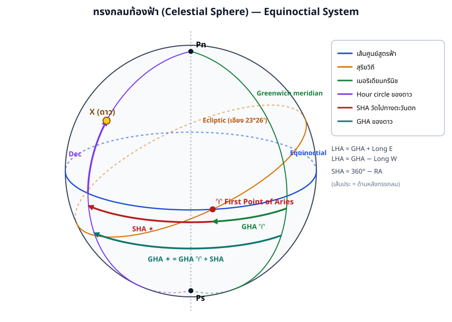
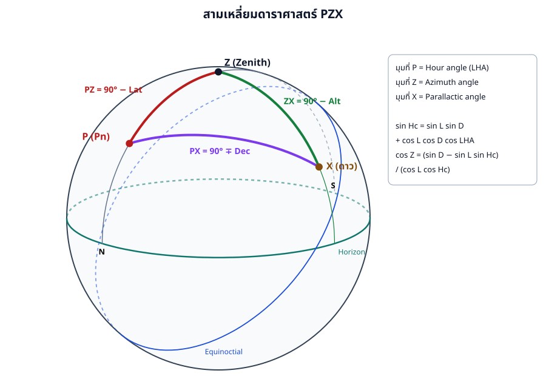
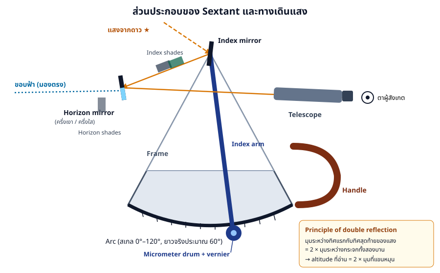
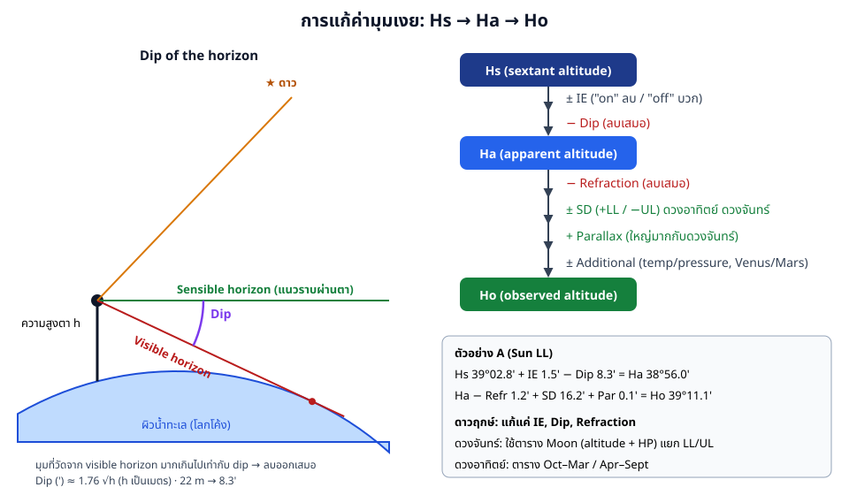
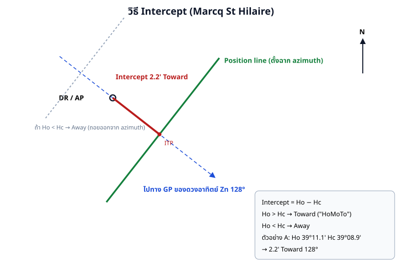
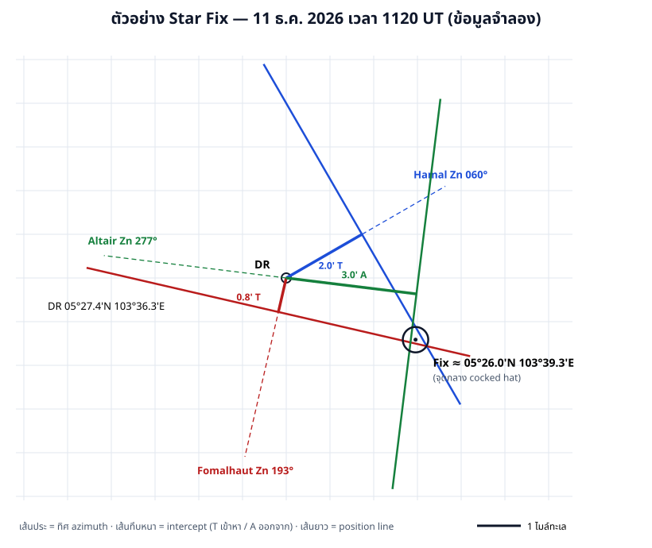

# 1.1.1 Celestial Navigation — การเดินเรือดาราศาสตร์

> สมุดบันทึกการฝึก OOW · TIRAPHONG NANTAPAN
> สมรรถนะตาม STCW A-II/1: *Ability to use celestial bodies to determine the ship's position*
> อ้างอิงหลัก: Bowditch *The American Practical Navigator* (NGA Pub. 9) บทว่าด้วย Navigational Astronomy / Sight Reduction, *Admiralty Manual of Navigation* (BR 45 Vol. 2 Astro-navigation), *The Nautical Almanac* (HMNAO/USNO; ADMIRALTY NP314), *Reed's Nautical Almanac*, NP401 Sight Reduction Tables for Marine Navigation, AP3270/NP303

---

## 0. ทำไมยุค GNSS ยังต้องเรียนดาราศาสตร์

ตอนเริ่มเรียนวิชานี้ เพื่อนหลายคนบ่นว่า "มี GPS แล้วจะยิงดาวไปทำไม" แต่พอขึ้นเรือจริงถึงเข้าใจว่า

1. **STCW ยังกำหนดเป็นสมรรถนะบังคับ** เกณฑ์การประเมินคือ "ตำแหน่งที่ได้ต้องอยู่ในความคลาดเคลื่อนของเครื่องมือและระบบที่ยอมรับได้" (within acceptable accuracy) ถ้าทำไม่ได้ก็สอบไม่ผ่าน
2. **GNSS ถูกรบกวนได้จริง** — การรบกวนสัญญาณ (jamming) และการปลอมสัญญาณ (spoofing) เกิดขึ้นบ่อยในหลายภูมิภาคช่วงหลายปีที่ผ่านมา (เช่น ทะเลดำ ทะเลบอลติก ตะวันออกกลาง และบางช่วงในเอเชีย) การหาตำแหน่งด้วยดาวไม่ใช้สัญญาณวิทยุใด ๆ จึงเป็นวิธีที่ "ไม่มีใครรบกวนได้"
3. **ใช้หาความคลาดเคลื่อนของเข็มทิศ** (compass error) ด้วย azimuth และ amplitude ซึ่งยังทำกันทุกวันบนเรือ (ดูบท 1.1.5)
4. **เป็นการตรวจสอบอิสระ** (independent cross-check) ของ GNSS ในทะเลเปิดที่ไม่มีเครื่องหมายบนฝั่งให้ใช้
5. **คำถามสอบปากเปล่า** ชอบถามเรื่องสามเหลี่ยม PZX, intercept, noon sight และ sextant error

---

## 1. ทรงกลมท้องฟ้า (The Celestial Sphere)

### 1.1 แนวคิดพื้นฐาน

นักเดินเรือสมมติว่าโลกอยู่นิ่งตรงกลาง และดาวทุกดวงติดอยู่บนผิวทรงกลมขนาดใหญ่ไม่จำกัดรัศมีที่ล้อมโลกไว้ เรียกว่า **ทรงกลมท้องฟ้า (celestial sphere)** ทรงกลมนี้ดูเหมือนหมุนจากตะวันออกไปตะวันตกวันละรอบ (ซึ่งที่จริงคือโลกหมุนจากตะวันตกไปตะวันออก)

เนื่องจากระยะห่างของดาวไกลมากเมื่อเทียบกับขนาดโลก เราจึงมองว่าแสงจากดาวที่มาถึงทุกจุดบนโลกเป็นเส้นขนานกัน (ยกเว้นดวงจันทร์ที่ใกล้โลกพอที่ต้องแก้ค่า parallax)



*ภาพที่ 1.1.1-1 ทรงกลมท้องฟ้าและพิกัดในระบบเส้นศูนย์สูตรฟ้า (equinoctial system)*

### 1.2 ส่วนประกอบของทรงกลมท้องฟ้า

| ศัพท์ | ความหมาย |
|---|---|
| Celestial poles (Pn, Ps) | ขั้วฟ้าเหนือและใต้ คือจุดที่แกนหมุนของโลกต่อออกไปตัดทรงกลมท้องฟ้า |
| Equinoctial / Celestial equator | เส้นศูนย์สูตรฟ้า — ระนาบเส้นศูนย์สูตรของโลกต่อออกไปตัดทรงกลมท้องฟ้า |
| Hour circle / Celestial meridian | วงกลมใหญ่ที่ผ่านขั้วฟ้าทั้งสอง (เทียบได้กับเส้นเมอริเดียนบนโลก) |
| Ecliptic | สุริยวิถี — เส้นทางที่ดวงอาทิตย์ดูเหมือนเคลื่อนที่ผ่านดาวพื้นหลังในรอบปี เอียงกับ equinoctial ประมาณ 23°26' (obliquity of the ecliptic) |
| First Point of Aries (♈) | จุดวสันตวิษุวัต (vernal equinox) จุดที่ดวงอาทิตย์เคลื่อนข้าม equinoctial จากใต้ขึ้นเหนือ ประมาณ 20–21 มีนาคม ใช้เป็นจุดอ้างอิงพิกัดดาวฤกษ์ |
| First Point of Libra (♎) | จุดศารทวิษุวัต (autumnal equinox) ประมาณ 22–23 กันยายน |
| Solstices | จุดที่ดวงอาทิตย์ไปไกลที่สุดทางเหนือ (≈21 มิ.ย., Dec N23°26') และใต้ (≈21–22 ธ.ค., Dec S23°26') |

### 1.3 ระบบพิกัดเส้นศูนย์สูตรฟ้า (Equinoctial coordinates)

ระบุตำแหน่งของดาวบนทรงกลมท้องฟ้า เทียบได้กับละติจูด/ลองจิจูดบนโลก

- **Declination (Dec)** — มุมวัดจาก equinoctial ไปตาม hour circle ของดาว ถึงตัวดาว วัดเป็นองศา 0°–90° เหนือ (N) หรือใต้ (S) — เทียบกับ "ละติจูด" ของดาว
- **Greenwich Hour Angle (GHA)** — มุมวัดไปทางตะวันตก จากเมอริเดียนกรีนิชบนท้องฟ้า (celestial meridian of Greenwich) ไปยัง hour circle ของดาว 0°–360° — เทียบกับ "ลองจิจูดแบบวัดไปทางตะวันตก" ของดาว และเปลี่ยนตลอดเวลาประมาณ 15° ต่อชั่วโมง
- **Local Hour Angle (LHA)** — มุมวัดไปทางตะวันตกจากเมอริเดียนของผู้สังเกต ไปยัง hour circle ของดาว
  - **LHA = GHA + ลองจิจูดตะวันออก** หรือ **LHA = GHA − ลองจิจูดตะวันตก** (ถ้าเกิน 360° ลบ 360°, ถ้าติดลบบวก 360°)
  - วลีช่วยจำที่ครูสอนกันมาคือ **"Longitude east, Greenwich least; longitude west, Greenwich best"** ใช้ได้ทั้งกับเวลาและมุมชั่วโมง ถ้าผู้สังเกตอยู่ลองจิจูดตะวันออก ค่าของกรีนิช (GHA หรือ GMT) จะน้อยกว่าค่าท้องถิ่น (LHA หรือ LMT) ถ้าอยู่ลองจิจูดตะวันตก ค่าของกรีนิชจะมากกว่า
- **Sidereal Hour Angle (SHA)** — มุมวัดไปทางตะวันตกจาก First Point of Aries ไปยัง hour circle ของดาว ใช้กับดาวฤกษ์เพราะค่าเปลี่ยนช้ามาก (Nautical Almanac จึงให้ SHA และ Dec ของดาวฤกษ์ 57 ดวงไว้เป็นค่าคงที่ตลอด 3 วัน)
  - **GHA ดาวฤกษ์ = GHA Aries + SHA ดาว**
- **Right Ascension (RA)** — มุมวัดไปทาง *ตะวันออก* จาก Aries มักวัดเป็นชั่วโมง (0–24h) นักดาราศาสตร์ใช้ ส่วนนักเดินเรือใช้ SHA: **SHA = 360° − RA (แปลงเป็นองศา)**

### 1.4 ระบบพิกัดขอบฟ้า (Horizon system)

ระบุตำแหน่งดาวเทียบกับผู้สังเกต ณ จุดหนึ่ง

| ศัพท์ | ความหมาย |
|---|---|
| Zenith (Z) | จุดเหนือศีรษะผู้สังเกตบนทรงกลมท้องฟ้า |
| Nadir | จุดตรงข้าม zenith ใต้เท้า |
| Rational / Celestial horizon | วงกลมใหญ่ที่ห่างจาก zenith 90° ระนาบผ่านจุดศูนย์กลางโลก |
| Sensible horizon | ระนาบขนานกับ rational horizon แต่ผ่านตาผู้สังเกต |
| Visible / Sea horizon | เส้นขอบฟ้าที่มองเห็นจริง อยู่ต่ำกว่า sensible horizon เพราะตาผู้สังเกตอยู่สูง (ทำให้เกิด dip) |
| Altitude (h) | มุมวัดจากขอบฟ้าขึ้นไปถึงดาวตามวงกลมดิ่ง (vertical circle) 0°–90° |
| Zenith distance (z) | 90° − altitude |
| Azimuth (Z, Zn) | มุมทิศของดาว วัดตามขอบฟ้าจากทิศเหนือ (Zn วัด 000°–360° ตามเข็มนาฬิกา) |
| Observer's meridian | เมอริเดียนบนท้องฟ้าที่ผ่าน zenith และขั้วฟ้า |
| Prime vertical | วงกลมดิ่งที่ผ่านจุดทิศตะวันออกและตะวันตก |

> **ความสัมพันธ์สำคัญที่ต้องจำให้ขึ้นใจ**
> 1. **Declination ของ zenith = ละติจูดของผู้สังเกต**
> 2. **มุมเงยของขั้วฟ้าที่อยู่ด้านเดียวกับผู้สังเกต (elevated pole) = ละติจูดของผู้สังเกต** — นี่คือเหตุผลที่ดาวเหนือ (Polaris) ใช้หาละติจูดได้
> 3. **Geographical Position (GP)** ของดาว คือจุดบนผิวโลกที่ดาวอยู่เหนือศีรษะพอดี มีละติจูด = Dec ของดาว และลองจิจูด = GHA (ถ้า GHA < 180° เป็นลองจิจูดตะวันตก, ถ้า > 180° ลองจิจูดตะวันออก = 360° − GHA)

### 1.5 สามเหลี่ยมดาราศาสตร์ (Astronomical / PZX Triangle)

นี่คือหัวใจของการคำนวณทั้งหมด เป็นสามเหลี่ยมทรงกลม (spherical triangle) บนทรงกลมท้องฟ้า มีมุมยอด 3 จุด

- **P** = ขั้วฟ้าด้านเดียวกับผู้สังเกต (elevated pole)
- **Z** = zenith ของผู้สังเกต
- **X** = ดาว



*ภาพที่ 1.1.1-2 สามเหลี่ยม PZX — ด้านและมุมที่ใช้ในการคำนวณ*

| ส่วนของสามเหลี่ยม | ค่า |
|---|---|
| ด้าน PZ | co-latitude = 90° − Lat |
| ด้าน PX | polar distance = 90° ∓ Dec (90° − Dec ถ้าชื่อเดียวกับละติจูด, 90° + Dec ถ้าชื่อต่างกัน) |
| ด้าน ZX | zenith distance = 90° − altitude |
| มุมที่ P | LHA (หรือ 360° − LHA) เรียกว่ามุมชั่วโมง (hour angle) ฝั่งตะวันออก/ตะวันตก |
| มุมที่ Z | azimuth angle (Z) |
| มุมที่ X | parallactic angle (ไม่ค่อยใช้ในการเดินเรือ) |

ถ้ารู้ 3 ค่า (ละติจูด, Dec, LHA) ก็คำนวณ altitude และ azimuth ได้ด้วยสูตรตรีโกณมิติทรงกลม (spherical trigonometry)

**สูตรหลัก (cosine formula)**

```
sin Hc = sin L · sin D + cos L · cos D · cos LHA
```

วิธีที่ไม่ต้องจำกฎชื่อ คือใส่เครื่องหมายให้ทั้งละติจูดและ Dec: **เหนือเป็นบวก ใต้เป็นลบ** (ผลเท่ากับการให้ D เป็นลบเมื่อชื่อต่างจากละติจูด)

**สูตรหามุม azimuth**

```
cos Z = (sin D − sin L · sin Hc) / (cos L · cos Hc)
```

ค่า Z ที่ได้จากสูตรนี้ (เมื่อใส่ L และ D แบบมีเครื่องหมาย) คือมุมวัดจากทิศเหนือ 0°–180° แล้วแปลงเป็น Zn: ถ้า LHA > 180° (ดาวอยู่ฝั่งตะวันออก) **Zn = Z** ; ถ้า LHA < 180° (ดาวอยู่ฝั่งตะวันตก) **Zn = 360° − Z** ใช้ได้ทั้งซีกโลกเหนือและใต้ (ถ้าใช้ตาราง sight reduction อย่าง NP401 ให้ใช้กฎแปลง Z เป็น Zn ที่พิมพ์อยู่มุมหน้าตาราง ซึ่งแยกตามซีกโลก)

สำหรับ azimuth ยังมีสูตรแบบ **ABC tables** ที่ใช้กันมากในหลักสูตรอังกฤษ

```
A = tan L / tan LHA        (named opposite to latitude, except when LHA between 90° and 270°)
B = tan D / sin LHA        (named same as declination)
C = A ± B                  (same names add, different names subtract; named as the larger)
tan Az = 1 / (C · cos L)   azimuth named C and E/W according to LHA
```

---

## 2. เวลา (Time)

ความแม่นยำของเวลาสำคัญมาก เพราะ **โลกหมุน 15' ของลองจิจูดต่อเวลา 1 นาที หรือ 1' ต่อ 4 วินาที** ถ้าจับเวลาผิด 4 วินาที ตำแหน่งตามลองจิจูดจะผิดไป 1 ลิปดาลองจิจูด (ที่เส้นศูนย์สูตรคือเกือบ 1 ไมล์ทะเล)

### 2.1 ตารางแปลง arc กับ time

| เวลา | มุม (arc) |
|---|---|
| 24 ชั่วโมง | 360° |
| 1 ชั่วโมง | 15° |
| 4 นาที | 1° |
| 1 นาที | 15' |
| 4 วินาที | 1' |
| 1 วินาที | 15" (0.25') |

### 2.2 ชนิดของเวลา

- **Apparent Solar Time** — เวลาตามดวงอาทิตย์จริง เที่ยงวันคือเมื่อดวงอาทิตย์ผ่านเมอริเดียน (meridian passage) ความยาวของวันจริงไม่เท่ากันตลอดปี เพราะวงโคจรเป็นวงรีและแกนโลกเอียง
- **Mean Solar Time** — เวลาตาม "ดวงอาทิตย์สมมติ" (mean sun) ที่เคลื่อนที่สม่ำเสมอ ทำให้วันยาวเท่ากัน 24 ชั่วโมง
- **Equation of Time (EqT)** — ผลต่างระหว่าง apparent กับ mean time มีค่าไม่เกินประมาณ ±16 นาที Nautical Almanac ให้ค่าไว้ในหน้า daily pages ใต้ตารางดวงอาทิตย์ พร้อมเวลา Mer. Pass. (LMT ของการผ่านเมอริเดียน)
- **Greenwich Mean Time (GMT) / Universal Time (UT)** — mean time ที่กรีนิช Nautical Almanac ใช้ UT (ในทางปฏิบัติของการเดินเรือ ใช้ UTC ที่ได้จากสัญญาณเวลาหรือ GNSS ได้เลย เพราะต่างกันไม่เกิน 0.9 วินาที)
- **Local Mean Time (LMT)** — mean time ที่เมอริเดียนของผู้สังเกต **LMT = GMT + ลองจิจูดตะวันออก (เป็นเวลา)** หรือ **− ลองจิจูดตะวันตก**
- **Zone Time (ZT)** — เวลาตามเขตเวลา แบ่งโลกเป็น 24 เขต เขตละ 15° ลองจิจูด เขต 0 อยู่ระหว่าง 7°30'W ถึง 7°30'E
- **Zone Description (ZD)** — จำนวนชั่วโมงที่ต้อง **บวก** กับ ZT เพื่อให้ได้ GMT เขตลองจิจูดตะวันออกมี ZD เป็นลบ เช่น ประเทศไทย (UTC+7) มี ZD = −7 เพราะ **GMT = ZT + ZD** → GMT = เวลาไทย − 7 ชั่วโมง
- **Standard Time** — เวลาที่ประเทศกำหนดใช้ อาจไม่ตรงกับเขตเวลาตามลองจิจูด (ดูได้จาก ADMIRALTY List of Radio Signals Vol 2 — ส่วน Legal Time)
- **International Date Line** — เส้นแบ่งวัน ประมาณตามเมอริเดียน 180° ข้ามจากตะวันออกไปตะวันตก (เดินเรือไปทางตะวันตก) วันที่ **เพิ่ม** 1 วัน ข้ามจากตะวันตกไปตะวันออก วันที่ **ลด** 1 วัน

### 2.3 Chronometer และสัญญาณเวลา

เดิมเรือใช้ chronometer (นาฬิกาเดินเรือความแม่นยำสูง) และต้องจด **chronometer error** และ **daily rate** ทุกวันโดยเทียบกับสัญญาณเวลาวิทยุ (radio time signal — รายละเอียดอยู่ใน ALRS Vol 2) ปัจจุบันส่วนใหญ่ใช้เวลาจาก GNSS (UTC) และนาฬิกาควอตซ์ แต่หลักการยังต้องรู้ ถ้า GNSS ใช้ไม่ได้ เวลาก็ต้องเชื่อถือได้ด้วยวิธีอื่น

**ตัวอย่าง:** chronometer ตอนเช้าวันที่ 1 อ่านได้ 09h 59m 50s ขณะสัญญาณเวลา 10h 00m 00s → error 10s slow ถ้า rate = 2s gaining ต่อวัน หลังจาก 3 วัน error = 10 − 6 = 4s slow

### 2.4 ตัวอย่างการแปลงเวลา

เรืออยู่ลองจิจูด 102°53'E นาฬิกาเรือใช้เวลาเขต UTC+7 (ZD −7) อ่านได้ 0914 วันที่ 11 ธันวาคม

- GMT = 0914 − 7h = **0214 UT วันที่ 11 ธันวาคม**
- ลองจิจูดเป็นเวลา: 102°53' ÷ 15 = 6h 51m 32s
- LMT = 0214 + 6h51m32s ≈ **0905:32 LMT** (สังเกตว่า LMT ต่างจาก ZT เพราะเรือไม่ได้อยู่ที่เมอริเดียนกลางเขต 105°E)

---

## 3. The Nautical Almanac

### 3.1 สิ่งพิมพ์ที่ใช้

- **The Nautical Almanac** — จัดทำร่วมกันโดย HM Nautical Almanac Office (สหราชอาณาจักร) และ US Naval Observatory พิมพ์ปีละเล่ม (ฉบับ UKHO คือ NP314)
- **Reed's Nautical Almanac** — ปฏิทินของเชิงพาณิชย์ มีข้อมูลดาราศาสตร์รวมกับข้อมูลชายฝั่งยุโรป (นิยมในเรือเล็กและเรือยอทช์)
- โปรแกรมคอมพิวเตอร์ เช่น **NavPac (DP330)** ของ HMNAO ที่ UKHO จำหน่าย (ฉบับปัจจุบันครอบคลุมปี 2026–2030) หรือโปรแกรมใน ECDIS/เครื่องคิดเลขเดินเรือ ใช้ได้ถ้าได้รับการยอมรับ แต่ต้องทำมือเป็นด้วย

### 3.2 โครงสร้างของ Nautical Almanac

| ส่วน | เนื้อหา |
|---|---|
| หน้าแรกและปกใน (inside front cover) | ตาราง **Altitude Correction Tables** สำหรับดวงอาทิตย์ ดาวฤกษ์ และดาวเคราะห์ (ช่วงความสูง 10°–90°) และตาราง Dip |
| หน้า A2–A4 | ตารางแก้ค่าที่ altitude ต่ำ 0°–10°, ตารางแก้ค่าสำหรับอุณหภูมิและความกดอากาศผิดปกติ (ละเอียดคือ A2 = ตาราง 10°–90° และ Dip ในปกหน้าตามแถวบน, A3 = ตาราง altitude ต่ำ 0°–10°, A4 = additional corrections สำหรับอุณหภูมิ/ความกดผิดปกติ) |
| Daily pages (หน้าซ้าย) | ข้อมูลรายชั่วโมงสำหรับ 3 วัน: GHA Aries, GHA และ Dec ของดาวเคราะห์ 4 ดวงที่ใช้เดินเรือ (Venus, Mars, Jupiter, Saturn) พร้อมค่า v และ d, SHA และ Dec ของดาวฤกษ์ 57 ดวง |
| Daily pages (หน้าขวา) | GHA และ Dec ของดวงอาทิตย์และดวงจันทร์รายชั่วโมง (ดวงจันทร์มี v, d, HP), เวลาขึ้น-ตก ของดวงอาทิตย์และดวงจันทร์, twilight, Equation of Time, Mer. Pass., อายุและเฟสดวงจันทร์ |
| ปกหลังด้านใน (inside back cover) | ตาราง Altitude Correction ของ **ดวงจันทร์** (ส่วนบนเข้าด้วย apparent altitude ส่วนล่างเข้าด้วย HP แยก L/U) — ตรวจตำแหน่งหน้ากับฉบับที่ใช้ |
| Increments and Corrections (หน้าสีเหลือง) | ตารางเพิ่มค่า GHA สำหรับนาทีและวินาที แยกคอลัมน์ Sun & Planets, Aries, Moon และตาราง v/d corrections |
| Polaris Tables | ตาราง a0, a1, a2 สำหรับหาละติจูด และตาราง azimuth ของ Polaris |
| Star charts และรายการดาว 173 ดวง | ช่วยระบุดาว |
| Sight Reduction Procedures และ Concise Sight Reduction Tables | วิธีลดค่าการสังเกตด้วยสูตรและตารางย่อในเล่ม |

### 3.3 ตัวอย่างการดึงค่าจาก Almanac (ข้อมูลจำลอง)

หา GHA และ Dec ของดวงอาทิตย์ เวลา **02h 14m 36s UT วันที่ 11 ธันวาคม 2026**

| รายการ | ค่า | ที่มา |
|---|---|---|
| GHA ดวงอาทิตย์ ที่ 02h | 211°44.4' | Daily page |
| Increment 14m 36s | +3°39.0' | Increments table (Sun/Planets) — 14m36s × 15°/h |
| **GHA ที่เวลาสังเกต** | **215°23.4'** | |
| Dec ที่ 02h | S22°59.1' | Daily page (ค่า d = 0.2 เพิ่มขึ้น) |
| d correction | +0.0' | 0.2 × 14.6/60 ≈ 0.05' ปัดทิ้ง |
| **Dec ที่เวลาสังเกต** | **S22°59.1'** | |
| SD ดวงอาทิตย์ | 16.2' | ท้ายคอลัมน์ดวงอาทิตย์ |

(ค่าข้างบนคำนวณจากสูตรตำแหน่งดวงอาทิตย์ความแม่นยำสูง ใช้เพื่อฝึกทำโจทย์ ไม่ได้คัดลอกจาก Nautical Almanac ฉบับจริง ค่าจริงอาจต่างไปหลักทศนิยม)

> **ตรวจทาน ต.ค. 2026:** คำนวณซ้ำด้วย ephemeris ความแม่นยำสูง (VSOP87 ผ่าน PyEphem) โดยใช้ GHA = Greenwich *apparent* sidereal time − apparent RA ตามแบบที่ Nautical Almanac ใช้ ได้ GHA ดวงอาทิตย์ 02h = 211°44.4' (ร่างแรกเขียน 211°44.2' — ต่างไป 0.2' เพราะไม่ได้รวม equation of the equinoxes ซึ่งปลายปี 2026 มีค่าราว 0.15') จึงแก้ค่าในตารางและในตัวอย่าง A ให้ตรงกัน ส่วน Dec S22°59.1', d ≈ 0.2 และ SD 16.2' ถูกต้องแล้ว สังเกตว่าช่วงนี้ GHA ดวงอาทิตย์เพิ่มชั่วโมงละ 14°59.7' ไม่ใช่ 15°00.0' พอดี ตาราง increments ใช้อัตรา 15°/ชม. คงที่ ความต่างนี้ถูกรวมไว้ในค่ารายชั่วโมงแล้ว ผลต่างที่เหลือไม่เกิน 0.1'

**สำหรับดาวเคราะห์** ต้องบวกค่า **v correction** กับ GHA (v คืออัตราที่ GHA ของดาวเคราะห์ต่างจากอัตรามาตรฐาน 15°/h) และ **d correction** กับ Dec
**สำหรับดวงจันทร์** ใช้คอลัมน์ Moon ในตาราง increments (อัตรามาตรฐาน 14°19.0'/h) และบวก v ที่มีค่ามากกว่าดาวเคราะห์เสมอ (บวกเสมอสำหรับดวงจันทร์) นอกจากนี้ต้องใช้ **HP (horizontal parallax)** ในการแก้ค่า altitude
**สำหรับดาวฤกษ์** GHA ดาว = GHA Aries (ชั่วโมง) + increment (คอลัมน์ Aries) + SHA ดาว

---

## 4. Sextant — เครื่องวัดมุมเงย

### 4.1 หลักการทำงาน

Sextant ทำงานด้วยหลักการ **การสะท้อนสองครั้ง (principle of double reflection)**:

> เมื่อแสงสะท้อนสองครั้งในระนาบเดียวกันด้วยกระจกเงาราบสองบาน มุมระหว่างทิศทางแรกกับทิศทางสุดท้ายของแสง เท่ากับ **สองเท่า** ของมุมระหว่างกระจกทั้งสองบาน

ด้วยเหตุนี้ ส่วนโค้ง (arc) ของ sextant ซึ่งยาวจริงประมาณ 60° (หนึ่งในหกของวงกลม จึงเรียกว่า *sextant*) จึงถูกแบ่งสเกลเป็น 120° คือทุก 1° จริงบนส่วนโค้ง จะพิมพ์ไว้เป็น 2°



*ภาพที่ 1.1.1-3 ส่วนประกอบหลักของ sextant และทางเดินแสงจากดาวผ่านกระจก index และกระจก horizon เข้าสู่กล้อง*

### 4.2 ส่วนประกอบ

| ส่วนประกอบ | หน้าที่ |
|---|---|
| Frame | โครงหลัก ทำจากทองเหลืองหรืออะลูมิเนียม |
| Arc (limb) | ส่วนโค้งที่มีขีดสเกลองศา |
| Index arm | แขนหมุนรอบจุดศูนย์กลาง มีกระจก index อยู่ที่ปลายบน |
| Index mirror | กระจกเงาเต็มบาน ติดบนแขน index หมุนตามแขน |
| Horizon mirror | กระจกติดกับ frame ครึ่งหนึ่งเป็นเงา อีกครึ่งใส (แบบดั้งเดิม) หรือแบบ whole-horizon ที่เคลือบกึ่งโปร่งแสงทั้งบาน |
| Micrometer drum | หมุนปรับละเอียด อ่านเป็นลิปดา |
| Vernier | สเกลย่อยอ่านเศษส่วนของลิปดา (มักอ่านได้ 0.2') |
| Index shades / Horizon shades | แผ่นกรองแสงสีเข้ม ใช้กับดวงอาทิตย์และขอบฟ้าที่สว่างจ้า |
| Telescope | กล้องส่องช่วยขยายภาพ |
| Release clamp | ปลดล็อกให้แขน index เลื่อนได้เร็ว |
| Handle | ด้ามจับ (ถือด้วยมือขวา) |

### 4.3 ความคลาดเคลื่อนของ sextant (Sextant errors)

**ก) ความคลาดเคลื่อนที่ปรับแก้ได้ (adjustable errors)** — ต้องตรวจและปรับ **ตามลำดับนี้เสมอ**

| ลำดับ | ชื่อ | สาเหตุ | วิธีตรวจ | วิธีแก้ |
|---|---|---|---|---|
| 1 | **Error of perpendicularity** | กระจก index ไม่ตั้งฉากกับระนาบของ sextant | ตั้งแขน index ประมาณกลางส่วนโค้ง ถือ sextant แนวนอน มองเข้าไปในกระจก index จากด้านหลัง ดูว่าภาพสะท้อนของส่วนโค้งกับส่วนโค้งจริงต่อกันเป็นเส้นเดียวหรือไม่ ถ้าหักหรือเหลื่อมแสดงว่ามี error | หมุนสกรูด้านหลังกระจก index |
| 2 | **Side error** | กระจก horizon ไม่ตั้งฉากกับระนาบของ sextant | ตั้งที่ 0° มองขอบฟ้าขณะเอียง sextant หรือมองดาว ภาพจริงกับภาพสะท้อนต้องซ้อนทับกันพอดีเมื่อหมุน micrometer ไม่ใช่เลื่อนผ่านกันข้าง ๆ | หมุนสกรูของกระจก horizon ตัวที่ **อยู่ไกล** จาก frame |
| 3 | **Index error (IE)** | กระจกทั้งสองไม่ขนานกันเมื่อตั้งค่าอ่านที่ 0° | ตั้ง 0° มองขอบฟ้า ถ้าเส้นขอบฟ้าจริงกับภาพสะท้อนไม่ต่อกันเป็นเส้นเดียว แสดงว่ามี IE | หมุนสกรูของกระจก horizon ตัวที่ **อยู่ใกล้** frame หรือถ้าค่าไม่มาก ไม่ต้องปรับ วัดค่าแล้วนำไปแก้ทุกครั้ง |
| 4 | **Collimation error** | แกนกล้องไม่ขนานกับระนาบของ sextant | ตรวจด้วยการวางดาวสองดวงให้อยู่ที่ขอบต่างกันของภาพในกล้อง | sextant รุ่นใหม่ส่วนใหญ่ยึดตายตัวจากโรงงาน |

> **หมายเหตุ:** ตำแหน่งสกรูปรับ side error/index error บนกระจก horizon (บานใกล้หรือไกลจาก frame) ต่างกันได้ตามยี่ห้อและรุ่นของ sextant ให้ยึดตามคู่มือของเครื่องที่ใช้จริง

> **ทำไมต้องเรียงลำดับ:** side error และ index error ปรับที่กระจก horizon บานเดียวกัน การปรับ side error ทำให้ index error เปลี่ยน จึงต้องแก้ side error ก่อน แล้วค่อยแก้หรือวัด index error เป็นอย่างสุดท้าย ส่วน perpendicularity ต้องแก้เป็นอย่างแรกเพราะใช้กระจก index เป็นฐานของการตรวจอื่น

**ข) ความคลาดเคลื่อนที่ปรับแก้ไม่ได้ (non-adjustable errors)** — เกิดจากการผลิต บันทึกไว้ในใบรับรองที่ติดในกล่อง sextant

- **Centring error** — จุดหมุนของแขน index ไม่ตรงกับจุดศูนย์กลางของส่วนโค้ง
- **Graduation error** — ขีดสเกลบนส่วนโค้ง/drum ไม่แม่นยำ
- **Prismatic error** — ผิวกระจกหรือแผ่นกรองแสงสองด้านไม่ขนานกัน
- **Shade error** — แผ่นกรองแสงทำให้เกิดการหักเหแสง

### 4.4 การหาค่า Index Error

**วิธีที่ 1: ใช้ขอบฟ้า (horizon)**

ตั้ง sextant ประมาณ 0° มองขอบฟ้า หมุน micrometer จนเส้นขอบฟ้าจริงและเส้นขอบฟ้าสะท้อนต่อกันเป็นเส้นตรงเส้นเดียว อ่านค่า

- ถ้าอ่านได้ค่ามากกว่า 0 (อ่านบนส่วนโค้ง – **on the arc**) → IE ต้อง **ลบ** ออกจากค่าที่วัดได้
- ถ้าอ่านได้ค่าน้อยกว่า 0 (อ่านนอกส่วนโค้ง – **off the arc** เช่น ขีด index เลย 0° ไปด้าน off the arc แล้ว drum อ่านได้ 58.5' แปลว่า −1° + 58.5' = −1.5' — ระวังอย่าอ่านเป็น 0°58.5') → IE ต้อง **บวก**
- วลีจำ: **"If it's on, take it off; if it's off, put it on."**

**วิธีที่ 2: ใช้ดวงอาทิตย์ (sun)** — แม่นยำกว่า และตรวจสอบตัวเองได้

1. ใส่แผ่นกรองแสงให้พอดี ตั้งประมาณ +32' (on the arc) ให้ขอบบนของภาพสะท้อนแตะขอบล่างของภาพจริง อ่านค่า R1
2. ตั้งประมาณ −32' (off the arc) ให้ขอบล่างของภาพสะท้อนแตะขอบบนของภาพจริง อ่านค่า R2 (ค่าที่อ่านนอกส่วนโค้ง)
3. **IE = (R1 − R2) / 2** — ถ้าผลเป็นบวก แปลว่า error on the arc (ต้องลบ), ถ้าเป็นลบ แปลว่า off the arc (ต้องบวก)
4. ตรวจสอบ: **(R1 + R2) / 4 ต้องเท่ากับ SD ของดวงอาทิตย์** ในวันนั้น (จาก Almanac) ถ้าไม่ใกล้เคียง แปลว่าอ่านผิดหรือวัดไม่ดี

**ตัวอย่าง:** R1 = 31.0' on the arc, R2 = 34.0' off the arc
IE = (31.0 − 34.0)/2 = −1.5' → แปลว่า 1.5' off the arc → **IE correction = +1.5'**
ตรวจ: (31.0 + 34.0)/4 = 16.25' ≈ SD 16.2' ✓

### 4.5 วิธียิงดาว (Taking a sight)

**ดวงอาทิตย์**
1. ใส่ shade ที่เหมาะสมทั้งด้าน index และ horizon (อย่ามองดวงอาทิตย์โดยไม่มี shade เด็ดขาด — ทำลายจอประสาทตาได้)
2. ตั้ง sextant ประมาณ 0° เล็งไปที่ดวงอาทิตย์ แล้วค่อย ๆ ดันแขน index ออกพร้อมเลื่อน sextant ลงจนภาพดวงอาทิตย์ลงมาถึงขอบฟ้า
3. **แกว่ง sextant (rock / swing the arc)** — หมุนข้อมือเล็กน้อยรอบแนวสายตา ดวงอาทิตย์จะแกว่งเป็นส่วนโค้ง จุดต่ำสุดของการแกว่งคือตอนที่ sextant ตั้งดิ่งพอดี
4. หมุน micrometer ให้ **ขอบล่าง (lower limb)** แตะขอบฟ้าพอดี ณ จุดต่ำสุดของการแกว่ง
5. ตะโกน "Stop!" หรือกดจับเวลา แล้วจดเวลา UT ถึงวินาที อ่านค่า Hs
6. ถ้าขอบล่างมองไม่ชัด (เช่นมีเมฆบัง) อาจยิงขอบบน (upper limb) แล้วแก้ค่า SD เป็นลบ

**ดาวฤกษ์และดาวเคราะห์**
- ยิงช่วงสนธยา (twilight) ที่ยังเห็นขอบฟ้าและเห็นดาว
- คำนวณล่วงหน้า (precompute) ค่า Hc และ Zn ของดาวที่เลือก แล้วตั้ง sextant ไว้ที่ Hc มองไปทาง Zn ดาวจะอยู่ใกล้ขอบฟ้าในกล้องพอดี
- หรือใช้วิธีกลับหัว sextant มองดาวโดยตรง แล้วดึงขอบฟ้าขึ้นมาหาดาว แล้วพลิกกลับ
- เวลาดาวสัมผัสขอบฟ้า ตัวดาวเป็นจุดเล็ก ไม่มี limb ไม่ต้องแก้ SD

**การดูแลรักษา sextant**
- เก็บในกล่องเสมอเมื่อไม่ใช้ ห้ามจับที่แขน index หรือส่วนโค้ง ให้จับที่ frame หรือ handle
- เช็ดกระจกด้วยกระดาษเช็ดเลนส์ ห้ามใช้ผ้าหยาบ
- ไม่วางทิ้งกลางแดดหรือในที่ที่อาจตกหล่น
- ทาน้ำมันส่วนโค้งและเฟืองเป็นระยะตามคู่มือ

---

## 5. การแก้ค่ามุมเงย (Altitude Corrections)

จากค่าที่อ่านบน sextant (**Hs – sextant altitude**) ต้องแก้หลายขั้นจนได้ **Ho – observed (true) altitude** ซึ่งเป็นมุมเงยของจุดศูนย์กลางดาว วัดจาก rational horizon ที่ศูนย์กลางโลก



*ภาพที่ 1.1.1-4 ลำดับการแก้ค่ามุมเงย และทิศทางของแต่ละค่าแก้*

### 5.1 ลำดับการแก้

```
Hs  (sextant altitude)
 ± IE        (index error)
 −  Dip      (ความสูงของตาผู้สังเกต)
= Ha  (apparent altitude)
 −  Refraction           (การหักเหของแสงในบรรยากาศ)
 ±  Semi-diameter (SD)   (+ lower limb, − upper limb)
 +  Parallax             (สำคัญมากกับดวงจันทร์)
 ±  Additional corrections (อุณหภูมิ/ความกดผิดปกติ, ดาวเคราะห์บางดวง)
= Ho  (observed altitude)
```

### 5.2 รายละเอียดแต่ละค่า

**Dip of the horizon** — เพราะตาผู้สังเกตอยู่สูงกว่าระดับน้ำทะเล เส้นขอบฟ้าที่มองเห็นจึงต่ำกว่าแนวราบที่ผ่านตา (sensible horizon) ทำให้มุมที่วัดได้ **มากเกินจริง ต้องลบเสมอ**

```
Dip (ลิปดา) ≈ 1.76 × √h     (h = ความสูงของตา เป็นเมตร)
```

ตัวอย่าง: h = 22 m → dip = 1.76 × 4.69 = **8.3'**

> Dip ได้รับผลจากการหักเหของแสงใกล้ผิวน้ำ ถ้าอุณหภูมิอากาศกับน้ำทะเลต่างกันมาก (เช่นอากาศร้อนเหนือน้ำเย็น) ค่า dip จริงอาจต่างจากตารางได้หลายลิปดา นี่คือแหล่ง error ที่ซ่อนอยู่บ่อย

**Refraction** — แสงจากดาวหักเหลงเมื่อผ่านบรรยากาศ ทำให้ดาวดูสูงกว่าจริง **ต้องลบเสมอ** ค่ามากที่ altitude ต่ำ

| Apparent altitude | Refraction โดยประมาณ |
|---|---|
| 0° (ขอบฟ้า) | ≈ 34' |
| 5° | ≈ 9.9' |
| 10° | ≈ 5.3' |
| 20° | ≈ 2.7' |
| 30° | ≈ 1.7' |
| 45° | ≈ 1.0' |
| 60° | ≈ 0.6' |
| 90° | 0' |

ด้วยเหตุนี้ จึงหลีกเลี่ยงการยิงดาวที่ altitude ต่ำกว่าประมาณ 15° (ค่า refraction แปรปรวนสูงตามอุณหภูมิและความกดอากาศ) — ถ้าจำเป็นต้องใช้ ให้ใช้ตาราง A2–A4 และตาราง additional correction สำหรับอุณหภูมิ/ความกด (ตาราง altitude ต่ำ 0°–10° คือหน้า A3 และ additional correction คือหน้า A4)

> ค่าในตาราง refraction ข้างบนตรวจซ้ำด้วยสูตรที่ Nautical Almanac ใช้ (Bennett) R ≈ cot(Ha + 7.31/(Ha + 4.4)) ลิปดา ที่ 10°C 1010 hPa ได้ 34.5', 9.9', 5.4', 2.7', 1.7', 1.0', 0.6' ตามลำดับ (ที่ 10° ตาราง NA พิมพ์ 5.3'–5.4' ขึ้นกับช่วงของตาราง)

**Semi-diameter (SD)** — ดวงอาทิตย์และดวงจันทร์มีขนาดเชิงมุม เรายิงขอบ (limb) แต่ต้องการจุดศูนย์กลาง
- Lower limb (ขอบล่าง) → **บวก SD**
- Upper limb (ขอบบน) → **ลบ SD**
- SD ดวงอาทิตย์ ประมาณ 15.8' (ต้นกรกฎาคม โลกอยู่ไกลดวงอาทิตย์ – aphelion) ถึง 16.3' (ต้นมกราคม – perihelion)
- SD ดวงจันทร์ ประมาณ 14.7'–16.8' แปรตามระยะห่าง

**Parallax** — มุมต่างระหว่างการมองดาวจากผิวโลกกับจากศูนย์กลางโลก ทำให้ดาวดู **ต่ำกว่า** จริง จึงต้อง **บวก**
- ดวงอาทิตย์: ประมาณ 0.15' × cos h (เล็กมาก)
- ดวงจันทร์: Horizontal Parallax (HP) 54'–61' **ใหญ่มาก** ต้องใช้ตาราง Moon correction ใน Almanac ที่รวม refraction, SD, parallax และ augmentation ไว้แล้ว
- ดาวฤกษ์: ไกลมากจน parallax = 0
- Venus และ Mars: มี additional correction เล็กน้อยในตาราง

**Additional correction (non-standard conditions)** — ตาราง refraction มาตรฐานอิงที่ 10°C และ 1010 hPa ถ้าอุณหภูมิและความกดต่างไปมาก โดยเฉพาะที่ altitude ต่ำ ต้องแก้เพิ่มด้วยตาราง A4

### 5.3 ตารางใน Nautical Almanac

- **Sun:** คอลัมน์แยก Oct–Mar และ Apr–Sept (เพราะ SD ต่างกัน) แยก Lower Limb / Upper Limb — ค่าที่ได้คือ refraction + SD + parallax รวมกันเป็น "main correction"
- **Stars and Planets:** ค่าเป็นลบ (refraction อย่างเดียว) และมี additional correction สำหรับ Venus/Mars
- **Moon:** ตารางสองส่วน ส่วนบนใช้ altitude, ส่วนล่างใช้ HP แยก L/U
- **Dip:** ตารางแยกตามความสูงของตา

---

## 6. เส้นตำแหน่งจากดาว (Celestial Position Line)

### 6.1 Circle of Equal Altitude

ที่ GP ของดาว ผู้สังเกตเห็นดาวอยู่ที่ zenith (altitude 90°) ถ้าเดินออกห่าง GP ไปทางไหนก็ตาม altitude ของดาวจะลดลง ผู้สังเกตทุกคนที่อยู่บน **วงกลมรอบ GP ที่มีรัศมีเท่ากับ zenith distance** จะวัด altitude ได้เท่ากัน วงกลมนี้เรียกว่า **circle of equal altitude** หรือ **position circle**

- รัศมี (เป็นไมล์ทะเล) = zenith distance (เป็นลิปดา) = (90° − Ho) × 60
- เช่น Ho = 39°11.1' → ZD = 50°48.9' = 3,048.9 ไมล์ — วงกลมใหญ่มาก
- เพราะวงกลมใหญ่มาก ส่วนโค้งเล็ก ๆ ใกล้ตำแหน่งเรือจึงถือว่าเป็น **เส้นตรง** ได้ และเส้นนี้ **ตั้งฉากกับทิศ azimuth ของดาว** — นี่คือ **position line (LOP)**

### 6.2 วิธี Intercept (Marcq St. Hilaire method)

วิธีหลักที่ใช้กันทั่วโลก คิดค้นโดย Adolphe-Laurent-Anatole Marcq de Blond de Saint-Hilaire ปี 1875

แนวคิด: คำนวณว่า "ถ้าเรืออยู่ที่ตำแหน่ง DR (หรือ AP) จะต้องวัด altitude ได้เท่าไร" → ได้ **Hc (calculated altitude)** เทียบกับ **Ho (observed altitude)** ที่วัดได้จริง

- **Intercept = Ho − Hc** (เป็นลิปดา = ไมล์ทะเล)
- ถ้า Ho > Hc → เรือ **ใกล้** GP มากกว่าตำแหน่ง DR → intercept **Toward** (เข้าหา azimuth)
- ถ้า Ho < Hc → เรือ **ไกล** GP มากกว่า → intercept **Away** (ออกจาก azimuth)
- วลีจำ: **"HoMoTo" — Ho More, Toward** หรือ **"Computed Greater Away" (CGA)**



*ภาพที่ 1.1.1-5 การ plot position line ด้วยวิธี intercept: ลากเส้น azimuth จาก DR วัด intercept ไปทาง toward/away แล้วลากเส้นตั้งฉาก*

**ขั้นตอนการ plot**
1. จุดตำแหน่ง DR (หรือ AP) บนแผนที่หรือ plotting sheet
2. ลากเส้นจาก DR ไปตามทิศ Zn ของดาว
3. วัดระยะ intercept จาก DR ไปทาง Zn (ถ้า Toward) หรือทางตรงข้าม (ถ้า Away) → ได้จุด **intercept terminal point (ITP)**
4. ลากเส้นผ่าน ITP **ตั้งฉาก** กับเส้น azimuth → นี่คือ position line เรืออยู่ที่ไหนสักแห่งบนเส้นนี้
5. ต้องมีอย่างน้อย 2 เส้น (ที่ตัดกันด้วยมุมดี) จึงได้ fix

### 6.3 Assumed Position (AP) กับ DR

- ถ้าคำนวณด้วยสูตรหรือเครื่องคิดเลข → ใช้ DR ได้เลย
- ถ้าใช้ตาราง sight reduction (NP401, AP3270) ซึ่งทำไว้เฉพาะละติจูดและ LHA เป็นองศาเต็ม → ต้องเลือก **AP** ที่ละติจูดเป็นองศาเต็มใกล้ DR และลองจิจูดที่ทำให้ LHA เป็นองศาเต็ม แล้ว plot จาก AP แทน (intercept จะยาวกว่าแต่ผลถูกต้องเหมือนกัน)

### 6.4 วิธี Sight Reduction ที่ใช้ได้

| วิธี | รายละเอียด |
|---|---|
| สูตรตรีโกณมิติ + เครื่องคิดเลขวิทยาศาสตร์ | ใช้สูตร sin Hc และ cos Z ตามข้อ 1.5 ใช้ DR ได้ตรง ๆ นิยมในการสอบของหลายประเทศ |
| NP401 / Pub. No. 229 *Sight Reduction Tables for Marine Navigation* | 6 เล่ม แบ่งตามช่วงละติจูด 15° เข้าตารางด้วย Lat (AP), LHA และ Dec (เต็มองศา) แล้ว interpolate Dec ด้วยค่า d ความแม่นยำ 0.1' |
| AP3270 / NP303 *Sight Reduction Tables for Air Navigation* (Pub. No. 249) — UKHO จำหน่าย NP303 ภายใต้ชื่อ *Rapid Sight Reduction Tables for Navigation* | Vol 1 สำหรับดาวฤกษ์ที่เลือกไว้ (ต้องเปลี่ยน epoch ทุก 5 ปี), Vol 2 (Lat 0°–39°) และ Vol 3 (Lat 40°–89°) สำหรับ Dec 0°–29° เร็วแต่ละเอียดน้อยกว่า (1') |
| Concise Sight Reduction Tables | อยู่ใน Nautical Almanac เอง ใช้ได้เมื่อไม่มีตารางอื่น |
| ซอฟต์แวร์/โปรแกรมคำนวณ | เช่น NavPac (DP330) ต้องตรวจความถูกต้องของข้อมูลที่ป้อน |

### 6.5 วิธีอื่นที่ควรรู้

- **Longitude by chronometer (Sumner line)** — สมมติละติจูด แล้วคำนวณ LHA จากสูตร หาลองจิจูดที่ทำให้ altitude เท่าที่วัดได้ ได้จุดหนึ่งบน position line เหมาะเมื่อดาวอยู่ใกล้ prime vertical (azimuth ใกล้ 090°/270°)
- **Ex-meridian** — ยิงดาวใกล้เมอริเดียนแต่ไม่ตรง (ช่วงเวลาสั้น ๆ ก่อน/หลัง mer pass) แล้วแก้ค่าเป็น meridian altitude ด้วยตาราง ex-meridian (เช่นใน Norie's / Burton's) ใช้เมื่อยิงตอนเที่ยงพอดีไม่ได้เพราะเมฆบัง

---

## 7. ละติจูดจากมุมเงยขณะผ่านเมอริเดียน (Latitude by Meridian Altitude / Noon Sight)

### 7.1 หลักการ

เมื่อดาวผ่านเมอริเดียนของผู้สังเกต (meridian passage) ดาวจะอยู่ทิศเหนือหรือใต้พอดี (Zn = 000° หรือ 180°) และมี altitude สูงสุดของวัน สามเหลี่ยม PZX แบนลงเป็นเส้นตรงตามเมอริเดียน การคำนวณจึงง่ายมาก ไม่ต้องใช้ตรีโกณมิติ

```
Lat = ZD ± Dec       (ZD = 90° − Ho)
```

**กฎการตั้งชื่อ (naming rule)**
1. ตั้งชื่อ ZD ให้ **ตรงข้าม** กับทิศที่ดาวอยู่ (ดาวอยู่ทิศใต้ → ZD ชื่อ N; ดาวอยู่ทิศเหนือ → ZD ชื่อ S) เพราะผู้สังเกตอยู่อีกฝั่งของดาว
2. ถ้า ZD และ Dec ชื่อเดียวกัน → **Lat = ZD + Dec**
3. ถ้าชื่อต่างกัน → **Lat = ผลต่าง** ตั้งชื่อตามค่าที่มากกว่า

**กรณี lower meridian passage** (ดาวรอบขั้ว – circumpolar ผ่านเมอริเดียนด้านล่างขั้ว): Lat = Ho + Polar distance (p = 90° − Dec)

### 7.2 เวลาของ Meridian Passage

1. ดูเวลา **Mer. Pass.** ของดวงอาทิตย์จาก daily page (เป็น LMT ที่กรีนิช ใช้ได้กับทุกลองจิจูดเพราะเปลี่ยนน้อยมาก)
2. แปลงเป็น UT: **UT = LMT ± ลองจิจูดเป็นเวลา** (ลองจิจูดตะวันออก **ลบ**, ตะวันตก **บวก**) ใช้ลองจิจูด DR ตอนเที่ยง
3. แปลงเป็นเวลาเรือ (ZT) เพื่อเตรียมตัวขึ้นไปยิงก่อนเวลาประมาณ 10–15 นาที
4. เฝ้าดูดวงอาทิตย์ขึ้นเรื่อย ๆ จนหยุดขึ้น ("dips" หรือ "hangs") ค่าสูงสุดคือ meridian altitude — อย่าลืมว่าเรือที่แล่นไปทางเหนือ/ใต้เร็ว ๆ เวลาที่ altitude สูงสุดอาจไม่ตรงกับ mer pass พอดี แต่ต่างกันน้อยมากสำหรับเรือสินค้า

### 7.3 ข้อควรระวัง

- ถ้า altitude สูงมาก (> 87°–88°) ดวงอาทิตย์เคลื่อนที่ทางราบเร็วมากช่วงเที่ยง ยากที่จะหาจุดสูงสุดและแกว่ง sextant ให้ถูก — ควรใช้วิธีอื่น
- ถ้าเมฆบังตอนเที่ยงพอดี ให้ใช้ ex-meridian sight

---

## 8. ละติจูดจากดาวเหนือ (Latitude by Polaris)

ดาวเหนือ (Polaris, α Ursae Minoris) อยู่ห่างขั้วฟ้าเหนือไม่ถึง 1° (Dec ประมาณ N89°22' ในปี 2026 → polar distance ประมาณ 38') altitude ของดาวเหนือจึงเกือบเท่ากับละติจูดของผู้สังเกต (ตามความสัมพันธ์ "altitude of elevated pole = latitude") แก้ค่าเล็กน้อยด้วยตาราง Polaris ใน Almanac

```
Lat = Ho − 1° + a0 + a1 + a2
```

- **a0** — เข้าตารางด้วย LHA Aries (ค่าหลัก แก้ผลจากการที่ดาวเหนือโคจรรอบขั้วเป็นวงเล็ก ๆ)
- **a1** — เข้าตารางด้วยละติจูดโดยประมาณ (และคอลัมน์ LHA Aries)
- **a2** — เข้าตารางด้วยเดือน (แก้ผลจากการเปลี่ยนแปลงเล็กน้อยของตำแหน่งดาวในรอบปี)
- ตาราง Polaris ยังให้ **azimuth ของดาวเหนือ** ใช้หาความคลาดเคลื่อนของเข็มทิศได้ (ดูบท 1.1.5)

**ข้อจำกัด:** ใช้ได้เฉพาะซีกโลกเหนือ และที่ละติจูดต่ำ (เช่นในอ่าวไทย 5°–13°N) ดาวเหนืออยู่ต่ำมาก refraction ใหญ่และแปรปรวน เส้นขอบฟ้าด้านเหนืออาจมีหมอกควัน ทำให้แม่นยำน้อยลง

---

## 9. การยิงดาวช่วงสนธยา (Star Sights at Twilight)

### 9.1 ช่วงเวลา

| ชื่อ | ดวงอาทิตย์อยู่ใต้ขอบฟ้า | สภาพ |
|---|---|---|
| Sunset / Sunrise | ขอบบนแตะขอบฟ้า (จุดศูนย์กลาง ≈ −0°50') | — |
| Civil twilight | 6° | ขอบฟ้าชัดมาก แต่เห็นเฉพาะดาวสว่างสุดและดาวเคราะห์ |
| Nautical twilight | 12° | ขอบฟ้าเริ่มไม่ชัด เห็นดาวมาก |
| Astronomical twilight | 18° | มืดสนิท |

**ช่วงเวลาดีที่สุดในการยิงดาว** คือระหว่าง civil กับ nautical twilight — เห็นทั้งขอบฟ้าและดาว

ลำดับการยิง: โดยทั่วไป **ยิงดาวด้านตะวันออกก่อนทั้งเช้าและเย็น** — ตอนเย็นเพราะท้องฟ้าด้านตะวันออกมืดก่อน ขอบฟ้าด้านนั้นจะหายไปก่อน ส่วนตอนเช้าเพราะท้องฟ้าด้านตะวันออกสว่างก่อน ดาวด้านนั้นจะจางหายก่อน (ขณะที่ขอบฟ้าด้านตะวันออกก็ชัดขึ้นก่อนด้วย) หลักง่าย ๆ คือ "ยิงฝั่งที่กำลังจะใช้ไม่ได้ก่อน"

Nautical Almanac ให้เวลา sunrise/sunset, civil และ nautical twilight เป็น LMT สำหรับละติจูดต่าง ๆ ต้องแปลงเป็นเวลาเรือ

### 9.2 การเลือกดาว (Star selection)

- อย่างน้อย **3 ดวง** (ดีกว่าคือ 4–5 ดวง)
- **azimuth กระจายดี**: 3 ดวงห่างกันประมาณ 120°, 4 ดวงห่างกันประมาณ 90° — ช่วยลด systematic error (ถ้ามี error เท่ากันทุกเส้น เช่น dip ผิด จุดศูนย์กลางของ cocked hat ยังถูกต้อง)
- altitude ประมาณ **15°–70°** (ต่ำไป refraction แปรปรวน สูงไปยิงยาก)
- เลือกดาวที่สว่าง (magnitude น้อย) และระบุได้แน่นอน
- ใช้เครื่องมือช่วย เช่น **Star Finder and Identifier (No. 2102-D)** ตั้งแผ่นตามละติจูดและ LHA Aries จะเห็นตำแหน่ง altitude/azimuth ของดาวทั้งหมด หรือใช้ AP3270 Vol 1 ที่เลือก 7 ดวงที่ดีที่สุดไว้ให้แล้ว หรือโปรแกรมคอมพิวเตอร์

### 9.3 การระบุดาว (Star identification)

- รู้จักกลุ่มดาวหลัก: กลุ่มดาวนายพราน (Orion) → แนวเข็มขัดชี้ไปหา Sirius (ดาวฤกษ์ที่สว่างที่สุด) และ Aldebaran; กลุ่มดาวหมีใหญ่ (Ursa Major / Big Dipper) → ดาวชี้ (pointers) ชี้ไปหา Polaris; กางเขนใต้ (Crux / Southern Cross) → ชี้ไปทางขั้วฟ้าใต้; สามเหลี่ยมฤดูร้อน (Vega–Deneb–Altair)
- ถ้าไม่แน่ใจว่ายิงดาวดวงไหน ให้จด altitude และ azimuth (ด้วย compass) แล้วคำนวณย้อนกลับหา Dec และ SHA (ใช้สูตร PZX แบบย้อน) แล้วเทียบกับรายการดาวใน Almanac
- ดาวเคราะห์ไม่กะพริบ และไม่อยู่ในรายการดาวฤกษ์ (อยู่ใกล้สุริยวิถีเสมอ)

### 9.4 การ plot star fix

- ถ้ายิงหลายดวงในเวลาต่างกันเล็กน้อย ให้ปรับ position line ทั้งหมดไปที่เวลาเดียวกัน (โดยเลื่อน DR ตามเข็มและระยะทางที่แล่น) หรือใช้ DR ที่เวลาของแต่ละดวง
- เส้น 3 เส้นมักไม่ตัดกันที่จุดเดียว เกิดเป็นสามเหลี่ยม **cocked hat**
  - ถ้าสามเหลี่ยมเล็ก → ถือว่าตำแหน่งอยู่กลางสามเหลี่ยม
  - ถ้าดาวกระจายรอบตัว (azimuth ห่างกัน > 180° รวม) และสงสัยว่ามี systematic error เท่ากันทุกเส้น ใช้จุดตัดของเส้นแบ่งครึ่งมุม (bisectors) — ตำแหน่งอาจอยู่นอกสามเหลี่ยมได้ถ้าดาวอยู่ในครึ่งวงกลมเดียวกัน
  - ถ้าสามเหลี่ยมใหญ่ → ตรวจหาความผิดพลาด (คิดเลขผิด อ่านเวลา/ค่าผิด ระบุดาวผิด)

---

## 10. Running Fix ด้วยดวงอาทิตย์ (Sun-Run-Sun)

ตอนกลางวันมีแค่ดวงอาทิตย์ดวงเดียว (บางครั้งมีดวงจันทร์หรือ Venus) ได้ position line ครั้งละเส้น วิธีที่ใช้กันทุกวันในทะเลเปิดคือ

1. ยิงดวงอาทิตย์ตอนเช้า (ประมาณ 0800–0900 เมื่อ azimuth ยังอยู่ทางตะวันออก) ได้ position line เส้นที่ 1
2. **เลื่อนเส้น (transfer)** ไปตามเข็มและระยะทางที่เรือแล่น จนถึงเวลาเที่ยง
3. ยิงเที่ยง (meridian altitude) ได้ละติจูด ซึ่งเป็น position line แนวตะวันออก-ตะวันตก
4. จุดตัดของเส้นที่เลื่อนมากับเส้นละติจูดตอนเที่ยง = **noon position (running fix)**

ความแม่นยำขึ้นกับความแม่นยำของเข็มและระยะทางที่ใช้เลื่อน (กระแสน้ำที่ไม่รู้ค่าทำให้คลาดเคลื่อนได้) จึงควรบันทึกเป็น "running fix" ไม่ใช่ "fix"

ในทางกลับกัน ยิงตอนบ่าย (azimuth ทางตะวันตก) แล้วเลื่อนเส้นเที่ยงไปตัดก็ได้ (noon-run-sun)

---

## 11. ตัวอย่างจำลองแบบเต็ม (Worked Examples)

> ข้อมูลทั้งหมดเป็นข้อมูลจำลองต่อเนื่องจากตัวอย่าง passage plan แหลมฉบัง → สิงคโปร์ ในบท 1.1 วันที่ 11 ธันวาคม 2026 ค่า GHA/Dec คำนวณจากสูตรดาราศาสตร์เพื่อใช้ฝึก ไม่ได้คัดลอกจาก Almanac จริง ความสูงตา (HE) 22.0 m, IE 1.5' off the arc ใช้ทุกตัวอย่าง

### ตัวอย่าง A — Sun sight ตอนเช้า (Intercept method)

**ข้อมูล:** เวลาเรือ 0914 (ZD −7) วันที่ 11 ธ.ค. 2026 DR 07°22.0'N 102°53.0'E ยิงขอบล่างของดวงอาทิตย์ เวลา UT ที่บันทึก 02h 14m 36s, **Hs = 39°02.8'**

**ขั้นที่ 1 — แก้ค่า altitude**

| รายการ | ค่า |
|---|---|
| Hs | 39°02.8' |
| IE (off the arc) | +1.5' |
| Dip (22 m) | −8.3' |
| **Ha** | **38°56.0'** |
| Refraction | −1.2' |
| SD (lower limb) | +16.2' |
| Parallax | +0.1' |
| **Ho** | **39°11.1'** |

**ขั้นที่ 2 — หา GHA, Dec, LHA**

| รายการ | ค่า |
|---|---|
| GHA 02h | 211°44.4' |
| Increment 14m 36s | 3°39.0' |
| GHA | 215°23.4' |
| Longitude (E, บวก) | +102°53.0' |
| **LHA** | **318°16.4'** (ดวงอาทิตย์อยู่ฝั่งตะวันออกเพราะ LHA > 180°) |
| **Dec** | **S22°59.1'** |

**ขั้นที่ 3 — คำนวณ Hc** (L = +7°22.0', D = −22°59.1')

```
sin L  = 0.12822     cos L  = 0.99175
sin D  = −0.39049    cos D  = 0.92061
cos LHA = 0.74633

sin Hc = (0.12822)(−0.39049) + (0.99175)(0.92061)(0.74633)
       = −0.05007 + 0.68140
       = 0.63134
Hc = 39°08.9'
```

**ขั้นที่ 4 — คำนวณ azimuth**

```
cos Z = (sin D − sin L · sin Hc) / (cos L · cos Hc)
      = (−0.39049 − 0.12822 × 0.63134) / (0.99175 × 0.77551)
      = (−0.39049 − 0.08095) / 0.76911
      = −0.61297
Z = 127.8°   → LHA > 180° → Zn = 127.8° ≈ 128°
```

**ขั้นที่ 5 — Intercept**

Intercept = Ho − Hc = 39°11.1' − 39°08.9' = **2.2' Toward** (Ho มากกว่า → toward)

(ร่างแรกได้ Hc 39°08.8' และ intercept 2.3' เพราะใช้ GHA 02h = 211°44.2' หลังแก้ GHA ตามข้อ 3.3 แล้วได้ค่าข้างบน ตรวจด้วยการคำนวณตรงจาก ephemeris ได้ Hc = 39°08.9', Zn = 127.8° ตรงกัน)

**ผลลัพธ์:** จาก DR 07°22.0'N 102°53.0'E วัด 2.2' ไปทาง 128° แล้วลาก position line ตั้งฉาก (แนว 038°–218°)

### ตัวอย่าง B — Noon sight (Meridian altitude)

**ข้อมูล:** DR ตอนเที่ยงประมาณ 06°47'N 103°06.5'E จาก Almanac: Mer. Pass. ของดวงอาทิตย์ = 11:53 (LMT), Equation of Time ≈ 7m 00s

**เวลา mer pass**

| รายการ | ค่า |
|---|---|
| LMT Mer Pass | 11h 53m 00s |
| Longitude 103°06.5' E (DR เที่ยง) เป็นเวลา | −6h 52m 26s |
| **UT ของ mer pass** | **05h 00m 34s** |
| ZD −7 → ZT | **12h 00m** (12:00:34) เวลาเรือ (บังเอิญตรงเที่ยงพอดี เพราะเรืออยู่ทางตะวันตกของเมอริเดียนกลางเขตและ EqT ช่วยชดเชย) |

Dec ดวงอาทิตย์ที่ 0500 UT = **S22°59.7'**

**ค่าที่วัดได้:** Hs (lower limb) = **60°05.7'** ดวงอาทิตย์แบริ่งทิศ **ใต้**

| รายการ | ค่า |
|---|---|
| Hs | 60°05.7' |
| IE | +1.5' |
| Dip | −8.3' |
| Ha | 59°58.9' |
| Refraction | −0.6' |
| SD | +16.2' |
| Parallax | +0.1' |
| **Ho** | **60°14.6'** |
| ZD = 90° − Ho | 29°45.4' **N** (ดวงอาทิตย์อยู่ทิศใต้ → ZD ชื่อ N) |
| Dec | 22°59.7' **S** |
| ชื่อต่างกัน → ลบกัน | |
| **Latitude** | **06°45.7'N** |

### ตัวอย่าง C — Running fix (Sun-Run-Sun) ตอนเที่ยง

- position line ตอนเช้า (ตัวอย่าง A) เวลา 0214:36 UT
- เรือแล่นเข็ม 159° ความเร็ว 13.5 นอต ถึง 0500:34 UT = 2h 45m 58s ≈ 2h 46m → ระยะทาง ≈ 37.3 ไมล์ (13.5 × 2.766 = 37.34)
- เลื่อน DR ตอนเช้าไปตาม 159° × 37.3' → **DR ใหม่ 06°47.1'N 103°06.5'E** (d.lat 34.9'S, dep 13.4'E → d.long 13.5'E)
- เลื่อนจุด ITP ไปด้วย: จาก DR ใหม่ วัด 2.2' ไปทาง 128° (d.lat 1.35'S, dep 1.73'E) → **06°45.8'N 103°08.2'E** ลาก position line ที่เลื่อนมา (transferred LOP) แนว 038°–218° ผ่านจุดนี้
- ตัดกับละติจูดเที่ยง 06°45.7'N (เลื่อนไปตามเส้น 218° อีกราว 0.1' จึงแทบอยู่ที่ ITP) → **Running fix (noon) ≈ 06°45.7'N 103°08.2'E**
- เทียบกับ GNSS ณ เวลาเดียวกัน (สมมติ) 06°45.6'N 103°08.5'E → ต่างกันประมาณ 0.3 ไมล์ ถือว่าดีมากสำหรับ running fix
- (ร่างแรกใช้ intercept 2.3' และ UT mer pass 0500:28 จากลองจิจูด 103°08' ที่ไม่ตรงกับ DR เที่ยง 103°06.5' จึงได้ RF 103°08.3'E และต่าง GNSS 0.2 ไมล์ — แก้ให้สอดคล้องกันทั้งชุดแล้ว)

### ตัวอย่าง D — Star fix ตอนสนธยาเย็น

**ข้อมูล:** Almanac ให้ sunset ประมาณ 1749 และ civil twilight สิ้นสุดประมาณ 1815 เวลาเรือ (คำนวณสำหรับละติจูด 5.5°N) — ตรวจทาน: ค่าที่ Almanac พิมพ์เป็น **LMT** คือ sunset 1749 และ civil twilight 1810 ต้องแปลงเป็นเวลาเรือก่อน: ลองจิจูด 103°36'E = 6h 54m 25s ดังนั้น ZT = LMT − 6h 54m 25s + 7h = LMT + 5m 35s ได้ **sunset ≈ 1755 และ civil twilight สิ้นสุด ≈ 1816 เวลาเรือ** (nautical twilight 1836 LMT ≈ 1842 เวลาเรือ) เวลา 1820 ดวงอาทิตย์อยู่ใต้ขอบฟ้าราว 7° จึงอยู่ในช่วงที่ดีสำหรับยิงดาว ยิงดาว 3 ดวงเวลา **1820 เวลาเรือ = 11h 20m 00s UT** (เพื่อความง่าย สมมติว่ายิงเวลาเดียวกัน ในชีวิตจริงต่างกันเป็นนาทีและต้องปรับ)

DR = **05°27.4'N 103°36.3'E**

GHA Aries 11h = 245°10.7' + increment 20m 00s (คอลัมน์ Aries) 5°00.8' = **250°11.5'**

| ดาว | SHA | Dec | GHA ดาว | LHA | Hs | Ha (Hs+1.5−8.3) | Refr. | Ho | Hc | Zn | Intercept |
|---|---|---|---|---|---|---|---|---|---|---|---|
| Hamal | 327°49.2' | N23°35.6' | 218°00.7' | 321°37.0' | 49°01.6' | 48°54.8' | −0.9' | 48°53.9' | 48°51.9' | 060° | **2.0' T** |
| Fomalhaut | 15°12.8' | S29°28.8' | 265°24.3' | 9°00.6' | 54°08.7' | 54°01.9' | −0.7' | 54°01.2' | 54°00.4' | 193° | **0.8' T** |
| Altair | 61°58.7' | N8°56.5' | 312°10.2' | 55°46.5' | 34°41.3' | 34°34.5' | −1.4' | 34°33.1' | 34°36.1' | 277° | **3.0' A** |

(GHA ดาว = GHA Aries + SHA, ถ้าเกิน 360° ลบออก; LHA = GHA + 103°36.3'E)

> **ตรวจทาน ต.ค. 2026:** คำนวณ GHA Aries, SHA และ Dec ใหม่เป็นตำแหน่งปรากฏ (apparent place: precession + nutation + aberration) ณ 11 ธ.ค. 2026 แบบเดียวกับที่ Nautical Almanac พิมพ์ ร่างแรกใช้ GHA Aries 245°10.5' และ SHA/Dec ที่ไม่ได้แก้ nutation/aberration (Hamal 327°49.6' N23°35.4', Fomalhaut 15°13.2' S29°28.7', Altair 61°58.8' N8°56.3') ทำให้ intercept เป็น 1.8' T, 0.7' T, 3.1' A ค่าที่แก้แล้วอยู่ในตารางข้างบน Hs ที่วัดได้ใช้ค่าเดิม ตำแหน่ง fix จึงขยับเพียงราว 0.1'

**การ plot** — จาก DR ลากเส้น azimuth ทั้งสามดวง วัด intercept แล้วลาก position line ตั้งฉาก จะได้สามเหลี่ยมเล็ก ๆ ที่ตัดกันใกล้ **05°26.0'N 103°39.3'E** (มุมทั้งสามของ cocked hat อยู่ราว 05°25.8'–05°26.4'N, 103°39.2'–103°39.6'E ขนาดไม่ถึง 0.6 ไมล์ ใช้จุดกลาง)



*ภาพที่ 1.1.1-6 Plot star fix ตัวอย่าง D — ดาวสามดวงที่ azimuth กระจายดี (060°, 193°, 277°)*

### ตัวอย่าง E — Latitude by Polaris (ตอนสนธยาเย็นเดียวกัน)

- Hs = 06°03.8', IE +1.5', dip −8.3' → Ha = 05°57.0'
- Refraction ที่ altitude ประมาณ 6° (ใช้ตาราง altitude ต่ำ) ≈ −8.6' → **Ho = 05°48.4'**
- LHA Aries = 250°11.5' + 103°39.3' = 353°50.8' (ใช้ลองจิจูดจาก star fix)
- จากตาราง Polaris (ค่าจำลองที่คำนวณให้ใกล้เคียงตาราง NA ปี 2026 สำหรับ LHA Aries ราว 354°, ละติจูดราว 5°, เดือนธันวาคม): a0 = 0°36.3', a1 = +0.5', a2 = +1.1'
- **Lat = 05°48.4' − 1° + 0°36.3' + 0.5' + 1.1' = 05°26.3'N** ต่างจาก star fix (05°26.0'N) 0.3' ถือว่าสอดคล้องกัน
- (ร่างแรกใช้ a1 = a2 = 0.6' ได้ 05°25.9'N พอดีกับ fix เดิม แต่ค่าเฉลี่ย 0.6' นั้นเป็นค่ากลางของตาราง ในเดือนธันวาคม a2 สำหรับ LHA Aries ช่วงนี้มีค่าราว 1.1' และที่ละติจูดต่ำ a1 ราว 0.5' ตรวจด้วยการคำนวณตรงได้ว่า Polaris ที่ 05°26.0'N เวลานั้นควรมี Ho ≈ 05°48.2' จึงเห็นว่าความต่าง 0.2'–0.3' มาจากการวัดมุมเงยต่ำ ซึ่งตรงกับข้อสังเกตด้านล่าง)

> สังเกตว่าที่ละติจูดต่ำแบบนี้ ดาวเหนืออยู่สูงแค่ราว 6° ค่า refraction 8.6' ใหญ่และแปรปรวน ผลที่ได้ควรใช้เป็นการตรวจสอบ ไม่ใช่แหล่งหลัก

### ตัวอย่าง F — หา gyro error จาก azimuth ของดวงอาทิตย์ (ต่อจากตัวอย่าง A)

STCW A-VIII/2 Part 4-1 ให้หา compass error อย่างน้อยยามละครั้ง การยิงดวงอาทิตย์ตอนเช้าจึงทำคู่กับการวัด azimuth ได้เลย

- เวลาเดียวกับตัวอย่าง A (0214:36 UT) วัดแบริ่งดวงอาทิตย์ด้วย azimuth mirror บน gyro repeater ได้ **129.0°G** (ค่าจำลอง)
- Zn ที่คำนวณได้ (true) = 127.8°
- **Gyro error = 129.0° − 127.8° = 1.2° High** (gyro อ่านสูงกว่าจริง ต้องลบ 1.2° จากค่าที่อ่านได้ทุกค่า)
- ถ้าวัดพร้อมกันด้วย magnetic compass ได้ 128.5°C และ variation บริเวณนั้นสมมติ 0.5°W: ค่า True 127.8° น้อยกว่าค่า Compass 128.5° อยู่ 0.7° → **compass error 0.7°W** (จำว่า "compass best, error west") แล้ว deviation = compass error − variation = 0.7°W − 0.5°W = **0.2°W** (รายละเอียดการตั้งชื่อ error/deviation อยู่ในบท 1.1.5)
- เย็นวันเดียวกันตอนดวงอาทิตย์ตก (Dec ราว S23°01', ละติจูดราว 5.5°N) ตรวจซ้ำด้วย amplitude: sin A = sin 23°01' / cos 5.5° → **A = W23.1°S** → true bearing 246.9°

> ข้อควรระวัง: azimuth ใช้ได้ดีเมื่อดวงอาทิตย์อยู่ต่ำ (altitude ไม่เกินราว 30°) เพราะถ้าสูงมาก การเล็ง azimuth mirror ให้ตรงยากและแบริ่งคลาดได้มาก ตัวอย่าง A ที่ altitude ราว 39° ยังพอใช้ได้ แต่ถ้าเลือกได้ควรวัดตอนดวงอาทิตย์ต่ำกว่านี้

### ตัวอย่าง G — การแก้ค่ามุมเงยของดวงจันทร์ (ดูหลักการ)

ดวงจันทร์ต่างจากดวงอาทิตย์ตรงที่ parallax ใหญ่มาก (ใกล้เท่ากับ HP × cos altitude) Nautical Almanac จึงรวม refraction, SD (รวม augmentation) และ parallax ไว้ในตาราง Moon สองส่วน ส่วนบนเข้าด้วย Ha ส่วนล่างเข้าด้วย HP แยก L/U ตัวอย่างนี้คำนวณด้วยหลักการเพื่อให้เห็นขนาดของแต่ละค่า (ค่าที่อ่านจากตารางจริงจะใกล้เคียงกันในระดับทศนิยม)

ข้อมูลจำลอง: Ha = 30°00.0', HP = 57.0' ขอบล่าง (LL)

| รายการ | ค่า |
|---|---|
| Refraction ที่ 30° | −1.7' |
| Parallax in altitude ≈ HP × cos Ha = 57.0 × cos 30° | +49.4' |
| SD ≈ 0.2724 × HP = 15.5' + augmentation ราว 0.1' | +15.7' |
| **รวม (LL)** | **≈ +63.3'** → Ho ≈ 31°03.3' |
| ถ้ายิงขอบบน (UL) | −1.7 + 49.4 − 15.7 ≈ **+32.0'** (ในตาราง NA ทำโดยใช้ค่าส่วนล่างคอลัมน์ U แล้ว **ลบ 30'** ตามหมายเหตุของตาราง) |

> จดไว้กันลืม: dip และ IE แก้เหมือนดวงอาทิตย์ แต่ค่าแก้ของดวงจันทร์ "บวกมาก" เสมอ ถ้าเห็นว่า Ho ของดวงจันทร์ต่ำกว่า Hs ให้สงสัยว่าลืมใช้ตาราง Moon หรือใช้ HP ผิดวัน/ผิดชั่วโมง

---

## 12. แหล่งของความคลาดเคลื่อนในการเดินเรือดาราศาสตร์

| ประเภท | ตัวอย่าง | วิธีลด |
|---|---|---|
| ความคลาดเคลื่อนเชิงระบบ (systematic) | IE ผิด, ความสูงตาผิด, dip ผิดปกติจากอุณหภูมิ, personal error (ผู้ยิงมีนิสัยยิงสูง/ต่ำเกินเสมอ) | วัด IE ทุกครั้ง, เลือกดาวที่ azimuth กระจาย, เทียบกับตำแหน่งที่รู้ค่าเพื่อหา personal error |
| ความคลาดเคลื่อนสุ่ม (random) | อ่านค่าไม่ละเอียด, จับเวลาช้า/เร็ว, เรือโคลง | ยิงหลายครั้งแล้วเฉลี่ย (หรือ plot altitude กับเวลาแล้วลากเส้นเฉลี่ย) |
| ความผิดพลาด (mistakes/blunders) | ใช้วันที่ผิด, ดาวผิดดวง, ลืมแก้ค่า, LHA บวก/ลบลองจิจูดผิด, plot intercept กลับทาง | ตรวจทานทุกขั้น ทำตามแบบฟอร์ม (sight reduction form) |
| สภาพแวดล้อม | ขอบฟ้าไม่ชัด (หมอก ฝน มืด), refraction ผิดปกติ | หลีกเลี่ยง altitude ต่ำ, ยิงช่วงที่ขอบฟ้าชัด |

> **จดไว้กันลืม:** เวลาผิด 4 วินาที = ลองจิจูดผิด 1' ; ความสูงตาผิด 1 m ที่ HE ประมาณ 20 m ทำให้ dip ผิดราว 0.2'

---

## 13. เครื่องช่วยคำนวณที่ควรรู้จักไว้

- แบบฟอร์ม sight reduction ที่บริษัทหรือสถาบันใช้ ช่วยให้ไม่ลืมขั้นตอน
- Plotting sheet (universal plotting sheet) ใช้ plot ในทะเลเปิดแทนแผนที่มาตราส่วนเล็ก
- เครื่องคิดเลขวิทยาศาสตร์ (ต้องตั้งโหมดองศา DEG)
- NavPac / โปรแกรมคำนวณในคอมพิวเตอร์ (ใช้ได้ แต่ต้องเข้าใจหลักการและทำมือได้)

---

## 14. คำถามสอบปากเปล่า / สัมภาษณ์ — Celestial Navigation

**ถาม:** สามเหลี่ยม PZX ประกอบด้วยอะไร ด้านแต่ละด้านเท่ากับอะไร
**แนวตอบ:** P = ขั้วฟ้าด้านเดียวกับผู้สังเกต, Z = zenith, X = ดาว ด้าน PZ = 90° − Lat (co-latitude), PX = 90° ∓ Dec (polar distance), ZX = 90° − altitude (zenith distance) มุมที่ P คือ hour angle (LHA), มุมที่ Z คือ azimuth

**ถาม:** อธิบายวิธี intercept
**แนวตอบ:** คำนวณ Hc ที่ควรวัดได้ถ้าเรืออยู่ที่ DR/AP เทียบกับ Ho ที่วัดได้จริง ผลต่างคือ intercept (ลิปดา = ไมล์) ถ้า Ho > Hc เป็น toward ถ้า Ho < Hc เป็น away plot จาก DR ตาม azimuth แล้วลาก position line ตั้งฉาก

**ถาม:** Sextant error มีอะไรบ้าง ต้องแก้ลำดับใด เพราะอะไร
**แนวตอบ:** แก้ได้ 3 อย่างหลัก ตามลำดับ perpendicularity → side error → index error (collimation มักแก้ไม่ได้ในรุ่นใหม่) เพราะ side และ index ปรับที่กระจก horizon เดียวกัน การแก้ side error จะเปลี่ยน index error ส่วน perpendicularity เป็นฐานของการตรวจอื่น ข้อผิดพลาดที่แก้ไม่ได้ได้แก่ centring, graduation, prismatic, shade error

**ถาม:** หา index error ด้วยดวงอาทิตย์อย่างไร ตรวจสอบได้อย่างไร
**แนวตอบ:** วัดเส้นผ่านศูนย์กลางดวงอาทิตย์ on the arc และ off the arc IE = (on − off)/2 ตรวจด้วย (on + off)/4 ต้องเท่ากับ SD ของดวงอาทิตย์ใน Almanac

**ถาม:** การแก้ค่า altitude มีอะไรบ้าง ค่าไหนบวกค่าไหนลบ
**แนวตอบ:** IE (ตามทิศ), dip (ลบเสมอ), refraction (ลบเสมอ), SD (บวก lower limb ลบ upper limb), parallax (บวกเสมอ), additional correction สำหรับอุณหภูมิ/ความกดผิดปกติ

**ถาม:** ทำไมไม่ควรยิงดาวที่ altitude ต่ำ
**แนวตอบ:** refraction มากและแปรปรวนตามอุณหภูมิความกด ค่าตารางมาตรฐานคลาดเคลื่อนได้มาก และขอบฟ้าใกล้ดาวอาจไม่ชัด

**ถาม:** ทำไมดาวเหนือใช้หาละติจูดได้
**แนวตอบ:** เพราะมุมเงยของขั้วฟ้าเท่ากับละติจูดของผู้สังเกต และดาวเหนืออยู่ห่างขั้วฟ้าเหนือไม่ถึง 1° แก้ค่าเล็กน้อยด้วยตาราง a0 a1 a2

**ถาม:** ช่วงเวลาไหนเหมาะกับการยิงดาว และทำไม
**แนวตอบ:** ระหว่าง civil twilight (ดวงอาทิตย์ใต้ขอบฟ้า 6°) กับ nautical twilight (12°) เพราะยังเห็นขอบฟ้าชัดและเห็นดาวสว่าง

**ถาม:** เลือกดาวสำหรับ fix อย่างไร
**แนวตอบ:** อย่างน้อย 3 ดวง azimuth กระจายดี (ประมาณ 120° สำหรับ 3 ดวง, 90° สำหรับ 4 ดวง) altitude 15°–70° สว่างและระบุได้แน่นอน

**ถาม:** GHA กับ SHA ต่างกันอย่างไร
**แนวตอบ:** GHA วัดไปทางตะวันตกจากเมอริเดียนกรีนิช เปลี่ยนตามเวลาประมาณ 15°/ชม. SHA วัดไปทางตะวันตกจาก First Point of Aries ค่าเกือบคงที่สำหรับดาวฤกษ์ GHA ดาว = GHA Aries + SHA

**ถาม:** ถ้าเวลาผิด 1 นาที ตำแหน่งจะผิดไปเท่าไร
**แนวตอบ:** ลองจิจูดผิด 15' (เพราะ 1 นาทีเวลา = 15' ของมุม) ที่เส้นศูนย์สูตรประมาณ 15 ไมล์ ที่ละติจูดอื่นเป็น 15 × cos Lat ไมล์

**ถาม:** Cocked hat ใหญ่ ทำอย่างไร
**แนวตอบ:** ตรวจหาความผิดพลาด เช่น ระบุดาวผิด คำนวณผิด ใช้เวลาผิด plot intercept กลับทาง ถ้าไม่พบ ให้ถือว่าตำแหน่งไม่แน่นอน ใช้ด้วยความระมัดระวังและหาตำแหน่งด้วยวิธีอื่นเพิ่ม

**ถาม:** ใช้ดวงอาทิตย์หา gyro error ได้อย่างไร
**แนวตอบ:** วัดแบริ่งดวงอาทิตย์ด้วย azimuth mirror บน gyro repeater พร้อมจดเวลา UT แล้วคำนวณ Zn (true) จาก LHA, Dec และละติจูด ผลต่างคือ gyro error (gyro อ่านมากกว่าจริง = High, น้อยกว่าจริง = Low) ตอนดวงอาทิตย์ขึ้น/ตกใช้ amplitude ซึ่งคำนวณง่ายกว่า ควรทำอย่างน้อยยามละครั้งตาม STCW A-VIII/2 และบันทึกลง compass error book

**ถาม:** การยิงดวงจันทร์ต่างจากดวงอาทิตย์อย่างไร
**แนวตอบ:** ดวงจันทร์ใกล้โลก parallax ใหญ่มาก (HP 54'–61') ต้องใช้ตาราง Moon ใน Almanac ที่เข้าด้วย Ha และ HP แยก L/U ถ้ายิงขอบบนต้องลบ 30' ตามหมายเหตุตาราง ส่วน GHA ใช้คอลัมน์ Moon ใน increments และบวก v correction เสมอ ค่าแก้รวมของดวงจันทร์เป็นบวกมาก

**ถาม:** ทำไมค่าใน Nautical Almanac ต้องเป็น "apparent position"
**แนวตอบ:** เพราะสิ่งที่ sextant วัดได้คือทิศที่แสงมาถึงตาเราจริง ซึ่งรวมผลของ precession, nutation และ aberration แล้ว ถ้าใช้ตำแหน่งดาวเฉลี่ยแบบไม่แก้ค่าเหล่านี้ GHA/Dec อาจคลาดได้หลายสิบวินาทีของมุม (ระดับ 0.2'–0.4') ซึ่งพอที่จะเลื่อน position line ได้ เวลาทำโจทย์ต้องใช้ Almanac ของปีนั้นเท่านั้น

---

*ก่อนหน้า ← [1.1 Passage Planning](1.1.0-passage-planning.md) · ถัดไป → [1.1.2-A Terrestrial and Coastal Navigation](1.1.2-A-terrestrial-coastal-navigation.md)*
