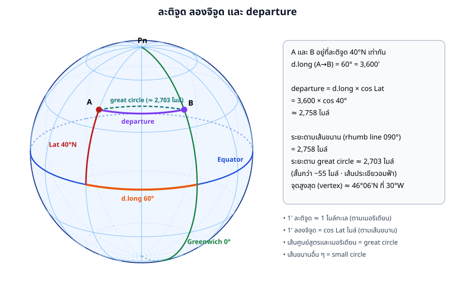
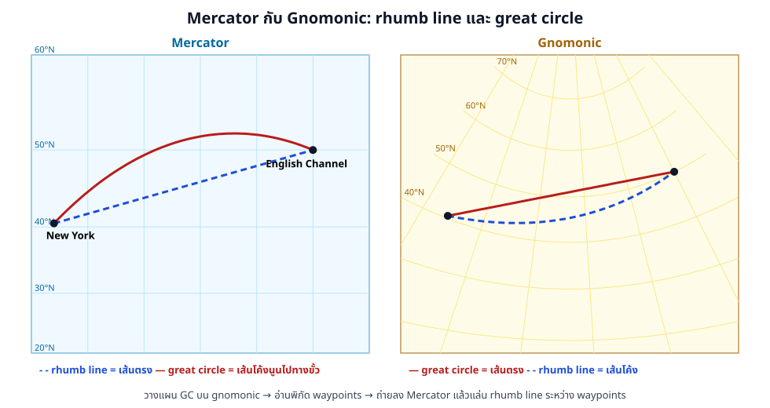
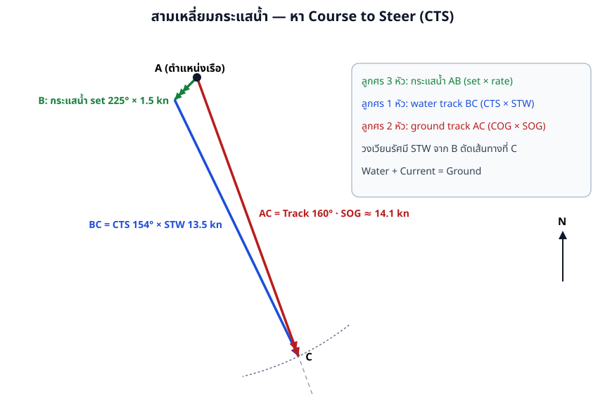
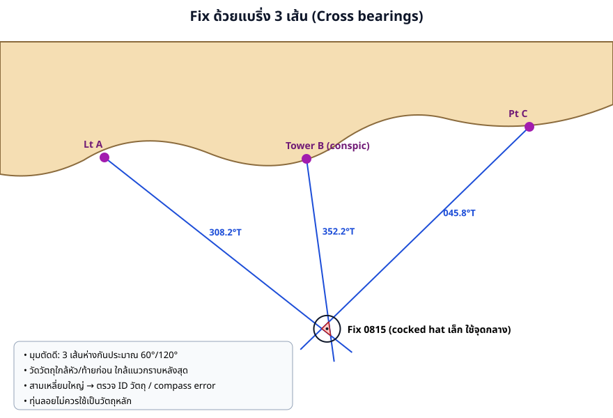
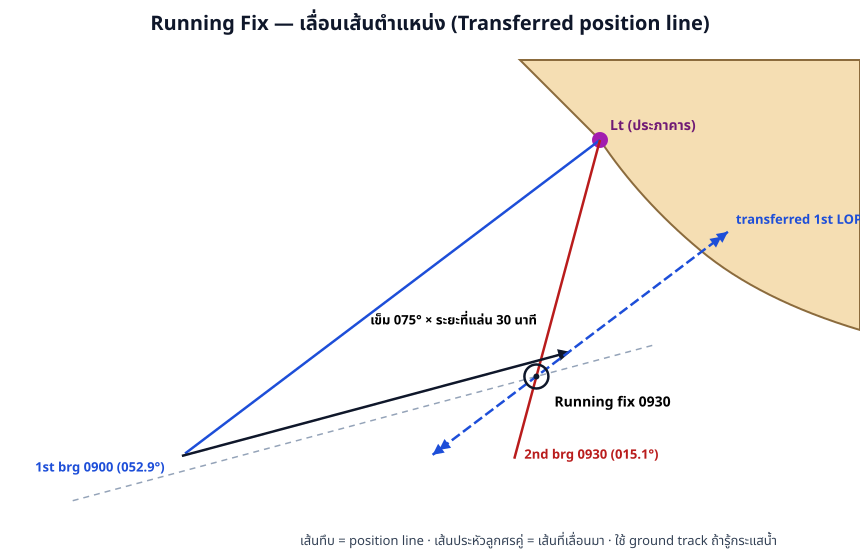
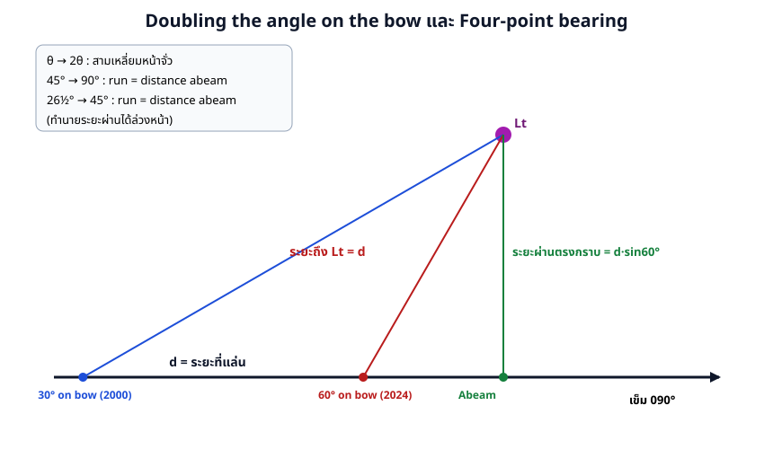

# 1.1.2 Terrestrial and Coastal Navigation (ภาค A) — โลก ทิศทาง การแล่นเรือ และการหาตำแหน่งด้วยสิ่งที่มองเห็น

> สมุดบันทึกการฝึก OOW · TIRAPHONG NANTAPAN
> สมรรถนะตาม STCW A-II/1: *Ability to determine the ship's position by use of: (1) landmarks; (2) aids to navigation, including lighthouses, beacons and buoys; (3) dead reckoning, taking into account winds, tides, currents and estimated speed*
> อ้างอิงหลัก: *Admiralty Manual of Navigation* (BR 45 Vol. 1), Bowditch (บท Navigational Mathematics, Dead Reckoning, Piloting), NP100 *The Mariner's Handbook*, ICS *Bridge Procedures Guide*, NP5011, IHO S-4

บทนี้แบ่งเป็น 5 ไฟล์ย่อยเพราะเนื้อหายาวมาก
- **ภาค A (ไฟล์นี้)** — โลก พิกัด ทิศ เส้นโครงแผนที่ การแล่นเรือ (sailings) DR/EP กระแสน้ำ และการหาตำแหน่งด้วยสิ่งที่มองเห็นบนฝั่ง
- [ภาค B](1.1.2-B-aids-to-navigation-buoyage-lights.md) — เครื่องหมายช่วยการเดินเรือ ประภาคาร ทุ่น ระบบ IALA
- [ภาค C](1.1.2-C-charts-and-publications.md) — แผนที่เดินเรือ สิ่งพิมพ์ การแก้ไขแผนที่ คำเตือนการเดินเรือ ระบบจัดเส้นทาง
- [ภาค D](1.1.2-D-tides-and-tidal-streams.md) — น้ำขึ้นน้ำลงและกระแสน้ำ
- [ภาค E](1.1.2-E-admiralty-publications-current-editions.md) — รายการ ADMIRALTY Publications ฉบับปัจจุบัน

---

## 1. โลกและระบบพิกัด

### 1.1 รูปทรงของโลก

โลกไม่ได้กลมสมบูรณ์ แต่เป็น **ทรงกลมแป้นที่ขั้ว (oblate spheroid)** — รัศมีที่เส้นศูนย์สูตรประมาณ 6,378 km ยาวกว่ารัศมีที่ขั้วประมาณ 6,357 km ราว 21 km ระบบที่ใช้กับ GNSS และ ENC ทั่วโลกปัจจุบันคือ **WGS 84 (World Geodetic System 1984)**

ในการคำนวณการเดินเรือส่วนใหญ่ ถือว่าโลกเป็นทรงกลมได้ ผลต่างเล็กน้อยมาก ยกเว้นในการคำนวณ meridional parts ที่ละเอียด

### 1.2 ศัพท์พื้นฐาน

| ศัพท์ | ความหมาย |
|---|---|
| Axis / Poles | แกนหมุนของโลก ปลายแกนคือขั้วโลกเหนือและใต้ (geographic poles) |
| Great circle | วงกลมบนผิวทรงกลมที่ระนาบผ่านจุดศูนย์กลางโลก แบ่งโลกเป็นสองซีกเท่ากัน — ระยะทางสั้นที่สุดระหว่างสองจุดบนผิวโลกอยู่บนส่วนโค้ง great circle |
| Small circle | วงกลมที่ระนาบไม่ผ่านจุดศูนย์กลางโลก เช่น เส้นขนาน (parallel of latitude) ทุกเส้นยกเว้นเส้นศูนย์สูตร |
| Equator | great circle ที่ห่างจากขั้วทั้งสองเท่ากัน |
| Meridian | ครึ่งของ great circle ที่ผ่านขั้วทั้งสอง |
| Prime meridian | เมอริเดียนที่ผ่านกรีนิช (0°) |
| Parallel of latitude | small circle ขนานกับเส้นศูนย์สูตร |
| Latitude (Lat, φ) | มุมวัดจากเส้นศูนย์สูตรไปตามเมอริเดียน 0°–90° N/S |
| Longitude (Long, λ) | มุมที่ขั้วระหว่างเมอริเดียนกรีนิชกับเมอริเดียนของจุดนั้น 0°–180° E/W |
| Difference of latitude (d.lat) | ผลต่างละติจูดของสองจุด (ลิปดา = ไมล์ทะเลตามเมอริเดียน) |
| Difference of longitude (d.long) | มุมที่ขั้วระหว่างเมอริเดียนของสองจุด (ไม่เกิน 180°) |
| Departure (dep) | ระยะทางตะวันออก-ตะวันตกเป็นไมล์ทะเล **dep = d.long × cos Lat** |
| Rhumb line (loxodrome) | เส้นที่ตัดเมอริเดียนทุกเส้นด้วยมุมเท่ากัน → เข็มคงที่ บนแผนที่ Mercator เป็นเส้นตรง |



*ภาพที่ 1.1.2-1 ละติจูด ลองจิจูด departure และความต่างระหว่าง great circle กับ rhumb line*

### 1.3 หน่วยวัด

- **Nautical mile (ไมล์ทะเล)** — ตามนิยามสากล **1 nm = 1,852 m** (ประมาณความยาวของ 1 ลิปดาละติจูด)
- **Sea mile** — ความยาวจริงของ 1 ลิปดาละติจูดซึ่งต่างกันตามละติจูดเพราะโลกแป้น ประมาณ 1,843 m ที่เส้นศูนย์สูตรถึง 1,862 m ที่ขั้ว
- **Cable** — 1/10 nm (≈ 185 m) ใช้ในระยะใกล้ เช่น "pass 3 cables off the buoy"
- **Knot (นอต)** — ความเร็ว 1 nm ต่อชั่วโมง
- **Fathom** — 6 ฟุต (1.83 m) ยังพบในแผนที่เก่าบางแผ่น ต้องดูหน่วยความลึกที่ชื่อแผนที่เสมอ

### 1.4 Geodetic datum และ chart datum (horizontal)

พิกัดเดียวกันอาจตกคนละที่ถ้าใช้ datum ต่างกัน ปัจจุบัน ENC ทั้งหมดและแผนที่ ADMIRALTY ส่วนใหญ่ใช้ WGS 84 แต่แผนที่เก่าหรือของบางประเทศยังใช้ local datum เช่น Indian 1975 (ใช้ในพื้นที่ประเทศไทยเดิม) Kertau 1948 (มาเลเซีย) Tokyo Datum ฯลฯ

แผนที่กระดาษจะมีหมายเหตุ **"SATELLITE-DERIVED POSITIONS"** บอกว่าตำแหน่งจาก GNSS (WGS 84) ต้องเลื่อนไปเท่าไรก่อน plot เช่น "Positions obtained from satellite navigation systems referred to WGS 84 should be moved 0.05 minutes SOUTHWARD and 0.12 minutes EASTWARD to agree with this chart" — ถ้าลืมเลื่อน ตำแหน่งจะคลาดได้หลายร้อยเมตร ซึ่งอันตรายมากในร่องน้ำ

> **จดไว้กันลืม** — เครื่อง GNSS ต้องตั้ง output datum ให้ตรงกับที่ ECDIS ใช้ (WGS 84) ห้ามไปเปลี่ยน datum ของเครื่อง GNSS ให้ตรงกับแผนที่กระดาษ เพราะ ECDIS/AIS/GMDSS จะได้ตำแหน่งผิดทั้งระบบ ให้แก้ค่าตอน plot บนแผนที่กระดาษแทน

---

## 2. ทิศทาง (Directions)

### 2.1 ทิศเหนือสามแบบ

| ทิศเหนือ | นิยาม |
|---|---|
| True North (T) | ทิศไปยังขั้วโลกเหนือทางภูมิศาสตร์ ตามเมอริเดียน |
| Magnetic North (M) | ทิศที่เข็มทิศแม่เหล็กชี้ เมื่อไม่มีอิทธิพลแม่เหล็กของเรือ ต่างจาก True North เท่ากับ **variation** |
| Compass North (C) | ทิศที่เข็มทิศบนเรือชี้จริง ต่างจาก Magnetic North เท่ากับ **deviation** (เกิดจากแม่เหล็กของตัวเรือ) |

**Compass error = variation + deviation** (รวมตามเครื่องหมาย) — รายละเอียดเต็มและการหาค่าอยู่ในบท 1.1.5

### 2.2 ทิศที่ใช้ในการเดินเรือ

- **Heading (Hdg)** — ทิศที่หัวเรือชี้ ณ ขณะนั้น
- **Course (Co)** — ทิศที่ตั้งใจให้เรือแล่น (ผ่านน้ำ) มักใช้แทน heading ที่ตั้งไว้
- **Course over ground (COG) / Course made good (CMG)** — ทิศที่เรือเคลื่อนที่จริงเทียบกับพื้นโลก
- **Track** — เส้นทางที่วางแผนไว้ หรือเส้นทางที่เรือผ่านมาจริง
- **True bearing** — มุมจากทิศเหนือจริงไปยังวัตถุ วัดตามเข็มนาฬิกา 000°–360°
- **Relative bearing** — มุมจากหัวเรือไปยังวัตถุ วัดตามเข็มนาฬิกา 000°–360° หรือวัดเป็น "x° on the starboard/port bow / quarter"
- **True bearing = Heading + Relative bearing** (ถ้าเกิน 360° ลบ 360°)
- จุดทิศดั้งเดิม (compass points) 32 จุด จุดละ 11¼° — ยังใช้พูด เช่น "two points on the starboard bow" (= 22.5° ทางขวาหัวเรือ), "abaft the beam"

---

## 3. เส้นโครงแผนที่ (Chart Projections)

### 3.1 คุณสมบัติที่ต้องการในแผนที่เดินเรือ

1. Rhumb line เป็นเส้นตรง (วาดเข็มได้ง่าย)
2. มุมถูกต้อง (orthomorphic / conformal) — รูปร่างเล็ก ๆ ถูกต้อง แบริ่งที่วัดได้บนแผนที่เท่ากับบนพื้นจริง
3. วัดระยะทางได้ง่าย
4. Great circle เป็นเส้นตรง (สำหรับวางแผนเดินทางไกล)

ไม่มีเส้นโครงใดมีครบทุกข้อ จึงใช้หลายแบบตามวัตถุประสงค์

### 3.2 Mercator projection

- เส้นโครงที่ใช้มากที่สุดสำหรับแผนที่เดินเรือ (Gerardus Mercator, 1569)
- เมอริเดียนเป็นเส้นตรงขนานห่างเท่ากัน เส้นขนานเป็นเส้นตรงตั้งฉากกับเมอริเดียน ระยะห่างระหว่างเส้นขนานเพิ่มขึ้นตามละติจูด (ยืดตาม sec Lat) เพื่อรักษามุมให้ถูกต้อง
- **ข้อดี:** rhumb line เป็นเส้นตรง, conformal, หาตำแหน่งด้วยละติจูด/ลองจิจูดง่าย
- **ข้อเสีย:** มาตราส่วนเปลี่ยนตามละติจูด (พื้นที่ใกล้ขั้วขยายใหญ่มาก), ใช้ไม่ได้ที่ขั้ว, great circle เป็นเส้นโค้ง (นูนไปทางขั้ว)
- **การวัดระยะทาง** — ใช้ **สเกลละติจูดที่ขอบซ้าย/ขวาของแผนที่ ณ ละติจูดเดียวกับระยะที่วัด** (1' ละติจูด = 1 nm) ห้ามใช้สเกลลองจิจูดด้านบน/ล่างเด็ดขาด

### 3.3 Gnomonic projection

- ฉายจากจุดศูนย์กลางโลกลงบนระนาบที่สัมผัสโลก ณ จุดหนึ่ง
- **Great circle ทุกเส้นเป็นเส้นตรง** — ใช้วางแผน great circle แล้วถ่ายจุด waypoints ลงแผนที่ Mercator
- ไม่ conformal ไม่รักษาระยะ วัดมุมและระยะตรง ๆ ไม่ได้ (ยกเว้นที่จุดสัมผัส)
- ใช้ทำ **gnomonic charts** สำหรับมหาสมุทร (ADMIRALTY 5095–5099 เดิม) และแผนที่ขั้วโลก รวมถึงแผนที่ท่าเรือมาตราส่วนใหญ่มาก (ที่พื้นที่เล็กจนความโค้งของโลกไม่มีผล)

### 3.4 Transverse Mercator และอื่น ๆ

- **Transverse Mercator** — หมุนกระบอกฉาย 90° ให้สัมผัสตามเมอริเดียน ใช้กับแผนที่มาตราส่วนใหญ่ของพื้นที่ที่ทอดตัวแนวเหนือ-ใต้ (แผนที่ ADMIRALTY มาตราส่วนใหญ่บางแผ่น) และเป็นฐานของระบบ UTM
- **Polar stereographic** — ใช้ในบริเวณขั้วโลก
- **Lambert conformal conic** — ใช้ในแผนที่การบินและแผนที่บางประเภท



*ภาพที่ 1.1.2-2 บน Mercator rhumb line เป็นเส้นตรง great circle เป็นเส้นโค้ง ส่วนบน Gnomonic กลับกัน*

### 3.5 มาตราส่วน (Scale)

- **Natural scale** เช่น 1:50 000 หมายถึง 1 หน่วยบนแผนที่ = 50,000 หน่วยจริง
- **แผนที่มาตราส่วนใหญ่ (large scale)** = ตัวหารน้อย (1:10 000) แสดงรายละเอียดมาก พื้นที่เล็ก ใช้ในท่าเรือ/ร่องน้ำ
- **แผนที่มาตราส่วนเล็ก (small scale)** = ตัวหารมาก (1:3 500 000) พื้นที่กว้าง รายละเอียดน้อย ใช้ในทะเลเปิด
- แผนที่ Mercator ระบุมาตราส่วน "ที่ละติจูดหนึ่ง" (scale at lat ...) เพราะมาตราส่วนเปลี่ยนตามละติจูด

ประเภทแผนที่ตามมาตราส่วนโดยประมาณ (รายละเอียดในภาค C)

| ประเภท | มาตราส่วน (โดยประมาณ) | ใช้ทำอะไร |
|---|---|---|
| Ocean / General charts | เล็กกว่า 1:1 500 000 | วางแผนเดินทางไกล ทะเลเปิด |
| Coastal charts | 1:150 000 – 1:1 500 000 | แล่นตามชายฝั่ง |
| Approach charts | 1:25 000 – 1:150 000 | เข้าใกล้ท่าเรือ ช่องแคบ |
| Harbour plans / berthing | ใหญ่กว่า 1:25 000 | ในท่าเรือ ร่องน้ำ ที่ทอดสมอ |

---

## 4. การแล่นเรือ (The Sailings) — การคำนวณเข็มและระยะทาง

### 4.1 Plane Sailing

ใช้กับระยะสั้น (ไม่เกินประมาณ 600 ไมล์) ถือว่าผิวโลกแบน สามเหลี่ยมมุมฉากที่มีด้าน d.lat, departure และ distance

```
dep  = dist × sin Co
d.lat = dist × cos Co
tan Co = dep / d.lat
dist = d.lat / cos Co   (หรือ √(d.lat² + dep²))
```

### 4.2 Parallel Sailing

เรือแล่นตามเส้นขนาน (เข็ม 090° หรือ 270°) d.lat = 0

```
dep = d.long × cos Lat
```

**ตัวอย่าง:** เรือแล่นจาก 10°00'N 100°00'E ไปทางตะวันออกตามเส้นขนาน 120 ไมล์ ลองจิจูดใหม่?
d.long = 120 / cos 10° = 120 / 0.9848 = 121.85' = 2°01.9' → ลองจิจูดใหม่ **102°01.9'E**

### 4.3 Middle Latitude Sailing (Mid-lat Sailing)

ใช้แปลง departure เป็น d.long เมื่อละติจูดเปลี่ยน โดยใช้ละติจูดกลาง (mean latitude) ใช้ได้ดีในละติจูดต่ำ-กลาง และระยะไม่ยาวมาก

```
dep  = d.long × cos(mean lat)
tan Co = dep / d.lat
dist = d.lat / cos Co
```

**ตัวอย่างจำลอง:** จาก WP2 (12°20'N 100°47'E) ถึง WP3 (10°30'N 101°40'E) ในแผนการเดินทาง

| ขั้น | ค่า |
|---|---|
| d.lat | 12°20'N → 10°30'N = 110' S |
| d.long | 100°47'E → 101°40'E = 53' E |
| Mean lat | (12°20' + 10°30')/2 = 11°25' |
| dep | 53 × cos 11°25' = 53 × 0.9802 = 51.95' E |
| tan Co | 51.95 / 110 = 0.4723 → Co = S 25.3° E = **154.7°** |
| dist | 110 / cos 25.3° = **121.7 ไมล์** |

(เทียบกับ Mercator sailing ในบท 1.1 ได้ 154.6° 121.8 ไมล์ — ต่างกันน้อยมาก)

### 4.4 Mercator Sailing

แม่นยำกว่า mid-lat สำหรับระยะไกลหรือละติจูดสูง ใช้ **meridional parts (MP)** — ระยะจากเส้นศูนย์สูตรถึงเส้นขนานบนแผนที่ Mercator หน่วยเป็นลิปดาของลองจิจูด ค่าอยู่ในตาราง Norie's / Burton's หรือคำนวณ

```
DMP = MP(lat2) − MP(lat1)
tan Co = d.long / DMP
dist = d.lat / cos Co
```

สูตร MP (ทรงกลม): **MP = 7915.7045 × log₁₀ tan(45° + Lat/2)** (สูตรเต็มสำหรับ spheroid มีพจน์แก้เพิ่ม)

**ตัวอย่างจำลอง — Mercator sailing จาก WP4 (07°30'N 102°50'E) ถึง WP5 (04°30'N 103°55'E)** ในแผนการเดินทางบท 1.1

| ขั้น | ทรงกลม (สูตรข้างบน) | spheroid (ตาราง Norie's/WGS 84) |
|---|---|---|
| MP(07°30') | 451.3 | 448.3 |
| MP(04°30') | 270.3 | 268.5 |
| DMP | 181.0 | 179.8 |
| d.lat / d.long | 180' S / 65' E | 180' S / 65' E |
| tan Co = d.long / DMP | 0.3591 → S 19.8° E = **160.2°** | 0.3615 → S 19.9° E = **160.1°** |
| dist = d.lat / cos Co | **191.3 ไมล์** | **191.4 ไมล์** |

ค่าด้าน spheroid ตรงกับตาราง waypoints ในบท 1.1 (160°, 191.4 ไมล์) สังเกตว่าในละติจูดต่ำ ผลของทรงกลมกับ spheroid ต่างกันแค่ราว 0.1° และ 0.1 ไมล์ แต่ถ้าละติจูดสูงหรือ d.lat มาก ความต่างจะโตขึ้น จึงควรใช้ตาราง meridional parts ที่อิง spheroid เมื่อทำงานจริงหรือทำข้อสอบที่กำหนดให้ใช้ตาราง

### 4.5 Great Circle Sailing

ระยะทางสั้นที่สุด แต่เข็มเปลี่ยนตลอดเวลา (ยกเว้นแล่นตามเมอริเดียนหรือเส้นศูนย์สูตร) ในทางปฏิบัติแบ่ง great circle เป็นช่วง ๆ แล้วแล่น rhumb line ระหว่าง waypoints (เช่น ทุก 5° หรือ 10° ของลองจิจูด)

**สูตร**

```
cos dist = sin L1 sin L2 + cos L1 cos L2 cos d.long
tan IC   = sin d.long / (cos L1 tan L2 − sin L1 cos d.long)
Vertex:   cos Lv = sin IC × cos L1
          d.long (จุดเริ่ม → vertex): tan = 1 / (tan IC × sin L1)
จุดบนเส้น:  tan L = tan Lv × cos (d.long จาก vertex)
```

**Vertex** คือจุดที่ great circle ขึ้นไปถึงละติจูดสูงสุด ที่ vertex เข็มเรือ = 090° หรือ 270°

**ตัวอย่างจำลอง — ข้ามแปซิฟิกเหนือ:** จากนอกแหลม Nojima Saki ญี่ปุ่น (34°50'N 140°00'E) ไปซานฟรานซิสโก (37°48'N 122°40'W)

| รายการ | ผลลัพธ์ |
|---|---|
| d.long | 97°20' E (ข้ามเส้น 180°) |
| Great circle distance | **4,470 ไมล์** |
| Initial course | **054.4°** |
| Final course | 122.3° |
| Vertex | **48°07'N 168°36'W** |
| Rhumb line | เข็ม 087.8° ระยะ 4,708 ไมล์ |
| ระยะที่ประหยัดได้ | ประมาณ **238 ไมล์** (เกือบ 18 ชั่วโมงที่ 13.5 นอต) |

Waypoints ทุก 10° ลองจิจูด (ตัวอย่างบางจุด): 150°E → 39°55'N, 170°E → 46°05'N, 180° → 47°33'N, 170°W → 48°07'N, 150°W → 46°35'N, 130°W → 41°05'N

**ข้อพิจารณา:** great circle นี้ขึ้นไปถึงเกือบ 48°N ใกล้หมู่เกาะอะลูเชียน ฤดูหนาวมีพายุแรงและคลื่นสูง (และอาจต้องดู load line zone ฤดูหนาว) จึงอาจเลือก **composite great circle** กำหนดละติจูดจำกัด (limiting latitude) เช่น 45°N — แล่น great circle จากจุดเริ่มไปสัมผัส 45°N, แล่นตามเส้นขนาน 45°N, แล้วแล่น great circle อีกเส้นไปปลายทาง ระยะทางเพิ่มขึ้นเล็กน้อยแต่ปลอดภัยกว่า หรือใช้คำแนะนำจาก weather routing

### 4.6 Composite Great Circle

1. เลือก limiting latitude
2. หา great circle จากจุดเริ่มต้นที่มี vertex อยู่บน limiting latitude (cos IC... หรือใช้ gnomonic chart ลากเส้นสัมผัส)
3. แล่นตามเส้นขนานที่ limiting latitude
4. great circle จาก vertex ที่สองไปยังจุดหมาย


### 4.7 Traverse Sailing — รวมหลายช่วงเข็มเป็นเข็มและระยะทางที่ทำได้ (Course and distance made good)

เมื่อเรือเปลี่ยนเข็มหลายครั้ง (เช่น หลบเรือ เลี่ยงพายุ หรือตามแนว TSS) ให้แยกแต่ละช่วงเป็น d.lat และ departure ด้วย plane sailing แล้วรวมกัน จากนั้นแปลง departure รวมเป็น d.long ด้วยละติจูดกลาง วิธีนี้คือหลักของ "day's work" ที่ใช้ทำ noon report

**ตัวอย่างจำลอง (แยกจากแผนการเดินทาง):** เริ่มจาก fix เที่ยง 06°47.0'N 103°06.5'E

| ช่วง | เข็ม | ระยะ | d.lat | dep |
|---|---|---|---|---|
| 1 | 159° | 27.0' (2 ชม. × 13.5) | 25.2' S | 9.7' E |
| 2 | 170° | 20.3' (1.5 ชม.) | 19.9' S | 3.5' E |
| 3 | 150° | 33.8' (2.5 ชม.) | 29.2' S | 16.9' E |
| **รวม** | | | **74.4' S** | **30.1' E** |

- Course made good: tan C = 30.1 / 74.4 → **158.0°** ระยะทางที่ทำได้ = √(74.4² + 30.1²) = **80.2 ไมล์**
- ละติจูดใหม่ = 06°47.0' − 74.4' = **05°32.6'N** ละติจูดกลาง ≈ 06°10'
- d.long = 30.1 / cos 06°10' = 30.2' E → ลองจิจูดใหม่ **103°36.7'E** (ตำแหน่ง DR)

**ต่อเป็น EP:** ถ้าประเมินว่ามีกระแสน้ำ set 225° rate 1.2 นอต ตลอด 6 ชั่วโมง → drift 7.2' (d.lat 5.1' S, dep 5.1' W) รวมกับ DR ได้ d.lat 79.5' S, dep 25.0' E → **EP ≈ 05°27.5'N 103°31.6'E** ground track ที่ทำได้ 162.6° ระยะ 83.3 ไมล์ — EP ห่างจาก DR ราว 7.2 ไมล์ไปทางตะวันตกเฉียงใต้ เท่ากับ drift พอดี ซึ่งเป็นวิธีตรวจคำตอบแบบง่าย

---

## 5. Dead Reckoning (DR), Estimated Position (EP) และกระแสน้ำ

### 5.1 นิยาม

- **Dead Reckoning (DR) position** — ตำแหน่งที่หาจากตำแหน่งที่รู้ล่าสุด (fix) โดยใช้ **เข็มจริงที่ถือ (true course steered)** และ **ระยะทางผ่านน้ำ (distance run through the water)** จาก log **ไม่รวม** ผลของกระแสน้ำและลม
- **Estimated Position (EP)** — DR ที่แก้ด้วยผลของกระแสน้ำ (set & drift) และ leeway ที่คาดไว้ เป็นตำแหน่งที่ดีที่สุดที่ประมาณได้โดยไม่มี fix
- **Fix** — ตำแหน่งที่หาจากการสังเกตตั้งแต่ 2 position lines ขึ้นไปที่เวลาเดียวกัน

สัญลักษณ์บนแผนที่กระดาษ (ตาม BR 45 / แนวปฏิบัติทั่วไป)

| สัญลักษณ์ | ความหมาย |
|---|---|
| ⊙ วงกลมมีจุด | Fix (เขียนเวลาไว้ข้าง ๆ) |
| ✕ หรือ เส้นขีดตั้งฉากเส้นทาง | DR position |
| △ สามเหลี่ยมมีจุด | EP |
| ⊡ สี่เหลี่ยม | ตำแหน่งจาก GNSS/อิเล็กทรอนิกส์ (บางบริษัทใช้) |
| ลูกศร 1 หัว | เส้นเข็มที่ถือผ่านน้ำ (water track) |
| ลูกศร 2 หัว | เส้นทางเทียบพื้น (ground track) |
| ลูกศร 3 หัว | กระแสน้ำ (set & drift) |

### 5.2 ปัจจัยที่ทำให้ตำแหน่งจริงต่างจาก DR

1. **กระแสน้ำ (current)** — กระแสน้ำทะเล (ocean current) และกระแสน้ำขึ้นลง (tidal stream)
2. **ลม (wind)** — ทำให้เกิด **leeway** (เรือไถลไปด้านใต้ลม) โดยเฉพาะเรือที่มี freeboard สูง (เรือตู้ เรือ RoRo เรือเปล่าน้ำหนัก) ประเมินเป็นมุมระหว่างเข็มที่ถือ (heading) กับ water track
3. **ความคลาดเคลื่อนของการถือท้าย (steering error)** — เรือส่าย (yaw) ไม่อยู่ที่เข็มพอดี
4. **ความคลาดเคลื่อนของเข็มทิศ (compass error)** ที่ไม่ได้แก้หรือแก้ผิด
5. **ความคลาดเคลื่อนของ log** (speed log error) และการประเมินความเร็วผิด
6. **สภาพคลื่น (sea state)** และการเปลี่ยน trim/draught

### 5.3 Set, Drift และ Rate

- **Set** — ทิศที่กระแสน้ำไหล **ไปหา** (ต่างจากลมที่เรียกตามทิศที่ลม **มาจาก**) เช่น set 225° คือกระแสน้ำไหลไปทางตะวันตกเฉียงใต้
- **Drift** — ระยะทางที่กระแสน้ำพาเรือไปในช่วงเวลาหนึ่ง (ไมล์)
- **Rate** — ความเร็วของกระแสน้ำ (นอต)

หา set และ drift จริง: เมื่อได้ fix ให้ลากเส้นจาก DR (ของเวลาเดียวกัน) ไปยัง fix → ทิศของเส้นคือ set, ความยาวคือ drift, หารด้วยเวลาคือ rate

**ตัวอย่าง:** fix เวลา 0600, แล่นเข็ม 160°T ความเร็ว 13.5 นอต จนถึง 0800 DR อยู่ที่ระยะ 27.0' จาก fix เวลา 0800 ได้ fix ใหม่ซึ่งอยู่ห่างจาก DR 3.2 ไมล์ ทิศ 250°
→ **set 250°, drift 3.2', rate 1.6 นอต**

### 5.4 สามเหลี่ยมความเร็ว (Current triangle) และการหาเข็มที่จะถือ (Course to Steer – CTS)

สามเหลี่ยมประกอบด้วยเวกเตอร์ 3 เส้น (เขียนเป็นความเร็วหรือระยะทางในเวลาเดียวกัน)

1. **Water track** — เข็มที่ถือ (heading/CTS) × ความเร็วผ่านน้ำ (STW)
2. **Current** — set × rate
3. **Ground track** — COG × SOG

Water track + Current = Ground track



*ภาพที่ 1.1.2-3 การหาเข็มที่ต้องถือ (CTS) เพื่อให้เรือเคลื่อนที่ตามเส้นทางที่ต้องการเมื่อมีกระแสน้ำ*

**ขั้นตอนบนแผนที่ (การหา CTS)**
1. ลากเส้นทางที่ต้องการ (intended track) จากตำแหน่งเรือ A
2. จาก A ลากเวกเตอร์กระแสน้ำตาม set ยาวเท่ากับ rate × 1 ชั่วโมง (หรือเวลาที่เลือก) ได้จุด B
3. ใช้วงเวียนกาง **รัศมีเท่ากับความเร็วผ่านน้ำ** × เวลาเดียวกัน จาก B ตัดเส้นทางที่ต้องการที่จุด C
4. **ทิศ BC = CTS**, **ระยะ AC = SOG** (ระยะทางเทียบพื้นในเวลาที่เลือก)

**ตัวอย่างจำลอง:** ต้องการแล่นเส้นทาง 160°T ความเร็วผ่านน้ำ 13.5 นอต กระแสน้ำ set 225° rate 1.5 นอต

คำนวณด้วยเวกเตอร์
```
sin(CTS − Track) = (Cy·sin Track − Cx·cos Track) / STW
Cx = 1.5 sin 225° = −1.061 ;  Cy = 1.5 cos 225° = −1.061
sin(CTS − 160°) = (−1.061 × 0.342 − (−1.061) × (−0.940)) / 13.5
                = (−0.363 − 0.997) / 13.5 = −0.1007
CTS − 160° = −5.8°  →  CTS = 154.2° ≈ 154°T
SOG ≈ 14.1 นอต
```

ตีความ: กระแสน้ำไหลไปทางตะวันตกเฉียงใต้ พาเรือไปทางขวาของเส้นทาง (ด้านตะวันตก) จึงต้องถือเข็มไปทางซ้าย (ตะวันออก) ประมาณ 6° และเพราะกระแสน้ำมีองค์ประกอบไปทางเดียวกับเส้นทางด้วย (ไปทางใต้) ความเร็วเทียบพื้นจึงเพิ่มขึ้นเป็นประมาณ 14.1 นอต

### 5.5 Leeway

- ประเมินจากมุมระหว่าง heading กับแนวของ wake (ร่องคลื่นท้ายเรือ) หรือจากประสบการณ์กับเรือลำนั้น
- แก้โดยถือเข็มเข้าหาลม (into the wind) เท่ากับมุม leeway
- ตัวอย่าง: ลมแรงจากทิศเหนือ เรือแล่นเข็ม 090° leeway 3° → water track = 093° ถ้าต้องการ water track 090° ต้องถือ 087°
- ในการคำนวณ EP ให้แก้ leeway ก่อน แล้วค่อยแก้กระแสน้ำ

### 5.6 ประโยชน์ของ DR/EP ในยุค GNSS

- เป็นการตรวจสอบความสมเหตุสมผลของตำแหน่ง GNSS (ถ้าห่างกันผิดปกติโดยไม่มีเหตุผล ต้องสงสัย)
- ใช้เมื่อ GNSS ใช้ไม่ได้ (jamming, spoofing, ขัดข้อง)
- ใช้คาดการณ์ตำแหน่งในอนาคต เช่นจะถึง WOP เมื่อไร
- ใช้ในการค้นหาและกู้ภัย (คำนวณ datum)

---

## 6. การหาตำแหน่งด้วยสิ่งที่มองเห็น (Position fixing by landmarks)

### 6.1 Position line (เส้นตำแหน่ง) แบบต่าง ๆ

Position line คือเส้นที่เรือ "ต้องอยู่ที่ไหนสักแห่งบนเส้นนั้น" ณ เวลาที่สังเกต ได้มาจาก

| ชนิด | วิธีได้ | ลักษณะบนแผนที่ |
|---|---|---|
| Bearing (แบริ่ง) | วัดทิศไปยังวัตถุด้วย gyro repeater / magnetic compass (azimuth circle, pelorus) หรือ EBL เรดาร์ | เส้นตรงจากวัตถุ ลากกลับมาตามแบริ่งกลับทิศ (reciprocal) |
| Range (ระยะ) | เรดาร์ (VRM), vertical sextant angle, rangefinder | วงกลมรอบวัตถุ รัศมี = ระยะ |
| Transit (แนวเรียง) | วัตถุสองอย่างที่อยู่ในแนวเดียวกันเมื่อมองจากเรือ | เส้นตรงผ่านวัตถุทั้งสอง แม่นยำมาก ไม่มี compass error |
| Horizontal angle | วัดมุมระหว่างวัตถุสองอย่างด้วย sextant แนวนอน | ส่วนโค้งวงกลมผ่านวัตถุทั้งสอง |
| Depth contour | ความลึกจาก echo sounder | เส้นชั้นความลึกบนแผนที่ (ใช้ตรวจสอบมากกว่าใช้เป็น fix หลัก) |
| Celestial | ดาราศาสตร์ (บท 1.1.1) | เส้นตั้งฉากกับ azimuth |

### 6.2 การเลือกวัตถุบนฝั่ง (Landmarks)

วัตถุที่ดีสำหรับหาตำแหน่ง ควร
- **ระบุได้แน่นอน** บนแผนที่ (ตรงกับสัญลักษณ์และคำอธิบาย) — สิ่งที่แผนที่เขียนว่า **"conspic"** (conspicuous) คือวัตถุที่มองเห็นชัดจากทะเล
- **มีตำแหน่งแม่นยำ** — ประภาคาร ยอดเขาที่มีความสูงกำกับ หอคอย ปล่องควัน เสาวิทยุ ปลายแหลมที่ชัน
- **อยู่ใกล้** (ความคลาดเคลื่อนเชิงมุมทำให้ตำแหน่งผิดน้อยกว่า: ผิด 1° ที่ระยะ 1 ไมล์ = 0.017 ไมล์ แต่ที่ระยะ 10 ไมล์ = 0.17 ไมล์)
- **ระวัง** ทุ่นลอย (buoy) ไม่ควรใช้เป็นวัตถุหลักในการหาตำแหน่ง เพราะอาจเลื่อนจากตำแหน่ง (ยกเว้นไม่มีทางเลือกอื่นและใช้ด้วยความระมัดระวัง)
- **ระวัง** ปลายแหลมที่ลาดต่ำ — ทั้งด้วยตาและเรดาร์ ขอบที่เห็นอาจไม่ใช่ปลายจริง

### 6.3 Cross bearings (แบริ่งตัดกัน)

วิธีพื้นฐานที่สุดของการเดินเรือชายฝั่ง



*ภาพที่ 1.1.2-4 Fix ด้วยแบริ่ง 3 วัตถุ มุมตัดกันดี — สามเหลี่ยมเล็ก (cocked hat) ที่ได้บอกความแม่นยำ*

**หลักการ**
- **2 แบริ่ง:** มุมตัดที่ดีที่สุด **90°** ยอมรับได้ 30°–150° แต่ไม่มีทางรู้ว่ามีความผิดพลาดหรือไม่
- **3 แบริ่ง:** ดีกว่า เพราะถ้าเกิด cocked hat แสดงว่ามีความคลาดเคลื่อน มุมระหว่างแบริ่งควรประมาณ **60°** (หรือ 120°)
- วัตถุควรอยู่ใกล้และกระจายทิศดี

**ลำดับการวัดแบริ่ง:** วัตถุที่อยู่ **ใกล้หัวเรือหรือท้ายเรือ** (แบริ่งเปลี่ยนช้า) วัดก่อน ส่วนวัตถุที่อยู่ **ใกล้แนวกราบ (beam)** (แบริ่งเปลี่ยนเร็ว) วัดเป็นอันสุดท้าย แล้วจดเวลาทันที — เพื่อให้ตำแหน่งที่ได้ใกล้เคียงกับเวลาที่จดมากที่สุด

**การตีความ cocked hat**
- สามเหลี่ยมเล็ก → ใช้จุดกลางสามเหลี่ยม หรือเลือกมุมที่ใกล้อันตรายที่สุดเพื่อความปลอดภัย (assume the worst)
- สามเหลี่ยมใหญ่ → อาจระบุวัตถุผิด อ่านแบริ่งผิด ใช้ compass error ผิด หรือใช้เวลานานเกินไประหว่างแบริ่ง → วัดใหม่
- ถ้ามี compass error ที่ไม่รู้ค่าคงที่ (เช่น gyro error ไม่ได้แก้) cocked hat จะขยายใหญ่ — ลองแก้ค่า error ทีละ 1° ถ้าสามเหลี่ยมเล็กลงเป็นจุด แสดงว่าพบค่า error จริง

### 6.4 Bearing and range ของวัตถุเดียว

ใช้เรดาร์วัดทั้งแบริ่งและระยะของวัตถุเดียว ได้ fix ทันที แต่ **ระยะเรดาร์แม่นยำกว่าแบริ่งเรดาร์** (เพราะความกว้างของลำคลื่น horizontal beam width ทำให้แบริ่งคลาดเคลื่อน) และถ้าวัตถุระบุผิด fix จะผิดทั้งหมดโดยไม่มีอะไรเตือน

### 6.5 Fix ด้วยระยะ (Ranges)

- ใช้ระยะเรดาร์จาก 2–3 วัตถุ — **แม่นยำที่สุดในบรรดาวิธีที่ใช้เรดาร์**
- ระยะต้องวัดจากขอบที่ใกล้ที่สุดของเป้า (leading edge) และวัตถุต้องเป็นจุดที่ระบุได้แน่นอน (หน้าผาชัน ไม่ใช่ชายหาดลาด)
- เรียกว่า "radar range fix"

### 6.6 Transit กับ Bearing

- Transit ให้ position line ที่แม่นยำมาก ไม่ขึ้นกับเข็มทิศ
- ข้ามเส้น transit (ขณะวัตถุสองอย่างเรียงกัน) แล้ววัดแบริ่งวัตถุอื่นพร้อมกัน → fix
- **ใช้ตรวจ compass error ได้ด้วย** — แบริ่งจริงของ transit อ่านจากแผนที่ เทียบกับแบริ่งที่วัดด้วยเข็มทิศ

### 6.7 Horizontal Sextant Angle (HSA) และปัญหาสามจุด (Three-point problem)

- วัดมุมแนวนอนระหว่างวัตถุ A–B และ B–C ด้วย sextant (ถือแนวนอน) แล้ว plot ด้วย **station pointer** (ไม้โปรแทรกเตอร์สามแขน) หรือสร้างวงกลมบนแผนที่
- **ข้อดี:** ไม่มี compass error เลย แม่นยำมากเมื่อวัตถุใกล้และมุมโต
- **ข้อควรระวัง:** ถ้าวัตถุทั้งสามและเรืออยู่บนวงกลมเดียวกัน (revolver/swinger) fix จะไม่แน่นอน (indeterminate)
- ใช้กันน้อยลงในยุคเรดาร์และ GNSS แต่ยังอยู่ในหลักสูตรและข้อสอบ

### 6.8 Vertical Sextant Angle (VSA) — หาระยะจากวัตถุที่รู้ความสูง

วัดมุมเงยระหว่างยอดวัตถุ (เช่นโคมไฟประภาคาร) กับแนวน้ำที่ฐาน (หรือขอบฟ้าถ้าวัตถุอยู่ไกล)

```
ระยะ (m) ≈ H / tan α        (H = ความสูงของวัตถุเหนือระดับน้ำ ณ ขณะนั้น, เมตร)
ระยะ (nm) ≈ H / (1852 × tan α)
```

**ข้อควรระวัง:** ความสูงของไฟบนแผนที่ ADMIRALTY วัดจาก **MHWS** (หรือระดับอ้างอิงความสูงที่ระบุในแผนที่) ไม่ใช่จากระดับน้ำปัจจุบัน ถ้าน้ำลงอยู่ วัตถุจะสูงกว่าที่แผนที่บอก — ต้องปรับค่า H ด้วย (H จริง = H แผนที่ + (MHWS − ระดับน้ำขณะนั้น))

**ตัวอย่างจำลอง:** ประภาคาร ความสูงโคมไฟ 52 m เหนือระดับน้ำ (ปรับแล้ว) วัด VSA ได้ 0°18.5' (แก้ IE แล้ว)
tan 18.5' = 0.005381 → ระยะ = 52 / 0.005381 = 9,663 m = **5.2 ไมล์**

### 6.9 Danger angles (มุมอันตราย)

- **Vertical danger angle** — คำนวณมุม VSA ที่ตรงกับระยะปลอดภัยจากวัตถุ (เช่นต้องผ่านห่างประภาคาร ≥ 1 ไมล์เพราะมีหินโสโครก) ถ้าวัดได้มุม **มากกว่า** ค่านี้ แปลว่าเรือเข้าใกล้เกินไป
- **Horizontal danger angle** — วาดวงกลมผ่านวัตถุสองอย่างที่ครอบอันตรายไว้ มุมที่จารึกบนวงกลมคือ danger angle ถ้าวัดมุมระหว่างวัตถุทั้งสองได้ **มากกว่า** ค่านี้ เรืออยู่ในวงกลม (ใกล้อันตราย) — ใช้รักษาระยะห่างจากหินโสโครกระหว่างวัตถุสองอย่าง

### 6.10 Running Fix (การหาตำแหน่งด้วยเส้นตำแหน่งที่เลื่อน)

ใช้เมื่อมีวัตถุให้วัดได้เพียงหนึ่งอย่าง (เช่นประภาคารอันเดียวในเวลากลางคืน)



*ภาพที่ 1.1.2-5 Running fix — เลื่อน (transfer) position line แรกไปตามเข็มและระยะทางที่แล่น แล้วตัดกับ position line ที่สอง*

**ขั้นตอน**
1. เวลา T1 วัดแบริ่งวัตถุ ลากเส้นตำแหน่งที่ 1
2. แล่นไปจนแบริ่งเปลี่ยนอย่างน้อยประมาณ 30° (ยิ่งมุมตัดใกล้ 90° ยิ่งดี) เวลา T2 วัดแบริ่งที่ 2 ลากเส้นตำแหน่งที่ 2
3. จากจุดใด ๆ บนเส้นที่ 1 ลากเวกเตอร์ตามเข็มที่ถือ × ระยะทางที่แล่น (T2 − T1) (ถ้ารู้กระแสน้ำ ให้ใช้ ground track — COG/SOG — จะได้ผลแม่นยำกว่า)
4. ลากเส้นขนานกับเส้นที่ 1 ผ่านปลายเวกเตอร์ → เส้นตำแหน่งที่เลื่อนแล้ว (transferred position line — วาดลูกศรสองหัวที่ปลายเพื่อแสดงว่าเป็นเส้นที่เลื่อน)
5. จุดตัดของเส้นที่เลื่อนกับเส้นที่ 2 = **running fix**

ความแม่นยำขึ้นกับความถูกต้องของเข็มและระยะทางที่ใช้เลื่อน ถ้ามีกระแสน้ำที่ไม่รู้ ตำแหน่งจะผิด — จึงถือว่าความน่าเชื่อถือต่ำกว่า fix ปกติ

### 6.11 วิธีพิเศษจากแบริ่งสัมพัทธ์ (Special cases using relative bearings)

ใช้ได้เมื่อไม่มีกระแสน้ำด้านข้าง (หรือใช้ระยะเทียบพื้น)



*ภาพที่ 1.1.2-6 Doubling the angle on the bow — สามเหลี่ยมหน้าจั่ว ทำให้ระยะที่แล่นได้เท่ากับระยะห่างจากวัตถุ*

| วิธี | แบริ่งสัมพัทธ์ครั้งแรก → ครั้งที่สอง | ผลลัพธ์ |
|---|---|---|
| **Doubling the angle on the bow** | θ → 2θ | ระยะที่แล่นระหว่างการวัด = ระยะห่างจากวัตถุ ณ เวลาวัดครั้งที่สอง |
| **Four-point bearing** | 45° (4 points) → 90° (abeam) | ระยะที่แล่น = ระยะห่างจากวัตถุตอนอยู่ตรงกราบ (distance abeam) |
| **26½° → 45°** | 26.5° → 45° | ระยะที่แล่น = ระยะที่จะผ่านวัตถุตอนอยู่ตรงกราบ (ทำนายล่วงหน้าได้) |
| **22½° → 45° (7/10 rule)** | 22.5° → 45° | ระยะผ่านตรงกราบ ≈ 7/10 ของระยะที่แล่น |
| **30° → 60° (7/8 rule)** | 30° → 60° | ระยะผ่านตรงกราบ ≈ 7/8 ของระยะที่แล่น (และระยะ ณ ครั้งที่สอง = ระยะที่แล่น ตามหลัก doubling) |

**ตัวอย่างจำลอง (Doubling the angle):** เวลา 2000 ประภาคารอยู่ 30° ทางกราบขวาหัวเรือ เวลา 2024 อยู่ 60° ทางกราบขวาหัวเรือ ความเร็ว 12 นอต ไม่มีกระแสน้ำ
ระยะที่แล่น = 12 × 24/60 = **4.8 ไมล์** = ระยะห่างจากประภาคาร ณ เวลา 2024
ระยะผ่านตรงกราบ (7/8 rule) ≈ 4.8 × 7/8 = 4.2 ไมล์ (ค่าจริง = 4.8 × sin 60° = 4.16 ไมล์)

### 6.12 ระยะที่เห็นไฟ — Rising and dipping (ภาพรวม)

เมื่อเห็นไฟประภาคารพ้นขอบฟ้าครั้งแรก (rising) หรือหายลับขอบฟ้า (dipping) แสดงว่าเรืออยู่ที่ระยะ geographical range ของไฟนั้น ใช้ร่วมกับแบริ่งได้ตำแหน่งโดยประมาณ (รายละเอียดสูตรและข้อจำกัดอยู่ในภาค B)

```
Geographical range (nm) ≈ 2.08 × (√H + √h)     (H = ความสูงไฟ, h = ความสูงตา, เมตร)
```

### 6.13 ความลึก (Soundings) เป็นเครื่องช่วยตรวจตำแหน่ง

- เทียบความลึกที่ echo sounder วัดได้ (แก้ draught และระดับน้ำแล้ว) กับความลึกบนแผนที่ ณ ตำแหน่ง fix
- **Line of soundings** — จดความลึกเป็นช่วง ๆ ตามเวลา แล้วเลื่อนเส้นบนกระดาษใสตามเข็มและระยะ ไปเทียบกับความลึกบนแผนที่ (เทคนิคเก่าที่ใช้เมื่อไม่มีวิธีอื่น)
- เส้นชั้นความลึก (depth contour) ที่ชัดเจน เช่นขอบไหล่ทวีป เป็น position line คร่าว ๆ ได้

---

## 7. Clearing lines และ leading lines ในการเดินเรือชายฝั่ง

(เขียนรายละเอียดการวางแผนไว้ในบท 1.1 ตรงนี้เน้นการใช้ระหว่างเข้ายาม)

- **Clearing bearing** — วัดแบริ่งไปยังวัตถุบ่อย ๆ เทียบกับค่า NMT/NLT ที่เขียนไว้ ถ้าแบริ่งเข้าใกล้ค่าจำกัด ต้องแก้เข็มทันที
- **Clearing range** — ใช้ VRM เรดาร์ตั้งไว้ที่ระยะจำกัด
- **Leading lines (ไฟนำร่อง / leading lights)** — ไฟสองดวงสูงต่ำต่างกัน เมื่อเรียงในแนวตั้งเดียวกันแสดงว่าเรืออยู่บนแนวร่องน้ำ ถ้าไฟหลัง (สูงกว่า) เยื้องไปทางซ้ายของไฟหน้า แปลว่าเรือหลุดไปทางซ้ายของแนว ต้องแก้ไปทางขวา (กลับกันถ้าไฟหลังเยื้องขวา)
- **Sector lights** — ไฟที่แสดงสีต่างกันในแต่ละ sector เช่น ขาวในแนวร่องน้ำ แดง/เขียวด้านข้าง (ภาค B)

---

## 8. แนวปฏิบัติการเดินเรือชายฝั่งระหว่างเข้ายาม

1. **ระบุวัตถุให้แน่นอนก่อนใช้** — เปรียบเทียบกับแผนที่ Sailing Directions (มีภาพร่างชายฝั่ง – coastal views) และ List of Lights (ลักษณะไฟ) ห้ามเดาว่า "น่าจะใช่"
2. **ใช้หลายวิธีร่วมกัน** — fix ด้วยเรดาร์ ตรวจด้วยแบริ่งตา และ GNSS ถ้าทุกวิธีตรงกันจึงมั่นใจได้
3. **รักษาความถี่ในการหาตำแหน่ง** ตามแผน
4. **plot ตำแหน่งให้เรียบร้อย** — เวลา วิธี (fix/EP/GNSS) และ DR ล่วงหน้าอย่างน้อย 2–3 จุด (ประมาณ 30 นาทีถึง 1 ชั่วโมงข้างหน้า) เพื่อดูว่าเส้นทางข้างหน้าปลอดภัย
5. **คำนวณ set & drift ทุกครั้งที่ได้ fix** และใช้ค่าล่าสุดในการทำ EP/CTS
6. **เฝ้าดูความลึก** ด้วย echo sounder ในน้ำตื้น
7. **บันทึกในสมุดปูมเรือ** — ตำแหน่ง เวลา วิธี เข็ม ความเร็ว ความผิดพลาดของเข็มทิศ เหตุการณ์สำคัญ
8. **ถ้าไม่แน่ใจตำแหน่ง** — ลดความเร็ว เรียกนายเรือ (ตาม standing orders) อย่าเดินหน้าต่อด้วยความหวัง

---

## 9. คำถามสอบปากเปล่า / สัมภาษณ์ — Terrestrial Navigation (ภาค A)

**ถาม:** ไมล์ทะเลคืออะไร ต่างจาก sea mile อย่างไร
**แนวตอบ:** nautical mile ตามนิยามสากลยาว 1,852 m ส่วน sea mile คือความยาวของ 1' ละติจูด ณ ตำแหน่งนั้น ซึ่งเปลี่ยนตามละติจูด (≈1,843 m ที่เส้นศูนย์สูตรถึง ≈1,862 m ที่ขั้ว) เพราะโลกแป้น

**ถาม:** ทำไมวัดระยะทางบนแผนที่ Mercator ต้องใช้สเกลละติจูดที่ระดับเดียวกัน
**แนวตอบ:** เพราะมาตราส่วนของ Mercator เปลี่ยนตามละติจูด (ยืดตาม sec Lat) 1' ละติจูดที่ระดับนั้นเท่ากับ 1 ไมล์ทะเล สเกลลองจิจูดไม่ใช่ระยะทาง

**ถาม:** Rhumb line กับ great circle ต่างกันอย่างไร เลือกใช้อย่างไร
**แนวตอบ:** rhumb line ตัดเมอริเดียนด้วยมุมคงที่ เข็มคงที่ แต่ไม่ใช่ระยะสั้นสุด (ยกเว้นตามเมอริเดียน/เส้นศูนย์สูตร) great circle คือระยะสั้นที่สุดแต่เข็มเปลี่ยนตลอด ใช้ GC ในการเดินทางไกลที่ประหยัดได้มาก (ข้ามมหาสมุทร ละติจูดสูง เข็มแนวตะวันออก-ตะวันตก) โดยแบ่งเป็น rhumb line ระหว่าง waypoints พิจารณาสภาพอากาศและน้ำแข็งด้วย อาจใช้ composite GC

**ถาม:** DR กับ EP ต่างกันอย่างไร
**แนวตอบ:** DR ใช้เข็มที่ถือและระยะทางผ่านน้ำเท่านั้น EP คือ DR ที่แก้ด้วยกระแสน้ำและ leeway ที่คาดไว้

**ถาม:** Set กับ drift คืออะไร หาได้อย่างไร
**แนวตอบ:** set คือทิศที่กระแสน้ำไหลไปหา drift คือระยะทางที่กระแสน้ำพาไปในช่วงเวลาหนึ่ง หาได้จากการลากเส้นจาก DR ไปยัง fix ของเวลาเดียวกัน

**ถาม:** อธิบายวิธีหา CTS เมื่อมีกระแสน้ำ
**แนวตอบ:** ลากเส้นทางที่ต้องการ จากจุดเริ่มลากเวกเตอร์กระแสน้ำ (set × rate × เวลา) จากปลายเวกเตอร์กางวงเวียนรัศมี = ความเร็วผ่านน้ำ × เวลาเดียวกัน ตัดเส้นทางที่ต้องการ ทิศของเส้นจากปลายเวกเตอร์กระแสน้ำไปจุดตัดคือ CTS ระยะจากจุดเริ่มถึงจุดตัดคือ SOG × เวลา

**ถาม:** ทำไม fix ด้วยแบริ่ง 3 เส้นดีกว่า 2 เส้น
**แนวตอบ:** เพราะเส้นที่ 3 ช่วยตรวจความผิดพลาด ถ้าตัดกันเป็นจุดหรือสามเหลี่ยมเล็กแสดงว่าน่าเชื่อถือ ถ้าเป็นสามเหลี่ยมใหญ่แสดงว่ามีความผิดพลาด ส่วน 2 เส้นตัดกันเสมอแม้ผิดก็ไม่รู้

**ถาม:** วัดแบริ่งหลายวัตถุ ควรวัดอันไหนก่อน
**แนวตอบ:** วัดวัตถุใกล้หัว/ท้ายเรือ (แบริ่งเปลี่ยนช้า) ก่อน และวัดวัตถุใกล้แนวกราบ (แบริ่งเปลี่ยนเร็ว) เป็นอันสุดท้ายแล้วจดเวลาทันที

**ถาม:** เรดาร์ ระยะกับแบริ่งอะไรแม่นกว่า
**แนวตอบ:** ระยะแม่นกว่า เพราะแบริ่งได้รับผลจาก horizontal beam width, การจัดแนวหัวเรือ (heading marker alignment) และ gyro error ส่วนระยะขึ้นกับ pulse length และความแม่นยำของ VRM ซึ่งดีกว่า

**ถาม:** Doubling the angle on the bow คืออะไร
**แนวตอบ:** วัดแบริ่งสัมพัทธ์ของวัตถุ เมื่อแบริ่งเพิ่มเป็นสองเท่า ระยะที่แล่นได้ระหว่างการวัดเท่ากับระยะห่างจากวัตถุ ณ การวัดครั้งที่สอง (สามเหลี่ยมหน้าจั่ว) กรณีพิเศษคือ four-point bearing (45° → 90°) ระยะที่แล่น = ระยะผ่านตรงกราบ

**ถาม:** Running fix คืออะไร ข้อจำกัดคืออะไร
**แนวตอบ:** fix จากเส้นตำแหน่งสองเส้นที่ได้ต่างเวลา โดยเลื่อนเส้นแรกตามเข็มและระยะที่แล่น ข้อจำกัดคือความแม่นยำขึ้นกับเข็มและระยะที่ใช้เลื่อน ถ้ามีกระแสน้ำที่ไม่รู้ ตำแหน่งจะคลาดเคลื่อน

**ถาม:** Mercator sailing ต่างจาก mid-latitude sailing อย่างไร ควรใช้เมื่อไร
**แนวตอบ:** mid-lat ใช้ละติจูดกลางแปลง departure เป็น d.long เหมาะกับระยะสั้นในละติจูดต่ำ-กลาง ส่วน Mercator sailing ใช้ผลต่าง meridional parts (DMP) แทน จึงแม่นยำกว่าเมื่อ d.lat มาก ระยะไกล หรือละติจูดสูง สูตรคือ tan Co = d.long / DMP และ dist = d.lat / cos Co

**ถาม:** Traverse sailing คืออะไร ใช้ทำอะไรบนเรือ
**แนวตอบ:** การรวมหลายช่วงเข็มเป็น d.lat และ departure รวม แล้วหา course and distance made good และตำแหน่ง DR ใหม่ ใช้ทำ day's work/noon report และใช้เมื่อเรือเปลี่ยนเข็มหลายครั้ง ถ้าใส่กระแสน้ำเป็นอีกช่วงหนึ่งจะได้ EP

**ถาม:** ใช้ leading lights อยู่ แล้วเห็นไฟหลังเยื้องไปทางซ้ายของไฟหน้า ต้องทำอย่างไร
**แนวตอบ:** แปลว่าเรือหลุดไปทางซ้ายของแนว ต้องแก้เข็มไปทางขวาจนไฟสองดวงกลับมาเรียงกันในแนวดิ่ง แล้วถือเข็มเผื่อกระแสน้ำ/ลมไว้ ไม่ใช่หันตามไฟหลัง

**ถาม:** หมายเหตุ "Satellite-derived positions" บนแผนที่มีไว้ทำไม
**แนวตอบ:** บอกค่าที่ต้องเลื่อนตำแหน่งจาก GNSS (WGS 84) ให้ตรงกับ datum ของแผนที่แผ่นนั้น ถ้าไม่เลื่อน ตำแหน่งที่ plot จะผิด

---

*ก่อนหน้า ← [1.1.1 Celestial Navigation](1.1.1-celestial-navigation.md) · ถัดไป → [1.1.2-B Aids to Navigation, Buoyage and Lights](1.1.2-B-aids-to-navigation-buoyage-lights.md)*
