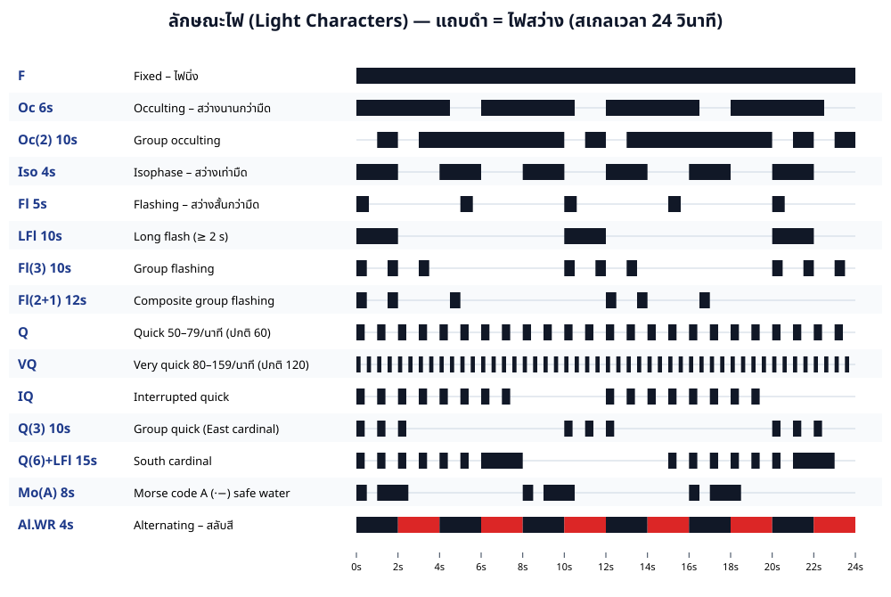
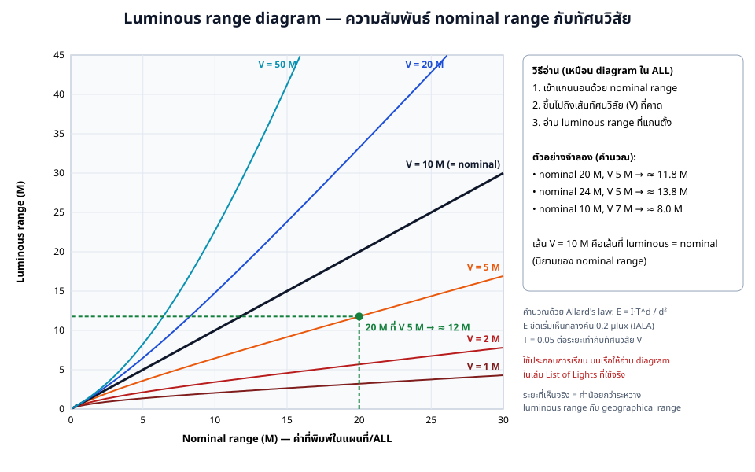
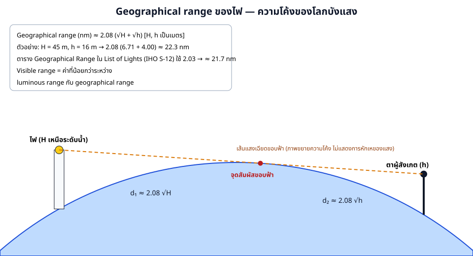
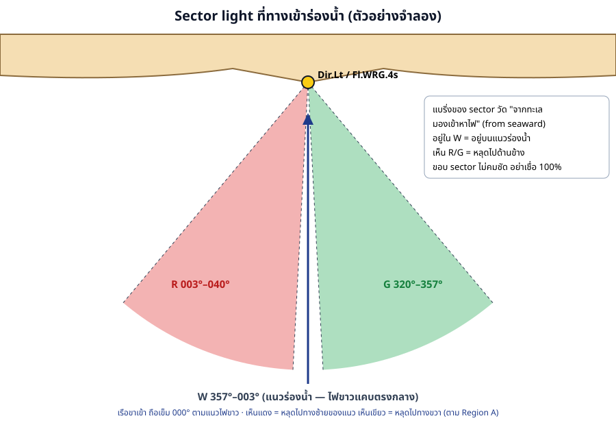
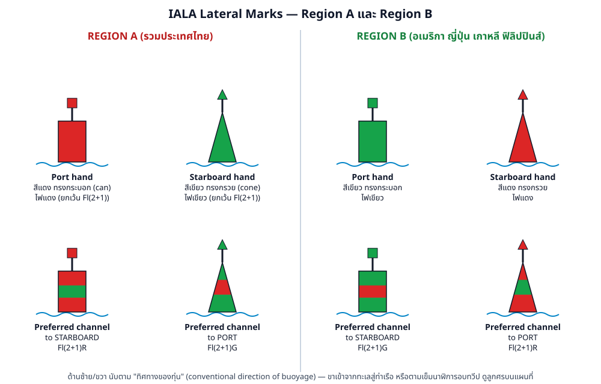
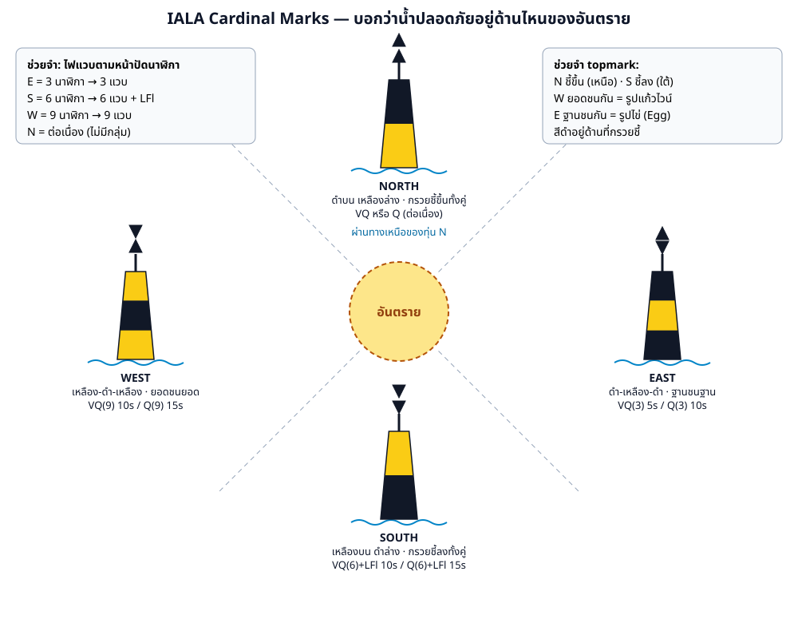
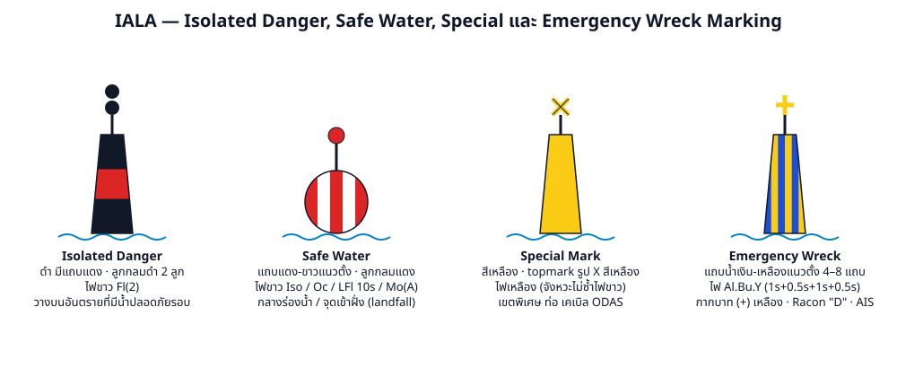

# 1.1.2 Terrestrial and Coastal Navigation (ภาค B) — เครื่องหมายช่วยการเดินเรือ ประภาคาร ทุ่น และระบบ IALA

> สมุดบันทึกการฝึก OOW · TIRAPHONG NANTAPAN
> สมรรถนะ: *Ability to determine the ship's position by use of aids to navigation, including lighthouses, beacons and buoys*
> อ้างอิงหลัก: SOLAS V/13, IALA Recommendation R1001 *The IALA Maritime Buoyage System* (Edition 2.0, June 2023), NP735 *IALA Maritime Buoyage System*, ADMIRALTY List of Lights and Fog Signals (NP74–NP88) ส่วนคำอธิบายด้านหน้าเล่ม, NP5011 (ส่วน P – Lights, Q – Buoys and Beacons, R – Fog signals, S – Radar/Radio/Satellite), NP100, Bowditch (บท Short Range Aids to Navigation)
> อ้างอิงเพิ่มเติม: IALA Recommendation R0110 (เดิม E-110) *Rhythmic Characters of Lights on Aids to Navigation*, IHO S-12 *Standardization of List of Lights and Fog Signals* (นิยามระยะของไฟ ตาราง geographical range), IALA R1016 *Mobile Aids to Navigation (MAtoN)*

---

## 1. Aids to Navigation (AtoN) คืออะไร ใครรับผิดชอบ

**เครื่องหมายช่วยการเดินเรือ (Aids to Navigation – AtoN)** คืออุปกรณ์หรือระบบภายนอกเรือที่ออกแบบและใช้งานเพื่อเพิ่มความปลอดภัยและประสิทธิภาพในการเดินเรือ

**SOLAS V/13 – Establishment and operation of aids to navigation** กำหนดให้รัฐภาคีจัดให้มี AtoN ตามที่ปริมาณการจราจรและระดับความเสี่ยงเห็นสมควร โดยคำนึงถึงข้อแนะนำและแนวทางของ **IALA (International Association of Marine Aids to Navigation and Lighthouse Authorities)** — ปัจจุบัน IALA เปลี่ยนสถานะเป็น **องค์การระหว่างรัฐบาล (intergovernmental organization)** ภายใต้อนุสัญญาที่มีผลบังคับในปี 2024 (ชื่อย่อยังเป็น IALA) — และต้องเผยแพร่ข้อมูล AtoN ให้ผู้เกี่ยวข้องทราบ

> จดไว้กันลืม: *Convention on the International Organization for Marine Aids to Navigation* มีผลบังคับ **22 สิงหาคม 2024** (90 วันหลังรัฐที่ 30 เข้าเป็นภาคี) ชื่อเต็มใหม่คือ **International Organization for Marine Aids to Navigation** แต่ยังใช้ตัวย่อ IALA เหมือนเดิม ชื่อเดิม "International Association of Marine Aids to Navigation and Lighthouse Authorities" จึงยังเห็นในเอกสารเก่าอยู่มาก

ในประเทศไทย หน่วยงานที่ดูแลประภาคารและทุ่นหลักคือ **กรมอุทกศาสตร์ กองทัพเรือ** (ประภาคาร เครื่องหมายทางเรือ แผนที่ และประกาศชาวเรือ) และ **กรมเจ้าท่า** (ร่องน้ำ ทุ่นในแม่น้ำและร่องน้ำต่าง ๆ) ส่วนการท่าเรือแต่ละแห่งดูแลในเขตท่าของตน

### 1.1 ประเภทของ AtoN

| ประเภท | ตัวอย่าง |
|---|---|
| ทัศนะ (visual) | ประภาคาร (lighthouse), ไฟนำร่อง (leading lights), กระโจมไฟ/หลักแสดง (beacons), ทุ่น (buoys), เรือไฟ (light vessels), ทุ่นนำร่องขนาดใหญ่ (LANBY / Large Navigational Buoy), เครื่องหมายกลางวัน (daymarks) |
| เสียง (audible) | สัญญาณหมอก (fog signals) — horn, siren, diaphone, bell, gong, whistle |
| วิทยุ/อิเล็กทรอนิกส์ (radio/electronic) | Racon, AIS AtoN (real, synthetic, virtual), DGNSS reference stations, eLoran |
| ระบบ | VTS ในบางนิยามของ IALA ก็นับเป็นบริการช่วยการเดินเรือ |

---

## 2. ไฟ (Lights) — ลักษณะและการอ่าน

### 2.1 ลักษณะไฟ (Light characters / Phase characteristics)

ไฟแต่ละดวงมี "รหัส" ด้วยจังหวะการกะพริบ สี และคาบ ให้แยกออกจากไฟอื่นในบริเวณใกล้เคียงได้

*ภาพที่ 1.1.2-B1 ลักษณะไฟที่พบบ่อย — แถบดำแทนช่วงไฟสว่าง (แถวสุดท้ายแสดงสีแดงสลับ)*

| ตัวย่อ | ชื่อ | ความหมาย |
|---|---|---|
| F | Fixed | ไฟนิ่งต่อเนื่อง |
| Oc | Occulting | ช่วงสว่าง **ยาวกว่า** ช่วงมืด (ดับเป็นจังหวะ) |
| Oc(2) | Group occulting | ดับเป็นกลุ่ม 2 ครั้งต่อคาบ |
| Oc(2+1) | Composite group occulting | ดับเป็นกลุ่ม 2 แล้ว 1 |
| Iso | Isophase | ช่วงสว่าง **เท่ากับ** ช่วงมืด |
| Fl | Flashing | ช่วงสว่าง **สั้นกว่า** ช่วงมืด — นิยามตาม IALA R0110 และ IHO S-12 คือแวบซ้ำด้วยอัตรา **น้อยกว่า 50 ครั้งต่อนาที** และ IALA แนะนำให้คาบไม่สั้นกว่า 2 วินาที (2.5 วินาทีในประเทศที่ใช้ Q อัตรา 50 ครั้ง/นาที) ในทางปฏิบัติจึงไม่เกินประมาณ 30 ครั้งต่อนาที |
| LFl | Long flashing | แวบยาว **ไม่น้อยกว่า 2 วินาที** |
| Fl(3) | Group flashing | แวบเป็นกลุ่ม 3 ครั้งต่อคาบ |
| Fl(2+1) | Composite group flashing | แวบ 2 แล้ว 1 (ใช้กับ preferred channel mark) |
| Q | Quick | แวบเร็ว 50–79 ครั้ง/นาที (ปกติ 50 หรือ 60) |
| VQ | Very quick | 80–159 ครั้ง/นาที (ปกติ 100 หรือ 120) |
| UQ | Ultra quick | 160 ครั้ง/นาทีขึ้นไป |
| IQ / IVQ | Interrupted quick / very quick | แวบเร็วแล้วหยุดเป็นช่วง |
| Q(3), VQ(3) ฯลฯ | Group quick | แวบเร็วเป็นกลุ่ม (ใช้กับ cardinal marks) |
| Q(6)+LFl | | 6 แวบเร็วตามด้วยแวบยาว (South cardinal) |
| Mo(A) | Morse code | แวบเป็นรหัสมอร์ส เช่น A (·−) สำหรับ safe water, U (··−) ใช้กับแท่นนอกชายฝั่งบางแห่ง |
| FFl | Fixed and flashing | ไฟนิ่งที่มีแวบสว่างขึ้นเป็นระยะ |
| Al.WR | Alternating | สลับสี เช่น ขาว-แดง |

**สีไฟ:** W (ขาว), R (แดง), G (เขียว), Y (เหลือง), Bu (น้ำเงิน) — ถ้าไม่ระบุสีถือว่าเป็นสีขาว

**คาบ (period):** เวลาที่ครบหนึ่งรอบจังหวะ เช่น "10s" — **ต้องจับเวลาด้วยนาฬิกาจับเวลาเสมอ** อย่านับในใจ เพราะผิดง่ายมาก

### 2.2 การอ่านคำอธิบายไฟบนแผนที่

ตัวอย่าง: **Fl(3)WRG.15s21m15-11M**

| ส่วน | ความหมาย |
|---|---|
| Fl(3) | แวบเป็นกลุ่ม 3 ครั้ง |
| WRG | มี 3 สี (sector light) ขาว แดง เขียว แยกตาม sector |
| 15s | คาบ 15 วินาที |
| 21m | ความสูงของโคมไฟเหนือระดับอ้างอิงความสูง (ADMIRALTY ใช้ MHWS หรือระดับที่ระบุในแผนที่ — ตาม IHO S-12 วัดจากจุดโฟกัสของโคม เหนือ MSL ในบริเวณที่แทบไม่มีน้ำขึ้นลง หรือเหนือ MHWS/ระดับน้ำสูงที่เหมาะสมในบริเวณอื่น) |
| 15-11M | ระยะ (range) ไมล์ทะเล — สีขาว 15 M, สีที่อ่อนที่สุด 11 M |

ตัวย่ออื่นที่พบ: **Dir** (directional light), **Ldg** (leading), **Occas** (occasional), **(U)** (unwatched – ไม่มีคนเฝ้า), **Aero** (ไฟการบิน อาจไม่เชื่อถือได้สำหรับการเดินเรือ), **Fog Det Lt** (fog detector light), **vis** (visible), **intens** (intensified sector), **(T)** temporary, **(P)** preliminary, **Exting** (extinguished)

### 2.3 ระยะของไฟ (Ranges)

| ชื่อ | นิยาม |
|---|---|
| **Luminous range** | ระยะไกลสุดที่ไฟมองเห็นได้ ขึ้นกับ **ความเข้มแสง (intensity)** และ **ทัศนวิสัยทางอุตุนิยมวิทยา (meteorological visibility)** ขณะนั้น ไม่คำนึงถึงความสูงหรือความโค้งของโลก |
| **Nominal range** | luminous range เมื่อทัศนวิสัยทางอุตุนิยมวิทยา **10 ไมล์ทะเล** (สภาพอ้างอิงมาตรฐาน) — แผนที่ ADMIRALTY และ ALL ส่วนใหญ่ให้ค่านี้ (บางประเทศให้ luminous range หรือ geographical range ตามที่ระบุในหมายเหตุของ ALL) |
| **Geographical range** | ระยะไกลสุดที่แสงจากไฟจะมาถึงตาผู้สังเกตได้ โดยพิจารณาความโค้งของโลก การหักเหของบรรยากาศ ความสูงของไฟและความสูงตา **ไม่ขึ้นกับความเข้มแสง** |
| **Visible range** | ระยะที่มองเห็นได้จริง = **ค่าที่น้อยกว่า** ระหว่าง luminous range กับ geographical range |

**การใช้ Luminous Range Diagram** (อยู่ในด้านหน้าเล่ม ALL และในแผนที่บางแผ่น): เข้าตารางด้วย nominal range (แกนนอน) แล้วเลือกเส้นทัศนวิสัยที่คาดไว้ อ่าน luminous range จากแกนตั้ง เช่น nominal range 20 M ในทัศนวิสัย 5 nm จะได้ luminous range ประมาณ **12 M** (คำนวณด้วย Allard's law ตามค่าคงที่ของ IALA ได้ ≈ 11.8 M — เดิมผมจดไว้ 12–13 M ซึ่งสูงไปเล็กน้อย ต้องเปิดดูกราฟจริงในเล่มเสมอ)

> หมายเหตุ ADMIRALTY: ระยะของไฟใน ALL และบนแผนที่ปกติเป็น **nominal range** ยกเว้นประเทศที่หน่วยงานรับผิดชอบให้ luminous หรือ geographical range — ดู "special remarks" ของแต่ละประเทศในเล่ม (คำอธิบาย Section V ของ Weekly NMs ก็ย้ำเรื่องนี้) ตัวอย่างใน IHO S-12: nominal range 10 M ทัศนวิสัย 7 M → luminous range ระหว่าง 7–8 M

*ภาพที่ 1.1.2-B2 Luminous range diagram ที่คำนวณจาก Allard's law ตามนิยามของ IALA — เส้น V = 10 M คือเส้นที่ luminous range เท่ากับ nominal range พอดี เพราะคือนิยามของ nominal range (ใช้ประกอบการเรียน บนเรือให้อ่านจาก diagram ใน ALL)*

**หลักคิดที่ต้องเข้าใจ:** ทัศนวิสัยดีกว่า 10 ไมล์ (อากาศใสหลังฝน) luminous range จะ **มากกว่า** nominal range ทัศนวิสัยแย่กว่า 10 ไมล์ (หมอกแดด ฝน) luminous range จะ **น้อยกว่า** และลดลงเร็วมากเมื่อทัศนวิสัยต่ำ — ไฟ 20 M ในทัศนวิสัย 2 ไมล์เห็นได้ราว 5–6 ไมล์เท่านั้น

*ภาพที่ 1.1.2-B3 ระยะ geographical range ขึ้นกับความสูงของไฟและความสูงตา*

### 2.4 Rising and dipping — การใช้ระยะที่เห็นไฟเพื่อหาตำแหน่ง

- เมื่อเรือแล่นเข้าหาไฟที่ geographical range < luminous range ไฟจะ "โผล่" ขึ้นจากขอบฟ้า (**rising**) ณ ระยะ geographical range — แบริ่งไฟ ณ ขณะนั้นรวมกับระยะ ได้ตำแหน่งโดยประมาณ
- เมื่อแล่นออกห่าง ไฟจะ "จม" ลงใต้ขอบฟ้า (**dipping**)
- วิธีตรวจว่าไฟกำลัง rising/dipping จริง: ลดระดับสายตา (ลงไปชั้นล่าง) ไฟจะหายไป ขึ้นมาที่สูงจะเห็นอีกครั้ง
- ALL มีตาราง Geographical Range Table ให้เปิดด้วยความสูงไฟและความสูงตา
- **ค่าคงที่ไม่เท่ากันทุกตำรา:** สูตรที่ใช้ในห้องเรียนคือ 2.08 (√H + √h) แต่ตาราง Geographical Range ตามมาตรฐาน IHO S-12 (ที่ List of Lights ใช้) เขียนสูตรใต้ตารางเป็น **2.03 (√H + √h)** ซึ่งสมมติการหักเหของบรรยากาศน้อยกว่า ได้ระยะสั้นกว่าราว 2–3% (ตัวอย่างด้านล่าง 45 m/16 m ได้ 21.7 ไมล์แทน 22.3 ไมล์) — ตอนสอบใช้สูตรที่ผู้สอบกำหนด บนเรือใช้ตารางในเล่มที่มีอยู่ และอย่าลืมว่าการหักเหจริงแปรผันตามอากาศได้มาก

**ตัวอย่างจำลอง:** ประภาคารสูงโคม 45 m (เหนือ MHWS — ระดับน้ำจริงขณะนั้นใกล้ MHWS) ความสูงตา 16 m ทัศนวิสัยดีมาก nominal range 24 M
- Geographical range = 2.08 (√45 + √16) = 2.08 (6.71 + 4.00) ≈ **22.3 ไมล์**
- ทัศนวิสัยดี luminous range ประมาณ 24 M > 22.3 → ไฟจะ **rising ที่ประมาณ 22 ไมล์** ใช้หาตำแหน่งได้
- ถ้าคืนนั้นทัศนวิสัยแค่ 5 ไมล์ luminous range อาจเหลือประมาณ 14 M (จาก diagram) → เห็นไฟครั้งแรกที่ประมาณ 14 ไมล์ ไฟไม่ได้ "rising" แต่ "ปรากฏ" เพราะหมอก ห้ามใช้เป็นระยะ dipping

> **Loom of the light** — แสงเรืองที่เห็นบนท้องฟ้าก่อนเห็นตัวไฟ (เพราะแสงสะท้อนจากเมฆ/ความชื้น) อย่าสับสนกับการเห็นไฟจริง

### 2.5 Sector lights และ Directional lights

*ภาพที่ 1.1.2-B4 ตัวอย่างจำลอง sector light — แบริ่งของ sector ระบุ "จากทะเลมองเข้าหาไฟ"*

- **Sector light** แสดงสีต่างกันในแต่ละ sector เพื่อบอกพื้นที่อันตราย/ปลอดภัย หรือแนวร่องน้ำ
- แบริ่งของ sector ใน ALL และบนแผนที่ระบุเป็น **true bearing มองจากทะเลเข้าหาไฟ (from seaward)**
- ขอบระหว่าง sector **ไม่คมชัด** มีช่วงที่สีผสมกันหรือไม่แน่นอนได้หลายองศา อย่าใช้ขอบ sector เป็นเส้นตำแหน่งที่แม่นยำ
- **Directional light (Dir)** — ไฟที่มีลำแสงแคบมากตามแนวร่องน้ำ มักมี sector สีแดง/เขียวขนาบข้าง
- **Leading lights (Ldg)** — ไฟสองดวงขึ้นไปอยู่บนแนวเดียวกัน ไฟหน้าต่ำ ไฟหลังสูง เมื่อเห็นเรียงกันแนวตั้ง เรืออยู่บนแนวร่องน้ำ (leading line) **ไฟหลังเยื้องไปทางไหนของไฟหน้า แปลว่าเรือหลุดไปทางนั้นของแนว → แก้เข็มไปทางตรงข้าม** (เพราะวัตถุที่ใกล้กว่าคือไฟหน้าจะดูเลื่อนมากกว่าวัตถุที่ไกล เวลาเรือเบี่ยงไปทางขวา ไฟหน้าจะดูเหมือนขยับไปทางซ้ายของไฟหลัง ทำให้ไฟหลังดูเยื้องไปทางขวา)

### 2.6 ความน่าเชื่อถือของไฟ — ข้อควรระวัง (จาก NP100 และคำอธิบายใน ALL)

1. ไฟอาจดับหรือแสดงลักษณะผิด (โดยเฉพาะไฟไม่มีคนเฝ้า – unwatched) — ตรวจ NAVTEX/NMs
2. ไฟสีที่อยู่ใกล้ขอบฟ้ามองเห็นได้ยากกว่า แสงสีแดงลดระยะมากในหมอก
3. ไฟบนฝั่งในเมือง (ไฟถนน ป้ายไฟ) อาจกลบไฟเดินเรือ
4. ไฟสูงมากอาจถูกเมฆต่ำบัง
5. ไฟที่มีการตั้ง "obscured sector" — ถูกภูเขาหรือสิ่งก่อสร้างบัง
6. ระยะที่ให้ไว้เป็นค่าประมาณ ขึ้นกับสภาพบรรยากาศจริง
7. **ระบุไฟด้วยการจับเวลาคาบและนับจำนวนแวบเสมอ** แล้วเทียบกับแผนที่และ ALL

---

## 3. สัญญาณหมอก (Fog signals)

| ชนิด | ลักษณะเสียง |
|---|---|
| Diaphone | เสียงทุ้มหนัก มักลงท้ายด้วยเสียง "grunt" |
| Horn | เสียงแตร (ไฟฟ้า/ลมอัด) ความถี่ต่าง ๆ |
| Siren | เสียงไซเรนสูงหรือต่ำ |
| Reed | เสียงแหลมเบา |
| Bell, Gong | ตีด้วยกลไกหรือคลื่น (wave-actuated) — บนทุ่นมักจังหวะไม่สม่ำเสมอ |
| Whistle | เสียงหวีด มักบนทุ่น (คลื่นทำให้ดัง) |
| Explosive | ระเบิดเป็นจังหวะ (ปัจจุบันแทบไม่มี) |

**ข้อควรระวังสำคัญ (NP100/ALL):**
- เสียงเดินทางในหมอกไม่สม่ำเสมอ อาจมี **zones of silence** (บริเวณที่ไม่ได้ยินแม้อยู่ใกล้)
- ห้ามประเมินระยะจากความดังของเสียง ห้ามประเมินทิศจากเสียงอย่างมั่นใจ
- สัญญาณหมอกอาจยังไม่เปิดเมื่อหมอกเพิ่งเริ่มลงที่เรือ (หมอกที่สถานีอาจยังไม่มี)
- หลายประเทศยกเลิกสัญญาณหมอกไปมาก เพราะมีเรดาร์และ GNSS แล้ว

---

## 4. Beacons, Daymarks และ Lighthouses

- **Beacon (หลักแสดง/กระโจม)** — โครงสร้างติดกับพื้น (บนหิน ตลิ่ง หรือในน้ำตื้น) อาจมีไฟหรือไม่มี สีและ topmark ใช้ตามระบบ IALA เช่นเดียวกับทุ่น
- **Daymark** — ป้ายหรือรูปทรงที่มองเห็นได้กลางวัน
- **Lighthouse (ประภาคาร)** — โครงสร้างถาวรที่มีไฟกำลังสูง ใช้เป็นจุด landfall และหาตำแหน่ง มักมีคำอธิบายรูปร่าง/สีในแผนที่และ ALL เช่น "white round tower, red band"
- **Light vessel / LANBY / Light float** — ใช้แทนประภาคารในที่ที่สร้างไม่ได้ ตำแหน่งอาจเคลื่อนเล็กน้อยรอบสมอ

ข้อดีของ beacon และ lighthouse คือ **ตำแหน่งคงที่** ใช้หาตำแหน่งได้น่าเชื่อถือกว่าทุ่นลอย

---

## 5. ทุ่น (Buoys) — รูปร่างและองค์ประกอบ

| รูปร่าง (shape) | ใช้กับ |
|---|---|
| Can (ทรงกระบอก ยอดแบน) | Port hand (Region A) / Starboard (Region B) |
| Conical (ทรงกรวย) | Starboard hand (Region A) / Port (Region B) |
| Spherical (ทรงกลม) | Safe water |
| Pillar (เสา) | ใช้ได้กับทุกประเภท โดยดูสี topmark ไฟ |
| Spar (ไม้/เสายาว) | ใช้ได้กับทุกประเภท |

องค์ประกอบที่ใช้ระบุทุ่น: **สี (colour)**, **รูปร่าง (shape)**, **topmark**, **ลักษณะไฟ (light)**, บางครั้งมี **retroreflective material** (แถบสะท้อนแสง), **radar reflector**, **racon**, **AIS** และ **ชื่อ/หมายเลข** เขียนบนทุ่น

ข้อจำกัดของทุ่น
- อาจเลื่อนจากตำแหน่ง (off station) จากพายุ กระแสน้ำ หรือเรือชน
- ไฟอาจดับหรือแสดงผิด
- ทุ่นมีวงแกว่งรอบสมอ (swinging circle) ตำแหน่งบนแผนที่คือตำแหน่งสมอโดยประมาณ
- ทุ่นเล็กอาจไม่ปรากฏบนเรดาร์ในคลื่นสูง

---

## 6. ระบบทุ่นทางเรือ IALA (IALA Maritime Buoyage System – MBS)

### 6.1 ประวัติย่อ

ก่อนปี 1976 มีระบบทุ่นในโลกกว่า 30 ระบบ บางระบบขัดแย้งกันจนเกิดอุบัติเหตุ IALA จึงจัดทำระบบเดียวกัน
- 1977 — ตกลงใช้ **ระบบ A** (ยุโรป แอฟริกา เอเชียส่วนใหญ่ ออสเตรเลีย) — ตาม R1001 กฎของ System A ร่างเสร็จและ IMO เห็นชอบในปี **1976** แล้วเริ่มนำมาใช้ปี **1977**
- 1980 — ตกลงรวมเป็น **ระบบเดียว มีสองภูมิภาค (Region A และ Region B)** ต่างกันเฉพาะสีของ lateral marks (การประชุมที่ IALA จัดเดือนพฤศจิกายน 1980 ร่วมกับ IMO และ IHO; กฎของ System B ร่างเสร็จต้นปี 1980)
- 1982 — ลงนาม "Agreement on the IALA Maritime Buoyage System" ที่ปารีส (15 เมษายน 1982) โดยผู้แทน 53 ประเทศ/หน่วยงาน
- 2006 — เพิ่ม **Emergency Wreck Marking Buoy** หลังเหตุเรือ *Tricolor* จมในช่องแคบโดเวอร์ (2002) และมีเรือชนซากซ้ำ
- 2010 — ปรับปรุงใหญ่ เพิ่ม AtoN ประเภทอื่นนอกจากทุ่นลอย (ประภาคาร ไฟนำ ไฟ sector beacon ฯลฯ)
- ต่อมา IALA ปรับปรุงและรวมเป็นเอกสาร **R1001** (The IALA Maritime Buoyage System) ซึ่งรวมทั้ง marks แบบดั้งเดิม เครื่องหมายสำหรับอันตรายใหม่ และการใช้ AIS AtoN — **Edition 1.0** (ตัว Recommendation ฉบับ 2.0 ระบุว่าเผยแพร่ พ.ค. 2018 และใช้แทน Agreement 1982) และ **Edition 2.0 (มิถุนายน 2023)** ซึ่งเป็นฉบับปัจจุบัน เพิ่มเรื่องเครื่องหมายอิเล็กทรอนิกส์และ **Mobile AtoN (MAtoN)** และกล่าวถึงเรือ MASS ด้วย

> ภาพรวมของ R1001 Ed. 2.0: ระบบมี **6 ประเภทของ marks** (lateral, cardinal, isolated danger, safe water, special, emergency wreck) — เฉพาะ lateral ที่ต่างกันระหว่าง Region A/B อีก 5 ประเภทเหมือนกันทั้งโลก และมี **4 รูปแบบการใช้งาน** คือ fixed, floating, mobile (MAtoN) และ electronic (AIS AtoN, Racon, radar target enhancer)

### 6.2 Region A และ Region B

- **Region B:** ทวีปอเมริกาเหนือ อเมริกากลาง อเมริกาใต้ ญี่ปุ่น เกาหลี และฟิลิปปินส์
- **Region A:** ส่วนที่เหลือของโลก **รวมถึงประเทศไทย** มาเลเซีย สิงคโปร์ อินโดนีเซีย จีน ยุโรป แอฟริกา ออสเตรเลีย อินเดีย ฯลฯ
- วลีจำ Region A: **"Red to port when entering"** (เข้าท่า ทุ่นแดงอยู่ทางซ้าย) ส่วน Region B คือ "Red Right Returning"

### 6.3 ทิศทางของทุ่น (Direction of buoyage)

Lateral marks อ้างอิงกับ **conventional direction of buoyage** ซึ่งกำหนดได้สองแบบ
1. **Local direction** — ทิศที่เรือแล่นเข้าหาท่าเรือ แม่น้ำ ปากน้ำ หรือทางน้ำอื่นจากทะเล
2. **General direction** — กำหนดโดยหน่วยงาน มักตามเข็มนาฬิการอบทวีป (clockwise around land masses) แสดงบนแผนที่ด้วย **สัญลักษณ์ลูกศรสีม่วงแดง (magenta) มีวงกลมสองวง** ตามที่กำหนดใน NP5011 (Q10)

ตัวอย่าง: ในช่องแคบมะละกาและช่องแคบสิงคโปร์ ทิศทางทุ่นกำหนดไว้ (แสดงบนแผนที่) — ต้องดูแผนที่เสมอ อย่าเดา

### 6.4 Lateral Marks

*ภาพที่ 1.1.2-B5 Lateral marks และ preferred channel marks ในทั้งสองภูมิภาค*

| | Region A | Region B |
|---|---|---|
| **Port hand mark** | สีแดง, can, topmark can แดง, ไฟแดงจังหวะใดก็ได้ยกเว้น Fl(2+1) | สีเขียว, can, topmark can เขียว, ไฟเขียว |
| **Starboard hand mark** | สีเขียว, conical, topmark cone เขียวชี้ขึ้น, ไฟเขียว | สีแดง, conical, topmark cone แดง, ไฟแดง |
| **Preferred channel to starboard** (ร่องหลักอยู่ทางขวา — ทุ่นทำหน้าที่เป็น port mark ของร่องหลัก) | แดง มีแถบเขียวกว้าง 1 แถบ, can, ไฟ **Fl(2+1)R** | เขียว มีแถบแดง, can, ไฟ Fl(2+1)G |
| **Preferred channel to port** (ร่องหลักอยู่ทางซ้าย) | เขียว มีแถบแดงกว้าง 1 แถบ, conical, ไฟ **Fl(2+1)G** | แดง มีแถบเขียว, conical, ไฟ Fl(2+1)R |

> **วิธีคิด preferred channel:** สีหลัก (สีส่วนบนและล่าง) บอกว่าทุ่นทำหน้าที่เป็นทุ่นอะไรสำหรับ **ร่องหลัก (preferred channel)** เช่นใน Region A ทุ่นแดงแถบเขียว = ทุ่นกราบซ้ายของร่องหลัก → ร่องหลักอยู่ทางขวาของทุ่นเมื่อแล่นตามทิศทางทุ่น

**หมายเลข:** lateral marks มักมีหมายเลขเรียงตามทิศทางทุ่น (บางท้องถิ่น port = เลขคู่ starboard = เลขคี่ หรือกลับกัน ต้องดูแผนที่) — R1001 Ed. 2.0 ข้อ 2.1.1.2 กำหนดให้หมายเลข/ตัวอักษรเรียงตาม conventional direction of buoyage และแนะนำ **เลขคู่บนทุ่นสีแดง เลขคี่บนทุ่นสีเขียว** โดยเฉพาะในร่องน้ำแคบ (สังเกตว่าผูกกับ "สี" ไม่ใช่ "กราบ" จึงใช้ได้ทั้งสอง Region)

### 6.5 Cardinal Marks

ใช้บอก **ทิศที่มีน้ำปลอดภัยที่สุด** เทียบกับอันตราย — ชื่อทุ่นคือ "ทิศที่เรือควรผ่าน" ทุ่น North cardinal วางอยู่ทางเหนือของอันตราย เรือต้องผ่านทางเหนือของทุ่น

*ภาพที่ 1.1.2-B6 Cardinal marks — สี topmark และไฟ*

| | North | East | South | West |
|---|---|---|---|---|
| Topmark (กรวยดำ 2 อัน) | ชี้ขึ้นทั้งคู่ | ฐานชนฐาน (ชี้ออกจากกัน) | ชี้ลงทั้งคู่ | ยอดชนยอด (ชี้เข้าหากัน) |
| สี | ดำบน เหลืองล่าง | ดำ มีแถบเหลืองกว้างตรงกลาง | เหลืองบน ดำล่าง | เหลือง มีแถบดำกว้างตรงกลาง |
| ไฟ (ขาว) | VQ หรือ Q ต่อเนื่อง | VQ(3) 5s หรือ Q(3) 10s | VQ(6)+LFl 10s หรือ Q(6)+LFl 15s | VQ(9) 10s หรือ Q(9) 15s |

**วลีช่วยจำ**
- สีดำอยู่ที่ "ปลายกรวยชี้ไป": N ชี้ขึ้น → ดำอยู่บน; S ชี้ลง → ดำอยู่ล่าง; E ชี้ออกทั้งบนล่าง → ดำบนและล่าง; W ชี้เข้ากลาง → ดำตรงกลาง
- จำนวนแวบตามหน้าปัดนาฬิกา: E = 3, S = 6, W = 9 (N ต่อเนื่อง) — South มี LFl ต่อท้ายเพื่อไม่ให้สับสนกับ 3 หรือ 9 เมื่อนับผิด
- topmark W คล้าย "แก้วไวน์" (Wine glass = West), E คล้าย "ไข่" (Egg = East)

ใช้ cardinal marks สำหรับ
- บอกด้านที่น้ำลึกที่สุดของอันตราย
- บอกด้านที่ต้องผ่านอันตรายเพื่อความปลอดภัย
- เน้นจุดเด่นในร่องน้ำ เช่น โค้ง ทางแยก หรือปลายแนวหินโสโครก

### 6.6 Isolated Danger Mark

- วาง **บน** หรือเหนืออันตรายขนาดเล็กที่มีน้ำปลอดภัยรอบด้าน
- สีดำ มีแถบแดงกว้างแนวนอนหนึ่งแถบหรือมากกว่า
- topmark ลูกกลมดำ 2 ลูกเรียงกัน
- ไฟขาว **Fl(2)** (ช่วยจำ: "2 ลูก = 2 แวบ")
- ห้ามผ่านใกล้เกินไป

### 6.7 Safe Water Mark

- บอกว่ามีน้ำปลอดภัยรอบทุ่น ใช้เป็น **กลางร่องน้ำ (mid-channel)** หรือ **จุดเข้าฝั่ง (landfall)**
- แถบแดง-ขาวแนวตั้ง ทรงกลม pillar หรือ spar
- topmark ลูกกลมแดง 1 ลูก
- ไฟขาว **Iso, Oc, LFl 10s หรือ Mo(A)**

### 6.8 Special Marks

- ไม่ได้มีจุดประสงค์หลักเพื่อช่วยการเดินเรือ แต่บอก **พื้นที่หรือสิ่งพิเศษ** ที่ระบุในเอกสารการเดินเรือ เช่น ODAS (ทุ่นเก็บข้อมูลสมุทรศาสตร์) แนวแบ่งเขตจราจร ท่อ/เคเบิลใต้น้ำ เขตฝึกทหาร เขตนันทนาการ เขตทิ้งวัสดุ
- สีเหลือง topmark รูป X สีเหลือง
- ไฟเหลือง จังหวะใดก็ได้ที่ไม่ซ้ำกับไฟขาวของ cardinal/isolated danger/safe water (R1001 Ed. 2.0 เพิ่ม **จังหวะที่สงวนไว้ให้ MAtoN** ด้วย) — เหตุผลคือในทัศนวิสัยไม่ดี ไฟเหลืองกับไฟขาวแยกกันยาก
- รูปร่างอิสระแต่ต้องไม่ขัดกับ lateral marks (เช่นถ้าวางด้านซ้ายร่องน้ำ อาจใช้รูปทรง can)
- ตัวอย่างการใช้อื่นตาม R1001 Ed. 2.0: แนวแบ่งใน TSS ที่ใช้ lateral แล้วอาจสับสน, ขอบเขตที่ทอดสมอ, สิ่งก่อสร้างในทะเล, ฟาร์มเพาะเลี้ยงสัตว์น้ำ (aquaculture), ทุ่นผูกเรือ (mooring buoys) ที่อยู่ใกล้ร่องน้ำ และใช้ทำ **ร่องพิเศษสำหรับเรือบางประเภท** (เช่น ร่องขุดลึกสำหรับเรือกินน้ำลึก ในขณะที่ขอบเขตน้ำปลอดภัยของเรือทั่วไปยังใช้ lateral/cardinal) อนุญาตให้ติด **pictogram** ตามสัญลักษณ์ IHO เพื่อบอกวัตถุประสงค์ได้

#### 6.8.1 Mobile AtoN (MAtoN) — เพิ่มใน R1001 Ed. 2.0

- ใช้ special mark (เหลือง topmark X ถ้าทำได้) ติดกับ **วัตถุลอยที่เคลื่อนที่ได้และเป็นอันตรายต่อการชน** เช่น อุปกรณ์สำรวจที่ลาก วัตถุลอยน้ำขนาดใหญ่ (รายละเอียดใน IALA R1016)
- ไฟเหลืองจังหวะเฉพาะ: **กะพริบถี่ (flicker 5 Hz) 3 ครั้ง ตามด้วยแวบปกติ 2 ครั้ง** — ลำดับตาม R1001: flicker 1 s มืด 0.7 s, flicker 1 s มืด 0.7 s, flicker 1 s มืด 0.5 s, Fl 1 s มืด 0.5 s, Fl 1 s มืด 3 s
- อาจมี radar reflector, AIS AtoN และเครื่องหมายเพิ่มสำหรับการสังเกตจากอากาศ
- ข้อสังเกตของผม: ถ้าเห็นไฟเหลืองกะพริบถี่แปลก ๆ ที่เคลื่อนที่ได้ อย่าคิดว่าเป็นทุ่นประจำที่ ให้ตรวจ AIS เรดาร์ และคำเตือนการเดินเรือ

### 6.9 Emergency Wreck Marking Buoy

- ใช้ทำเครื่องหมาย **ซากเรือใหม่ (new wrecks)** ที่ยังไม่ได้ลงในเอกสารการเดินเรือ
- แถบสีน้ำเงินและเหลืองแนวตั้ง จำนวนเท่ากัน (อย่างน้อย 4 สูงสุด 8 แถบ)
- รูปทรงทุ่น **pillar หรือ spar** (R1001 Ed. 2.0 เรียกว่า *Emergency Wreck mark*)
- topmark กากบาทตั้ง (upright cross, +) สีเหลือง
- ไฟสลับน้ำเงิน-เหลือง: **Bu 1.0s + มืด 0.5s + Y 1.0s + มืด 0.5s** (คาบ 3 วินาที)
- อาจมี **Racon รหัส Morse "D" (−··)** และ **AIS AtoN** (real หรือ virtual)
- วางไว้ชั่วคราวจนกว่าจะประกาศข้อมูลซากเรือในเอกสารการเดินเรือหรือนำซากออก บางกรณีใช้ทุ่นหลายลูก

*ภาพที่ 1.1.2-B7 เครื่องหมายอื่น ๆ ในระบบ IALA*

### 6.10 อันตรายใหม่ (New dangers)

"New danger" คืออันตรายที่เพิ่งพบและยังไม่ได้ลงในเอกสารการเดินเรือ เช่น หินโสโครก สันดอน หรือซากเรือ ต้อง
- ทำเครื่องหมายด้วย lateral, cardinal, isolated danger หรือ emergency wreck marking ตามความเหมาะสม
- ถ้าอันตรายมาก อาจวางทุ่นซ้ำ (duplicate) อย่างน้อยหนึ่งลูก
  - ทุ่นซ้ำต้อง **เหมือนคู่ของมันทุกประการ** และถ้าใช้ lateral mark ที่มีไฟเป็นทุ่นซ้ำ ต้องใช้ไฟจังหวะ **VQ หรือ Q** (R1001 Ed. 2.0 ข้อ 3.2.2)
- อาจใช้ Racon รหัส "D" และ AIS
- เผยแพร่ด้วย Radio navigational warnings (NAVTEX, NAVAREA) จนกว่าจะออก Notices to Mariners

### 6.11 เครื่องหมายอื่นที่ R1001 Ed. 2.0 อธิบายไว้ (Other marks)

| ประเภท | สาระสำคัญตาม R1001 |
|---|---|
| **Lighthouse** | สิ่งก่อสร้างถาวรที่มีไฟระยะไกล/กลาง และเป็น daymark ไฟสีขาว แดง หรือเขียว จังหวะใดก็ได้ที่ทำให้ระบุได้ อาจมี racon, AIS, DGNSS ติดตั้ง |
| **Leading lines / ranges** | เครื่องหมายหรือไฟสองอันขึ้นไปในระนาบตั้งเดียวกัน สีและรูปร่างไม่มีความหมายตายตัว (แนะนำสี่เหลี่ยมผืนผ้าหรือสามเหลี่ยม) ไฟสีใดก็ได้ ไฟนิ่งควรใช้อย่างประหยัด อาจใช้ไฟซิงโครไนซ์ช่วยให้เด่นจากไฟพื้นหลัง |
| **Sector lights** | ถ้าใช้บอกขอบร่องน้ำ สีของ sector ต้องเป็นไปตาม Region ของ lateral marks (Region A: แดงด้านซ้าย เขียวด้านขวา เมื่อมาตามทิศทางทุ่น) ขอบ sector อาจเป็นแบบ oscillating |
| **Beacons** | เครื่องหมายติดตั้งถาวร ระบุด้วยรูปร่าง สี ลาย topmark หรือไฟ (ไฟขาว แดง หรือเขียว) อาจเป็น cardinal beacon ก็ได้ |
| **Major floating aids** | light vessel, light float, LANBY วางในจุดสำคัญที่การจราจรหนาแน่น |
| **Auxiliary marks** | เครื่องหมายเล็ก ๆ ที่ไม่ได้บอกขอบร่องน้ำหรืออันตราย ต้องไม่ขัดกับเครื่องหมายอื่นและต้องประกาศในเอกสารการเดินเรือ |

เรื่องอื่นที่ R1001 Ed. 2.0 ให้ไว้และควรรู้
- **Synchronized / sequential lights** — ไฟแนวร่องน้ำกะพริบพร้อมกัน หรือไล่ลำดับ ช่วยให้มองเห็นแนวร่องน้ำได้ง่ายท่ามกลางไฟบนฝั่ง
- **Retro-reflective materials** — แถบสะท้อนแสงบนทุ่น/หลัก เมื่อส่องไฟค้นหา (searchlight) จะเห็นสีและรหัส บางประเทศ (เช่น สแกนดิเนเวีย) ใช้รหัสละเอียด
- **เครื่องหมายท้องถิ่น** (ท่าเรือ ทางน้ำภายใน สะพาน) ควรสอดคล้องกับ MBS แต่ต้องศึกษากฎท้องถิ่นก่อนเข้าพื้นที่ครั้งแรก
- **MASS** — เครื่องหมายทั้งหมดใช้กับเรืออัตโนมัติด้วย ผู้ควบคุมเรือต้องทำให้ระบบของเรือตีความเครื่องหมายได้ถูกต้อง

---

## 7. AtoN อิเล็กทรอนิกส์

### 7.1 Racon (Radar Beacon)

- เครื่องรับ-ส่งสัญญาณติดบนประภาคาร ทุ่น หรือแท่น เมื่อได้รับพัลส์เรดาร์ (X-band และ/หรือ S-band) จะส่งสัญญาณตอบกลับ ทำให้ปรากฏบนจอเรดาร์เป็น **เส้นรหัส Morse** เริ่มจากตำแหน่งของ racon ยื่นออกไปตามแนวรัศมี (ห่างจากเรือ)
- ใช้ **ระบุ** เป้าเรดาร์ (identification) และหาตำแหน่ง (ระยะวัดที่จุดเริ่มต้นของเส้นรหัส — ซึ่งอาจห่างจากตำแหน่งจริงเล็กน้อยเพราะ delay ในเครื่อง ประมาณ 50–100 m)
- สัญลักษณ์บนแผนที่: วงกลมสีม่วงแดง พร้อมข้อความ "Racon (T)" เป็นต้น
- บางเรดาร์มี interference rejection ที่อาจลบ racon ออก
- รายละเอียดใน ALRS Vol 2 (NP282) — UKHO เริ่มตัดข้อมูล AIS และ Racon ออกจาก Sailing Directions ตั้งแต่ปี 2018 (ฉบับใหม่แต่ละเล่มจะไม่มี และข้อมูลเดิมในเล่มเก่าไม่ถูกอัปเดตแล้ว) ให้ใช้ ALRS เป็นแหล่งหลัก (ตามคำอธิบายใน Weekly NMs Section I)
- เรื่องระยะ: Bowditch ระบุว่าจุดเริ่มของสัญญาณ racon บนจอปรากฏเลยตำแหน่งจริงไปเล็กน้อย (ราว 50 หลา) จาก response delay ของเครื่อง จึงวัดระยะที่ขอบใกล้ของสัญญาณ แล้วเผื่อความคลาดเล็กน้อย

### 7.2 AIS AtoN

| ประเภท | ลักษณะ |
|---|---|
| **Real AIS AtoN** | มีเครื่องส่ง AIS ติดอยู่บน AtoN จริง (ทุ่น ประภาคาร) |
| **Synthetic AIS AtoN** | AtoN มีอยู่จริง แต่ข้อความ AIS ส่งจากสถานีที่อื่น (เช่นสถานีบนฝั่ง) |
| **Virtual AIS AtoN** | **ไม่มีวัตถุจริง** อยู่ ณ ตำแหน่งนั้น มีเฉพาะข้อความ AIS ปรากฏบน ECDIS/เรดาร์/AIS display ใช้ทำเครื่องหมายชั่วคราว เช่น ซากเรือใหม่ ก่อนวางทุ่นจริง |

ข้อควรระวัง: virtual AtoN จะไม่ปรากฏบนจอเรดาร์และมองไม่เห็นด้วยตา อาจถูกปลอมแปลงได้ (AIS spoofing) ต้องตรวจสอบกับ NAVTEX/NMs

> R1001 Ed. 2.0 ข้อ 3.2.1 ใช้คำว่า **physical** AIS AtoN (แทนคำว่า real) — สถานี AIS ติดอยู่บน AtoN ที่มีอยู่จริง ส่วน synthetic และ virtual ความหมายเหมือนตารางด้านบน และย้ำว่า virtual AtoN อาจแสดงสัญลักษณ์บน ENC/ECDIS ทั้งที่ไม่มีทุ่นหรือหลักจริงอยู่ ณ ที่นั้น ตาราง Table 16 ของ R1001 ระบุว่า marks ทุกประเภท (lateral, cardinal, isolated danger, safe water, special, emergency wreck) ทำเป็น virtual/synthetic AIS ได้

### 7.3 DGNSS และ eLoran

ดูบท 1.1.3 — สถานี DGNSS ส่งค่าแก้ (correction) ทาง MF beacon ส่วน eLoran เป็นระบบภาคพื้นดินที่หลายประเทศพิจารณาเป็นระบบสำรอง GNSS

> สถานะปัจจุบัน: บางประเทศยุติบริการ DGPS ทาง MF แล้ว เช่น General Lighthouse Authorities ของสหราชอาณาจักรและไอร์แลนด์ (Trinity House, Northern Lighthouse Board, Irish Lights) หยุดส่งสัญญาณหลัง **31 มีนาคม 2022** เพราะ GPS ปกติให้ความแม่นยำตามข้อกำหนด IMO แล้ว — ก่อนพึ่ง DGNSS ในพื้นที่ใด ให้ตรวจสถานีที่ยังทำงานใน ALRS Vol 2 และ NMs ล่าสุด

---

## 8. ตัวอย่างจำลอง — ใช้ AtoN เข้าร่องน้ำตอนกลางคืน

> สถานการณ์จำลอง ชื่อและลักษณะไฟเป็นค่าสมมติ ไม่ใช่ข้อมูลของท่าเรือจริง

เรือ MV "Andaman Pearl" เข้าร่องน้ำสู่ท่าเรือสมมติในอ่าวไทย (Region A) เวลา 0200 ทัศนวิสัย 6 ไมล์

1. **ระยะ 18 ไมล์** — เห็นไฟ **Fl(2)W.10s** ทางหัวเรือซ้ายเล็กน้อย จับเวลาคาบได้ 10 วินาที แวบ 2 ครั้ง ตรงกับ "ประภาคารเกาะ A" ในแผนที่และ ALL Vol F ใช้แบริ่ง + ระยะเรดาร์จากหน้าผาของเกาะ A ได้ fix ตรวจกับ GNSS ต่างกัน 0.1 ไมล์ ✓
2. **ระยะ 8 ไมล์** — เห็นไฟ **Mo(A)W.8s** ตรงหัว คือทุ่น **safe water (landfall buoy)** หน้าร่องน้ำ มี Racon "K" (−·−) บนเรดาร์ ยืนยันตัวตน
3. **เข้าร่องน้ำ** — ทุ่นคู่แรก: ไฟ **Fl.R.3s** ทางซ้าย (port hand – Region A) และ **Fl.G.3s** ทางขวา (starboard hand) ✓ ตรงกับทิศทางทุ่นขาเข้า
4. **ทางแยก** — ทุ่นไฟ **Fl(2+1)R.10s** แดงแถบเขียว = preferred channel to starboard → ร่องหลักอยู่ทางขวา เรือเข้าร่องหลักโดยปล่อยทุ่นนี้ไว้ทางซ้าย
5. **ใกล้หินโสโครก** — ไฟ **VQ(3)W.5s** ทางขวาหน้า = **East cardinal** → น้ำปลอดภัยอยู่ทางตะวันออกของทุ่น เส้นทางวางไว้ผ่านทางตะวันออกห่าง 3 cables ✓
6. **ไฟนำร่อง** — เห็น leading lights สองดวง ไฟหลังเยื้องไปทางขวาของไฟหน้าเล็กน้อย → เรือหลุดไปทางขวาของแนว → แก้เข็มไปทางซ้ายเล็กน้อยจนไฟเรียงในแนวตั้ง แล้วถือเข็มเผื่อกระแสน้ำให้ไฟยังเรียงอยู่
7. ตลอดทาง ตรวจตำแหน่งด้วย PI เรดาร์และ GNSS เสมอ ไม่อาศัยทุ่นลอยอย่างเดียว

---

## 9. คำถามสอบปากเปล่า / สัมภาษณ์ — AtoN และระบบทุ่น

**ถาม:** ประเทศไทยอยู่ IALA Region ไหน ต่างจาก Region B อย่างไร
**แนวตอบ:** Region A ต่างกันเฉพาะสีของ lateral marks — Region A ทุ่นกราบซ้าย (port) สีแดงทรง can ทุ่นกราบขวาสีเขียวทรงกรวย ส่วน Region B กลับสี (แดงอยู่ขวาเมื่อเข้าท่า – "red right returning")

**ถาม:** ทิศทางทุ่น (direction of buoyage) กำหนดอย่างไร
**แนวตอบ:** แบบ local คือทิศจากทะเลเข้าสู่ท่า/ร่องน้ำ แบบ general กำหนดโดยหน่วยงาน มักตามเข็มนาฬิการอบทวีป แสดงด้วยลูกศรสีม่วงแดงบนแผนที่

**ถาม:** อธิบาย cardinal marks ทั้ง 4 (topmark สี ไฟ)
**แนวตอบ:** (ตามตารางในข้อ 6.5) N: กรวยชี้ขึ้น ดำบนเหลืองล่าง VQ/Q ต่อเนื่อง; E: ฐานชนฐาน ดำ-เหลือง-ดำ VQ(3)5s/Q(3)10s; S: ชี้ลง เหลืองบนดำล่าง VQ(6)+LFl 10s/Q(6)+LFl 15s; W: ยอดชนยอด เหลือง-ดำ-เหลือง VQ(9)10s/Q(9)15s เรือผ่านด้านที่ตรงกับชื่อทุ่น

**ถาม:** ทำไม South cardinal มี LFl ต่อท้าย
**แนวตอบ:** เพื่อให้แยกจาก East (3) และ West (9) ได้แน่นอน เพราะการนับแวบเร็ว 6 ครั้งอาจผิดเป็น 3 หรือ 9 ได้ LFl ทำหน้าที่บอกจุดสิ้นสุดกลุ่ม

**ถาม:** Emergency wreck marking buoy มีลักษณะอย่างไร
**แนวตอบ:** แถบน้ำเงิน-เหลืองแนวตั้ง 4–8 แถบ topmark กากบาทตั้งสีเหลือง ไฟสลับ Bu/Y 1 วินาทีมืด 0.5 วินาที อาจมี Racon "D" และ AIS ใช้ทำเครื่องหมายซากเรือใหม่ชั่วคราว

**ถาม:** Luminous range, nominal range, geographical range ต่างกันอย่างไร
**แนวตอบ:** luminous range ขึ้นกับความเข้มแสงและทัศนวิสัยขณะนั้น; nominal range คือ luminous range ที่ทัศนวิสัย 10 ไมล์; geographical range ขึ้นกับความสูงไฟ ความสูงตา และความโค้งของโลก ระยะที่เห็นจริงคือค่าที่น้อยกว่าระหว่าง luminous กับ geographical

**ถาม:** คำนวณ geographical range ของไฟสูง 36 m ความสูงตา 25 m
**แนวตอบ:** 2.08 (√36 + √25) = 2.08 (6 + 5) = 22.9 ไมล์

**ถาม:** ทำไมไม่ควรใช้ทุ่นลอยเป็นวัตถุหลักในการหาตำแหน่ง
**แนวตอบ:** เพราะทุ่นอาจเลื่อนจากตำแหน่ง ไฟอาจดับ แกว่งรอบสมอ และตำแหน่งบนแผนที่เป็นตำแหน่งโดยประมาณ ควรใช้วัตถุถาวรบนฝั่งหรือประภาคาร

**ถาม:** ถ้าเห็นไฟที่ไม่ตรงกับแผนที่ จะทำอย่างไร
**แนวตอบ:** จับเวลาคาบ นับแวบใหม่อย่างระมัดระวัง เทียบกับ ALL และแผนที่ ตรวจ NAVTEX/NMs ว่ามีการเปลี่ยนแปลงหรือไฟดับ ตรวจตำแหน่งด้วยวิธีอื่น ถ้ายังไม่ชัดเจนให้แจ้งนายเรือและอย่าใช้ไฟนั้นในการหาตำแหน่ง ถ้าพบไฟผิดปกติจริงให้รายงานหน่วยงานที่เกี่ยวข้อง (SOLAS V/31 – danger messages / รายงานผ่านสถานีชายฝั่ง และแจ้ง UKHO ด้วย H-note)

**ถาม:** Racon คืออะไร ใช้อย่างไร
**แนวตอบ:** radar beacon ที่ตอบสนองต่อพัลส์เรดาร์ แสดงเป็นรหัส Morse บนจอเรดาร์ ยื่นออกจากตำแหน่ง racon ไปทางรัศมีด้านไกล ใช้ระบุเป้าและวัดระยะ/แบริ่ง

**ถาม:** Virtual AIS AtoN คืออะไร มีข้อควรระวังอะไร
**แนวตอบ:** AtoN ที่มีเฉพาะสัญญาณ AIS ไม่มีวัตถุจริง ใช้ทำเครื่องหมายชั่วคราว ไม่ปรากฏบนเรดาร์หรือด้วยตา ต้องตรวจสอบกับคำเตือนการเดินเรือและระวังการปลอมแปลง

**ถาม:** Isolated danger mark กับ safe water mark ต่างกันอย่างไร (สี topmark ไฟ)
**แนวตอบ:** Isolated danger วางบนอันตรายเล็กที่มีน้ำปลอดภัยรอบ สีดำแถบแดงแนวนอน topmark ลูกกลมดำ 2 ลูก ไฟขาว Fl(2) ห้ามเข้าใกล้; safe water บอกว่ามีน้ำปลอดภัยรอบทุ่น ใช้กลางร่องหรือ landfall แถบแดง-ขาวแนวตั้ง ทรงกลม (หรือ pillar/spar) topmark ลูกกลมแดง 1 ลูก ไฟขาว Iso, Oc, LFl 10s หรือ Mo(A)

**ถาม:** เห็นทุ่นแดงแถบเขียวกว้างหนึ่งแถบ ไฟ Fl(2+1)R ใน Region A หมายความว่าอย่างไร
**แนวตอบ:** Preferred channel to starboard — ทุ่นทำหน้าที่เป็นทุ่นกราบซ้ายของร่องหลัก ร่องหลักอยู่ทางขวาเมื่อแล่นตามทิศทางทุ่น ให้ปล่อยทุ่นไว้ทางซ้าย (ร่องรองก็ใช้ได้โดยปล่อยทุ่นไว้ทางขวา)

**ถาม:** ทำไมไฟเหลืองของ special mark ห้ามใช้จังหวะเดียวกับไฟขาวของ cardinal/isolated danger/safe water
**แนวตอบ:** เพราะในทัศนวิสัยไม่ดี ไฟเหลืองกับไฟขาวแยกสีกันยาก ถ้าจังหวะเหมือนกันอาจเข้าใจผิดว่าเป็น cardinal หรือ isolated danger ได้ R1001 Ed. 2.0 ยังสงวนจังหวะของ MAtoN ไว้ด้วย

**ถาม:** MAtoN คืออะไร
**แนวตอบ:** Mobile Aid to Navigation ตาม R1001 Ed. 2.0 และ IALA R1016 เป็น special mark สีเหลืองติดกับวัตถุลอยที่เคลื่อนที่ได้และเป็นอันตรายต่อการชน ไฟเหลือง flicker 3 ครั้งตามด้วยแวบปกติ 2 ครั้ง อาจมี radar reflector และ AIS

**ถาม:** ไฟมี nominal range 20 M คืนนี้ทัศนวิสัย 5 ไมล์ จะเห็นไฟได้ไกลประมาณเท่าไร ความสูงไฟ 45 m ความสูงตา 16 m
**แนวตอบ:** luminous range จาก diagram ≈ 12 M ส่วน geographical range ≈ 2.08(√45 + √16) ≈ 22.3 ไมล์ ระยะที่เห็นจริงคือค่าน้อยกว่า ≈ 12 ไมล์ และที่ระยะนั้นไฟไม่ได้ rising จึงห้ามใช้เป็นระยะจากการเห็นไฟโผล่ขอบฟ้า

**ถาม:** แบริ่งของ sector light ใน ALL และบนแผนที่วัดอย่างไร
**แนวตอบ:** เป็น true bearing ของไฟเมื่อมองจากทะเลเข้าหาไฟ (from seaward) เรียงตามเข็มนาฬิกา ขอบ sector ไม่คมชัด จึงไม่ใช้ขอบ sector เป็นเส้นตำแหน่งที่แม่นยำ ถ้าเป็น sector บอกขอบร่องน้ำ สีจะตามระบบ Region ของ lateral marks

**ถาม:** อันตรายใหม่ที่ร้ายแรงมาก หน่วยงานจะทำเครื่องหมายอย่างไร
**แนวตอบ:** ใช้ lateral, cardinal, isolated danger หรือ emergency wreck mark และวางทุ่นซ้ำอย่างน้อยหนึ่งลูกที่เหมือนคู่ทุกประการ ถ้าเป็น lateral ที่มีไฟให้ใช้ VQ หรือ Q อาจมี Racon "D" และ AIS AtoN และประกาศทางคำเตือนการเดินเรือจนกว่าจะลงใน NMs

---

*ก่อนหน้า ← [1.1.2-A Terrestrial and Coastal Navigation](1.1.2-A-terrestrial-coastal-navigation.md) · ถัดไป → [1.1.2-C Charts and Nautical Publications](1.1.2-C-charts-and-publications.md)*
