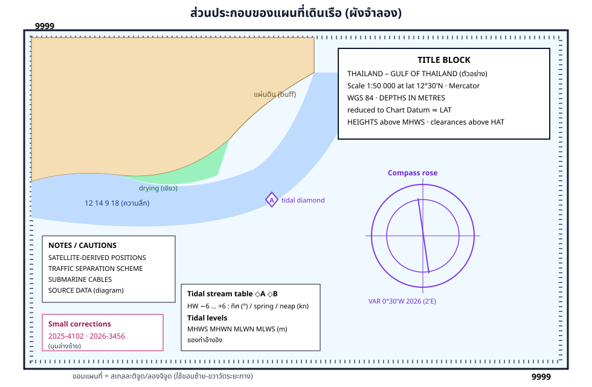
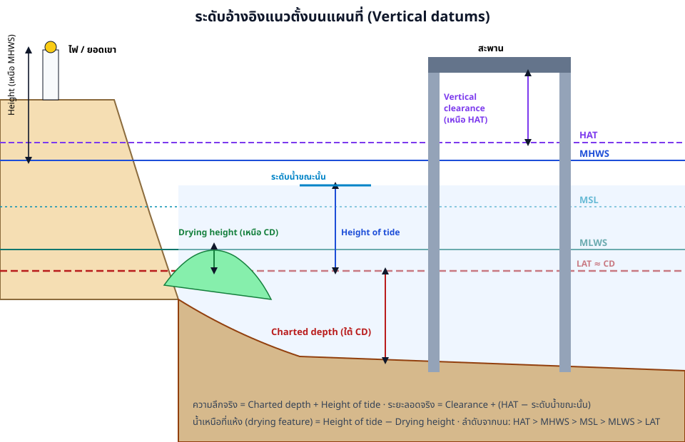
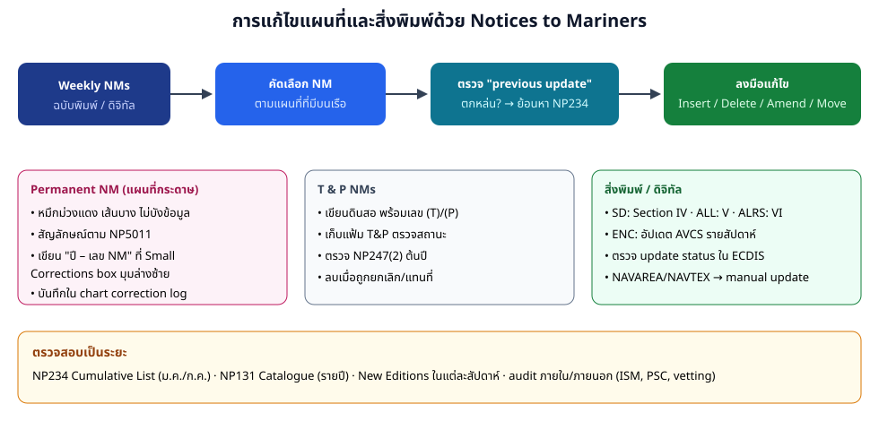
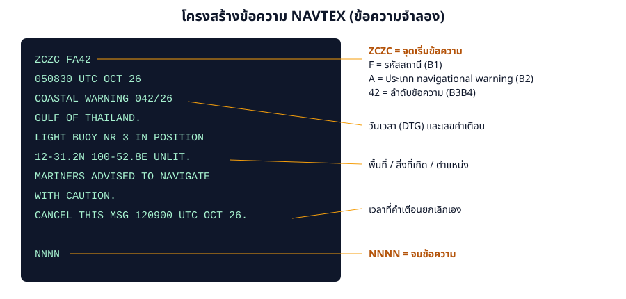

# 1.1.2 Terrestrial and Coastal Navigation (ภาค C) — แผนที่เดินเรือและสิ่งพิมพ์ทางทะเล

> สมุดบันทึกการฝึก OOW · TIRAPHONG NANTAPAN
> สมรรถนะ: *Thorough knowledge of and ability to use nautical charts, and publications, such as sailing directions, tide tables, notices to mariners, radio navigational warnings and ships' routeing information*
> อ้างอิงหลัก: SOLAS V/2, V/4, V/9, V/10, V/19, V/27; IHO S-4, IHO/IMO *Joint Manual on Maritime Safety Information* (IHO S-53 / IMO), IMO Res. A.706(17) as amended (WWNWS), NP5011, NP100, NP131, NP294, NP247, NP234, IMO *Ships' Routeing*, ADMIRALTY Weekly Notices to Mariners
> อ้างอิงเพิ่มเติม: IMO *Revised NAVTEX Manual* (MSC.1/Circ.1403/Rev.1 มีผล 1 ม.ค. 2018), แถลงการณ์ UKHO เรื่องแผนที่กระดาษ (ก.ค. 2022, ก.พ. 2023, 19 ก.พ. 2026), รายการ *Current editions of ADMIRALTY Sailing Directions* (UKHO, ปรับปรุงถึง Week 42/26), IHO WWNWS documents (ขอบเขต NAVAREA)

> หัวข้อน้ำขึ้นน้ำลง (Tide tables) แยกไปอยู่ใน [ภาค D](1.1.2-D-tides-and-tidal-streams.md) และรายการสิ่งพิมพ์ ADMIRALTY ฉบับปัจจุบันอยู่ใน [ภาค E](1.1.2-E-admiralty-publications-current-editions.md)

---

## 1. แผนที่เดินเรือตามกฎหมาย (Official nautical charts)

### 1.1 นิยามตาม SOLAS V/2

> *Nautical chart or nautical publication* is a special-purpose map or book, or a specially compiled database from which such a map or book is derived, that is issued officially by or on the authority of a Government, authorized Hydrographic Office or other relevant government institution and is designed to meet the requirements of marine navigation.

แปลความ: แผนที่/สิ่งพิมพ์ที่ใช้ตามกฎหมายต้องเป็น **ของทางการ (official)** ออกโดยหรือได้รับอนุญาตจากรัฐบาลหรือสำนักงานอุทกศาสตร์ที่ได้รับมอบอำนาจ แผนที่จากผู้ผลิตเอกชนที่ไม่ได้รับอนุญาต (เช่นแผนที่ในแอปมือถือทั่วไป) **ใช้แทนไม่ได้**

### 1.2 ข้อกำหนดการมีแผนที่บนเรือ (Carriage requirements)

- **SOLAS V/19.2.1.4** — เรือทุกลำต้องมีแผนที่และสิ่งพิมพ์ทางทะเลเพื่อวางแผนและแสดงเส้นทางเดินเรือ และ plot/ติดตามตำแหน่งตลอดการเดินทาง โดยยอมรับ **ECDIS** ว่าเป็นไปตามข้อนี้ได้
- **SOLAS V/19.2.10 และ 19.2.11** — ข้อกำหนดบังคับติดตั้ง ECDIS สำหรับเรือโดยสารและเรือบรรทุกสินค้าขนาดต่าง ๆ (ทยอยบังคับระหว่างปี 2012–2018) — แยกให้ชัด: **19.2.10** คือข้อบังคับติดตั้งตามขนาด/ชนิดเรือและวันที่ ส่วน **19.2.11** เป็นข้อยกเว้นที่ Administration ให้ได้สำหรับเรือที่จะปลดระวางถาวรภายใน 2 ปีหลังวันบังคับ
- เรือที่ใช้ ECDIS เป็นระบบหลัก ต้องมี **ระบบสำรอง (back-up arrangement)** ที่ยอมรับได้ — ECDIS เครื่องที่สองที่มีแหล่งไฟฟ้าแยก หรือแผนที่กระดาษชุดที่เหมาะสม (ตามที่ flag state อนุมัติ)
- **SOLAS V/27** — แผนที่และสิ่งพิมพ์ต้องเพียงพอและเป็นปัจจุบัน
- **SOLAS V/9** — รัฐภาคีมีหน้าที่จัดบริการอุทกศาสตร์ (hydrographic services) สำรวจ จัดทำแผนที่ เผยแพร่ข้อมูลและ NMs

### 1.3 ผู้ผลิตแผนที่

- **IHO (International Hydrographic Organization)** — กำหนดมาตรฐาน (S-4 สำหรับแผนที่กระดาษ, S-57/S-101 สำหรับ ENC, S-52 การแสดงผล, S-44 การสำรวจ ฯลฯ) และประสานงาน **INT charts** (แผนที่สากลที่ประเทศต่าง ๆ ผลิตร่วมกันตามมาตรฐานเดียว มีเลข INT)
- **UKHO (ADMIRALTY)** — ผลิตแผนที่ครอบคลุมทั่วโลก (ทั้งสำรวจเองและพิมพ์ซ้ำจากข้อมูลประเทศอื่น) ใช้กันแพร่หลายที่สุดในเรือพาณิชย์
- **สำนักงานอุทกศาสตร์ของแต่ละประเทศ** — เช่น NOAA (สหรัฐฯ), JHOD (ญี่ปุ่น), MPA Singapore, **กรมอุทกศาสตร์ กองทัพเรือ (ประเทศไทย)**

> **IHO S-4 คืออะไร (จดไว้กันลืม):** *Regulations of the IHO for International (INT) Charts and Chart Specifications of the IHO* — เป็นข้อกำหนดการทำแผนที่กระดาษ (ทั้ง INT charts และแผนที่ชาติที่ยึดตาม) ครอบคลุมรูปแบบแผนที่ สัญลักษณ์และตัวย่อ สี มาตราส่วน การจัดชุด INT ตามภูมิภาค ส่วน **INT 1** (ที่ UKHO พิมพ์เป็น NP5011) คือ "กุญแจ" สัญลักษณ์ที่มาจาก S-4 ส่วนเรื่องระดับอ้างอิง ข้อมติ IHO (Technical Resolution 3/1919 as amended) แนะนำให้ใช้ **LAT หรือระดับใกล้เคียงเป็น chart datum** และ **HAT เป็นระดับอ้างอิงของ vertical clearance** ในพื้นที่ที่น้ำขึ้นลงมีผล (ตรวจฉบับ/ข้อความปัจจุบันของ S-4 และข้อมติ IHO ที่ iho.int)

### 1.4 สถานะแผนที่กระดาษ ADMIRALTY (ข้อมูลล่าสุดที่บันทึกไว้)

- กรกฎาคม 2022 UKHO ประกาศจะเลิกผลิตแผนที่กระดาษภายในปลายปี 2026
- กุมภาพันธ์ 2023 ขยายเวลาเป็น "อย่างน้อยถึงปี 2030"
- **19 กุมภาพันธ์ 2026** UKHO ออกแถลงการณ์ว่าจะ **ยังคงจัดหาแผนที่กระดาษ "ตราบเท่าที่ยังมีความต้องการ"** โดยไม่กำหนดวันเลิก แต่ทิศทางระยะยาวยังเป็นดิจิทัล และแผนที่ฉบับใหม่บางแผ่นใช้ข้อมูล ENC เป็นแหล่งหลักในการจัดทำ ซึ่งอาจทำให้การแสดงสัญลักษณ์ต่างจากเดิมเล็กน้อย
  - ตรวจซ้ำ ต.ค. 2026: ข่าวของ UKHO ("Sustaining the future of ADMIRALTY Standard Nautical Charts", 19 ก.พ. 2026) ระบุว่าแผนที่ Standard Nautical Charts ฉบับใหม่จะ "generated using official ADMIRALTY ENC data as the primary source" และการปรับ portfolio ในอนาคตจะทำแบบอิงหลักฐานและปรึกษาผู้ใช้ — ไม่มีวันเลิกผลิตกำหนดไว้ (ส่วนข่าวที่ว่าแผนที่กระดาษ "ถูกยกเลิก" ในปี 2026 ที่เห็นในสื่อบางแห่งหมายถึงแผนที่ของผู้ผลิตเอกชนรายอื่น ไม่ใช่ ADMIRALTY)
- บริการที่ปลดไปแล้ว: **ADMIRALTY ECDIS Service** (แพ็กเกจรวม ENC + ARCS) ยุติเมื่อ **31 มกราคม 2024** ผู้ใช้ยังซื้อ AVCS และ ARCS แยกกันได้
- บริการใหม่: **ADMIRALTY Digital Sailing Directions (ADSD)** เปิดตัวมิถุนายน 2026 — Sailing Directions แบบโต้ตอบ ค้นหาได้ มี geo-display แสดงข้อมูลบนแผนที่ เริ่มที่ 38 เล่มที่ใช้มากที่สุด ส่วนที่เหลือมีกำหนดออกภายในสิ้นปี 2026 (ADMIRALTY e-NP ฉบับ PDF ยังมีอยู่คู่กัน)
- ข้อสังเกต: อุตสาหกรรมกำลังเปลี่ยนไปสู่ **S-100** (ENC รุ่นใหม่ S-101 และชั้นข้อมูลอื่น เช่น S-102 bathymetry, S-104 ระดับน้ำ, S-111 กระแสน้ำ) ECDIS ที่ติดตั้งตั้งแต่ 1 ม.ค. 2026 เลือกใช้มาตรฐานเดิม (MSC.232(82)) หรือใหม่ (MSC.530(106)/Rev.1) ได้ และตั้งแต่ 1 ม.ค. 2029 ECDIS ที่ติดตั้งใหม่ต้องเป็นไปตามมาตรฐานใหม่ (ดูบท 1.4)

---

## 2. ส่วนประกอบของแผนที่กระดาษ (Chart anatomy)



*ภาพที่ 1.1.2-C1 ตำแหน่งข้อมูลสำคัญบนแผนที่ ADMIRALTY (ผังจำลอง ไม่ใช่แผนที่จริง)*

| ส่วน | ข้อมูลที่ต้องอ่านทุกครั้งที่หยิบแผนที่ใหม่ |
|---|---|
| **เลขแผนที่ (chart number)** | มุมบนซ้ายและมุมล่างขวา (และเลข INT ถ้าเป็นแผนที่สากล) |
| **Title block** | ชื่อแผนที่ มาตราส่วน (scale) เส้นโครง (projection) **datum แนวราบ** (เช่น WGS 84) **หน่วยความลึก** (DEPTHS IN METRES) **chart datum** (เช่น "Depths are in metres and are reduced to Chart Datum, which is approximately the level of Lowest Astronomical Tide") **ระดับอ้างอิงความสูง** (เช่น MHWS) แหล่งข้อมูล (sources) |
| **Edition date และ publication note** | วันพิมพ์ครั้งแรก/ฉบับใหม่ (New Edition) — ตรวจกับ catalogue ว่าเป็นฉบับปัจจุบัน |
| **Small corrections box** | มุมล่างซ้าย บันทึกเลข NM ที่แก้ไขแล้ว (เช่น 2025-1234, 2026-0567) |
| **Notes / Cautions** | หมายเหตุสำคัญ เช่น SATELLITE-DERIVED POSITIONS, TRAFFIC SEPARATION SCHEME, SUBMARINE CABLES, WRECKS, MILITARY EXERCISE AREAS, SOURCE DATA |
| **Source data diagram** | บอกแหล่งและปีการสำรวจของแต่ละพื้นที่ (บางแผ่น) ใช้ประเมินความน่าเชื่อถือ |
| **Compass rose** | วงทิศจริงด้านนอก วงทิศแม่เหล็กด้านใน พร้อม variation และอัตราเปลี่ยนต่อปี (annual change) ณ ปีอ้างอิง |
| **Tidal information panel** | ตารางระดับน้ำ (MHWS, MHWN, MLWN, MLWS ของท่าอ้างอิง) |
| **Tidal stream table** | ตารางกระแสน้ำตาม tidal diamond (◇ A, B, C …) เป็นรายชั่วโมงเทียบกับ HW ท่ามาตรฐาน |
| **Scale bars และ latitude/longitude borders** | ใช้วัดระยะ (ใช้สเกลละติจูดข้างแผนที่) |
| **Adjoining charts / insets** | เลขแผนที่ข้างเคียงที่ต่อกัน และแผนที่ย่อย (plans) ในแผ่นเดียวกัน |

---

## 3. ระดับอ้างอิงแนวตั้ง (Vertical datums) — ความลึก ความสูง ระยะลอด

นี่คือเรื่องที่ถูกถามบ่อยที่สุดเรื่องหนึ่งในการสอบ ต้องวาดภาพได้



*ภาพที่ 1.1.2-C2 ความสัมพันธ์ของ HAT, MHWS, MSL, MLWS, LAT/Chart Datum กับ charted depth, drying height, height และ vertical clearance*

| ค่า | อ้างอิงกับ | หมายเหตุ |
|---|---|---|
| **Charted depth (sounding)** | ใต้ **Chart Datum (CD)** | ปัจจุบัน CD ของแผนที่ ADMIRALTY ส่วนใหญ่ ≈ **LAT (Lowest Astronomical Tide)** |
| **Drying height** | เหนือ **CD** | ตัวเลขมีขีดเส้นใต้ เช่น 2̲₄ = แห้ง 2.4 m เหนือ CD |
| **Height ของภูเขา อาคาร ไฟ** | เหนือ **MHWS** (หรือ MHHW / ระดับที่ระบุในแผนที่) | ในพื้นที่ไม่มีน้ำขึ้นลงใช้ MSL |
| **Vertical clearance (ใต้สะพาน สายไฟ)** | เหนือ **HAT** (แผนที่ ADMIRALTY รุ่นใหม่) | แผนที่เก่าบางแผ่นอาจใช้ MHWS — ต้องอ่านหมายเหตุในแผนที่ |
| **Height of tide** | เหนือ **CD** | จาก Tide Tables |

**ทำไม CD ตั้งไว้ต่ำ (ใกล้ LAT):** เพื่อให้ความลึกที่แผนที่บอกเป็นค่า "ต่ำสุดที่คาดได้ในสภาวะปกติ" — ระดับน้ำจริงเกือบตลอดเวลาจะสูงกว่า CD ทำให้ปลอดภัยไว้ก่อน แต่ระดับน้ำ **อาจต่ำกว่า CD ได้** เมื่อความกดอากาศสูงมาก หรือลมพัดออกจากฝั่งแรง (negative surge)

**ทำไม vertical clearance ใช้ HAT:** เพราะ HAT คือระดับน้ำสูงสุดที่คาดได้ทางดาราศาสตร์ ระยะลอดที่แผนที่บอกจึงเป็นค่า "น้อยที่สุดที่คาดได้" ตามหลักความปลอดภัยเช่นกัน

> **จดไว้กันลืม** — ทุกค่าบนแผนที่ใช้ระดับอ้างอิงที่ทำให้ "เผื่อความปลอดภัย" ไว้ก่อน: ความลึกวัดจากระดับต่ำ ระยะลอดวัดจากระดับสูง

---

## 4. สัญลักษณ์และตัวย่อ — NP5011 (INT 1)

**NP5011 *Symbols and Abbreviations used on ADMIRALTY Paper Charts*** (ฉบับที่ 9 ปี 2026) จัดตามมาตรฐาน INT 1 ของ IHO แบ่งหมวดเป็นตัวอักษร

| หมวด | เนื้อหา |
|---|---|
| A | Chart number, title, marginal notes |
| B | Positions, distances, directions, compass |
| C | Natural features (ชายฝั่ง ภูมิประเทศ) |
| D | Cultural features (เมือง ถนน สะพาน) |
| E | Landmarks (วัตถุเด่น) |
| F | Ports (ท่าเรือ เขื่อนกันคลื่น อู่) |
| G | Topographic terms |
| H | Tides, currents |
| I | Depths (ความลึก เส้นชั้นความลึก) |
| J | Nature of the seabed (ลักษณะพื้นทะเล: S sand, M mud, Cy clay, R rock, Sh shells, Co coral ฯลฯ) |
| K | Rocks, wrecks, obstructions, aquaculture |
| L | Offshore installations (แท่น ท่อ เคเบิล กังหันลม) |
| M | Tracks, routes (TSS, recommended tracks, deep water routes) |
| N | Areas, limits (เขตจำกัด เขตห้ามทอดสมอ เขตทหาร) |
| O | Hydrographic terms |
| P | Lights |
| Q | Buoys, beacons |
| R | Fog signals |
| S | Radar, radio, satellite navigation systems (Racon, AIS, DGPS) |
| T | Services (นำร่อง ยามฝั่ง สถานีสัญญาณ) |
| U | Small craft (leisure) facilities |
| V–X | ดัชนีตัวย่อและคำศัพท์ |

สำหรับ ENC ใน ECDIS สัญลักษณ์ต่างออกไป ใช้ **NP5012 *ADMIRALTY Guide to ENC Symbols used in ECDIS*** (ดูบท 1.4)

### 4.1 สัญลักษณ์อันตรายที่ต้องจำ (หมวด K)

| สัญลักษณ์ | ความหมาย |
|---|---|
| ✱ (ดอกจัน — asterisk) | หินที่พ้นน้ำบางเวลา (rock which covers and uncovers) — ตัวเลขขีดเส้นใต้คือความสูงเหนือ CD (INT 1 / NP5011 K11) |
| ✳ (เครื่องหมาย + มีจุดในมุมทั้ง 4) | หินระดับน้ำ (awash) ที่ระดับ CD (K12) — จำง่าย ๆ ว่า "จุด 4 มุม" เป็นของหิน awash ไม่ใช่หินที่ covers and uncovers |
| หินที่ไม่จมน้ำ (rock which does not cover) | วาดเป็นเกาะเล็ก ความสูงในวงเล็บคือความสูงเหนือ MHWS (K10) |
| + (กากบาท) | หินใต้น้ำ ความลึกไม่ทราบ อันตรายต่อการเดินเรือผิวน้ำ |
| ตัวเลขในวงประ (dotted danger line) | อันตรายที่มีความลึกตามตัวเลข (เช่น หินใต้น้ำ 4.5 m) |
| Wreck สัญลักษณ์ตัวเรือครึ่งลำ | ซากเรือที่ส่วนหนึ่งพ้นน้ำที่ระดับ CD |
| Wreck สัญลักษณ์ +++ ในวงประ | ซากเรืออันตราย (dangerous wreck) ความลึกไม่ทราบ |
| Wreck มีตัวเลขและขีดใต้วงประ/ "Wk" | ซากเรือที่ทราบความลึก (ถ้ามีเส้นขีดใต้แนวนอน = ความลึกได้จากการลากเชือก – swept by wire drag) |
| Obstn | สิ่งกีดขวาง (obstruction) |
| Foul | พื้นที่มีสิ่งกีดขวาง ห้ามทอดสมอ/ลากอวน |
| PA / PD / ED / SD / Rep | position approximate / position doubtful / existence doubtful / sounding doubtful / reported (ยังไม่ได้ยืนยัน) |

### 4.2 สีบนแผนที่ ADMIRALTY

- **บก (land)** — สีเหลืองน้ำตาล (buff)
- **พื้นที่แห้งเมื่อน้ำลง (drying areas / intertidal)** — สีเขียว
- **น้ำตื้น** — สีฟ้า (มักแรเงาถึงเส้นชั้นความลึก 5 m หรือ 10 m หรือ 20 m ตามแผ่น)
- **น้ำลึก** — สีขาว
- **ข้อมูลสำคัญทางการเดินเรือ** (ไฟ ทุ่นบางชนิด TSS เขตจำกัด) — สีม่วงแดง (magenta)

---

## 5. ความน่าเชื่อถือของแผนที่ (Chart reliability)

แผนที่ดีแค่ไหนก็ดีเท่าข้อมูลสำรวจที่ใช้ทำ NP100 และ SOLAS ย้ำเรื่องนี้เสมอ

1. **อายุของการสำรวจ** — หลายพื้นที่ในโลก (รวมถึงบางส่วนของทะเลจีนใต้และอินโดนีเซีย) ยังใช้ข้อมูลสำรวจด้วยลูกดิ่ง (lead line) ตั้งแต่ศตวรรษที่ 19 ระหว่างเส้นสำรวจอาจมีหินโสโครกที่ไม่เคยพบ
2. **Source data diagram / CATZOC** — ใช้ประเมินว่าพื้นที่ไหนสำรวจดี พื้นที่ไหนน่าสงสัย (ใน ENC ใช้ CATZOC A1, A2, B, C, D, U — บท 1.4) — ใน ENC รุ่นใหม่ตามมาตรฐาน S-101 (S-100) ข้อมูลคุณภาพความลึกถูกจัดอยู่ใน feature ชื่อ "Quality of Bathymetric Data" ซึ่งยังมีค่า zone of confidence และมีรายละเอียดเพิ่ม (ตรวจรายละเอียดกับ NP231 ฉบับปัจจุบัน/คู่มือ ECDIS) หลักคิดเหมือนเดิม: ข้อมูลยิ่งเก่า ยิ่งต้องเผื่อมาก
3. **ความหนาแน่นของตัวเลขความลึก** — ช่องว่างกว้างระหว่างตัวเลขความลึก อาจหมายถึงไม่มีการสำรวจ ไม่ใช่ "ไม่มีอันตราย"
4. **ความลึกผิดปกติในบริเวณที่มีการเปลี่ยนแปลงพื้นทะเล** — ปากแม่น้ำ สันดอน ทราย (sand waves) ที่เคลื่อนที่ได้
5. **พื้นที่ภูเขาไฟและปะการัง** — อาจมียอดแหลมโผล่ขึ้นมาโดยไม่มีสัญญาณในความลึกรอบ ๆ
6. **ตำแหน่งที่วัดสมัยก่อน GNSS** — อาจคลาดจากตำแหน่งจริงได้มาก (โดยเฉพาะเกาะเล็กห่างไกล)
7. **เนื้อหาที่ไม่ได้ปรับปรุง** — ถ้าไม่แก้ไขด้วย NMs แผนที่ก็ล้าสมัย

> หลัก "**prudent mariner**" — ให้ระยะห่างจากอันตรายมากขึ้นในพื้นที่ที่ข้อมูลไม่ดี ใช้ echo sounder ตลอด และใช้แผนที่มาตราส่วนใหญ่ที่สุด

---

## 6. Chart Catalogue และการจัดการแผนที่บนเรือ

- **NP131 *Catalogue of ADMIRALTY Charts and Publications*** (ออกทุกปี ฉบับ 2026 ปัจจุบัน) — แผนผังแสดงขอบเขตแผนที่ทุกแผ่น พร้อมรายการสิ่งพิมพ์ทั้งหมด
- **Digital catalogue** ใน ECDIS / ADMIRALTY e-Navigator / โปรแกรมจัดการแผนที่ของผู้ให้บริการ — เลือก ENC ที่ต้องใช้และสั่งซื้อ/ขอ permit
- **Chart folio** — ชุดแผนที่จัดเก็บตามพื้นที่ เรียงลำดับในลิ้นชักห้องแผนที่ มีรายการ (folio list)
- **Chart correction log / NP133A (Paper chart maintenance record)** — บันทึกว่าแต่ละแผ่นแก้ไขถึง NM ใดแล้ว และ **NP133C (ENC & ECDIS Maintenance Record)** สำหรับระบบดิจิทัล
- **AVCS (ADMIRALTY Vector Chart Service)** — บริการ ENC ทั่วโลกของ UKHO
- **ARCS (ADMIRALTY Raster Chart Service)** — แผนที่แบบภาพ (raster) ใช้ใน ECDIS ในโหมด RCDS (Raster Chart Display System) ได้เฉพาะพื้นที่ที่ไม่มี ENC และต้องมีแผนที่กระดาษสำรองที่เหมาะสม — UKHO ทยอยลดบทบาทของ ARCS ตามทิศทางสู่ ENC (ตรวจ ต.ค. 2026: ARCS ยังซื้อแยกได้ ยังไม่พบประกาศวันเลิกให้บริการ แต่แพ็กเกจ ADMIRALTY ECDIS Service ที่รวม ARCS ยุติแล้วเมื่อ 31 ม.ค. 2024)
- **ADMIRALTY e-Navigator** — โปรแกรมจัดการแผนที่และสิ่งพิมพ์ดิจิทัล อัปเดต NMs/ENC และวางแผนการสั่งซื้อ

---

## 7. Notices to Mariners (NMs) และการแก้ไขแผนที่

### 7.1 ประเภทของ ADMIRALTY Notices to Mariners

| ชนิด | ความหมาย | วิธีจัดการ |
|---|---|---|
| **Weekly NMs** | ออกทุกสัปดาห์ (ฉบับพิมพ์และดิจิทัล) รวมการแก้ไขทุกประเภท | แก้ไขแผนที่และสิ่งพิมพ์ตามลำดับเลข NM |
| **Permanent NMs** | การแก้ไขถาวร (เพิ่ม/ลบ/เปลี่ยนข้อมูล) | แก้ด้วย **หมึกสีม่วงแดง (magenta)** และเขียนเลข NM/ปีที่ Small Corrections box |
| **Temporary (T) NMs** | การเปลี่ยนแปลงชั่วคราว เช่น ทุ่นถูกย้ายชั่วคราว งานก่อสร้าง | แก้ด้วย **ดินสอ** ลบออกเมื่อยกเลิก |
| **Preliminary (P) NMs** | แจ้งล่วงหน้าว่าจะมีการเปลี่ยนแปลง หรือข้อมูลที่ยังไม่ยืนยัน | แก้ด้วย **ดินสอ** จนกว่าจะออก NM ถาวรหรือยกเลิก |
| **Block corrections (chartlets)** | ภาพแผนที่ย่อสำหรับแปะทับส่วนที่เปลี่ยนแปลงมาก | ตัดตามขอบ แปะให้ตรงตำแหน่ง (ตรวจด้วยพิกัด) |
| **New Charts / New Editions** | แผนที่ใหม่ หรือฉบับใหม่ทั้งแผ่น ฉบับเก่าใช้ไม่ได้อีกต่อไป | สั่งฉบับใหม่ ทำลายหรือทำเครื่องหมาย "CANCELLED" ฉบับเก่า |
| **Annual NMs** | ข้อมูลสำคัญที่ออกครั้งเดียวต่อปี เช่น เรื่องโจรสลัด ระบบรายงาน การใช้แผนที่ | อยู่ใน **NP247(1)** Annual Summary Part 1 |

### 7.2 โครงสร้างของ ADMIRALTY Weekly NMs (โดยทั่วไป)

| Section | เนื้อหา |
|---|---|
| I | คำอธิบาย ดัชนี รายการแผนที่ใหม่/ฉบับใหม่/แผนที่ที่ถูกยกเลิก รายการ ENC ที่เปลี่ยนแปลง |
| II | การแก้ไขแผนที่กระดาษ (Updates to Standard Nautical Charts) รวม T&P NMs |
| III | NAVAREA I navigational warnings (พิมพ์ซ้ำ) และรายการคำเตือนที่ยังมีผล |
| IV | การแก้ไข Sailing Directions |
| V | การแก้ไข List of Lights and Fog Signals |
| VI | การแก้ไข List of Radio Signals |
| VII | การแก้ไขสิ่งพิมพ์ ADMIRALTY อื่น ๆ |
| VIII | ข้อมูลบริการดิจิทัล (ENC/AVCS, ADP) ตามที่ UKHO กำหนด |

(UKHO ปรับรูปแบบบางส่วนเป็นระยะ ให้ดูคำอธิบายใน Section I ของฉบับปัจจุบันเสมอ)

> ตรวจกับ Weekly Edition 15/2026 (9 เม.ย. 2026) แล้ว หัวข้อ Section ตรงกับตารางด้านบน: I Explanatory Notes. Publications List · II Updates to Standard Nautical Charts · III Reprints of NAVAREA I Navigational Warnings · IV Updates to Sailing Directions · V Updates to List of Lights and Fog Signals · VI Updates to List of Radio Signals · VII Updates to Miscellaneous ADMIRALTY Nautical Publications · VIII Updates to ADMIRALTY Digital Services
>
> เรื่องที่ควรจดจาก Section I: (1) ฉบับดิจิทัลของ Weekly NMs ขึ้นเว็บ ADMIRALTY ก่อนวันที่ของฉบับพิมพ์ราว 10 วัน (2) Section III พิมพ์ซ้ำคำเตือน NAVAREA I ที่มีผล ณ เวลาที่ระบุในหัว (UKHO แนะนำให้เก็บต่อกันเป็นแฟ้ม) และพิมพ์ **ข้อความเต็มของคำเตือนที่ยังมีผลทั้งหมด** ใน Week 1, 13, 26 และ 39 ของทุกปี (3) Section V — List of Lights เป็นแหล่งข้อมูลหลักเรื่องไฟ การเปลี่ยนแปลงชั่วคราวหลายอย่างประกาศเฉพาะใน Section V (4) การรายงานกลับ UKHO ใช้แบบฟอร์ม **H102** (อันตรายใหม่ AtoN เปลี่ยน ข้อมูลแผนที่ผิด ปัญหาการแสดงผล ENC), **H102A** (ข้อมูลท่าเรือ) และ **H102B** (ข้อมูลเทียบ GPS/Chart Datum)

### 7.3 สิ่งพิมพ์ช่วยจัดการการแก้ไข

- **NP234A/B Cumulative List of ADMIRALTY Notices to Mariners** — ออกปีละสองครั้ง (มกราคม/กรกฎาคม) บอกว่าแผนที่แต่ละแผ่นมี NM ใดบ้างตั้งแต่ฉบับล่าสุด ใช้ตรวจว่าแผนที่บนเรือแก้ไขครบหรือไม่ (เช่น ตอนรับแผนที่ใหม่เข้ามา หรือตอน audit)
- **NP247(1) Annual Summary Part 1** — Annual NMs (ข้อมูลสำคัญประจำปี)
- **NP247(2) Annual Summary Part 2** — T&P NMs ทั้งหมดที่ยังมีผล ณ ต้นปี
- **NP294 *How to keep your ADMIRALTY products up-to-date*** — คู่มือวิธีแก้ไขแผนที่และสิ่งพิมพ์
- **NP133A Paper chart maintenance record** และ **NP133C ENC & ECDIS maintenance record**
- **ADMIRALTY Digital Notices to Mariners / e-NM** — ค้นหา NM สำหรับแผนที่ที่ต้องการ ส่งออก tracing ได้
- **NMs ระดับประเทศ** — เช่น **ประกาศชาวเรือ** ของกรมอุทกศาสตร์ ทร. (สำหรับแผนที่ไทย) ซึ่ง UKHO ใช้เป็นแหล่งข้อมูลเพื่อออก NM ของตนอีกที (อาจช้ากว่าเล็กน้อย)

### 7.4 ขั้นตอนการแก้ไขแผนที่กระดาษ (ตามแนว NP294)

1. ตรวจว่าแผนที่ที่จะแก้คือ **ฉบับปัจจุบัน** (edition date ตรงกับ catalogue)
2. ตรวจว่าการแก้ไขครั้งก่อนหน้า (**"Previous update"** ที่ระบุใน NM) ทำแล้ว — ถ้าไม่ตรง แสดงว่าตกหล่น ต้องย้อนไปหา
3. อ่านทั้ง NM ให้จบก่อนลงมือ แยกว่าเป็น Insert / Delete / Amend / Move
4. แก้ด้วยหมึกม่วงแดงกันน้ำ ลายเส้นบาง ชัดเจน **ไม่บังข้อมูลอื่น** สัญลักษณ์ตาม NP5011
   - **Insert** — วาดสัญลักษณ์ ณ ตำแหน่งที่ระบุ พร้อมคำอธิบาย
   - **Delete** — ขีดฆ่าด้วยเส้นตรงหรือกากบาท ห้ามลบหรือทาสีทับ
   - **Amend** — ขีดฆ่าข้อมูลเดิม เขียนข้อมูลใหม่ใกล้ ๆ
   - **Move** — ขีดฆ่าตำแหน่งเดิม วาดใหม่ที่ตำแหน่งใหม่ ลากลูกศรเชื่อม (ถ้าไม่สับสน)
5. ถ้าเป็น block ให้ตัดและแปะให้ตรงเส้นพิกัดและข้อมูลรอบข้าง
6. เขียน **เลข NM และปี** ที่ Small Corrections box มุมล่างซ้าย เช่น `2026 – 3456`
7. บันทึกใน **chart correction log** (เลขแผนที่, เลข NM, วันที่, ลายเซ็น)
8. T&P — เขียนดินสอบนแผนที่ บันทึกในแฟ้ม T&P เลขที่ และตรวจสถานะเป็นระยะ (ดู NP247(2) และ Section ที่ประกาศยกเลิก)
9. ระวังเลข NM ที่กระทบหลายแผ่น — ต้องแก้ทุกแผ่นที่ระบุ



*ภาพที่ 1.1.2-C3 ลำดับการแก้ไขแผนที่และสิ่งพิมพ์บนเรือ — กระดาษและดิจิทัล*

### 7.5 การอัปเดต ENC (สั้น ๆ — รายละเอียดในบท 1.4)

- AVCS ส่งการอัปเดตรายสัปดาห์ (base CD/DVD + update หรือออนไลน์ผ่านระบบของผู้ให้บริการ)
- เมื่อโหลดอัปเดตแล้ว ต้องตรวจ **update status report** ว่าเซลล์ทั้งหมดอัปเดตถึงสัปดาห์ล่าสุด
- **T&P NMs สำหรับ ENC** ส่วนใหญ่รวมอยู่ใน ENC แล้ว (UKHO ใส่ T&P ใน AVCS) แต่บาง HO ไม่ได้ใส่ ต้องตรวจจาก "ADMIRALTY Information Overlay (AIO)" และใส่เป็น manual update ถ้าจำเป็น
- NAVAREA/NAVTEX warnings ใส่ใน ECDIS ด้วย manual update / user chart

### 7.6 ตัวอย่างจำลอง — แก้ไขแผนที่ด้วย NM

> NM สมมติ ไม่ใช่ NM จริง

```
3456   THAILAND - Gulf of Thailand - Approaches to [ท่าเรือสมมติ] - Wreck.
Source: Royal Thai Navy Hydrographic Department Notice ...
Chart 9999 (INT 9999) [ previous update 2025 – 4102 ] WGS84 DATUM
Insert    Dangerous wreck, depth unknown      12° 31'.25N., 100° 52'.80E.
Delete    [Light buoy symbol] Fl.G.3s          12° 32'.10N., 100° 53'.45E.
Amend     light to, Fl(2)R.6s                 12° 33'.00N., 100° 51'.90E.
```

ขั้นตอน
1. ตรวจ Chart 9999 ว่าแก้ล่าสุดคือ 2025-4102 ✓
2. วาดสัญลักษณ์ dangerous wreck (+++ ในวงประ) ที่ 12°31.25'N 100°52.80'E
3. ขีดฆ่าทุ่นเขียวที่ 12°32.10'N 100°53.45'E
4. ที่ตำแหน่ง 12°33.00'N 100°51.90'E ขีดฆ่าลักษณะไฟเดิม เขียน Fl(2)R.6s
5. เขียน "2026 – 3456" ที่ Small Corrections box บันทึกใน log
6. ตรวจว่าต้องแก้สิ่งพิมพ์อื่นด้วยหรือไม่ (เช่น ทุ่นที่ถูกลบมีอยู่ใน ALL Vol F ไหม → ดู Section V)
7. ถ้าใช้ ECDIS ตรวจว่า ENC เซลล์ที่เกี่ยวข้องได้รับอัปเดตแล้ว

---

## 8. คำเตือนการเดินเรือทางวิทยุ (Radio Navigational Warnings)

### 8.1 World-Wide Navigational Warning Service (WWNWS)

IMO ร่วมกับ IHO จัดระบบเผยแพร่คำเตือนการเดินเรือทั่วโลก (IMO Res. A.706(17) as amended และ **IMO/IHO Joint Manual on Maritime Safety Information**) ส่วนหนึ่งของ GMDSS

แบ่งโลกเป็น **21 NAVAREAs** (และ METAREAs สำหรับข้อมูลอุตุนิยมวิทยา ขอบเขตเดียวกัน) แต่ละ NAVAREA มีประเทศผู้ประสานงาน (NAVAREA Coordinator)

| NAVAREA | ผู้ประสานงาน | NAVAREA | ผู้ประสานงาน |
|---|---|---|---|
| I | สหราชอาณาจักร | XII | สหรัฐอเมริกา |
| II | ฝรั่งเศส | XIII | รัสเซีย |
| III | สเปน | XIV | นิวซีแลนด์ |
| IV | สหรัฐอเมริกา | XV | ชิลี |
| V | บราซิล | XVI | เปรู |
| VI | อาร์เจนตินา | XVII | แคนาดา |
| VII | แอฟริกาใต้ | XVIII | แคนาดา |
| VIII | อินเดีย | XIX | นอร์เวย์ |
| IX | ปากีสถาน | XX | รัสเซีย |
| X | ออสเตรเลีย | XXI | รัสเซีย |
| XI | **ญี่ปุ่น** (ครอบคลุมประเทศไทยและทะเลจีนใต้) | | |

(NAVAREA XVII–XXI เป็นพื้นที่อาร์กติกที่เพิ่มในช่วงปี 2010–2011)

> **ขอบเขต NAVAREA VIII/XI แถวบ้านเรา:** เส้นแบ่งระหว่าง NAVAREA VIII (อินเดีย) กับ XI (ญี่ปุ่น) เริ่มจากพรมแดนเมียนมา/ไทย (ประมาณ 10°00'N 98°30'E) ลากไปทางตะวันตกเฉียงใต้ถึง 6°00'N 95°00'E (ตามเอกสาร self-assessment ของ NAVAREA VIII และ XI ในที่ประชุม IHO WWNWS) ดังนั้น **ชายฝั่งไทยทั้งอ่าวไทยและฝั่งอันดามัน อยู่ใน NAVAREA XI** แต่เรือที่ออกจากภูเก็ตไปทางตะวันตก/ตะวันตกเฉียงเหนือจะข้ามเข้า NAVAREA VIII ในทะเลอันดามันตอนกลางไม่นาน — เครื่อง EGC ต้องตั้งพื้นที่ให้ครอบคลุมทั้งสองเมื่อเส้นทางคร่อมเส้นแบ่ง (ตรวจพิกัดเส้นแบ่งที่แน่นอนจาก ALRS Vol 3 ทุกครั้ง)

### 8.2 ประเภทของคำเตือน

| ประเภท | ขอบเขต | ช่องทาง |
|---|---|---|
| **NAVAREA warnings** | มหาสมุทร พื้นที่กว้าง อันตรายที่เกี่ยวกับเรือเดินสมุทร | SafetyNET (Inmarsat EGC), Iridium SafetyCast, บางพื้นที่ HF NBDP |
| **Coastal warnings** | พื้นที่ชายฝั่ง (โดยประมาณ 250–400 ไมล์จากสถานี) | **NAVTEX** (ที่มี) หรือ SafetyNET/EGC ในพื้นที่ไม่มี NAVTEX |
| **Local warnings** | ในเขตท่า ร่องน้ำ | VHF ของท่า/VTS, สถานีชายฝั่งท้องถิ่น |

เนื้อหาที่อยู่ในคำเตือน เช่น ไฟดับ/ทุ่นหาย ซากเรือใหม่ อันตรายใหม่ การฝึกยิงปืน/ปล่อยจรวด การวางท่อ/สายเคเบิล การเคลื่อนย้ายแท่นขุดเจาะ เรือที่ลากจูงยาก/เรือเสีย สิ่งของลอยน้ำ (เช่น ตู้สินค้าหล่น) งาน SAR โจรสลัด ระบบนำทางขัดข้อง (เช่น GNSS jamming tests)

### 8.3 NAVTEX

- ความถี่ **518 kHz** (ภาษาอังกฤษ ระดับสากล), **490 kHz** (ภาษาท้องถิ่น/ระดับชาติ), **4209.5 kHz** (HF NAVTEX ในบางพื้นที่)
- สถานีแต่ละแห่งมี **รหัสสถานี (B1: A–X)** และส่งตามตารางเวลา (time-sharing) ช่วงละ 10 นาที ทุก 4 ชั่วโมง (เช่น สถานี A เริ่ม 0000, 0400, 0800 … UTC; G เริ่ม 0100; M เริ่ม 0200; S เริ่ม 0300) — IMO NAVTEX Coordinating Panel เป็นผู้กำหนดรหัส B1 และระยะออกแบบของ NAVTEX ไม่เกินประมาณ 400 ไมล์
- **รูปแบบข้อความ:** `ZCZC B1B2B3B4` … ข้อความ … `NNNN`
  - B1 = รหัสสถานี, B2 = ประเภทข้อความ, B3B4 = เลขลำดับ 01–99 (00 = ข้อความด่วนที่รับเสมอ)
  - ข้อความ B3B4 = 00 ปฏิเสธไม่ได้และข้ามการตั้งค่า B1/B2 ทั้งหมดของเครื่อง จึงสงวนไว้สำหรับข้อความสำคัญจริง ๆ ไม่ใช้กับข้อความประจำ (Revised NAVTEX Manual ข้อ 5.4.3)
  - เลข NAVTEX (B3B4) **ไม่เกี่ยวกับ** เลขชุดของคำเตือน (เช่น "COASTAL WARNING 042/26" ในเนื้อความ) อย่าสับสนตอนจดลงแฟ้ม

| B2 | ประเภท |
|---|---|
| **A** | Navigational warnings (**ปิดรับไม่ได้**) |
| **B** | Meteorological warnings (**ปิดรับไม่ได้**) |
| C | Ice reports |
| **D** | Search and rescue information, คำเตือนโจรสลัด (acts of piracy) รวมถึง tsunami และปรากฏการณ์ธรรมชาติอื่น (**ปิดรับไม่ได้** และทำให้เครื่องรับส่งสัญญาณ alarm) |
| E | Meteorological forecasts |
| F | Pilot and VTS service messages |
| G | AIS service messages (ที่ไม่ใช่คำเตือนการเดินเรือ) |
| H | LORAN messages |
| I | ปัจจุบันไม่ใช้ |
| J | GNSS messages |
| K | Other electronic navaid messages |
| **L** | Navigational warnings — เพิ่มเติมจาก A (**ไม่ควรปิดรับ**) — ตาม Revised NAVTEX Manual (MSC.1/Circ.1403/Rev.1) ข้อ 5.3.4 กลุ่ม A, B, D และ L เป็นข้อความบังคับรับที่ปิดไม่ได้ เครื่องรุ่นเก่าบางรุ่นอาจปิด L ได้แต่ IMO แนะนำอย่างยิ่งว่าห้ามปิด (L ใช้เมื่อคำเตือนกลุ่ม A ที่มีผลพร้อมกันเกิน 99 ฉบับ) |
| T | Test transmissions (บางประเทศ) — หมายเหตุ: ใน Revised NAVTEX Manual ตัวอักษร M–U ระบุว่า "currently not used" ถ้าเจอ T ให้ถือเป็นการใช้งานเฉพาะของสถานีนั้น |
| V, W, X, Y | Special services (ใช้เฉพาะบางประเทศ/ตามที่ IMO NAVTEX Panel กำหนด) |
| Z | No messages on hand |



*ภาพที่ 1.1.2-C4 โครงสร้างข้อความ NAVTEX ตัวอย่าง (ข้อความสมมติ)*

### 8.4 SafetyNET และ Iridium SafetyCast

- **Inmarsat SafetyNET** — ระบบ Enhanced Group Call (EGC) ผ่านดาวเทียม ส่ง NAVAREA/METAREA warnings, SAR, coastal warnings ในพื้นที่ไม่มี NAVTEX
- **Iridium SafetyCast** — บริการ MSI ผ่าน Iridium ที่ได้รับการรับรองเป็นผู้ให้บริการ GMDSS (ตั้งแต่ปี 2020) ใช้งานจริงในหลาย NAVAREA และครอบคลุมพื้นที่ขั้วโลก
- เครื่อง EGC ต้องตั้งค่า NAVAREA/METAREA ปัจจุบัน และพื้นที่ coastal ที่ต้องการ (ตำแหน่งต้องอัปเดตอัตโนมัติจาก GNSS)

### 8.5 การจัดการคำเตือนบนเรือ (แนวปฏิบัติตาม BPG/SMS)

1. อ่าน NAVTEX/EGC ทุกยาม แจ้งนายเรือเมื่อมีคำเตือนที่กระทบเส้นทาง
2. คัดคำเตือนที่เกี่ยวข้องกับเส้นทาง เก็บในแฟ้ม (Navigational warnings file) จัดตามเลข
3. **plot** คำเตือนที่เกี่ยวข้องบนแผนที่กระดาษด้วยดินสอ (เลขคำเตือนกำกับ) หรือใส่เป็น manual update ใน ECDIS
4. ตรวจรายการคำเตือนที่ยังมีผล (in-force list) ที่ประกาศเป็นระยะ ลบคำเตือนที่ถูกยกเลิกออก
5. ส่งต่อข้อมูลในการส่งมอบยาม

---

## 9. ข้อมูลระบบจัดเส้นทางเดินเรือ (Ships' Routeing Information)

### 9.1 แหล่งข้อมูล

- **IMO publication *Ships' Routeing*** (มีการแก้ไขเป็นระยะ) — รวมระบบจัดเส้นทางที่ IMO รับรองทั้งหมด: Traffic Separation Schemes (TSS), Deep-water routes, Areas to be avoided, Recommended routes/tracks, Two-way routes, Precautionary areas, Inshore traffic zones, No anchoring areas, Archipelagic sea lanes, ระบบรายงานบังคับ (mandatory ship reporting systems) และ mandatory routeing systems
- **แผนที่เดินเรือ** — แสดง TSS และระบบจัดเส้นทางด้วยสีม่วงแดง พร้อมหมายเหตุ
- **Sailing Directions และ ALRS Vol 6** — รายละเอียดกฎท้องถิ่นและการรายงาน
- **ADMIRALTY Mariners' Routeing Guides** — เช่น 5500 (English Channel and Southern North Sea) และฉบับสำหรับพื้นที่หนาแน่นอื่น รวมข้อมูล TSS ระบบรายงาน VTS และข้อแนะนำในแผ่นเดียว
- **Routeing Charts (5124–5128)** และ **Ocean Passages for the World (NP136)** — เส้นทางเดินสมุทรที่แนะนำตามฤดู (คนละความหมายกับ "ships' routeing" ของ IMO แต่ใช้ในการวางแผน)

(หลักการใช้ TSS ตาม COLREG Rule 10 และ General Provisions on Ships' Routeing อยู่ในบท 1.2.1-C)

---

## 10. Sailing Directions (Pilots)

### 10.1 คืออะไร

**ADMIRALTY Sailing Directions (NP1–NP72)** 75 เล่ม ตามรายการ current editions ของ UKHO (ปรับปรุงถึง Week 42/26 — เดิมผมจดไว้ 74 เล่ม; ข่าวเปิดตัว ADSD ของ UKHO ปี 2026 พูดถึงชุด 76 เล่ม จึงควรนับจากรายการล่าสุดเสมอ) (บางหมายเลขมี A/B) ครอบคลุมน่านน้ำการค้าทั่วโลก ให้ข้อมูลที่แผนที่แสดงไม่ได้ เช่น คำอธิบายชายฝั่ง ภาพทิวทัศน์ (views) ข้อบังคับท้องถิ่น ข้อมูลท่าเรือ ภูมิอากาศ กระแสน้ำ การนำร่อง ที่ทอดสมอ อันตรายที่ไม่ปรากฏชัดบนแผนที่ และ **directions** (คำแนะนำเส้นทางเข้า-ออก)

### 10.2 โครงสร้างโดยทั่วไป

| ส่วน | เนื้อหา |
|---|---|
| หน้าแรก | ฉบับ, วันที่ข้อมูล, การแก้ไข, ดัชนีแผนที่ (chartlets) |
| Chapter 1 | Navigation and regulations — ข้อบังคับระหว่างประเทศ/ท้องถิ่นที่เกี่ยวข้อง ระบบรายงาน การนำร่อง การเตือนต่าง ๆ |
| Chapter 2 | Countries and ports, natural conditions — ประเทศ ท่าเรือหลัก ภูมิอากาศ กระแสน้ำ คลื่น ลม (พร้อมแผนภาพสถิติ) |
| Chapter 3 เป็นต้นไป | ชายฝั่งทีละช่วง — ภาพรวม เส้นทาง (route) ที่ทอดสมอ ท่าเรือ (port information: limiting conditions, arrival information, harbour, port services) และ directions |
| ภาคผนวก | ข้อบังคับเฉพาะ ตารางข้อมูล ดัชนี |

### 10.3 การแก้ไข

- อัปเดตผ่าน **Weekly NMs Section IV** (เก็บรวบรวมใส่แฟ้มหรือแปะในเล่มตามที่ระบุ) — เขียนเลข NM ที่หน้า "Record of amendments"
- **ฉบับใหม่ (new edition)** ออกเป็นระยะ ทำให้ฉบับเก่าและการแก้ไขทั้งหมดถูกยกเลิก
- ฉบับดิจิทัล **ADMIRALTY e-NP** อัปเดตอัตโนมัติผ่านโปรแกรม
- ฉบับดิจิทัลแบบโต้ตอบ **ADMIRALTY Digital Sailing Directions (ADSD)** เปิดตัวมิถุนายน 2026 (38 เล่มแรก ที่เหลือกำหนดภายในสิ้นปี 2026) — เนื้อหาเดียวกับเล่มกระดาษแต่ค้นหาตามหัวข้อและดูบนแผนที่ได้
- ข้อมูล **AIS และ Racon ถูกทยอยตัดออกจาก Sailing Directions ตั้งแต่ปี 2018** (ฉบับใหม่ไม่มี ฉบับเก่าไม่อัปเดตส่วนนี้แล้ว) ให้ดูจาก ALRS Vol 2 แทน

### 10.4 Sailing Directions ที่เกี่ยวข้องกับน่านน้ำไทยและใกล้เคียง

| NP | ชื่อ | ฉบับปัจจุบัน (ข้อมูล ณ Week 42/26) |
|---|---|---|
| NP30 | China Sea Pilot Vol 1 | 14th Edition (2026) |
| NP44 | Malacca Strait and West Coast of Sumatera Pilot | 15th Edition (2022) |
| NP21 | Bay of Bengal Pilot (ทะเลอันดามันตอนบน — ตรวจขอบเขตที่แน่นอนจาก NP131) | 14th Edition (2025) |
| NP36 | Indonesia Pilot Vol 1 | 12th Edition (2025) |
| NP31 | China Sea Pilot Vol 2 | 15th Edition (2021) |

(รายการเต็มทุกเล่มอยู่ใน [ภาค E](1.1.2-E-admiralty-publications-current-editions.md))

---

## 11. Admiralty List of Lights and Fog Signals (ALL)

- **NP74–NP88** 15 เล่ม (Vol A–Q ไม่มี I และ O) แบ่งตามภูมิภาค — อ่าวไทยอยู่ใน **Vol F (NP79)**, ทะเลจีนใต้ตอนเหนือ/ฟิลิปปินส์ใน **Vol P (NP87)**, Malacca ส่วนหนึ่งใน **Vol F**
- ข้อมูลในแต่ละรายการ: **International number** (เลข ADMIRALTY เช่น F1234.5), ชื่อ/สถานที่, ตำแหน่ง, ลักษณะไฟและคาบ (พร้อมรายละเอียดจังหวะ fl/ec เป็นวินาที), ความสูง, ระยะ, คำอธิบายโครงสร้าง, หมายเหตุ (sector, obscured, fog signals, racon)
- รวมไฟที่ความสูงตั้งแต่ประมาณ 8 m ขึ้นไป และไฟลอยน้ำที่สำคัญ (ทุ่นเล็กอาจไม่อยู่ในเล่ม) — คำอธิบายเล่มของ UKHO/ตัวแทนจำหน่ายเขียนว่าครอบคลุมประภาคารที่สำคัญทั้งหมด เรือไฟ **ทุ่นไฟที่สูงเกิน 8 m** และสัญญาณหมอก ทุ่นไฟเล็กทั่วไปจึงต้องดูจากแผนที่
- ด้านหน้าเล่มมีคำอธิบายลักษณะไฟ **Luminous Range Diagram** และ **Geographical Range Table**
- อัปเดตผ่าน NMs Section V; ฉบับดิจิทัลคือ **ADMIRALTY Digital List of Lights (ADLL)**
- แต่ละเล่มออกฉบับใหม่ราวปีละครั้ง — ณ ต.ค. 2026 ตัวแทนจำหน่ายแสดง Vol F (NP79) และ Vol P (NP87) เป็น **7th Edition 2026** แล้ว (ดูตารางในภาค E และยืนยันกับ NM Section I)

## 12. Admiralty List of Radio Signals (ALRS)

| เล่ม | NP | เนื้อหา |
|---|---|---|
| Vol 1 (2 parts) | NP281(1), (2) | **Maritime Radio Stations** — สถานีวิทยุชายฝั่ง บริการ medical advice ทางวิทยุ (TMAS), ขั้นตอนรายงานโรค quarantine, สื่อสารผ่านดาวเทียม |
| Vol 2 (2 parts) | NP282(1), (2) | **Radio Aids to Navigation, Satellite Navigation Systems, DGPS, Legal Time, Radio Time Signals and Electronic Position Fixing** — Racon, AIS AtoN, DGNSS stations, เวลามาตรฐานของแต่ละประเทศ (Part 1: Europe, Africa and Asia excluding the Far East; Part 2: The Americas, Far East and Oceania — ประเทศไทยน่าจะอยู่ในกลุ่ม Far East ของ Part 2 แต่ผมยังไม่ได้เห็นแผนผังขอบเขตจริง ให้ตรวจกับ NP131/หน้าเล่ม) |
| Vol 3 (2 parts) | NP283(1), (2) | **Maritime Safety Information Services** — สถานีพยากรณ์อากาศ NAVTEX SafetyNET พื้นที่พยากรณ์ weather fax คำเตือนการเดินเรือ |
| Vol 4 | NP284 | **Meteorological Observation Stations** |
| Vol 5 | NP285 | **Global Maritime Distress and Safety System (GMDSS)** — ขั้นตอนการขอความช่วยเหลือ ความถี่ MRCC พื้นที่ทะเล A1–A4 |
| Vol 6 (8 parts) | NP286(1)–(8) | **Pilot Services, Vessel Traffic Services and Port Operations** — ขั้นตอนเข้าท่า การรายงาน VTS ช่อง VHF นำร่อง (แยกตามภูมิภาค) |

ฉบับดิจิทัล: **ADMIRALTY Digital Radio Signals (ADRS)** และ ADMIRALTY e-NP

---

## 13. สิ่งพิมพ์อื่นที่เรือควรมี (ตามที่ flag state และ SMS กำหนด)

| สิ่งพิมพ์ | เนื้อหา/การใช้งาน |
|---|---|
| **NP100 The Mariner's Handbook** (13th Ed. 2023) | ความรู้ทั่วไปเรื่องแผนที่ ความน่าเชื่อถือ การใช้สิ่งพิมพ์ อุตุนิยมวิทยา น้ำแข็ง กฎหมาย — คู่มือหลักที่ควรอ่านทั้งเล่ม |
| **NP136 Ocean Passages for the World** (3rd Ed. 2026, 2 เล่ม) | เส้นทางเดินสมุทร สภาพภูมิอากาศ กระแสน้ำ — Vol 1 แอตแลนติก, Vol 2 อินเดียและแปซิฟิก |
| **NP131 Catalogue** | รายการแผนที่และสิ่งพิมพ์ (ฉบับรายปี) |
| **NP5011** | สัญลักษณ์และตัวย่อในแผนที่กระดาษ |
| **NP5012, NP231, NP232** | คู่มือ ENC/ECDIS |
| **NP735** | IALA Maritime Buoyage System |
| **NP350 Distance Tables** | ระยะทางระหว่างท่า |
| **NP201–NP208 Tide Tables / TotalTide**, Tidal Stream Atlases | น้ำขึ้นลงและกระแสน้ำ (ภาค D) |
| **The Nautical Almanac (NP314)** และ Sight Reduction Tables (NP401/NP303) | ดาราศาสตร์ |
| **International Code of Signals** | สัญญาณสากล (บท 1.8) |
| **IAMSAR Manual Vol III** | SAR สำหรับเรือ (บังคับตาม SOLAS V/21 ฉบับปัจจุบัน 2025 ใช้ตั้งแต่ 1 ม.ค. 2026 — การแก้ไขที่ MSC 109 อนุมัติด้วย MSC.1/Circ.1686 และต้องมีฉบับพิมพ์บนเรือ) |
| **IMO SMCP**, COLREG, SOLAS, MARPOL, STCW, ISM Code, ISPS Code | ข้อบังคับ (บางฉบับต้องมีตามกฎหมาย) |
| **Ships' Routeing** (IMO) | ระบบจัดเส้นทาง |
| **Guide to Port Entry** (เชิงพาณิชย์) และข้อมูลจาก agent | ข้อมูลท่าเรือเพิ่มเติม |
| **Load Line chart (zones)** | เขตและฤดูของ load line |
| **Routeing Charts / Gnomonic charts** | วางแผนเดินสมุทร |
| **Weekly NMs**, NP234, NP247 | การแก้ไข |
| ประกาศชาวเรือ ประกาศท่า ระเบียบท้องถิ่น | ตามพื้นที่ที่ไป |

---

## 14. คำถามสอบปากเปล่า / สัมภาษณ์ — Charts and Publications

**ถาม:** แผนที่ที่ใช้ได้ตามกฎหมายต้องเป็นอย่างไร
**แนวตอบ:** ต้องเป็นแผนที่ทางการตามนิยาม SOLAS V/2 (ออกโดยหรือได้รับอนุญาตจากรัฐบาล/HO) เพียงพอและเป็นปัจจุบันตาม V/27 ถ้าใช้ ECDIS ต้องใช้ ENC ทางการ (หรือ RNC ในพื้นที่ที่ไม่มี ENC พร้อมแผนที่กระดาษที่เหมาะสม) และมีระบบสำรอง

**ถาม:** Chart datum คืออะไร ความสูงของไฟและระยะลอดใต้สะพานอ้างอิงอะไร
**แนวตอบ:** CD คือระดับอ้างอิงของความลึกและ drying heights ส่วนใหญ่ประมาณ LAT ความสูงของไฟ/ภูมิประเทศอ้างอิง MHWS (หรือตามที่ระบุ) ระยะลอดใต้สะพานบนแผนที่ ADMIRALTY รุ่นใหม่อ้างอิง HAT ทั้งหมดเพื่อให้ปลอดภัยไว้ก่อน

**ถาม:** ตรวจอย่างไรว่าแผนที่เป็นปัจจุบัน
**แนวตอบ:** เทียบ edition date กับ catalogue/NM Section I, ตรวจ Small Corrections box เทียบกับ Cumulative List (NP234) และ NM ล่าสุด, ตรวจ T&P ที่ยังมีผล (NP247(2) และ NMs ล่าสุด), ดู chart correction log

**ถาม:** Temporary และ Preliminary NMs ต่างจาก permanent อย่างไร แก้ไขอย่างไร
**แนวตอบ:** T&P เป็นข้อมูลชั่วคราวหรือแจ้งล่วงหน้า แก้ด้วยดินสอ เก็บแฟ้ม T&P และลบเมื่อยกเลิก ส่วน permanent แก้ด้วยหมึกม่วงแดงและบันทึกเลขที่ Small Corrections box

**ถาม:** NAVTEX ใช้ความถี่อะไร ข้อความประเภทไหนปิดรับไม่ได้
**แนวตอบ:** 518 kHz (อังกฤษสากล), 490 kHz (ภาษาท้องถิ่น), 4209.5 kHz (HF) ข้อความ A (navigational warnings), B (meteorological warnings), D (SAR/piracy) ปิดรับไม่ได้ และ L ไม่ควรปิด (Revised NAVTEX Manual จัด L อยู่ในกลุ่มบังคับรับเช่นเดียวกับ A, B, D) และข้อความเลข 00 ปฏิเสธไม่ได้เสมอ

**ถาม:** ประเทศไทยอยู่ NAVAREA ไหน ใครเป็นผู้ประสานงาน
**แนวตอบ:** NAVAREA XI ผู้ประสานงานคือญี่ปุ่น

**ถาม:** Sailing Directions มีอะไรที่แผนที่ไม่มี
**แนวตอบ:** คำอธิบายชายฝั่งและภาพทิวทัศน์ ข้อบังคับท้องถิ่น ข้อมูลท่าเรือ ภูมิอากาศและสภาพธรรมชาติ ข้อแนะนำเส้นทาง (directions) ที่ทอดสมอ นำร่อง และข้อควรระวังเฉพาะพื้นที่

**ถาม:** ALRS เล่มไหนใช้หาช่อง VHF ของ VTS และนำร่อง เล่มไหนดู NAVTEX
**แนวตอบ:** Vol 6 (NP286) สำหรับนำร่อง VTS port operations; Vol 3 (NP283) สำหรับ MSI รวม NAVTEX และพยากรณ์อากาศ

**ถาม:** ทำไมพื้นที่ว่างบนแผนที่ (ไม่มีตัวเลขความลึก) ไม่ได้แปลว่าปลอดภัย
**แนวตอบ:** อาจเป็นพื้นที่ที่ยังไม่ได้สำรวจหรือสำรวจห่าง ๆ ด้วยวิธีเก่า อาจมีอันตรายที่ไม่เคยพบ ต้องดู source data diagram/CATZOC และให้ระยะห่างมากขึ้น

**ถาม:** สถานะแผนที่กระดาษ ADMIRALTY ปัจจุบันเป็นอย่างไร
**แนวตอบ:** UKHO เคยประกาศ (ก.ค. 2022) จะเลิกผลิตภายในปลายปี 2026 แล้วขยายเป็นอย่างน้อยถึงปี 2030 (ก.พ. 2023) ล่าสุดแถลงการณ์ 19 ก.พ. 2026 ระบุว่าจะยังจัดหาแผนที่กระดาษตราบเท่าที่ยังจำเป็น ไม่กำหนดวันเลิก แต่แผนที่ฉบับใหม่จะใช้ข้อมูล ENC เป็นแหล่งหลัก สัญลักษณ์อาจต่างจากเดิมเล็กน้อย

**ถาม:** สัญลักษณ์ดอกจัน กับเครื่องหมาย + ที่มีจุด 4 มุม บนแผนที่ต่างกันอย่างไร
**แนวตอบ:** ดอกจัน (asterisk) คือหินที่พ้นน้ำบางเวลา (covers and uncovers) มีตัวเลขขีดเส้นใต้คือความสูงเหนือ CD; + มีจุด 4 มุมคือหิน awash ที่ระดับ CD ส่วน + เปล่าคือหินใต้น้ำความลึกไม่ทราบที่อันตรายต่อการเดินเรือผิวน้ำ

**ถาม:** IHO S-4 กับ INT 1 / NP5011 เกี่ยวข้องกันอย่างไร
**แนวตอบ:** S-4 เป็นข้อกำหนดการทำแผนที่กระดาษของ IHO รวมถึง INT charts ส่วน INT 1 คือรายการสัญลักษณ์และตัวย่อที่มาจาก S-4 ซึ่ง UKHO พิมพ์เป็น NP5011 (ปัจจุบัน 9th Edition 2026) ใช้อ่านแผนที่กระดาษ ส่วน ENC ใน ECDIS ใช้ NP5012 ตาม S-52

**ถาม:** เห็นข้อความ NAVTEX หัว "ZCZC FA42" แปลว่าอะไร และเลข 42 คือเลขคำเตือนหรือไม่
**แนวตอบ:** F คือรหัสสถานี (B1) A คือ navigational warning (B2) 42 คือเลข NAVTEX (B3B4) ซึ่งเป็นเลขระบุข้อความในระบบ NAVTEX เท่านั้น ไม่เกี่ยวกับเลขคำเตือน coastal/NAVAREA ที่อยู่ในเนื้อความ

**ถาม:** พบทุ่นหาย ไฟดับ หรือความลึกไม่ตรงแผนที่ จะรายงาน UKHO อย่างไร
**แนวตอบ:** แจ้งด่วนผ่านสถานีชายฝั่ง/NAVAREA coordinator ถ้าเป็นอันตรายทันที แล้วส่งแบบฟอร์ม H102 (หรือ H102A ข้อมูลท่าเรือ, H102B ข้อมูลเทียบ GPS/Chart Datum) ตามที่อยู่ท้าย Weekly NMs พร้อมตำแหน่ง เวลา และวิธีตรวจวัด

**ถาม:** ชายฝั่งอันดามันของไทยอยู่ NAVAREA ไหน
**แนวตอบ:** ชายฝั่งไทยทั้งสองฝั่งอยู่ NAVAREA XI เพราะเส้นแบ่งกับ NAVAREA VIII ลากจากพรมแดนเมียนมา/ไทยไปทางตะวันตกเฉียงใต้ถึง 6°N 95°E แต่เรือที่แล่นไปทางตะวันตกจะเข้าเขต NAVAREA VIII (อินเดีย) ไม่ไกลจากฝั่ง ต้องตั้งเครื่อง EGC ให้ครอบคลุม

---

*ก่อนหน้า ← [1.1.2-B Aids to Navigation](1.1.2-B-aids-to-navigation-buoyage-lights.md) · ถัดไป → [1.1.2-D Tides and Tidal Streams](1.1.2-D-tides-and-tidal-streams.md)*
