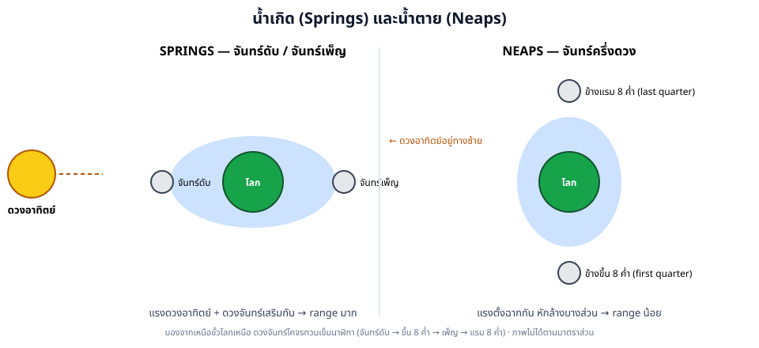
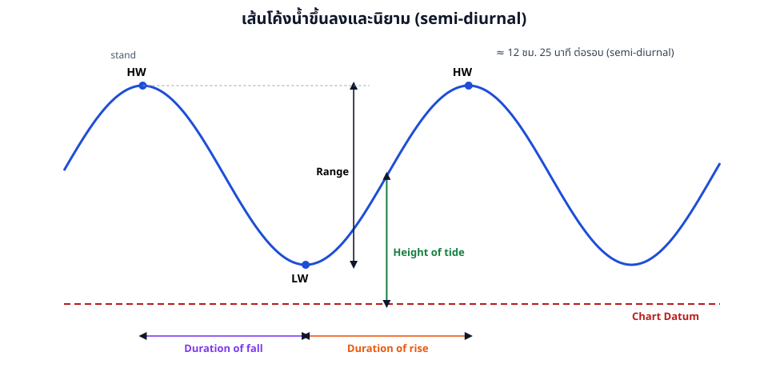
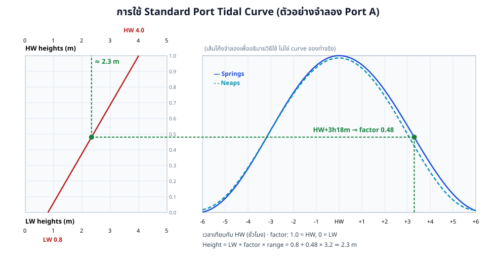
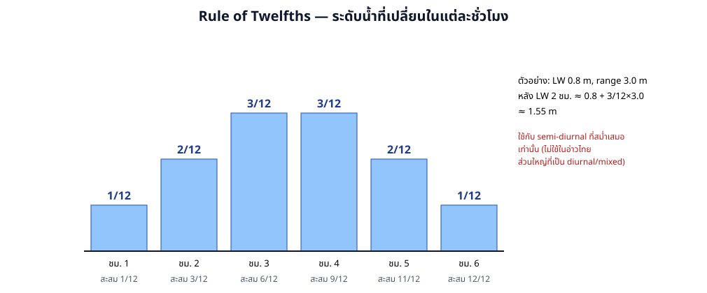
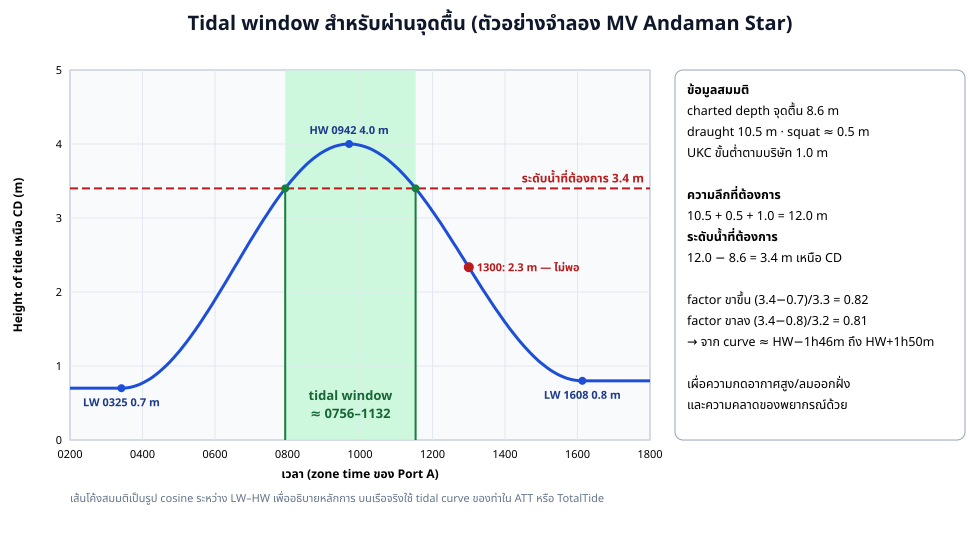

# 1.1.2 Terrestrial and Coastal Navigation (ภาค D) — น้ำขึ้นน้ำลงและกระแสน้ำขึ้นลง (Tides and Tidal Streams)

> สมุดบันทึกการฝึก OOW · TIRAPHONG NANTAPAN
> สมรรถนะ: *Thorough knowledge of and ability to use ... tide tables* และ *dead reckoning, taking into account winds, tides, currents*
> อ้างอิงหลัก: ADMIRALTY Tide Tables (NP201–NP208) ส่วนคำอธิบายหน้าเล่ม, NP120 *ADMIRALTY Manual of Tides*, NP159 *Simplified Harmonic Method of Tidal Prediction*, ADMIRALTY TotalTide, Tidal Stream Atlases, NP100, Bowditch (บท Tides and Tidal Currents)

---

## 1. ทำไม OOW ต้องเข้าใจน้ำขึ้นน้ำลง

- คำนวณ **UKC** และ **tidal window** ในการผ่านน้ำตื้น ร่องน้ำ สันดอน (บท 1.1)
- คำนวณ **air draught clearance** ใต้สะพานและสายไฟ
- คำนวณ **กระแสน้ำขึ้นลง** เพื่อหา EP และ CTS
- วางแผนเวลาเข้า-ออกท่า การเทียบท่า การทอดสมอ (ความยาวโซ่ตามความลึกที่เปลี่ยน)
- ดูแลเชือกผูกเรือขณะเทียบท่า (น้ำขึ้นลงทำให้เชือกตึง/หย่อน)

---

## 2. สาเหตุของน้ำขึ้นน้ำลง

### 2.1 แรงก่อน้ำขึ้นลง (Tide-raising forces)

น้ำขึ้นน้ำลงเกิดจากแรงดึงดูดของ **ดวงจันทร์** และ **ดวงอาทิตย์** กระทำต่อมวลน้ำบนโลก รวมกับผลของการหมุนของระบบโลก-ดวงจันทร์รอบจุดศูนย์มวลร่วม ทำให้เกิด "โป่งน้ำ" (tidal bulge) สองด้านของโลก — ด้านที่หันเข้าหาดวงจันทร์ และด้านตรงข้าม

- แม้ดวงอาทิตย์มีมวลมากกว่ามาก แต่อยู่ไกลกว่ามาก **แรงก่อน้ำขึ้นลงแปรผกผันกับระยะทางยกกำลังสาม** ดวงจันทร์จึงมีผลมากกว่าดวงอาทิตย์ประมาณ **2.2 เท่า**
- โลกหมุนผ่านโป่งน้ำทั้งสองในหนึ่ง "วันจันทรคติ" (lunar day) ≈ **24 ชั่วโมง 50 นาที** → พื้นที่ทั่วไปจึงมีน้ำขึ้น 2 ครั้ง น้ำลง 2 ครั้ง และเวลาน้ำขึ้นเลื่อนช้าลงประมาณ **50 นาทีต่อวัน**

### 2.2 น้ำเกิด-น้ำตาย (Springs and Neaps)



*ภาพที่ 1.1.2-D1 น้ำเกิดเมื่อดวงอาทิตย์-โลก-ดวงจันทร์อยู่แนวเดียวกัน น้ำตายเมื่อทำมุมฉากกัน*

- **Spring tides (น้ำเกิด)** — ช่วงจันทร์ดับ (new moon) และจันทร์เพ็ญ (full moon) ดวงอาทิตย์และดวงจันทร์อยู่แนวเดียวกับโลก (syzygy) แรงเสริมกัน → **พิสัยน้ำ (range) มาก** น้ำขึ้นสูงมาก น้ำลงต่ำมาก กระแสน้ำแรง
- **Neap tides (น้ำตาย)** — ช่วงจันทร์ครึ่งดวง (first/last quarter) ตั้งฉากกัน (quadrature) แรงหักล้างกัน → **พิสัยน้ำน้อย** กระแสน้ำอ่อน
- **Age of the tide** — น้ำเกิดสูงสุดจริงมักเกิดหลังจันทร์ดับ/จันทร์เพ็ญ 1–2 วัน (ความล่าช้าจากการตอบสนองของมหาสมุทร)
- **Equinoctial springs** — ช่วงวสันตวิษุวัต/ศารทวิษุวัต (มีนาคม/กันยายน) น้ำเกิดแรงกว่าปกติ
- **Perigean springs** — เมื่อน้ำเกิดตรงกับช่วงที่ดวงจันทร์ใกล้โลกที่สุด (perigee) พิสัยน้ำมากเป็นพิเศษ
- **Priming and lagging** — ระหว่างน้ำเกิดถึงน้ำตาย ช่วงเวลาระหว่างน้ำขึ้นแต่ละครั้งสั้นหรือยาวกว่า 12h25m เล็กน้อยตามตำแหน่งของดวงอาทิตย์ — แยกให้ชัด: **priming** เกิดช่วงจากน้ำเกิดไปหาน้ำตาย (ดวงจันทร์อยู่ระหว่างจันทร์ดับ–ขึ้น 8 ค่ำ และจันทร์เพ็ญ–แรม 8 ค่ำ) HW มาเร็วกว่าที่คาดจากดวงจันทร์อย่างเดียว ช่วงห่างระหว่าง HW สั้นกว่า 12h25m; **lagging** เกิดช่วงจากน้ำตายไปหาน้ำเกิด HW มาช้ากว่า ช่วงห่างยาวกว่า 12h25m

### 2.3 Diurnal inequality และชนิดของน้ำขึ้นลง

เมื่อดวงจันทร์ (และดวงอาทิตย์) มี declination สูง โป่งน้ำทั้งสองไม่สมมาตรเทียบกับเส้นศูนย์สูตร น้ำขึ้นสองครั้งในวันเดียวกันจึงสูงไม่เท่ากัน เรียกว่า **diurnal inequality**

| ชนิด | ลักษณะ | ตัวอย่างพื้นที่ |
|---|---|---|
| **Semi-diurnal** | น้ำขึ้น 2 ลง 2 ต่อวัน สูงใกล้เคียงกัน | ชายฝั่งอังกฤษ ยุโรปตะวันตก |
| **Mixed** | น้ำขึ้น 2 ลง 2 แต่สูง/ต่ำต่างกันมาก (higher high water, lower high water ฯลฯ) บางวันอาจเหลือครั้งเดียว | ชายฝั่งแปซิฟิกสหรัฐฯ หลายพื้นที่ในทะเลจีนใต้ อ่าวไทยตอนบน |
| **Diurnal** | น้ำขึ้น 1 ลง 1 ต่อวัน | หลายพื้นที่ในอ่าวไทย อ่าวเม็กซิโก บางส่วนของทะเลจีนใต้ |

ตัวชี้วัดชนิดของน้ำขึ้นลงจากค่าคงที่ฮาร์โมนิก — **Form factor F = (K1 + O1) / (M2 + S2)**

| F | ชนิด |
|---|---|
| < 0.25 | Semi-diurnal |
| 0.25 – 1.5 | Mixed, mainly semi-diurnal |
| 1.5 – 3.0 | Mixed, mainly diurnal |
| > 3.0 | Diurnal |

(M2 = principal lunar semi-diurnal, S2 = principal solar semi-diurnal, K1 = luni-solar diurnal, O1 = principal lunar diurnal)

> **ข้อสังเกตสำหรับคนเดินเรือแถวบ้านเรา:** อ่าวไทยหลายพื้นที่น้ำขึ้นลงเป็นแบบ diurnal หรือ mixed ไม่ใช่ semi-diurnal กฎ "rule of twelfths" และ standard curves ของท่าเรืออังกฤษ **ใช้ไม่ได้** ต้องใช้ตารางน้ำของท่านั้นโดยตรง, SHM (NP159) หรือ TotalTide

---

## 3. ศัพท์และระดับน้ำ



*ภาพที่ 1.1.2-D2 นิยามของ HW, LW, range, duration, rise และ height of tide*

| ศัพท์ | ความหมาย |
|---|---|
| High Water (HW) / Low Water (LW) | ระดับน้ำสูงสุด/ต่ำสุดในรอบ |
| Range | ผลต่างระหว่าง HW กับ LW ที่ต่อเนื่องกัน |
| Duration of rise / fall | เวลาจาก LW ถึง HW / HW ถึง LW |
| Height of tide | ความสูงของผิวน้ำเหนือ CD ณ เวลาหนึ่ง |
| Rise of tide | ความสูงของ HW เหนือ CD (ใช้ในบางตำรา) |
| Stand | ช่วงที่ระดับน้ำแทบไม่เปลี่ยนใกล้ HW หรือ LW |
| MHWS / MHWN | Mean High Water Springs / Neaps — ค่าเฉลี่ยน้ำขึ้นสูงสุดช่วงน้ำเกิด / น้ำตาย |
| MLWN / MLWS | Mean Low Water Neaps / Springs |
| MHHW / MLHW / MHLW / MLLW | ค่าเฉลี่ยสำหรับพื้นที่ mixed/diurnal (higher high, lower high, higher low, lower low) |
| MSL | Mean Sea Level |
| HAT / LAT | Highest / Lowest Astronomical Tide — สูงสุด/ต่ำสุดที่คาดได้จากปัจจัยดาราศาสตร์ในสภาพอากาศเฉลี่ย (ในรอบประมาณ 18.6 ปี) |
| Chart Datum (CD) | ระดับอ้างอิงความลึก ≈ LAT |

---

## 4. ผลจากสภาพอากาศ (Meteorological effects)

Tide tables พยากรณ์จากดาราศาสตร์อย่างเดียว ระดับน้ำจริงอาจต่างไปเพราะ

1. **ความกดอากาศ** — ความกดสูงกว่าค่าเฉลี่ย 1 hPa ระดับน้ำต่ำลงประมาณ **1 cm** (inverse barometer effect) เช่น ความกด 1033 hPa (สูงกว่าค่าเฉลี่ยประมาณ 1013 อยู่ 20 hPa) น้ำอาจต่ำกว่าพยากรณ์ราว 0.2 m — อาจต่ำกว่า CD ได้
2. **ลม** — ลมพัดเข้าฝั่งต่อเนื่องทำให้น้ำสูงกว่าพยากรณ์ (positive surge) ลมพัดออกจากฝั่งทำให้น้ำต่ำกว่า (negative surge)
3. **Storm surge** — พายุหมุนเขตร้อนทำให้ระดับน้ำชายฝั่งสูงขึ้นหลายเมตรได้ (ความกดต่ำมาก + ลมแรง)
4. **Seiche** — การกระเพื่อมของน้ำในอ่าวหรือแอ่งปิด เป็นคาบนาทีถึงชั่วโมง
5. **น้ำจากแม่น้ำ (river discharge)** — ฤดูน้ำหลากทำให้ระดับน้ำในแม่น้ำสูงกว่าพยากรณ์ และกระแสน้ำลงแรงกว่า (เช่นแม่น้ำเจ้าพระยาช่วงปลายฤดูฝน)

---

## 5. ADMIRALTY Tide Tables (ATT)

### 5.1 เล่มต่าง ๆ (ฉบับรายปี)

| NP | พื้นที่ |
|---|---|
| NP201A / NP201B | Volume 1 — United Kingdom and Ireland (แบ่ง 2 เล่ม) |
| NP202 | Volume 2 — Europe/North Atlantic Ocean and Arctic regions |
| NP203 | Volume 3 — Indian Ocean (รวม Red Sea และ Persian Gulf) |
| NP204 | Volume 4 — South Pacific Ocean |
| **NP205** | **Volume 5 — South China Sea and Indonesia (รวม tidal stream tables) — ใช้กับน่านน้ำไทย** |
| NP206 | Volume 6 — North Pacific Ocean |
| NP207 | Volume 7 — South West Atlantic Ocean and South America |
| NP208 | Volume 8 — South East Atlantic Ocean, West Africa and Mediterranean |

ฉบับดิจิทัล **ADMIRALTY TotalTide** ครอบคลุมกว่า 7,000 ท่าและ 3,000 สถานีกระแสน้ำ คำนวณให้ทั้งกราฟความสูงและกระแสน้ำ

### 5.2 โครงสร้างเล่ม

| ส่วน | เนื้อหา |
|---|---|
| **Part I** | **Standard ports** — เวลาและความสูงของ HW/LW รายวันตลอดปี พร้อม **tidal curves** (spring/neap) ของแต่ละท่า |
| **Part II** | **Secondary ports** — ค่าแก้ (differences) ของเวลาและความสูงเทียบกับ standard port, ระดับน้ำเฉลี่ย, การเปลี่ยนแปลงตามฤดู (seasonal changes in mean level) |
| **Part III** | **Harmonic constants** — สำหรับคำนวณด้วย SHM (NP159) ใช้ในพื้นที่น้ำขึ้นลงไม่ปกติ |
| Tidal stream tables | (บางเล่ม เช่น NP205) |
| คำอธิบายหน้าเล่ม | วิธีใช้ ตัวอย่างการคำนวณ แบบฟอร์ม |

> **เวลาในตาราง** — ATT ให้เวลาเป็น **เวลาท้องถิ่นมาตรฐาน (Zone time)** ของท่านั้นตามที่ระบุหัวหน้า เช่น "Time Zone −0700" สำหรับไทย (ความหมายเหมือน ZD: ต้องบวก ZD เพื่อได้ UT) — ต้องดูหัวตารางเสมอ และระวังเวลาออมแสง (summer time) ในบางประเทศที่ตารางไม่ได้รวมไว้

---

## 6. การคำนวณที่ Standard Port

### 6.1 วิธีใช้ tidal curve (ADMIRALTY method)



*ภาพที่ 1.1.2-D3 ขั้นตอนการใช้ tidal curve: ลากเส้น HW–LW บนกราฟความสูง เข้ากราฟด้วยเวลาเทียบกับ HW อ่านค่า factor แล้วแปลงเป็นความสูง*

**หาความสูงของน้ำ ณ เวลาหนึ่ง**
1. จากตาราง หา HW และ LW ที่คร่อมเวลาที่ต้องการ (ใช้ HW ที่ใกล้ที่สุดเป็นหลัก)
2. คำนวณพิสัยน้ำของวันนั้น (range = HW − LW) แล้วเทียบกับ spring range/neap range ของท่า เพื่อเลือกหรือ interpolate ระหว่าง spring curve กับ neap curve
3. ลากเส้นตรงบนกราฟความสูงด้านซ้าย จากความสูง HW (ขีดบน) ไปความสูง LW (ขีดล่าง)
4. หาเวลาที่ต้องการเทียบกับ HW (เช่น HW+3h18m) เข้าแกนเวลาใต้ curve ลากขึ้นไปถึง curve แล้วอ่านค่า **factor** (0 = LW, 1 = HW)
5. นำ factor ไปเข้ากราฟความสูงด้านซ้าย จะได้ความสูงของน้ำ
   - หรือคำนวณตรง: **Height = LW + factor × range**

**หาเวลาที่น้ำถึงความสูงที่ต้องการ** — ทำย้อนกลับ: factor = (ความสูงที่ต้องการ − LW) / range แล้วเข้า curve หาเวลาเทียบกับ HW

### 6.2 ตัวอย่างจำลอง — Standard port

> ท่าสมมติ "Port A" (semi-diurnal) MHWS 4.2 m, MHWN 3.3 m, MLWN 1.5 m, MLWS 0.6 m → spring range 3.6 m, neap range 1.8 m

วันนั้นตารางให้: **HW 0942 4.0 m, LW 1608 0.8 m** หาความสูงของน้ำเวลา **1300**

| ขั้น | ค่า |
|---|---|
| Range | 4.0 − 0.8 = **3.2 m** (ใกล้ spring range 3.6 → ใช้ spring curve หรือ interpolate ค่อนไปทาง spring) |
| เวลาเทียบ HW | 1300 − 0942 = **HW + 3h18m** |
| อ่าน factor จาก curve (สมมติ) | **0.48** |
| Height | 0.8 + 0.48 × 3.2 = 0.8 + 1.54 = **2.34 m ≈ 2.3 m** เหนือ CD |

ถ้าจุดตื้นที่สุดในร่องน้ำ charted depth 8.6 m ความลึกน้ำเวลา 1300 ≈ 8.6 + 2.3 = 10.9 m

### 6.3 กฎ "หนึ่งในสิบสอง" (Rule of Twelfths) — ใช้ประมาณเท่านั้น

สำหรับน้ำขึ้นลง **semi-diurnal ที่สม่ำเสมอ** (duration ประมาณ 6 ชั่วโมง) ระดับน้ำเปลี่ยนในแต่ละชั่วโมงตามสัดส่วน

| ชั่วโมงที่ | 1 | 2 | 3 | 4 | 5 | 6 |
|---|---|---|---|---|---|---|
| เปลี่ยน (ส่วนของ range) | 1/12 | 2/12 | 3/12 | 3/12 | 2/12 | 1/12 |
| สะสม | 1/12 | 3/12 | 6/12 | 9/12 | 11/12 | 12/12 |



*ภาพที่ 1.1.2-D4 อัตราการเปลี่ยนระดับน้ำเร็วที่สุดช่วงกลางของน้ำขึ้น/ลง (ชั่วโมงที่ 3–4)*

**ตัวอย่าง:** LW 0.8 m, HW ถัดไป 3.8 m (range 3.0 m, duration ประมาณ 6 ชั่วโมง) ความสูงหลัง LW 2 ชั่วโมง ≈ 0.8 + 3/12 × 3.0 = **1.55 m**; หลัง LW 3 ชั่วโมง ≈ 0.8 + 6/12 × 3.0 = **2.3 m**

> ข้อควรระวัง: ใช้ไม่ได้กับน้ำแบบ diurnal/mixed หรือท่าที่มีเส้นโค้งผิดปกติ (เช่น double high water ที่เซาท์แธมป์ตัน) ใช้เพื่อประมาณเร็ว ๆ หรือตรวจความสมเหตุสมผลเท่านั้น

### 6.4 ตัวอย่างจำลอง — UKC และ tidal window (ทำย้อนกลับจาก curve)

> สถานการณ์จำลอง เรือ MV Andaman Star (bulk carrier) ต้องผ่านจุดตื้นในร่องน้ำเข้า "Port A" วันเดียวกับตัวอย่าง 6.2 ตัวเลขทั้งหมดเป็นค่าสมมติ

ข้อมูล
- charted depth ของจุดตื้นที่สุดบนเส้นทาง **8.6 m**
- draught สูงสุด (น้ำทะเล) **10.5 m**, squat ที่ความเร็วผ่านร่อง ≈ **0.5 m** (จากตาราง/สูตร squat ของเรือ — บท 1.3)
- UKC ขั้นต่ำตามนโยบายบริษัท **1.0 m** (หลังหัก squat แล้ว)
- ตารางน้ำ Port A: **LW 0325 0.7 m, HW 0942 4.0 m, LW 1608 0.8 m**

| ขั้น | การคำนวณ | ผล |
|---|---|---|
| ความลึกน้ำที่ต้องการ | draught + squat + UKC = 10.5 + 0.5 + 1.0 | **12.0 m** |
| ระดับน้ำ (height of tide) ที่ต้องการ | 12.0 − 8.6 | **3.4 m เหนือ CD** |
| ขาขึ้น (LW 0325 → HW 0942) | range 4.0 − 0.7 = 3.3 m; factor = (3.4 − 0.7)/3.3 | **0.82** |
| ขาลง (HW 0942 → LW 1608) | range 4.0 − 0.8 = 3.2 m; factor = (3.4 − 0.8)/3.2 | **0.81** |
| อ่านเวลาจาก curve (สมมติรูป cosine) | ขาขึ้นถึง factor 0.82 ที่ HW − 1h46m; ขาลงลดถึง 0.81 ที่ HW + 1h50m | **window ≈ 0756–1132** |

ผลและข้อสังเกต
- ช่วงที่ผ่านจุดตื้นได้ตามเกณฑ์คือประมาณ **0756–1132** — ในแผนจริงผมจะตั้งเวลาผ่านให้อยู่กลาง window (เช่น 0830–1100) เผื่อเรือช้าหรือรอนำร่อง
- เวลา 1300 (ตัวอย่าง 6.2) ระดับน้ำ ≈ 2.3 m → ความลึกน้ำ ≈ 10.9 m น้อยกว่า 12.0 m ที่ต้องการ → **ห้ามผ่านตอน 1300**
- ตรวจผลกระทบสภาพอากาศ: ถ้าความกดอากาศ 1030 hPa (สูงกว่าเฉลี่ย ~17 hPa) ระดับน้ำอาจต่ำกว่าพยากรณ์ราว 0.17 m → window จะแคบลง ต้องคำนวณใหม่ด้วยระดับน้ำที่ต้องการ 3.4 + 0.2 ≈ 3.6 m
- squat เพิ่มตามกำลังสองของความเร็วโดยประมาณ ถ้าต้องเร่งเครื่องผ่านกระแสน้ำ ต้องคิด squat ใหม่
- บนเรือจริงใช้ tidal curve ของท่านั้นใน ATT หรือ TotalTide ไม่ใช่ cosine สมมติ (factor ที่ได้จากตารางในตัวอย่างนี้ใช้ curve สมมติเพื่อให้ตัวเลขตรวจทานได้)



*ภาพที่ 1.1.2-D5 Tidal window จากระดับน้ำที่ต้องการ 3.4 m — ช่วงสีเขียวคือเวลาที่ผ่านจุดตื้นได้ (ตัวอย่างจำลอง)*

---

## 7. การคำนวณที่ Secondary Port

Secondary port ไม่มีพยากรณ์รายวันของตัวเอง ต้องใช้ standard port ที่กำหนดแล้วแก้ด้วย **time differences** และ **height differences** จาก Part II

### 7.1 ขั้นตอน

1. จาก Part II หาข้อมูล secondary port: standard port ที่ใช้, ตาราง time differences (HW และ LW ณ เวลา HW/LW ของ standard port ที่กำหนด) และ height differences (MHWS, MHWN, MLWN, MLWS)
2. หา HW/LW ของ standard port ในวันนั้น
3. **Interpolate time difference** ตามเวลาของ HW/LW ของ standard port แล้วบวกเข้าไป → เวลา HW/LW ที่ secondary port
4. **Interpolate height difference** ตามความสูงของ HW/LW ของ standard port (เทียบกับ MHWS/MHWN สำหรับ HW และ MLWN/MLWS สำหรับ LW) → ความสูงที่ secondary port
5. แก้ seasonal change ถ้ามี
6. ใช้ **tidal curve ของ standard port** กับเวลาและความสูงที่ secondary port (ยกเว้นมีหมายเหตุให้ใช้ curve อื่น)

### 7.2 ตัวอย่างจำลอง — Secondary port

> ท่ารอง "Port B" ใช้ Port A เป็น standard port (ข้อมูลสมมติ)

| Time differences | HW at 0000 & 1200: **+0030** | HW at 0600 & 1800: **+0050** | LW at 0500 & 1700: **+0040** | LW at 1100 & 2300: **+0020** |
|---|---|---|---|---|
| **Height differences** | MHWS **−0.4** | MHWN **−0.3** | MLWN **−0.1** | MLWS **0.0** |

Standard port วันนั้น: HW 0942 4.0 m, LW 1608 0.8 m

**เวลา HW ที่ Port B**
- 0942 อยู่ระหว่าง 0600 (+0050) กับ 1200 (+0030) — ห่างจาก 0600 = 3h42m จาก 6h → สัดส่วน 0.617
- diff = 50 − (20 × 0.617) = 37.7 ≈ **+0038** → HW Port B = **1020**

**เวลา LW ที่ Port B**
- 1608 อยู่ระหว่าง 1100 (+0020) กับ 1700 (+0040) — ห่างจาก 1100 = 5h08m → สัดส่วน 0.856
- diff = 20 + (20 × 0.856) = 37.1 ≈ **+0037** → LW Port B = **1645**

**ความสูง HW ที่ Port B**
- HW 4.0 m อยู่ระหว่าง MHWN 3.3 (−0.3) กับ MHWS 4.2 (−0.4) → สัดส่วน (4.0 − 3.3)/0.9 = 0.78
- diff = −0.3 − (0.1 × 0.78) = −0.38 ≈ **−0.4** → HW Port B = **3.6 m**

**ความสูง LW ที่ Port B**
- LW 0.8 m อยู่ระหว่าง MLWS 0.6 (0.0) กับ MLWN 1.5 (−0.1) → สัดส่วน (0.8 − 0.6)/0.9 = 0.22
- diff = −0.02 ≈ **0.0** → LW Port B = **0.8 m**

ผล: **Port B — HW 1020 3.6 m, LW 1645 0.8 m** แล้วใช้ curve ของ Port A หาความสูง ณ เวลาที่ต้องการต่อไป

**ต่อ — ความสูงของน้ำที่ Port B เวลา 1330**
- เวลาเทียบ HW ของ Port B: 1330 − 1020 = **HW + 3h10m**
- range ที่ Port B = 3.6 − 0.8 = **2.8 m** (น้อยกว่า spring range ของ Port A 3.6 m แต่มากกว่า neap 1.8 m → ค่อนไปทาง spring)
- อ่าน factor จาก curve ของ Port A ที่ HW + 3h10m (curve สมมติเดียวกับตัวอย่าง 6.2) ≈ **0.51**
- Height = 0.8 + 0.51 × 2.8 = 0.8 + 1.43 = **2.23 ≈ 2.2 m** เหนือ CD

> สังเกต: ต้องเข้า curve ด้วย **เวลาและความสูงของ secondary port** ไม่ใช่ของ standard port — ถ้าใช้ HW ของ Port A (0942) จะได้เวลาเทียบ HW ผิดไป 38 นาที

> ATT ส่วนใหญ่มี **แบบฟอร์มคำนวณ (tidal prediction form)** อยู่ในหน้าเล่ม ใช้แบบฟอร์มช่วยไม่ให้สับสนลำดับ

### 7.3 Simplified Harmonic Method (SHM) — NP159

สำหรับท่าที่น้ำขึ้นลงไม่ปกติ (diurnal/mixed) หรือ secondary port ที่ไม่สามารถใช้ differences ได้ ใช้ **harmonic constants** (M2, S2, K1, O1 และค่าแก้น้ำตื้น f4, f6, F4, F6) จาก Part III คำนวณด้วยแบบฟอร์ม NP159 หรือใช้ TotalTide ซึ่งทำให้อัตโนมัติ — สำหรับ OOW ให้เข้าใจหลักการ และใช้ซอฟต์แวร์ได้ถูกต้อง

---

## 8. Air Draught และระยะลอดใต้สะพาน

```
ระยะลอดจริง (actual clearance) = Charted vertical clearance (เหนือ HAT) + (HAT − ระดับน้ำขณะนั้น)
ระยะเผื่อ (margin) = ระยะลอดจริง − Air draught ของเรือ
```

**ตัวอย่างจำลอง:** สะพานมี vertical clearance บนแผนที่ 45.0 m (เหนือ HAT), HAT ของพื้นที่ = 4.6 m เหนือ CD, ระดับน้ำพยากรณ์ตอนผ่าน = 3.2 m, air draught ของเรือ 41.5 m (จากตัวอย่าง passage plan)
- Actual clearance = 45.0 + (4.6 − 3.2) = **46.4 m**
- Margin = 46.4 − 41.5 = **4.9 m** — ถ้าบริษัทกำหนด margin ขั้นต่ำ 2 m → ผ่านได้
- ข้อควรระวัง: ระดับน้ำจริงอาจสูงกว่าพยากรณ์ (ลม surge น้ำหลาก) ต้องเผื่อ และ air draught ของเรือเปลี่ยนตาม draught/trim (เรือเบาลง air draught เพิ่ม)

---

## 9. กระแสน้ำขึ้นลง (Tidal Streams)

### 9.1 นิยาม

- **Tidal stream** — การเคลื่อนที่แนวราบของน้ำที่เกิดจากน้ำขึ้นน้ำลง เปลี่ยนทิศเป็นรอบ (ทางวิชาการอังกฤษแยกคำ "tidal stream" กับ "current" ซึ่งหมายถึงกระแสน้ำที่ไม่ใช่จากน้ำขึ้นลง เช่นกระแสน้ำมหาสมุทร ส่วนตำราอเมริกันใช้ "tidal current")
- **Flood stream** — กระแสขาเข้า (น้ำขึ้น) / **Ebb stream** — กระแสขาออก (น้ำลง)
- **Slack water** — ช่วงกระแสน้ำอ่อนมากขณะเปลี่ยนทิศ — ไม่จำเป็นต้องตรงกับเวลา HW/LW
- **Rectilinear stream** — ไหลกลับไปกลับมาสองทิศ (ในร่องน้ำ ช่องแคบ) / **Rotary stream** — เปลี่ยนทิศหมุนตลอดรอบ (ทะเลเปิด)
- **Overfalls / Tide rips / Races** — บริเวณคลื่นปั่นป่วนจากกระแสน้ำแรงผ่านพื้นทะเลไม่เรียบหรือปะทะลม — อันตรายต่อเรือเล็ก
- **Eddies** — กระแสวนใกล้แหลม ชายฝั่งโค้ง

### 9.2 แหล่งข้อมูลกระแสน้ำ

1. **Tidal diamonds บนแผนที่** — สัญลักษณ์ ◇ มีตัวอักษร (A, B, C…) ตารางมุมแผนที่ให้ทิศ (°T) และอัตรา (นอต) ที่ spring/neap เป็นรายชั่วโมงตั้งแต่ HW−6 ถึง HW+6 ของ standard port ที่ระบุ
2. **Tidal Stream Atlases (ADMIRALTY NP2xx)** — หนังสือแผนที่ลูกศรรายชั่วโมง (เช่น NP250 English Channel) ตัวเลขบนลูกศร เช่น "19,34" = neap 1.9 นอต spring 3.4 นอต
3. **Tidal stream tables ใน ATT** (เช่น NP205) และ **Sailing Directions**
4. **TotalTide / ECDIS (S-111 ในอนาคต)**
5. ข้อมูลท้องถิ่นจากนำร่องและ VTS

### 9.3 การคำนวณอัตรากระแสน้ำ (Interpolation by range)

```
Rate = Neap rate + (Spring rate − Neap rate) × (Today's range − Neap range) / (Spring range − Neap range)
```

(หรือใช้ **Computation of Rates diagram** ที่อยู่ใน Tidal Stream Atlas)

**ตัวอย่างจำลอง:** Tidal diamond ◇A เวลา HW−2 (ของ Port A): ทิศ 065° spring 3.2 kn neap 1.6 kn วันนี้ range 3.2 m (spring range 3.6, neap range 1.8)
- สัดส่วน = (3.2 − 1.8)/(3.6 − 1.8) = 0.78
- Rate = 1.6 + (3.2 − 1.6) × 0.78 = 1.6 + 1.25 = **2.85 ≈ 2.8 kn** ทิศ 065°
- ใช้ค่านี้ใน current triangle เพื่อหา CTS (บท 1.1.2-A ข้อ 5.4)
- ถ้าเกินช่วงสเกล (range มากกว่า spring range) ให้ extrapolate ได้แต่ระวัง

### 9.4 การใช้กระแสน้ำในการวางแผน

- เลือกเวลาผ่านช่องแคบให้ได้กระแสน้ำตามหลัง (fair tide) ประหยัดเวลาและน้ำมัน
- เลี่ยงช่วงที่กระแสน้ำขวางร่องน้ำแรงในจุดเลี้ยวหรือเข้าท่า
- เทียบท่าและทอดสมอมักเลือกช่วงกระแสน้ำอ่อน (slack) หรือหันหัวเข้าหากระแสน้ำ (stemming the tide) เพื่อควบคุมเรือได้ดี
- ประเมินระยะลอยเมื่อเครื่องขัดข้อง (drift) ในแผนฉุกเฉิน

---

## 10. กระแสน้ำมหาสมุทร (Ocean currents) — ภาพรวม

(รายละเอียดอยู่ในบท 1.1.7 อุตุนิยมวิทยาและสมุทรศาสตร์)

- เกิดจากลมประจำ (wind-driven) ความแตกต่างของความหนาแน่น (thermohaline) และรูปร่างของแอ่งมหาสมุทร
- ข้อมูลจาก **Routeing Charts** (ลูกศรเฉลี่ยรายเดือน) **NP136** และ **Sailing Directions**
- ในทะเลจีนใต้และอ่าวไทย ทิศกระแสน้ำผิวหน้าเปลี่ยนตาม **มรสุม** — ช่วงมรสุมตะวันออกเฉียงเหนือ (พ.ย.–มี.ค.) กระแสน้ำตามชายฝั่งเวียดนาม-มาเลเซียไหลลงใต้ค่อนข้างแรง ช่วงมรสุมตะวันตกเฉียงใต้ (พ.ค.–ก.ย.) กลับทิศ

---

## 11. คำถามสอบปากเปล่า / สัมภาษณ์ — Tides

**ถาม:** อะไรทำให้เกิดน้ำเกิดและน้ำตาย
**แนวตอบ:** น้ำเกิดช่วงจันทร์ดับ/จันทร์เพ็ญ ดวงอาทิตย์ ดวงจันทร์ โลกอยู่แนวเดียวกัน แรงก่อน้ำขึ้นลงเสริมกัน พิสัยน้ำมาก น้ำตายช่วงจันทร์ครึ่งดวง ทำมุมฉากกัน แรงหักล้างกัน พิสัยน้อย

**ถาม:** ทำไมน้ำขึ้นเลื่อนเวลาวันละประมาณ 50 นาที
**แนวตอบ:** เพราะวันจันทรคติยาวประมาณ 24 ชั่วโมง 50 นาที ดวงจันทร์โคจรไปข้างหน้าทำให้โลกต้องหมุนเพิ่มอีกประมาณ 50 นาทีจึงจะกลับมาตำแหน่งเดิมเทียบกับดวงจันทร์

**ถาม:** LAT, HAT, MHWS, MLWS คืออะไร ใช้กับอะไรบนแผนที่
**แนวตอบ:** LAT/HAT คือระดับต่ำสุด/สูงสุดที่คาดได้จากดาราศาสตร์ — CD ≈ LAT (ความลึก/drying height), HAT ใช้กับ vertical clearance; MHWS ใช้อ้างอิงความสูงของภูมิประเทศและไฟ; MLWS/MHWS ใช้หาพิสัยน้ำเกิดเฉลี่ย

**ถาม:** ระดับน้ำจริงต่ำกว่า chart datum ได้หรือไม่
**แนวตอบ:** ได้ เช่นความกดอากาศสูงมาก ลมพัดออกจากฝั่งแรง (negative surge) ประมาณ 1 cm ต่อ 1 hPa ที่สูงกว่าค่าเฉลี่ย

**ถาม:** Secondary port คำนวณอย่างไร
**แนวตอบ:** ใช้ HW/LW ของ standard port แล้ว interpolate time differences และ height differences จาก Part II ของ ATT ได้เวลาและความสูงที่ secondary port แล้วใช้ tidal curve ของ standard port หาความสูง ณ เวลาที่ต้องการ

**ถาม:** Rule of twelfths ใช้ได้เมื่อไร
**แนวตอบ:** ใช้ประมาณกับน้ำ semi-diurnal ที่สม่ำเสมอ duration ประมาณ 6 ชั่วโมง ไม่ใช้กับ diurnal/mixed หรือท่าที่ curve ผิดปกติ

**ถาม:** Slack water ตรงกับ HW/LW หรือไม่
**แนวตอบ:** ไม่จำเป็น เวลาเปลี่ยนทิศกระแสน้ำขึ้นกับรูปร่างชายฝั่งและแอ่งน้ำ ต้องดูจาก tidal stream data ไม่ใช่สมมติจากเวลา HW/LW

**ถาม:** คำนวณระยะลอดใต้สะพานอย่างไร
**แนวตอบ:** ระยะลอดจริง = clearance บนแผนที่ (เหนือ HAT) + (HAT − ระดับน้ำขณะนั้น) แล้วลบ air draught ของเรือ ต้องมี margin ตามนโยบาย และเผื่อระดับน้ำที่อาจสูงกว่าพยากรณ์

**ถาม:** น่านน้ำไทยใช้ ATT เล่มไหน
**แนวตอบ:** NP205 Volume 5 South China Sea and Indonesia หรือ TotalTide และตารางน้ำของกรมอุทกศาสตร์ ทร.

**ถาม:** คำนวณ tidal window ผ่านจุดตื้นอย่างไร
**แนวตอบ:** หาความลึกที่ต้องการ = draught + squat + UKC ตามนโยบาย ลบ charted depth ได้ระดับน้ำที่ต้องการ แล้วหา factor = (ระดับที่ต้องการ − LW)/range ทั้งขาขึ้นและขาลง เข้า tidal curve หาเวลาเทียบ HW ได้ช่วงเวลาที่ระดับน้ำสูงพอ แล้วเผื่อผลความกดอากาศ ลม และความคลาดของพยากรณ์

**ถาม:** Priming และ lagging ต่างกันอย่างไร
**แนวตอบ:** Priming เกิดช่วงจากน้ำเกิดไปน้ำตาย HW มาเร็วขึ้น ช่วงห่างระหว่าง HW สั้นกว่า 12h25m; lagging เกิดช่วงจากน้ำตายไปน้ำเกิด HW มาช้าลง ช่วงห่างยาวกว่า 12h25m เป็นผลจากตำแหน่งของดวงอาทิตย์เทียบกับดวงจันทร์

**ถาม:** Form factor บอกอะไร และอ่าวไทยเป็นแบบไหน
**แนวตอบ:** F = (K1 + O1)/(M2 + S2) บอกชนิดน้ำขึ้นลง น้อยกว่า 0.25 semi-diurnal, 0.25–1.5 mixed ค่อนไปทาง semi-diurnal, 1.5–3.0 mixed ค่อนไปทาง diurnal, มากกว่า 3 diurnal อ่าวไทยหลายพื้นที่เป็น diurnal หรือ mixed จึงใช้ rule of twelfths ไม่ได้

**ถาม:** หาความสูงของน้ำที่ secondary port ณ เวลาหนึ่ง ต้องระวังอะไร
**แนวตอบ:** หลังได้เวลาและความสูง HW/LW ของ secondary port แล้ว ต้องเข้า curve ของ standard port ด้วยเวลาเทียบ HW และ range ของ secondary port เอง ไม่ใช่ของ standard port และเลือก spring/neap curve ตาม range ของวันนั้น

**ถาม:** Age of the tide คืออะไร
**แนวตอบ:** ช่วงเวลาที่น้ำเกิดสูงสุดจริงเกิดหลังจันทร์ดับหรือจันทร์เพ็ญ มักประมาณ 1–2 วัน เพราะมหาสมุทรตอบสนองต่อแรงก่อน้ำขึ้นลงช้ากว่า

---

*ก่อนหน้า ← [1.1.2-C Charts and Publications](1.1.2-C-charts-and-publications.md) · ถัดไป → [1.1.2-E ADMIRALTY Publications ฉบับปัจจุบัน](1.1.2-E-admiralty-publications-current-editions.md)*
