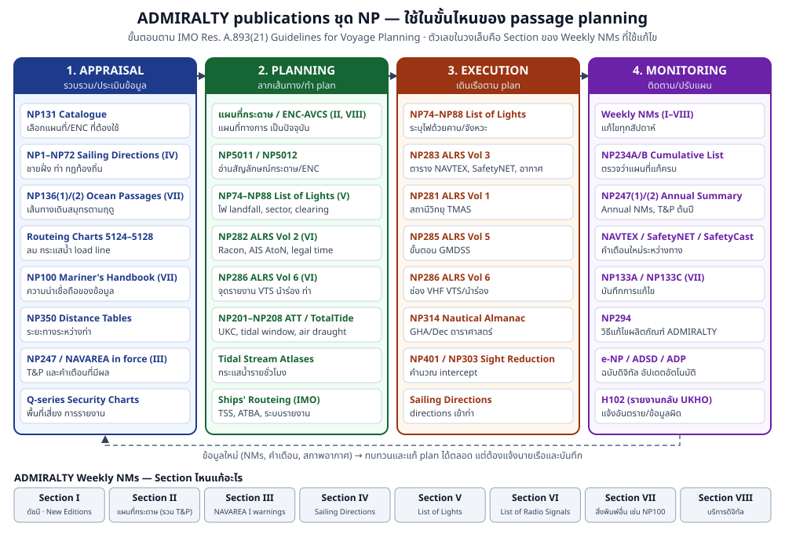

# 1.1.2 Terrestrial and Coastal Navigation (ภาค E) — รายการ ADMIRALTY Publications ฉบับปัจจุบัน: เล่มไหนคืออะไร ใช้ทำอะไร

> สมุดบันทึกการฝึก OOW · TIRAPHONG NANTAPAN
> หน้านี้รวบรวมเพื่อทบทวนก่อนสัมภาษณ์และใช้ตรวจห้องแผนที่ (chart room) บนเรือ

---

## 0. อ่านก่อนใช้ตาราง — ข้อมูลมาจากไหน และ "ล่าสุด" ถึงเมื่อไร

ข้อมูลฉบับ (edition) ในหน้านี้ตรวจสอบเมื่อ **ตุลาคม 2026** จาก
1. รายการ **"Current editions of ADMIRALTY Sailing Directions"** ที่ UKHO เผยแพร่ (ปรับปรุงถึง Week 42/26 — รวมฉบับใหม่ที่ประกาศกำหนดวางจำหน่ายล่วงหน้าแล้ว)
2. รายการ New Edition ADMIRALTY Publications ของตัวแทนจำหน่ายที่ได้รับอนุญาต (ข้อมูลถึง Week 16/26) และหน้าสินค้าของตัวแทนจำหน่ายรายอื่นสำหรับเล่มที่ออกหลังจากนั้น
3. หน้าข้อมูลสิ่งพิมพ์บนเว็บไซต์ ADMIRALTY (UKHO)

> **กฎเหล็ก:** บนเรือจริง ให้ยืนยันฉบับปัจจุบันจาก **ADMIRALTY Weekly Notices to Mariners Section I** (รายการ New Editions) และ **NP131 Catalogue** ฉบับล่าสุด หรือจากระบบจัดการสิ่งพิมพ์ (เช่น ADMIRALTY e-Navigator) เสมอ เพราะ UKHO ออกฉบับใหม่แทบทุกสัปดาห์ — **ตารางในสมุดนี้ใช้เพื่อเรียนรู้ ไม่ใช่ใช้แทนการตรวจสอบจริง**

### 0.1 ภาพรวมระบบเลข NP

| ช่วงเลข | กลุ่มสิ่งพิมพ์ |
|---|---|
| NP1 – NP72 | Sailing Directions (Pilots) |
| NP74 – NP88 | List of Lights and Fog Signals (Vol A – Q) |
| NP100 | The Mariner's Handbook |
| NP120 | ADMIRALTY Manual of Tides |
| NP131 | Catalogue of ADMIRALTY Charts and Publications |
| NP133A / NP133C | Chart / ENC & ECDIS maintenance records |
| NP136 | Ocean Passages for the World |
| NP159 | Simplified Harmonic Method of Tidal Prediction |
| NP201 – NP208 | Tide Tables (Vol 1–8) |
| NP2xx / NP3xx บางเลข | Tidal Stream Atlases (เช่น NP233, NP249, NP250, NP337) |
| NP231 / NP232 | ADMIRALTY Guides (ENC, ECDIS) |
| NP234A / NP234B | Cumulative List of Notices to Mariners |
| NP247(1) / NP247(2) | Annual Summary of Notices to Mariners |
| NP281 – NP286 | List of Radio Signals (Vol 1–6) |
| NP294 | How to keep your ADMIRALTY products up-to-date |
| NP303 | Rapid Sight Reduction Tables (AP3270) |
| NP314 | The Nautical Almanac |
| NP350 | Distance Tables |
| NP401 | Sight Reduction Tables for Marine Navigation |
| NP735 | IALA Maritime Buoyage System |
| NP5011 / NP5012 | Symbols and Abbreviations (paper charts) / Guide to ENC symbols in ECDIS |

### 0.2 สิ่งพิมพ์แต่ละกลุ่มใช้ในขั้นไหนของ passage planning

ผมสรุปไว้เป็นภาพเดียวตามสี่ขั้นของ IMO Res. A.893(21) *Guidelines for Voyage Planning* (Appraisal → Planning → Execution → Monitoring) เวลาเตรียม passage plan จะได้ไม่ลืมเปิดเล่มไหน และรู้ว่าเล่มนั้นแก้ไขจาก Section ใดของ Weekly NMs

*ภาพที่ 1.1.2-E1 สิ่งพิมพ์ ADMIRALTY ชุด NP ที่ใช้ในแต่ละขั้นของ passage planning และ Section ของ Weekly NMs ที่ใช้แก้ไขแต่ละกลุ่ม*

ข้อสังเกตจากภาพ
- ขั้น **Appraisal** ใช้สิ่งพิมพ์ "ภาพกว้าง" มากที่สุด (NP131, Sailing Directions, NP136, Routeing Charts, NP100) และต้องตรวจ T&P กับคำเตือนที่ยังมีผลก่อนเริ่มลากเส้นทาง
- ขั้น **Planning** เน้นแผนที่ทางการที่แก้ไขแล้ว รายละเอียดไฟ (ALL) จุดรายงาน (ALRS Vol 6) และการคำนวณน้ำ (ATT/TotalTide) สำหรับ UKC และ air draught
- ขั้น **Execution/Monitoring** ใช้ ALL ระบุไฟจริง ALRS Vol 3 สำหรับตารางรับ MSI และต้องรับข้อมูลใหม่ (NAVTEX/SafetyNET, Weekly NMs) เพื่อปรับแผน — ถ้าแก้แผนระหว่างทางต้องแจ้งนายเรือและบันทึก
- ไม่ว่าขั้นไหน ถ้าพบข้อมูลผิดหรืออันตรายใหม่ ให้รายงานกลับ UKHO ด้วย H102

---

## 1. Sailing Directions (Pilots) — NP1 ถึง NP72

**ใช้ทำอะไร:** ข้อมูลประกอบแผนที่ — คำอธิบายชายฝั่ง ภาพทิวทัศน์ ท่าเรือ ข้อบังคับท้องถิ่น การนำร่อง ที่ทอดสมอ สภาพธรรมชาติ (ลม กระแสน้ำ ภูมิอากาศ) และคำแนะนำเส้นทาง (directions) ใช้มากในขั้น **Appraisal** ของ passage planning และเมื่อเข้าใกล้ฝั่ง/ท่า

**อัปเดตด้วย:** Weekly NMs Section IV; ฉบับดิจิทัล ADMIRALTY e-NP อัปเดตอัตโนมัติ

**ตารางฉบับปัจจุบัน** (อ้างอิงรายการของ UKHO; "สัปดาห์ที่ออก" คือสัปดาห์/ปีที่ฉบับนั้นวางจำหน่าย; คำอธิบายพื้นที่เป็นสังเขปจากชื่อเล่ม — ขอบเขตแน่นอนดูแผนผังใน NP131)

| NP | ชื่อ | ฉบับปัจจุบัน | สัปดาห์ที่ออก | พื้นที่โดยสังเขป |
|---|---|---|---|---|
| NP1 | Africa Pilot Vol 1 | 19th (2020) | 50/20 | ชายฝั่งแอฟริกาตะวันตก (ตอนเหนือ) และหมู่เกาะในมหาสมุทรแอตแลนติกตะวันออก |
| NP2 | Africa Pilot Vol 2 | 19th (2022) | 09/22 | ชายฝั่งแอฟริกาตะวันตกตอนใต้และแอฟริกาใต้ |
| NP3 | Africa Pilot Vol 3 | 18th (2019) | 16/19 | ชายฝั่งแอฟริกาตะวันออกและเกาะในมหาสมุทรอินเดียตะวันตก |
| NP4 | South-East Alaska Pilot | 9th (2025) | 42/25 | อะแลสกาตะวันออกเฉียงใต้ |
| NP5 | South America Pilot Vol 1 | 20th (2021) | 40/21 | ชายฝั่งตะวันออกของอเมริกาใต้ (ตอนเหนือ) |
| NP6 | South America Pilot Vol 2 | 20th (2025) | 46/25 | ชายฝั่งตะวันออกของอเมริกาใต้ (ตอนใต้) |
| NP7 | South America Pilot Vol 3 | 14th (2022) | 49/22 | ชายฝั่งตะวันตกของอเมริกาใต้ |
| NP7A | South America Pilot Vol 4 | 9th (2022) | 06/22 | ชายฝั่งชิลีตอนใต้และช่องแคบ |
| NP8 | Pacific Coasts of Central America and United States Pilot | 15th (2019) | 43/19 | ชายฝั่งแปซิฟิกของอเมริกากลางและสหรัฐฯ |
| NP9 | Antarctic Pilot | 9th (2019) | 24/19 | แอนตาร์กติกา |
| NP10 | Arctic Pilot Vol 1 | 9th (2016) | 07/16 | อาร์กติก (ส่วนที่ 1) |
| NP11 | Arctic Pilot Vol 2 | 12th (2018) | 34/18 | อาร์กติก (ส่วนที่ 2) |
| NP12 | Arctic Pilot Vol 3 | 10th (2018) | 19/18 | อาร์กติก (ส่วนที่ 3) |
| NP13 | Australia Pilot Vol 1 | 6th (2020) | 35/20 | ออสเตรเลีย (ส่วนที่ 1) |
| NP14 | Australia Pilot Vol 2 | 15th (2025) | 28/25 | ออสเตรเลีย (ส่วนที่ 2) |
| NP15 | Australia Pilot Vol 3 | 16th (2025) | 33/25 | ออสเตรเลีย (ส่วนที่ 3) |
| NP18 | Baltic Pilot Vol 1 | 21st (2026) | 16/26 | ทะเลบอลติก (ส่วนที่ 1) |
| NP19 | Baltic Pilot Vol 2 | 18th (2022) | 11/22 | ทะเลบอลติก (ส่วนที่ 2) |
| NP20 | Baltic Pilot Vol 3 | 15th (2022) | 35/22 | ทะเลบอลติก (ส่วนที่ 3) |
| NP21 | Bay of Bengal Pilot | 14th (2025) | 05/25 | อ่าวเบงกอล รวมทะเลอันดามันตอนบน |
| NP22 | Bay of Biscay Pilot | 15th (2024) | 13/24 | อ่าวบิสเคย์ |
| NP23 | Bering Sea and Strait Pilot | 9th (2019) | 30/19 | ทะเลแบริ่งและช่องแคบแบริ่ง |
| NP24 | Black Sea and Sea of Azov Pilot | 6th (2019) | 33/19 | ทะเลดำและทะเลอะซอฟ |
| NP25 | British Columbia Pilot Vol 1 | 17th (2019) | 38/19 | บริติชโคลัมเบีย (ส่วนที่ 1) |
| NP26 | British Columbia Pilot Vol 2 | 11th (2017) | 11/17 | บริติชโคลัมเบีย (ส่วนที่ 2) |
| NP27 | Channel Pilot | 14th (2023) | 34/23 | ช่องแคบอังกฤษ |
| NP28 | Dover Strait Pilot | 14th (2024) | 02/24 | ช่องแคบโดเวอร์ |
| NP30 | China Sea Pilot Vol 1 | 14th (2026) | 38/26 | ทะเลจีนใต้ฝั่งตะวันตก อ่าวไทย ชายฝั่งตะวันออกของคาบสมุทรมลายู |
| NP31 | China Sea Pilot Vol 2 | 15th (2021) | 01/22 | ทะเลจีนใต้ (ส่วนที่ 2) |
| NP32A | China Sea Pilot Vol 3 | 5th (2024) | 06/24 | ทะเลจีน (ส่วนที่ 3) |
| NP32B | China Sea Pilot Vol 4 | 4th (2022) | 46/22 | ทะเลจีน (ส่วนที่ 4) |
| NP33 | Philippine Islands Pilot | 7th (2021) | 05/21 | ฟิลิปปินส์ |
| NP34 | Indonesia Pilot Vol 2 | 10th (2022) | 04/22 | อินโดนีเซีย (ส่วนที่ 2) |
| NP35 | Indonesia Pilot Vol 3 | 8th (2021) | 34/21 | อินโดนีเซีย (ส่วนที่ 3) |
| NP36 | Indonesia Pilot Vol 1 | 12th (2025) | 18/25 | อินโดนีเซีย (ส่วนที่ 1) |
| NP37 | West Coasts of England and Wales Pilot | 21st (2022) | 16/22 | ชายฝั่งตะวันตกของอังกฤษและเวลส์ |
| NP38 | West Coast of India Pilot | 20th (2023) | 10/23 | ชายฝั่งตะวันตกของอินเดีย |
| NP39 | South Indian Ocean Pilot | 16th (2020) | 39/20 | มหาสมุทรอินเดียตอนใต้ |
| NP40 | Irish Coast Pilot | 22nd (2023) | 52/23 | ไอร์แลนด์ |
| NP41 | Japan Pilot Vol 1 | 13th (2021) | 33/21 | ญี่ปุ่น (ส่วนที่ 1) |
| NP42A | Japan Pilot Vol 2 | 8th (2023) | 22/23 | ญี่ปุ่น (ส่วนที่ 2) |
| NP42B | Japan Pilot Vol 3 | 13th (2022) | 41/22 | ญี่ปุ่น (ส่วนที่ 3) |
| NP42C | Japan Pilot Vol 4 | 7th (2023) | 18/23 | ญี่ปุ่น (ส่วนที่ 4) |
| NP43 | South and East Coasts of Korea, East Coast of Siberia and Sea of Okhotsk Pilot | 13th (2025) | 05/25 | เกาหลีใต้ฝั่งใต้-ตะวันออก ไซบีเรียตะวันออก ทะเลโอค็อตสค์ |
| NP44 | Malacca Strait and West Coast of Sumatera Pilot | 15th (2022) | 22/22 | ช่องแคบมะละกา ช่องแคบสิงคโปร์ ชายฝั่งตะวันตกสุมาตรา |
| NP45 | Mediterranean Pilot Vol 1 | 18th (2024) | 28/24 | เมดิเตอร์เรเนียน (ส่วนที่ 1) |
| NP46 | Mediterranean Pilot Vol 2 | 18th (2022) | 51/22 | เมดิเตอร์เรเนียน (ส่วนที่ 2) |
| NP47 | Mediterranean Pilot Vol 3 | 18th (2024) | 35/24 | เมดิเตอร์เรเนียน (ส่วนที่ 3) |
| NP48 | Mediterranean Pilot Vol 4 | 19th (2025) | 10/25 | เมดิเตอร์เรเนียน (ส่วนที่ 4) |
| NP49 | Mediterranean Pilot Vol 5 | 16th (2025) | 15/25 | เมดิเตอร์เรเนียน (ส่วนที่ 5) |
| NP50 | Newfoundland and Labrador Pilot | 15th (2025) | 50/25 | นิวฟันด์แลนด์และแลบราดอร์ |
| NP51 | New Zealand Pilot | 21st (2026) | 03/26 | นิวซีแลนด์ |
| NP52 | North Coast of Scotland Pilot | 11th (2022) | 39/22 | ชายฝั่งเหนือของสกอตแลนด์ |
| NP54 | North Sea (West) Pilot | 12th (2021) | 37/21 | ทะเลเหนือฝั่งตะวันตก |
| NP55 | North Sea (East) Pilot | 14th (2026) | 06/26 | ทะเลเหนือฝั่งตะวันออก |
| NP56 | Norway Pilot Vol 1 | 18th (2022) | 43/22 | นอร์เวย์ (ส่วนที่ 1) |
| NP57A | Norway Pilot Vol 2A | 14th (2022) | 32/22 | นอร์เวย์ (ส่วนที่ 2A) |
| NP57B | Norway Pilot Vol 2B | 11th (2022) | 28/22 | นอร์เวย์ (ส่วนที่ 2B) |
| NP58A | Norway Pilot Vol 3A | 10th (2022) | 45/22 | นอร์เวย์ (ส่วนที่ 3A) |
| NP58B | Norway Pilot Vol 3B | 9th (2022) | 20/22 | นอร์เวย์ (ส่วนที่ 3B) |
| NP59 | Nova Scotia and Bay of Fundy Pilot | 16th (2020) | 05/20 | โนวาสโกเชียและอ่าวฟันดี |
| NP60 | Pacific Islands Pilot Vol 1 | 13th (2018) | 04/18 | หมู่เกาะแปซิฟิก (ส่วนที่ 1) |
| NP61 | Pacific Islands Pilot Vol 2 | 14th (2026) | 08/26 | หมู่เกาะแปซิฟิก (ส่วนที่ 2) |
| NP62 | Pacific Islands Pilot Vol 3 | 15th (2020) | 02/20 | หมู่เกาะแปซิฟิก (ส่วนที่ 3) |
| NP63 | Persian Gulf Pilot | 20th (2025) | 38/25 | อ่าวเปอร์เซีย |
| NP64 | Red Sea and Gulf of Aden Pilot | 20th (2021) | 32/21 | ทะเลแดงและอ่าวเอเดน |
| NP65 | St Lawrence Pilot | 19th (2020) | 06/20 | แม่น้ำและอ่าวเซนต์ลอว์เรนซ์ |
| NP66A | South-West Coast of Scotland Pilot | 3rd (2023) | 39/23 | ชายฝั่งตะวันตกเฉียงใต้ของสกอตแลนด์ |
| NP66B | North-West Coast of Scotland Pilot | 3rd (2023) | 43/23 | ชายฝั่งตะวันตกเฉียงเหนือของสกอตแลนด์ |
| NP67 | West Coasts of Spain and Portugal Pilot | 15th (2024) | 48/24 | ชายฝั่งตะวันตกของสเปนและโปรตุเกส |
| NP68 | East Coast of the United States Pilot Vol 1 | 17th (2021) | 46/21 | ชายฝั่งตะวันออกสหรัฐฯ (ส่วนที่ 1) |
| NP69 | East Coast of the United States Pilot Vol 2 | 15th (2021) | 19/21 | ชายฝั่งตะวันออกสหรัฐฯ (ส่วนที่ 2) |
| NP69A | East Coasts of Central America and Gulf of Mexico Pilot | 9th (2020) | 50/20 | อเมริกากลางฝั่งตะวันออกและอ่าวเม็กซิโก |
| NP70 | West Indies Pilot Vol 1 | 8th (2021) | 13/21 | หมู่เกาะเวสต์อินดีส (ส่วนที่ 1) |
| NP71 | West Indies Pilot Vol 2 | 19th (2022) | 27/22 | หมู่เกาะเวสต์อินดีส (ส่วนที่ 2) |
| NP72 | Southern Barents Sea and Beloye More Pilot | 4th (2019) | 36/19 | ทะเลแบเรนตส์ตอนใต้และทะเลขาว |

> หมายเหตุ: ไม่มีเลข NP16, NP17 (ถูกรวมเข้า NP13), NP29, NP53 ในชุดปัจจุบัน — เลขที่หายไปเกิดจากการรวม/เลิกเล่มในอดีต (ยืนยันแล้วว่ารายการ UKHO Week 42/26 ไม่มีเลขเหล่านี้ แต่ประวัติว่าเล่มใดรวมเข้าเล่มใด ผมยังหาเอกสาร UKHO ยืนยันไม่ได้ ให้ถือเป็นข้อมูลประกอบเท่านั้น)
>
> ตรวจซ้ำ 5 ต.ค. 2026: ตารางข้างบนตรงกับไฟล์ "Current editions of ADMIRALTY Sailing Directions (updated to Week 42/26)" ของ UKHO ครบทั้ง **75 รายการ** ทั้งเลขฉบับและสัปดาห์ที่ออก (ไฟล์ของ UKHO ระบุสัปดาห์ล่วงหน้าของฉบับที่ประกาศกำหนดออกแล้ว เช่น NP30 Week 38/26)

**เล่มที่เกี่ยวกับเส้นทางของเรือไทยบ่อยที่สุด:** NP30 (อ่าวไทย/ทะเลจีนใต้ตะวันตก — ฉบับใหม่ปี 2026), NP44 (ช่องแคบมะละกาและสิงคโปร์), NP21 (อ่าวเบงกอล/อันดามัน), NP31–NP32B (ทะเลจีน), NP33 (ฟิลิปปินส์), NP34–NP36 (อินโดนีเซีย), NP41–NP42C (ญี่ปุ่น), NP43 (เกาหลี)

---

## 2. ADMIRALTY List of Lights and Fog Signals (ALL) — NP74 ถึง NP88

**ใช้ทำอะไร:** รายละเอียดไฟทุกดวง (ลักษณะไฟ คาบและจังหวะเป็นวินาที ความสูง ระยะ sector คำอธิบายโครงสร้าง) และสัญญาณหมอก ใช้ **ระบุไฟ (identification)** ตอนกลางคืน และตรวจข้อมูลที่แผนที่แสดงไม่ครบ
**อัปเดตด้วย:** Weekly NMs Section V; ฉบับดิจิทัล **ADMIRALTY Digital List of Lights (ADLL)**
**รอบการพิมพ์:** แต่ละเล่มออกฉบับใหม่ประมาณปีละครั้ง (หมุนเวียนกันตลอดปี)

| NP | Vol | พื้นที่ | ฉบับที่ตรวจพบล่าสุด |
|---|---|---|---|
| NP74 | A | British Isles and North Coast of France — หมู่เกาะอังกฤษและชายฝั่งเหนือของฝรั่งเศส | 7th Ed. 2026 (Wk 09/26) |
| NP75 | B | Southern and Eastern sides of the North Sea — ทะเลเหนือฝั่งใต้และตะวันออก | **7th Ed. 2026** (ตัวแทนจำหน่ายแสดงเป็นฉบับปัจจุบัน ณ ต.ค. 2026 — เดิมบันทึกไว้ 6th Ed. 2025; ยืนยันกับ NM Section I/NP131) |
| NP76 | C | Baltic Sea — ทะเลบอลติก | **7th Ed. 2026** (ตัวแทนจำหน่ายแสดงเป็นฉบับปัจจุบัน ณ ต.ค. 2026 — เดิมบันทึกไว้ 6th Ed. 2025; ยืนยันกับ NM Section I/NP131) |
| NP77 | D | Eastern Atlantic Ocean, Western Indian Ocean, Arabian and Red Seas | **7th Ed. 2026** (ตรวจ ต.ค. 2026: ตัวแทนจำหน่ายอย่างน้อย 2 รายแสดง 7th Ed. 2026 เป็นฉบับปัจจุบัน — ก่อนหน้าคือ 6th Ed. 2025; ยืนยันกับ NM Section I/NP131) |
| NP78 | E | Western Mediterranean — เมดิเตอร์เรเนียนตะวันตก | **7th Ed. 2026** (ตัวแทนจำหน่ายแสดงเป็นฉบับปัจจุบัน ณ ต.ค. 2026 — เดิมบันทึกไว้ 5th Ed. 2024; ยืนยันกับ NM Section I/NP131) |
| NP79 | **F** | **North East Indian Ocean, central part of South China and Eastern Archipelagic Seas (north of the Equator) excluding China, and SW Philippine Sea — รวมอ่าวไทย ทะเลอันดามัน ช่องแคบมะละกา/สิงคโปร์** | **7th Ed. 2026** (ตัวแทนจำหน่ายแสดงเป็นฉบับปัจจุบัน ณ ต.ค. 2026 — เดิมบันทึกไว้ 6th Ed. 2025; ยืนยันกับ NM Section I/NP131) |
| NP80 | G | Western side of South Atlantic and Eastern Pacific Ocean | 6th Ed. 2025 (Wk 41/25) |
| NP81 | H | Northern and Eastern Coasts of Canada | 6th Ed. 2025 (Wk 46/25) |
| NP82 | J | Western side of North Atlantic Ocean | 6th Ed. 2026 (Wk 51/25) |
| NP83 | K | Western Pacific Ocean, south of the Equator | 6th Ed. 2026 (Wk 04/26) |
| NP84 | L | Northern Seas (นอร์เวย์ตอนเหนือ ไอซ์แลนด์ อาร์กติก) | 6th Ed. 2026 (Wk 16/26) |
| NP85 | M | Western side of North Pacific Ocean (ญี่ปุ่น เกาหลี รัสเซียฝั่งแปซิฟิก) | **7th Ed. 2026** (ตัวแทนจำหน่ายแสดงเป็นฉบับปัจจุบัน ณ ต.ค. 2026 — เดิมบันทึกไว้ 6th Ed. 2025 (Wk 39/25); ยืนยันกับ NM Section I/NP131) |
| NP86 | N | Eastern Mediterranean and Black Sea | 6th Ed. 2025 |
| NP87 | P | Northern part of South China and Eastern Archipelagic Seas, western part of East China, Philippine and Yellow Seas (รวม Taiwan Strait) | **7th Ed. 2026** (ตัวแทนจำหน่ายแสดงเป็นฉบับปัจจุบัน ณ ต.ค. 2026 — เดิมบันทึกไว้ 6th Ed. 2025; ยืนยันกับ NM Section I/NP131) |
| NP88 | Q | Eastern Indian Ocean, south of the Equator (ชวา ทะเลบันดา ทะเลติมอร์) | 6th Ed. 2026 (Wk 06/26) |

---

## 3. ADMIRALTY List of Radio Signals (ALRS) — NP281 ถึง NP286

**ใช้ทำอะไร:** ข้อมูลการสื่อสารทั้งหมดที่เรือต้องใช้ — สถานีวิทยุ บริการแพทย์ทางวิทยุ ระบบรายงาน NAVTEX พยากรณ์อากาศ GMDSS นำร่อง VTS ท่าเรือ
**อัปเดตด้วย:** Weekly NMs Section VI; ฉบับดิจิทัล **ADMIRALTY Digital Radio Signals (ADRS)**

| NP | Vol / Part | เนื้อหา | ฉบับที่ตรวจพบล่าสุด |
|---|---|---|---|
| NP281(1) | Vol 1 Part 1 | Maritime Radio Stations — Europe, Africa and Asia (excluding the Far East) | 6th Ed. 2025 |
| NP281(2) | Vol 1 Part 2 | Maritime Radio Stations — The Americas, Far East and Oceania | 6th Ed. 2025 |
| NP282(1) | Vol 2 Part 1 | Radio Aids to Navigation, Satellite Navigation Systems, DGPS, Legal Time, Radio Time Signals, Electronic Position Fixing — ส่วนที่ 1 (Europe, Africa and Asia excluding the Far East) | 7th Ed. 2026 (Wk 12/26) |
| NP282(2) | Vol 2 Part 2 | เช่นเดียวกัน — ส่วนที่ 2 (The Americas, Far East and Oceania) | 7th Ed. 2026 (Wk 12/26) |
| NP283(1) | Vol 3 Part 1 | Maritime Safety Information Services — Europe, Africa and Asia (excluding the Far East) | 6th Ed. 2025 |
| NP283(2) | Vol 3 Part 2 | Maritime Safety Information Services — The Americas, Far East and Oceania | 6th Ed. 2025 |
| NP284 | Vol 4 | Meteorological Observation Stations | 7th Ed. 2026 (Wk 04/26) |
| NP285 | Vol 5 | Global Maritime Distress and Safety System (GMDSS) | **7th Ed. 2026** (ตัวแทนจำหน่ายแสดงเป็นฉบับปัจจุบัน ณ ต.ค. 2026 — เดิมบันทึกไว้ 6th Ed. 2025; ยืนยันกับ NM Section I/NP131) |
| NP286(1) | Vol 6 Part 1 | Pilot Services, VTS and Port Operations — United Kingdom and Ireland / European Channel ports | **7th Ed. 2026** (ตัวแทนจำหน่ายแสดงเป็นฉบับปัจจุบัน ณ ต.ค. 2026 — เดิมบันทึกไว้ 6th Ed. 2025; ยืนยันกับ NM Section I/NP131) |
| NP286(2) | Vol 6 Part 2 | Europe (excluding UK, Ireland, Channel ports and Mediterranean), Arctic and Baltic coasts | **7th Ed. 2026** (ตัวแทนจำหน่ายแสดงเป็นฉบับปัจจุบัน ณ ต.ค. 2026 — เดิมบันทึกไว้ 6th Ed. 2025; ยืนยันกับ NM Section I/NP131) |
| NP286(3) | Vol 6 Part 3 | Mediterranean and Black Sea และพื้นที่ใกล้เคียง (ตรวจขอบเขตจาก NP131) | **7th Ed. 2026** (ตัวแทนจำหน่ายแสดงเป็นฉบับปัจจุบัน ณ ต.ค. 2026 — เดิมบันทึกไว้ 5th Ed. 2023; ยืนยันกับ NM Section I/NP131) |
| NP286(4) | Vol 6 Part 4 | **Indian sub-continent, South East Asia and Australasia — ใช้กับท่าเรือไทย** | **7th Ed. 2026** (ตัวแทนจำหน่ายแสดงเป็นฉบับปัจจุบัน ณ ต.ค. 2026 — เดิมบันทึกไว้ 6th Ed. 2025; ยืนยันกับ NM Section I/NP131) |
| NP286(5) | Vol 6 Part 5 | North America, Canada and Greenland | 6th Ed. 2025 (Wk 42/25) |
| NP286(6) | Vol 6 Part 6 | North East Asia and Russia (Pacific Coast) | 7th Ed. 2026 (Wk 52/25) |
| NP286(7) | Vol 6 Part 7 | Central and South America and the Caribbean | 7th Ed. 2026 (Wk 04/26) |
| NP286(8) | Vol 6 Part 8 | Africa (excluding Mediterranean coast, Red Sea and the Persian Gulf) | 7th Ed. 2026 (Wk 13/26) |

---

## 4. ADMIRALTY Tide Tables (ATT) และสิ่งพิมพ์น้ำขึ้นลง

**ใช้ทำอะไร:** เวลาและความสูงของน้ำขึ้นลงรายวันที่ standard ports, ค่าแก้สำหรับ secondary ports, harmonic constants และ (บางเล่ม) tidal stream tables — ใช้คำนวณ UKC tidal window air draught (ภาค D)
**รอบการพิมพ์:** **รายปี** (ฉบับปีถัดไปออกล่วงหน้าราวกลางปี — ปัจจุบันฉบับ 2027 ของหลายเล่มวางจำหน่ายแล้ว)

| NP | เล่ม | พื้นที่ |
|---|---|---|
| NP201A | Vol 1A | United Kingdom and Ireland (ส่วนที่ 1 — ตัวแทนจำหน่ายระบุ "United Kingdom English Channel to River Humber") |
| NP201B | Vol 1B | United Kingdom and Ireland (ส่วนที่ 2) |
| NP202 | Vol 2 | Europe/North Atlantic and Arctic regions |
| NP203 | Vol 3 | Indian Ocean (รวม Red Sea, Persian Gulf) |
| NP204 | Vol 4 | South Pacific Ocean |
| **NP205** | **Vol 5** | **South China Sea and Indonesia (including Tidal Stream Tables) — น่านน้ำไทย** |
| NP206 | Vol 6 | North Pacific Ocean |
| NP207 | Vol 7 | South West Atlantic Ocean and South America |
| NP208 | Vol 8 | South East Atlantic Ocean, West Africa and Mediterranean |

สิ่งพิมพ์น้ำขึ้นลงอื่น

| สิ่งพิมพ์ | ใช้ทำอะไร |
|---|---|
| **ADMIRALTY TotalTide (ADP)** | ซอฟต์แวร์พยากรณ์น้ำขึ้นลงและกระแสน้ำ กว่า 7,000 ท่า 3,000 สถานีกระแสน้ำ อัปเดตรายปี |
| **NP120 ADMIRALTY Manual of Tides** | ทฤษฎีน้ำขึ้นลงเชิงลึก |
| **NP159 Simplified Harmonic Method of Tidal Prediction** | วิธีคำนวณด้วย harmonic constants สำหรับท่าที่น้ำขึ้นลงไม่ปกติ |
| **Tidal Stream Atlases** (เช่น NP233 Dover Strait, NP249 Thames Estuary, NP250 English Channel, NP337 Solent) | แผนที่ลูกศรกระแสน้ำรายชั่วโมงเทียบ HW ท่าอ้างอิง (ส่วนใหญ่น่านน้ำยุโรป) |
| **NP164 Dover Daily Times of High Water** (รายปี) | เวลา HW ที่ Dover ใช้กับ tidal stream atlas ของช่องแคบอังกฤษ |

---

## 5. สิ่งพิมพ์ทั่วไปและคู่มืออ้างอิง (General and reference publications)

| NP | ชื่อ | ฉบับปัจจุบัน (ที่ตรวจพบ) | ใช้ทำอะไร |
|---|---|---|---|
| **NP100** | The Mariner's Handbook | **13th Ed. 2023** (วางจำหน่าย ม.ค. 2024) | ตำราหลักเรื่องแผนที่ สิ่งพิมพ์ ความน่าเชื่อถือของข้อมูล อุตุนิยมวิทยา น้ำแข็ง กฎข้อบังคับ — หลายสถาบันใช้เป็น core text |
| **NP131** | Catalogue of ADMIRALTY Charts and Publications | **2026** (รายปี) | ดูขอบเขตแผนที่ทุกแผ่นและรายการสิ่งพิมพ์ ใช้สั่งซื้อและวางแผน |
| **NP136(1)** | Ocean Passages for the World Vol 1 — Atlantic Ocean | **3rd Ed. 2026** (Wk 06/26) | เส้นทางเดินสมุทรที่แนะนำ สภาพอากาศ/กระแสน้ำตามฤดู ระยะทาง |
| **NP136(2)** | Ocean Passages for the World Vol 2 — Indian and Pacific Oceans | **3rd Ed. 2026** (Wk 06/26) | เช่นเดียวกัน สำหรับมหาสมุทรอินเดียและแปซิฟิก |
| **NP5011** | Symbols and Abbreviations used on ADMIRALTY Paper Charts | **9th Ed. 2026** (Wk 10/26; ตัวแทนจำหน่ายระบุวันตีพิมพ์ 19 มี.ค. 2026 แทน 8th Ed. 2020) | อ่านสัญลักษณ์แผนที่กระดาษ (INT 1) |
| **NP5012** | ADMIRALTY Guide to ENC Symbols used in ECDIS | 2nd Ed. (2015) | อ่านสัญลักษณ์ ENC ตาม S-52 ใน ECDIS |
| **NP231** | ADMIRALTY Guide to the Practical Use of ENCs | 3rd Ed. 2019 | ใช้ ENC อย่างถูกต้อง (CATZOC, SCAMIN, การแสดงผล) |
| **NP232** | ADMIRALTY Guide to ECDIS Implementation, Policy and Procedures | 3rd Ed. 2019 | นโยบายและขั้นตอน ECDIS ของบริษัท/เรือ |
| **NP735** | IALA Maritime Buoyage System | ตรวจจาก NP131 | ระบบทุ่น IALA พร้อมภาพ |
| **NP294** | How to keep your ADMIRALTY products up-to-date | ตรวจจาก NP131 | วิธีแก้ไขแผนที่และสิ่งพิมพ์ |
| **NP234A / NP234B** | Cumulative List of ADMIRALTY Notices to Mariners | ออกปีละ 2 ครั้ง (NP234A 2026 ออก Wk 08/26) | ตรวจว่าแผนที่แก้ครบ |
| **NP247(1)** | Annual Summary of ADMIRALTY NMs Part 1 | **2026** | Annual NMs |
| **NP247(2)** | Annual Summary of ADMIRALTY NMs Part 2 | **2026** | T&P NMs ที่มีผล ณ ต้นปี |
| **NP133A** | Paper Chart Maintenance Record | 2017 | บันทึกการแก้ไขแผนที่กระดาษ |
| **NP133C** | ENC & ECDIS Maintenance Record | 2024 | บันทึกการอัปเดต ENC และ ECDIS |
| **NP350(1)–(3)** | ADMIRALTY Distance Tables | ตรวจจาก NP131 | ระยะทางระหว่างท่าทั่วโลก (3 เล่มตามภูมิภาค) |

---

## 6. สิ่งพิมพ์ดาราศาสตร์

| NP | ชื่อ | หมายเหตุ |
|---|---|---|
| **NP314** | The Nautical Almanac (HMNAO/USNO) | รายปี — ข้อมูล GHA/Dec ของดวงอาทิตย์ ดวงจันทร์ ดาวเคราะห์ ดาวฤกษ์ (ฉบับปีถัดไปออกล่วงหน้าปลายปี) |
| **NP303 (AP3270)** | Rapid Sight Reduction Tables for Navigation Vol 1–3 | Vol 1 ดาวฤกษ์ที่เลือก (epoch เปลี่ยนทุก 5 ปี), Vol 2–3 สำหรับ Dec 0°–29° |
| **NP401** | Sight Reduction Tables for Marine Navigation Vol 1–6 | ความละเอียด 0.1' แบ่งตามช่วงละติจูด 15° |
| **DP330** | NavPac and Compact Data 2026–2030 | ซอฟต์แวร์คำนวณดาราศาสตร์ของ HMNAO |
| **GP100** | The Astronomical Almanac 2026 | ข้อมูลดาราศาสตร์ละเอียดสำหรับงานวิชาการ (ไม่ใช่สิ่งพิมพ์บังคับบนเรือ) |

---

## 7. แผนที่พิเศษ (Thematic / Special charts) ที่ควรรู้จัก

| ชุด | ใช้ทำอะไร |
|---|---|
| **Routeing Charts 5124 (N Atlantic), 5125 (S Atlantic), 5126 (Indian Ocean), 5127 (N Pacific), 5128 (S Pacific)** — แยกรายเดือน | ลม กระแสน้ำ ทัศนวิสัย ความกด น้ำแข็ง พายุ เส้นทางที่แนะนำ load line zones ตามเดือน — ใช้วางแผนเดินสมุทร |
| **Gnomonic charts** | ลาก great circle เป็นเส้นตรง |
| **Mariners' Routeing Guides** (เช่น 5500 English Channel and Southern North Sea) | รวม TSS ระบบรายงาน VTS ในพื้นที่หนาแน่นไว้แผ่นเดียว |
| **Maritime Security Charts (Q-series)** (เช่น Q6099 Red Sea, Gulf of Aden and Arabian Sea) | ข้อมูลความปลอดภัยทางทะเล พื้นที่เสี่ยง ขั้นตอนการรายงาน UKMTO/MSCHOA |
| **World Time Zone Chart (5006)** | เขตเวลาทั่วโลก |
| **Load Line zones chart / Ocean Passages diagrams** | เขตและฤดู load line |
| **Instructional / practice charts** | ใช้ฝึกในสถาบัน |

---

## 8. บริการดิจิทัลของ ADMIRALTY (ภาพรวม ณ ปี 2026)

| บริการ | คืออะไร |
|---|---|
| **AVCS (ADMIRALTY Vector Chart Service)** | ENC ทางการจาก HO ทั่วโลก ใช้ใน ECDIS ปัจจุบัน S-57 กำลังทยอยรองรับ S-100/S-101 |
| **ARCS (ADMIRALTY Raster Chart Service)** | แผนที่ raster (ภาพสแกนแผนที่กระดาษ) ใช้ในโหมด RCDS เฉพาะพื้นที่ที่ไม่มี ENC |
| **ADMIRALTY Information Overlay (AIO)** | ชั้นข้อมูลแสดง T&P NMs และ NAVAREA warnings บน ENC ใน ECDIS (permit GB800001 ฟรีสำหรับผู้ใช้ AVCS ตาม AVCS User Guide 2025) |
| **ADP — ADMIRALTY Digital Publications** | ADLL (List of Lights), ADRS (Radio Signals), TotalTide |
| **ADMIRALTY e-NP** | Sailing Directions, NP100, NP136 ฯลฯ ในรูปดิจิทัล อัปเดตรายสัปดาห์ |
| **ADMIRALTY Digital Sailing Directions (ADSD)** | (ใหม่ มิ.ย. 2026) Sailing Directions แบบโต้ตอบ ค้นหาตามหัวข้อ มี geo-display แสดงข้อมูลบนแผนที่และภาพชายฝั่ง เปิดตัวพร้อม 38 เล่มที่ครอบคลุมเส้นทางการค้าหลัก ที่เหลือกำหนดภายในสิ้นปี 2026 — ใช้คู่กับ e-NP ไม่ได้แทน |
| **ADMIRALTY e-Navigator** | ซอฟต์แวร์จัดการแผนที่และสิ่งพิมพ์ดิจิทัล วางแผน ENC สั่งซื้อ อัปเดต |
| **ADMIRALTY Digital Notices to Mariners (e-NMs)** | ค้นหา NM ดาวน์โหลด tracings |
| **ADMIRALTY Maritime Data Solutions / S-100 services** | ชั้นข้อมูลใหม่ตามมาตรฐาน S-100 (S-102, S-104, S-111 ฯลฯ) — อยู่ในช่วงเริ่มนำมาใช้ |

**สถานะแผนที่กระดาษ:** ตามแถลงการณ์ UKHO 19 ก.พ. 2026 จะยังคงจัดหา ADMIRALTY Standard Nautical Charts "ตราบเท่าที่ยังมีความต้องการ" (ไม่มีกำหนดวันเลิก) แต่ทิศทางระยะยาวยังเป็นดิจิทัล

**ลำดับเหตุการณ์ (ตรวจแล้ว):** ก.ค. 2022 ประกาศจะเลิกผลิตภายในปลายปี 2026 → ก.พ. 2023 ขยายเป็น "อย่างน้อยถึง 2030" → **31 ม.ค. 2024** ปลด ADMIRALTY ECDIS Service (แพ็กเกจรวม ENC+ARCS แต่ยังซื้อ AVCS/ARCS แยกได้) → **19 ก.พ. 2026** ยกเลิกกำหนดวันเลิกแผนที่กระดาษ แผนที่ฉบับใหม่ใช้ ENC เป็นแหล่งข้อมูลหลัก → **มิ.ย. 2026** เปิดตัว ADSD

---

## 9. รายการตรวจห้องแผนที่ (Chart room checklist) — แบบที่ใช้จริงตอนฝึก

ใช้ตอนรับเวร (handover) ของ Second Officer หรือก่อนการตรวจ (PSC / vetting / audit)

- [ ] NP131 ฉบับปีปัจจุบัน
- [ ] Weekly NMs ครบถึงฉบับล่าสุด และบันทึกการแก้ไขสม่ำเสมอ
- [ ] NP234 ฉบับล่าสุด, NP247(1)/(2) ปีปัจจุบัน
- [ ] Sailing Directions ทุกพื้นที่ที่จะไป เป็นฉบับปัจจุบัน และลงการแก้ไขจาก Section IV
- [ ] ALL เล่มที่เกี่ยวข้องเป็นฉบับปัจจุบัน (Section V)
- [ ] ALRS เล่มที่เกี่ยวข้อง (Section VI)
- [ ] ATT ปีปัจจุบัน / TotalTide license ปีปัจจุบัน
- [ ] NP100, NP136, NP5011, NP5012, NP735, NP350
- [ ] Nautical Almanac ปีปัจจุบัน (และปีถัดไปถ้าเดินทางข้ามปี), sight reduction tables
- [ ] AVCS permits ครบสำหรับเส้นทาง และอัปเดตถึงสัปดาห์ล่าสุด, ECDIS update record (NP133C)
- [ ] แผนที่กระดาษสำรองครบตามที่ flag state/บริษัทกำหนด (ถ้ามี)
- [ ] IAMSAR Vol III ฉบับ 2025, International Code of Signals, IMO SMCP, Ships' Routeing
- [ ] แฟ้ม NAVAREA/NAVTEX warnings ที่ยังมีผล

---

## 10. คำถามสอบปากเปล่า / สัมภาษณ์ — ADMIRALTY Publications

**ถาม:** ถ้าต้องหาช่อง VHF ของ VTS ท่าเรือแหลมฉบัง จะดูเล่มไหน
**แนวตอบ:** ADMIRALTY List of Radio Signals Vol 6 Part 4 (NP286(4)) Indian sub-continent, South East Asia and Australasia (และตรวจกับ Sailing Directions NP30/ข้อมูลท่าเรือล่าสุด)

**ถาม:** ไฟในอ่าวไทยอยู่ใน ALL เล่มไหน
**แนวตอบ:** Volume F (NP79)

**ถาม:** ตารางน้ำของท่าเรือในประเทศไทยอยู่ใน ATT เล่มไหน
**แนวตอบ:** NP205 Volume 5 South China Sea and Indonesia หรือใช้ TotalTide

**ถาม:** รู้ได้อย่างไรว่า Sailing Directions บนเรือเป็นฉบับปัจจุบัน
**แนวตอบ:** ตรวจกับรายการ New Editions ใน Weekly NMs Section I และ NP131 ฉบับล่าสุด หรือรายการ current editions ของ UKHO และดูหน้า record of amendments ว่าลงการแก้ไขจาก Section IV ครบ

**ถาม:** NP100 คืออะไร มีประโยชน์อย่างไร
**แนวตอบ:** The Mariner's Handbook ฉบับปัจจุบัน 13th Edition 2023 อธิบายการใช้แผนที่และสิ่งพิมพ์ ความน่าเชื่อถือของข้อมูล อุตุนิยมวิทยา น้ำแข็ง และข้อบังคับ ใช้เป็นตำราหลักของการเดินเรือ

**ถาม:** Ocean Passages for the World ฉบับใหม่ต่างจากเดิมอย่างไร
**แนวตอบ:** ฉบับ 3rd Edition 2026 แบ่งเป็น 2 เล่ม — NP136(1) Atlantic Ocean และ NP136(2) Indian and Pacific Oceans

**ถาม:** สิ่งพิมพ์ใดใช้ตรวจว่าแผนที่แต่ละแผ่นแก้ไข NM ครบหรือยัง
**แนวตอบ:** NP234 Cumulative List of ADMIRALTY Notices to Mariners (ออกปีละ 2 ครั้ง) ร่วมกับ Weekly NMs หลังจากนั้น

**ถาม:** ในขั้น appraisal ของ passage plan ต้องเปิดสิ่งพิมพ์อะไรบ้าง
**แนวตอบ:** NP131 เลือกแผนที่/ENC, Sailing Directions ของพื้นที่, Ocean Passages for the World (NP136) และ Routeing Charts สำหรับเดินสมุทร, NP100, ATT/TotalTide, ALRS Vol 6 สำหรับท่าและ VTS, Ships' Routeing ของ IMO, Distance Tables และตรวจ T&P NMs กับคำเตือนการเดินเรือที่ยังมีผล

**ถาม:** ADMIRALTY Digital Sailing Directions (ADSD) ต่างจาก e-NP อย่างไร
**แนวตอบ:** e-NP เป็นสำเนาดิจิทัลของเล่มกระดาษที่ค้นหาและอัปเดตอัตโนมัติ ส่วน ADSD (เปิดตัว มิ.ย. 2026) จัดเนื้อหาเดียวกันเป็นแบบโต้ตอบ กรองตามหัวข้อ และแสดงข้อมูลบนแผนที่ (geo-display) พร้อมภาพชายฝั่ง ทั้งสองแบบยังใช้คู่กัน เนื้อหายังเป็นข้อมูลทางการของ UKHO

**ถาม:** หาข้อมูล racon หรือ AIS AtoN ของท่าเรือ ควรดูเล่มไหน
**แนวตอบ:** ALRS Vol 2 (NP282) เพราะ UKHO ทยอยตัดข้อมูล AIS และ racon ออกจาก Sailing Directions ตั้งแต่ปี 2018 และข้อมูลส่วนนั้นในเล่มเก่าไม่ถูกอัปเดตแล้ว

**ถาม:** ทำไมตารางฉบับ List of Lights ในสมุดนี้ถึงต้องตรวจซ้ำบ่อย
**แนวตอบ:** ALL แต่ละเล่มออกฉบับใหม่ราวปีละครั้งหมุนเวียนกันตลอดปี (ณ ต.ค. 2026 หลายเล่มรวม Vol F ขึ้นเป็น 7th Edition 2026 แล้ว) จึงต้องยืนยันจาก NM Section I, NP131 หรือระบบจัดการสิ่งพิมพ์ทุกครั้ง

---

*ก่อนหน้า ← [1.1.2-D Tides](1.1.2-D-tides-and-tidal-streams.md) · ถัดไป → [1.1.3 Electronic Navigation Systems](1.1.3-electronic-navigation-systems.md)*
