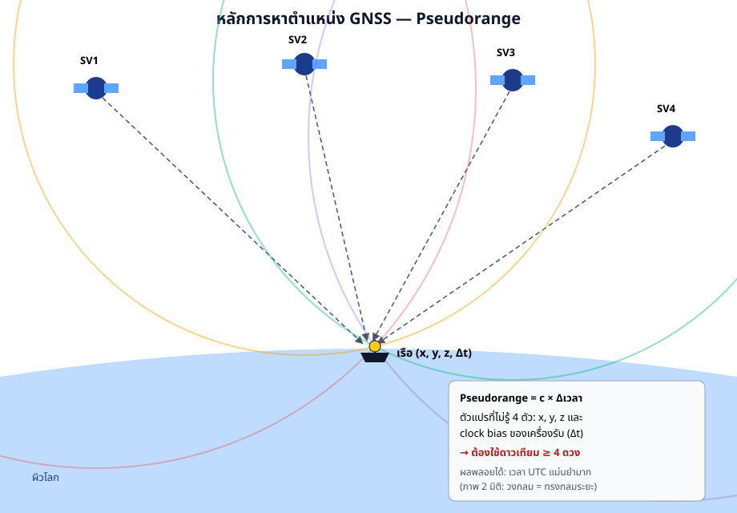
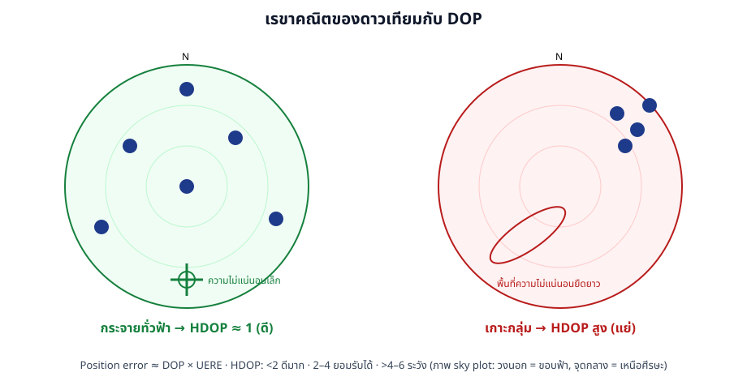
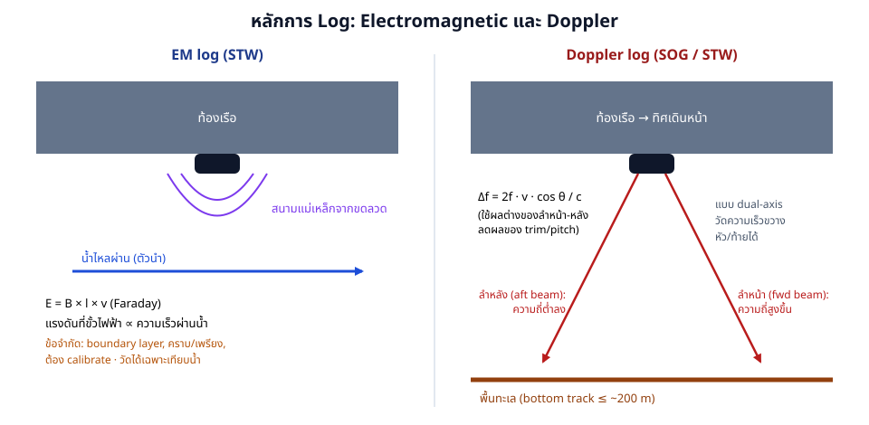

# 1.1.3 Electronic Systems of Position Fixing and Navigation — ระบบหาตำแหน่งและเดินเรืออิเล็กทรอนิกส์

> สมุดบันทึกการฝึก OOW · TIRAPHONG NANTAPAN
> สมรรถนะตาม STCW A-II/1: *Ability to determine the ship's position by use of electronic navigational aids*
> อ้างอิงหลัก: SOLAS V/19, V/19-1, V/20; IMO Performance Standards (MSC.112(73) GPS, MSC.113(73) GLONASS, MSC.114(73) DGNSS, MSC.233(82) Galileo, MSC.379(93) BeiDou, MSC.401(95) multi-system receivers, MSC.74(69) Annex 3 AIS, MSC.96(72) speed & distance logs, MSC.252(83) INS, MSC.302(87) Bridge Alert Management), MSC.1/Circ.1575 (Guidelines for shipborne PNT data processing), MSC.1/Circ.1644 (Deliberate interference with GPS and other GNSS, 2021), Res. A.1106(29) (AIS operational use), ITU-R M.1371-5 (AIS technical characteristics), SN.1/Circ.243/Rev.2 (navigation-related symbols), SOLAS IV/18 (position updating สำหรับ DSC), IALA guidelines, Bowditch (Satellite Navigation, Electronic Navigation), ALRS Vol 2

---

## 0. ภาพใหญ่ — เครื่องมืออิเล็กทรอนิกส์บนสะพานเดินเรือ

สะพานเดินเรือยุคปัจจุบันมีเครื่องมืออิเล็กทรอนิกส์เต็มไปหมด แต่สำหรับ "การหาตำแหน่ง" แบ่งได้เป็น 3 กลุ่ม

1. **ระบบดาวเทียม (GNSS)** — GPS, GLONASS, Galileo, BeiDou และระบบเสริม (DGNSS, SBAS)
2. **ระบบภาคพื้นดิน (terrestrial radionavigation)** — Loran-C ในอดีต, eLoran และ R-Mode ที่กำลังพัฒนา
3. **ระบบที่ไม่ใช้สัญญาณภายนอก** — เรดาร์ (บท 1.3), echo sounder (บท 1.1.4), gyro + log สำหรับ DR

รวมถึงระบบที่ **กระจายข้อมูลตำแหน่ง** ไปยังเรืออื่นและฝั่ง เช่น AIS, LRIT และระบบที่ **รวมข้อมูล** เช่น ECDIS (บท 1.4), INS/IBS

### 0.1 ข้อกำหนดการติดตั้งตาม SOLAS V/19 (ที่เกี่ยวกับบทนี้)

| อุปกรณ์ | เรือที่ต้องมี (โดยสรุป) |
|---|---|
| **GNSS receiver หรือ terrestrial radionavigation receiver** | เรือทุกขนาด (ทุกลำที่อยู่ใต้ Chapter V) — เพื่อหาตำแหน่งอัตโนมัติตลอดการเดินทาง |
| **AIS** | เรือ 300 GT ขึ้นไปที่เดินทางระหว่างประเทศ, เรือสินค้า 500 GT ขึ้นไปที่ไม่เดินทางระหว่างประเทศ, เรือโดยสารทุกลำ |
| **Speed and distance measuring device (log)** | 300 GT ขึ้นไปและเรือโดยสารทุกขนาด (STW — V/19.2.3.4); 50,000 GT ขึ้นไปต้องวัดได้ทั้งความเร็วผ่านน้ำและเทียบพื้น (SOG/distance over the ground ทั้งแนวหัว-ท้ายและแนวขวาง — V/19.2.9.2) |
| **Echo sounder** | 300 GT ขึ้นไปและเรือโดยสารทุกขนาด (V/19.2.3.1) |
| **Heading information (THD / gyro)** | 300 GT ขึ้นไปและเรือโดยสารทุกขนาด (THD — V/19.2.3.5), 500 GT ขึ้นไป (gyro compass — V/19.2.5.1) |
| **Rate of Turn indicator** | 50,000 GT ขึ้นไป |
| **ECDIS** | ตามตารางบังคับ (เรือโดยสาร 500 GT+, เรือบรรทุกน้ำมัน 3,000 GT+, เรือสินค้าอื่น 10,000 GT+ ทยอยตามขนาดและปีที่สร้าง) |
| **BNWAS** | เรือสินค้า 150 GT+ และเรือโดยสารทุกลำ (ทยอยบังคับ) |
| **LRIT (V/19-1)** | เรือโดยสาร, เรือสินค้า 300 GT+ ในการเดินทางระหว่างประเทศ, MODU |
| **VDR / S-VDR (V/20)** | เรือโดยสาร และเรือสินค้า 3,000 GT+ ตามเงื่อนไข |

---

## 1. พื้นฐานคลื่นวิทยุและหลักการหาตำแหน่ง

### 1.1 คลื่นวิทยุที่เกี่ยวข้อง

| แถบความถี่ | ช่วง | การใช้งานทางทะเล |
|---|---|---|
| LF (Low Frequency) | 30–300 kHz | Loran-C / eLoran (100 kHz) |
| MF (Medium Frequency) | 300 kHz – 3 MHz | DGNSS beacons (283.5–325 kHz), NAVTEX (490/518 kHz), MF DSC (2187.5 kHz) |
| HF | 3–30 MHz | สื่อสารระยะไกล HF DSC/NBDP |
| VHF | 30–300 MHz | VHF radio, **AIS (161.975 และ 162.025 MHz)** |
| UHF/L-band | 300 MHz – 3 GHz | **GNSS (≈1.1–1.6 GHz)**, Inmarsat, Iridium |
| SHF | 3–30 GHz | **เรดาร์ X-band (≈9.4 GHz) และ S-band (≈3.0 GHz)** |

### 1.2 รูปแบบการแพร่กระจายคลื่น

- **Ground wave** — เคลื่อนตามผิวโลก ใช้กับ LF/MF ไปได้ไกลหลายร้อยไมล์ (กว่า 1,000 ไมล์สำหรับ LF)
- **Sky wave** — สะท้อนกลับจากชั้นบรรยากาศ ionosphere ใช้กับ HF สื่อสารไกล แต่ทำให้สัญญาณนำทาง LF/MF คลาดเคลื่อน (โดยเฉพาะกลางคืน)
- **Space wave / Line of sight** — VHF ขึ้นไป เดินทางเป็นเส้นตรง ระยะจำกัดด้วยความโค้งของโลก (AIS ประมาณ 20–30 ไมล์ระหว่างเรือ)

### 1.3 หลักการหาตำแหน่ง

| หลักการ | วิธี | เส้นตำแหน่ง | ระบบตัวอย่าง |
|---|---|---|---|
| **Ranging** (วัดระยะ) | วัดเวลาเดินทางของสัญญาณ × ความเร็วแสง | วงกลม (2D) / ทรงกลม (3D) | GNSS, เรดาร์, eLoran (แบบ ranging) |
| **Hyperbolic** (ผลต่างระยะ) | วัดผลต่างเวลาที่สัญญาณจากสองสถานีมาถึง | ไฮเพอร์โบลา | Loran-C, Decca (อดีต) |
| **Direction finding** | วัดทิศที่สัญญาณมา | เส้นแบริ่ง | RDF (อดีต), VHF DF ในงาน SAR |

---

## 2. GNSS — Global Navigation Satellite Systems

### 2.1 ระบบหลักทั่วโลก

| ระบบ | ประเทศ | ดาวเทียม (โครงสร้างหลัก) | วงโคจร | สัญญาณพลเรือนหลัก | ระบบพิกัดอ้างอิง |
|---|---|---|---|---|---|
| **GPS** | สหรัฐอเมริกา | 24 ดวงตามแบบ (ใช้งานจริงราว 31 ดวง) 6 ระนาบ เอียง 55° | MEO ≈ 20,200 km คาบ ≈ 11 ชม. 58 นาที | L1 C/A (1575.42 MHz), L2C, L5, L1C | WGS 84 |
| **GLONASS** | รัสเซีย | 24 ดวง 3 ระนาบ เอียง 64.8° | ≈ 19,100 km คาบ ≈ 11 ชม. 15 นาที | L1/L2 (FDMA แต่ละดวงความถี่ต่างกัน) + CDMA รุ่นใหม่ | PZ-90 |
| **Galileo** | สหภาพยุโรป | ออกแบบ 24 + สำรอง (≈30 ดวง) 3 ระนาบ เอียง 56° | ≈ 23,222 km คาบ ≈ 14 ชม. | E1, E5a, E5b, E6 (High Accuracy Service ระดับ ~20 cm เริ่มให้บริการปี 2023) | GTRF |
| **BeiDou (BDS-3)** | จีน | MEO 24 + IGSO 3 + GEO 3 (ใช้งานทั่วโลกตั้งแต่ปี 2020) | MEO ≈ 21,500 km | B1C, B1I, B2a | CGCS2000 |

ระบบภูมิภาค: **QZSS** (ญี่ปุ่น — ดาวเทียมวงโคจรกึ่งค้างฟ้าเหนือเอเชีย-ออสเตรเลีย) และ **NavIC/IRNSS** (อินเดีย)

> ในการเดินเรือ ระบบพิกัดของ GNSS ทั้งหมดสอดคล้องกับ ITRF ในระดับเซนติเมตร-เดซิเมตร จึงถือว่าตรงกับ WGS 84 ได้

**สถานะระบบโดยสรุป (จดไว้ ณ ต.ค. 2026 — ตัวเลขเปลี่ยนตามการส่งดาวเทียมและการปลดระวาง ให้ตรวจกับประกาศของผู้ให้บริการ/NAVCEN/EUSPA ก่อนอ้างอิง)**

| ระบบ | สถานะที่ควรรู้ |
|---|---|
| **GPS** | ใช้งานราว 31–32 ดวง; ดาวเทียม GPS III ดวงที่ 10 (ดวงสุดท้ายของรุ่น) ส่งขึ้นเมื่อ เม.ย. 2026 รุ่นถัดไปคือ GPS IIIF; สัญญาณพลเรือนใหม่ L2C/L5/L1C ยังทยอยครบ — เครื่องรับเรือส่วนใหญ่ยังใช้ L1 C/A เป็นหลัก |
| **GLONASS** | ใช้งานราว 24–25 ดวง (ส่วนใหญ่ GLONASS-M ร่วมกับ GLONASS-K/K2); สัญญาณ CDMA ยังอยู่ระหว่างทยอยใช้งาน |
| **Galileo** | ส่งขึ้นแล้ว 34 ดวง (IOV 4 + FOC 30) ใช้งานจริงน้อยกว่านี้เล็กน้อย; **OSNMA (Open Service Navigation Message Authentication)** — การยืนยันความถูกต้องของ navigation message เพื่อช่วยตรวจจับ spoofing — ประกาศ Initial Service เมื่อ 24 ก.ค. 2025 (เครื่องรับต้องรองรับ); ดาวเทียมรุ่นที่สอง (G2G) มีแผนเริ่มส่งช่วงปี 2026–2027 |
| **BeiDou (BDS-3)** | ให้บริการทั่วโลกตั้งแต่ 31 ก.ค. 2020 มีดาวเทียม GEO/IGSO ช่วยเพิ่มจำนวนดาวที่เห็นในเอเชีย-แปซิฟิก (น่านน้ำไทยจึงเห็นดาว BDS จำนวนมาก) |

> IMO รับรองระบบดาวเทียมเป็นองค์ประกอบของ World-Wide Radionavigation System (WWRNS) ตาม Res. A.1046(27) — GPS และ GLONASS (มาก่อน), BeiDou (MSC 94, พ.ย. 2014), Galileo (รับรองเป็น future component ปี 2016 — SN.1/Circ.334) และ NavIC/IRNSS ของอินเดียเฉพาะพื้นที่มหาสมุทรอินเดีย (MSC 102, พ.ย. 2020) — แต่ละระบบมี performance standard ของเครื่องรับ (ดูหัวบท); ส่วนระบบเสริม (SBAS/DGNSS) NCSR 12 (พ.ค. 2025) เห็นว่าไม่จำเป็นต้อง "รับรอง" เป็นส่วนของ WWRNS เพราะเป็นวิธีปรับปรุงคุณสมบัติของ GNSS (ตรวจสถานะล่าสุดกับเอกสาร IMO)

### 2.2 องค์ประกอบของระบบ (segments)

1. **Space segment** — ดาวเทียมส่งสัญญาณบอกเวลาที่แม่นยำมาก (นาฬิกาอะตอม) และข้อมูลวงโคจร
2. **Control segment** — สถานีภาคพื้นดินติดตามดาวเทียม คำนวณและส่งข้อมูลแก้ (ephemeris, clock corrections) ขึ้นไป
3. **User segment** — เครื่องรับบนเรือ

ข้อมูลที่ดาวเทียมส่ง (navigation message)
- **Ephemeris** — วงโคจรละเอียดของดาวเทียมดวงนั้น (อัปเดตทุก ~2 ชม.) ใช้คำนวณตำแหน่งดาวเทียม
- **Almanac** — วงโคจรคร่าว ๆ ของดาวเทียมทุกดวง ใช้ให้เครื่องรับรู้ว่าดวงไหนอยู่บนท้องฟ้า (ลดเวลา cold start)
- **Clock corrections, ionospheric model, health status**

### 2.3 หลักการหาตำแหน่ง — Pseudorange



*ภาพที่ 1.1.3-1 ตำแหน่งได้จากจุดตัดของทรงกลมระยะ (ในภาพแสดงเป็นวงกลม 2 มิติ) ต้องใช้ดาวเทียมอย่างน้อย 4 ดวงเพื่อแก้ตัวแปร x, y, z และความคลาดเคลื่อนนาฬิกาของเครื่องรับ*

```
Pseudorange = c × (เวลารับ − เวลาส่ง)    (c ≈ 299,792 km/s)
```

- เครื่องรับมีนาฬิกาควอตซ์ราคาถูก ไม่แม่นเท่านาฬิกาอะตอมของดาวเทียม ระยะที่วัดได้จึงมี error เท่ากันทุกดวง (clock bias) เรียกว่า **"pseudo"-range**
- ตัวแปรที่ไม่รู้ 4 ตัว: x, y, z (ตำแหน่ง) และ Δt (clock bias) → ต้องการดาวเทียมอย่างน้อย **4 ดวง** สำหรับ 3D fix (เรือในทะเลรู้ความสูงคร่าว ๆ จึงใช้ 3 ดวงทำ 2D fix ได้ แต่ความแม่นยำลดลง)
- ผลพลอยได้: GNSS ให้ **เวลา UTC ที่แม่นยำมาก** ใช้ซิงก์นาฬิกาเรือ VDR AIS GMDSS

### 2.4 แหล่งความคลาดเคลื่อน (Error sources)

| แหล่ง | สาเหตุ | ผลโดยประมาณ / วิธีลด |
|---|---|---|
| **Ionospheric delay** | สัญญาณช้าลงเมื่อผ่านชั้น ionosphere แปรตามกิจกรรมดวงอาทิตย์ เวลากลางวัน/กลางคืน ละติจูด | ใหญ่ที่สุดสำหรับเครื่องความถี่เดียว (หลายเมตร) — เครื่องรับ **dual-frequency** ขจัดได้เกือบหมด; SBAS/DGNSS ช่วยแก้ |
| **Tropospheric delay** | ความชื้นและความหนาแน่นอากาศ | ไม่กี่เมตรที่มุมเงยต่ำ — ใช้ model แก้, ตั้ง elevation mask (ไม่ใช้ดาวเทียมต่ำกว่า 5°–10°) |
| **Satellite clock / ephemeris error** | ข้อมูลวงโคจร/นาฬิกาคลาดเล็กน้อย | ~1–2 m — แก้ด้วย DGNSS/SBAS |
| **Multipath** | สัญญาณสะท้อนจากโครงสร้างเรือ เครน ตู้สินค้า ผิวน้ำ ก่อนเข้าเสาอากาศ | เลือกตำแหน่งเสาอากาศโล่ง สูง ห่างจากโครงสร้าง/เสาอากาศอื่น |
| **Receiver noise** | วงจรภายใน | เล็กน้อย |
| **Geometry (DOP)** | ตำแหน่งดาวเทียมบนท้องฟ้าเกาะกลุ่มกัน | ดู HDOP — คูณ error ทั้งหมด |
| **Datum mismatch** | ใช้ datum ต่างจากแผนที่ | ตั้ง WGS 84 และแก้ตอน plot แผนที่กระดาษ (ภาค 1.1.2-C) |
| **Antenna offset / CCRP** | ตำแหน่งเสาอากาศไม่ใช่ตำแหน่งสะพานเดินเรือ | ตั้งค่า offset ให้ถูกใน ECDIS/AIS (consistent common reference point) |
| **Interference / Jamming / Spoofing** | สัญญาณรบกวนหรือสัญญาณปลอม | ดูข้อ 2.8 |
| **Space weather** | พายุสุริยะทำให้ ionosphere ปั่นป่วน (scintillation) โดยเฉพาะเขตศูนย์สูตรและขั้วโลก | ความแม่นยำลดหรือสูญเสีย fix ชั่วคราว |

> **Selective Availability (SA)** — การลดความแม่นยำของ GPS โดยเจตนาของสหรัฐฯ ถูกยกเลิกตั้งแต่ 2 พฤษภาคม 2000 ปัจจุบัน GPS SPS ให้ความแม่นยำแนวราบราว 3–5 m (95%) และเครื่องรับหลายระบบ/สองความถี่ดีกว่านี้

### 2.5 Dilution of Precision (DOP)



*ภาพที่ 1.1.3-2 ดาวเทียมกระจายทั่วท้องฟ้า → DOP ต่ำ (ดี); ดาวเทียมเกาะกลุ่ม → DOP สูง (แย่)*

- **DOP** คือตัวคูณที่บอกว่าเรขาคณิตของดาวเทียมขยายความคลาดเคลื่อนของการวัดระยะมากแค่ไหน
  - Position error ≈ DOP × UERE (User Equivalent Range Error)
- ชนิด: **GDOP** (geometric รวมทุกอย่าง), **PDOP** (3D position), **HDOP** (แนวราบ — สำคัญที่สุดสำหรับเรือ), **VDOP** (แนวดิ่ง), **TDOP** (เวลา)
- แนวทางการตีความ HDOP: **1–2 ดีมาก, 2–4 ดี/ยอมรับได้, 4–6 พอใช้ระวัง, > 6 แย่** (เครื่องรับส่วนใหญ่ให้ตั้ง HDOP alarm ได้)
- ในร่องน้ำแคบที่มีตึกสูง/ภูเขาบังท้องฟ้าบางส่วน DOP อาจเพิ่มขึ้นกะทันหัน

### 2.6 ระบบเสริม (Augmentation)

**ก) DGNSS (Differential GNSS) ผ่าน MF beacon**
- สถานีอ้างอิงบนฝั่งรู้ตำแหน่งจริงของตัวเอง เทียบกับตำแหน่งที่คำนวณจาก GNSS ได้ค่าแก้ (corrections) ส่งออกอากาศทาง **MF 283.5–325 kHz** (มาตรฐาน RTCM SC-104 ตามแนวทาง IALA) ระยะประมาณ 100–300 ไมล์
- ความแม่นยำราว 1–3 m และมี **integrity monitoring** (แจ้งเตือนเมื่อดาวเทียมดวงใดผิดปกติภายในไม่กี่วินาที)
- หลายประเทศยุติหรือลดบริการ DGPS beacon หลังจาก SBAS และ GNSS หลายระบบพัฒนาขึ้น — ตรวจรายชื่อสถานีที่ยังให้บริการจาก **ALRS Vol 2 (NP282)**
- ตัวอย่างการยุติบริการที่ยืนยันแล้ว (จดไว้กันลืม): **สหรัฐฯ (USCG NDGPS)** ปิดสถานีสุดท้าย 30 มิ.ย. 2020, **ออสเตรเลีย (AMSA)** ยุติ 1 ก.ค. 2020, **สหราชอาณาจักรและไอร์แลนด์ (Trinity House, NLB, Irish Lights)** ยุติ 31 มี.ค. 2022, **นอร์เวย์ (Kystverket)** ยุติ 27 ม.ค. 2026 — หลายประเทศในเอเชียยังให้บริการอยู่ ต้องตรวจเป็นรายพื้นที่
- เมื่อสถานีที่เครื่องรับเลือกไว้หยุดส่ง เครื่องจะขึ้น alarm "DGPS/differential lost" แต่ยังให้ตำแหน่ง GNSS ปกติ — OOW ต้องรู้ว่า alarm นี้หมายถึงอะไร ไม่ต้องตกใจ แต่ต้องบันทึกและเปลี่ยนโหมดให้ถูก (เช่น SBAS หรือ GNSS only) ตามคำแนะนำของบริษัท

**ข) SBAS (Satellite-Based Augmentation System)**
- ส่งค่าแก้และข้อมูล integrity ผ่านดาวเทียมค้างฟ้าในความถี่ L1 (เครื่องรับ GPS ทั่วไปรับได้)
- ระบบ: **WAAS** (สหรัฐฯ), **EGNOS** (ยุโรป), **MSAS** (ญี่ปุ่น), **GAGAN** (อินเดีย), **SDCM** (รัสเซีย), **BDSBAS** (จีน), **KASS** (เกาหลีใต้), **SouthPAN** (ออสเตรเลีย/นิวซีแลนด์)
- ความแม่นยำราว 1–2 m ในพื้นที่ครอบคลุม — ต้องดูว่าระบบรับรองสำหรับการเดินเรือในพื้นที่นั้นหรือไม่

**ค) ระบบความแม่นยำสูงพิเศษ** — RTK (Real Time Kinematic) และ PPP (Precise Point Positioning) ระดับเซนติเมตร ใช้ในงานเฉพาะ (สำรวจ ขุดลอก DP วางท่อ) ไม่ใช่การเดินเรือทั่วไป

### 2.7 เครื่องรับ GNSS บนเรือ — การตั้งค่าและการตรวจสอบ

สิ่งที่ OOW ต้องรู้และตรวจในเครื่องรับ (และใน ECDIS ที่รับข้อมูล)

1. **Datum** — WGS 84
2. **Mode** — GPS only / multi-GNSS / DGNSS / SBAS; สถานะปัจจุบัน (เช่น "D" หรือ "SBAS" แสดงว่าใช้ค่าแก้)
3. **จำนวนดาวเทียมที่ใช้, HDOP, signal strength (C/N0)**
4. **Alarms** — loss of position, HDOP exceeded, differential lost, integrity (RAIM) alarm, anchor watch, XTE (ถ้าใช้)
5. **Antenna position offset** — สอดคล้องกับ CCRP ของเรือ
6. **Output** — ส่งไป ECDIS, radar/ARPA, AIS, GMDSS (DSC ต้องมีตำแหน่งอัตโนมัติ), VDR, autopilot (track control)
7. **Smoothing / filtering** — การตั้งค่าเฉลี่ยตำแหน่ง/ความเร็ว ถ้าตั้งมากเกินไปจะทำให้ COG/SOG ตอบสนองช้า (สำคัญตอนเลี้ยว)
8. **Time** — UTC และ offset ของเวลาท้องถิ่น
9. **Integrity monitoring (RAIM)** — เครื่องรับใช้ดาวเทียมส่วนเกินตรวจหาดาวที่ผิดปกติ และเตือนผู้ใช้
10. **บันทึกตำแหน่งเมื่อเปลี่ยนแหล่งข้อมูล** — เช่นเปลี่ยนจาก GNSS 1 ไป GNSS 2 ใน ECDIS ต้องบันทึกในสมุดปูมเรือ

> IMO ส่งเสริมแนวคิด **PNT data processing** (MSC.1/Circ.1575) ใน INS — รวมข้อมูลจากหลายแหล่ง (GNSS หลายระบบ, log, gyro, เรดาร์) ตรวจความสอดคล้องและความน่าเชื่อถือ (integrity) แล้วแสดงสถานะให้ผู้ใช้เห็น

### 2.8 การรบกวนสัญญาณ (Jamming) และการปลอมสัญญาณ (Spoofing)

สัญญาณ GNSS ที่มาถึงพื้นโลกอ่อนมาก (ต่ำกว่าระดับสัญญาณรบกวนพื้นหลัง) จึงถูกรบกวนได้ง่าย

| | Jamming | Spoofing |
|---|---|---|
| คืออะไร | ส่งคลื่นรบกวนกลบสัญญาณ | ส่งสัญญาณปลอมที่เหมือนจริง หลอกให้เครื่องรับคำนวณตำแหน่ง/เวลาผิด |
| อาการ | สูญเสีย fix, จำนวนดาวเทียมลดลงฉับพลัน, C/N0 ต่ำ, HDOP สูง, alarm "no fix" | **ตำแหน่งกระโดด** หรือค่อย ๆ เลื่อนออก, ตำแหน่งอยู่บนบก/สนามบิน, SOG/COG ผิดปกติขณะเรือไม่ได้เปลี่ยน, เวลา UTC กระโดด, AIS ของเรือหลายลำในพื้นที่ไปรวมตำแหน่งเดียวกันหรือเรียงเป็นวงกลม, ตำแหน่ง GNSS ไม่ตรงกับเรดาร์/ความลึก |
| อันตราย | ระบบที่พึ่ง GNSS หยุดทำงาน (ECDIS ไม่มีตำแหน่ง, DSC ไม่มีตำแหน่ง) | **อันตรายกว่า** เพราะระบบยังดูเหมือนทำงานปกติ แต่ข้อมูลผิด — ECDIS, AIS, autopilot track mode, GMDSS, VDR ได้ข้อมูลผิดทั้งหมด |

**แนวปฏิบัติเมื่อสงสัยว่า GNSS ถูกรบกวน**

1. **ตรวจสอบข้ามแหล่ง (cross-check)** ทันที — fix ด้วยเรดาร์ (ระยะ/แบริ่งจากวัตถุบนฝั่ง), สายตา, ความลึก, DR จาก gyro + log
2. **แจ้งนายเรือ** ตาม standing orders
3. ถ้ายืนยันว่าตำแหน่ง GNSS ผิด — เปลี่ยนแหล่งตำแหน่งใน ECDIS เป็นแหล่งที่เชื่อถือได้หรือ **DR mode** และใช้ **manual position fix** (เรดาร์/ตา) ใน ECDIS; เปลี่ยน autopilot จาก track mode เป็น heading mode
4. ระวังว่า **ARPA ground-stabilised, AIS ของเรือตัวเอง, COG/SOG** อาจผิดตาม — ใช้ water-stabilised (STW จาก log) สำหรับการหลีกเลี่ยงการโดนกัน
5. ระวัง AIS ของเรือลำอื่น ซึ่งอาจถูกปลอมด้วย (ตำแหน่งเป้าใน AIS อาจไม่ตรงกับเรดาร์)
6. **บันทึก** เวลา ตำแหน่ง อาการ ลงในสมุดปูมเรือ
7. **รายงาน** — แจ้ง VTS/สถานีชายฝั่ง/ผู้ประสานงาน NAVAREA หรือหน่วยงานที่กำหนด (หลายประเทศมีช่องทางรายงาน GNSS interference) และบริษัท
8. **ไม่ปิด alarm** เพื่อความรำคาญ และ **รักษาทักษะเดินเรือแบบดั้งเดิม** (เรดาร์ ดาราศาสตร์ DR) — นี่คือเหตุผลที่ STCW ยังบังคับ

> พื้นที่ที่มีรายงานการรบกวน GNSS บ่อยมักประกาศผ่าน NAVAREA/NAVTEX และหนังสือเวียนของรัฐเจ้าของธง ให้ตรวจก่อนเข้าพื้นที่ในขั้น Appraisal

**ระบบบนสะพานที่ "พังตาม" เมื่อ GNSS ผิด (จดไว้กันลืม — ต้องไล่ตรวจทีละตัว)**

| ระบบ | ผลกระทบ | สิ่งที่ OOW ทำ |
|---|---|---|
| ECDIS | ตำแหน่งเรือ เส้นทาง alarm (anti-grounding, XTE) อ้างอิงตำแหน่งผิด | เปลี่ยน position source / DR + manual fix, ใช้ radar overlay เทียบ |
| Radar/ARPA (ground stabilised) | เวกเตอร์เป้าและ CPA/TCPA ผิดถ้าใช้ SOG/COG จาก GNSS | ใช้ sea-stabilised ด้วย STW จาก log |
| AIS ของเรือตัวเอง | ส่งตำแหน่ง/SOG/COG ผิดออกไปให้เรืออื่นและ VTS | แจ้ง VTS/เรือรอบข้างเมื่อจำเป็น |
| GMDSS (DSC, ระบบที่ใส่ตำแหน่งใน distress alert) | distress alert อาจส่งตำแหน่งผิด | ตาม **SOLAS IV/18** ถ้าตำแหน่งไม่ได้อัปเดตอัตโนมัติ ต้อง **ป้อนตำแหน่งและเวลาด้วยมือทุกช่วงไม่เกิน 4 ชั่วโมง** ขณะเรือเดินทาง — ใช้ตำแหน่งจาก fix ที่เชื่อถือได้ |
| Gyro (speed/latitude correction อัตโนมัติจาก GNSS) | ถ้า SOG/ละติจูดที่ป้อนผิด course & speed error ที่แก้ก็ผิดตาม (บท 1.1.5) | ป้อนความเร็ว/ละติจูดด้วยมือ |
| Satellite compass / ROT จาก GNSS | heading/ROT หายหรือผิด | สลับไปใช้ gyro / THD อื่น |
| Autopilot track mode, VDR, นาฬิกาเรือที่ซิงก์ GNSS | ทำงานตามข้อมูลผิด / เวลาเพี้ยน | ใช้ heading mode, บันทึกเวลาเกิดเหตุจากนาฬิกาอิสระ |

**แนวทางของ IMO และอุตสาหกรรมที่ควรรู้**
- **MSC.1/Circ.1644** (18 ต.ค. 2021) *Deliberate interference with the United States' GPS and other GNSS* — ขอให้รัฐสมาชิกลดการรบกวนจากดินแดนของตน ออกประกาศเตือนชาวเรือ (ช่วงเวลาและพื้นที่ที่มีการรบกวน) และป้องกันการส่งสัญญาณที่ไม่ได้รับอนุญาตในย่านความถี่ GNSS
- **แถลงการณ์ร่วม IMO–ICAO–ITU (25 มี.ค. 2025)** — ขอให้รัฐปกป้อง RNSS จากการรบกวน เสริมความทนทาน (resilience) ของระบบ PNT **คงระบบนำทางแบบดั้งเดิมไว้เป็นสำรอง** ประสานงานระหว่างหน่วยงาน และจัดช่องทางรายงานการรบกวน
- อุตสาหกรรมเดินเรือมีคู่มือ *Jamming and Spoofing of GNSS* (2nd ed., 2025 — เผยแพร่ทาง maritimeglobalsecurity.org) ใช้ประกอบ SMS ของบริษัท
- เทคโนโลยีช่วยตรวจจับ: เครื่องรับหลายระบบหลายความถี่, RAIM/การตรวจความสอดคล้องใน INS (MSC.1/Circ.1575), Galileo OSNMA — **แต่ไม่มีอะไรแทนการ cross-check ด้วยเรดาร์ ตา และ DR ได้**
- การรายงาน: ตามช่องทางที่รัฐชายฝั่ง/NAVAREA coordinator กำหนด, บริษัท, และสำหรับ GPS สามารถรายงานไปที่ศูนย์ NAVCEN ของ USCG; ในพื้นที่ความเสี่ยงทางความมั่นคงให้ดูประกาศ/advisory ของหน่วยงานที่รับผิดชอบพื้นที่นั้น

---

## 3. ระบบหาตำแหน่งภาคพื้นดิน (Terrestrial radionavigation)

### 3.1 Loran-C (ประวัติ)

- **Long Range Navigation** ระบบ hyperbolic ความถี่ 100 kHz สถานีเป็นชุด (chain) ประกอบด้วย master และ secondaries
- วัด **time difference (TD)** ระหว่างพัลส์จาก master กับ secondary ได้เส้นไฮเพอร์โบลา จุดตัดของสองเส้นคือตำแหน่ง
- ความแม่นยำ absolute ประมาณ 0.25 ไมล์ (repeatable accuracy ดีกว่ามาก) ระยะ ground wave ราว 1,000–1,200 ไมล์
- สหรัฐฯ ยุติ Loran-C ปี 2010 ยุโรปส่วนใหญ่ยุติปี 2015–2016
- **Decca** และ **Omega** — ระบบ hyperbolic ในอดีตที่เลิกใช้แล้ว (ยังเห็นในตำราเก่าและข้อสอบเก่าบางชุด)

### 3.2 eLoran

- **Enhanced Loran** — พัฒนาจาก Loran-C ใช้เทคโนโลยีใหม่ มี data channel ส่งค่าแก้และข้อมูล integrity ได้ความแม่นยำราว 10–20 m ในพื้นที่ที่มีค่าแก้ (ASF corrections)
- จุดเด่น: สัญญาณแรงมาก (LF ภาคพื้นดิน) **ยากต่อการรบกวน** และ **อิสระจาก GNSS** — จึงเป็นตัวเลือกของระบบสำรอง (resilient PNT) ให้ทั้งตำแหน่งและเวลา
- บางประเทศพัฒนา/ทดลองใช้งาน (เช่น เกาหลีใต้ จีน) และหลายประเทศพิจารณานโยบายสำรอง GNSS
- สถานะที่ติดตามได้ (ต.ค. 2026 — ตรวจกับประกาศทางการอีกครั้ง): **เกาหลีใต้** ปรับสถานี Loran-C เป็น eLoran และรายงานว่าถึง Initial Operational Capability ราวปี 2023; **จีน** ขยายระบบ eLoran (เดิม "Changhe") เพื่อใช้ด้านเวลาและตำแหน่ง กำหนดแล้วเสร็จราวปี 2026; **สหราชอาณาจักร** ประกาศงบประมาณ PNT ปี 2025 ซึ่งรวมโครงการ eLoran ระดับชาติ คาดว่าจะถึง IOC ราวปี 2028 — เรือสินค้าทั่วไปยังไม่มีข้อบังคับให้ติดเครื่องรับ eLoran
- สำหรับ OOW: eLoran เป็น "ระบบสำรองที่อาจมีในบางพื้นที่" ไม่ใช่สิ่งที่พึ่งได้ทั่วโลก — ระบบสำรองหลักบนเรือทุกลำยังคือ **เรดาร์ + DR + การเดินเรือด้วยสายตา/ดาราศาสตร์**

### 3.3 R-Mode (Ranging Mode)

- แนวคิดใหม่ที่ใช้สัญญาณจาก **MF DGNSS beacons** และ **AIS base stations** ที่มีอยู่แล้ว มาวัดระยะเพื่อหาตำแหน่งสำรองเมื่อ GNSS ใช้ไม่ได้
- อยู่ในขั้นทดสอบในยุโรป (เช่นทะเลบอลติกและทะเลเหนือ) — ควรรู้ไว้ว่าเป็นทิศทางของ e-Navigation

---

## 4. AIS — Automatic Identification System

### 4.1 วัตถุประสงค์ (SOLAS V/19.2.4)

1. ส่งข้อมูลของเรือ (identity, type, position, course, speed, navigational status ฯลฯ) **อัตโนมัติ** ไปยังสถานีฝั่ง เรืออื่น และอากาศยาน
2. รับข้อมูลเดียวกันจากเรืออื่นอัตโนมัติ
3. ติดตามและเฝ้าดูเรือ (VTS)
4. แลกเปลี่ยนข้อมูลกับสถานีฝั่ง

ช่วยใน: การหลีกเลี่ยงการโดนกัน (ข้อมูลเสริม), VTS, การค้นหาและกู้ภัย, ความปลอดภัยทางทะเล (security), การจราจร

### 4.2 หลักการทำงาน

- ความถี่ VHF ทางทะเล **AIS 1 = ช่อง 87B (161.975 MHz)** และ **AIS 2 = ช่อง 88B (162.025 MHz)**
- ใช้เทคนิค **SOTDMA (Self-Organizing Time Division Multiple Access)** — แบ่งเวลาเป็น 2,250 slot ต่อนาทีต่อช่อง เรือแต่ละลำจองช่องเวลาของตัวเองอัตโนมัติ ทำให้รองรับเรือจำนวนมากโดยไม่ชนกัน (Class B บางชนิดใช้ CSTDMA)
- ระยะใช้งานเรือ-เรือประมาณ **20–30 ไมล์** (ขึ้นกับความสูงเสาอากาศ) และมี **Satellite AIS** รับจากอวกาศสำหรับติดตามระยะไกล (ข้อมูลไปยังศูนย์บนฝั่ง ไม่ใช่สำหรับเรือ)

### 4.3 ประเภทอุปกรณ์ AIS

| ประเภท | ผู้ใช้ |
|---|---|
| **Class A** | เรือตาม SOLAS — กำลังส่ง 12.5 W, อัตรารายงานสูง, มีข้อมูลครบ |
| **Class B** | เรือเล็ก เรือประมง เรือสำราญ — กำลังส่งต่ำกว่า อัตรารายงานต่ำกว่า ข้อมูลน้อยกว่า |
| **Base station** | สถานีบนฝั่ง (VTS, ท่าเรือ) |
| **AIS AtoN** | ทุ่น/ประภาคาร (real/synthetic/virtual) |
| **AIS-SART** | อุปกรณ์ช่วยค้นหาผู้ประสบภัย (บท 3.4) — แสดงเป็นวงกลมมีกากบาท |
| **SAR aircraft AIS** | อากาศยานค้นหาและกู้ภัย |
| **MOB AIS devices** | อุปกรณ์ส่วนบุคคลสำหรับคนตกน้ำ |

### 4.4 ข้อมูลที่ส่ง (Class A)

| ประเภทข้อมูล | รายการ | ใครป้อน / อัปเดตเมื่อไร |
|---|---|---|
| **Static** | MMSI, IMO number, call sign, ชื่อเรือ, ความยาว/ความกว้าง, ประเภทเรือ, ตำแหน่งเสาอากาศ GNSS บนเรือ | ตั้งตอนติดตั้ง ส่งทุก 6 นาที หรือเมื่อมีการร้องขอ |
| **Dynamic** | ตำแหน่ง (พร้อมตัวบ่งชี้ความแม่นยำ), เวลา UTC, COG, SOG, heading, ROT, **navigational status** | อัตโนมัติจากเซนเซอร์ — ยกเว้น navigational status ที่ **OOW ต้องเปลี่ยนเอง** (underway using engine, at anchor, moored, restricted manoeuvrability, not under command, constrained by draught, engaged in fishing ฯลฯ) |
| **Voyage-related** | draught, ประเภทสินค้าอันตราย (hazardous cargo category), destination, ETA, route plan (ถ้ามี) | **OOW ป้อน/อัปเดตทุกเที่ยว** และเมื่อเปลี่ยน |
| **Short safety-related messages** | ข้อความสั้นด้านความปลอดภัย | ป้อนเองตามต้องการ |

**อัตรารายงานข้อมูล dynamic ของ Class A** (ITU-R M.1371-5, Table 1)

| สภาพเรือ | ช่วงเวลารายงาน |
|---|---|
| ทอดสมอ/ผูกท่า เคลื่อนที่ไม่เกิน 3 นอต | 3 นาที |
| ทอดสมอ/ผูกท่า เคลื่อนที่มากกว่า 3 นอต | 10 วินาที |
| แล่น 0–14 นอต | 10 วินาที (3⅓ วินาทีถ้ากำลังเปลี่ยนเข็ม) |
| แล่น 14–23 นอต | 6 วินาที (2 วินาทีถ้ากำลังเปลี่ยนเข็ม) |
| แล่นมากกว่า 23 นอต | 2 วินาที |

**Class B — เทียบให้เห็นว่าทำไมเป้า Class B "กระโดด" บนจอ** (ITU-R M.1371-5, Table 2; กำลังส่ง Class B "CS" 2 W, Class B "SO" 5 W เทียบ Class A 12.5 W)

| ชนิด / สภาพ | ช่วงเวลารายงานตามปกติ |
|---|---|
| Class B "CS" (CSTDMA) — ไม่เกิน 2 นอต | 3 นาที |
| Class B "CS" — มากกว่า 2 นอต | 30 วินาที |
| Class B "SO" (SOTDMA) — ไม่เกิน 2 นอต | 3 นาที |
| Class B "SO" — 2–14 นอต | 30 วินาที |
| Class B "SO" — 14–23 นอต | 15 วินาที |
| Class B "SO" — มากกว่า 23 นอต | 5 วินาที |

**ตัวอย่างจำลอง:** เรือประมงติด Class B "CS" แล่น 8 นอต รายงานทุก 30 วินาที → ระหว่างรายงานสองครั้งเรือเคลื่อนไป 8 × 30/3600 = **0.067 ไมล์ (~124 m)** — ถ้าเป้าเปลี่ยนเข็มกะทันหัน ข้อมูล AIS บนจอจะช้ากว่าความจริงชัดเจน ต้องดูเป้าเรดาร์ประกอบเสมอ (Class A ที่ 13 นอตรายงานทุก 10 วินาที เคลื่อนเพียง ~67 m ต่อรอบ)

### 4.5 แนวทางการใช้งาน AIS บนเรือ — IMO Res. A.1106(29)

1. **เปิด AIS ตลอดเวลา** ทั้งขณะแล่นและทอดสมอ — นายเรือปิดได้เมื่อเห็นว่าการเปิดจะกระทบความปลอดภัย (เช่นพื้นที่เสี่ยงโจรสลัด) และต้อง **บันทึกเหตุผลในสมุดปูมเรือ** แล้วเปิดใหม่เมื่อพ้นสถานการณ์
2. OOW ตรวจข้อมูล static/voyage ให้ถูกต้องทุกเที่ยว โดยเฉพาะ **draught, destination, ETA, navigational status, จำนวนคนบนเรือ (ถ้าระบบมี)**
3. ตรวจว่าตำแหน่ง/heading ที่ส่งออกถูกต้อง (เทียบกับเครื่องรับ GNSS และ gyro)
4. **AIS ไม่ใช่สิ่งทดแทนเรดาร์หรือการเฝ้าระวังด้วยตา** และ **ไม่ได้เปลี่ยนความรับผิดชอบตาม COLREG**
5. ระวังข้อจำกัด (ข้อ 4.6)

### 4.6 ข้อจำกัดของ AIS — ต้องจำให้ได้

- ไม่ใช่ทุกเรือติด AIS (เรือเล็ก เรือประมง เรือที่ปิด AIS) และวัตถุอื่น (ทุ่น ซาก สิ่งกีดขวาง) อาจไม่มี
- ความถูกต้องขึ้นกับข้อมูลที่ป้อนและเซนเซอร์ของเรือลำนั้น — ข้อมูล static/voyage ผิดได้ (ชื่อ ประเภท draught สถานะ)
- ตำแหน่งมาจาก GNSS ของเรือลำนั้น (อาจผิด อาจถูก spoof) และ **ตำแหน่งที่แสดงคือตำแหน่งของเสาอากาศ GNSS** ไม่ใช่กลางเรือ
- **COG/SOG ของ AIS เป็นข้อมูลเทียบพื้น** — การหา aspect ของเป้าด้วย COG อาจผิดเมื่อมีกระแสน้ำแรง (ใช้ heading ประกอบ)
- ช่วงเวลารายงาน ทำให้ข้อมูลล่าช้าได้ (โดยเฉพาะ Class B)
- อาจเกิดช่องว่างการรับเพราะสภาพการกระจายคลื่นหรือความหนาแน่นของช่องสัญญาณ
- **ห้ามใช้ AIS เพียงอย่างเดียวในการตัดสินใจหลีกเลี่ยงการโดนกัน** และระวังการคุยทาง VHF เพื่อ "ตกลงกัน" ตามชื่อเรือใน AIS ซึ่งอาจเข้าใจผิดคนละลำ (VHF-assisted collisions)

### 4.7 AIS บนจอเรดาร์/ECDIS

สัญลักษณ์ตามมาตรฐาน IMO (SN.1/Circ.243 ฉบับปัจจุบัน Rev.2 ปี 2019 และ IEC 62288): **sleeping target** (สามเหลี่ยมเล็ก), **activated target** (สามเหลี่ยมมีเวกเตอร์และ heading line), **selected target**, **dangerous target** (สีแดง กะพริบ), **lost target** (สามเหลี่ยมขีดกากบาท) และ **target association/fusion** ที่รวมเป้าเรดาร์ (ARPA) กับ AIS เป็นเป้าเดียวเมื่อข้อมูลสอดคล้องกัน

### 4.8 ก้าวต่อไป — VDES

- **VDES (VHF Data Exchange System)** เป็นระบบสื่อสารข้อมูลย่าน VHF ที่รวม AIS ไว้ พร้อมช่องข้อมูลความจุสูงกว่า (ASM, VDE ภาคพื้นและดาวเทียม) สำหรับงาน e-Navigation
- MSC 111 (พ.ค. 2026) รับรองการแก้ไข SOLAS บทที่ V ให้เรือ **เลือกติด VDES แทน AIS ได้โดยสมัครใจ** (ยังเป็นไปตามข้อกำหนดการติดตั้งเดิม) พร้อม performance standards และแนวทางการใช้งาน — กำหนดมีผล **1 ม.ค. 2028** (ตรวจหมายเลข resolution กับฉบับทางการ)
- สำหรับ OOW: ส่วน AIS ภายใน VDES ทำงานเหมือน AIS เดิม หลักการใช้งานและข้อจำกัดในข้อ 4.5–4.6 ยังใช้ได้ทั้งหมด

---

## 5. Speed and Distance Measuring Devices (Logs)

### 5.1 ทำไมความเร็วสำคัญ

- ใช้ทำ DR/EP, คำนวณ ETA, ระยะหยุดเรือ
- **ใช้ใน ARPA** — ความเร็วผ่านน้ำ (STW) ทำให้หา **aspect และเข็มจริงของเป้าเทียบน้ำ** ได้ถูกต้องสำหรับการหลีกเลี่ยงการโดนกัน ส่วนความเร็วเทียบพื้น (SOG) ใช้กับการเดินเรือในร่องน้ำ (ground-stabilised display)
- ใช้ในระบบควบคุมเรือ เช่น autopilot track control, การเทียบท่า (ความเร็วด้านข้าง)

### 5.2 ชนิดของ log

| ชนิด | หลักการ | วัดอะไร | หมายเหตุ |
|---|---|---|---|
| **Electromagnetic (EM) log** | กฎของฟาราเดย์ — น้ำทะเล (ตัวนำ) ไหลผ่านสนามแม่เหล็กของ sensor ใต้ท้องเรือ เกิดแรงดันไฟฟ้าแปรผันกับความเร็ว | **STW** (แนวหัว-ท้าย; บางรุ่นสองแกน) | ใช้มากที่สุด ได้รับผลจากชั้นน้ำที่ไหลติดตัวเรือ (boundary layer), ความเค็ม/คราบสกปรกบน sensor, trim — ต้องปรับเทียบ (calibrate) |
| **Doppler log** | ส่งคลื่นเสียงลงในทิศเอียงหน้า-หลัง (และซ้าย-ขวา) วัด **Doppler shift** ของเสียงสะท้อน | **SOG** (bottom track ในน้ำตื้นถึงราว 200 m ขึ้นกับรุ่น) หรือ **STW** (water track — สะท้อนชั้นน้ำ) | dual-axis วัดความเร็วด้านข้างหัว/ท้ายได้ — มีประโยชน์มากตอนเทียบท่าเรือใหญ่ |
| **Acoustic correlation log** | เทียบรูปแบบเสียงสะท้อนจากพื้นทะเล | SOG/STW | ใช้ในบางเรือ |
| **GNSS-derived** | คำนวณจากการเปลี่ยนตำแหน่ง | **SOG/COG** | ไม่ใช่ "log" ตามความหมายดั้งเดิม แต่ใช้แสดงความเร็วเทียบพื้น ขึ้นกับความน่าเชื่อถือของ GNSS |
| แบบดั้งเดิม | Pitometer (ความดัน), impeller, Walker's trailing log (ใบพัดลาก) | STW | ส่วนใหญ่เลิกใช้บนเรือสินค้า |



*ภาพที่ 1.1.3-3 EM log วัดความเร็วผ่านน้ำด้วยการเหนี่ยวนำไฟฟ้า ส่วน Doppler log วัดการเลื่อนความถี่ของเสียงสะท้อน*

### 5.3 ความคลาดเคลื่อนและการตรวจสอบ

- ตรวจ log โดยเทียบกับ SOG ของ GNSS ในพื้นที่ที่ **ไม่มีกระแสน้ำ** หรือแล่นสวนกันสองทาง (reciprocal runs) แล้วเฉลี่ย หรือใช้ **measured mile** (ระยะวัดที่มีเครื่องหมายบนฝั่ง)
- **Log error (%) = (log distance − true distance) / true distance × 100** — บวก = log อ่านเกิน (fast)
- Performance standard (MSC.96(72)): ความคลาดเคลื่อนไม่เกินประมาณ 2% ของความเร็ว หรือ 0.2 นอต แล้วแต่ค่าไหนมากกว่า
- สาเหตุคลาดเคลื่อน: sensor สกปรก/มีเพรียง, อากาศใต้ท้องเรือ (aeration) ในคลื่นแรงหรือตอนเรือเปล่า, trim/draught ต่างจากตอน calibrate, การตั้ง calibration ผิด, น้ำตื้น (Doppler เปลี่ยนโหมดระหว่าง bottom/water track)

**ตัวอย่างจำลอง:** แล่นผ่าน measured mile 1.0 ไมล์ สองเที่ยวสวนกัน เที่ยวแรก log อ่าน 1.04, เที่ยวกลับ 1.00 เฉลี่ย 1.02 → log error = +2% (อ่านเร็วไป 2%) ต้องปรับ calibration หรือบันทึกค่าแก้ไว้ใช้

**ตัวอย่างจำลอง (ใช้เวลาผ่าน measured mile เมื่อมีกระแสน้ำ):** MV Andaman Star รอบเครื่องคงที่ แล่นผ่านระยะ 1.0 ไมล์
- เที่ยวตามกระแส ใช้เวลา 4 นาที 00 วินาที → SOG = 3600/240 = **15.00 นอต**
- เที่ยวสวนกระแส ใช้เวลา 4 นาที 36 วินาที → SOG = 3600/276 = **13.04 นอต**
- ความเร็วผ่านน้ำจริง ≈ (15.00 + 13.04)/2 = **14.02 นอต**; กระแสน้ำ ≈ (15.00 − 13.04)/2 = **0.98 นอต**
- log แสดง 14.3 นอต ทั้งสองเที่ยว → log error = (14.3 − 14.02)/14.02 × 100 ≈ **+2.0%** (log อ่านเกิน)
- ต้องเฉลี่ย "ความเร็ว" ของสองเที่ยว ไม่ใช่เฉลี่ยเวลา และควรทำในสภาพลม/ทะเลสงบ กระแสน้ำคงที่ (ถ้ากระแสน้ำเปลี่ยนระหว่างทดสอบ ใช้ 3–4 เที่ยวแล้วเฉลี่ยแบบ "mean of means")

---

## 6. INS, IBS และ Bridge Alert Management

### 6.1 Integrated Navigation System (INS) — MSC.252(83)

ระบบที่รวมข้อมูลจากเซนเซอร์หลายตัวและแสดงผล/ควบคุมจาก "workstation" ร่วมกัน เพื่อเพิ่มความปลอดภัยด้วยข้อมูลที่ตรวจสอบแล้ว (integrity monitoring) และลดภาระงาน

**Task stations / Tasks ตามมาตรฐาน**
- **Route planning** — วางแผนเส้นทาง
- **Route monitoring** — ติดตามเส้นทาง
- **Collision avoidance** — การหลีกเลี่ยงการโดนกัน (เรดาร์/ARPA/AIS)
- **Navigation control data** — ข้อมูลควบคุม (heading, speed, track control)
- **Status and data display** — สถานะเซนเซอร์และข้อมูล
- **Alert management** — การจัดการการแจ้งเตือนรวมศูนย์

หลักการสำคัญ
- **CCRP (Consistent Common Reference Point)** — ระยะและแบริ่งทุกค่าอ้างอิงจุดเดียวกันบนเรือ (มักเป็นตำแหน่งที่บังคับเรือ/conning position)
- **Consistency & integrity checks** — เทียบข้อมูลซ้ำซ้อน (เช่น GNSS 2 ตัว, gyro 2 ตัว) ถ้าต่างกันเกินเกณฑ์ให้แจ้งเตือน
- **Sensor selection** — ผู้ใช้เลือกแหล่งข้อมูลหลัก/สำรองได้ และต้องเห็นชัดว่ากำลังใช้แหล่งใด

### 6.2 IBS (Integrated Bridge System) — MSC.64(67) Annex 1

แนวคิดกว้างกว่า INS — รวมระบบของสะพานเดินเรือ (นำทาง สื่อสาร ควบคุมเครื่องจักร ความปลอดภัย) ให้ทำงานประสานกัน

### 6.3 Bridge Alert Management (BAM) — MSC.302(87)

- จัดลำดับความสำคัญการแจ้งเตือนเป็น **Emergency alarm, Alarm, Warning, Caution**
- ลดจำนวน alarm ที่ไม่จำเป็น (alarm fatigue) และให้รับทราบ (acknowledge) จากจุดเดียว
- แยก **category A** (ต้องมีข้อมูลประกอบการตัดสินใจที่จอนั้น เช่น collision, grounding) กับ **category B**
- เกี่ยวข้องโดยตรงกับ BNWAS และ ECDIS (บท 1.2.1-B, 1.4)

---

## 7. ระบบอิเล็กทรอนิกส์อื่นที่เกี่ยวข้อง

| ระบบ | สาระสำคัญ |
|---|---|
| **VDR (Voyage Data Recorder) — SOLAS V/20** | "กล่องดำ" บันทึกข้อมูลเพื่อการสอบสวนอุบัติเหตุ: ตำแหน่ง เวลา heading ความเร็ว เสียงบนสะพาน (ไมโครโฟน) VHF ภาพเรดาร์/ECDIS AIS ความลึก หางเสือ คำสั่งเครื่องจักร alarm ประตูกันน้ำ ฯลฯ — VDR ตามมาตรฐานปัจจุบันบันทึกอย่างน้อย 48 ชั่วโมงในแคปซูลป้องกัน (fixed และ float-free) และ 30 วันในหน่วยบันทึกระยะยาว; OOW ต้องรู้วิธี **save data** เมื่อเกิดเหตุ |
| **LRIT (Long-Range Identification and Tracking) — SOLAS V/19-1** | ส่งตำแหน่งอัตโนมัติผ่านดาวเทียมไปยังศูนย์ข้อมูลของรัฐเจ้าของธง **ทุก 6 ชั่วโมง** (ปรับถี่ขึ้นได้) — ข้อมูลไม่เปิดเผยต่อสาธารณะ ต่างจาก AIS |
| **SSAS (Ship Security Alert System) — SOLAS XI-2/6** | ปุ่มแจ้งเหตุด้านความปลอดภัยแบบเงียบ (ISPS) — ไม่ใช่ระบบนำทาง แต่ส่งตำแหน่งด้วย |
| **ROT indicator** | แสดงอัตราการหัน (°/นาที) ใช้ประกอบการเลี้ยวตาม WOP |
| **THD / Gyro repeaters** | ข้อมูล heading ให้เรดาร์ ECDIS AIS (บท 1.1.5) |
| **Anemometer / weather sensors** | ข้อมูลลมสำหรับการบังคับเรือ (บท 1.1.7) |

---

## 8. การเปรียบเทียบความแม่นยำและความน่าเชื่อถือ (โดยประมาณ)

| วิธี | ความแม่นยำแนวราบโดยประมาณ | จุดอ่อนหลัก |
|---|---|---|
| GNSS (single system, single frequency) | ~3–10 m | ionosphere, jamming/spoofing, multipath |
| GNSS multi-constellation dual-frequency | ~1–3 m | jamming/spoofing |
| DGNSS / SBAS | ~1–3 m | พื้นที่ครอบคลุม, สถานีถูกยุติ |
| eLoran (มีค่าแก้) | ~10–20 m | พื้นที่ครอบคลุมจำกัด |
| Radar range fix (วัตถุชัดเจน ใกล้) | ~20–50 m | ระบุวัตถุผิด, ความแม่นยำของแผนที่ |
| Visual cross bearings (ใกล้) | ~0.05–0.2 ไมล์ | compass error, ระบุวัตถุผิด |
| Celestial | ~1–2 ไมล์ | ทัศนวิสัย, ขอบฟ้า, ทักษะ |
| DR (gyro + log) | คลาดเพิ่มตามเวลาและกระแสน้ำ | กระแสน้ำ/ลม ที่ไม่รู้ |

> ความแม่นยำของ "ตำแหน่ง" ไม่ได้รับประกันความปลอดภัย ถ้า **แผนที่เองมีความคลาดเคลื่อน** (CATZOC ต่ำ) ตำแหน่ง GNSS ที่แม่นระดับเมตรก็อาจพาเข้าหาหินที่แผนที่วางผิดที่ได้ — นี่คือเหตุผลที่ต้องใช้เรดาร์และสายตาเทียบกับสภาพจริงเสมอ

---

## 9. ตัวอย่างจำลอง — เหตุการณ์ GNSS ผิดปกติระหว่างยาม

> สถานการณ์สมมติเพื่อฝึกการตัดสินใจ

**เวลา 0215** เรือแล่นเข็ม 160° 13.5 นอต ห่างฝั่ง 12 ไมล์ ECDIS แสดงตำแหน่งจาก GNSS 1 ปกติ

**0218** ECDIS แจ้ง alarm "Position discrepancy" — GNSS 1 กับ GNSS 2 ต่างกัน 0.8 ไมล์ SOG ของ GNSS 1 เปลี่ยนเป็น 17.6 นอต ทั้งที่รอบเครื่องและ log (STW 13.4 นอต) ไม่เปลี่ยน

**การปฏิบัติของ OOW**
1. รับทราบ alarm ดูข้อมูลดิบของเครื่องรับทั้งสอง — GNSS 1: จำนวนดาวเทียม 12 ดวง C/N0 สูงผิดปกติ, GNSS 2 (multi-frequency): fix หาย 2 ครั้งในหนึ่งนาที
2. ทำ **radar fix** จากระยะเรดาร์ไปยังแหลมสองแห่งที่ระบุได้ชัด → ตำแหน่งตรงกับ DR และ GNSS 2 ก่อนหน้า ห่างจาก GNSS 1 ประมาณ 0.8 ไมล์ → สรุปว่า GNSS 1 ผิด (สงสัย spoofing)
3. **เปลี่ยนแหล่งตำแหน่งใน ECDIS** เป็น DR + manual radar fixes, เปลี่ยน autopilot จาก track mode เป็น heading mode, ตั้ง ARPA เป็น sea-stabilised ด้วย log
4. **แจ้งนายเรือ** ตาม standing orders
5. ตรวจ AIS ของเรือรอบข้าง — เรือหลายลำแสดงตำแหน่งกระโดดเช่นกัน → แจ้ง VTS/สถานีชายฝั่งตามช่องทางที่กำหนด
6. เพิ่มความถี่การทำ fix ด้วยเรดาร์เป็นทุก 6 นาที เฝ้าดูความลึกตลอด
7. **บันทึกในสมุดปูมเรือ** — เวลา ตำแหน่ง อาการ การกระทำ
8. เมื่อออกนอกพื้นที่และ GNSS กลับมาสอดคล้องกับเรดาร์ต่อเนื่อง จึงกลับมาใช้ GNSS ตามความเห็นชอบของนายเรือ และบันทึก

---

## 10. คำถามสอบปากเปล่า / สัมภาษณ์ — Electronic Navigation

**ถาม:** GPS หาตำแหน่งอย่างไร ทำไมต้องใช้ดาวเทียม 4 ดวง
**แนวตอบ:** วัด pseudorange จากเวลาเดินทางของสัญญาณ ทรงกลมระยะจากดาวเทียมหลายดวงตัดกันเป็นตำแหน่ง ต้องใช้ 4 ดวงเพื่อแก้ตัวแปร 4 ตัวคือ x, y, z และ clock bias ของเครื่องรับ

**ถาม:** แหล่ง error ของ GNSS มีอะไรบ้าง ตัวไหนใหญ่ที่สุด
**แนวตอบ:** ionospheric delay (ใหญ่สุดสำหรับเครื่องความถี่เดียว), tropospheric delay, satellite clock/ephemeris, multipath, receiver noise, geometry (DOP), datum ไม่ตรง, interference/jamming/spoofing

**ถาม:** HDOP คืออะไร ค่าเท่าไรถือว่าดี
**แนวตอบ:** Horizontal Dilution of Precision บอกผลของเรขาคณิตดาวเทียมต่อความแม่นยำแนวราบ ค่ายิ่งต่ำยิ่งดี โดยทั่วไป < 2 ดีมาก 2–4 ยอมรับได้ > 4–6 ต้องระวัง

**ถาม:** DGPS ทำงานอย่างไร
**แนวตอบ:** สถานีอ้างอิงบนฝั่งรู้ตำแหน่งจริง คำนวณค่าแก้ของดาวเทียมแต่ละดวงแล้วส่งทาง MF beacon (283.5–325 kHz) เครื่องรับบนเรือนำไปแก้ ได้ความแม่นยำ 1–3 m พร้อม integrity monitoring; SBAS ทำหน้าที่คล้ายกันผ่านดาวเทียมค้างฟ้า

**ถาม:** สงสัย GNSS spoofing ทำอย่างไร
**แนวตอบ:** ตรวจข้ามแหล่งด้วยเรดาร์ สายตา ความลึก DR แจ้งนายเรือ เปลี่ยนแหล่งตำแหน่งใน ECDIS เป็นแหล่งที่เชื่อถือได้หรือ DR ใช้ manual fix ตั้ง autopilot เป็น heading mode ระวัง AIS/ARPA ที่ใช้ข้อมูล GNSS บันทึกและรายงาน

**ถาม:** AIS ใช้ช่องอะไร ส่งข้อมูลอะไรบ้าง
**แนวตอบ:** VHF ช่อง 87B (161.975 MHz) และ 88B (162.025 MHz) ข้อมูล static, dynamic, voyage-related และ safety messages

**ถาม:** ข้อมูล AIS ส่วนไหนที่ OOW ต้องป้อน/อัปเดตเอง
**แนวตอบ:** navigational status, draught, destination, ETA, ประเภทสินค้าอันตราย (และข้อมูล voyage อื่น ๆ) ทุกครั้งที่เปลี่ยน

**ถาม:** นายเรือปิด AIS ได้หรือไม่
**แนวตอบ:** ได้ ถ้าเห็นว่าการเปิดจะกระทบความปลอดภัยหรือความมั่นคง (เช่นพื้นที่เสี่ยงโจรสลัด) ตาม Res. A.1106(29) ต้องบันทึกเหตุผลในสมุดปูมเรือและเปิดใหม่เมื่อพ้นสถานการณ์

**ถาม:** ทำไมห้ามใช้ AIS อย่างเดียวในการหลีกเลี่ยงการโดนกัน
**แนวตอบ:** ไม่ใช่ทุกเรือมี AIS ข้อมูลอาจผิดหรือล่าช้า ตำแหน่งขึ้นกับ GNSS ของเรือลำนั้น COG/SOG เป็นค่าเทียบพื้น และ COLREG Rule 7 กำหนดให้ใช้ทุกวิธีที่มี — เรดาร์และการเฝ้าระวังด้วยตายังจำเป็น

**ถาม:** EM log กับ Doppler log ต่างกันอย่างไร
**แนวตอบ:** EM log ใช้การเหนี่ยวนำไฟฟ้าวัดความเร็วผ่านน้ำ Doppler log วัดการเลื่อนความถี่ของเสียงสะท้อน วัดความเร็วเทียบพื้นได้เมื่อน้ำตื้นพอ (bottom track) หรือเทียบน้ำ (water track) และวัดความเร็วด้านข้างได้ถ้าเป็นแบบสองแกน

**ถาม:** ARPA ควรใช้ความเร็วผ่านน้ำหรือเทียบพื้น
**แนวตอบ:** สำหรับการหลีกเลี่ยงการโดนกัน ใช้ความเร็วผ่านน้ำ (sea-stabilised) เพื่อให้ได้เข็มจริงและ aspect ของเป้าที่ถูกต้อง ส่วน ground-stabilised ใช้ในการเดินเรือใกล้ฝั่ง/ร่องน้ำเพื่อดูการเคลื่อนที่เทียบพื้น

**ถาม:** VDR บันทึกอะไร OOW ต้องทำอะไรเมื่อเกิดอุบัติเหตุ
**แนวตอบ:** บันทึกตำแหน่ง เวลา heading ความเร็ว เสียงบนสะพาน VHF ภาพเรดาร์ ECDIS AIS ความลึก หางเสือ คำสั่งเครื่องจักร alarm ฯลฯ เมื่อเกิดเหตุต้องกด save/backup ข้อมูลตามขั้นตอนเพื่อไม่ให้ข้อมูลถูกบันทึกทับ

**ถาม:** อัตรารายงาน AIS ของ Class A ขณะแล่น 18 นอตและกำลังเปลี่ยนเข็มคือเท่าไร ทอดสมออยู่ล่ะ
**แนวตอบ:** ตาม ITU-R M.1371-5 ช่วง 14–23 นอตรายงานทุก 6 วินาที และทุก 2 วินาทีเมื่อกำลังเปลี่ยนเข็ม; ทอดสมอ/ผูกท่าที่เคลื่อนไม่เกิน 3 นอตรายงานทุก 3 นาที (ถ้าเกิน 3 นอตทุก 10 วินาที); ข้อมูล static/voyage ส่งทุก 6 นาทีหรือเมื่อมีการร้องขอ

**ถาม:** Class B ต่างจาก Class A อย่างไรในมุมของ OOW
**แนวตอบ:** กำลังส่งต่ำกว่า (CS 2 W, SO 5 W เทียบ 12.5 W) อัตรารายงานช้ากว่า (CS ทุก 30 วินาทีเมื่อเกิน 2 นอต) ข้อมูลน้อยกว่า และอาจไม่ถูกส่งเมื่อช่องสัญญาณหนาแน่น — ตำแหน่งบนจอจึงล่าช้าและ "กระโดด" ต้องใช้เรดาร์และการเฝ้าระวังด้วยตาเป็นหลัก

**ถาม:** สถานี DGPS ที่เครื่องรับตั้งไว้หยุดส่ง จะเกิดอะไรขึ้น และทำไมหลายประเทศยุติ DGPS
**แนวตอบ:** เครื่องจะเตือน differential lost แต่ยังให้ตำแหน่ง GNSS ปกติ (ความแม่นยำตามระบบดาวเทียม) — หลายประเทศ (เช่น สหรัฐฯ 2020, ออสเตรเลีย 2020, สหราชอาณาจักร/ไอร์แลนด์ 2022, นอร์เวย์ 2026) ยุติเพราะ GNSS หลายระบบและ SBAS ให้ความแม่นยำพอตามข้อกำหนดของ IMO แล้ว ต้องตรวจสถานะสถานีใน ALRS Vol 2 และ Notices to Mariners

**ถาม:** ถ้า GNSS ใช้ไม่ได้ ตำแหน่งใน DSC/GMDSS ต้องทำอย่างไร
**แนวตอบ:** SOLAS IV/18 กำหนดว่าถ้าตำแหน่งไม่ได้อัปเดตอัตโนมัติ ต้องป้อนตำแหน่งและเวลาที่หาตำแหน่งด้วยมือทุกช่วงไม่เกิน 4 ชั่วโมงขณะเรือเดินทาง เพื่อให้ distress alert ส่งตำแหน่งที่ถูกต้องเสมอ — ใช้ตำแหน่งจาก fix ที่ตรวจแล้ว (เรดาร์/ตา/ดาราศาสตร์)

**ถาม:** GNSS spoofing กระทบไจโรได้อย่างไร
**แนวตอบ:** ไจโรจำนวนมากรับความเร็วและละติจูดจาก GNSS อัตโนมัติเพื่อแก้ course & speed error ถ้า SOG/ละติจูดที่ได้รับผิด ค่าที่แก้ก็ผิด ทำให้ heading เพี้ยน — ต้องเปลี่ยนเป็นป้อนค่าด้วยมือ และเทียบ gyro กับ magnetic compass

**ถาม:** eLoran ต่างจาก GNSS อย่างไร ทำไมจึงถูกพูดถึงในฐานะระบบสำรอง
**แนวตอบ:** eLoran ใช้สัญญาณ LF 100 kHz จากสถานีภาคพื้น กำลังส่งสูงมาก ถูกรบกวนยาก ไม่ขึ้นกับดาวเทียม ให้ทั้งตำแหน่ง (ราว 10–20 m เมื่อมีค่าแก้) และเวลา แต่มีเฉพาะบางประเทศ/บางพื้นที่ จึงยังไม่ใช่สิ่งที่ OOW พึ่งได้ทั่วโลก

**ถาม:** BAM แบ่งระดับการแจ้งเตือนอย่างไร category A กับ B ต่างกันอย่างไร
**แนวตอบ:** ลำดับความสำคัญ emergency alarm, alarm, warning, caution — category A คือ alert ที่ต้องมีข้อมูลกราฟิกประกอบการตัดสินใจที่จอนั้น (เช่น collision, grounding) ต้องรับทราบที่ workstation ที่เกี่ยวข้อง; category B รับทราบจากจุดรวม (central alert management) ได้

**ถาม:** INS ตาม MSC.252(83) มี task อะไรบ้าง และ CCRP คืออะไร
**แนวตอบ:** route planning, route monitoring, collision avoidance, navigation control data, status and data display และ alert management — CCRP คือจุดอ้างอิงร่วมบนเรือที่ใช้วัดระยะ/แบริ่งทุกค่า (มักเป็น conning position) เพื่อให้ข้อมูลจากเซนเซอร์ต่างตำแหน่งสอดคล้องกัน

---

*ก่อนหน้า ← [1.1.2-E ADMIRALTY Publications](1.1.2-E-admiralty-publications-current-editions.md) · ถัดไป → [1.1.4 Echo-sounders](1.1.4-echo-sounders.md)*
