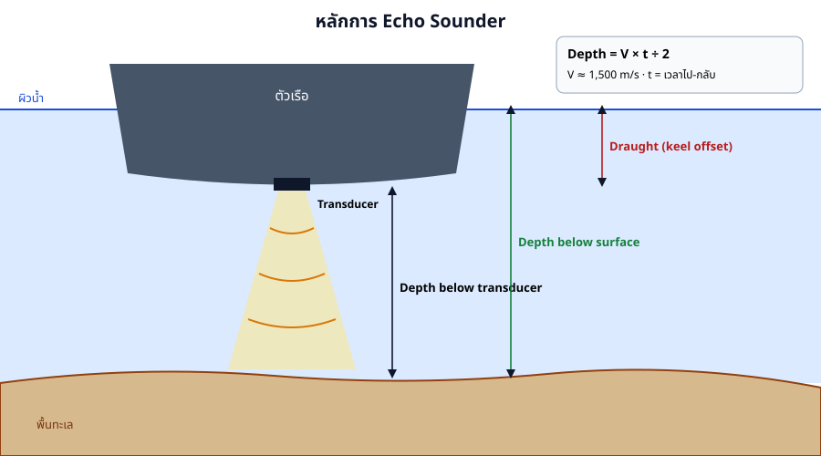
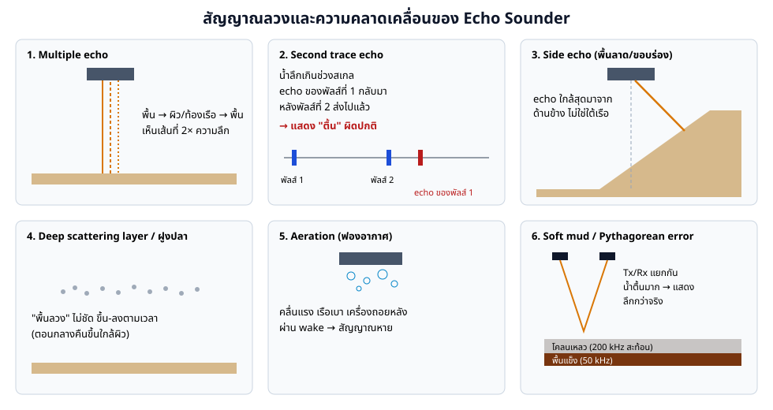

# 1.1.4 Echo-sounders — เครื่องวัดความลึกด้วยเสียงสะท้อน

> สมุดบันทึกการฝึก OOW · TIRAPHONG NANTAPAN
> สมรรถนะตาม STCW A-II/1: *Ability to operate the equipment and apply the information correctly*
> อ้างอิงหลัก: SOLAS V/19.2.3.1; IMO Res. A.224(VII) *Performance Standards for Echo-sounding Equipment* as amended by MSC.74(69) Annex 4 (ใช้กับเครื่องที่ติดตั้งตั้งแต่ 1 ม.ค. 2001); MSC.302(87) (BAM — ส่วนการแจ้งเตือน); ISO 9875:2023 *Marine echo-sounding equipment* (มาตรฐานทดสอบ type approval — เดิมบันทึกนี้อ้าง IEC 61180 ซึ่งเป็นมาตรฐานการทดสอบแรงดันสูง ไม่เกี่ยวกับ echo sounder); IEC 61162 (interface); Bowditch (บท Hydrography / Sonar); *Admiralty Manual of Navigation*; คู่มือผู้ผลิต

---

## 1. ทำไม echo sounder ยังสำคัญมาก

- เป็นเครื่องมือเดียวบนสะพานเดินเรือที่ **วัดสภาพจริงใต้ท้องเรือ** — ไม่ขึ้นกับแผนที่ GNSS หรือ ENC
- ใช้ **ตรวจความสมเหตุสมผลของตำแหน่ง** (ความลึกที่วัดได้ต้องสอดคล้องกับแผนที่ ณ ตำแหน่ง fix)
- เตือนเมื่อเข้าใกล้น้ำตื้น (shallow water alarm) — หลายอุบัติเหตุเกยตื้นเกิดในขณะที่ echo sounder **ปิดอยู่** หรือ **ไม่มีใครดู**
- ใช้ตอนทอดสมอ (เลือกความลึก คำนวณความยาวโซ่) ตอนเข้าร่องน้ำ (ติดตาม UKC) และใช้ตรวจ squat
- ข้อมูลถูกบันทึกใน VDR — ใช้ในการสอบสวนอุบัติเหตุ

---

## 2. ข้อกำหนดตามกฎหมายและมาตรฐาน

### 2.1 SOLAS V/19.2.3.1

เรือ **300 GT ขึ้นไป** และเรือโดยสารทุกขนาด ต้องมี echo sounding device หรือวิธีการทางอิเล็กทรอนิกส์อื่นในการวัดและแสดงความลึกของน้ำที่มีอยู่ (available depth of water)

### 2.2 Performance standards (A.224(VII) as amended by MSC.74(69) Annex 4) — ประเด็นที่ควรรู้

| หัวข้อ | ข้อกำหนดโดยสรุป |
|---|---|
| ช่วงการวัด | วัดระยะใต้ transducer ได้ตั้งแต่ **2 m ถึง 200 m** |
| สเกล (range scales) | อย่างน้อย 2 สเกล — **shallow range ครอบคลุม 20 m** และ **deep range ครอบคลุม 200 m** |
| ความแม่นยำ | สเกลตื้น ±0.5 m, สเกลลึก ±5 m **หรือ ±2.5% ของความลึกที่แสดง** แล้วแต่ค่าไหนมากกว่า (ที่ความเร็วเสียง 1,500 m/s) |
| อัตราพัลส์ (pulse repetition rate) | ไม่ช้ากว่า **12 ครั้งต่อนาทีบนสเกลลึก** และ **36 ครั้งต่อนาทีบนสเกลตื้น** |
| สภาพเรือ | ทำงานได้ถูกต้องเมื่อเรือโคลง (roll) ±10° และโยนหัว-ท้าย (pitch) ±5° |
| การแสดงผล | แสดงความลึกปัจจุบันเป็นตัวเลขและภาพประวัติ (graphical) ย้อนหลังอย่างน้อย 15 นาที |
| การบันทึก | บันทึกความลึกพร้อมเวลาย้อนหลังอย่างน้อย **12 ชั่วโมง** (กระดาษหรือวิธีอื่น) เรียกดูได้ |
| สัญญาณเตือน | **Shallow depth alarm** (ตั้งค่าได้) และ **failure/power alarm** — ทั้งเสียงและภาพ มีปุ่มปิดเสียง (mute); เครื่องรุ่นใหม่จัดการ alert ตาม BAM (MSC.302(87)) |
| Interface | ส่งข้อมูลไป VDR, ECDIS, INS ตามมาตรฐาน IEC 61162 |

> เครื่องที่ติดตั้งก่อน 1 ม.ค. 2001 ใช้มาตรฐานเดิม A.224(VII) — บนเรือเก่าอาจยังเห็นเครื่องรุ่นนี้ (paper recorder)

**ทำไมสเกลตื้นต้องมีอัตราพัลส์สูงกว่า (จดไว้กันลืม):** ในน้ำ 20 m เสียงใช้เวลาไป-กลับเพียง 2 × 20/1,500 ≈ 0.027 วินาที ส่งพัลส์ได้ถี่มาก ข้อมูลจึงอัปเดตเร็ว ทันต่อการเปลี่ยนความลึกในร่องน้ำ; ส่วนสเกลลึก 200 m ใช้ ≈ 0.27 วินาที และต้องรอให้เสียงสะท้อนกลับมาก่อนส่งพัลส์ใหม่เพื่อเลี่ยง second trace echo

---

## 3. หลักการทำงาน



*ภาพที่ 1.1.4-1 พัลส์เสียงจาก transducer เดินทางลงไปสะท้อนพื้นทะเลและกลับขึ้นมา — ความลึก = ความเร็วเสียง × เวลา ÷ 2*

```
Depth (below transducer) = (V × t) / 2
V = ความเร็วเสียงในน้ำทะเล (ตั้งมาตรฐาน 1,500 m/s)
t = เวลาตั้งแต่ส่งพัลส์จนรับเสียงสะท้อน
```

**ตัวอย่าง:** เวลาไป-กลับ 0.02 วินาที → depth = 1,500 × 0.02 / 2 = **15 m** ใต้ transducer

### 3.1 ส่วนประกอบ

| ส่วน | หน้าที่ |
|---|---|
| **Transmitter** | สร้างพัลส์ไฟฟ้ากำลังสูงตามจังหวะ |
| **Transducer** | แปลงพลังงานไฟฟ้าเป็นคลื่นเสียง (และกลับกันเมื่อรับ) ติดใต้ท้องเรือ — อาจใช้ตัวเดียวทั้งส่งและรับ หรือแยกตัวส่ง/รับ |
| **Receiver / Amplifier** | ขยายสัญญาณสะท้อนที่อ่อนมาก มี gain และ TVG (time varied gain — เพิ่ม gain ตามเวลาเพื่อชดเชยการลดทอนในน้ำลึก) |
| **Timing / Processing unit** | จับเวลา คำนวณความลึก กรองสัญญาณรบกวน |
| **Display / Recorder** | แสดงตัวเลขและภาพประวัติ (เดิมเป็น paper recorder) ตั้ง alarm |

### 3.2 ชนิดของ transducer

- **Piezoelectric (electrostrictive)** — ผลึก/เซรามิกที่เปลี่ยนรูปเมื่อได้รับแรงดันไฟฟ้า ใช้มากที่สุดในปัจจุบัน
- **Magnetostrictive** — แท่งโลหะ (นิกเกิล) ที่เปลี่ยนความยาวในสนามแม่เหล็ก ทนทาน ใช้ในเครื่องรุ่นเก่า

### 3.3 ความถี่

| ความถี่ | ลักษณะ |
|---|---|
| ต่ำ (ประมาณ 24–50 kHz) | ไปได้ลึก ลำเสียงกว้าง ความละเอียดต่ำกว่า — เหมาะกับน้ำลึก |
| สูง (ประมาณ 200 kHz) | ลำแคบ ความละเอียดสูง ถูกดูดซับเร็ว — เหมาะกับน้ำตื้น |

เครื่องบนเรือสินค้าจำนวนมากใช้ราว **50 kHz และ/หรือ 200 kHz** (dual frequency)

### 3.4 ความเร็วเสียงในน้ำทะเล

ค่าตั้งมาตรฐาน **1,500 m/s** แต่ความเร็วจริงแปรประมาณ **1,445–1,560 m/s** ขึ้นกับ
- **อุณหภูมิ** (มีผลมากที่สุด — น้ำอุ่นเสียงเร็วขึ้น ประมาณ +4.5 m/s ต่อ +1°C ในน้ำเย็นใกล้ 0°C ลดลงเหลือราว +2 m/s ต่อ +1°C ในน้ำอุ่น 28–30°C)
- **ความเค็ม** (ความเค็มสูงเสียงเร็วขึ้น ประมาณ +1.0–1.4 m/s ต่อ +1 psu)
- **ความดัน/ความลึก** (ลึกขึ้นเร็วขึ้น ประมาณ +1.7 m/s ต่อ 100 m)

ในทะเลเขตร้อนอย่างอ่าวไทย (น้ำอุ่น ~28–30°C) ความเร็วเสียงจริงมักสูงกว่า 1,500 m/s เล็กน้อย → เครื่องที่ตั้ง 1,500 m/s จะแสดงความลึก **น้อยกว่าจริงเล็กน้อย** (เป็นทางปลอดภัย)

**ความเร็วเสียงโดยประมาณที่ผิวน้ำ** (คำนวณด้วยสมการ Mackenzie (1981) ความลึก 10 m — ค่าอ้างอิงเพื่อเข้าใจขนาดของผล ไม่ใช่ค่าที่ต้องจำ)

| อุณหภูมิน้ำ | ความเค็ม 35 psu | ความเค็ม 33 psu | ความลึกที่แสดง (ตั้ง 1,500) เทียบจริง |
|---|---|---|---|
| 0°C | ~1,449 m/s | ~1,446 m/s | แสดง **ลึกกว่าจริง** ~3.5% (อันตราย) |
| 10°C | ~1,490 m/s | ~1,488 m/s | ลึกกว่าจริง ~0.7–0.8% |
| 15°C | ~1,507 m/s | ~1,505 m/s | ใกล้เคียงจริง |
| 20°C | ~1,522 m/s | ~1,519 m/s | ตื้นกว่าจริง ~1.3–1.4% |
| 28°C | ~1,541 m/s | ~1,539 m/s | ตื้นกว่าจริง ~2.6% (ปลอดภัย) |
| 30°C | ~1,546 m/s | ~1,544 m/s | ตื้นกว่าจริง ~2.9–3.0% |

> จดไว้กันลืม — ในน้ำ 15 m ที่อ่าวไทย ความคลาดเคลื่อนจากความเร็วเสียงราว 2.6% เท่ากับไม่ถึง 0.4 m ซึ่งน้อยกว่าผลของการตั้ง draught ผิดหรือ squat มาก — แต่ในน้ำเย็นละติจูดสูงหรือในน้ำจืด/น้ำกร่อยปากแม่น้ำ ผลอาจเป็นทางอันตราย (เครื่องแสดงลึกเกินจริง)

---

## 4. การตั้งค่าและใช้งาน (Operation)

| การตั้งค่า | ความหมาย / ข้อแนะนำ |
|---|---|
| **Power on / Standby** | เปิดก่อนเข้าน้ำตื้น ร่องน้ำ หรือเมื่อ passage plan กำหนด (หลายบริษัทกำหนดให้เปิดตลอดในพื้นที่ชายฝั่ง) |
| **Range / Scale** | เลือกให้ความลึกปัจจุบันอยู่ในช่วงแสดงผล ถ้า auto range ให้ตรวจว่าทำงานถูก |
| **Gain** | ปรับให้เห็นพื้นชัดแต่ไม่มีสัญญาณรบกวนมาก gain มากเกิน → เห็นปลา/ฟองอากาศเป็นพื้น; gain น้อยเกิน → พื้นหาย |
| **Pulse length / Power** | พัลส์ยาว พลังสูง → ไปได้ลึก แต่ความละเอียดต่ำ; น้ำตื้นใช้พัลส์สั้น |
| **Draught / Keel offset** | ตั้งค่า draught ที่ตำแหน่ง transducer เพื่อเลือกแสดง **depth below keel (under keel)** หรือ **depth below surface** — ต้องรู้ว่าเครื่องแสดงแบบไหนอยู่! และต้องปรับเมื่อ draught เปลี่ยน |
| **Sound velocity** | ปกติ 1,500 m/s; บางเครื่องให้ปรับตามข้อมูลจริง |
| **Units** | เมตร / ฟุต / ฟาทอม — ต้องตรงกับแผนที่ที่ใช้ |
| **Shallow water alarm** | ตั้งตาม passage plan เช่น UKC ขั้นต่ำ + margin (ถ้าแสดง under keel) หรือ draught + UKC (ถ้าแสดง below surface) |
| **Transducer selection** | เรือบางลำมี transducer หัวและท้าย — เลือกให้เหมาะ (เช่นหัวเรือตอนเข้าน้ำตื้นเดินหน้า) |
| **History / Event mark** | กดบันทึกเหตุการณ์ (เช่นเวลา fix) บนภาพประวัติ |

> **จดไว้กันลืม** — ความผิดพลาดคลาสสิกคือ "อ่านความลึกใต้กระดูกงู (below keel) แต่คิดว่าเป็นความลึกใต้ผิวน้ำ" หรือกลับกัน ทำให้ประเมิน UKC ผิดหลายเมตร ตอนรับยามต้องดูว่าเครื่องตั้ง draught offset ไว้เท่าไร

---

## 5. ความคลาดเคลื่อนและสัญญาณสะท้อนลวง (Errors and false echoes)



*ภาพที่ 1.1.4-2 สาเหตุของค่าความลึกผิดที่พบบ่อย*

### 5.1 ความคลาดเคลื่อนเชิงระบบ

| ชนิด | สาเหตุ | ผล |
|---|---|---|
| **Velocity error** | ความเร็วเสียงจริงต่างจากที่ตั้ง | ความลึกผิดตามสัดส่วน: **ความลึกจริง = ค่าที่แสดง × (V จริง / V ที่ตั้ง)** |
| **Pythagorean (separation) error** | transducer ส่งและรับแยกกัน ในน้ำตื้นเสียงเดินทางเป็นสามเหลี่ยม ไม่ใช่แนวดิ่ง | ค่าที่แสดง **มากกว่าความลึกจริง** ในน้ำตื้นมาก (ผลน้อยลงเมื่อลึก) |
| **Draught/offset error** | ตั้ง draught ผิด หรือ draught เปลี่ยนแล้วไม่ปรับ | ความลึกผิดเท่ากับผลต่าง |
| **Trim / heel / roll / pitch** | ลำเสียงไม่ชี้ดิ่ง | วัดระยะเฉียง ค่าอาจมากหรือน้อยกว่าจริง (ปกติลำเสียงกว้างจะรับเสียงจากจุดที่ใกล้ที่สุดก่อน) |
| **Zero / timing error** | เครื่องเริ่มจับเวลาไม่ตรง | ค่าผิดคงที่ |

**ตัวอย่างจำลอง (velocity error):** เครื่องตั้ง 1,500 m/s แสดงความลึก 40.0 m ความเร็วเสียงจริง 1,540 m/s → ความลึกจริง = 40.0 × 1,540/1,500 = **41.1 m** (เครื่องแสดงน้อยกว่าจริง 1.1 m — ปลอดภัย)
ถ้ากลับกัน (น้ำเย็นมาก V จริง 1,460 m/s) → 40.0 × 1,460/1,500 = **38.9 m** (เครื่องแสดง **มากกว่าจริง** — อันตราย)

**ตัวอย่างจำลอง (Pythagorean error):** transducer ส่งและรับติดห่างกัน 4 m (ห่างจากจุดกึ่งกลางข้างละ 2 m) ความลึกจริงใต้ transducer 2.0 m
- เสียงเดินทางเฉียงทั้งขาไปและขากลับ ระยะต่อขา = √(2.0² + 2.0²) = 2.83 m → เครื่องแสดง **2.83 m** (มากกว่าจริง 0.83 m — ทางอันตราย)
- ถ้าความลึกจริง 20.0 m → √(20.0² + 2.0²) = 20.10 m → คลาดเพียง 0.1 m
- สรุป: error นี้มีความหมายเฉพาะน้ำตื้นมาก (เช่นเทียบท่า/สันดอน) เครื่องสมัยใหม่ส่วนใหญ่ใช้ transducer ตัวเดียวหรือชดเชยในซอฟต์แวร์

### 5.2 สัญญาณสะท้อนลวง (False echoes)

| ชนิด | สาเหตุ | วิธีสังเกต / แก้ |
|---|---|---|
| **Multiple echoes** | เสียงสะท้อนจากพื้นขึ้นมาสะท้อนผิวน้ำ/ท้องเรือ แล้วลงไปสะท้อนพื้นอีกครั้ง | เห็นเส้นพื้นที่ 2×, 3× ของความลึกจริง (มักจางกว่า) — ลด gain |
| **Second trace (second-time-around) echoes** | น้ำลึกกว่าช่วงสเกล — เสียงสะท้อนกลับมาหลังพัลส์ถัดไปถูกส่งไปแล้ว เครื่องคิดว่าเป็นเสียงจากพัลส์ใหม่ | แสดง **ความลึกตื้นกว่าจริงมาก** — เปลี่ยนสเกลลึกขึ้น/ลด pulse rate ค่าจะเปลี่ยนไปถ้าเป็นเสียงลวง |
| **Deep Scattering Layer (DSL)** | ชั้นแพลงก์ตอน/สัตว์ทะเลขนาดเล็ก (ขึ้นใกล้ผิวตอนกลางคืน ลงลึกตอนกลางวัน) | เห็น "พื้นลวง" ที่ไม่ชัด ไม่สม่ำเสมอ เคลื่อนขึ้นลงตามเวลา |
| **Fish shoals, kelp/weed** | ฝูงปลา สาหร่าย | สัญญาณกระจัดกระจาย ระหว่างผิวน้ำกับพื้น |
| **Density layers / thermocline** | ชั้นน้ำที่อุณหภูมิ/ความเค็มเปลี่ยนเร็ว (เช่นปากแม่น้ำน้ำจืดทับน้ำเค็ม) | เส้นสะท้อนจาง ๆ ระดับหนึ่ง |
| **Soft mud / fluid mud** | โคลนเหลวด้านบน พื้นแข็งด้านล่าง | อาจเห็นสองเส้น — ความถี่สูงสะท้อนผิวโคลน ความถี่ต่ำทะลุไปถึงพื้นแข็ง; สำคัญมากในท่าเรือปากแม่น้ำ (แนวคิด "nautical depth") |
| **Side echoes** | พื้นลาดชัน ขอบร่องน้ำ ซากเรือ หรือหินด้านข้างอยู่ในลำเสียง | ค่าที่ได้คือจุดใกล้ที่สุด (อาจไม่อยู่ใต้เรือตรง ๆ) — ในร่องน้ำแคบอาจเห็นตื้นกว่าตรงกลาง |
| **Aeration** | ฟองอากาศใต้ท้องเรือ: คลื่นแรง เรือเบา (ballast) หัวเรือลอย, เดินเครื่องถอยหลัง, ผ่าน wake ของเรืออื่น | สัญญาณขาดหาย/ไม่มี echo |
| **Interference** | echo sounder ของเรืออื่นใกล้ ๆ, Doppler log/sonar ของเรือเอง, สัญญาณรบกวนจากใบจักร/ไฟฟ้า | จุด/เส้นแปลก ๆ ซ้ำเป็นจังหวะ — ใช้ interference rejection |

**ตัวอย่างจำลอง (second trace echo):** เครื่องตั้งสเกล 0–200 m ส่งพัลส์ทุก 0.4 วินาที (150 ครั้ง/นาที) — ความลึกสูงสุดที่ไม่กำกวม = 1,500 × 0.4 / 2 = **300 m**
- ถ้าน้ำลึกจริง 340 m เสียงสะท้อนกลับมาที่ 2 × 340 / 1,500 = 0.453 วินาที คือ 0.053 วินาทีหลังพัลส์ถัดไป
- เครื่องคิดว่าเป็นเสียงของพัลส์ใหม่ → แสดง 1,500 × 0.053 / 2 ≈ **40 m** ทั้งที่จริงลึก 340 m
- ตรวจโดยเปลี่ยนเป็นสเกลลึก (pulse rate ช้าลง) — ถ้าเป็น second trace ค่าที่แสดงจะเปลี่ยนไป ส่วนพื้นจริงจะคงที่ และเทียบกับความลึกบนแผนที่ (แผนที่บอก 300 m+ แต่เครื่องบอก 40 m → สงสัยทันที)

---

## 6. การใช้ข้อมูลความลึกในการเดินเรือ

### 6.1 การเปรียบเทียบความลึกที่วัดได้กับแผนที่ (Reduction to chart datum)

```
Depth below surface = Depth below keel + Draught (ที่ตำแหน่ง transducer)
Reduced sounding (เทียบแผนที่) = Depth below surface − Height of tide
```

**ตัวอย่างจำลอง:** echo sounder แสดง **6.2 m ใต้กระดูกงู**, draught ที่ตำแหน่ง transducer 9.4 m, height of tide ขณะนั้น 1.3 m
- Depth below surface = 6.2 + 9.4 = **15.6 m**
- Reduced to CD = 15.6 − 1.3 = **14.3 m**
- แผนที่ ณ ตำแหน่ง fix แสดงความลึก 14 m และเส้นชั้นความลึก 15 m อยู่ใกล้ ๆ → **สอดคล้อง** ✓
- ถ้าได้ค่า reduced sounding 9 m ในพื้นที่ที่แผนที่บอก 14 m → ตำแหน่งอาจผิด หรือแผนที่ผิด หรือเครื่องตั้งค่าผิด → ตรวจทันทีและแจ้งนายเรือ

### 6.2 การหาตำแหน่งด้วยความลึก

- **Depth contour navigation** — ตามเส้นชั้นความลึกที่ชัดเจน (เช่นแล่นตามแนว 20 m)
- **Line of soundings** — จดความลึกเป็นชุดตามเวลา เลื่อนบนกระดาษใสเทียบกับแผนที่ (วิธีดั้งเดิมเมื่อไม่มีเครื่องมืออื่น)
- เห็นการเปลี่ยนความลึกฉับพลัน (ขอบไหล่ทวีป แนวสันดอน) เป็นจุดตรวจตำแหน่ง

### 6.3 การใช้ในสถานการณ์ต่าง ๆ

- **การเข้าร่องน้ำ/น้ำตื้น** — ติดตาม UKC จริงเทียบกับที่คำนวณ ถ้า UKC ลดลงผิดปกติ ลดความเร็ว (ลด squat) และแจ้งนายเรือ
- **การทอดสมอ** — เลือกจุดที่ความลึกเหมาะ คำนวณความยาวโซ่ (บท 1.9) เฝ้าดูความลึกระหว่างทอด
- **ในหมอก/ทัศนวิสัยจำกัด** — เป็นข้อมูลอิสระสำคัญเมื่อพึ่งเรดาร์อย่างเดียว
- **การรายงานความลึกผิดปกติ** — ถ้าพบความลึกน้อยกว่าแผนที่มากโดยมีตำแหน่งแน่นอน ให้บันทึกและส่งรายงานให้ HO (เช่น UKHO H-note / ผ่าน NAVAREA coordinator ถ้าเป็นอันตราย — SOLAS V/31)

### 6.4 การบันทึก

- บันทึกความลึกพร้อมตำแหน่งในสมุดปูมเรือตามที่ SMS กำหนด (เช่นทุกชั่วโมงในน้ำชายฝั่ง หรือทุกครั้งที่ fix ในพื้นที่จำกัด)
- ข้อมูลประวัติในเครื่องและใน VDR ใช้ตรวจสอบย้อนหลังได้

---

## 7. ระบบความลึกขั้นสูงที่ควรรู้จัก

- **Multibeam echo sounder** — ลำเสียงหลายร้อยลำเป็นแนวกว้างขวางเรือ ใช้ในงานสำรวจอุทกศาสตร์ (ข้อมูลสำหรับทำแผนที่สมัยใหม่ ตามมาตรฐาน IHO S-44)
- **Forward-Looking Sonar (FLS)** — มองความลึกข้างหน้าเรือ ใช้ในเรือสำรวจ เรือสำราญบางลำ เรือในเขตน้ำแข็ง/แนวปะการัง
- **S-102 (bathymetric surface)** — ข้อมูลความลึกความละเอียดสูงสำหรับ ECDIS ยุค S-100 (กำลังเริ่มใช้)

---

## 8. การตรวจสอบและบำรุงรักษาเบื้องต้น (ระดับ OOW)

1. ทดสอบตามรายการตรวจก่อนออกเรือ (pre-departure check) — เปิดเครื่อง ตรวจว่าแสดงความลึกสมเหตุสมผล (เทียบความลึกที่ท่าตามแผนที่และ draught)
2. ตรวจ alarm ทำงาน
3. เทียบกับลูกดิ่ง (hand lead line) ในท่าเรือเป็นครั้งคราวเพื่อตรวจ offset
4. ตรวจข้อมูลส่งไป VDR/ECDIS
5. แจ้งความผิดปกติ (เช่น สัญญาณอ่อนลงต่อเนื่อง อาจเพราะ transducer สกปรก) เพื่อบันทึกการซ่อม — ทำความสะอาด transducer ตอนเข้าอู่

---

## 9. คำถามสอบปากเปล่า / สัมภาษณ์ — Echo-sounders

**ถาม:** อธิบายหลักการทำงานของ echo sounder
**แนวตอบ:** transducer ส่งพัลส์เสียงความถี่สูงลงไปสะท้อนพื้นทะเล จับเวลาจนรับเสียงสะท้อน ความลึก = ความเร็วเสียง (ตั้ง 1,500 m/s) × เวลา ÷ 2 ได้ความลึกใต้ transducer แล้วปรับด้วย draught offset ตามที่ต้องการแสดง

**ถาม:** ความเร็วเสียงในน้ำทะเลขึ้นกับอะไร มีผลอย่างไร
**แนวตอบ:** อุณหภูมิ (มากที่สุด) ความเค็ม และความดัน ถ้าความเร็วจริงสูงกว่าค่าตั้ง เครื่องจะแสดงตื้นกว่าจริง (ปลอดภัย) ถ้าต่ำกว่าจะแสดงลึกกว่าจริง (อันตราย)

**ถาม:** False echoes มีอะไรบ้าง
**แนวตอบ:** multiple echoes, second trace echoes, deep scattering layer, ฝูงปลา/สาหร่าย, ชั้นความหนาแน่น/thermocline, โคลนเหลว, side echoes จากพื้นลาด, aeration (สัญญาณหาย), interference

**ถาม:** Second trace echo คืออะไร ตรวจอย่างไร
**แนวตอบ:** echo จากพัลส์ก่อนหน้าที่กลับมาหลังพัลส์ใหม่ถูกส่ง ทำให้แสดงความลึกตื้นผิดปกติในน้ำลึก ตรวจโดยเปลี่ยนสเกล/pulse rate ถ้าค่าเปลี่ยนแสดงว่าเป็นเสียงลวง

**ถาม:** Echo sounder แสดง 5.0 m ใต้กระดูกงู draught 8.0 m น้ำขึ้น 2.0 m แผนที่บอก 11 m ถือว่าสอดคล้องไหม
**แนวตอบ:** depth below surface 13.0 m ลบ height of tide 2.0 m = 11.0 m เทียบ CD ตรงกับแผนที่ → สอดคล้อง

**ถาม:** ข้อกำหนดความแม่นยำของ echo sounder ตาม performance standard
**แนวตอบ:** ช่วงวัดอย่างน้อย 2–200 m สเกลตื้น ±0.5 m สเกลลึก ±5 m หรือ ±2.5% ของความลึกที่แสดง (ค่าที่มากกว่า) บันทึกข้อมูลย้อนหลัง 12 ชั่วโมง มี shallow depth alarm

**ถาม:** ทำไมตอนเรือเบา (ballast) คลื่นแรง echo sounder มักไม่มีค่า
**แนวตอบ:** หัวเรือลอยและกระแทกคลื่น เกิดฟองอากาศ (aeration) ใต้ transducer เสียงไม่ผ่าน/ถูกดูดซับ

**ถาม:** ในน้ำตื้นในร่องน้ำ echo sounder แสดงตื้นกว่าแผนที่ ทำอะไร
**แนวตอบ:** ลดความเร็ว (ลด squat และให้มีเวลาตัดสินใจ) ตรวจตำแหน่งด้วยวิธีอื่นทันที ตรวจการตั้ง draught offset ตรวจ height of tide แจ้งนายเรือ พิจารณาหยุดเรือ/ทอดสมอถ้าไม่แน่ใจ บันทึกและรายงานถ้าพบความลึกผิดจากแผนที่จริง

**ถาม:** อัตราพัลส์ขั้นต่ำตาม performance standard คือเท่าไร
**แนวตอบ:** ไม่ช้ากว่า 12 ครั้งต่อนาทีบนสเกลลึก (200 m) และ 36 ครั้งต่อนาทีบนสเกลตื้น (20 m) ตาม A.224(VII) as amended by MSC.74(69) Annex 4 และต้องทำงานได้เมื่อเรือโคลง ±10° / pitch ±5°

**ถาม:** เครื่องตั้งความเร็วเสียง 1,500 m/s แสดง 30.0 m ในน้ำที่ความเร็วเสียงจริง 1,545 m/s ความลึกจริงเท่าไร
**แนวตอบ:** ความลึกจริง = 30.0 × 1,545 / 1,500 = 30.9 m — เครื่องแสดงตื้นกว่าจริง 0.9 m (ทางปลอดภัย)

**ถาม:** Pythagorean error คืออะไร มีผลมากเมื่อไร
**แนวตอบ:** เกิดเมื่อ transducer ส่งและรับแยกกัน เสียงเดินทางเฉียงแทนแนวดิ่ง เครื่องจึงแสดงลึกกว่าจริง ผลมากเฉพาะในน้ำตื้นมาก (เช่นแยกกัน 4 m ความลึกจริง 2 m แสดง 2.83 m) และแทบไม่มีผลในน้ำลึก

**ถาม:** มาตรฐานทดสอบ type approval ของ echo sounder คืออะไร
**แนวตอบ:** ISO 9875 (ฉบับปัจจุบัน 2023) ซึ่งกำหนดวิธีทดสอบให้เป็นไปตาม A.224(VII) as amended by MSC.74(69) Annex 4 ร่วมกับ IEC 60945 (สภาพแวดล้อม) IEC 61162 (interface) และมาตรฐาน BAM สำหรับการแจ้งเตือน

---

*ก่อนหน้า ← [1.1.3 Electronic Navigation](1.1.3-electronic-navigation-systems.md) · ถัดไป → [1.1.5 Compasses](1.1.5-compasses.md)*
