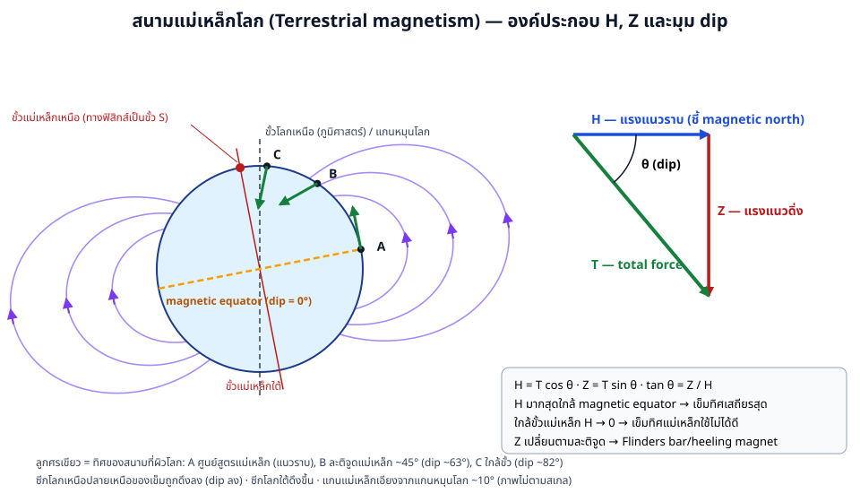
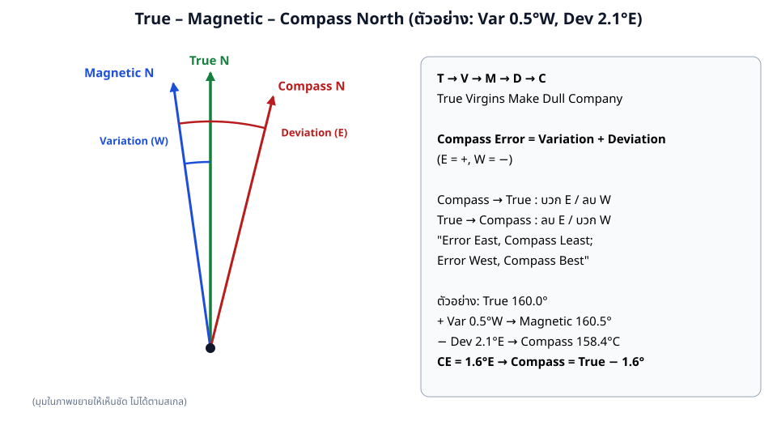
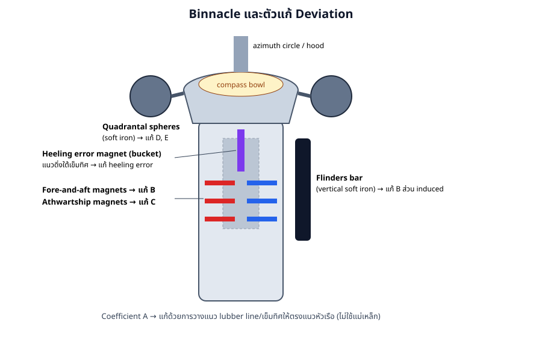
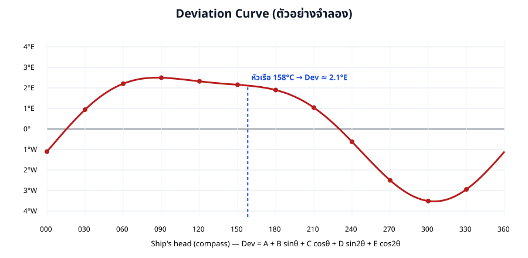
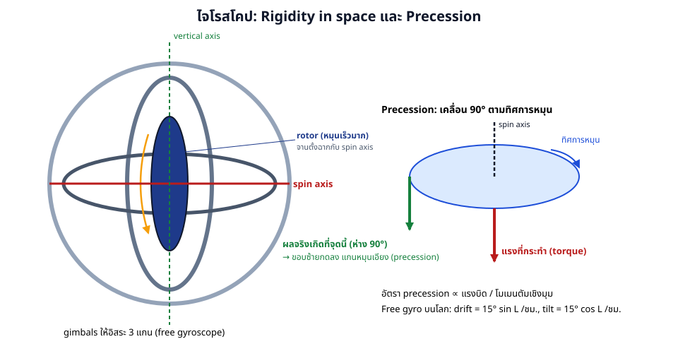
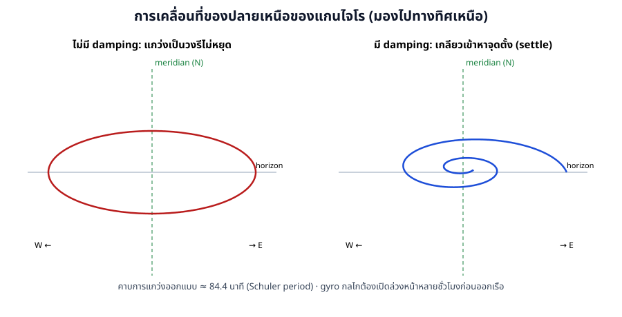

# 1.1.5 Compass — Magnetic and Gyro — เข็มทิศแม่เหล็กและไจโรคอมพาส

> สมุดบันทึกการฝึก OOW · TIRAPHONG NANTAPAN
> สมรรถนะตาม STCW A-II/1: *Knowledge of the principles of magnetic and gyro-compasses* และ *Ability to determine errors of the magnetic and gyro-compasses, using celestial and terrestrial means, and to allow for such errors*
> อ้างอิงหลัก: SOLAS V/19.2.1.1–1.3, V/19.2.2.1, V/19.2.3.5, V/19.2.5.1–5.3; STCW Code A-VIII/2 Part 4-1 para 34; IMO Res. A.382(X) (magnetic compasses), A.424(XI) (gyro-compasses), MSC.116(73) (THD); ISO 449 / ISO 25862 (magnetic compasses), ISO 8728 (gyro-compasses), ISO 22090 (THD); World Magnetic Model (WMM2025, NOAA/BGS); *Admiralty Manual of Navigation*; Bowditch (บท Compasses, Azimuths and Amplitudes); *The Ship's Magnetic Compass* และคู่มือผู้ผลิต gyro (Sperry, Anschütz, Tokyo Keiki/Yokogawa)

---

## 0. ทำไมเรือต้องมีเข็มทิศสองแบบ

| | Magnetic compass | Gyro compass |
|---|---|---|
| หลักการ | ชี้ตามสนามแม่เหล็กโลก | ชี้ตามแกนหมุนของโลก (ทิศเหนือจริง) ด้วยคุณสมบัติของไจโรสโคป |
| ต้องใช้ไฟฟ้า | **ไม่ต้อง** | ต้อง |
| ความคลาดเคลื่อน | variation + deviation (หลายองศาได้) | เล็กน้อย (ปกติไม่เกิน 1–2°) |
| ส่งสัญญาณไปอุปกรณ์อื่น | ได้เมื่อเป็น TMC (transmitting magnetic compass) | ได้ (repeaters, radar, ECDIS, autopilot, AIS, VDR) |
| ข้อเสีย | อ่อนไหวต่อเหล็ก/ไฟฟ้าบนเรือ การเปลี่ยนละติจูด | ต้องมีไฟ ใช้เวลา settle เครื่องกลอาจเสีย |
| บทบาท | **เข็มทิศมาตรฐาน/สำรองที่ไม่ขึ้นกับไฟฟ้า** | **เข็มทิศหลักในการเดินเรือ** |

**SOLAS V/19 กำหนด** (โดยย่อ)
- เรือทุกลำ: **properly adjusted standard magnetic compass** (หรือวิธีอื่นที่ไม่ขึ้นกับแหล่งไฟฟ้า) สำหรับหา heading และแสดงที่ตำแหน่งบังคับเรือหลัก; มี **pelorus หรือ compass bearing device** วัดแบริ่งรอบทิศ 360°; มีวิธีแก้ค่า heading และแบริ่งเป็นทิศจริงตลอดเวลา (V/19.2.1.1–1.3)
- เรือ 150 GT ขึ้นไป (และเรือโดยสาร): **spare magnetic compass** ที่เปลี่ยนแทนกันได้ (หรือวิธีอื่น)
- เรือ 300 GT ขึ้นไป: **THD (Transmitting Heading Device)** ส่ง heading ไปเรดาร์ ARPA AIS
- เรือ 500 GT ขึ้นไป: **gyro compass** (หรือวิธีอื่น) พร้อม **gyro repeater** ที่ตำแหน่งบังคับเรือฉุกเฉิน และ repeater สำหรับวัดแบริ่งรอบทิศ
- ต้องมี **ตารางหรือกราฟ deviation** ของเข็มทิศแม่เหล็กที่เป็นปัจจุบัน

---

## ภาค A — เข็มทิศแม่เหล็ก (Magnetic Compass)

## 1. สนามแม่เหล็กโลก (Terrestrial magnetism)

### 1.1 ลักษณะของสนามแม่เหล็กโลก

- โลกเปรียบเหมือนแท่งแม่เหล็กขนาดใหญ่ — **ขั้วแม่เหล็ก (magnetic poles)** ไม่ตรงกับขั้วภูมิศาสตร์ และ **เคลื่อนที่อยู่ตลอด** (ขั้วแม่เหล็กเหนือเคลื่อนจากแคนาดาไปทางไซบีเรียหลายสิบกิโลเมตรต่อปีในทศวรรษที่ผ่านมา)
- ขั้วแม่เหล็กที่อยู่ซีกโลกเหนือมีขั้วแม่เหล็กจริงเป็น "ขั้วใต้" (ดึงปลายขั้วเหนือของเข็มทิศ) — นักเดินเรือเรียกตามตำแหน่งว่า "magnetic north pole"
- ที่จุดใด ๆ สนามแม่เหล็กโลก (total force, T) แยกเป็น
  - **H — horizontal component** (แรงแนวราบ) ทำให้เข็มทิศชี้ทิศ **ยิ่งมากเข็มทิศยิ่งเสถียร** (มากที่สุดใกล้เส้นศูนย์สูตรแม่เหล็ก น้อยมากใกล้ขั้วแม่เหล็ก — ใกล้ขั้วเข็มทิศแม่เหล็กใช้ไม่ได้ดี)
  - **Z — vertical component** (แรงแนวดิ่ง) ศูนย์ที่เส้นศูนย์สูตรแม่เหล็ก มากที่สุดที่ขั้ว
  - **Dip (inclination, θ)** — มุมที่สนามเอียงจากแนวราบ: tan θ = Z/H
- **Magnetic equator** — แนวที่ dip = 0
- **Magnetic meridian** — ทิศของแรงแนวราบ (ที่เข็มทิศชี้เมื่อไม่มีอิทธิพลอื่น)



*ภาพที่ 1.1.5-1 สนามแม่เหล็กโลก — ที่เส้นศูนย์สูตรแม่เหล็กสนามอยู่ในแนวราบ (dip = 0°, H มากสุด) ยิ่งเข้าใกล้ขั้วแม่เหล็ก dip ยิ่งชันและ H ยิ่งน้อย; ขั้วแม่เหล็กไม่ตรงกับขั้วภูมิศาสตร์ (ภาพแบบง่าย ไม่ตามสเกล)*

**ตัวเลขที่ควรรู้คร่าว ๆ (แบบจำลอง dipole):** tan(dip) ≈ 2 × tan(ละติจูดแม่เหล็ก) — ที่ละติจูดแม่เหล็ก 10° dip ≈ 19°, ที่ 45° dip ≈ 63°, ที่ 75° dip ≈ 82° (สนามจริงไม่ใช่ dipole สมบูรณ์ ค่าจริงอ่านจากแผนที่ isoclinal/แบบจำลอง WMM) — จึงเห็นว่าในละติจูดสูง H เหลือน้อย เข็มทิศแม่เหล็ก "เฉื่อย" และไวต่อแม่เหล็กของเรือมาก



*ภาพที่ 1.1.5-2 Variation คือมุมระหว่างทิศเหนือจริงกับทิศเหนือแม่เหล็ก ส่วน deviation คือมุมระหว่างทิศเหนือแม่เหล็กกับทิศเหนือของเข็มทิศบนเรือ*

### 1.2 Variation (Magnetic declination)

- มุมระหว่าง **true meridian** กับ **magnetic meridian** ณ ตำแหน่งนั้น
- ชื่อ **East (E)** ถ้าเหนือแม่เหล็กอยู่ทางตะวันออกของเหนือจริง, **West (W)** ถ้าอยู่ทางตะวันตก
- **เปลี่ยนตามตำแหน่ง** (ดูจาก compass rose บนแผนที่ หรือ magnetic variation chart — เส้นที่ variation เท่ากันเรียก **isogonic line**, เส้นที่ variation เป็นศูนย์เรียก **agonic line**) และ **เปลี่ยนตามเวลา** (annual change บน compass rose เช่น "VAR 0°30'W 2026 (2'E)" หมายถึงปีละเปลี่ยนไปทางตะวันออก 2')
- **การคำนวณ variation ปีปัจจุบัน:** ตัวอย่าง compass rose ระบุ "1°15'W 2020 (6'E)" ปี 2026 ผ่านไป 6 ปี → เปลี่ยน 36'E → variation = 1°15'W − 0°36' = **0°39'W**
- พื้นที่ที่มี **local magnetic anomaly** (แหล่งแร่เหล็กใต้ทะเล) แผนที่จะมีหมายเหตุเตือน
- ในอ่าวไทยและทะเลจีนใต้ตอนใต้ variation มีค่าน้อย (ราวศูนย์ถึงไม่กี่ลิปดา–องศาทางตะวันตกหรือตะวันออกแล้วแต่ตำแหน่งและปี) — ต้องอ่านจากแผนที่ที่ใช้เสมอ

### 1.3 พายุแม่เหล็ก (Magnetic storms)

กิจกรรมดวงอาทิตย์ทำให้สนามแม่เหล็กโลกแปรปรวนชั่วคราว เข็มทิศอาจแกว่งหรือคลาดเล็กน้อย โดยเฉพาะในละติจูดสูง (มักเกิดพร้อมกับการรบกวน GNSS และวิทยุ HF)

---

## 2. แม่เหล็กของตัวเรือ (Ship's magnetism) และ Deviation

### 2.1 ที่มาของแม่เหล็กในตัวเรือ

| ชนิด | ที่มา | ลักษณะ |
|---|---|---|
| **Permanent magnetism (hard iron)** | เกิดระหว่างต่อเรือ — เหล็กถูกตอก ทุบ เชื่อม ในสนามแม่เหล็กโลก ทำให้ตัวเรือกลายเป็นแม่เหล็กถาวร ทิศขึ้นกับ **ทิศหัวเรือตอนต่อ (building heading)** | ค่อนข้างคงที่ ทำให้เกิด deviation ที่เปลี่ยนตาม heading แบบ **semicircular** (สูงสุดบนสองทิศตรงข้าม) |
| **Sub-permanent magnetism** | ส่วนหนึ่งของแม่เหล็กถาวรที่ค่อย ๆ หายไปหลังปล่อยเรือ หรือเปลี่ยนเมื่อเรือแล่นทิศเดียวนาน ๆ จอดนาน ซ่อมในอู่ เชื่อม ถูกฟ้าผ่า สั่นสะเทือนแรง | ทำให้ deviation เปลี่ยนชั่วคราว |
| **Induced magnetism (soft iron)** | เหล็กอ่อนถูกเหนี่ยวนำโดยสนามแม่เหล็กโลก **ณ ขณะนั้น** | เปลี่ยนตาม heading **และละติจูดแม่เหล็ก** — ส่วนแนวราบให้ deviation แบบ **quadrantal** (สูงสุดบนทิศ intercardinal); ส่วนแนวดิ่ง (vertical soft iron) ให้ semicircular deviation ที่เปลี่ยนตามละติจูด |

### 2.2 Deviation

- มุมระหว่าง **magnetic meridian** กับทิศที่เข็มทิศบนเรือชี้ (**compass north**)
- **E** ถ้าเหนือของเข็มทิศอยู่ทางตะวันออกของเหนือแม่เหล็ก, **W** ถ้าอยู่ทางตะวันตก
- **เปลี่ยนตามหัวเรือ (heading)** — จึงต้องมี **deviation card/curve** บอกค่าแต่ละ heading
- เปลี่ยนตามละติจูดแม่เหล็ก (ส่วนที่มาจาก induced magnetism) และเหตุการณ์ที่ทำให้แม่เหล็กของเรือเปลี่ยน

### 2.3 สัมประสิทธิ์ของ deviation (Coefficients)

```
Deviation (θ) ≈ A + B sin θ + C cos θ + D sin 2θ + E cos 2θ     (θ = compass heading)
```

| Coefficient | ชนิด | สาเหตุหลัก | ตัวแก้ (corrector) |
|---|---|---|---|
| **A** | Constant (คงที่ทุก heading) | ติดตั้ง lubber line ไม่ตรงแนวหัวเรือ, soft iron ไม่สมมาตร | ปรับตำแหน่ง/แนวของเข็มทิศ (ไม่ใช่ magnet) |
| **B** | Semicircular — สูงสุดที่ **090°/270°** | แม่เหล็กถาวรแนวหัว-ท้าย + vertical soft iron (induced) | **Fore-and-aft magnets** (สำหรับส่วนถาวร) + **Flinders bar** (สำหรับส่วน vertical soft iron) |
| **C** | Semicircular — สูงสุดที่ **000°/180°** | แม่เหล็กถาวรแนวขวาง (athwartship) | **Athwartship magnets** |
| **D** | Quadrantal — สูงสุดที่ 045°, 135°, 225°, 315° | horizontal soft iron สมมาตร | **Quadrantal correctors (soft iron spheres)** สองข้างเข็มทิศ |
| **E** | Quadrantal — สูงสุดที่ 000°, 090°, 180°, 270° | horizontal soft iron ไม่สมมาตร | หมุนตำแหน่ง quadrantal spheres |
| (Heeling error) | เกิดเมื่อเรือเอียง/โคลง | ส่วนแนวดิ่งของแม่เหล็กถาวรและ soft iron เปลี่ยนเทียบกับเข็มทิศเมื่อเรือเอียง ทำให้เข็มแกว่ง | **Heeling error magnet** (แท่งแม่เหล็กแนวดิ่งใน bucket ใต้เข็มทิศ) |



*ภาพที่ 1.1.5-3 ส่วนประกอบของ binnacle — Flinders bar, quadrantal spheres, fore-and-aft/athwartship magnets และ heeling error magnet*

### 2.4 การปรับเข็มทิศ (Compass adjustment) และการ swing ship

- ทำโดย **compass adjuster** ที่ได้รับการรับรอง (ไม่ใช่งานของ OOW แต่ OOW ต้องเข้าใจและช่วยได้)
- **Swinging the ship** — หมุนเรือรอบทิศ (ทุก 45° หรือ 15°) ในที่โล่ง ห่างจากเรือ/โครงสร้างเหล็กอื่น เทียบ heading ของเข็มทิศกับ heading แม่เหล็กจริง (จาก transit, แบริ่งวัตถุไกล หรือดวงอาทิตย์) หาค่า deviation ของแต่ละ heading → คำนวณ coefficients → ใส่ตัวแก้ → swing ซ้ำ → ทำ **deviation card** ใหม่
- **เมื่อไรควรตรวจ/ปรับ** — ตามที่ flag state/บริษัทกำหนด (ปกติอย่างน้อยทุกปี หรือทุก 2 ปี), หลังเข้าอู่/ซ่อมโครงสร้าง/เชื่อมมากใกล้สะพานเดินเรือ, หลังบรรทุกสินค้าแม่เหล็ก (เหล็ก) เป็นเวลานาน, หลังเปลี่ยนอุปกรณ์ไฟฟ้า/เรดาร์ใกล้เข็มทิศ, หลังถูกฟ้าผ่า, เมื่อ deviation ที่สังเกตต่างจาก card มาก, เมื่อเปลี่ยนละติจูดแม่เหล็กมาก (Flinders bar ไม่ถูกต้อง)

### 2.5 Deviation card (ตัวอย่างจำลอง)

| Ship's head (compass) | Deviation | | Ship's head (compass) | Deviation |
|---|---|---|---|---|
| 000° | 1.1° W | | 180° | 1.9° E |
| 030° | 0.9° E | | 210° | 1.0° E |
| 060° | 2.2° E | | 240° | 0.6° W |
| 090° | 2.5° E | | 270° | 2.5° W |
| 120° | 2.3° E | | 300° | 3.5° W |
| 150° | 2.2° E | | 330° | 2.9° W |

(ค่าคำนวณจาก A = +0.2°, B = +2.5°, C = −1.5°, D = +0.8°, E = +0.2° — สมมติ)



*ภาพที่ 1.1.5-4 Deviation curve — ใช้ interpolate หา deviation ของ heading ที่ไม่มีในตาราง*

### 2.6 การวิเคราะห์ coefficients จากการ swing และหลักการใช้ตัวแก้ (Correctors)

เมื่อได้ deviation 8 ทิศ (cardinal + intercardinal) จากการ swing ใช้สูตรอย่างง่ายแยก coefficient ได้ (E = +, W = −)

```
A = (ผลรวม deviation ทั้ง 8 ทิศ) / 8          (หรือเฉลี่ย 4 ทิศ cardinal)
B = (dev บน E − dev บน W) / 2
C = (dev บน N − dev บน S) / 2
D = (dev NE + dev SW − dev SE − dev NW) / 4
E = (dev N + dev S − dev E − dev W) / 4
```

**ตัวอย่างจำลอง — ใช้ค่าจาก deviation card ข้อ 2.5** (ค่าทิศ intercardinal ได้จากการ swing ชุดเดียวกัน: NE 1.7°E, SE 2.2°E, SW 0.3°E, NW 3.4°W)

| Coefficient | การคำนวณ | ผล |
|---|---|---|
| A | (−1.1 + 1.7 + 2.5 + 2.2 + 1.9 + 0.3 − 2.5 − 3.4) / 8 = 1.6 / 8 | **+0.2°** |
| B | (2.5 − (−2.5)) / 2 | **+2.5°** |
| C | (−1.1 − 1.9) / 2 | **−1.5°** |
| D | (1.7 + 0.3 − 2.2 − (−3.4)) / 4 = 3.2 / 4 | **+0.8°** |
| E | (−1.1 + 1.9 − 2.5 − (−2.5)) / 4 = 0.8 / 4 | **+0.2°** |

ตรงกับค่าที่ใช้สร้างตาราง — แปลว่าตารางและกราฟในบันทึกนี้สอดคล้องกัน และเห็นว่า **B เป็นตัวหลัก** (deviation สูงสุดบน E/W) รองลงมาคือ C

**หลักการของตัวแก้แต่ละตัว (ระดับที่ OOW ควรเข้าใจ — งานปรับจริงเป็นของ compass adjuster)**
- **Fore-and-aft / athwartship magnets** ชดเชยแม่เหล็กถาวร (hard iron) — ผลของแม่เหล็กถาวรต่อ deviation แปรผันตาม 1/H จึงเปลี่ยนเมื่อเรือเปลี่ยนละติจูดแม่เหล็กด้วย แต่ถ้าชดเชยแรงได้พอดี (แรงหักล้างกัน) ก็ใช้ได้ทุกละติจูด
- **Flinders bar** (เหล็กอ่อนแนวดิ่ง) ชดเชยส่วนของ B ที่เกิดจาก vertical soft iron ซึ่งถูกเหนี่ยวนำโดย Z — ส่วนนี้ของ B แปรตาม Z/H = tan(dip) จึง **เปลี่ยนเครื่องหมายเมื่อข้ามเส้นศูนย์สูตรแม่เหล็ก**; ที่เส้นศูนย์สูตรแม่เหล็ก (Z = 0) B ทั้งหมดมาจากแม่เหล็กถาวร — ผู้ปรับจึงใช้ค่า B ที่สังเกตในสองละติจูดแม่เหล็กที่ต่างกันมาก แยกส่วนถาวรกับส่วนเหนี่ยวนำ แล้วกำหนดความยาว Flinders bar ให้ถูก ถ้า Flinders bar ไม่ถูก B จะ "ลอย" เปลี่ยนไปเรื่อย ๆ ตามละติจูดที่เรือแล่น
- **Quadrantal spheres** (เหล็กอ่อนทรงกลมสองข้าง) แก้ D (และ E เมื่อหมุนแนว spheres) — เพราะเป็น induced magnetism จาก H เหมือนเหล็กอ่อนแนวนอนของเรือ ผลจึงคงที่ทุกละติจูดเมื่อปรับถูกแล้ว (spheres เองถูกเหนี่ยวนำโดยเข็มทิศด้วย จึงต้องตรวจตอนปรับ Flinders bar/heeling magnet)
- **Heeling error magnet** (แท่งแม่เหล็กแนวดิ่งใน bucket) — heeling error มากที่สุดบนหัวเรือ N/S และเป็นศูนย์บน E/W ส่วนที่มาจาก induced magnetism เปลี่ยนตาม Z จึงต้องปรับระดับ (ยก/ลด bucket) เมื่อเปลี่ยนละติจูดแม่เหล็กมาก

**ลำดับการปรับโดยทั่วไป** (ตามตำราการปรับเข็มทิศ เช่น Bowditch / Admiralty Manual of Navigation — ผู้ปรับอาจสลับตามสภาพจริง)
1. ตรวจ lubber line/การวางเข็มทิศ (A) และสภาพเข็มทิศ (ฟองอากาศ pivot)
2. ตั้ง heeling error magnet (ใช้ dip needle/vertical force instrument) และวาง Flinders bar กับ spheres ตามค่าประมาณ
3. นำเรือขึ้นหัว E หรือ W (magnetic) → ปรับ **fore-and-aft magnets** จน deviation ≈ 0 (แก้ B)
4. หัว N หรือ S → ปรับ **athwartship magnets** (แก้ C)
5. หัว intercardinal → ปรับระยะ **spheres** (แก้ D)
6. **Swing** เก็บ residual deviation ทุก 45° (หรือถี่กว่า) แล้วทำ deviation card ใหม่ ลงนามโดยผู้ปรับ

---

## 3. การแปลงทิศ — True, Magnetic, Compass

### 3.1 หลักการ

```
True  ←(Variation)→  Magnetic  ←(Deviation)→  Compass
Compass Error (CE) = Variation + Deviation  (คิดเครื่องหมาย E = +, W = −)
```

**กฎ:**
- **Compass → True (correcting):** E บวก, W ลบ
- **True → Compass (uncorrecting):** E ลบ, W บวก
- วลีจำอังกฤษ: **"Error East, Compass Least; Error West, Compass Best"** — ถ้า error เป็น East ค่าบนเข็มทิศจะน้อยกว่า true; ถ้า West ค่าบนเข็มทิศมากกว่า true
- หรือ **"CADET" — Compass to true, ADd East** และลำดับ T-V-M-D-C (**"True Virgins Make Dull Company"**)

### 3.2 ตัวอย่างจำลอง

**(ก) True → Compass:** ต้องการถือเข็มจริง **160°T**, variation 0.5°W, deviation ที่ heading ประมาณ 160°C = 2.1°E (จาก card)

| T | V | M | D | C |
|---|---|---|---|---|
| 160.0° | 0.5° W (+) | 160.5° | 2.1° E (−) | **158.4°C** |

ตรวจ: CE = 0.5W + 2.1E = 1.6°E → Compass = True − 1.6 = 158.4 ✓ (Error East, Compass Least)

**(ข) Compass → True:** แบริ่งประภาคารด้วยเข็มทิศแม่เหล็ก 045°C ขณะหัวเรือ 158°C (deviation 2.1°E), variation 0.5°W
CE = 1.6°E → True bearing = 045 + 1.6 = **046.6°T**

> **ระวัง:** deviation ที่ใช้คือ **ของ heading ของเรือ** ไม่ใช่ของแบริ่งที่วัด

---

## 4. ส่วนประกอบของเข็มทิศแม่เหล็กบนเรือ

| ส่วน | รายละเอียด |
|---|---|
| **Bowl** | ชามบรรจุของเหลว (ส่วนผสมแอลกอฮอล์กับน้ำกลั่น หรือน้ำมันพิเศษ) ช่วยหน่วงการแกว่ง ไม่แข็งตัวที่อุณหภูมิต่ำ มี expansion chamber/bellows รองรับการขยายตัว |
| **Card** | แผ่นหน้าปัดติดกับระบบแม่เหล็กเล็ก ๆ (needles) ลอยอยู่บน pivot ด้วย float ลดแรงกดที่ pivot |
| **Pivot & jewel cap** | จุดหมุนแรงเสียดทานต่ำ |
| **Lubber line** | เส้นอ้างอิงแนวหัวเรือในชามเข็มทิศ — อ่าน heading ตรงนี้ |
| **Gimbals** | ทำให้ชามอยู่ในแนวราบเมื่อเรือโคลง |
| **Binnacle** | ฐานรองรับ ทำจากวัสดุไม่เป็นแม่เหล็ก บรรจุตัวแก้ต่าง ๆ และไฟส่องสว่าง |
| **Azimuth circle / bearing device** | วางบนชามเพื่อวัดแบริ่งวัตถุและดาว |
| **Reflector / projector** | ให้นายท้ายในห้องถือท้ายเห็นหน้าปัด standard compass บนดาดฟ้าบน (monkey island) |
| **TMC (Transmitting Magnetic Compass) / fluxgate sensor** | ส่งค่า heading แม่เหล็กไปเป็น THD ให้ autopilot/เรดาร์ (ต้องแก้ deviation อัตโนมัติ) |

**การดูแลประจำวัน (OOW)**
- ตรวจว่าไม่มีฟองอากาศในชาม (ฟองใหญ่ทำให้อ่านผิดและการแกว่งผิดปกติ — แจ้งให้แก้ไข)
- ไม่นำวัตถุแม่เหล็ก/อุปกรณ์ไฟฟ้า (วิทยุ มือถือ ไฟฉาย กุญแจ หมวกเหล็ก) ไว้ใกล้เข็มทิศ — ระยะปลอดภัย (safe distance) ของอุปกรณ์แต่ละชนิดระบุไว้บนอุปกรณ์
- ไฟส่องสว่างทำงาน, ฝาครอบปิด
- เปรียบเทียบกับ gyro ทุกยามและหลังเปลี่ยนเข็ม บันทึกใน compass error book / log

---

## ภาค B — ไจโรคอมพาส (Gyro-compass)

## 5. คุณสมบัติของไจโรสโคป

ไจโรสโคปคือล้อหรือลูกหมุนมวลมาก หมุนเร็วมาก (ไจโรเดินเรือแบบกลไกหมุนราว 6,000–20,000 รอบต่อนาที) ติดตั้งในระบบ gimbals ที่ให้อิสระหมุนได้ 3 แกน (spin axis, horizontal axis, vertical axis) — เรียกว่า **free gyroscope**

มีคุณสมบัติสำคัญ 2 ข้อ

1. **Gyroscopic inertia (rigidity in space)** — แกนหมุนจะชี้ไปทิศเดิม **ในอวกาศ** (เทียบกับดาว) เสมอ ถ้าไม่มีแรงภายนอกมากระทำ ความแข็งแรงของคุณสมบัตินี้เพิ่มขึ้นตามมวลของโรเตอร์ รัศมีการกระจายมวล และความเร็วรอบ
2. **Precession** — เมื่อมีแรงบิด (torque) มากระทำต่อแกนหมุน แกนหมุนจะ **ไม่เคลื่อนตามทิศของแรงโดยตรง** แต่จะเคลื่อนไปในทิศที่ **ตั้งฉาก 90° ตามทิศการหมุน** ของโรเตอร์ ความเร็วของ precession แปรผันตามแรงบิด และผกผันกับโมเมนตัมเชิงมุม



*ภาพที่ 1.1.5-5 Free gyroscope ใน gimbals และกฎของ precession*

## 6. Free gyro บนโลกที่หมุน — Apparent motion

เนื่องจากโลกหมุน ผู้สังเกตบนโลกจะเห็นแกนของ free gyro (ที่จริงชี้ทิศเดิมในอวกาศ) **ดูเหมือนเคลื่อนที่** เทียบกับพื้นโลก

- ที่ **ขั้วโลก** แกนแนวราบดูเหมือนหมุนในแนวราบ (**drift**) 15° ต่อชั่วโมง
- ที่ **เส้นศูนย์สูตร** แกนที่ชี้ตะวันออก-ตะวันตกดูเหมือนเงยขึ้น/ก้มลง (**tilt**) 15° ต่อชั่วโมง; ถ้าชี้เหนือ-ใต้จะไม่เคลื่อน
- ที่ **ละติจูด L**:
  - **Drift** ≈ **15° × sin L ต่อชั่วโมง** (ซีกโลกเหนือ ปลายเหนือของแกนดูเหมือน drift ไปทางตะวันออก)
  - **Tilt** ≈ **15° × cos L ต่อชั่วโมง** (ปลายด้านตะวันออกดูเหมือนเงยขึ้น)

free gyro จึง **ยังไม่ใช่เข็มทิศ** — ต้องทำให้ "หาทิศเหนือเอง" (north-seeking) และ "หยุดนิ่งที่ทิศเหนือ" (settle)

## 7. การทำให้ไจโรชี้ทิศเหนือ (Control and Damping)

### 7.1 Gravity control — ทำให้เป็น north-seeking

ใส่ **แรงโน้มถ่วง** เข้าไปในระบบ (เช่น ถ่วงน้ำหนักให้จุดศูนย์ถ่วงต่ำกว่าแกน — pendulous gyro, หรือใช้ **mercury ballistic** — ภาชนะปรอทเชื่อมกันทางเหนือ-ใต้ แบบ Sperry, หรือ gyrosphere ลอยในของเหลวแบบ Anschütz)

กลไก: เมื่อแกนเงยขึ้นจากการ tilt (เพราะโลกหมุน) แรงโน้มถ่วงสร้าง torque → เกิด **precession ในแนวราบ** พาแกนไปทางเมอริเดียน → แกนจะแกว่งเป็นวงรีรอบเมอริเดียนไม่หยุด (**undamped ellipse**) คาบการแกว่งออกแบบไว้ราว **84.4 นาที (Schuler period)** เพื่อให้ไม่ได้รับผลจากความเร่งของเรือ (ballistic error ลดลง)

### 7.2 Damping — ทำให้หยุดนิ่ง (settle)

ต้องลดขนาดการแกว่งจนแกนหยุดนิ่งที่เมอริเดียน (เส้นทางเป็น **spiral** เข้าหาจุดตั้ง) ทำได้โดย
- **Damping in tilt** — ใส่แรงบิดในแนวราบที่ทำให้เกิด precession ในแนวดิ่ง ลด tilt (เช่น damping weight หรือ offset ของจุดเชื่อม ballistic ไปทางตะวันออกเล็กน้อย) → ทำให้เกิด **latitude (damping) error** ในไจโรบางแบบ
- **Damping in azimuth** — ใส่แรงบิดที่ลดการแกว่งทางราบโดยตรง (เช่น oil damping/ระบบหน่วงของเหลว) → ไม่มี latitude error



*ภาพที่ 1.1.5-6 Settling curve — ไจโรแบบกลไกต้องใช้เวลาหลายชั่วโมงจึง settle จึงต้องเปิดก่อนออกเรืออย่างน้อยตามที่ผู้ผลิตกำหนด (มัก 4–6 ชั่วโมง)*

### 7.3 Settling position

ไจโรที่มี damping จะ settle ที่ตำแหน่งที่แรงทั้งหมดสมดุล — สำหรับไจโรที่ใช้ damping in tilt ปลายเหนือของแกนจะ settle ห่างจากเมอริเดียนเล็กน้อย (latitude error) และเงยเล็กน้อยเพื่อชดเชย drift ของโลก

---

## 8. ความคลาดเคลื่อนของไจโรคอมพาส (Gyro errors)

| ชนิด | สาเหตุ | ลักษณะ | วิธีแก้ |
|---|---|---|---|
| **Latitude error (damping error)** | ไจโรที่ใช้ damping in tilt settle ไม่ตรงเมอริเดียน | ขนาด ∝ tan(lat) — ซีกโลกเหนือมักเป็น easterly error (ขึ้นกับแบบ) | **Latitude corrector** (ตั้งด้วยมือหรืออัตโนมัติจาก GNSS) — ไม่มีในไจโรที่ damping in azimuth |
| **Course and speed error (steaming error)** | ไจโร settle ตามความเร็วเชิงมุม "รวม" ของการหมุนของโลกกับการเคลื่อนที่เหนือ-ใต้ของเรือ | **แล่นทางเหนือ → error ไปทางตะวันตก (gyro อ่านสูง); แล่นทางใต้ → error ไปทางตะวันออก (gyro อ่านต่ำ)**; แล่นตะวันออก-ตะวันตก error ≈ 0; มากขึ้นที่ละติจูดสูงและความเร็วสูง | **Speed/latitude corrector** — ป้อนความเร็วและละติจูด (ปัจจุบันส่วนใหญ่รับจาก GNSS/log อัตโนมัติ) |
| **Ballistic deflection (ballistic error)** | ความเร่งเหนือ-ใต้ระหว่างเปลี่ยนเข็ม/ความเร็ว ทำให้ระบบ gravity control (ballistic/pendulous) เคลื่อน เกิด precession ชั่วคราว | error ชั่วคราวหลังเปลี่ยนเข็มหรือความเร็วมาก | ออกแบบด้วย Schuler tuning (คาบ 84.4 นาที) ให้ ballistic deflection ชดเชย course & speed error ที่เปลี่ยนไปพอดี; บางแบบใช้ ballistic damping switch |
| **Ballistic tilt / Damping error ระหว่างเปลี่ยนเข็ม** | ผลของ damping ต่อความเร่ง | error ชั่วคราว ค่อย ๆ หายใน 1–2 ชั่วโมง | ออกแบบตัดผล damping ระหว่างเปลี่ยนเข็ม (บางรุ่น) |
| **Rolling error (intercardinal rolling error)** | การโคลงทำให้แรงเหวี่ยงกระทำกับระบบ gravity control ไม่สมมาตร โดยเฉพาะเข็ม intercardinal | error แกว่ง | ออกแบบด้วยไจโรคู่ (twin gyros) ใน gyrosphere, ใช้ของเหลวหน่วง, ออกแบบ pendulous ให้สมดุล |
| **Gimballing error** | อ่านหน้าปัดเมื่อระบบเอียง | ปัจจุบันขจัดด้วยการออกแบบ | — |
| **Transmission / repeater error** | repeater (step-by-step หรือ synchro) ไม่ตรงกับ master compass | repeater อ่านต่างจาก master | ตรวจ repeaters เทียบกับ master ทุกครั้งที่รับยาม และหลังไฟดับ/สลับไจโร แล้ว sync ใหม่ |
| **Error จากการสตาร์ท/ไฟฟ้า** | ยังไม่ settle หรือไฟฟ้าขัดข้อง | ค่าลอย (wander) | เปิดก่อนออกเรือตามเวลาที่ผู้ผลิตกำหนด, ตรวจ alarm |

**ตัวอย่างจำลอง — course & speed error:**
เรือแล่นเข็ม 160° ความเร็ว 13.5 นอต ที่ละติจูด 7°N ถ้าไม่ได้ป้อนความเร็ว/ละติจูดให้ไจโร
```
error ≈ atan[ V cos Co / (900 cos L + V sin Co) ]
      = atan[ 13.5 × cos160° / (900 × cos7° + 13.5 × sin160°) ]
      = atan[ −12.69 / (893.3 + 4.6) ] ≈ −0.81°

สูตรประมาณที่ใช้ในตำราหลายเล่ม: error (องศา) ≈ V cos Co / (5π cos L)
      = −12.69 / (15.71 × 0.9925) ≈ −0.81°
```
→ error ประมาณ **0.8° ไปทางตะวันออก (gyro อ่านต่ำ)** — สอดคล้องกับกฎ "แล่นทางใต้ gyro อ่านต่ำ"
(900 นอตคือความเร็วเชิงเส้นของผิวโลกที่เส้นศูนย์สูตรโดยประมาณ ซึ่งที่ละติจูด L เหลือ 900 cos L — ส่วนประกอบตะวันออกของเรือ V sin Co บวกเพิ่มกับความเร็วผิวโลก ส่วนประกอบเหนือ-ใต้ V cos Co ทำให้ "เมอริเดียนปรากฏ" เอียงไป; 5π ≈ 15.7 มาจาก 900 × π/180)

ที่ละติจูด 45° แล่นเข็ม 000° 20 นอต error ≈ 1.8° ไปทางตะวันตก — เห็นว่ามีนัยสำคัญในละติจูดสูง

### 8.1 Gyro แบบใหม่ — Fibre-Optic Gyro (FOG) และ Ring Laser Gyro (RLG)

- ใช้ **Sagnac effect** — แสงสองลำวิ่งสวนทางกันในวงใยแก้วนำแสง/วงเลเซอร์ ถ้าระบบหมุน เส้นทางแสงทั้งสองยาวต่างกันเล็กน้อย วัดเป็นความต่างเฟส ได้อัตราการหมุนรอบแกน
- ใช้ 3 แกนร่วมกับ accelerometer คำนวณทิศเหนือจริงจากการหมุนของโลก
- **ไม่มีชิ้นส่วนหมุน** บำรุงรักษาน้อย settle เร็ว (ไม่กี่นาทีถึงไม่ถึงชั่วโมง) ส่วนใหญ่ชดเชย latitude/speed error ภายในโดยใช้ข้อมูล GNSS
- ยังต้องตรวจ compass error เป็นประจำเหมือนเดิม

### 8.2 Satellite compass (GNSS compass)

- ใช้เสาอากาศ GNSS 2–3 ตัว วัดความต่างเฟสของสัญญาณเพื่อหาทิศของแนวเส้นเชื่อมเสาอากาศ (= heading)
- ให้ heading ทิศจริง, ROT, และตำแหน่ง — ใช้เป็น THD ได้ตามมาตรฐาน
- **ข้อจำกัด:** ขึ้นกับ GNSS — ถูก jamming/spoofing ก็เสียด้วย จึงไม่ใช่สิ่งทดแทน gyro/magnetic compass ที่เป็นอิสระ

### 8.3 ระบบไจโรบนเรือ (System)

| ส่วนประกอบ | หน้าที่ |
|---|---|
| **Master compass** | ตัวไจโรหลัก (มักอยู่ในห้องไจโร/ใต้สะพาน) |
| **Control/monitoring unit** | ตั้งค่า speed/latitude correction, แสดงสถานะ, alarm |
| **Repeaters** | หน้าปัดที่ตำแหน่งต่าง ๆ: steering repeater, bearing repeaters ที่ปีกสะพาน (bridge wings), steering gear room (ฉุกเฉิน) |
| **Outputs** | autopilot, เรดาร์/ARPA, ECDIS, AIS, VDR, GMDSS (บางระบบ), ROT indicator |
| **Changeover switch** | สลับไจโร 1/2 หรือ magnetic (THD) สำหรับ autopilot และเรดาร์ — **ทุกครั้งที่สลับต้องตรวจว่าทุกระบบได้รับ heading ที่ถูกต้อง** |
| **Alarms** | power failure, gyro failure, heading difference (เทียบสองแหล่ง) |

**ข้อควรระวังเวลาไจโรเสีย**
- autopilot อาจพาเรือเลี้ยวโดยไม่รู้ตัว ถ้า heading ที่รับผิด → เปลี่ยนเป็น hand steering ด้วยเข็มทิศแม่เหล็ก
- เรดาร์ head-up/north-up และ ARPA vector ผิดทั้งหมด → ระวังการประเมินการโดนกัน
- ECDIS heading line ผิด, AIS heading ผิด
- แจ้งนายเรือ บันทึก ใช้ THD จากแหล่งสำรอง

---

## ภาค C — การหาความคลาดเคลื่อนของเข็มทิศ (Determining compass errors)

## 9. หลักการทั่วไป

```
Compass error = True bearing (หรือ heading) − Compass bearing (หรือ heading)
ถ้า True > Compass → error East (magnetic) / gyro "Low"
ถ้า True < Compass → error West (magnetic) / gyro "High"
```

**กฎตาม STCW Code A-VIII/2 Part 4-1 para 34.2 (Performing the navigational watch)** — OOW ต้องตรวจให้แน่ใจว่า **หา standard compass error อย่างน้อยหนึ่งครั้งต่อยาม** และ **เมื่อทำได้ (when possible) หลังเปลี่ยนเข็มใหญ่ทุกครั้ง**; **เปรียบเทียบ standard compass กับ gyro บ่อย ๆ** และ **repeaters ตรงกับ master compass** — ในทางปฏิบัติหาค่า gyro error ไปพร้อมกัน (ข้อความเดิมของ STCW ใช้คำว่า "the standard compass error is determined at least once a watch and, when possible, after any major alteration of course")

## 10. วิธีหาความคลาดเคลื่อน

| วิธี | ใช้เมื่อ | ข้อดี / ข้อจำกัด |
|---|---|---|
| **Transit bearing** (วัตถุสองอย่างเรียงกันบนแผนที่) | ชายฝั่ง ร่องน้ำ | แม่นยำ ง่าย ไม่ต้องคำนวณ — ต้องระบุวัตถุถูก |
| **Leading line / range** | เข้าร่องน้ำ | เหมือน transit |
| **แบริ่งวัตถุไกลจากตำแหน่งที่รู้** (เช่นตำแหน่ง GNSS ที่ตรวจแล้ว) | ชายฝั่ง | วัตถุควรไกล (>5 ไมล์) เพื่อลดผลของความคลาดเคลื่อนของตำแหน่ง |
| **Azimuth ของดาว** (ดวงอาทิตย์ ดาวฤกษ์ ดาวเคราะห์) | ทุกเวลาที่เห็นดาว | คำนวณ Zn ด้วยสูตรหรือตาราง — ใช้ได้ทั่วโลก ควรใช้ดาวที่ altitude ต่ำ (< 30°) เพื่อวัดแบริ่งได้แม่นยำ |
| **Amplitude** (ดวงอาทิตย์ขึ้น/ตก) | เช้า/เย็น | คำนวณง่ายที่สุด แม่นยำในละติจูดต่ำ-กลาง |
| **Polaris azimuth** | ซีกโลกเหนือ กลางคืน | ใช้ตาราง Polaris ใน Almanac (azimuth ใกล้ 000° เสมอ) |
| **เทียบกับเข็มทิศที่รู้ error** | ทุกเวลา | gyro ↔ magnetic ↔ satellite compass |
| **Heading ขณะเทียบท่า** | ในท่า | ไม่แม่นยำมาก (เรือไม่ขนานท่าพอดี) ใช้ตรวจหยาบ ๆ |

### 10.1 Amplitude — หลักการและสูตร

**Amplitude** คือมุมทางราบวัดจาก **ทิศตะวันออกจริง** (ตอนดาวขึ้น) หรือ **ทิศตะวันตกจริง** (ตอนดาวตก) ไปยังดาว ณ ขณะที่ดาวอยู่บน **rational (celestial) horizon** (true altitude = 0)

```
sin Amplitude = sin Dec / cos Lat
```

- ชื่อ amplitude: นำหน้าด้วย **E** (ขึ้น) หรือ **W** (ตก) และตามด้วยชื่อ **ตาม Dec** (N หรือ S) เช่น E23.1°S หมายถึง 23.1° ใต้ทิศตะวันออก → true bearing 113.1°
- **เวลาที่วัด:** ดวงอาทิตย์อยู่บน rational horizon เมื่อ **ขอบล่างอยู่สูงกว่าขอบฟ้าที่มองเห็นประมาณครึ่งถึงสองในสามของเส้นผ่านศูนย์กลาง** (เพราะ refraction ยกภาพขึ้นราว 34' บวก dip) — หรือวัดตอนจุดศูนย์กลางแตะ **visible horizon** แล้วใช้ตาราง correction ของ amplitude ที่ visible horizon (มีใน Norie's/ตารางเดินเรือ — ผลต่างมากขึ้นในละติจูดสูง)
- ดวงจันทร์: ขอบบน (upper limb) อยู่บนขอบฟ้าที่มองเห็น (เพราะ parallax ใหญ่)

### 10.2 ตัวอย่างจำลอง — Amplitude (ดวงอาทิตย์ตก)

> ต่อจากตัวอย่างในบท 1.1.1: วันที่ 11 ธ.ค. 2026 เรือที่ 05°30'N 103°40'E เวลา 1749 (UTC+7)

| รายการ | ค่า |
|---|---|
| Dec ดวงอาทิตย์ (1049 UT) | S23°01' |
| Lat | 05°30'N |
| sin Amp = sin 23°01' / cos 5°30' | 0.39100 / 0.99540 = 0.39281 |
| **Amplitude** | **W23.1°S** (ตก — ทิศตะวันตก, Dec ใต้) |
| **True bearing** | 270° − 23.1° = **246.9°T** |
| แบริ่งด้วย gyro repeater | 245.5°G |
| **Gyro error** | 246.9 − 245.5 = **1.4° Low** (gyro อ่านต่ำกว่าจริง → บวก 1.4° เพื่อได้ true) |
| แบริ่งด้วย standard magnetic compass (หัวเรือ 158°C) | 245.3°C |
| **Compass error (magnetic)** | 246.9 − 245.3 = **1.6° E** |
| Variation (จากแผนที่) | 0.5° W |
| **Deviation** (สำหรับหัวเรือ 158°C) | CE − Var = 1.6E − (0.5W) = 1.6 + 0.5 = **2.1° E** ✓ ตรงกับ deviation card |

> ข้อสังเกต: gyro error 1.4° Low ส่วนหนึ่งอาจเป็น course & speed error (ประมาณ 0.8° Low ที่เข็ม 160°/13.5 นอต) ถ้าไม่ได้ป้อนค่าแก้ให้ไจโร — ตรวจ speed/latitude corrector ก่อนสรุปว่าไจโรเสีย

### 10.3 ตัวอย่างจำลอง — Azimuth (ดวงอาทิตย์ช่วงเช้า)

จากตัวอย่าง A ของบท 1.1.1 (0214:36 UT, Hc ≈ 39°) คำนวณได้ **Zn = 127.8°T**
- แบริ่งด้วย gyro repeater (ใช้ azimuth mirror) = 126.5°G → **gyro error 1.3° Low** (สอดคล้องกับ amplitude ตอนเย็น)

**ขั้นตอนการวัด azimuth ด้วย azimuth mirror (หรือ azimuth circle)**
1. วางอุปกรณ์บน repeater ให้ได้ระดับ (ดู bubble)
2. หมุนให้ภาพดวงอาทิตย์ที่สะท้อนผ่านปริซึม/กระจกตกบนเส้นอ่านค่า
3. อ่านแบริ่งและจดเวลา UT พร้อมกัน (สำคัญมาก เพราะ azimuth เปลี่ยนตามเวลา)
4. คำนวณ Zn ด้วยสูตร cos Z หรือ ABC tables หรือ azimuth tables
5. Error = Zn − แบริ่งที่วัด

**ทำไมเลือกดาวที่ altitude ต่ำ:** ถ้า altitude สูง อุปกรณ์เอียงเล็กน้อยก็ทำให้แบริ่งผิดมาก (ผลของ tilt ∝ tan altitude)

### 10.4 ตัวอย่างจำลอง — Transit

ประภาคาร A และยอดหอคอย B อยู่ในแนวเดียวกันเมื่อมองจากเรือ แบริ่งของ transit จากแผนที่ (วัดด้วยไม้โปรแทรกเตอร์) = **052.5°T**
- Gyro bearing ขณะ transit = 053.5°G → **gyro error 1.0° High** (ลบ 1° จากค่า gyro)
- Magnetic compass bearing = 050.0°C (หัวเรือ 095°C) → CE = 052.5 − 050.0 = **2.5° E** → ถ้า var 0.5°W → dev = **3.0° E** ที่หัวเรือ 095°C (card ให้ 2.5°E ที่ 090° → สมเหตุสมผล/อาจต้องตรวจเพิ่ม)

### 10.5 การบันทึก

บันทึกใน **Compass Error Book / Compass Observation Book** (หรือ ECDIS/e-logbook) ทุกครั้ง: วันที่ เวลา ตำแหน่ง วิธี (amplitude/azimuth/transit) วัตถุ true bearing/heading ค่าที่วัดด้วย gyro และ magnetic, gyro error, compass error, variation, deviation, หัวเรือ, ลายมือชื่อ — ข้อมูลนี้ใช้ตรวจแนวโน้ม (deviation เปลี่ยนเร็วผิดปกติ หรือ gyro error เพิ่มขึ้น) และใช้โดย compass adjuster

---

## 11. คำถามสอบปากเปล่า / สัมภาษณ์ — Compasses

**ถาม:** Variation กับ deviation ต่างกันอย่างไร
**แนวตอบ:** variation คือมุมระหว่างเหนือจริงกับเหนือแม่เหล็ก ขึ้นกับตำแหน่งบนโลกและเวลา (ดูจาก compass rose) deviation คือมุมระหว่างเหนือแม่เหล็กกับเหนือของเข็มทิศบนเรือ เกิดจากแม่เหล็กของตัวเรือ ขึ้นกับ heading ของเรือ (ดูจาก deviation card)

**ถาม:** ทำไม deviation เปลี่ยนตาม heading
**แนวตอบ:** เพราะแม่เหล็กของเรือ (ทั้ง permanent และ induced) หมุนไปพร้อมเรือ ขณะที่สนามแม่เหล็กโลกคงที่ มุมระหว่างแรงจากเรือกับแรงของโลกจึงเปลี่ยนตาม heading — ส่วนถาวรให้ semicircular deviation ส่วน horizontal soft iron ให้ quadrantal deviation

**ถาม:** Flinders bar แก้อะไร
**แนวตอบ:** แก้ส่วนหนึ่งของ coefficient B ที่เกิดจาก induced magnetism ใน vertical soft iron ซึ่งเปลี่ยนตามละติจูดแม่เหล็ก ใช้เหล็กอ่อนแนวดิ่งวางหน้าหรือหลัง binnacle

**ถาม:** Quadrantal spheres แก้อะไร
**แนวตอบ:** แก้ coefficient D (และ E เมื่อหมุนตำแหน่ง) ซึ่งเกิดจาก induced magnetism ใน horizontal soft iron

**ถาม:** Heeling error คืออะไร แก้อย่างไร
**แนวตอบ:** deviation ที่เกิดเมื่อเรือเอียง/โคลง เพราะองค์ประกอบแนวดิ่งของแม่เหล็กเรือเปลี่ยนตำแหน่งเทียบกับเข็มทิศ ทำให้เข็มทิศแกว่ง แก้ด้วย heeling error magnet แนวดิ่งใต้เข็มทิศ

**ถาม:** อธิบายคุณสมบัติของไจโรสโคป
**แนวตอบ:** gyroscopic inertia (rigidity in space) แกนหมุนชี้ทิศเดิมในอวกาศถ้าไม่มีแรงภายนอก และ precession เมื่อมีแรงบิด แกนจะเคลื่อน 90° ตามทิศการหมุน

**ถาม:** ทำอย่างไรให้ไจโรชี้ทิศเหนือและหยุดนิ่ง
**แนวตอบ:** ใช้ gravity control (pendulous/mercury ballistic) ทำให้ tilt ที่เกิดจากการหมุนของโลกสร้าง precession ในแนวราบเข้าหาเมอริเดียน (north-seeking) แล้วใช้ damping (in tilt หรือ in azimuth) ลดการแกว่งจน settle

**ถาม:** Course and speed error คืออะไร ทิศไหน
**แนวตอบ:** error จากการเคลื่อนที่เหนือ-ใต้ของเรือรวมกับการหมุนของโลก แล่นทางเหนือ error ตะวันตก (gyro อ่านสูง) แล่นทางใต้ error ตะวันออก (gyro อ่านต่ำ) มากขึ้นตามความเร็วและละติจูด แก้ด้วย speed/latitude corrector

**ถาม:** ต้องหาความคลาดเคลื่อนของเข็มทิศบ่อยแค่ไหน
**แนวตอบ:** หา standard compass error อย่างน้อยหนึ่งครั้งต่อยาม และเมื่อทำได้หลังเปลี่ยนเข็มใหญ่ทุกครั้ง (STCW Code A-VIII/2 Part 4-1 para 34.2) เปรียบเทียบ gyro กับ magnetic บ่อย ๆ และตรวจ repeaters ให้ตรงกับ master — ในทางปฏิบัติหา gyro error พร้อมกันทุกครั้ง

**ถาม:** Amplitude คืออะไร คำนวณอย่างไร วัดเมื่อไร
**แนวตอบ:** มุมจากทิศตะวันออก/ตะวันตกจริงไปยังดาวขณะขึ้น/ตกบน rational horizon sin Amp = sin Dec / cos Lat วัดตอนขอบล่างดวงอาทิตย์อยู่เหนือขอบฟ้าที่มองเห็นประมาณครึ่งถึงสองในสามของเส้นผ่านศูนย์กลาง (หรือใช้ตารางแก้ถ้าวัดที่ visible horizon)

**ถาม:** ไจโรเสียระหว่างแล่นด้วย autopilot ทำอย่างไร
**แนวตอบ:** เปลี่ยนเป็นถือท้ายด้วยมือ (hand steering) ใช้เข็มทิศแม่เหล็ก แจ้งนายเรือ ตรวจเรดาร์/ECDIS/AIS ที่ใช้ heading จากไจโร เปลี่ยนแหล่ง heading เป็น THD สำรอง บันทึก แจ้งช่าง/ห้องเครื่อง และระวังการประเมินสถานการณ์การโดนกันจากเรดาร์ที่ heading ผิด

**ถาม:** Gyro error 2° High หมายความว่าอะไร
**แนวตอบ:** gyro อ่านค่ามากกว่าทิศจริง 2° ต้องลบ 2° ออกจากค่า gyro เพื่อได้ทิศจริง (เช่น gyro bearing 090° = true 088°)

**ถาม:** SOLAS V/19 กำหนดเข็มทิศอะไรบ้างตามขนาดเรือ
**แนวตอบ:** ทุกลำ — standard magnetic compass ที่ปรับแล้ว (หรือวิธีอื่นที่ไม่ขึ้นกับไฟฟ้า), pelorus/compass bearing device และวิธีแก้ heading/แบริ่งเป็นทิศจริง; 150 GT ขึ้นไปและเรือโดยสาร — spare magnetic compass ที่เปลี่ยนแทนกันได้; 300 GT ขึ้นไปและเรือโดยสาร — THD; 500 GT ขึ้นไป — gyro compass, gyro heading repeater ที่ตำแหน่งถือท้ายฉุกเฉิน และ gyro bearing repeater (หรือวิธีอื่น) วัดแบริ่งได้รอบ 360°

**ถาม:** ทำไมเข็มทิศแม่เหล็กใช้ไม่ได้ดีใกล้ขั้วแม่เหล็ก
**แนวตอบ:** แรงแนวราบ H ที่ทำให้เข็มชี้ทิศเหลือน้อยมาก (dip เกือบ 90°) ขณะที่แม่เหล็กของเรือยังมีแรงเท่าเดิม deviation จึงใหญ่และไม่เสถียร เข็มเฉื่อยและแกว่งง่าย

**ถาม:** จาก deviation บนหัว E = 3.0°E และหัว W = 1.0°W หา coefficient B
**แนวตอบ:** B = (dev E − dev W)/2 = (3.0 − (−1.0))/2 = +2.0° แก้ด้วย fore-and-aft magnets (ส่วนถาวร) และ Flinders bar (ส่วนที่เหนี่ยวนำจาก vertical soft iron)

**ถาม:** ทำไมต้องปรับ Flinders bar ให้ถูก ถ้าผิดจะเห็นอะไร
**แนวตอบ:** ส่วนของ B จาก vertical soft iron แปรตาม tan(dip) ถ้า Flinders bar ไม่ถูก B จะเปลี่ยนไปเรื่อย ๆ เมื่อเรือเปลี่ยนละติจูดแม่เหล็ก (และกลับเครื่องหมายเมื่อข้ามเส้นศูนย์สูตรแม่เหล็ก) — deviation card จะใช้ไม่ได้เมื่อเรือแล่นไกลจากที่ปรับ

**ถาม:** เรือแล่นเข็ม 000° 18 นอตที่ละติจูด 30°N ไม่ได้ป้อนความเร็วให้ไจโร error เท่าไร ทิศไหน
**แนวตอบ:** error ≈ 18 × cos0° / (5π × cos30°) = 18 / 13.6 ≈ 1.3° — แล่นขึ้นเหนือ error เป็น westerly (gyro อ่านสูง) ต้องลบ 1.3° จากค่า gyro

**ถาม:** ข้อดีและข้อจำกัดของ satellite compass เทียบกับ gyro
**แนวตอบ:** ข้อดีคือ settle เร็ว ไม่มีชิ้นส่วนหมุน ไม่มี course & speed error แบบไจโร ให้ ROT และตำแหน่งด้วย; ข้อจำกัดคือขึ้นกับ GNSS — ถูก jamming/spoofing หรือสัญญาณถูกบังก็เสีย จึงไม่ใช่สิ่งทดแทน gyro/magnetic compass ที่เป็นอิสระ

---

*ก่อนหน้า ← [1.1.4 Echo-sounders](1.1.4-echo-sounders.md) · ถัดไป → [1.1.6 Steering Control System](1.1.6-steering-control-system.md)*
