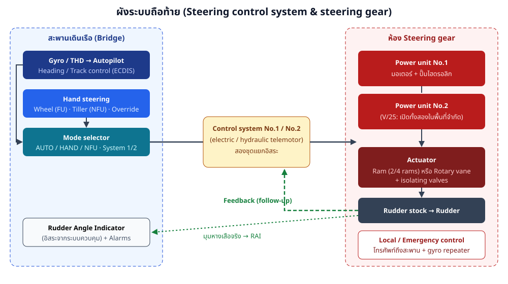
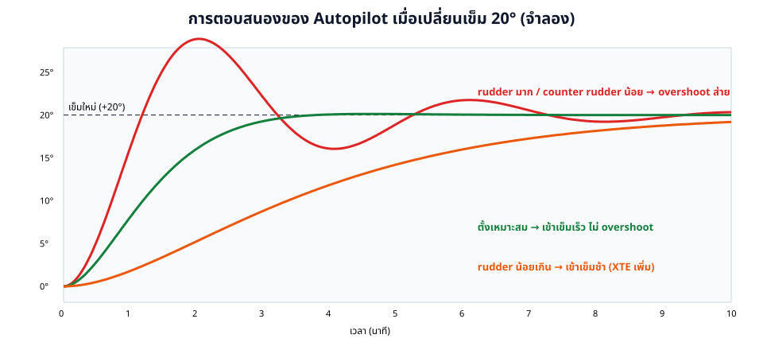

# 1.1.6 Steering Control System — ระบบควบคุมการถือท้ายเรือ

> สมุดบันทึกการฝึก OOW · TIRAPHONG NANTAPAN
> สมรรถนะตาม STCW A-II/1: *Knowledge of steering control systems, operational procedures and change-over from manual to automatic control and vice versa. Adjustment of controls for optimum performance*
> อ้างอิงหลัก: SOLAS II-1/29, II-1/30 (รวมการแก้ไขโดย MSC.365(93) มีผล 1 ม.ค. 2016); SOLAS V/24, V/25, V/26; IMO Res. MSC.64(67) Annex 3 (Heading control systems), MSC.74(69) Annex 2 (Track control systems), IEC 62065 (track control — มาตรฐานทดสอบ); STCW Code A-VIII/2 Part 4-1 para 34; IMO SMCP — Res. A.918(22) (wheel orders); ICS *Bridge Procedures Guide*; คู่มือผู้ผลิต autopilot/steering gear

---

## 1. ภาพรวมของระบบถือท้าย



*ภาพที่ 1.1.6-1 ผังระบบถือท้าย — คำสั่งจากพวงมาลัย/autopilot ผ่านระบบควบคุม ไปยัง power unit และ actuator ที่หมุนหางเสือ พร้อม feedback และ rudder angle indicator*

ระบบถือท้ายแบ่งเป็น 2 ส่วนใหญ่

1. **Steering control system** — ส่วนที่ส่งคำสั่งจากสะพานเดินเรือ (พวงมาลัย tiller joystick autopilot) ไปยังห้อง steering gear เช่น ระบบไฟฟ้า (electric follow-up / non-follow-up) หรือ telemotor ไฮดรอลิก (เรือเก่า)
2. **Steering gear** — ส่วนกำลังที่หมุนหางเสือ ประกอบด้วย power units (มอเตอร์ไฟฟ้า + ปั๊มไฮดรอลิก) และ actuator (ram หรือ rotary vane) ที่ต่อกับ rudder stock

| ส่วนประกอบ | หน้าที่ |
|---|---|
| **Steering wheel / Tiller / Joystick** | อุปกรณ์สั่งการบนสะพาน |
| **Steering stand / console** | รวมพวงมาลัย ตัวเลือกโหมด (mode selector) และ autopilot |
| **Control system (telemotor / electric)** | ส่งคำสั่งเป็นสัญญาณไปห้อง steering gear — ปกติมี 2 ระบบอิสระ (No.1, No.2) |
| **Power unit** | มอเตอร์ไฟฟ้าขับปั๊มไฮดรอลิก — ปกติมี 2 ชุดขึ้นไป อาจเป็น variable displacement pump (เช่นแบบ Hele-Shaw/swashplate) หรือ fixed pump + solenoid valves |
| **Actuator** | **Ram type** (2 หรือ 4 ram ดันแขน tiller) หรือ **Rotary vane** (ใบพัดในห้องน้ำมันหมุน rudder stock โดยตรง) |
| **Rudder stock และ rudder** | ส่งแรงบิดไปหางเสือ |
| **Feedback (follow-up / hunting gear)** | บอกตำแหน่งหางเสือจริงกลับไปยังระบบควบคุม ให้หยุดเมื่อถึงมุมที่สั่ง |
| **Rudder Angle Indicator (RAI)** | แสดงมุมหางเสือจริงบนสะพานและในห้อง steering gear (ต้องแยกจากระบบควบคุม) |
| **Isolating valves / bypass** | แยกวงจรไฮดรอลิกที่รั่ว (บังคับสำหรับเรือบางประเภทตาม II-1/29) |
| **Emergency steering** | ควบคุมเฉพาะที่ในห้อง steering gear (local control) — ด้วยปุ่ม solenoid/trick wheel พร้อมระบบสื่อสารกับสะพาน และ gyro repeater |

---

## 2. ข้อกำหนดตาม SOLAS

### 2.1 SOLAS II-1/29 — Steering gear (ประเด็นที่ OOW ควรรู้)

- ต้องมี **main steering gear** และ **auxiliary steering gear** (ยกเว้นกรณีที่ main มีสอง power units ขึ้นไปและตามเงื่อนไขที่กำหนด)
- **Main steering gear** ต้องหมุนหางเสือได้จาก **35° ข้างหนึ่งไป 35° อีกข้าง** ที่ draught ลึกที่สุดและความเร็วเดินหน้าสูงสุดในการให้บริการ และจาก **35° ข้างหนึ่งไป 30° อีกข้างภายในเวลาไม่เกิน 28 วินาที**
- **Auxiliary steering gear** ต้องหมุนจาก **15° ข้างหนึ่งไป 15° อีกข้างภายในไม่เกิน 60 วินาที** ที่ความเร็วครึ่งหนึ่งของความเร็วสูงสุดหรือ 7 นอต แล้วแต่ค่าไหนมากกว่า และต้องเริ่มใช้งานได้เร็ว
- **การพิสูจน์ในการทดลองเรือ (sea trials)** — การแก้ไข II-1/29 โดย MSC.365(93) (มีผล 1 ม.ค. 2016) ยอมให้ทดสอบที่ draught อื่นได้เมื่อทดสอบที่ draught ลึกสุดไม่ได้ในทางปฏิบัติ เช่น เรือ even keel หางเสือจมมิดที่ความเร็วตามรอบเครื่อง MCR, หรือคำนวณความเร็วเทียบเท่าจากพื้นที่หางเสือที่จมน้ำ, หรือทำนายแรง/แรงบิดของหางเสือแล้ว extrapolate ไปสภาพบรรทุกเต็ม — OOW ควรรู้ว่าเวลา "28 วินาที" ในใบรับรองมาจากเงื่อนไขทดสอบแบบไหน
- Main steering gear ต้องใช้กำลัง (power operated) เมื่อจำเป็น และในทุกกรณีเมื่อ rudder stock ใหญ่กว่า 120 mm (ตรง tiller); auxiliary ต้องใช้กำลังเมื่อ rudder stock ใหญ่กว่า 230 mm
- เรือบรรทุกน้ำมัน/เคมี/ก๊าซ 10,000 GT ขึ้นไป และเรืออื่น 70,000 GT ขึ้นไป: main steering gear ต้องมี power units ที่เหมือนกันตั้งแต่ 2 ชุดขึ้นไป และสำหรับเรือบรรทุกน้ำมัน/เคมี/ก๊าซ 10,000 GT ขึ้นไป ต้องคงความสามารถถือท้ายได้หลังเกิด **single failure** ในวงจรไฮดรอลิก (ยกเว้นตัว actuator ตามเงื่อนไข) ภายใน 45 วินาที
- ต้องมี **ระบบควบคุมสองชุดที่แยกอิสระ** จากสะพานเดินเรือในกรณีที่กำหนด
- ต้องมีวิธีสื่อสารระหว่างสะพานเดินเรือกับห้อง steering gear
- มี **rudder angle indicator** บนสะพานที่เป็นอิสระจากระบบควบคุม

### 2.2 SOLAS II-1/30 — ข้อกำหนดเพิ่มเติมสำหรับ steering gear ไฟฟ้า/ไฟฟ้า-ไฮดรอลิก

- มีสัญญาณแสดงการทำงานของ power unit บนสะพาน
- **Alarms** บนสะพาน: power failure, phase failure, overload ของมอเตอร์, ระดับน้ำมันไฮดรอลิกต่ำ (low level) ฯลฯ — หมายเหตุ: alarm ระดับน้ำมันไฮดรอลิกต่ำของแต่ละถัง (low-level alarm ทั้งเสียงและภาพ บนสะพานและในห้องเครื่อง) กำหนดไว้ใน II-1/29.12.2 ส่วน II-1/30 เน้นสัญญาณแสดงการทำงานของมอเตอร์ และ alarm overload/phase failure ของวงจรไฟฟ้า

### 2.3 SOLAS V/24 — Use of heading and/or track control systems

1. ในพื้นที่ **การจราจรหนาแน่น** ใน **ทัศนวิสัยจำกัด** และใน **สถานการณ์อันตรายอื่น ๆ** ถ้าใช้ heading/track control (autopilot) ต้องสามารถเปลี่ยนเป็นถือท้ายด้วยมือได้ทันที
2. ในสถานการณ์ข้างต้น OOW ต้องมี **นายท้ายที่มีคุณสมบัติ (qualified helmsperson)** พร้อมถือท้ายได้ทันที
3. การเปลี่ยนจากอัตโนมัติเป็นมือและกลับกัน ต้องทำโดยหรือภายใต้การกำกับของ **OOW** (หรือนายเรือ)
4. ต้องทดสอบการถือท้ายด้วยมือ **หลังใช้ autopilot ต่อเนื่องนาน** และ **ก่อนเข้าพื้นที่ที่ต้องระมัดระวังเป็นพิเศษ**

### 2.4 SOLAS V/25 — Operation of steering gear

ในพื้นที่ที่การเดินเรือต้องระมัดระวังเป็นพิเศษ ต้องเปิด **power units มากกว่าหนึ่งชุด** ถ้า power units นั้นทำงานพร้อมกันได้ (เพื่อให้หางเสือตอบสนองเร็วและมีสำรองทันที)

### 2.5 SOLAS V/26 — Steering gear: testing and drills

**ภายใน 12 ชั่วโมงก่อนออกเดินทาง** ต้องตรวจและทดสอบ steering gear โดยลูกเรือ ครอบคลุม (ตามที่ใช้ได้)
1. Main steering gear
2. Auxiliary steering gear
3. Remote steering gear control systems
4. ตำแหน่งถือท้ายบนสะพาน (steering positions)
5. แหล่งไฟฟ้าฉุกเฉิน (emergency power supply)
6. Rudder angle indicators เทียบกับมุมหางเสือจริง
7. Alarm เมื่อแหล่งไฟของ remote control system ขัดข้อง
8. Alarm เมื่อ power unit ขัดข้อง
9. ระบบแยก (automatic isolating arrangements) และอุปกรณ์อัตโนมัติอื่น

การตรวจและทดสอบต้องรวม
- การเคลื่อนหางเสือเต็มช่วง (full movement) ตามความสามารถที่กำหนด
- การตรวจด้วยสายตาของ steering gear และ linkage
- การทดสอบระบบสื่อสารระหว่างสะพานกับห้อง steering gear

**ข้อกำหนดอื่น**
- **แผนผังอย่างง่าย (simple block diagram) และขั้นตอนการเปลี่ยนระบบ (change-over procedures)** สำหรับ remote control systems และ power units ต้องติดถาวรบนสะพานและในห้อง steering gear
- นายประจำเรือที่เกี่ยวข้องทุกคนต้องคุ้นเคยกับการทำงานและการเปลี่ยนระบบ
- **Emergency steering drills อย่างน้อยทุก 3 เดือน** — ฝึกถือท้ายโดยตรงจากห้อง steering gear การสื่อสารกับสะพาน และการใช้แหล่งไฟฟ้าสำรอง (ถ้ามี)
- **บันทึก** วันที่และรายละเอียดการทดสอบ/การฝึกใน log book
- ถ้าเรือแล่นประจำเส้นทางสั้น flag state อาจผ่อนผันการทดสอบก่อนออกทุกเที่ยว แต่ต้องทดสอบอย่างน้อยสัปดาห์ละครั้ง

---

## 3. โหมดการถือท้าย (Steering modes)

| โหมด | การทำงาน | ใช้เมื่อ |
|---|---|---|
| **Hand steering — Follow-up (FU)** | หมุนพวงมาลัยไปมุมใด หางเสือจะไปที่มุมนั้นแล้วหยุด (มี feedback) — นายท้าย "สั่งมุมหางเสือ" | ถือท้ายปกติในร่องน้ำ นำร่อง ทัศนวิสัยจำกัด |
| **Hand steering — Non-follow-up (NFU)** | กดปุ่ม/โยก tiller ค้าง หางเสือจะเคลื่อนไปเรื่อย ๆ จนปล่อย — ต้องดู RAI ตลอด | ระบบสำรองเมื่อ FU เสีย |
| **Autopilot — Heading control (HCS)** | รักษา heading ที่ตั้งไว้โดยเทียบกับเข็มทิศ (gyro/THD) | ทะเลเปิด ชายฝั่งที่การจราจรไม่หนาแน่น |
| **Autopilot — Track control (TCS)** | รักษาเรือให้อยู่บน track ที่วางไว้ใน ECDIS ปรับ heading อัตโนมัติชดเชยกระแสน้ำ/ลม บางระบบเลี้ยวตาม waypoint อัตโนมัติ | ทะเลเปิด/ชายฝั่ง — ต้องมี OOW เฝ้าและยืนยันการเลี้ยวตามขั้นตอน |
| **Override** | ปุ่ม/tiller ที่ให้ควบคุมด้วยมือทันทีแม้ autopilot ทำงานอยู่ | ฉุกเฉิน — หลีกเลี่ยงการโดนกันเร่งด่วน |
| **Emergency / Local control** | ควบคุมในห้อง steering gear โดยตรง | ระบบควบคุมจากสะพานเสียทั้งหมด |

**ประเภท Track control system ตาม MSC.74(69) Annex 2** (การแบ่ง category ใช้ในมาตรฐานทดสอบ IEC 62065 และใบรับรองของผู้ผลิต)
- **Category A** — straight track เท่านั้น (เลี้ยวต้องทำเอง)
- **Category B** — เลี้ยวตามแผนอัตโนมัติ (pre-planned turns ตามรัศมีที่วางไว้) โดยระบบแจ้ง early course change / actual course change ก่อนถึง wheel-over ให้ **OOW รับทราบ (acknowledge)** และเฝ้าดูการเลี้ยว (รายละเอียดการยืนยันขึ้นกับรุ่นและคู่มือผู้ผลิต — ตรวจกับฉบับปัจจุบัน)
- **Category C** — เลี้ยวอัตโนมัติตามแผนรวมถึงการควบคุมความเร็ว (ขึ้นกับการรับรอง)

ระบบต้องมี **alarms**: off-heading, off-track (cross track limit), end of track, waypoint approach, sensor failure, position/heading source change ฯลฯ

---

## 4. หลักการของ Autopilot

### 4.1 PID control

Autopilot แบบดั้งเดิมสั่งมุมหางเสือ (δ) จาก 3 องค์ประกอบ

```
δ = Kp × ψe  +  Kd × dψ/dt  +  Ki × ∫ψe dt
```

| องค์ประกอบ | ชื่อบนเครื่อง | ความหมาย |
|---|---|---|
| **P — Proportional** | **Rudder (gain)** | มุมหางเสือแปรผันตาม **heading error** (ψe) — ตั้งสูงเรือตอบสนองแรงแต่ส่ายเกิน; ตั้งต่ำเรือตอบสนองช้า |
| **D — Derivative** | **Counter rudder** | หางเสือแปรผันตาม **อัตราการหัน** — ใส่หางเสือสวนเพื่อหยุดการหันก่อนถึงเข็ม (ป้องกัน overshoot) เรือใหญ่/เรือหันยากต้องการ counter rudder มากขึ้น |
| **I — Integral** | **Permanent helm / Weather helm / Trim** | ชดเชยแรงคงที่ที่ทำให้เรือเบนข้างเดียวตลอด (ลมข้าง ใบจักรทางเดียว trim เรือ) โดยสะสม error เฉลี่ย |



*ภาพที่ 1.1.6-2 ผลของการตั้ง rudder/counter rudder ต่อการกลับเข้าเข็ม — ตั้งเหมาะสม (สีเขียว), rudder มากเกิน/counter น้อย (สีแดง overshoot), rudder น้อย (สีส้มช้า)*

### 4.2 การตั้งค่าอื่น

| การตั้งค่า | ความหมาย / คำแนะนำ |
|---|---|
| **Weather / Yaw (deadband)** | ช่วงที่ยอมให้ heading ส่ายโดยไม่สั่งหางเสือ — คลื่นแรงเพิ่ม weather เพื่อลดการใช้หางเสือถี่ ๆ (ประหยัดน้ำมัน ลดการสึกหรอ) แต่เรือจะส่ายมากขึ้น |
| **Rudder limit** | มุมหางเสือสูงสุดที่ autopilot ใช้ได้ (เช่น 10°–20°) — ป้องกันการหันแรงเกิน |
| **Rate of turn / Radius limit** | กำหนดการเลี้ยวตาม ROT หรือรัศมีที่ตั้ง (สอดคล้องกับ WOP ในแผน) |
| **Off-course alarm** | เตือนเมื่อ heading ต่างจากเข็มที่ตั้งเกินค่า (เช่น 5°–10°) |
| **Speed input** | ปรับ gain ตามความเร็วอัตโนมัติ (เรือเร็ว หางเสือได้ผลมาก ต้องใช้ gain ต่ำลง) |
| **Load condition (loaded/ballast)** | เลือก parameter ชุดที่เหมาะกับสภาพเรือ |
| **Adaptive / Auto mode** | autopilot รุ่นใหม่ปรับค่าเองตามการตอบสนองของเรือ (self-tuning) — ยังต้องตรวจผลด้วยตา |
| **Economy / Precise mode** | economy ลดการใช้หางเสือ (ทะเลเปิด) precise รักษาเข็มแม่น (ชายฝั่ง/track control) |

### 4.3 การปรับเพื่อประสิทธิภาพสูงสุด (Adjustment for optimum performance)

| สภาพ | แนวทางปรับ |
|---|---|
| ทะเลสงบ ความเร็วสูง | rudder ปานกลาง-ต่ำ, counter rudder ปานกลาง, weather ต่ำ |
| คลื่นลมแรง (เรือส่ายมาก) | เพิ่ม weather (deadband), เพิ่ม rudder เล็กน้อยถ้าเรือไม่กลับเข้าเข็ม, ระวังหางเสือทำงานถี่เกินไป |
| **คลื่นตามท้าย (following/quartering sea)** | เรือมีแนวโน้มส่ายแรงและ **broaching** — เพิ่ม rudder และ counter rudder, พิจารณาถือท้ายด้วยมือ, ปรับเข็ม/ความเร็วตามแนวทาง IMO MSC.1/Circ.1228 (คำแนะนำหลีกเลี่ยงสถานการณ์อันตรายในคลื่นตาม) |
| ความเร็วต่ำ (เช่นเข้าท่า) | หางเสือได้ผลน้อย ต้องเพิ่ม gain หรือใช้มือดีกว่า — autopilot ส่วนใหญ่ไม่เหมาะที่ความเร็วต่ำมาก |
| น้ำตื้น | เรือตอบสนองช้าลง (ต้องการหางเสือมากกว่า) ระวัง bank effect — ส่วนใหญ่ถือท้ายด้วยมือ |
| เรือเปล่า (ballast, trim ท้าย) | ลมมีผลมาก ใช้ permanent helm ชดเชย |

> **จดไว้กันลืม** — ตั้งค่าผิดทำให้ใช้หางเสือมากเกินจำเป็น ความเร็วตก เปลืองน้ำมัน สึกหรอ steering gear; ตั้งน้อยเกินทำให้เรือออกนอกเส้นทาง (XTE เพิ่ม) — ให้ดูกราฟหางเสือ/heading บนจอ autopilot ประกอบ

### 4.4 ความสัมพันธ์ ROT – รัศมีเลี้ยว – ความเร็ว (ใช้ตั้ง radius/ROT ให้ตรงกับ passage plan)

```
ROT (°/นาที) ≈ 0.955 × V (นอต) / R (ไมล์)        [มาจาก 57.3° × V/60 ÷ R]
R (ไมล์)     ≈ 0.955 × V / ROT
```

**ตัวอย่างจำลอง:** MV Andaman Pearl แล่น 14 นอต passage plan กำหนดเลี้ยวรัศมี 1.0 ไมล์ ที่ WOP เพื่อเปลี่ยนเข็ม 160° → 220° (เปลี่ยน 60°)
- ROT ที่ต้องการ ≈ 0.955 × 14 / 1.0 ≈ **13.4°/นาที** → ตั้ง radius 1.0 ไมล์ (หรือ ROT ~13°/นาที) ใน autopilot/track control
- เวลาเลี้ยว ≈ 60 / 13.4 ≈ **4.5 นาที**; ระยะจาก WOP ถึงจุดเปลี่ยนเข็มบนแผนที่ (ไม่รวมช่วงหน่วงที่เรือเริ่มหัน) ≈ R × tan(Δ/2) = 1.0 × tan30° ≈ **0.58 ไมล์**
- ถ้าลดความเร็วเหลือ 8 นอตแต่ยังตั้ง ROT 13.4°/นาที รัศมีจะเหลือ ≈ 0.955 × 8 / 13.4 ≈ 0.57 ไมล์ — เส้นทางการเลี้ยวจริงจะไม่ตรงกับที่วางไว้ จึงต้องตั้ง "radius" แทน "ROT" เมื่อความเร็วเปลี่ยน หรือคำนวณใหม่

---

## 5. ขั้นตอนการเปลี่ยนโหมด (Change-over procedures)

### 5.1 Auto → Hand (เช่น ก่อนเข้า TSS/ร่องน้ำ หรือเมื่อเกิดเหตุ)

1. เรียกนายท้าย (helmsman) ขึ้นสะพาน ให้เวลาปรับสายตาถ้าเป็นกลางคืน
2. แจ้งนายท้าย: เข็มปัจจุบัน สภาพลม กระแสน้ำ หางเสือที่ใช้ประมาณ (permanent helm) และเรือรอบข้าง
3. ให้นายท้ายยืนประจำพวงมาลัย ตั้งพวงมาลัยตรงกับมุมหางเสือปัจจุบัน (สำหรับ FU)
4. OOW เปลี่ยน mode selector เป็น **Hand (FU)** — แจ้ง "Hand steering, steer course one-six-zero"
5. นายท้ายทวน "Steer course one-six-zero" และรายงานเมื่อเรืออยู่ที่เข็ม "Course one-six-zero"
6. ตรวจว่าเรือตอบสนองถูกต้อง ดู RAI และ ROT
7. บันทึกเวลาในสมุดปูมเรือ ("Hand steering engaged")

### 5.2 Hand → Auto

1. นำเรือมาอยู่บนเข็มที่ต้องการและหยุดการหัน (rate of turn ≈ 0)
2. ตรวจว่า heading ที่ autopilot ใช้ (gyro 1 หรือ 2) ถูกต้อง ตรวจ heading set ในเครื่องตรงกับเข็มปัจจุบัน
3. ตรวจการตั้งค่า (rudder, counter rudder, weather, rudder limit, off-course alarm) เหมาะกับสภาพ
4. เปลี่ยน mode selector เป็น **Auto** สังเกตการตอบสนองหลายนาที
5. แจ้งนายท้ายว่า "Finished with wheel" หรือให้ยืนเฝ้าตามคำสั่ง
6. บันทึกเวลาและเข็มในสมุดปูมเรือ

### 5.3 การเปลี่ยน power units / control systems

- ทำตาม block diagram ที่ติดบนสะพาน — เช่น เลือก "System 1 / Pump 1" เป็น "System 2 / Pump 2" ขณะเรือแล่นตรง ความเร็วปกติ
- ในพื้นที่ต้องระวัง: เปิด **ทั้งสอง pumps** (SOLAS V/25)
- หลังเปลี่ยน ทดสอบหางเสือซ้าย-ขวาเล็กน้อย ตรวจ RAI
- บันทึก

### 5.4 การทดสอบระหว่างยาม

- **ทดสอบการถือท้ายด้วยมืออย่างน้อยหนึ่งครั้งต่อยาม** เมื่อใช้ autopilot (STCW Code A-VIII/2 Part 4-1 para 34.3: "the automatic pilot is tested manually at least once a watch") และทดสอบ manual steering หลังใช้ autopilot นานและก่อนเข้าพื้นที่ที่ต้องระมัดระวังเป็นพิเศษ (SOLAS V/24.4)
- ตรวจ off-course alarm ทำงาน
- ตรวจว่า gyro ที่ใช้กับ autopilot ตรงกับ gyro อีกตัวและเข็มทิศแม่เหล็ก
- ตรวจว่าคนถือท้าย (ถ้ามี) ถือเข็มถูกต้อง

---

## 6. คำสั่งหางเสือ (Helm orders) ตาม IMO SMCP

| คำสั่ง | ความหมาย |
|---|---|
| **Midships** | หางเสือตรงกลาง (0°) |
| **Port / Starboard five (ten, fifteen, twenty)** | หางเสือซ้าย/ขวา 5° (10°, 15°, 20°) |
| **Hard-a-port / Hard-a-starboard** | หางเสือเต็มที่ (ปกติ 35°) |
| **Ease to five (ten, fifteen)** | ลดมุมหางเสือลงเหลือ ... (ข้างเดิม) |
| **Steady / Steady as she goes** | **Steady** = ลดการหัน (swing) ให้หยุดเร็วที่สุด (reduce swing as rapidly as possible); **Steady as she goes** = ถือเข็มตามเข็มทิศที่หัวเรืออยู่ ณ ขณะที่สั่ง — นายท้ายทวนคำสั่งและขานเข็มนั้นทันที |
| **Steer one-two-three** | ถือเข็ม 123° (ขานเลขทีละตัว) |
| **Nothing to port / starboard** | อย่าให้หัวเรือเบนไปทางซ้าย/ขวาของเข็มที่ถืออยู่ |
| **Report if she does not answer the wheel** | รายงานถ้าเรือไม่ตอบสนองหางเสือ |
| **Finished with wheel / No more steering** | เลิกใช้หางเสือ |

**หลักการสื่อสาร (closed loop)**
1. OOW (หรือนำร่อง) สั่งชัดเจน
2. นายท้าย **ทวนคำสั่ง** ทันที
3. นายท้ายทำตามและ **รายงานเมื่อทำเสร็จ** (เช่น "Wheel starboard ten", "Course one-six-zero")
4. OOW ตรวจที่ RAI และ heading แล้วตอบ **"Correct"** หรือแก้ไข
5. เมื่อนำร่องสั่งหางเสือ OOW ต้องตรวจว่านายท้ายทำตามคำสั่งถูกต้อง (pilot มักพูดเร็ว ภาษาไม่ชัด — ต้องฟังจับและยืนยัน)

---

## 7. เหตุขัดข้องของระบบถือท้าย (Steering failure)

### 7.1 อาการที่ต้องระวัง

- เรือไม่ตอบสนองหางเสือ หรือหันเองโดยไม่ได้สั่ง
- RAI ไม่ตรงกับมุมที่สั่ง
- Alarm: steering gear power failure, phase failure, hydraulic low level, overload, autopilot failure, heading sensor failure
- เสียงผิดปกติจากห้อง steering gear

### 7.2 การปฏิบัติทันที (ตัวอย่างลำดับ — ต้องเป็นไปตาม SMS ของเรือ)

1. **เปลี่ยนเป็น hand steering / NFU / override** และลองเปลี่ยน control system/pump อีกชุด (ตาม block diagram)
2. **แจ้งนายเรือ** และห้องเครื่อง — ลดความเร็ว/หยุดเครื่องตามสถานการณ์ (คำนึงถึงเรือรอบข้างและพื้นที่)
3. ถ้ายังควบคุมไม่ได้: แสดง **ไฟ/รูปทรง Not Under Command (NUC)** (สองดวงแดง/สองลูกกลมดำ ตาม COLREG Rule 27) และเสียงสัญญาณในทัศนวิสัยจำกัด (Rule 35); แจ้งเรือรอบข้าง/VTS ทาง VHF (Sécurité หรือ urgency ถ้าจำเป็น)
4. ส่งคนไปห้อง steering gear เตรียม **emergency steering (local control)** ตั้งการสื่อสาร (โทรศัพท์ sound-powered/วิทยุ) และให้ดู gyro repeater ในห้องนั้น
5. ถ้าใกล้อันตราย/น้ำตื้น พิจารณา **ทอดสมอ** (เตรียมสมอไว้แล้วในพื้นที่จำกัด)
6. บันทึกทุกอย่างในสมุดปูมเรือ (เวลา ตำแหน่ง การกระทำ)
7. รายงานบริษัท/flag/หน่วยงานตามข้อกำหนด

### 7.3 Emergency steering drill (ตัวอย่างการฝึกทุก 3 เดือน)

- ประกาศการฝึก แจ้งห้องเครื่อง
- เปลี่ยนการควบคุมเป็น local ในห้อง steering gear
- สั่งหางเสือจากสะพานผ่านระบบสื่อสาร คนในห้อง steering gear ทำตามโดยดู RAI ท้องถิ่นและ gyro repeater
- ทดสอบการเปลี่ยน power unit และแหล่งไฟฟ้าฉุกเฉิน (ถ้ากำหนด)
- กลับสู่การควบคุมปกติ ตรวจความถูกต้อง
- บันทึกใน log book และสรุปบทเรียน

---

## 8. ตัวอย่างจำลอง — การทดสอบ steering gear ก่อนออกเรือ (Pre-departure checklist)

> ใช้ฟอร์มของบริษัทจริงเสมอ ตัวอย่างนี้สร้างขึ้นเพื่อฝึก

| # | รายการ | ผล |
|---|---|---|
| 1 | ติดต่อห้อง steering gear ทางโทรศัพท์/วิทยุ — ชัดเจน | ✓ |
| 2 | Start No.1 pump — สัญญาณบนสะพาน "running" | ✓ |
| 3 | Hand (FU) จาก No.1 system: Hard-a-port → Hard-a-starboard จับเวลา 35°→30° อีกข้าง = 24 วินาที (≤ 28 s) | ✓ |
| 4 | RAI บนสะพาน = RAI ในห้อง steering gear = มุมจริงบนสเกลที่ rudder stock (ต่างกันไม่เกิน 1°) ที่ 0°, 10°, 20°, 35° ทั้งสองข้าง | ✓ |
| 5 | Start No.2 pump — ทดสอบซ้ำจาก No.2 system | ✓ |
| 6 | ทั้งสอง pumps พร้อมกัน — ตรวจเวลา | ✓ |
| 7 | NFU (tiller) ทั้งสองข้าง | ✓ |
| 8 | Autopilot — เปลี่ยนเข็มเล็กน้อย หางเสือตอบสนองถูกทิศ, off-course alarm ทำงาน | ✓ |
| 9 | Alarms: power failure / phase failure / low oil level (จำลองตามขั้นตอนผู้ผลิต) | ✓ |
| 10 | Emergency power supply ของ steering gear (ตามที่กำหนด) | ✓ |
| 11 | ตรวจด้วยสายตา: รั่วซึม ระดับน้ำมัน linkage ไม่มีสิ่งกีดขวางรอบหางเสือ (ตรวจท้ายเรือว่าไม่มีเรือเล็ก/เชือกใกล้หางเสือ) | ✓ |
| 12 | Block diagram/change-over procedure ติดอยู่ทั้งบนสะพานและห้อง steering gear | ✓ |
| 13 | บันทึกใน deck log: "Steering gear tested and found in good order" เวลา ลายเซ็น | ✓ |

---

## 9. คำถามสอบปากเปล่า / สัมภาษณ์ — Steering

**ถาม:** SOLAS กำหนดความสามารถของ main steering gear อย่างไร
**แนวตอบ:** หมุนหางเสือจาก 35° ข้างหนึ่งไป 35° อีกข้างที่ draught ลึกสุดและความเร็วสูงสุด และจาก 35° ไป 30° อีกข้างภายใน 28 วินาที (II-1/29) auxiliary 15°–15° ภายใน 60 วินาทีที่ครึ่งความเร็วหรือ 7 นอต

**ถาม:** ต้องทดสอบ steering gear เมื่อไร มีอะไรบ้าง
**แนวตอบ:** ภายใน 12 ชั่วโมงก่อนออกเดินทาง (SOLAS V/26) ทดสอบ main/auxiliary, remote control systems, steering positions, emergency power, RAI เทียบมุมจริง, alarms ต่าง ๆ, full movement, ตรวจด้วยตา, ระบบสื่อสาร และฝึก emergency steering ทุก 3 เดือน บันทึกในสมุดปูมเรือ

**ถาม:** เมื่อไรต้องมีนายท้ายพร้อมและต้องเปลี่ยนเป็นมือได้ทันที
**แนวตอบ:** ในพื้นที่การจราจรหนาแน่น ทัศนวิสัยจำกัด และสถานการณ์อันตรายอื่น (SOLAS V/24) การเปลี่ยนโหมดทำโดยหรือภายใต้การกำกับของ OOW และทดสอบ manual steering หลังใช้ autopilot นาน ๆ และก่อนเข้าพื้นที่ต้องระวัง

**ถาม:** Follow-up กับ Non-follow-up ต่างกันอย่างไร
**แนวตอบ:** FU หางเสือไปตามมุมที่ตั้งบนพวงมาลัยแล้วหยุด (มี feedback) NFU หางเสือเคลื่อนตลอดเวลาที่กดค้าง ต้องดู RAI และปล่อย/กดกลับเอง

**ถาม:** อธิบายการตั้งค่า rudder, counter rudder, weather ของ autopilot
**แนวตอบ:** rudder (P) คือมุมหางเสือต่อ heading error, counter rudder (D) คือหางเสือสวนตามอัตราการหันเพื่อป้องกัน overshoot, weather คือ deadband ลดการตอบสนองต่อการส่ายจากคลื่น และ permanent helm (I) ชดเชยแรงคงที่

**ถาม:** ทำไมต้องเปิด steering pump สองชุดในพื้นที่จำกัด
**แนวตอบ:** SOLAS V/25 — เพื่อให้หางเสือตอบสนองเร็วขึ้นและมีสำรองทันทีถ้าชุดหนึ่งเสีย

**ถาม:** หางเสือไม่ตอบสนองระหว่างอยู่ในช่องแคบ ทำอะไรก่อน
**แนวตอบ:** เปลี่ยนเป็น hand/NFU/override และระบบควบคุม/pump อีกชุด แจ้งนายเรือและห้องเครื่อง ลด/หยุดเครื่องตามสถานการณ์ แสดงไฟ/รูปทรง NUC และแจ้งเรือรอบข้าง/VTS เตรียม emergency steering ในห้อง steering gear เตรียมสมอ บันทึก

**ถาม:** STCW กำหนดอะไรเกี่ยวกับ autopilot ระหว่างยาม
**แนวตอบ:** STCW Code A-VIII/2 Part 4-1 para 34 ให้ OOW ตรวจว่าคนถือท้ายหรือ autopilot ถือเข็มถูกต้อง และทดสอบ autopilot ด้วยการถือท้ายด้วยมืออย่างน้อยหนึ่งครั้งต่อยาม ร่วมกับ SOLAS V/24 ที่ให้ทดสอบ manual steering หลังใช้ autopilot นานและก่อนเข้าพื้นที่ต้องระวัง

**ถาม:** เรือแล่นเส้นทางสั้นประจำ ต้องทดสอบ steering gear ทุกครั้งก่อนออกหรือไม่
**แนวตอบ:** SOLAS V/26.5 ให้ Administration ผ่อนผันการทดสอบก่อนออกทุกเที่ยวได้สำหรับเรือที่เดินทางระยะสั้นเป็นประจำ แต่ต้องทดสอบอย่างน้อยสัปดาห์ละครั้ง และยังต้องฝึก emergency steering ทุก 3 เดือนและบันทึกตามปกติ

**ถาม:** ข้อใดคือสิ่งที่ต้องติดไว้ถาวรบนสะพานและในห้อง steering gear
**แนวตอบ:** คำแนะนำการใช้งานอย่างง่ายพร้อม block diagram แสดงขั้นตอนการเปลี่ยนระบบ (change-over) ของ remote steering gear control systems และ power units (SOLAS V/26.3.1)

**ถาม:** แล่น 12 นอต ต้องการเลี้ยวรัศมี 0.8 ไมล์ ต้องตั้ง ROT ประมาณเท่าไร
**แนวตอบ:** ROT ≈ 0.955 × V / R = 0.955 × 12 / 0.8 ≈ 14.3°/นาที

**ถาม:** Track control category A, B, C ต่างกันอย่างไร
**แนวตอบ:** A รักษาเรือบนเส้นตรงเท่านั้น เลี้ยวเอง; B เลี้ยวอัตโนมัติตามรัศมีที่วางไว้ โดยมีการเตือนก่อนเลี้ยวให้ OOW รับทราบและเฝ้าดู; C เพิ่มการควบคุมความเร็วตามแผน — ทุกแบบ OOW ยังต้องเฝ้าดูและพร้อมเปลี่ยนเป็นมือทันที

**ถาม:** "Steady" กับ "Steady as she goes" หมายความว่าอะไร
**แนวตอบ:** ตาม SMCP "Steady" คือให้ลดการหัน (swing) ของหัวเรือให้หยุดเร็วที่สุด ส่วน "Steady as she goes" คือให้ถือเข็มตามเข็มทิศที่หัวเรืออยู่ ณ ขณะที่ได้รับคำสั่ง นายท้ายทวนคำสั่งและขานเข็มนั้นให้ OOW ทราบ — ในทางปฏิบัติทั้งสองคำสั่งจบที่การหยุดการหันและถือเข็ม OOW ต้องฟังเข็มที่นายท้ายขานแล้วตอบรับ

---

*ก่อนหน้า ← [1.1.5 Compasses](1.1.5-compasses.md) · ถัดไป → [1.1.7 Meteorology](1.1.7-meteorology.md)*
