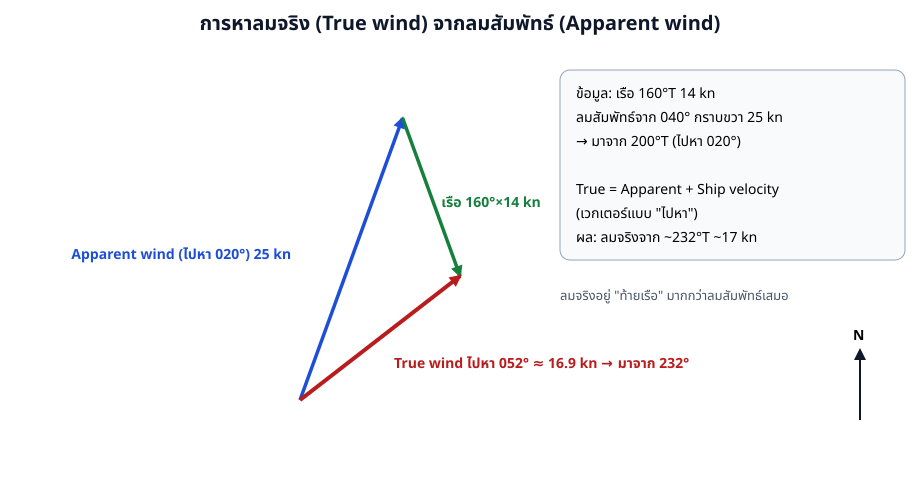
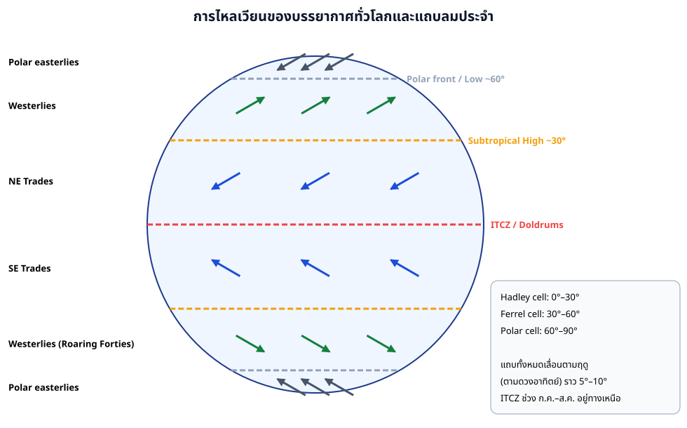
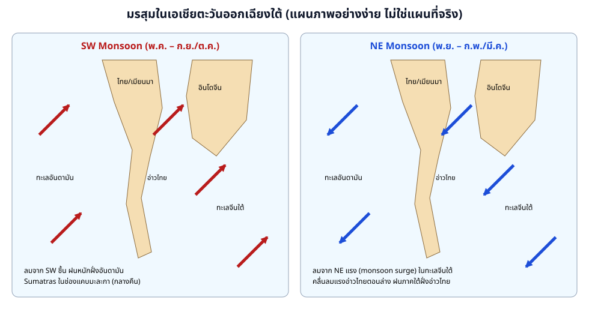
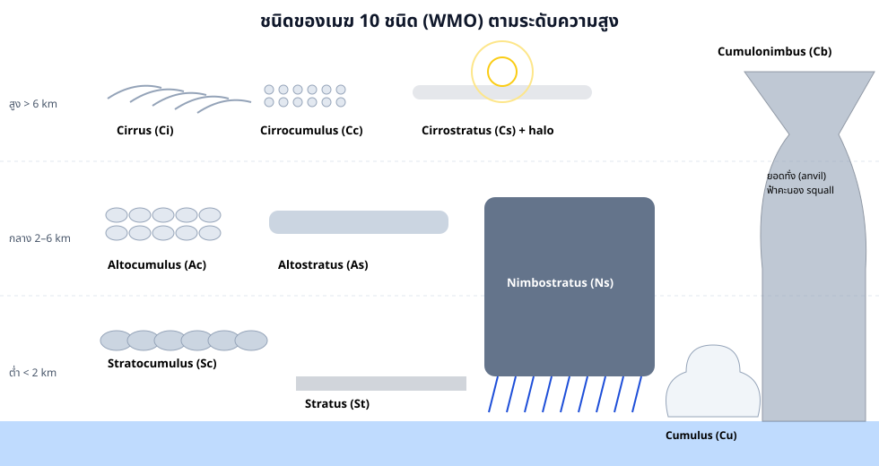
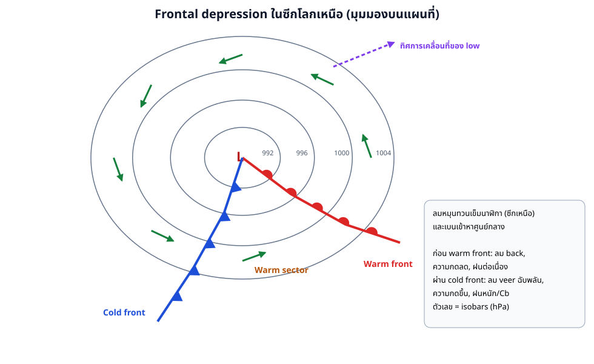
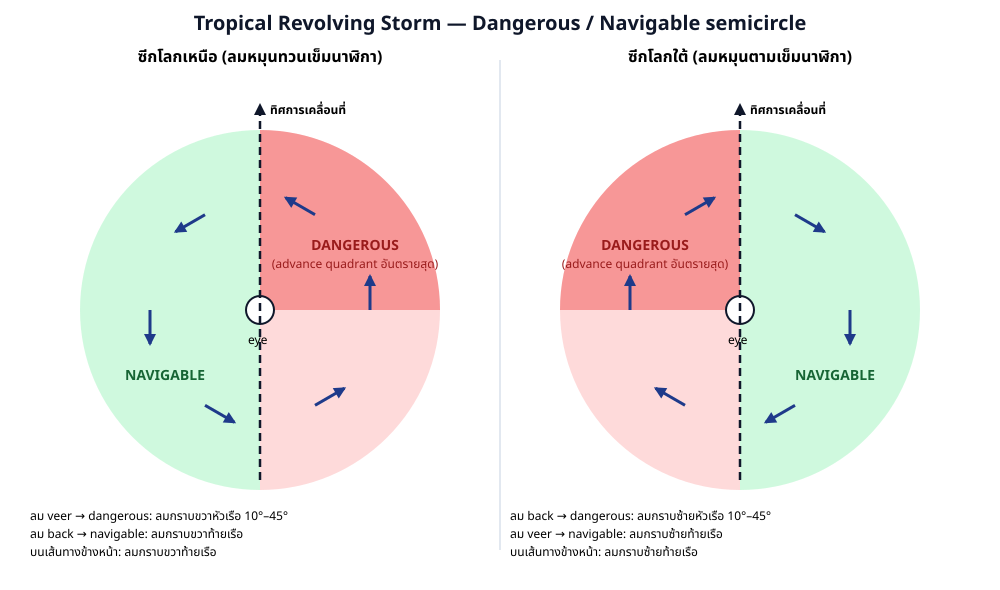
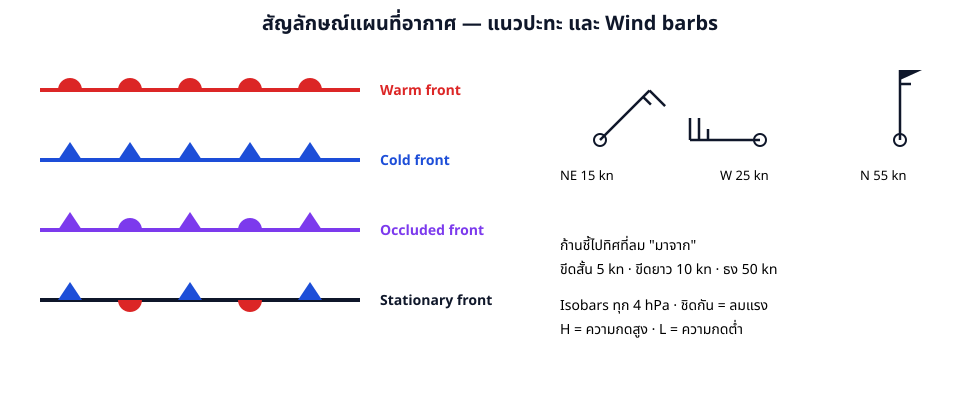

# 1.1.7 Meteorology — อุตุนิยมวิทยาทางทะเล

> สมุดบันทึกการฝึก OOW · TIRAPHONG NANTAPAN
> สมรรถนะตาม STCW A-II/1: *Ability to use and interpret information obtained from shipborne meteorological instruments; Knowledge of the characteristics of the various weather systems, reporting procedures and recording systems; Ability to apply the meteorological information available*
> อ้างอิงหลัก: SOLAS V/5, V/31, V/32; WMO-No. 8 (Guide to Instruments and Methods of Observation), WMO-No. 471 (Guide to Marine Meteorological Services), WMO-No. 558 (Manual on Marine Meteorological Services), WMO-No. 306 (Manual on Codes — FM 13 SHIP/BUFR); กรมอุตุนิยมวิทยา (ฤดูมรสุมของประเทศไทย); NP100 *The Mariner's Handbook* (บท Meteorology); *Meteorology for Mariners* (UK Met Office); Bowditch (บท Weather Elements, Tropical Cyclones, Weather Observations); ADMIRALTY Sailing Directions บทที่ 2 (natural conditions); NP136; Routeing Charts; IMO MSC.1/Circ.1228

---

## 0. ทำไมคนเดินเรือต้องรู้อุตุนิยมวิทยา

อากาศเป็นปัจจัยภายนอกที่มีผลต่อความปลอดภัยมากที่สุด — พายุทำให้เรือเสียหาย สินค้าเคลื่อน เครื่องจักรรับภาระเกิน หมอกทำให้เสี่ยงต่อการโดนกัน ลมแรงทำให้เรือเลื่อนออกจากเส้นทางหรือสมอเกา คลื่นตามท้ายทำให้เรือเสียการทรงตัว (broaching, parametric rolling) งานของ OOW จึงไม่ใช่แค่ "จดลมกับความกดลงสมุดปูมเรือ" แต่ต้อง **สังเกต ตีความ คาดการณ์ และแจ้งนายเรือ** ก่อนสถานการณ์จะแย่ลง

---

## 1. เครื่องมืออุตุนิยมวิทยาบนเรือ (Shipborne meteorological instruments)

### 1.1 Barometer — วัดความกดอากาศ

| ชนิด | หลักการ | หมายเหตุ |
|---|---|---|
| **Aneroid barometer** | ตลับโลหะสุญญากาศบาง ๆ (vacuum capsules) ยุบ/พองตามความกดอากาศ ผ่านคานงัดไปที่เข็ม | ใช้มากที่สุดบนเรือ ต้องเทียบมาตรฐาน (calibrate) เป็นระยะ มี index error |
| **Precision aneroid / Digital barometer** | sensor อิเล็กทรอนิกส์ (silicon/capacitive) | แม่นยำ ±0.3 hPa แสดงแนวโน้ม (tendency) อัตโนมัติ ส่งข้อมูลเข้า VDR/ระบบรายงาน |
| **Barograph** | aneroid ที่ต่อปากกาเขียนบนกระดาษหมุนรอบสัปดาห์ (หรือแสดงเป็นกราฟดิจิทัล) | ดู **แนวโน้ม (tendency)** ได้ชัด — เครื่องมือเตือนพายุที่ดีที่สุด |
| **Mercury barometer** | ความสูงของลำปรอท | ใช้ในอดีต/สถานีบนฝั่ง ต้องแก้ค่าอุณหภูมิ ความโน้มถ่วง ห้ามมีปรอทบนเรือเพราะอันตราย |

**การแก้ค่าความกด (Barometer corrections) เพื่อให้ได้ความกดที่ระดับน้ำทะเล (MSL pressure)**
1. **Index (instrument) error** — จากใบรับรองการ calibrate หรือเทียบกับสถานีบนฝั่ง
2. **Height correction** — barometer อยู่สูงกว่าระดับน้ำทะเล ความกดลดลงประมาณ **0.12 hPa ต่อเมตร** (≈ 1 hPa ต่อ 8 m) → **บวก** ค่าแก้
3. (สำหรับ mercury barometer: temperature และ latitude/gravity corrections)

**ตัวอย่างจำลอง:** aneroid อ่านได้ 1005.0 hPa, อยู่สูง 25 m เหนือระดับน้ำ, index error +0.4 (เครื่องอ่านเกิน)
MSL pressure = 1005.0 − 0.4 + (25 × 0.12) = 1005.0 − 0.4 + 3.0 = **1007.6 hPa**

**Pressure tendency** — การเปลี่ยนแปลงความกดในช่วง **3 ชั่วโมง** ที่ผ่านมา พร้อม "ลักษณะ" (characteristic) ของกราฟ (ขึ้นแล้วลง ลงต่อเนื่อง ฯลฯ) ใช้ในการรายงานและพยากรณ์

| การเปลี่ยนแปลงใน 3 ชม. (นอกเขตร้อน) | ความหมายโดยทั่วไป |
|---|---|
| 0.1–1.5 hPa | slowly |
| 1.6–3.5 hPa | rising/falling |
| 3.6–6.0 hPa | quickly |
| มากกว่า 6.0 hPa | very rapidly — มีพายุแรง/ใกล้ศูนย์กลางพายุ |

**Diurnal variation ในเขตร้อน** — ความกดอากาศในเขตร้อนขึ้นลงวันละสองรอบอย่างสม่ำเสมอ (atmospheric tide) **สูงสุดประมาณ 1000 และ 2200 น. เวลาท้องถิ่น ต่ำสุดประมาณ 0400 และ 1600 น.** พิสัยราว 2–3 hPa — **ถ้าความกดไม่เป็นไปตามจังหวะนี้ หรือต่ำกว่าค่าปกติของฤดูกาล (หลังแก้ diurnal) ตั้งแต่ 3 hPa ขึ้นไป ให้สงสัยว่ามีพายุหมุนเขตร้อนอยู่ใกล้** (แนวทางใน NP100 และตำราอุตุฯ — ถ้าต่ำกว่าปกติ 5 hPa ขึ้นไป ถือว่าพายุอยู่ใกล้แล้ว)

### 1.2 Thermometers และ Hygrometers (ความชื้น)

- **Dry-bulb thermometer** — อุณหภูมิอากาศ
- **Wet-bulb thermometer** — กระเปาะห่อผ้ามัสลินชุ่มน้ำกลั่น การระเหยทำให้เย็นลง ยิ่งอากาศแห้งยิ่งต่างจาก dry-bulb มาก
- ติดตั้งใน **Stevenson screen** (กล่องบานเกล็ดสีขาว) ด้านรับลม (windward) ไม่โดนแดด ห่างจากความร้อนของเรือ หรือใช้ **whirling / aspirated psychrometer** (เหวี่ยงหรือเป่าลมผ่าน)
- จาก dry/wet bulb → ตาราง hygrometric หา **relative humidity (RH)** และ **dew point (Td)**

**ตัวอย่างจำลอง:** dry bulb 30.0°C, wet bulb 26.0°C (ความกดราว 1010 hPa) → RH ≈ **73%**, dew point ≈ **24.6°C**
ถ้า **อุณหภูมิผิวน้ำทะเล (SST) ต่ำกว่า dew point ของอากาศ** ที่พัดผ่าน → มีโอกาสเกิด **advection fog**

- **Sea surface temperature (SST)** — วัดด้วยถังตักน้ำ (bucket) ที่หัวเรือ, เซนเซอร์ที่ท่อรับน้ำหล่อเย็นเครื่องจักร (engine intake — ค่าอาจสูงกว่าจริงเล็กน้อย) หรือ hull contact sensor

### 1.3 Anemometer และ Wind vane — ลม

- **Cup anemometer**, **propeller-vane**, **ultrasonic anemometer** — ติดบนเสาสูง (ระวังการบังของโครงสร้างเรือ)
- เครื่องวัดได้ **apparent wind (ลมสัมพัทธ์)** = ลมจริงรวมกับ "ลม" ที่เกิดจากการเคลื่อนที่ของเรือ ต้องแปลงเป็น **true wind** ก่อนบันทึก/รายงาน (เครื่องรุ่นใหม่คำนวณให้โดยรับ heading และความเร็วจาก gyro/log/GNSS — ต้องตรวจว่าใช้ความเร็วที่ถูก)
- เมื่อไม่มีเครื่องมือ: ประเมินจาก **สภาพผิวน้ำทะเลตาม Beaufort scale** (ฟองคลื่น ยอดคลื่นแตก ลายฟองตามลม) — ทิศลมจริงดูจากแนวของยอดคลื่น/ลายฟองที่ผิวน้ำ

**การหา True wind จาก apparent wind (Vector triangle)**



*ภาพที่ 1.1.7-1 สามเหลี่ยมความเร็วสำหรับแปลงลมสัมพัทธ์เป็นลมจริง*

**ตัวอย่างจำลอง:** เรือแล่นเข็ม 160°T ความเร็ว 14.0 นอต, anemometer วัดลมสัมพัทธ์จาก **040° ทางกราบขวาหัวเรือ** ความเร็ว 25 นอต
- ลมสัมพัทธ์มาจาก 160° + 40° = 200°T
- แปลงเป็นเวกเตอร์ "ไปหา" แล้วรวมกับเวกเตอร์ความเร็วเรือ → **ลมจริงมาจากประมาณ 232°T ความเร็วประมาณ 17 นอต** (Beaufort 4–5)
- สังเกต: ลมจริงอ่อนกว่าลมสัมพัทธ์ เพราะเรือแล่นเข้าหาลมบางส่วน และทิศลมจริง "เบนไปทางท้ายเรือ" เมื่อเทียบกับลมสัมพัทธ์ (กฎทั่วไป: ลมจริงอยู่ทางท้ายเรือมากกว่าลมสัมพัทธ์เสมอ ยกเว้นลมตรงหัว/ท้าย)

**ตรวจด้วยการคำนวณองค์ประกอบ (ใช้เวกเตอร์แบบ "ไปหา", E = x, N = y)**

| เวกเตอร์ | ทิศ "ไปหา" | E (นอต) | N (นอต) |
|---|---|---|---|
| Apparent wind 25 นอต (มาจาก 200° → ไปหา 020°) | 020° | 25 sin20° = +8.55 | 25 cos20° = +23.49 |
| ความเร็วเรือ 14 นอต | 160° | 14 sin160° = +4.79 | 14 cos160° = −13.16 |
| **True wind = ผลรวม** | | **+13.34** | **+10.34** |

- ความเร็ว = √(13.34² + 10.34²) = **16.9 นอต** (Beaufort 4 ที่ขอบบน เกือบ 5)
- ทิศไปหา = atan(13.34/10.34) = 052° → **ลมจริงมาจาก 232°T** = ทางกราบขวา 72° จากหัวเรือ (ลมสัมพัทธ์อยู่ที่ 40°) — ตรงกับภาพที่ 1.1.7-1

### 1.4 การสังเกตอื่น ๆ ด้วยสายตา

- **ทัศนวิสัย (visibility)** — ประเมินจากระยะวัตถุที่รู้ระยะ (เรือ เกาะ ระยะเรดาร์) — ตามรหัส WMO
- **เมฆ** — ชนิด ปริมาณ (oktas: แบ่งท้องฟ้าเป็น 8 ส่วน) ความสูงฐานเมฆโดยประมาณ
- **สภาพอากาศปัจจุบัน (present weather)** — ฝน ฟ้าคะนอง หมอก ฯลฯ
- **คลื่นลม (wind waves) และคลื่นหัวโต (swell)** — ทิศ คาบ ความสูง (ดูข้อ 9)
- **น้ำแข็งเกาะเรือ (ice accretion)** ในละติจูดสูง

### 1.5 เครื่องรับข้อมูลอุตุนิยมวิทยา

- **NAVTEX / SafetyNET / Iridium SafetyCast** — คำเตือนและพยากรณ์อากาศตาม METAREA (บท 1.1.2-C)
- **Weather facsimile (radiofacsimile)** — แผนที่อากาศผิวพื้น (surface analysis/prognosis) แผนที่คลื่น ภาพดาวเทียม ตารางสถานีและเวลาส่งอยู่ใน **ALRS Vol 3**
- **ข้อมูลอินเทอร์เน็ต/ดาวเทียม** — GRIB files (ข้อมูลพยากรณ์เชิงตัวเลข), ภาพดาวเทียม, บริการ weather routing — ใช้ประกอบ แต่ข้อมูลทางการด้าน safety ยังมาจาก GMDSS MSI
- **ซอฟต์แวร์บนเรือ** — แสดงพยากรณ์ซ้อนบนเส้นทาง (บาง ECDIS รองรับ)

### 1.6 การดูแลเครื่องมือ (OOW)

- อ่านค่าตามเวลาที่กำหนด (ทุกยาม/ทุก 4 ชม. และในช่วง synoptic hours)
- ตรวจผ้าหุ้ม wet-bulb ให้สะอาด ชุ่มน้ำกลั่นเสมอ
- ไม่วางของบังหรือแหล่งความร้อนใกล้ Stevenson screen
- เปลี่ยนกระดาษ barograph และเติมหมึกตามกำหนด ตั้งเวลาให้ตรง
- บันทึกค่าลงสมุดปูมเรือครบถ้วน

---

## 2. บรรยากาศ — พื้นฐานที่ต้องเข้าใจ

### 2.1 ชั้นบรรยากาศ

- **Troposphere** — ชั้นล่างสุด สูงราว 8 km (ขั้วโลก) ถึง 16–18 km (เส้นศูนย์สูตร) **ปรากฏการณ์อากาศเกือบทั้งหมดเกิดที่นี่** อุณหภูมิลดลงตามความสูงโดยเฉลี่ย ~6.5°C ต่อ km (environmental lapse rate – ELR)
- **Tropopause** — รอยต่อ (ยอดเมฆ Cb มักแผ่ออกเป็นรูปทั่งที่ระดับนี้)
- **Stratosphere** และชั้นที่สูงกว่า — มีผลน้อยต่อการเดินเรือ

### 2.2 ความชื้น การเย็นตัว และเสถียรภาพ

- **Saturation** — อากาศรับไอน้ำได้จำกัดตามอุณหภูมิ อากาศอุ่นจุไอน้ำได้มากกว่า
- **Dew point** — อุณหภูมิที่อากาศ (ไม่เพิ่มไอน้ำ) อิ่มตัวพอดีเมื่อเย็นลง → เกิดการควบแน่น (เมฆ หมอก น้ำค้าง)
- **Adiabatic processes** — อากาศลอยขึ้นขยายตัวและเย็นลง
  - Dry adiabatic lapse rate (DALR) ≈ **9.8°C/km**
  - Saturated adiabatic lapse rate (SALR) ≈ **5–6°C/km** (ช้ากว่าเพราะการควบแน่นปลดความร้อนแฝง)
- **Stability** — ถ้าอากาศที่ถูกยกขึ้นเย็นกว่าอากาศรอบข้าง จะจมกลับ (stable → เมฆแผ่น ฝนปรอย หมอก ทัศนวิสัยแย่); ถ้าอุ่นกว่าจะลอยต่อ (unstable → เมฆก่อตัวแนวตั้ง Cu/Cb ฝนซู่ ลมกระโชก ทัศนวิสัยดีนอกฝน)
- **กลไกการยกตัวของอากาศ** — การพาความร้อน (convection), แนวปะทะอากาศ (frontal lifting), ภูเขา (orographic), การบรรจบกันของลม (convergence)

---

## 3. ความกดอากาศและลม

### 3.1 แรงที่ทำให้เกิดลม

1. **Pressure gradient force** — อากาศเคลื่อนจากความกดสูงไปต่ำ แรงมากเมื่อ **isobars ชิดกัน**
2. **Coriolis force** — ผลจากการหมุนของโลก ทำให้การเคลื่อนที่เบี่ยงไปทาง **ขวาในซีกโลกเหนือ** และ **ซ้ายในซีกโลกใต้** มีค่าเป็นศูนย์ที่เส้นศูนย์สูตร (พายุหมุนเขตร้อนจึงไม่เกิดในละติจูดต่ำกว่าประมาณ 5°)
3. **Centrifugal (curvature) effect** — เมื่อเส้นทางโค้งรอบศูนย์กลาง
4. **Friction** — แรงเสียดทานกับผิวน้ำ/ผิวดิน ทำให้ลมผิวพื้นอ่อนลงและเบนเข้าหาความกดต่ำ

- **Geostrophic wind** — สมดุลระหว่าง pressure gradient กับ Coriolis ลมพัด **ขนานกับ isobars**
- **Gradient wind** — รวมผลของความโค้ง (รอบ low ลมอ่อนกว่า geostrophic, รอบ high ลมแรงกว่าในทางทฤษฎี)
- **Surface wind เหนือทะเล** — แรงประมาณ 2/3–3/4 ของ geostrophic wind และ **ตัดข้าม isobars เข้าหาความกดต่ำราว 10°–20°** (บนบกมากกว่านั้น)

### 3.2 กฎของ Buys Ballot

> **ซีกโลกเหนือ: ยืนหันหลังให้ลม ความกดต่ำอยู่ทางซ้ายมือ (ค่อนไปข้างหน้าเล็กน้อย)**
> **ซีกโลกใต้: ยืนหันหลังให้ลม ความกดต่ำอยู่ทางขวามือ**

ลมจึงพัด **ทวนเข็มนาฬิการอบความกดต่ำ** และ **ตามเข็มนาฬิการอบความกดสูง** ในซีกโลกเหนือ (กลับกันในซีกโลกใต้)

### 3.3 Beaufort Wind Scale

| Force | ชื่อ | ความเร็ว (นอต) | สภาพทะเล (โดยย่อ) | ความสูงคลื่นโดยประมาณ (m) |
|---|---|---|---|---|
| 0 | Calm | < 1 | เรียบเหมือนกระจก | 0 |
| 1 | Light air | 1–3 | ระลอกคล้ายเกล็ด ไม่มียอดฟอง | 0.1 |
| 2 | Light breeze | 4–6 | คลื่นเล็ก ยอดใส ไม่แตก | 0.2 |
| 3 | Gentle breeze | 7–10 | คลื่นเล็กยอดเริ่มแตก ฟองกระจาย | 0.6 |
| 4 | Moderate breeze | 11–16 | คลื่นเล็ก-กลาง ฟองขาว (white horses) บ่อย | 1.0 |
| 5 | Fresh breeze | 17–21 | คลื่นปานกลาง ยาวขึ้น ฟองขาวมาก อาจมีละอองน้ำ | 2.0 |
| 6 | Strong breeze | 22–27 | คลื่นใหญ่เริ่มก่อตัว ยอดฟองกว้าง ละอองน้ำ | 3.0 |
| 7 | Near gale | 28–33 | ทะเลกองขึ้น ฟองจากยอดคลื่นปลิวเป็นริ้วตามลม | 4.0 |
| 8 | Gale | 34–40 | คลื่นสูงปานกลาง ยาว ยอดคลื่นแตกเป็นละออง ริ้วฟองชัด | 5.5 |
| 9 | Strong gale | 41–47 | คลื่นสูง ยอดคลื่นม้วนพังลง ละอองบังทัศนวิสัย | 7.0 |
| 10 | Storm | 48–55 | คลื่นสูงมาก ยอดยาวห้อย ผิวทะเลขาวด้วยฟอง | 9.0 |
| 11 | Violent storm | 56–63 | คลื่นสูงเป็นพิเศษ เรือขนาดกลางอาจหายลับหลังคลื่น | 11.5 |
| 12 | Hurricane | ≥ 64 | อากาศเต็มไปด้วยฟองและละออง ทะเลขาวทั้งหมด | ≥ 14 |

(ความสูงคลื่นเป็นค่าประมาณในทะเลเปิดเมื่อลมพัดนานพอ ใกล้ฝั่งหรือ fetch สั้นจะต่ำกว่านี้)

### 3.4 ลมท้องถิ่น

- **Sea breeze** — กลางวัน บกร้อนเร็วกว่าทะเล ลมพัดจากทะเลเข้าฝั่ง (เริ่มสาย ๆ แรงสุดบ่าย) อาจแรง 10–15 นอต
- **Land breeze** — กลางคืน ลมพัดจากบกออกทะเล อ่อนกว่า
- **Katabatic wind** — อากาศเย็นไหลลงลาดเขาตอนกลางคืน (แรงมากในพื้นที่ภูเขา/ธารน้ำแข็ง)
- **Squalls ท้องถิ่น** — เช่น **"Sumatras"** ในช่องแคบมะละกา: ลมกระโชกแรงจากทิศตะวันตกเฉียงใต้-ตะวันตก พร้อมฝนฟ้าคะนอง มักเกิดตอนกลางคืนถึงเช้ามืด ช่วงมรสุมตะวันตกเฉียงใต้ (ประมาณเมษายน–พฤศจิกายน) ลมเปลี่ยนทิศและแรงขึ้นฉับพลัน — ระวังเรือทอดสมอและเรือเล็ก

---

## 4. การไหลเวียนของบรรยากาศทั่วโลก (General circulation)



*ภาพที่ 1.1.7-2 แถบความกดอากาศและลมประจำของโลก (ตำแหน่งเลื่อนขึ้นลงตามฤดู)*

| แถบ | ละติจูดโดยประมาณ | ลักษณะ |
|---|---|---|
| **Equatorial trough / ITCZ (Doldrums)** | 0°–10° (เลื่อนตามดวงอาทิตย์ อยู่ทางซีกโลกเหนือเป็นส่วนใหญ่) | ความกดต่ำ ลมอ่อน แปรปรวน ฝนฟ้าคะนองหนัก ลมกระโชก |
| **Trade winds** | 10°–30° | ลมค้าสม่ำเสมอ — NE trades (ซีกเหนือ), SE trades (ซีกใต้) แรงราว Force 3–5 |
| **Subtropical high (Horse latitudes)** | ประมาณ 30°–35° | ความกดสูง ลมอ่อน อากาศดี (แอนติไซโคลนกลางมหาสมุทร) |
| **Westerlies** | 35°–60° | ลมตะวันตกแปรปรวน มีพายุดีเปรสชันนอกเขตร้อนเคลื่อนผ่านต่อเนื่อง — ซีกโลกใต้แรงมาก ("Roaring Forties", "Furious Fifties") |
| **Polar front / Subpolar low** | ประมาณ 60° | แนวปะทะระหว่างอากาศขั้วโลกกับอากาศอบอุ่น กำเนิด depression |
| **Polar easterlies / Polar high** | 60°–90° | ลมตะวันออกเย็นจัด |

เกิดจากการรับความร้อนจากดวงอาทิตย์ไม่เท่ากัน + การหมุนของโลก → **Hadley cell** (ศูนย์สูตร–30°), **Ferrel cell** (30°–60°), **Polar cell** (60°–90°)

### 4.1 มรสุม (Monsoons) — สำคัญมากสำหรับน่านน้ำไทยและเอเชีย

มรสุมคือลมที่ **เปลี่ยนทิศตามฤดูกาล** เพราะทวีปและมหาสมุทรร้อน-เย็นต่างกัน



*ภาพที่ 1.1.7-3 ทิศทางลมมรสุมหลักในเอเชียตะวันออกเฉียงใต้ (แผนภาพอย่างง่าย)*

| มรสุม | ช่วงเวลา (โดยประมาณ) | ลักษณะในน่านน้ำไทยและใกล้เคียง |
|---|---|---|
| **Southwest (SW) monsoon** | กลาง พ.ค. – ก.ย./ต.ค. | ลม SW ชื้น นำฝนตกหนักฝั่งทะเลอันดามัน คลื่นลมแรงในทะเลอันดามันและอ่าวเบงกอล (Force 5–7 บ่อย) ในอ่าวไทยค่อนข้างอ่อนกว่า มี Sumatras ในช่องแคบมะละกา |
| **ช่วงเปลี่ยนมรสุม (inter-monsoon)** | เม.ย.–พ.ค. และ ต.ค.–พ.ย. | ลมแปรปรวน ฝนฟ้าคะนองบ่อย พายุหมุนเขตร้อนในอ่าวเบงกอลชุกช่วงนี้ |
| **Northeast (NE) monsoon** | พ.ย. – ก.พ./มี.ค. | ลม NE ค่อนข้างแรงและสม่ำเสมอในทะเลจีนใต้ (Force 5–7 ในช่วง "monsoon surge") คลื่นลมแรงในอ่าวไทยตอนล่างและฝั่งตะวันออกของคาบสมุทรมลายู ฝนตกหนักภาคใต้ฝั่งอ่าวไทย (ต.ค.–ม.ค.) |

> เรือที่วิ่งแหลมฉบัง–สิงคโปร์ช่วงธันวาคม (ตัวอย่าง passage plan บท 1.1) จะเจอคลื่นลม NE ด้านท้าย-กราบซ้าย ต้องดูแลการผูกยึดตู้สินค้าและระวังการโคลง

> **ช่วงเวลาตามนิยามของกรมอุตุนิยมวิทยา (สำหรับประเทศไทย):** มรสุมตะวันตกเฉียงใต้ประมาณ **กลาง พ.ค. – กลาง ต.ค.** และมรสุมตะวันออกเฉียงเหนือประมาณ **กลาง ต.ค. – กลาง ก.พ.** — ช่วงในตารางข้างบนเป็นช่วงที่คลื่นลมมีผลต่อการเดินเรือในทะเลมากที่สุด ซึ่งในทะเลจีนใต้ลม NE มักแรงสม่ำเสมอ พ.ย.–มี.ค. (ดู Sailing Directions และ Routeing Charts ของพื้นที่) ช่วงเปลี่ยนมรสุมแต่ละปีไม่ตรงกัน ให้ติดตามประกาศของกรมอุตุนิยมวิทยา

---

## 5. เมฆ (Clouds)

### 5.1 การจำแนกเมฆ 10 ชนิด (WMO cloud genera)



*ภาพที่ 1.1.7-4 เมฆ 10 ชนิดตามระดับ (high, middle, low) และเมฆก่อตัวแนวตั้ง*

| ระดับ (เขตอบอุ่น) | ชนิด | ลักษณะ | ความหมายต่อการเดินเรือ |
|---|---|---|---|
| **สูง** (> ~6 km) | **Cirrus (Ci)** | เส้นใยขาวบาง "หางม้า" | ถ้าหนาขึ้นต่อเนื่องจากทิศหนึ่ง อาจบอก warm front/พายุกำลังเข้า (ในเขตร้อน — cirrus ที่แผ่จากจุดหนึ่งเป็นสัญญาณ TRS) |
| | **Cirrocumulus (Cc)** | เกล็ดเล็กขาว "ท้องฟ้าเกล็ดปลา" | อากาศไม่เสถียรระดับสูง |
| | **Cirrostratus (Cs)** | แผ่นบางขาวทั่วฟ้า เกิด **halo** รอบดวงอาทิตย์/ดวงจันทร์ | warm front กำลังเข้า (ฝนตามมาใน 12–24 ชม.) |
| **กลาง** (~2–6 km) | **Altocumulus (Ac)** | ก้อนขาว/เทาเป็นแถว | Ac castellanus บอกความไม่เสถียร อาจมีฟ้าคะนองตามมา |
| | **Altostratus (As)** | แผ่นเทา ดวงอาทิตย์ดูเหมือนผ่านกระจกฝ้า (ไม่มี halo) | ใกล้ warm front ฝนจะตกเร็ว ๆ นี้ |
| | **Nimbostratus (Ns)** | แผ่นเทาเข้มหนา ฐานต่ำ | ฝนตกต่อเนื่อง ทัศนวิสัยแย่ (ข้าง warm front) |
| **ต่ำ** (< ~2 km) | **Stratocumulus (Sc)** | ก้อนเทาเป็นแผ่น | อากาศค่อนข้างเสถียร ฝนปรอยบางครั้ง |
| | **Stratus (St)** | แผ่นเทาฐานต่ำมาก | ฝนปรอย/ละอองหมอก ทัศนวิสัยต่ำ อาจคลุมยอดเขา/ประภาคาร |
| | **Cumulus (Cu)** | ก้อนปุยฐานเรียบ ยอดโดม | Cu ขนาดเล็ก = อากาศดี; Cu ที่ก่อตัวสูงขึ้นเรื่อย ๆ = อาจกลายเป็น Cb |
| แนวตั้ง | **Cumulonimbus (Cb)** | ก้อนใหญ่มหึมา ยอดแผ่เป็นรูปทั่ง (anvil) | **ฝนฟ้าคะนอง ลมกระโชกแรง (squall) พายุงวงช้าง (waterspout) ลูกเห็บ ทัศนวิสัยลดฉับพลัน** — สังเกตบนเรดาร์ได้เป็นกลุ่มสะท้อนหนา |

ปริมาณเมฆบันทึกเป็น **oktas** (0 = ฟ้าโปร่ง, 8 = ปกคลุมทั้งหมด)

---

## 6. หมอกและทัศนวิสัย (Fog and visibility)

**นิยาม (WMO):** หมอก (fog) = ทัศนวิสัย **น้อยกว่า 1 km** จากละอองน้ำ; mist = 1–5 km (ความชื้นสูง); haze = ลดทัศนวิสัยจากฝุ่น/ควัน (อากาศแห้ง)

| ชนิดหมอก | กลไก | ที่ไหน/เมื่อไร |
|---|---|---|
| **Advection fog (sea fog)** | อากาศอุ่นชื้นเคลื่อนผ่านผิวน้ำที่ **เย็นกว่า dew point** ของอากาศ → เย็นลงจนควบแน่น | Grand Banks (กระแสน้ำ Labrador เย็นพบอากาศจาก Gulf Stream), ทะเลเหลือง/ทะเลญี่ปุ่นฤดูใบไม้ผลิ-ร้อน, ชายฝั่งแคลิฟอร์เนีย, ชายฝั่งที่มีน้ำผุด (upwelling) — **ลมแรงไม่ทำให้หายไปง่าย ๆ** |
| **Radiation fog** | พื้นดินคายความร้อนตอนกลางคืนท้องฟ้าโปร่งลมสงบ อากาศใกล้พื้นเย็นจนอิ่มตัว | บนบกและในแม่น้ำ/ปากแม่น้ำ ท่าเรือ ตอนเช้ามืด — สลายเมื่อแดดออกหรือลมพัด (เช่นในแม่น้ำเจ้าพระยาช่วงหนาว) |
| **Frontal fog** | ฝนอุ่นตกผ่านอากาศเย็น ระเหยเพิ่มความชื้น | หน้า warm front |
| **Steam fog / Arctic sea smoke** | อากาศเย็นจัดพัดผ่านน้ำอุ่นกว่ามาก ไอน้ำระเหยแล้วควบแน่นทันที | เขตขั้วโลก ทางออกของธารน้ำแข็ง |
| **Orographic/hill fog** | อากาศถูกยกตามภูเขาจนเย็นลง | ชายฝั่งภูเขา (ยอดเขา/ประภาคารบนเขาถูกบัง) |

**การพยากรณ์หมอกทะเลบนเรือ:** ติดตาม **dew point ของอากาศเทียบกับ SST** — ถ้า SST ต่ำกว่า dew point และลมพัดจากผิวน้ำที่อุ่นกว่าเข้ามา โอกาสหมอกสูง ให้เตรียมมาตรการทัศนวิสัยจำกัด (COLREG Rule 19 — บท 1.2.1-A และข้อปฏิบัติในบท 1.2.1-B)

---

## 7. มวลอากาศและแนวปะทะอากาศ (Air masses and fronts)

### 7.1 มวลอากาศ

| ชนิด | แหล่งกำเนิด | ลักษณะ |
|---|---|---|
| **Maritime Tropical (mT)** | มหาสมุทรเขตร้อน/กึ่งร้อน | อุ่น ชื้น เสถียรเมื่อเคลื่อนผ่านพื้นที่เย็น (หมอก Stratus ฝนปรอย) |
| **Continental Tropical (cT)** | ทะเลทราย | ร้อน แห้ง ฝุ่น |
| **Maritime Polar (mP)** | มหาสมุทรละติจูดสูง | เย็น ชื้น ไม่เสถียรเมื่อผ่านน้ำอุ่นกว่า (Cu, Cb ฝนซู่ ทัศนวิสัยดีระหว่างฝน) |
| **Continental Polar (cP)** | แผ่นดินละติจูดสูง (ไซบีเรีย แคนาดา) | เย็นจัด แห้ง (ต้นกำเนิด "monsoon surge" และความหนาวในเอเชียตะวันออก) |
| **Arctic/Antarctic (A)** | บริเวณขั้วโลก | เย็นจัดที่สุด |
| **Equatorial (E)** | เขตศูนย์สูตร | ร้อน ชื้นมาก ไม่เสถียร |

### 7.2 แนวปะทะ (Fronts)

**Front** คือแนวรอยต่อระหว่างมวลอากาศสองแบบที่อุณหภูมิ/ความชื้นต่างกัน

| ชนิด | ลักษณะ | สภาพอากาศ |
|---|---|---|
| **Warm front** | อากาศอุ่นเคลื่อนขึ้นทับอากาศเย็นอย่างช้า ๆ ลาดเอียงน้อย (~1:100–1:200) | เมฆ Ci → Cs (halo) → As → Ns ฝนตกต่อเนื่องเป็นวงกว้าง (ก่อนถึงแนวหลายร้อยไมล์) ทัศนวิสัยลดลง อาจมีหมอก |
| **Cold front** | อากาศเย็นดันใต้อากาศอุ่นอย่างรวดเร็ว ลาดชัน (~1:50–1:80) | Cb ฝนหนักซู่ ฟ้าคะนอง ลมกระโชก **ลมเปลี่ยนทิศ (veer ในซีกเหนือ) ฉับพลัน** แนวพายุ (line squall) หลังผ่านอากาศเย็นลง ทัศนวิสัยดี |
| **Occluded front** | cold front ตามทัน warm front ยกอากาศอุ่นขึ้นจากผิวพื้น | ผสมระหว่าง warm และ cold — เมฆหนา ฝน |
| **Stationary front** | แนวปะทะที่แทบไม่เคลื่อน | อากาศแย่ค่อนข้างนาน |

---

## 8. ระบบความกดอากาศ (Pressure systems)

### 8.1 Depression (Low) นอกเขตร้อน — แบบจำลอง Norwegian



*ภาพที่ 1.1.7-5 Frontal depression ในซีกโลกเหนือ: warm front, warm sector, cold front และลมหมุนทวนเข็มนาฬิกา*

**วงจรชีวิต:** คลื่นบนแนว polar front → warm sector ชัดเจน (depression ลึกลง) → cold front ไล่ตาม warm front → occlusion → depression อ่อนตัว

**ลำดับสภาพอากาศเมื่อ depression เคลื่อนผ่านทางเหนือของเรือ (ซีกโลกเหนือ — เรืออยู่ใน warm sector)**

| ช่วง | ความกด | ลม | อุณหภูมิ | เมฆ/ฝน | ทัศนวิสัย |
|---|---|---|---|---|---|
| ก่อน warm front | ลดลงต่อเนื่อง | backs (หมุนทวนเข็ม) แรงขึ้น | คงที่/สูงขึ้นเล็กน้อย | Ci → Cs → As → Ns ฝนต่อเนื่อง | ดี → แย่ลง |
| warm front ผ่าน | หยุดลด | **veers** (หมุนตามเข็ม) | สูงขึ้น | ฝนหยุด/เหลือฝนปรอย | แย่ (หมอก/ฝนปรอย) |
| warm sector | คงที่/ลดช้า ๆ | คงที่ | สูง | St, Sc ฝนปรอย | ปานกลาง-แย่ |
| cold front ผ่าน | **ขึ้นฉับพลัน** | **veers ฉับพลัน** ลมกระโชก | ลดลงชัด | Cb ฝนหนัก ฟ้าคะนอง | แย่ในฝน แล้วดีมาก |
| หลัง cold front | ขึ้นต่อเนื่อง | ค่อนข้างคงที่ ลมกระโชกเป็นช่วง | เย็น | Cu ฝนซู่เป็นพัก ๆ | ดีมาก (ยกเว้นในฝน) |

**ซีกโลกใต้** — ทิศการหมุนกลับกัน (ลมหมุนตามเข็มนาฬิการอบ low) และลมเปลี่ยนทิศแบบ "backing" เมื่อ front ผ่าน

### 8.2 ระบบอื่น

| ระบบ | ลักษณะ | สภาพอากาศ |
|---|---|---|
| **Secondary depression** | low เล็กเกิดในวงของ low หลัก มักอยู่ทางใต้/ตะวันตกเฉียงใต้ (ซีกเหนือ) | อาจทวีความรุนแรงเร็ว ลมแรงกว่าที่คาด |
| **Trough** | ร่องความกดต่ำยื่นออกจาก low | อากาศแย่ ลมเปลี่ยนทิศเมื่อผ่าน |
| **Anticyclone (High)** | ความกดสูง isobars ห่าง ลมอ่อน หมุนตามเข็มนาฬิกา (ซีกเหนือ) | อากาศดี เสถียร อาจมีหมอก/haze ฤดูหนาว |
| **Ridge** | สันความกดสูงยื่นออกจาก high | อากาศดีชั่วคราวระหว่าง low สองลูก |
| **Col** | บริเวณระหว่าง high สองลูกและ low สองลูก | ลมอ่อนแปรปรวน อาจมีหมอก/ฟ้าคะนอง |

---

## 9. พายุหมุนเขตร้อน (Tropical Revolving Storms – TRS)

### 9.1 ชื่อเรียกตามภูมิภาค

| ภูมิภาค | ชื่อ |
|---|---|
| North Atlantic, Caribbean, NE Pacific | **Hurricane** |
| NW Pacific (รวมทะเลจีนใต้) | **Typhoon** |
| North Indian Ocean (อ่าวเบงกอล ทะเลอาหรับ) | **Cyclone** (Cyclonic storm) |
| South Indian Ocean, South Pacific, Australia | **Tropical cyclone** |

### 9.2 การจัดระดับ (ตามความเร็วลมเฉลี่ยสูงสุด) — ตัวอย่างระบบที่ใช้ใน NW Pacific

| ระดับ | ความเร็วลม |
|---|---|
| Tropical depression | < 34 นอต |
| Tropical storm | 34–47 นอต |
| Severe tropical storm | 48–63 นอต |
| Typhoon / Hurricane | ≥ 64 นอต |

(แต่ละศูนย์อุตุฯ ภูมิภาคมีชื่อเรียกระดับย่อยเพิ่ม เช่น super typhoon, very severe cyclonic storm — ให้ใช้ตามประกาศของศูนย์ที่รับผิดชอบพื้นที่)

### 9.3 เงื่อนไขการเกิด

1. **อุณหภูมิผิวน้ำทะเล ≥ ~26.5–27°C** และชั้นน้ำอุ่นลึกพอ
2. อยู่ห่างเส้นศูนย์สูตร **มากกว่าประมาณ 5°** (ต้องมี Coriolis)
3. **Wind shear** ในแนวดิ่งต่ำ
4. อากาศชื้นในระดับกลาง และมี **การรบกวนเริ่มต้น** (tropical wave, ITCZ, monsoon trough)

### 9.4 โครงสร้าง

- **Eye (ตาพายุ)** — เส้นผ่านศูนย์กลางราว 10–50 ไมล์ ลมสงบ ท้องฟ้าค่อนข้างโปร่ง **แต่ทะเลปั่นป่วนรุนแรงมาก (คลื่นจากทุกทิศ)** ความกดต่ำที่สุด
- **Eye wall** — วงเมฆ Cb รอบตา **ลมแรงที่สุด ฝนหนักที่สุด**
- **Spiral rain bands** — แถบฝนเป็นเกลียว ลมกระโชกแรงเป็นช่วง
- ลมพายุ (gale force ≥ 34 นอต) ครอบคลุมรัศมีหลายสิบถึงหลายร้อยไมล์
- **Storm surge** ทำให้ระดับน้ำชายฝั่งสูงขึ้นมาก

### 9.5 ฤดูกาลโดยประมาณ

| พื้นที่ | ช่วงที่พบบ่อย |
|---|---|
| NW Pacific / ทะเลจีนใต้ | เกิดได้ทุกเดือน ชุกที่สุด ก.ค.–ต.ค. (ทะเลจีนใต้ตอนใต้/อ่าวไทยมีโอกาสช่วงปลายปี ต.ค.–ธ.ค.) |
| North Indian Ocean (อ่าวเบงกอล) | สองช่วง: เม.ย.–มิ.ย. และ ต.ค.–ธ.ค. |
| North Atlantic | มิ.ย.–พ.ย. (สูงสุด ส.ค.–ก.ย.) |
| South Indian Ocean | พ.ย.–เม.ย. |
| South Pacific / Australia | พ.ย.–เม.ย. |

### 9.6 เส้นทางการเคลื่อนที่

- ในซีกโลกเหนือ ระยะแรกเคลื่อนไปทาง **ตะวันตก-ตะวันตกเฉียงเหนือ** (ตามลมค้าและขอบของ subtropical high) ด้วยความเร็วราว 10–15 นอต
- หลายลูก **"recurve"** โค้งขึ้นเหนือแล้วไปทางตะวันออกเฉียงเหนือเมื่อถึงละติจูดประมาณ 20°–30° (เร่งความเร็วขึ้น)
- ซีกโลกใต้ — กลับกัน (ตะวันตก-ตะวันตกเฉียงใต้แล้ว recurve ไปตะวันออกเฉียงใต้)
- เส้นทางจริงไม่แน่นอน อาจวน หยุด หรือเปลี่ยนทิศกะทันหัน

### 9.7 สัญญาณเตือนว่ามี TRS ใกล้ (Signs of approach)

1. **คำเตือนทางวิทยุ** (NAVTEX/SafetyNET/weather fax) — สำคัญที่สุดในปัจจุบัน
2. **ความกดอากาศ** — diurnal variation หายไป ความกดต่ำกว่าปกติของฤดูกาล **3 hPa ขึ้นไป** (หลังแก้ diurnal) ให้สงสัย; ต่ำกว่า **5 hPa** ถือว่าพายุใกล้มาก (แทบไม่ต้องสงสัยว่ามี TRS อยู่ในระยะราว 200 ไมล์ — แนวทางใน The Mariner's Handbook/ตำราอุตุฯ ทางทะเล); ถ้าต่ำกว่าปกติราว 10 hPa จังหวะ diurnal มักถูกกลบหายไปทั้งหมด
3. **Swell ผิดปกติ** — คลื่นหัวโตยาว คาบยาว มาจากทิศของพายุ (เดินทางเร็วกว่าพายุ เห็นได้ตั้งแต่ไกลหลายร้อยไมล์)
4. **เมฆ cirrus** หนาแน่นแผ่ออกจากทิศหนึ่ง ท้องฟ้าสีแดง/ทองแดงผิดปกติตอนเช้า-เย็น
5. **ลมเปลี่ยนทิศ/แรงขึ้นผิดจากลมประจำฤดู** และลมกระโชก
6. **ฝนซู่หนาแน่นเป็นแถบ** และเรดาร์เห็นแถบฝนเกลียว
7. ทัศนวิสัยดีผิดปกติก่อนพายุ แล้วแย่ลงอย่างรวดเร็ว

### 9.8 หาตำแหน่งศูนย์กลางและครึ่งวงกลมอันตราย

**ทิศศูนย์กลางพายุ** — ซีกโลกเหนือ: **หันหน้าเข้าหาลม ศูนย์กลางอยู่ทางขวามือประมาณ 8–12 points (90°–135°)** (ใกล้ศูนย์กลางค่อนไปทาง 8 points เพราะลมหมุนเกือบเป็นวงกลม ไกลออกไปค่อนไปทาง 12 points เพราะลมไหลเข้าหาศูนย์กลางมากขึ้น); ซีกโลกใต้: ทางซ้ายมือ



*ภาพที่ 1.1.7-6 Dangerous semicircle อยู่ทางขวาของทิศการเคลื่อนที่ของพายุในซีกโลกเหนือ (ทางซ้ายในซีกโลกใต้)*

**Dangerous semicircle (ครึ่งวงกลมอันตราย)** — ซีกโลกเหนือคือ **ด้านขวา** ของเส้นทางพายุ เพราะ
1. ลมหมุนของพายุรวมกับความเร็วการเคลื่อนที่ของพายุ → ลมแรงกว่า
2. ลมในครึ่งนี้มีแนวโน้มพัดเรือ **เข้าหาเส้นทางของพายุ** (ไปข้างหน้าพายุ)
3. ถ้าพายุ recurve มักโค้งเข้าหาด้านนี้
- ส่วนหน้า (**dangerous quadrant / advance quadrant**) ของครึ่งขวาอันตรายที่สุด

**Navigable semicircle** — ด้านซ้ายของเส้นทาง (ซีกเหนือ) ลมอ่อนกว่า และลมพัดเรือไปทางท้ายพายุ

**การบอกว่าเรืออยู่ครึ่งไหน (เรือหยุดนิ่งหรือแล่นช้า สังเกตการเปลี่ยนทิศลม)**

| สิ่งที่สังเกต (ซีกโลกเหนือ) | เรืออยู่ที่ |
|---|---|
| ลม **veer** (หมุนตามเข็มนาฬิกา) | **Dangerous semicircle** |
| ลม **back** (หมุนทวนเข็มนาฬิกา) | **Navigable semicircle** |
| ลมทิศคงที่ แรงขึ้นเรื่อย ๆ ความกดลดลง | **อยู่บนเส้นทางของพายุ ข้างหน้าพายุ** |
| ลมทิศคงที่ อ่อนลง ความกดเพิ่ม | อยู่บนเส้นทาง ข้างหลังพายุ |

(ซีกโลกใต้ — กลับกัน: ลม back = dangerous, ลม veer = navigable)

### 9.9 การหลบหลีก (Avoiding action)

**กฎทั่วไปที่สำคัญที่สุด: อย่าให้เรือเข้าไปอยู่ในรัศมีลมพายุ (gale) เลย — ใช้คำเตือนล่วงหน้าวางแผนหนีให้ห่างอย่างน้อยหลายร้อยไมล์ (หลายบริษัทกำหนดให้ห่างศูนย์กลางไม่น้อยกว่า 200–250 ไมล์ หรือนอกรัศมีลม 34 นอตบวกระยะเผื่อ) และใช้ "1-2-3 rule" / แนวทาง Mariner's 34-knot rule ในการเผื่อความคลาดเคลื่อนของพยากรณ์**

> **Mariner's 1-2-3 rule** (แนวทางของ US NWS/NHC สำหรับมหาสมุทรแอตแลนติก): เผื่อความคลาดเคลื่อนของพยากรณ์ตำแหน่งพายุ 100, 200, 300 ไมล์สำหรับพยากรณ์ 24, 48, 72 ชั่วโมง แล้วบวกรัศมีลม 34 นอต ได้ "พื้นที่หลีกเลี่ยง" — แนวคิดนี้ใช้ได้ทั่วไป (ความคลาดเคลื่อนพยากรณ์ปัจจุบันลดลงกว่าเดิม แต่หลักการยังดี)

**ถ้าอยู่ใกล้พายุแล้ว (ซีกโลกเหนือ)**

| ตำแหน่ง | การปฏิบัติ |
|---|---|
| **Dangerous semicircle** (ลม veer) | นำเรือให้ **ลมอยู่ทางกราบขวาหัวเรือ 10°–45° (fine on the starboard bow)** แล่นเร็วที่สุดเท่าที่ทำได้อย่างปลอดภัย ออกห่างจากศูนย์กลาง — ถ้าทำไม่ได้ (เรือช้า คลื่นแรง) ให้ heave-to โดยลมอยู่กราบขวาหัวเรือ |
| **Navigable semicircle** (ลม back) | นำเรือให้ **ลมอยู่ทางกราบขวาท้ายเรือ (starboard quarter)** แล่นเร็วที่สุด — ปรับเข็มตามลมที่ backing |
| **บนเส้นทาง ข้างหน้าพายุ** (ลมคงที่ แรงขึ้น) | นำเรือให้ **ลมอยู่ทางกราบขวาท้ายเรือ** แล่นเข้าไปใน **navigable semicircle** แล้วปฏิบัติตามข้างบน |
| **บนเส้นทาง ข้างหลังพายุ** | หลีกห่างตามความเหมาะสม หลีกเลี่ยงการตามพายุ |

**ซีกโลกใต้** — ใช้ "port" แทน "starboard" (dangerous: ลมทางกราบซ้ายหัวเรือ; navigable/บนเส้นทางข้างหน้า: ลมทางกราบซ้ายท้ายเรือ)

**ข้อควรระวัง** — เรือแต่ละลำมีข้อจำกัด (ความเร็ว การทรงตัว สินค้า) การแล่นลมท้ายในคลื่นใหญ่อาจเสี่ยง broaching/parametric rolling ต้องพิจารณาแนวทาง MSC.1/Circ.1228 และดุลยพินิจของนายเรือ

### 9.10 การรายงาน (SOLAS V/31, V/32)

นายเรือที่พบ **tropical cyclone** หรือมีเหตุผลเชื่อว่ามีพายุอยู่ใกล้ ต้องส่ง **danger message** ไปยังเรือใกล้เคียงและหน่วยงานบนฝั่ง (สถานีชายฝั่ง/ศูนย์อุตุฯ) ทุกวิธีที่มี — เนื้อหาตาม V/32
- คำแถลงว่าพบพายุหมุนเขตร้อน (หรือสงสัย)
- วันเวลา (UTC) และตำแหน่งเรือ
- ความกดอากาศ (ระบุว่าแก้แล้วหรือไม่) และ **แนวโน้ม** (tendency) ใน 3 ชั่วโมงที่ผ่านมา
- ทิศและแรงลมจริง
- สภาพทะเล คลื่นหัวโต (ทิศ คาบ ความสูง)
- เข็มและความเร็วเรือ
- รายงานต่อเนื่อง **ทุก 3 ชั่วโมง** (แนะนำ — และถี่ขึ้นเมื่ออยู่ใกล้พายุ) ตราบที่ยังอยู่ในอิทธิพลของพายุ — ถ้อยคำใน V/32: "desirable but not obligatory" ให้ส่งการสังเกตเพิ่มเติม **ทุกชั่วโมงถ้าทำได้ แต่ห่างกันไม่เกิน 3 ชั่วโมง** ตราบที่เรือยังอยู่ในอิทธิพลของพายุ; ข้อความ danger message ตาม V/31 ต้องขึ้นต้นด้วย safety signal (SECURITE) และจะส่งเป็นภาษาธรรมดา (ควรเป็นอังกฤษ) หรือใช้ International Code of Signals ก็ได้

**ตัวอย่างข้อความ (จำลอง):**
```
SECURITE SECURITE SECURITE
TROPICAL CYCLONE. 111800 UTC DEC. LAT 0614N LONG 10422E.
BAROMETER CORRECTED 994.0 HPA, TENDENCY MINUS 4.5 HPA IN PAST THREE HOURS.
WIND NE FORCE 8, BACKING. SEA ROUGH, HEAVY SWELL FROM EAST PERIOD 13 SECONDS.
COURSE 225 SPEED 12 KNOTS.
MASTER MV ANDAMAN PEARL / CALLSIGN XXXX
```

---

## 10. คลื่น (Waves) และคลื่นหัวโต (Swell)

### 10.1 นิยาม

| ศัพท์ | ความหมาย |
|---|---|
| **Wind waves (sea)** | คลื่นที่เกิดจากลมในพื้นที่ขณะนั้น ยอดแหลม คาบสั้น ไม่สม่ำเสมอ |
| **Swell** | คลื่นที่เดินทางออกจากพื้นที่ที่ลมก่อตัว ยอดมน คาบยาว สม่ำเสมอ เดินทางได้ไกลหลายพันไมล์ |
| **Wave height (H)** | ระยะแนวดิ่งจากท้องคลื่นถึงยอดคลื่น |
| **Significant wave height (Hs / H1/3)** | ความสูงเฉลี่ยของคลื่นที่สูงที่สุด 1/3 — ใกล้เคียงกับที่คนเดินเรือประเมินด้วยตา พยากรณ์ส่วนใหญ่ให้ค่านี้ **คลื่นสูงสุดเดี่ยวอาจสูงได้ราว 1.6–2 เท่าของ Hs** |
| **Period (T)** | เวลาระหว่างยอดคลื่นที่ต่อเนื่องผ่านจุดคงที่ |
| **Wavelength (L)** | ระยะระหว่างยอดคลื่นที่ต่อเนื่อง |
| **Fetch** | ระยะทางเหนือผิวน้ำที่ลมพัดด้วยทิศ/แรงสม่ำเสมอ |
| **Duration** | ระยะเวลาที่ลมพัดต่อเนื่อง |

ความสูงของ wind waves ขึ้นกับ **ความเร็วลม, fetch และ duration** — ทะเลจะ "fully developed" เมื่อทั้ง fetch และ duration ยาวพอ

### 10.2 สูตรคลื่นน้ำลึก (deep water waves)

```
L (m) ≈ 1.56 × T²          C (m/s) ≈ 1.56 × T        C (knots) ≈ 3.03 × T
```

**ตัวอย่าง:** swell คาบ 10 วินาที → L ≈ 156 m, C ≈ 15.6 m/s ≈ **30 นอต** (เร็วกว่าพายุส่วนใหญ่ — swell จึงมาถึงก่อนพายุ)

### 10.3 อันตรายจากคลื่นต่อเรือ

- **Synchronous rolling** — คาบการโคลงของเรือใกล้เคียงกับคาบการเผชิญคลื่น (encounter period) → การโคลงขยายใหญ่มาก
- **Parametric rolling** — เรือที่หัว-ท้ายบานมาก (เรือตู้ เรือ RoRo) ในคลื่นหัว/ท้าย ที่คาบการเผชิญคลื่นประมาณ **ครึ่งหนึ่งของคาบการโคลง** → GM เปลี่ยนเป็นจังหวะ เกิดการโคลงรุนแรงฉับพลัน (ตู้สินค้าหล่นทะเล)
- **Surf-riding และ broaching** — ในคลื่นตามท้าย ความเร็วเรือใกล้ความเร็วคลื่น เรือถูกคลื่นพาไถลและหันขวางคลื่นโดยควบคุมไม่ได้
- **Pure loss of stability** — เมื่อยอดคลื่นอยู่กลางลำ เสถียรภาพลดลง
- **Slamming, green water on deck, propeller racing**
- **Freak/rogue waves** — คลื่นสูงผิดปกติเฉพาะที่ เช่น บริเวณ Agulhas Current ทางใต้ของแอฟริกาใต้ (กระแสน้ำไหลสวนลม/คลื่นจากทิศตะวันตกเฉียงใต้)

IMO **MSC.1/Circ.1228** (Revised Guidance to the Master for Avoiding Dangerous Situations in Adverse Weather and Sea Conditions) ให้วิธีคำนวณ encounter period และหลีกเลี่ยงช่วงความเร็ว/เข็มที่อันตราย

---

## 11. กระแสน้ำมหาสมุทร (Ocean currents)

### 11.1 สาเหตุ

1. **Drift currents** — ลมประจำพัดผิวน้ำ (Ekman — ผิวน้ำเคลื่อนเบนจากทิศลม ~45° ไปทางขวาในซีกเหนือ)
2. **Gradient (density) currents** — ความแตกต่างของความหนาแน่น (อุณหภูมิ ความเค็ม) และระดับน้ำ
3. **Tidal streams** (บท 1.1.2-D)
4. รูปร่างชายฝั่งและพื้นทะเลบังคับทิศ

### 11.2 กระแสน้ำสำคัญที่ควรรู้

| กระแสน้ำ | ลักษณะ |
|---|---|
| **Gulf Stream / North Atlantic Drift** | อุ่น แรง (ถึง 4–5 นอต) ไหลขึ้นเหนือตามชายฝั่งตะวันออกสหรัฐฯ แล้วข้ามแอตแลนติก |
| **Kuroshio** | อุ่น แรง ไหลขึ้นเหนือตามชายฝั่งตะวันออกของไต้หวันและญี่ปุ่น |
| **Agulhas Current** | อุ่น แรง ไหลลงใต้ตามชายฝั่งตะวันออกเฉียงใต้ของแอฟริกา — ไหลสวน swell/ลม SW ทำให้เกิดคลื่นสูงผิดปกติ |
| **Labrador / Oyashio / California / Humboldt / Benguela / Canary** | กระแสน้ำเย็น — มักเกี่ยวกับหมอกทะเลและน้ำผุด |
| **Equatorial currents และ Equatorial Counter-current** | ไหลตะวันตกตามลมค้า มี counter-current ไหลตะวันออกใกล้แนว ITCZ |
| **Monsoon currents** (มหาสมุทรอินเดียเหนือ ทะเลจีนใต้) | **เปลี่ยนทิศตามฤดูมรสุม** — Somali Current แรงมากช่วง SW monsoon |
| **Antarctic Circumpolar Current** | ไหลตะวันออกรอบทวีปแอนตาร์กติกา |

**El Niño–Southern Oscillation (ENSO)** — การเปลี่ยนแปลงอุณหภูมิผิวน้ำในแปซิฟิกเขตร้อน ส่งผลต่อพายุ มรสุม และสภาพอากาศทั่วโลก (ปีเอลนีโญมักทำให้ฝนในเอเชียตะวันออกเฉียงใต้น้อยลง)

ข้อมูลกระแสน้ำใช้จาก **Routeing Charts, NP136, Sailing Directions**, ข้อมูลดาวเทียม/พยากรณ์ และเปรียบเทียบ set & drift จริงจาก fix (บท 1.1.2-A)

---

## 12. แหล่งข้อมูลอุตุนิยมวิทยาและการอ่านแผนที่อากาศ

### 12.1 SOLAS V/5 — Meteorological services and warnings

รัฐภาคีต้องร่วมกัน (ผ่าน WMO) จัดบริการอุตุนิยมวิทยาเพื่อการเดินเรือ ได้แก่ คำเตือนพายุ/ลมแรง พยากรณ์อากาศประจำวันสำหรับการเดินเรือ (ผ่าน GMDSS — NAVTEX/SafetyNET ตาม METAREAs) แผนที่อากาศทางวิทยุโทรสาร และ **สนับสนุนให้เรือเก็บและรายงานข้อมูลอุตุนิยมวิทยา** (Voluntary Observing Ships)

### 12.2 ข้อมูลที่ OOW ใช้

| แหล่ง | ข้อมูล |
|---|---|
| **METAREA bulletins (SafetyNET / Iridium)** | Gale/storm warnings, tropical cyclone warnings, synopsis และ forecast ของแต่ละพื้นที่ย่อย |
| **NAVTEX (B = met warnings, E = forecasts)** | สำหรับพื้นที่ชายฝั่ง |
| **Weather fax (ALRS Vol 3)** | Surface analysis, prognosis 24–96 ชม., wave/swell charts, ภาพดาวเทียม, sea ice |
| **Weather routing services** (เชิงพาณิชย์) | แนะนำเส้นทางเพื่อลดเวลา/น้ำมัน/ความเสี่ยง พร้อมพยากรณ์ตามเส้นทาง |
| **GRIB / ข้อมูลพยากรณ์เชิงตัวเลข** | ลม คลื่น ความกด รายชั่วโมงหรือราย 3–6 ชั่วโมง (เป็นผลของแบบจำลอง ไม่ใช่คำเตือนทางการ) |
| **ภาพดาวเทียม / เรดาร์ตรวจอากาศ** | ตำแหน่งพายุ แถบเมฆ |
| **Climatological data** | NP136, Routeing Charts, Sailing Directions บทที่ 2 — ใช้วางแผนล่วงหน้า |

### 12.3 การอ่านแผนที่อากาศผิวพื้น (Synoptic chart)



*ภาพที่ 1.1.7-7 สัญลักษณ์แนวปะทะ isobars และการอ่าน wind barbs*

- **Isobars** — เส้นความกดเท่า (ทุก 4 hPa ในแผนที่ส่วนใหญ่) — ชิดกัน = ลมแรง
- **H / L** — ศูนย์กลางความกดสูง/ต่ำ พร้อมค่าความกด และลูกศรทิศการเคลื่อนที่/ความเร็ว
- **Fronts** — warm front (เส้นแดง ครึ่งวงกลม), cold front (เส้นน้ำเงิน สามเหลี่ยม), occluded (ม่วง สลับ), stationary (สลับแดง-น้ำเงิน ด้านตรงข้าม)
- **Wind barbs** — ก้านชี้ไปทิศที่ลม **มาจาก**; ขีดสั้น = 5 นอต, ขีดยาว = 10 นอต, ธงสามเหลี่ยม = 50 นอต
- **Station model** — อุณหภูมิ ความกด tendency ทัศนวิสัย สภาพอากาศ ปริมาณเมฆ รอบจุดสถานี
- **สัญลักษณ์พายุหมุนเขตร้อน** พร้อมตำแหน่งพยากรณ์และ "cone of uncertainty"
- **"Warning" boxes** — เช่น [GW] gale warning, [SW] storm warning, [TW] typhoon warning (ตามรูปแบบของ JMA ในแปซิฟิกตะวันตก)

---

## 13. การบันทึกและการรายงาน (Recording and reporting)

### 13.1 การบันทึกในสมุดปูมเรือ (Deck log book)

บันทึกอย่างน้อยทุกยาม/ทุก 4 ชั่วโมง (หรือตามแบบฟอร์มของบริษัท/e-logbook)

| รายการ | ตัวอย่าง |
|---|---|
| ทิศและแรงลมจริง | NE 5 (หรือ 040° 18 kn) |
| สภาพทะเล (sea state) | Moderate (Douglas 4) |
| คลื่นหัวโต (swell) | NE moderate, long |
| สภาพอากาศ (weather) | bc (blue sky, partly cloudy), r (rain), f (fog) — ใช้รหัส Beaufort letters ตามที่บริษัทกำหนด |
| ทัศนวิสัย | Good / 10 nm |
| ความกดอากาศ (แก้แล้ว) และ tendency | 1009.6 hPa, falling slowly |
| อุณหภูมิอากาศ dry/wet, SST | 29.5/26.0, 28.5°C |
| ปริมาณเมฆ | 5/8 Sc, Cu |

**Douglas sea state:** 0 calm (glassy), 1 calm (rippled) 0–0.1 m, 2 smooth 0.1–0.5, 3 slight 0.5–1.25, 4 moderate 1.25–2.5, 5 rough 2.5–4, 6 very rough 4–6, 7 high 6–9, 8 very high 9–14, 9 phenomenal > 14 m

### 13.2 Voluntary Observing Ships (VOS) Scheme — WMO

- เรือที่ร่วมโครงการรายงานข้อมูลอากาศตาม **synoptic hours** (หลัก: 0000, 0600, 1200, 1800 UTC; รอง: 0300, 0900, 1500, 2100 UTC) ส่งผ่านดาวเทียม/อีเมลด้วยรหัส **FM 13 SHIP** (ปัจจุบันมักใช้ซอฟต์แวร์ เช่น TurboWin หรือระบบอัตโนมัติ)
- ข้อมูลเรือเป็นแหล่งข้อมูลสำคัญเหนือมหาสมุทรที่ไม่มีสถานีตรวจอากาศ — ช่วยปรับปรุงพยากรณ์ที่เรือเองได้ใช้
- รายงานพิเศษเมื่อเจอสภาพอากาศรุนแรง (และบังคับเมื่อพบ TRS/ลมพายุที่ไม่ได้รับคำเตือน ตาม SOLAS V/31)
- รายละเอียดเพิ่มเติมที่ควรรู้:
  - เรือที่ร่วมโครงการจะได้รับการเยี่ยม/ตรวจเทียบเครื่องมือโดย **Port Meteorological Officer (PMO)** ของประเทศที่รับสมัคร
  - นอกจากรายงานแบบ real-time ยังมีการเก็บข้อมูลแบบ delayed-mode ใน e-logbook (เช่น TurboWin+ ในรูปแบบ IMMT) ส่งให้หน่วยงานอุตุฯ เพื่อใช้ทางภูมิอากาศ
  - ระบบรับข้อมูลของ WMO ทยอยเปลี่ยนจากรหัสตัวอักษร FM 13 SHIP ไปเป็นรหัส BUFR (ตาม WMO-No. 306) — ซอฟต์แวร์บนเรือจัดการให้ OOW ไม่ต้องเข้ารหัสเอง แต่ต้องสังเกตและป้อนค่าให้ถูก (ลมจริง ความกดที่แก้แล้ว tendency คลื่น swell)
  - ข้อมูลที่ส่งบ่อยที่สุดคือ ความกดและ tendency, ลม, อุณหภูมิอากาศ/จุดน้ำค้าง, SST, ทัศนวิสัย, สภาพอากาศ, เมฆ, คลื่นลม/swell, น้ำแข็งเกาะเรือ (ถ้ามี)

### 13.3 SOLAS V/31 — Danger messages ด้านอากาศ

ต้องรายงานเมื่อพบ: **tropical cyclone**, **ลมแรง Force 10 ขึ้นไปที่ไม่ได้รับคำเตือนล่วงหน้า**, **อุณหภูมิอากาศต่ำกว่าจุดเยือกแข็งร่วมกับลมแรงที่ทำให้เกิดน้ำแข็งเกาะเรือรุนแรง**, **น้ำแข็ง/ภูเขาน้ำแข็ง (dangerous ice)** และอันตรายอื่นต่อการเดินเรือ (ซากเรือ สิ่งลอยน้ำอันตราย)

---

## 14. การประยุกต์ใช้ข้อมูลอุตุนิยมวิทยา (Applying meteorological information)

### 14.1 ในการวางแผนการเดินทาง

- ดูข้อมูลภูมิอากาศตามฤดูกาล (Routeing Charts, NP136) เลือกเส้นทางเลี่ยงพื้นที่พายุ/มรสุมแรง
- ใช้ **weather routing** สำหรับการข้ามมหาสมุทร — เป้าหมายอาจเป็น least time, least fuel, หรือ minimum risk (ความปลอดภัยของเรือ/สินค้ามาก่อน)
- กำหนดจุดตัดสินใจ (decision points) ถ้าพยากรณ์เปลี่ยน

### 14.2 การเตรียมเรือรับสภาพอากาศเลว (Heavy weather precautions) — รายการตรวจจำลอง

1. ตรวจการผูกยึดสินค้า (cargo lashings) ตู้สินค้า สินค้าบนดาดฟ้า เพิ่มการผูกยึดตาม Cargo Securing Manual
2. ปิดช่องเปิดกันน้ำ/กันอากาศ (watertight & weathertight doors, hatches, ventilators, portholes, deadlights) — บันทึกใน checklist
3. ผูกยึดของหลวมบนดาดฟ้า ห้องเครื่อง ห้องครัว ห้องพัก
4. **ประเมินเสถียรภาพ** — หลีกเลี่ยง free surface, เติมน้ำอับเฉาถ้าจำเป็นตามคำแนะนำของต้นเรือ (เพื่อลด slamming/ปรับ GM ไม่ให้สูงเกิน → โคลงรุนแรง หรือต่ำเกิน)
5. ขึงเชือกราว (lifelines) บนดาดฟ้า **ห้ามทำงานบนดาดฟ้าที่โดนคลื่น** เว้นแต่จำเป็น (permit + ระบบความปลอดภัย)
6. แจ้งห้องเครื่อง (ลดรอบเครื่องได้ ระวัง propeller racing) ตรวจระบบ bilge
7. ตรวจสมอ (ผูก/ล็อก กันสมอหลุด) ปิดช่องท่อโซ่ (spurling pipes)
8. ปรับเข็ม/ความเร็วเพื่อลด slamming การโคลง และหลีกเลี่ยงสภาพอันตรายตาม MSC.1/Circ.1228
9. แจ้งลูกเรือทุกคน ระวังการเคลื่อนที่ในเรือ
10. เพิ่มความถี่การตรวจตราและการรายงาน บันทึกการเตรียมการในสมุดปูมเรือ

### 14.3 ในการตัดสินใจระหว่างยาม

- **หมอก** — dew point ใกล้ SST, ลมพาอากาศชื้น → เตรียมมาตรการ restricted visibility ล่วงหน้า (แจ้งนายเรือตาม standing orders เมื่อทัศนวิสัยลดลงถึงค่าที่กำหนด)
- **ฝนฟ้าคะนอง/squall** บนเรดาร์ — เตรียมรับลมกระโชกและทัศนวิสัยลด ระวังการโคลงและการผูกยึด แจ้งงานบนดาดฟ้าให้หยุด
- **ทอดสมอ** — พยากรณ์ลมแรงต้องเพิ่มความยาวโซ่ เตรียมเครื่องพร้อม หรือออกจากที่ทอดสมอก่อน
- **การเทียบท่า/ออกท่า** — ลมแรงมีผลต่อเรือที่มี windage สูง (เรือตู้ เรือเปล่า) อาจต้องใช้เรือลากจูงเพิ่มหรือเลื่อนเวลา

### 14.4 ตัวอย่างจำลอง — การตัดสินใจหลบพายุไต้ฝุ่นในทะเลจีนใต้

> สถานการณ์สมมติเพื่อฝึกคิด (เรือสมมติ "MV Gulf Trader" เดินทางสิงคโปร์ → ฮ่องกง ช่วงเดือนตุลาคม) ตัวเลขคำนวณให้สอดคล้องกัน แต่ไม่ใช่เหตุการณ์จริง

**เวลา 0800 LT** เรืออยู่ที่ **07°00'N 108°30'E** แล่นเข็ม **040° ความเร็ว 14 นอต**

1. **ได้รับคำเตือนทาง SafetyNET (METAREA XI):** Typhoon (สมมติ) ศูนย์กลาง **10°00'N 115°00'E** เคลื่อนที่ทิศ **280° ความเร็ว 12 นอต** ลมสูงสุดใกล้ศูนย์กลาง 75 นอต รัศมีลม 50 นอต 60 ไมล์ รัศมีลม 34 นอต 150 ไมล์ด้านเหนือ และ 100 ไมล์ด้านใต้
2. **OOW plot** — พายุอยู่ที่แบริ่ง **065° ระยะประมาณ 426 ไมล์** ถ้าทั้งเรือและพายุคงเข็ม/ความเร็วเดิม **ระยะใกล้สุด (CPA) จะเหลือประมาณ 19 ไมล์ ในเวลาราว 19 ชั่วโมง** (ราว 10°23'N 111°22'E) → เรือจะเข้าไปในวงลมแรงที่สุดของพายุ **ยอมรับไม่ได้เด็ดขาด**
3. **ตำแหน่งเทียบพายุ** — เรืออยู่ทางใต้ (ด้านซ้าย) ของเส้นทางพายุที่มุ่งไปทางตะวันตก → อยู่ฝั่ง **navigable semicircle** แต่เส้นทางของเรือตัดผ่านหน้าพายุ
4. **ข้อมูลจากเครื่องมือบนเรือ** — ความกด 1006.5 hPa (แก้แล้ว) เวลา 1000 LT ซึ่งควรเป็นช่วง diurnal สูงสุด (ค่าปกติประจำฤดูประมาณ 1010–1011 hPa) → ต่ำกว่าปกติราว 4 hPa สอดคล้องกับพายุในระยะไกล; swell ใหม่จากทิศตะวันออก คาบ 12 วินาที; cirrus หนาขึ้นทางตะวันออก
5. **แจ้งนายเรือทันที** พร้อม plot และการคำนวณ
6. **ทางเลือกที่เปรียบเทียบได้จากการ plot (คำนวณ CPA ตามพยากรณ์ปัจจุบัน):**

| ทางเลือก | CPA กับศูนย์กลางพายุ | ข้อพิจารณา |
|---|---|---|
| คงเข็ม 040° 14 นอต | ~19 ไมล์ | อันตรายร้ายแรง |
| คงเข็ม 040° ลดความเร็วเหลือ 8 นอต | ~86 ไมล์ | อยู่ในรัศมีลม 34 นอต และไม่มีระยะเผื่อความคลาดเคลื่อนของพยากรณ์ → ไม่ยอมรับ |
| เปลี่ยนเข็มเป็น 150° 14 นอต | ~376 ไมล์ | ห่างพอ ล่าช้า ต้องกลับเข้าเส้นทางภายหลัง |
| เปลี่ยนเข็มเป็น 180° 14 นอต | ~418 ไมล์ | ห่างมาก ล่าช้ามากขึ้น |

7. **การตัดสินใจ (ตัวอย่างโดยนายเรือ):** เปลี่ยนเข็มไปทางใต้-ตะวันออกเฉียงใต้ (ประมาณ 150°–180°) รอให้พายุผ่านไปทางตะวันตก ติดตามคำเตือนทุก 6 ชั่วโมง (และทุก 3 ชั่วโมงเมื่อออกใหม่) แล้วจึงวางแผนกลับเข้าเส้นทางเดิมเมื่อพายุพ้นและอ่อนกำลัง — ต้องตรวจพื้นที่อันตรายในทะเลจีนใต้ (เช่น บริเวณ "Dangerous Ground" ทางตะวันออกเฉียงเหนือ) ไม่ให้เส้นทางใหม่เข้าใกล้
8. **วางแผนใหม่ (re-plan)** ในแผนที่/ECDIS ให้นายเรืออนุมัติ แจ้ง ETA ใหม่ให้บริษัท/ตัวแทนเรือ
9. **เตรียมเรือ** ตามรายการ 14.2 แม้คาดว่าจะไม่เข้าวงลมพายุ (swell และคลื่นลมยังแรงได้)
10. **บันทึก** การตัดสินใจและเหตุผลใน log (นายเรือมีอำนาจตาม SOLAS V/34-1) และรายงานตาม SOLAS V/31 ถ้าสังเกตลักษณะที่ต่างจากคำเตือน

---

## 15. คำถามสอบปากเปล่า / สัมภาษณ์ — Meteorology

**ถาม:** แก้ค่าความกดอากาศจาก aneroid barometer อย่างไร
**แนวตอบ:** แก้ index error ตามใบรับรอง และแก้ความสูงของเครื่องเหนือระดับน้ำทะเล (บวกประมาณ 0.12 hPa ต่อเมตร หรือ 1 hPa ต่อ 8 m) จะได้ความกดที่ระดับน้ำทะเล

**ถาม:** Diurnal variation ของความกดอากาศในเขตร้อนคืออะไร ใช้ประโยชน์อย่างไร
**แนวตอบ:** ความกดขึ้นลงวันละสองรอบ สูงสุดราว 10 และ 22 น. ต่ำสุดราว 04 และ 16 น. พิสัย 2–3 hPa ถ้าความกดหลังแก้ diurnal ต่ำกว่าปกติของฤดู 3 hPa ขึ้นไปให้สงสัย TRS ถ้าต่ำกว่า 5 hPa ถือว่าพายุใกล้

**ถาม:** True wind กับ apparent wind ต่างกันอย่างไร หาอย่างไร
**แนวตอบ:** apparent wind คือลมที่วัดได้บนเรือที่เคลื่อนที่ เป็นผลรวมของลมจริงกับลมจากการเคลื่อนที่ของเรือ หา true wind ด้วยสามเหลี่ยมเวกเตอร์ (true = apparent + ความเร็วเรือในรูปเวกเตอร์ "ไปหา") หรือจากเครื่องที่คำนวณอัตโนมัติ หรือประเมินจากสภาพทะเล

**ถาม:** กฎของ Buys Ballot
**แนวตอบ:** ซีกโลกเหนือ ยืนหันหลังให้ลม ความกดต่ำอยู่ทางซ้าย (ซีกโลกใต้อยู่ทางขวา)

**ถาม:** หมอกทะเล (advection fog) เกิดอย่างไร
**แนวตอบ:** อากาศอุ่นชื้นเคลื่อนผ่านผิวน้ำที่เย็นกว่า dew point ของอากาศ อากาศเย็นลงจนอิ่มตัว ควบแน่นเป็นหมอก ลมแรงไม่ทำให้หายง่าย

**ถาม:** อธิบายสภาพอากาศเมื่อ cold front ผ่าน
**แนวตอบ:** เมฆ Cb ฝนหนักซู่ ฟ้าคะนอง ลมกระโชก ลมเปลี่ยนทิศฉับพลัน (veer ในซีกเหนือ) ความกดเพิ่มขึ้นทันที อุณหภูมิลด หลังผ่านทัศนวิสัยดี มีฝนซู่เป็นพัก ๆ

**ถาม:** เงื่อนไขการเกิดพายุหมุนเขตร้อน
**แนวตอบ:** SST ≥ 26.5–27°C, ห่างเส้นศูนย์สูตร > 5°, wind shear ต่ำ, อากาศชื้น, มีการรบกวนเริ่มต้น

**ถาม:** Dangerous semicircle คืออะไร ทำไมอันตราย
**แนวตอบ:** ครึ่งวงกลมด้านขวาของเส้นทางพายุในซีกเหนือ (ซ้ายในซีกใต้) ลมแรงกว่าเพราะความเร็วพายุรวมกับลมหมุน ลมพัดเรือเข้าหาเส้นทางพายุ และพายุมัก recurve มาทางด้านนี้

**ถาม:** รู้ได้อย่างไรว่าเรืออยู่ครึ่งไหนของพายุ และต้องทำอะไร (ซีกเหนือ)
**แนวตอบ:** ลม veer = dangerous → ให้ลมอยู่กราบขวาหัวเรือ 10°–45° แล่นออกห่าง; ลม back = navigable → ให้ลมอยู่กราบขวาท้าย แล่นเร็วที่สุด; ลมคงที่ แรงขึ้น ความกดลด = อยู่บนเส้นทางข้างหน้า → ให้ลมอยู่กราบขวาท้าย แล่นเข้า navigable semicircle

**ถาม:** ข้อความรายงานพายุตาม SOLAS V/32 มีอะไร
**แนวตอบ:** ข้อความว่าพบ tropical cyclone, วันเวลา UTC, ตำแหน่งเรือ, ความกด (แก้แล้วหรือไม่) และ tendency, ลมจริง ทิศ/แรง, สภาพทะเล, swell ทิศ คาบ ความสูง, เข็มและความเร็วเรือ รายงานต่อเนื่องขณะอยู่ในอิทธิพลพายุ — V/32 แนะนำทุกชั่วโมงถ้าทำได้ และห่างกันไม่เกิน 3 ชั่วโมง

**ถาม:** Parametric rolling คืออะไร หลีกเลี่ยงอย่างไร
**แนวตอบ:** การโคลงรุนแรงที่เกิดในคลื่นหัว/ท้ายเมื่อคาบการเผชิญคลื่นประมาณครึ่งหนึ่งของคาบการโคลงของเรือ ทำให้ GM เปลี่ยนเป็นจังหวะ พบบ่อยในเรือตู้ หลีกเลี่ยงโดยเปลี่ยนเข็ม/ความเร็วให้คาบการเผชิญคลื่นออกจากช่วงอันตราย ตาม MSC.1/Circ.1228

**ถาม:** เรือแล่นเข็ม 090°T 15 นอต ลมสัมพัทธ์มาจากหัวเรือตรง (000° relative) 15 นอต ลมจริงเป็นอย่างไร
**แนวตอบ:** ลมสัมพัทธ์มาจาก 090°T เท่ากับความเร็วเรือพอดี — เวกเตอร์ลมสัมพัทธ์ (ไปหา 270°, 15 นอต) บวกเวกเตอร์เรือ (ไปหา 090°, 15 นอต) = 0 → ลมจริงสงบ (calm) ลมที่รู้สึกเกิดจากการเคลื่อนที่ของเรือทั้งหมด

**ถาม:** ข้อความรายงานตาม SOLAS V/31 ต้องขึ้นต้นด้วยอะไร ใช้ภาษาอะไร
**แนวตอบ:** ขึ้นต้นด้วย safety signal (SECURITE) ตามขั้นตอนของ Radio Regulations ส่งเป็นภาษาธรรมดา (ควรเป็นภาษาอังกฤษ) หรือใช้ International Code of Signals ส่งไปยังเรือใกล้เคียงและหน่วยงานบนฝั่งทุกวิธีที่มี

**ถาม:** ในซีกโลกใต้ ถ้าลม back ต่อเนื่องขณะเรือหยุดนิ่ง แปลว่าอะไร ต้องทำอย่างไร
**แนวตอบ:** ซีกโลกใต้ลม back แปลว่าอยู่ใน dangerous semicircle (ด้านซ้ายของเส้นทางพายุ) ให้นำลมอยู่กราบซ้ายหัวเรือ 10°–45° แล่นออกห่างจากศูนย์กลางเร็วที่สุดเท่าที่ปลอดภัย หรือ heave-to โดยลมอยู่กราบซ้ายหัวเรือถ้าแล่นไม่ได้

**ถาม:** Wind barb ที่มีธง 1 อันและขีดยาว 1 ขีด ก้านชี้ไปทางตะวันตก หมายถึงลมอะไร
**แนวตอบ:** ก้านชี้ทิศที่ลมมาจาก → ลมตะวันตก (W) ความเร็ว 50 + 10 = 60 นอต

**ถาม:** Port Meteorological Officer (PMO) คือใคร เกี่ยวข้องกับเรืออย่างไร
**แนวตอบ:** เจ้าหน้าที่ของหน่วยงานอุตุนิยมวิทยาประจำท่าเรือที่รับสมัครเรือเข้าโครงการ VOS ให้คำแนะนำ ตรวจเทียบเครื่องมือ (เช่น barometer) และรับข้อมูลบันทึกการตรวจอากาศของเรือ

**ถาม:** มรสุมที่มีผลต่อการเดินเรือในอ่าวไทยมีอะไรบ้าง
**แนวตอบ:** มรสุมตะวันออกเฉียงเหนือ (พ.ย.–ก.พ./มี.ค.) ลม NE ค่อนข้างแรง คลื่นสูงในอ่าวไทยตอนล่าง ฝนตกหนักภาคใต้ฝั่งอ่าวไทย; มรสุมตะวันตกเฉียงใต้ (พ.ค.–ก.ย.) ลม SW ฝนชุกฝั่งอันดามัน คลื่นลมแรงในทะเลอันดามัน และ Sumatras ในช่องแคบมะละกา

---

*ก่อนหน้า ← [1.1.6 Steering Control System](1.1.6-steering-control-system.md) · ถัดไป → [1.2.1-A COLREGs](1.2.1-A-colregs.md)*
