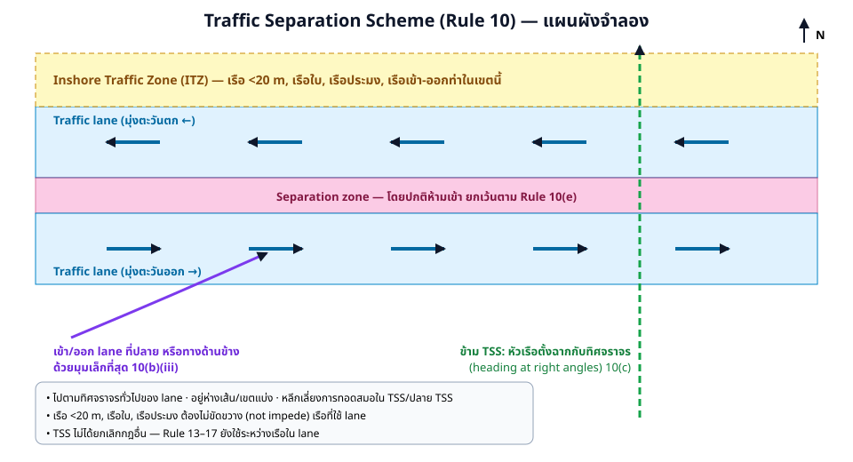
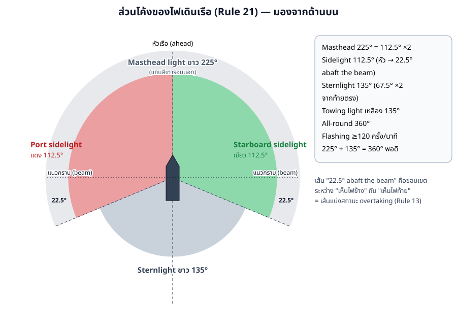
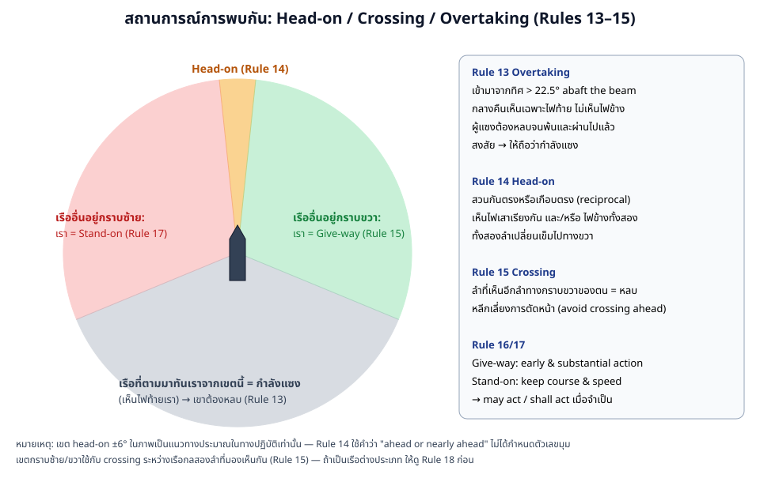
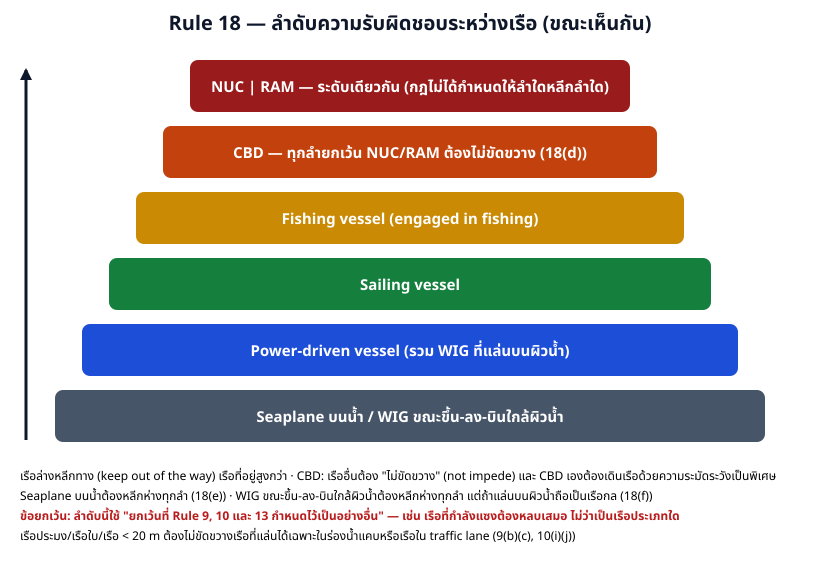
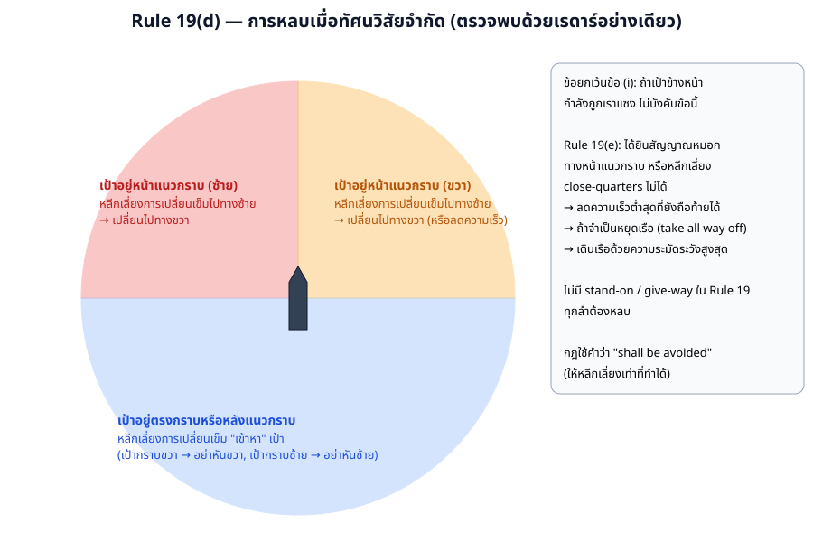
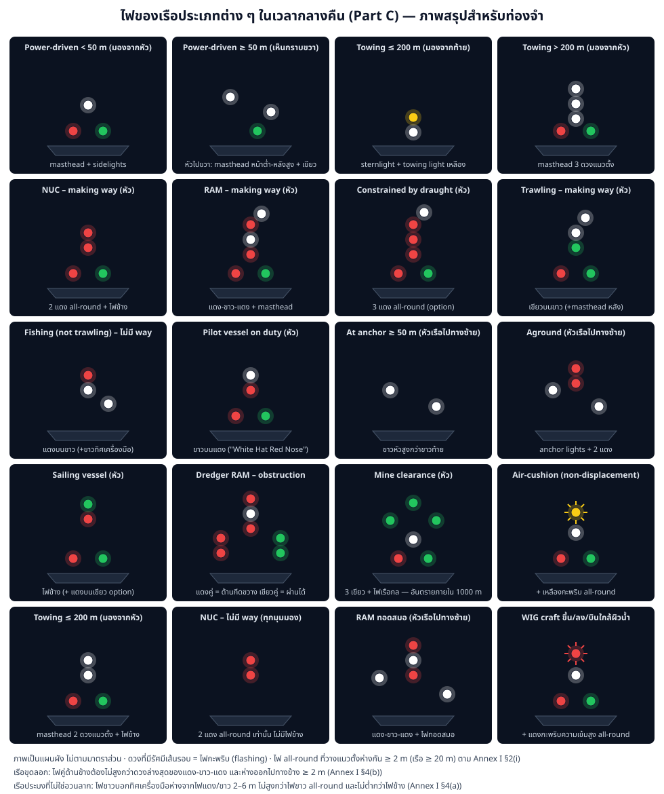
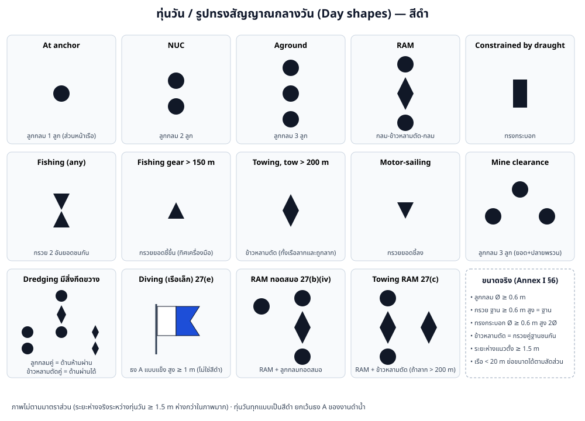
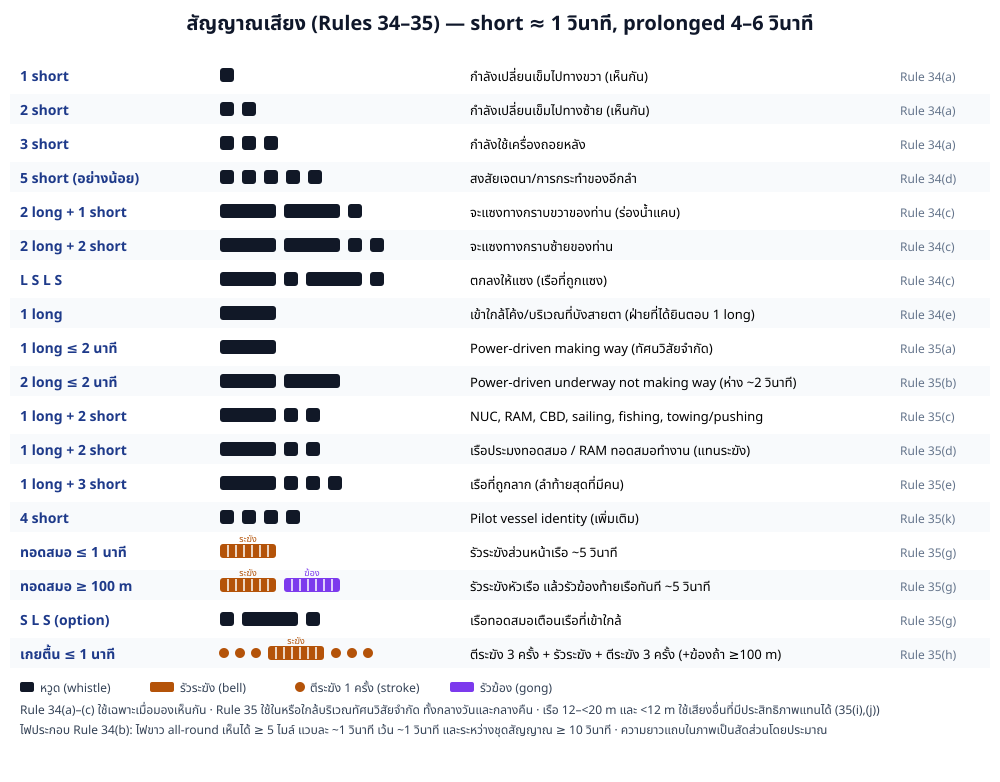
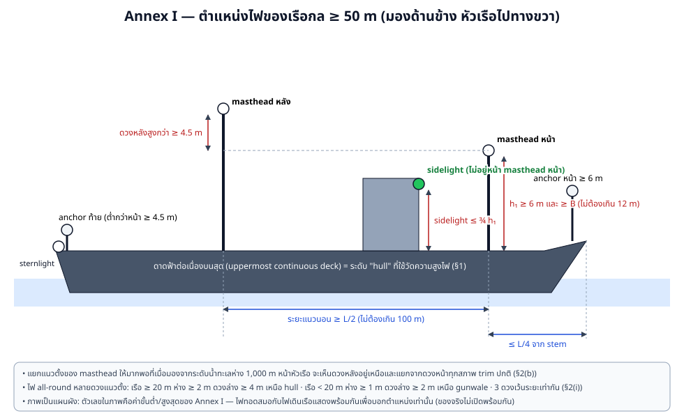
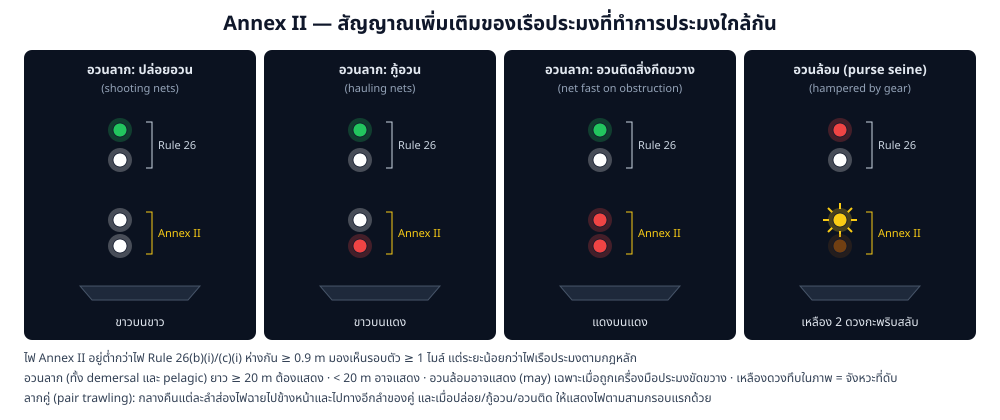

# 1.2.1 Watchkeeping (ภาค A) — COLREG 1972: กฎข้อบังคับระหว่างประเทศว่าด้วยการป้องกันเรือโดนกันในทะเล

> สมุดบันทึกการฝึก OOW · TIRAPHONG NANTAPAN
> สมรรถนะตาม STCW A-II/1 (Competence: *Maintain a safe navigational watch*): *Thorough knowledge of the content, application and intent of the International Regulations for Preventing Collisions at Sea, 1972, as amended*
> อ้างอิงหลัก: COLREG 1972 as amended (ฉบับรวมของ IMO), *A Guide to the Collision Avoidance Rules* (Cockcroft & Lameijer), BR 45 Vol. 1 (บท Rule of the Road), ICS *Bridge Procedures Guide*, IMO Res. A.1085(28) (การแก้ไข COLREG เพิ่ม Part F — Verification of compliance มีผล 1 ม.ค. 2016) และ A.1070(28) (III Code)

เกณฑ์ประเมินในตาราง A-II/1 (คอลัมน์ 4 ของสมรรถนะ *Use of radar and ARPA to maintain safety of navigation*) เขียนไว้ชัดว่า "**Action taken to avoid a close encounter or collision with other vessels is in accordance with the International Regulations for Preventing Collisions at Sea, 1972, as amended**" ส่วนสมรรถนะ *Maintain a safe navigational watch* เองมีเกณฑ์ว่าต้องเฝ้าระวังอย่างถูกต้องตลอดเวลา และไฟ ทุ่นวัน สัญญาณเสียงต้องเป็นไปตาม COLREG และ **จำแนกได้ถูกต้อง (correctly recognized)** — แปลว่าการสอบ OOW ไม่ได้ดูว่าท่องกฎได้ แต่ดูว่า **ปฏิบัติตามกฎได้ถูกต้องในสถานการณ์จริง** สมุดบทนี้จึงจดทั้งตัวกฎ เจตนาของกฎ (intent) และวิธีคิดในสถานการณ์จำลอง

---

## 0. ภาพรวม COLREG

### 0.1 ประวัติย่อ

| ปี | เหตุการณ์ |
|---|---|
| 1863, 1889, 1910, 1948, 1960 | กฎป้องกันเรือโดนกันฉบับก่อน ๆ (ฉบับ 1960 ผนวกกับ SOLAS 1960) |
| 20 ต.ค. 1972 | รับรอง **Convention on the International Regulations for Preventing Collisions at Sea, 1972** เป็นอนุสัญญาแยก |
| **15 ก.ค. 1977** | มีผลบังคับใช้ |
| 1981, 1987, 1989, 1993 | แก้ไขรายละเอียด เช่น narrow channels, TSS, ไฟและทุ่นวัน (ตามสรุปของ IMO: 1981 เพิ่ม Rule 10(k),(l) ยกเว้นเรือ RAM ที่ทำงานใน TSS; 1987 เพิ่ม Rule 8(f) เรื่อง "not impede" และระบุชัดว่า Rule 10 ใช้กับ TSS ที่ IMO รับรอง; 1989 ปรับ Rule 10(d) เรื่องผู้ที่ใช้ ITZ ได้; 1993 ส่วนใหญ่เป็นเรื่องตำแหน่งไฟใน Annex I — ตรวจกับฉบับรวมปัจจุบัน) |
| 2001 (มีผล 2003) | เพิ่มข้อกำหนดสำหรับ **WIG craft** (Wing-In-Ground) |
| 2007 (มีผล 2009) | ปรับ **Annex IV** สัญญาณอันตราย (ตัดสัญญาณเก่าที่ไม่ใช้ เพิ่มสัญญาณ GMDSS) |
| 2013 (มีผล 1 ม.ค. 2016) | เพิ่ม **Part F – Verification of compliance** (การตรวจสอบรัฐภาคีตาม III Code) |

### 0.2 โครงสร้าง (41 Rules + 4 Annexes)

| ส่วน | Rules | เนื้อหา |
|---|---|---|
| **Part A** General | 1–3 | การใช้บังคับ ความรับผิดชอบ นิยาม |
| **Part B** Steering and Sailing | 4–19 | Section I (4–10) ทุกสภาพทัศนวิสัย / Section II (11–18) เรือมองเห็นกัน / Section III (19) ทัศนวิสัยจำกัด |
| **Part C** Lights and Shapes | 20–31 | ไฟและทุ่นวัน |
| **Part D** Sound and Light Signals | 32–37 | สัญญาณเสียงและแสง |
| **Part E** Exemptions | 38 | ข้อยกเว้นช่วงเปลี่ยนผ่าน |
| **Part F** Verification of compliance | 39–41 | การตรวจสอบการปฏิบัติตามของรัฐภาคี |
| **Annex I** | | ตำแหน่งและรายละเอียดทางเทคนิคของไฟและทุ่นวัน |
| **Annex II** | | สัญญาณเพิ่มเติมของเรือประมงที่ทำการประมงใกล้กัน |
| **Annex III** | | รายละเอียดทางเทคนิคของอุปกรณ์สัญญาณเสียง |
| **Annex IV** | | สัญญาณแสดงอันตราย (Distress signals) |

> **เคล็ดลับการอ่าน COLREG** — คำว่า "**shall**" คือบังคับ, "**may**" คือให้ทางเลือก, "**if the circumstances of the case admit**" คือให้ทำถ้าสถานการณ์เอื้อ, "**not impede**" ต่างจาก "**keep out of the way**" (ดูข้อ Rule 8(f) และ Rule 18) อ่านคำเหล่านี้ให้ขาดจะตอบกรรมการได้แม่นขึ้นมาก

---

## Part A — General

### Rule 1 — Application (การใช้บังคับ)

**(a)** ใช้กับเรือทุกลำ **บนทะเลหลวง (high seas)** และ **ในน่านน้ำทั้งหมดที่เชื่อมต่อกับทะเลหลวงซึ่งเรือเดินทะเลสามารถเดินเรือได้** (all waters connected therewith navigable by seagoing vessels)

**(b)** ไม่ขัดขวางกฎพิเศษ (special rules) ที่หน่วยงานที่เหมาะสม (appropriate authority) ออกสำหรับท่าเรือ แม่น้ำ ทะเลสาบ หรือทางน้ำภายในที่ต่อกับทะเลหลวง แต่กฎพิเศษนั้นต้อง **สอดคล้องกับ COLREG มากที่สุดเท่าที่จะทำได้** — เช่น กฎการเดินเรือในแม่น้ำเจ้าพระยา กฎของคลองปานามา คลองสุเอซ แม่น้ำเซนต์ลอว์เรนซ์ หรือ US Inland Rules

**(c)** ไม่ขัดขวางกฎพิเศษของรัฐบาลเรื่อง **ไฟหรือสัญญาณเพิ่มเติม** สำหรับเรือรบ เรือที่แล่นเป็นขบวน (convoy) หรือเรือประมงที่ทำการประมงเป็นกองเรือ ซึ่งต้องไม่ทำให้สับสนกับไฟ/สัญญาณใน COLREG

**(d)** IMO อาจรับรอง **Traffic Separation Schemes** เพื่อวัตถุประสงค์ของกฎนี้

**(e)** เรือที่มีโครงสร้างหรือวัตถุประสงค์พิเศษ (เช่น เรือบรรทุกเครื่องบิน) ที่ไม่สามารถติดไฟตามกฎได้เต็มที่ ให้ปฏิบัติให้ใกล้เคียงที่สุดตามที่รัฐบาลของเรือกำหนด — ครอบคลุมทั้งจำนวน ตำแหน่ง ระยะและมุมส่องสว่างของไฟ/ทุ่นวัน และการจัดวางและลักษณะของอุปกรณ์สัญญาณเสียง (sound-signalling appliances) ด้วย

### Rule 2 — Responsibility (ความรับผิดชอบ)

**(a)** ไม่มีข้อใดในกฎนี้ยกเว้นเรือ เจ้าของเรือ นายเรือ หรือคนประจำเรือ จากผลของ **การละเลยไม่ปฏิบัติตามกฎ** หรือ **การละเลยข้อระมัดระวังใด ๆ ที่การปฏิบัติตามปกติของชาวเรือ (ordinary practice of seamen) หรือสถานการณ์พิเศษของกรณีนั้นกำหนด**

**(b)** ในการตีความและปฏิบัติตามกฎ ต้องคำนึงถึง **อันตรายในการเดินเรือและการโดนกันทั้งปวง** และ **สถานการณ์พิเศษ** รวมถึงข้อจำกัดของเรือที่เกี่ยวข้อง ซึ่งอาจทำให้จำเป็นต้อง **ปฏิบัติแตกต่างจากกฎ (departure from these Rules) เพื่อหลีกเลี่ยงอันตรายเฉพาะหน้า (immediate danger)**

**เจตนาของ Rule 2:**
- Rule 2(a) คือ "ทำตามกฎอย่างเดียวไม่พอ ต้องใช้ความเป็นชาวเรือที่ดี (good seamanship)" — เช่น ถึงจะเป็น stand-on vessel ก็ยังต้องเฝ้าระวังและเตรียมพร้อม
- Rule 2(b) อนุญาตให้ "ออกนอกกฎ" ได้ **เฉพาะเมื่อจำเป็นเพื่อหลีกเลี่ยงอันตรายเฉพาะหน้าเท่านั้น** ไม่ใช่ข้ออ้างให้ทำตามใจ ศาลในคดีเรือโดนกันจะตีความแคบมาก เช่น สถานการณ์ที่มีเรือหลายลำจนกฎขัดกันเอง หรือเรืออีกลำทำผิดกฎจนการทำตามกฎจะทำให้ชน

### Rule 3 — General definitions (นิยามทั่วไป)

| คำ | นิยาม (สรุปความ) |
|---|---|
| **(a) Vessel** | ยานพาหนะทางน้ำทุกชนิด รวมถึงยานที่ไม่มีระวางขับน้ำ (non-displacement craft) WIG craft และเครื่องบินทะเล (seaplanes) ที่ใช้หรือสามารถใช้เป็นพาหนะทางน้ำ |
| **(b) Power-driven vessel** | เรือที่ขับเคลื่อนด้วยเครื่องจักร |
| **(c) Sailing vessel** | เรือที่ใช้ใบ **โดยไม่ได้ใช้เครื่องจักรขับเคลื่อน (ถ้ามี)** — ถ้าใช้เครื่องร่วมด้วยถือเป็น power-driven |
| **(d) Vessel engaged in fishing** | เรือที่ทำการประมงด้วยอวน สาย อวนลาก หรือเครื่องมือประมงอื่นที่ **จำกัดความสามารถในการบังคับเรือ** — ไม่รวมเรือที่ใช้สายเบ็ดลากท้าย (trolling lines) หรือเครื่องมือที่ไม่จำกัดความสามารถในการบังคับเรือ |
| **(e) Seaplane** | อากาศยานที่ออกแบบให้บังคับบนผิวน้ำได้ |
| **(f) Vessel not under command (NUC)** | เรือที่ **ด้วยสถานการณ์พิเศษบางประการ (exceptional circumstance)** ไม่สามารถบังคับตามที่กฎกำหนด จึงไม่สามารถหลีกทางให้เรืออื่นได้ — เช่น เครื่องจักรขัดข้อง หางเสือเสีย |
| **(g) Vessel restricted in her ability to manoeuvre (RAM)** | เรือที่ **ด้วยลักษณะของงานที่ทำอยู่ (nature of her work)** ถูกจำกัดความสามารถในการบังคับเรือ จึงไม่สามารถหลีกทางได้ ได้แก่ (i) วาง ซ่อม เก็บทุ่นเดินเรือ สายเคเบิล ท่อใต้น้ำ (ii) ขุดลอก สำรวจ ทำงานใต้น้ำ (iii) ส่งเสบียง ถ่ายคน สินค้า ขณะเดินเรือ (replenishment at sea) (iv) ปล่อย-รับอากาศยาน (v) กวาดทุ่นระเบิด (vi) ลากจูงที่ทำให้เรือลากและสิ่งที่ถูกลากถูกจำกัดอย่างมากในการเปลี่ยนเส้นทาง |
| **(h) Vessel constrained by her draught (CBD)** | เรือกลที่เนื่องจากอัตรากินน้ำลึกเทียบกับความลึกและความกว้างของน้ำที่มี **ถูกจำกัดอย่างมากในการเบี่ยงจากเส้นทางที่แล่นอยู่** |
| **(i) Underway** | เรือที่ **ไม่ได้ทอดสมอ ไม่ได้ผูกติดกับฝั่ง และไม่ได้เกยตื้น** (สังเกต: เรือที่เครื่องดับลอยลำอยู่ก็ยัง underway) |
| **(j) Length and breadth** | ความยาวตลอดลำ (LOA) และความกว้างสูงสุด |
| **(k) In sight of one another** | เรือถือว่ามองเห็นกันเมื่อลำหนึ่งมองเห็นอีกลำด้วย **ตา (visually)** — เห็นแค่บนเรดาร์ไม่นับ |
| **(l) Restricted visibility** | สภาพที่ทัศนวิสัยถูกจำกัดด้วยหมอก หมอกบาง หิมะตก ฝนตกหนัก พายุทราย หรือสาเหตุอื่นที่คล้ายกัน |
| **(m) WIG craft** | ยานหลายรูปแบบที่ในโหมดปฏิบัติการหลักบินใกล้ผิวน้ำโดยอาศัย surface effect |

**จุดที่ชอบถาม:**
- "Underway" vs "**making way**" — making way คือเรือเคลื่อนที่ผ่านน้ำ (มีความเร็วผ่านน้ำ) เรือ underway อาจไม่ making way ก็ได้ (ลอยลำ) — ส่งผลต่อไฟของ NUC และสัญญาณเสียงในหมอก (Rule 35(a) vs 35(b))
- NUC ต่างจาก RAM ตรงสาเหตุ: NUC เกิดจาก "**สถานการณ์พิเศษ**" (เครื่องเสีย) RAM เกิดจาก "**ลักษณะงาน**" (ขุดลอก วางเคเบิล)
- เรือลากอวนเป็น "engaged in fishing" แต่เรือตกปลาด้วย trolling lines ไม่ใช่
- นิยาม CBD ใน Rule 3(h) ใช้คำว่า "power-driven vessel" — เรือใบจึงประกาศตัวเป็น CBD ไม่ได้ และสถานะ CBD เป็นของเรือเอง ไม่ใช่ของร่องน้ำ (เรือลำเดียวกันอาจเป็น CBD ในน้ำตื้นแคบ แต่ไม่ใช่เมื่อออกทะเลเปิด)
- "In sight of one another" ตาม Rule 3(k) ต้องเห็นด้วยตา ในหมอกบางอาจเกิดกรณีที่ลำหนึ่งเห็นอีกลำก่อน (เช่น เรือเล็กเห็นไฟเรือใหญ่ แต่เรือใหญ่ยังไม่เห็นเรือเล็ก) — ตำราอย่าง Cockcroft ถือว่าเป็นช่วงคลุมเครือ ทางปฏิบัติที่ปลอดภัยคืออย่าคิดว่าอีกลำจะทำตาม Section II จนกว่าจะแน่ใจว่าเขาเห็นเราแล้ว และเฝ้าดูการกระทำของเขาต่อไป

---

## Part B — Steering and Sailing Rules

## Section I — Conduct of vessels in any condition of visibility (Rules 4–10)

### Rule 4 — Application

Rules ใน Section I ใช้ใน **ทุกสภาพทัศนวิสัย** (ทั้งมองเห็นกันและไม่เห็นกัน)

### Rule 5 — Look-out (การเฝ้าระวัง)

> "Every vessel shall at all times maintain a proper look-out **by sight and hearing** as well as by **all available means appropriate** in the prevailing circumstances and conditions so as to make a **full appraisal of the situation and of the risk of collision**."

ประเด็นสำคัญ
- ต้องเฝ้าระวัง **ตลอดเวลา (at all times)** — รวมถึงขณะทอดสมอ ขณะมีนำร่อง ขณะใช้ autopilot
- **ด้วยตาและหู** — เสียงมีความสำคัญมากในทัศนวิสัยจำกัด (ประตูสะพานเดินเรือควรเปิดหรือใช้ระบบรับเสียงภายนอก)
- **ทุกวิธีที่เหมาะสม** — เรดาร์ (ใช้ scanning ระยะไกลด้วย) ARPA, AIS, VHF, ECDIS, กล้องส่องทางไกล
- เป้าหมายคือ **ประเมินสถานการณ์และความเสี่ยงเรือโดนกันได้เต็มที่**
- รายงานสอบสวนอุบัติเหตุจำนวนมากพบว่า **การเฝ้าระวังไม่เพียงพอ** เป็นสาเหตุหลัก
- STCW A-VIII/2 Part 4-1 วรรค 14–17 ขยายความเรื่องผู้ดูต้นหน (look-out) ว่าต้องทุ่มเทความสนใจ ไม่มอบงานอื่นที่ขัดขวาง และเงื่อนไขที่ OOW อาจเป็นผู้ดูต้นหนคนเดียวในเวลากลางวัน (sole look-out) — รายละเอียดอยู่ในบท 1.2.1-B

### Rule 6 — Safe speed (ความเร็วที่ปลอดภัย)

> "Every vessel shall at all times proceed at a safe speed so that she can take **proper and effective action to avoid collision** and be **stopped within a distance appropriate** to the prevailing circumstances and conditions."

กฎไม่กำหนดตัวเลข แต่ให้ปัจจัยที่ต้องพิจารณา

**(a) สำหรับเรือทุกลำ**
1. ทัศนวิสัย (state of visibility)
2. ความหนาแน่นของการจราจร รวมถึงกลุ่มเรือประมงหรือเรืออื่น
3. ความสามารถในการบังคับเรือ โดยเฉพาะ **ระยะหยุด (stopping distance)** และ **ความสามารถในการเลี้ยว (turning ability)** ในสภาพนั้น
4. เวลากลางคืน — แสงพื้นหลัง (background light) จากไฟบนฝั่งหรือแสงสะท้อนจากไฟของเรือเอง
5. สภาพลม ทะเล กระแสน้ำ และความใกล้ชิดของอันตรายทางการเดินเรือ
6. อัตรากินน้ำลึกเทียบกับความลึกน้ำที่มี

**(b) เพิ่มเติมสำหรับเรือที่ใช้เรดาร์**
1. คุณลักษณะ ประสิทธิภาพ และข้อจำกัดของเรดาร์
2. ข้อจำกัดจากระยะ (range scale) ที่ใช้อยู่
3. ผลของสภาพทะเล อากาศ และการรบกวนอื่นต่อการตรวจจับ
4. เรือเล็ก น้ำแข็ง และวัตถุลอยน้ำอื่นอาจตรวจไม่พบด้วยเรดาร์ในระยะที่เพียงพอ
5. จำนวน ตำแหน่ง และการเคลื่อนที่ของเรือที่ตรวจพบด้วยเรดาร์
6. การประเมินทัศนวิสัยได้แม่นยำขึ้นเมื่อใช้เรดาร์วัดระยะเรือหรือวัตถุใกล้เคียง

> **ความเห็นส่วนตัวจากการฝึก** — ตอนสัมภาษณ์มักถูกถามว่า "ในหมอก ความเร็วปลอดภัยคือเท่าไร" คำตอบที่ดีไม่ใช่ตัวเลข แต่คือ "ความเร็วที่ทำให้หยุดเรือได้ภายในครึ่งหนึ่งของระยะทัศนวิสัย" (หลัก **half-distance rule** จากแนวคำพิพากษาของศาลสหรัฐฯ เช่น *The Nacoochee* (1890) และ *Union Oil Co. v. The San Jacinto* (1972) — ทั้งสองลำต่างหยุดได้ในครึ่งระยะ จะไม่ชนกัน) แล้วอธิบายปัจจัยใน Rule 6 ประกอบ
>
> จดเพิ่ม: half-distance rule **ไม่ได้อยู่ในตัวบท COLREG** เป็นเพียงหลักจากคดี ศาลสหรัฐฯ เองก็เคยไม่นำมาใช้ในกรณีที่ไม่มีเหตุให้คาดว่าจะมีเรือแล่นตัดเส้นทาง สำหรับเรือใหญ่ที่ระยะหยุดหลายเคเบิลถึงหลายไมล์ ในหมอกหนาแทบทำตามไม่ได้ จึงต้องใช้ปัจจัยใน Rule 6(b) (เรดาร์ การ plot) ประกอบเสมอ และเตรียมเครื่องให้พร้อมตาม Rule 19(b)

### Rule 7 — Risk of collision (ความเสี่ยงเรือโดนกัน)

**(a)** ทุกลำต้องใช้ **ทุกวิธีที่มี** ในการตัดสินว่ามีความเสี่ยงหรือไม่ **ถ้าสงสัย ให้ถือว่ามีความเสี่ยง (if there is any doubt such risk shall be deemed to exist)**

**(b)** ถ้ามีเรดาร์และใช้งานได้ ต้องใช้อย่างเหมาะสม รวมถึง **การ scan ระยะไกล (long-range scanning)** เพื่อให้รู้ล่วงหน้า และ **การ plot เรดาร์ (radar plotting) หรือการสังเกตอย่างเป็นระบบที่เทียบเท่า**

**(c)** ห้ามตั้งสมมติฐานจาก **ข้อมูลไม่เพียงพอ (scanty information)** โดยเฉพาะข้อมูลเรดาร์ไม่เพียงพอ — เช่น ดูเรดาร์แวบเดียวแล้วสรุป หรือดู AIS แต่ไม่ plot

**(d)** ในการพิจารณาความเสี่ยง ต้องคำนึงว่า
1. **ความเสี่ยงมีอยู่ถ้าแบริ่งเข็มทิศ (compass bearing) ของเรือที่เข้ามาไม่เปลี่ยนแปลงอย่างเห็นได้ชัด** (constant bearing, decreasing range — CBDR)
2. ความเสี่ยง **บางครั้งอาจมีอยู่แม้แบริ่งเปลี่ยนอย่างเห็นได้ชัด** โดยเฉพาะเมื่อเข้าใกล้เรือขนาดใหญ่มาก เรือลากจูง หรือเรือในระยะใกล้

> ทำไมต้องเป็น **compass bearing** ไม่ใช่ relative bearing — เพราะ relative bearing เปลี่ยนเมื่อเรือเราส่าย (yaw) หรือเปลี่ยนเข็ม ทำให้หลงคิดว่าแบริ่งเปลี่ยน ใช้ gyro repeater หรือ azimuth circle และ EBL แบบ true

> **จดไว้กันลืม (Rule 7 ในทางปฏิบัติ)** — การจับแบริ่งต้องทำ **เป็นชุด** ไม่ใช่ครั้งเดียว ผมจดเวลา-แบริ่ง-ระยะทุก 3 นาทีหรือถี่กว่าเมื่อเข้าใกล้ ใช้ ARPA ดู CPA/TCPA ประกอบ แต่ต้องจำว่าค่า ARPA ต้องใช้เวลาประมวลผลหลังเป้าหรือเราเปลี่ยนเข็ม/ความเร็ว (ตามมาตรฐานสมรรถนะเรดาร์ของ IMO ประมาณ 1 นาทีสำหรับแนวโน้ม และ 3 นาทีสำหรับเวกเตอร์ที่แม่นยำ) และข้อมูล AIS อาจผิดหรือไม่ครบ จึงห้ามใช้ AIS อย่างเดียวตัดสินความเสี่ยง (Rule 7(c) scanty information)

### Rule 8 — Action to avoid collision (การกระทำเพื่อหลีกเลี่ยงการโดนกัน)

**(a)** การกระทำต้องเป็นไปตามกฎใน Part B และถ้าสถานการณ์เอื้อ ต้อง **positive** (ชัดเจนเด็ดขาด), ทำใน **ample time** (เวลาเพียงพอ) และ **ด้วยความเป็นชาวเรือที่ดี (due regard to the observance of good seamanship)**

**(b)** การเปลี่ยนเข็มและ/หรือความเร็ว ต้อง **มากพอที่เรืออื่นจะสังเกตได้ทันที** ทั้งด้วยตาและเรดาร์ — **หลีกเลี่ยงการเปลี่ยนทีละน้อยหลายครั้ง (a succession of small alterations)**

**(c)** ถ้ามีที่ว่างพอ (sufficient sea room) **การเปลี่ยนเข็มอย่างเดียวอาจเป็นการกระทำที่มีประสิทธิภาพที่สุด** เพื่อหลีกเลี่ยงสถานการณ์ใกล้ชิด (to avoid a close-quarters situation) ถ้าทำแต่เนิ่น ๆ เป็นการเปลี่ยนที่มากพอ และไม่ทำให้เกิดสถานการณ์ใกล้ชิดใหม่ (close-quarters situation) กับเรืออื่น

**(d)** การกระทำต้องทำให้ **ผ่านกันในระยะปลอดภัย (pass at a safe distance)** และต้องตรวจสอบประสิทธิผลจนกว่าเรืออีกลำจะผ่านพ้นไปแล้ว (finally past and clear)

**(e)** ถ้าจำเป็นเพื่อหลีกเลี่ยงการโดนกันหรือให้มีเวลาประเมินสถานการณ์มากขึ้น เรือต้อง **ลดความเร็ว หรือหยุดเรือ (โดยหยุดเครื่องหรือใช้เครื่องถอยหลัง)**

**(f) — หน้าที่ "ไม่ขัดขวาง" (not to impede)**
1. เรือที่กฎกำหนดว่า **ต้องไม่ขัดขวาง** การผ่านของเรืออื่น ต้อง **ทำแต่เนิ่น ๆ** เพื่อให้มีที่ว่างพอสำหรับการผ่านอย่างปลอดภัยของเรืออีกลำ
2. หน้าที่ไม่ขัดขวาง **ยังคงอยู่แม้เข้าใกล้กันจนเกิดความเสี่ยงเรือโดนกันแล้ว** และเมื่อทำการใด ๆ ต้องคำนึงถึงการกระทำที่กฎใน Part B กำหนดด้วย
3. เรือที่ได้รับสิทธิ์ "ไม่ถูกขัดขวาง" **ยังมีหน้าที่ปฏิบัติตามกฎ Part B เต็มที่** เมื่อเข้าใกล้กันจนมีความเสี่ยง

> "Not impede" (เช่นเรือเล็กในร่องน้ำแคบ, เรือ < 20 m/เรือใบ/เรือประมง ต่อเรือที่แล่นตาม lane ใน TSS ตาม Rule 10(i),(j), เรือทั่วไปต่อ CBD) หมายถึงต้องทำแต่เนิ่นเพื่อ **ไม่ให้เกิดสถานการณ์เสี่ยงขึ้นตั้งแต่แรก** แต่ถ้าเกิดความเสี่ยงขึ้นแล้ว กฎ Part B (เช่น crossing, overtaking) ก็ใช้กับทั้งสองลำ

### Rule 9 — Narrow channels (ร่องน้ำแคบ)

| ข้อ | สาระ |
|---|---|
| (a) | เรือที่แล่นตามร่องน้ำแคบหรือทางเรือ (fairway) ต้อง **อยู่ใกล้ขอบด้านนอกของร่องน้ำทางกราบขวาของตน** เท่าที่ปลอดภัยและปฏิบัติได้ |
| (b) | เรือ **ยาวน้อยกว่า 20 m** หรือ **เรือใบ** ต้องไม่ขัดขวางเรือที่แล่นได้อย่างปลอดภัยเฉพาะในร่องน้ำนั้น |
| (c) | เรือที่ **ทำการประมง** ต้องไม่ขัดขวางเรืออื่นที่แล่นในร่องน้ำ |
| (d) | เรือต้อง **ไม่ข้ามร่องน้ำ** ถ้าการข้ามนั้นขัดขวางเรือที่แล่นได้เฉพาะในร่องน้ำ — เรือในร่องน้ำอาจใช้สัญญาณ Rule 34(d) (5 สั้น) ถ้าสงสัยเจตนาของเรือที่ข้าม |
| (e) | **การแซงในร่องน้ำแคบ** ที่ต้องให้เรือถูกแซงช่วยหลบ: ผู้แซงให้สัญญาณ **2 ยาว 1 สั้น** (แซงกราบขวา) หรือ **2 ยาว 2 สั้น** (แซงกราบซ้าย) เรือถูกแซงตอบตกลงด้วย **ยาว-สั้น-ยาว-สั้น** และหลบให้ ถ้าสงสัยให้ 5 สั้น — ไม่ได้ยกเว้นหน้าที่ของผู้แซงตาม Rule 13 |
| (f) | เมื่อเข้าใกล้ **โค้งหรือบริเวณที่มีสิ่งกีดขวางบังสายตา** ต้องระวังเป็นพิเศษ และให้สัญญาณ **1 ยาว** (Rule 34(e)) เรือที่ได้ยินอีกด้านตอบด้วย 1 ยาว |
| (g) | ถ้าสถานการณ์เอื้อ **หลีกเลี่ยงการทอดสมอในร่องน้ำแคบ** |

> **จดไว้กันลืม (Rule 9)**
> - COLREG ไม่ได้ให้นิยามตัวเลขของ "narrow channel" — ขึ้นกับความกว้าง ความลึก ขนาดเรือ และปริมาณจราจร ถ้าสงสัยให้ปฏิบัติแบบร่องน้ำแคบไว้ก่อน และตรวจกฎท้องถิ่น (Rule 1(b)) เพราะร่องน้ำหลายแห่งมีกฎพิเศษ
> - Rule 9 อยู่ใน Section I จึงใช้ในทุกสภาพทัศนวิสัย แต่สัญญาณแซงตาม Rule 9(e) / Rule 34(c) ใช้เฉพาะเมื่อ **มองเห็นกัน** ในหมอกใช้ VHF ประสานและ Rule 19 แทน
> - 2 ยาว 1 สั้น = "ผมจะแซงทาง **กราบขวา** ของคุณ", 2 ยาว 2 สั้น = "ผมจะแซงทาง **กราบซ้าย** ของคุณ" — กราบที่พูดถึงคือกราบของ **เรือที่ถูกแซง**
> - การตกลงกันทาง VHF ไม่ได้แทนสัญญาณเสียงตามกฎ และไม่ได้ยกเว้นหน้าที่ตาม Rule 13 ของผู้แซง

### Rule 10 — Traffic Separation Schemes (เขตแบ่งแนวจราจร)

*ภาพที่ 1.2.1-A1 แผนผังจำลองของ TSS — lanes, separation zone, ITZ และการข้าม*

| ข้อ | สาระ |
|---|---|
| (a) | ใช้กับ TSS ที่ IMO รับรอง และ **ไม่ยกเว้นหน้าที่ตามกฎอื่น** |
| (b) | เรือที่ใช้ TSS ต้อง (i) แล่นใน lane ที่ถูกต้อง **ตามทิศทางการจราจรทั่วไป** (ii) อยู่ห่างจากเส้น/เขตแบ่งแนวเท่าที่ทำได้ (iii) **โดยปกติ (normally) เข้าหรือออกจาก lane ที่ปลาย lane** ถ้าเข้า/ออกด้านข้าง ให้ทำ **ด้วยมุมเล็กที่สุดกับทิศจราจร** |
| (c) | **หลีกเลี่ยงการข้าม lane** เท่าที่ทำได้ ถ้าจำเป็นต้องข้าม ต้องข้ามโดย **หัวเรือ (heading) ทำมุมฉากกับทิศทางการจราจรให้มากที่สุดเท่าที่ทำได้** (สังเกต: ใช้ heading ไม่ใช่ course over ground — เพื่อให้เรือใน lane เห็นชัดว่ากำลังข้าม และใช้เวลาใน lane น้อยที่สุด) |
| (d) | (i) เรือต้องไม่ใช้ **inshore traffic zone (ITZ)** ถ้าใช้ lane ที่อยู่ติดกันได้อย่างปลอดภัย แต่เรือ **< 20 m, เรือใบ, เรือประมง** ใช้ ITZ ได้ (ii) เรือใดก็ใช้ ITZ ได้เมื่อจะไป-มาจากท่าเรือ สิ่งก่อสร้างนอกชายฝั่ง สถานีนำร่อง หรือจุดหมายอื่นภายใน ITZ หรือเพื่อหลีกเลี่ยงอันตรายเฉพาะหน้า |
| (e) | เรือที่ไม่ได้ข้ามหรือเข้า/ออก lane **โดยปกติ (normally)** ต้อง **ไม่เข้าไปในเขตแบ่งแนว (separation zone) หรือข้ามเส้นแบ่งแนว** ยกเว้น (i) กรณีฉุกเฉินเพื่อหลีกเลี่ยงอันตรายเฉพาะหน้า (ii) เพื่อทำการประมงภายในเขตแบ่งแนว |
| (f) | เรือที่แล่นบริเวณ **ปลาย TSS** ต้องระวังเป็นพิเศษ |
| (g) | **หลีกเลี่ยงการทอดสมอ** ใน TSS หรือบริเวณใกล้ปลาย TSS |
| (h) | เรือที่ไม่ใช้ TSS ต้อง **อยู่ห่างจาก TSS** ให้มากที่สุดเท่าที่ทำได้ |
| (i) | เรือประมงต้องไม่ขัดขวางเรือที่แล่นตาม lane |
| (j) | เรือ < 20 m หรือเรือใบ ต้องไม่ขัดขวางการผ่านอย่างปลอดภัยของเรือกลที่แล่นตาม lane |
| (k) | เรือ **RAM ที่กำลังทำงานเพื่อความปลอดภัยของการเดินเรือใน TSS** (เช่นซ่อมทุ่น) ได้รับยกเว้น Rule 10 เท่าที่จำเป็น |
| (l) | เรือ RAM ที่กำลัง **วาง ซ่อม หรือเก็บเคเบิลใต้น้ำ** ใน TSS ได้รับยกเว้นเท่าที่จำเป็น |

> **จดไว้กันลืม** — TSS ไม่ได้ทำให้เรือใน lane มี "สิทธิ์" เหนือเรืออื่นเสมอไป ถ้าเรือใน lane สองลำเกิด crossing หรือ overtaking กัน Rule 13–17 ใช้ตามปกติ ส่วนเรือที่ข้าม TSS ไม่ได้เป็น give-way โดยอัตโนมัติ (เว้นแต่เป็นเรือ < 20 m/เรือใบ/เรือประมงที่มีหน้าที่ not impede) — ใช้ Rule 15 ตามตำแหน่งของเรือ

> **เพิ่มเติมเรื่อง TSS ที่ชอบถาม**
> - ทิศจราจรใน TSS แบบสอง lane เป็นแบบ "ชิดขวา" — เรือที่แล่นใน lane จะมีเขตแบ่งแนว (separation zone) อยู่ทาง **กราบซ้าย** ของตน ตรวจทิศลูกศรบนแผนที่ทุกครั้ง อย่าเดา
> - Rule 10 ใช้กับ TSS ที่ **IMO รับรอง** เท่านั้น ระบบแบ่งแนวที่รัฐชายฝั่งกำหนดเองหรือในเขตท่าเรืออาจมีกฎท้องถิ่นของตน (Rule 1(b)) — ดูใน Sailing Directions / ALRS และหมายเหตุบนแผนที่ ส่วนการกำหนด routeing ของ IMO อยู่ใต้ SOLAS V/10 และ *General Provisions on Ships' Routeing* (Res. A.572(14) as amended) และรายชื่อ TSS อยู่ในเล่ม *Ships' Routeing* ของ IMO
> - TSS หลายแห่งมีระบบรายงานเรือ (ship reporting system, SOLAS V/11) หรือ VTS ควบคู่ เช่น ช่องแคบโดเวอร์ (CALDOVREP) และช่องแคบมะละกา-สิงคโปร์ (STRAITREP) — ต้องรายงานตามที่กำหนดด้วย
> - Rule 10(c) พูดถึง **heading** ที่ตั้งฉาก ถ้ามีกระแสน้ำพัดข้าง COG จะเฉียงไปบ้างก็ไม่ผิด เพราะจุดประสงค์คือให้เรือใน lane เห็น aspect ของเราว่ากำลังข้ามชัดเจน

---

## Section II — Conduct of vessels in sight of one another (Rules 11–18)

### Rule 11 — Application

Rules ใน Section II ใช้กับเรือที่ **มองเห็นกันด้วยตา** (in sight of one another ตาม Rule 3(k))

### Rule 12 — Sailing vessels (เรือใบพบกัน)

เมื่อเรือใบสองลำเข้าใกล้กันจนมีความเสี่ยง ลำหนึ่งต้องหลีกทางดังนี้
1. ถ้า **รับลมคนละด้าน** — ลำที่รับลม **ทางกราบซ้าย (port tack)** ต้องหลีกทางให้ลำที่รับลมทางกราบขวา
2. ถ้า **รับลมด้านเดียวกัน** — ลำที่อยู่ **ด้านเหนือลม (windward)** ต้องหลีกทางให้ลำที่อยู่ใต้ลม (leeward)
3. ถ้าลำที่รับลมทางกราบซ้ายเห็นอีกลำอยู่ด้านเหนือลมแต่ **ไม่แน่ใจ** ว่าอีกลำรับลมกราบไหน ต้องหลีกทาง

**นิยาม windward side** = ด้านตรงข้ามกับด้านที่ใบหลัก (mainsail) กางอยู่ (สำหรับเรือ square-rigged คือด้านตรงข้ามกับด้านที่ใบแบบขึงตามแนวหัว-ท้ายเรือ (fore-and-aft sail) ผืนที่ใหญ่ที่สุดกางอยู่)

> ข้อสังเกต: Rule 12 ใช้เฉพาะ **เรือใบกับเรือใบ** และอยู่ใน Section II (มองเห็นกัน) ถ้าเรือใบลำหนึ่งกำลังแซงอีกลำ ใช้ Rule 13 ไม่ใช่ Rule 12 (Rule 13(a) เขียนให้มีผลเหนือ Rules ใน Section I และ II) และถ้าเรือใบลำใดใช้เครื่องร่วมด้วยก็ไม่ใช่ "sailing vessel" แล้ว

### Rule 13 — Overtaking (การแซง)

**(a)** ไม่ว่ากฎใน Part B Section I และ II จะกำหนดอย่างไร **เรือที่แซงต้องหลีกทางให้เรือที่ถูกแซง** — ใช้กับทุกประเภท แม้เรือ NUC หรือเรือประมงที่แซงเรือกล ก็ต้องหลบ

**(b)** เรือถือว่ากำลังแซงเมื่อเข้ามาหาอีกลำ **จากทิศที่เกิน 22.5° หลังแนวกราบ (more than 22.5° abaft her beam)** — กลางคืนจะเห็นเฉพาะไฟท้ายของเรือที่ถูกแซง ไม่เห็นไฟข้างทั้งสอง

**(c)** ถ้า **สงสัย** ว่ากำลังแซงหรือไม่ ให้ **ถือว่ากำลังแซง** และปฏิบัติตาม

**(d)** การเปลี่ยนแบริ่งระหว่างกันในภายหลัง **ไม่ทำให้เรือที่แซงกลายเป็นเรือ crossing** และไม่ยกเว้นหน้าที่หลีกทาง **จนกว่าจะผ่านพ้นไปแล้ว (finally past and clear)**

> **จุดที่ชอบถาม (Rule 13)**
> - Overtaking ตัดสินจาก **ตำแหน่งที่เราอยู่เทียบกับแนวกราบของเรือที่ถูกแซง** (เกิน 22.5° หลังแนวกราบของเขา) และต้องเป็นการ "เข้าหา" (coming up with) คือเราเร็วกว่าและระยะลดลง
> - Rule 13 อยู่ใน Section II จึงใช้เมื่อ **มองเห็นกัน** — ในหมอกที่เห็นแค่บนเรดาร์ ไม่มีผู้แซง/ผู้ถูกแซงตามความหมายนี้ ใช้ Rule 19 ซึ่งทุกลำต้องหลบเอง (มีข้อยกเว้นใน Rule 19(d)(i) สำหรับเรือที่ "กำลังถูกเราแซง" เท่านั้น)
> - เมื่อแซงแล้วต้องระวังไม่ตัดหน้าเรือที่ถูกแซงในระยะใกล้ และในร่องน้ำแคบให้ใช้ Rule 9(e) ประกอบ
> - ช่วงกลางคืนถ้าเห็นไฟท้ายแล้วบางทีเห็นไฟข้างวับ ๆ (ใกล้เส้น 22.5° พอดี) ให้ถือว่าเป็นผู้แซง ตาม Rule 13(c)

*ภาพที่ 1.2.1-A2 ขอบเขตของไฟ — เส้น 22.5° หลังแนวกราบคือเส้นแบ่งระหว่าง "เห็นไฟข้าง" กับ "เห็นไฟท้าย" และเป็นเกณฑ์ของ overtaking*

### Rule 14 — Head-on situation (สวนกันตรง)

**(a)** เมื่อเรือกลสองลำ **สวนกันตรงหรือเกือบตรง (reciprocal or nearly reciprocal courses)** จนมีความเสี่ยง **ทั้งสองลำต้องเปลี่ยนเข็มไปทางขวา (alter her course to starboard)** เพื่อผ่านกันทางกราบซ้าย

**(b)** สถานการณ์นี้ถือว่ามีอยู่เมื่อเรือลำหนึ่งเห็นอีกลำ **ตรงหน้าหรือเกือบตรงหน้า** — กลางคืนเห็น **ไฟเสา (masthead lights) เรียงกันหรือเกือบเรียงกัน และ/หรือ ไฟข้างทั้งสองดวง** — กลางวันเห็นลักษณะที่สอดคล้องกัน

**(c)** ถ้า **สงสัย** ว่าเป็น head-on หรือไม่ ให้ **ถือว่าเป็น** และปฏิบัติตาม

> Rule 14 ใช้กับ **เรือกล (power-driven) สองลำ** เท่านั้น — ถ้าเป็นเรือกลกับเรือใบสวนกัน ใช้ Rule 18 (เรือกลหลบเรือใบ)

> จดเพิ่ม: Annex I ข้อ 9(a)(i) กำหนดให้แสงของไฟข้างทางด้านหัวเรือลดลงจน **ตัดภายใน 1°–3° เลยเส้นหัวเรือ** ดังนั้นถ้าเห็นไฟข้างทั้งเขียวและแดงพร้อมกัน แปลว่าหัวเรือเขาชี้มาหาเราแทบตรง (ภายในไม่กี่องศา) ใน head-on ทั้งสองลำต้องหันขวา **ไม่มีลำใดเป็น stand-on** และเรือกลที่เปลี่ยนเข็มขณะมองเห็นกัน **ต้อง** ให้สัญญาณ 1 สั้น (Rule 34(a) ใช้คำว่า shall) ถ้าเห็นเรืออยู่ทางหัวเรือขวาเล็กน้อยและเข็มขนานกัน (ผ่านกราบขวาต่อกราบขวาได้อย่างปลอดภัยโดยไม่ต้องทำอะไร ไม่มีความเสี่ยงเรือโดนกัน) ไม่ใช่ head-on แต่ต้องระวังอย่าหันซ้ายเข้าหาเขา

### Rule 15 — Crossing situation (ตัดกัน)

> "When two power-driven vessels are crossing so as to involve risk of collision, **the vessel which has the other on her own starboard side shall keep out of the way** and shall, if the circumstances of the case admit, **avoid crossing ahead of the other vessel**."

- ลำที่เห็นอีกลำอยู่ทาง **กราบขวา** = **give-way vessel**
- ควรหลบโดย **เปลี่ยนเข็มไปทางขวา (ผ่านท้ายเรืออีกลำ)** หรือ **ลดความเร็ว/หยุด** — การเปลี่ยนไปทางซ้ายเพื่อตัดหน้าถือว่าขัดเจตนาของกฎ
- ใช้กับเรือกลสองลำ (สำหรับประเภทอื่นใช้ Rule 18)

*ภาพที่ 1.2.1-A3 เขตของสถานการณ์ต่าง ๆ เมื่อมองจากเรือเรา*

### Rule 16 — Action by give-way vessel

> "Every vessel which is directed to keep out of the way of another vessel shall, so far as possible, take **early and substantial action** to keep well clear."

- **Early** — ทำเร็ว ไม่รอให้ใกล้
- **Substantial** — มากพอที่เรืออีกลำจะเห็นชัด (มักเป็นการเปลี่ยนเข็มอย่างน้อย 30°–60° หรือมากกว่า ขึ้นกับสถานการณ์)
- **Keep well clear** — ผ่านในระยะปลอดภัย

### Rule 17 — Action by stand-on vessel

**(a)(i)** เมื่อลำหนึ่งต้องหลีกทาง อีกลำต้อง **คงเข็มและความเร็ว (keep her course and speed)**

**(a)(ii)** อย่างไรก็ดี stand-on vessel **อาจ (may)** ดำเนินการหลีกเลี่ยงการโดนกันด้วยการบังคับเรือของตนเอง **ทันทีที่เห็นชัดว่า** give-way vessel **ไม่ได้ทำการที่เหมาะสม** ตามกฎ

**(b)** เมื่อด้วยเหตุใดก็ตาม stand-on vessel พบว่าเข้าใกล้จนการโดนกัน **ไม่สามารถหลีกเลี่ยงได้ด้วยการกระทำของ give-way vessel เพียงลำเดียว** stand-on vessel **ต้อง (shall)** ทำการที่ช่วยหลีกเลี่ยงการโดนกันได้ดีที่สุด

**(c)** เรือกลที่ทำตาม (a)(ii) ในสถานการณ์ crossing เพื่อหลีกเลี่ยงการโดนกับเรือกลอีกลำ **ต้องไม่ (shall ... not) เปลี่ยนเข็มไปทางซ้ายสำหรับเรือที่อยู่ทางกราบซ้ายของตน** ถ้าสถานการณ์เอื้อ — เพราะ give-way vessel ที่อยู่ทางซ้ายของเรามักจะหลบไปทางขวา ถ้าเราหันซ้ายด้วยจะเข้าหากัน

**(d)** กฎนี้ **ไม่ยกเว้น** หน้าที่หลีกทางของ give-way vessel

**สามระยะของ stand-on vessel (ช่วยจำ)**

| ระยะ | สถานการณ์ | หน้าที่ |
|---|---|---|
| 1 | ระยะไกล ความเสี่ยงเพิ่งเกิด | **ต้องคง** เข็มและความเร็ว (shall keep) |
| 2 | give-way vessel ยังไม่ทำการที่เหมาะสม | **อาจ** ทำการเอง (may take action) — เมื่อสงสัยว่าอีกลำทำการไม่พอ **ต้อง** ให้สัญญาณอย่างน้อย 5 สั้นถี่ทันที (Rule 34(d) ใช้คำว่า shall) และอาจเสริมด้วยไฟกะพริบ 5 ครั้งสั้นถี่ ถ้าเปลี่ยนเข็มต้องให้สัญญาณ Rule 34(a) ด้วย |
| 3 | การโดนกันไม่สามารถหลีกเลี่ยงได้ด้วย give-way ลำเดียว | **ต้อง** ทำการที่ดีที่สุด (shall take such action as will best aid to avoid collision) |

**ตัวอย่างจำลอง — crossing ที่เราเป็น give-way (Rules 7, 8, 15, 16)**

MV Andaman Pearl เข็ม 000° ความเร็ว 15 นอต กลางวัน ทัศนวิสัยดี เห็นเรือสินค้าลำหนึ่งที่แบริ่ง 045° ระยะ 8 ไมล์ เข็ม 270° ความเร็ว 15 นอต จับแบริ่งเข็มทิศเป็นชุดแล้วไม่เปลี่ยน (CBDR)

1. ความเร็วสัมพัทธ์ = 15 × √2 ≈ 21.2 นอต ทิศ 225° (พุ่งตรงมาที่เรา) → **CPA 0 ไมล์, TCPA ≈ 22.6 นาที** → มีความเสี่ยงชัดเจน (Rule 7(d)(i))
2. เรือเขาอยู่ทางกราบขวาของเรา → เราเป็น **give-way** (Rule 15) เขาเป็น stand-on
3. ถ้าเราหันขวาไป 060° ตอนระยะเหลือ 6 ไมล์ (อีกประมาณ 5.7 นาที) โดยคิดแบบหันทันที ไม่นับเวลาเลี้ยว จะได้ **CPA ≈ 3.0 ไมล์** ผ่านท้ายเรือเขา TCPA ≈ 10.8 นาทีหลังหัน
4. เทียบทางเลือกอื่นที่ระยะ 6 ไมล์: หัน 30° ได้ CPA ≈ 1.6 ไมล์ หัน 45° ได้ ≈ 2.3 ไมล์ ลดความเร็วเหลือ 7.5 นอตโดยคงเข็ม ได้เพียง ≈ 1.9 ไมล์ และในความจริงเรือใหญ่ลดความเร็วได้ช้า จึงเห็นว่าการหันขวามาก ๆ แต่เนิ่น ๆ ได้ผลที่สุดในกรณีนี้ (Rule 8(c), Rule 16)
5. หันแล้วต้อง **ให้สัญญาณ 1 สั้น** (Rule 34(a)) และจับแบริ่ง/ดู ARPA ต่อจนเรือเขา **ผ่านพ้นไปแล้ว** (Rule 8(d)) จึงค่อยกลับเข็มเดิม

> จากมุมเรือ stand-on: ถ้าถึงระยะประมาณ 4–5 ไมล์แล้วแบริ่งยังไม่เปลี่ยนและไม่เห็นเราทำอะไร เขาต้องให้ 5 สั้น (Rule 34(d)) และอาจทำการเองได้ (Rule 17(a)(ii)) โดย **ต้องไม่หันซ้ายเข้าหาเรือที่อยู่ทางกราบซ้ายของตน** (Rule 17(c)) — ตัวเลขระยะนี้เป็นแนวปฏิบัติของแต่ละบริษัท/ตามคำสั่งนายเรือ ไม่ใช่ตัวเลขในกฎ

### Rule 18 — Responsibilities between vessels (ความรับผิดชอบระหว่างเรือประเภทต่าง ๆ)

*ภาพที่ 1.2.1-A4 ลำดับ Rule 18 — เรือที่อยู่ล่างหลีกทางให้เรือที่อยู่สูงกว่า (ยกเว้นตามที่ Rule 9, 10, 13 กำหนด)*

ยกเว้นที่ Rules 9, 10 และ 13 กำหนดไว้เป็นอย่างอื่น

**(a) เรือกล (power-driven) ขณะแล่น** ต้องหลีกทางให้: (i) NUC (ii) RAM (iii) เรือที่ทำการประมง (iv) เรือใบ

**(b) เรือใบ** ขณะแล่นต้องหลีกทางให้: (i) NUC (ii) RAM (iii) เรือที่ทำการประมง

**(c) เรือที่ทำการประมง** ขณะแล่น ต้องหลีกทางให้ **ถ้าเป็นไปได้ (so far as possible)**: (i) NUC (ii) RAM

**(d)(i)** เรือใด ๆ **นอกจาก NUC และ RAM** ถ้าสถานการณ์เอื้อ ต้อง **หลีกเลี่ยงการขัดขวางการผ่านอย่างปลอดภัยของเรือ CBD** ที่แสดงสัญญาณตาม Rule 28
**(d)(ii)** เรือ CBD ต้องเดินเรือด้วยความระมัดระวังเป็นพิเศษ โดยคำนึงถึงสภาพพิเศษของตน

**(e)** เครื่องบินทะเล (seaplane) บนผิวน้ำ โดยทั่วไปต้องอยู่ห่างจากเรือทุกลำและหลีกเลี่ยงการขัดขวาง แต่ถ้ามีความเสี่ยงเรือโดนกัน ให้ปฏิบัติตามกฎใน Part นี้

**(f)** WIG craft (i) ขณะขึ้น ลง และบินใกล้ผิวน้ำ ต้องอยู่ห่างจากเรืออื่นและหลีกเลี่ยงการขัดขวาง (ii) ขณะแล่นบนผิวน้ำ ปฏิบัติเหมือนเรือกล

> ข้อสังเกต: CBD ไม่ได้อยู่ใน "keep out of the way" list แต่เป็น "**not impede**" — ถ้าเรือกลกับ CBD เข้าใกล้จนมีความเสี่ยง Rule 15 ยังใช้ได้ (ตาม Rule 8(f)) แต่เรือกลอื่นต้องทำแต่เนิ่นเพื่อไม่ให้เกิดสถานการณ์นั้นตั้งแต่แรก

> **จุดที่ชอบถาม (Rule 18)**
> - Rule 18(d)(i) เขียนว่า "เรือใด ๆ ยกเว้น NUC และ RAM" — จึงรวม **เรือประมงและเรือใบ** ด้วยที่ต้องหลีกเลี่ยงการขัดขวางเรือ CBD
> - กฎ **ไม่ได้จัดลำดับระหว่าง NUC กับ RAM** หรือระหว่าง NUC ด้วยกันเอง ถ้าเจอกันต้องใช้ Rule 2 (good seamanship) Rule 8 และติดต่อทาง VHF
> - Rule 18 อยู่ใน Section II ใช้เมื่อมองเห็นกัน ในทัศนวิสัยจำกัดไม่มีลำดับนี้ ทุกลำใช้ Rule 19 (แต่ไฟ/สัญญาณหมอกของเขายังบอกได้ว่าเขาเป็นเรือประเภทใด ซึ่งช่วยในการตัดสินใจ)
> - ข้อยกเว้นในวงเล็บ "except where Rules 9, 10 and 13 otherwise require" หมายความว่า เช่น เรือใบที่กำลังแซงเรือกลยังเป็นผู้หลบตาม Rule 13 และเรือประมงในร่องน้ำแคบหรือใน TSS ยังต้องไม่ขัดขวางเรือที่แล่นตามร่องน้ำ/lane ตาม Rule 9(c), 10(i)

---

## Section III — Conduct of vessels in restricted visibility

### Rule 19 — Conduct of vessels in restricted visibility

**(a)** ใช้กับเรือที่ **ไม่ได้มองเห็นกัน** ขณะแล่นในหรือใกล้พื้นที่ทัศนวิสัยจำกัด

**(b)** ทุกลำต้องแล่นด้วย **ความเร็วปลอดภัย** ที่ปรับให้เหมาะกับสถานการณ์และสภาพทัศนวิสัยจำกัด เรือกลต้อง **เตรียมเครื่องจักรให้พร้อมบังคับเรือทันที (engines ready for immediate manoeuvre)**

**(c)** ต้องคำนึงถึงสถานการณ์และสภาพทัศนวิสัยจำกัดเมื่อปฏิบัติตาม Section I

**(d)** เรือที่ **ตรวจพบเรืออื่นด้วยเรดาร์เพียงอย่างเดียว** ต้องพิจารณาว่ากำลังเกิดสถานการณ์ใกล้ชิด (close-quarters situation) และ/หรือความเสี่ยงหรือไม่ ถ้าใช่ ต้องดำเนินการหลีกเลี่ยงใน **เวลาเพียงพอ** และถ้าการกระทำนั้นเป็นการเปลี่ยนเข็ม **ต้องหลีกเลี่ยงเท่าที่ทำได้** ดังนี้
- **(i)** การเปลี่ยนเข็ม **ไปทางซ้าย** สำหรับเรือที่อยู่ **หน้าแนวกราบ (forward of the beam)** — **ยกเว้น** เรือที่กำลังถูกเราแซง
- **(ii)** การเปลี่ยนเข็ม **เข้าหา** เรือที่อยู่ **ตรงกราบหรือหลังแนวกราบ (abeam or abaft the beam)**

**(e)** ยกเว้นเมื่อได้ประเมินแล้วว่าไม่มีความเสี่ยง เรือที่ **ได้ยินสัญญาณหมอกของเรืออื่นทางหน้าแนวกราบ** (กฎใช้คำว่า *apparently forward of her beam* — "ดูเหมือนว่า" อยู่หน้าแนวกราบ เพราะทิศของเสียงในหมอกหลอกหูได้ง่าย) หรือ **ไม่สามารถหลีกเลี่ยงสถานการณ์ใกล้ชิดกับเรือที่อยู่หน้าแนวกราบได้** ต้อง **ลดความเร็วลงต่ำสุดที่ยังถือท้ายได้ (minimum at which she can be kept on her course)** ถ้าจำเป็นต้อง **หยุดเรือ (take all her way off)** และในทุกกรณีต้อง **เดินเรือด้วยความระมัดระวังสูงสุดจนกว่าอันตรายจะผ่านพ้น**

*ภาพที่ 1.2.1-A5 สรุป Rule 19(d) — ทางเลือกการเปลี่ยนเข็มตามตำแหน่งของเป้าเรดาร์*

**ประเด็นที่ต้องเข้าใจ**
- ใน Rule 19 **ไม่มี stand-on หรือ give-way** — ทุกลำต้องทำการหลีกเลี่ยงเอง
- ตาราง "ทางเลือก" ที่นิยมสอน:
  - เป้าอยู่หน้าแนวกราบ (ทั้งซ้ายและขวา ยกเว้นกำลังถูกเราแซง) → **เปลี่ยนเข็มไปทางขวา** หรือลดความเร็ว
  - เป้าอยู่ตรงกราบหรือหลังแนวกราบทางขวา → **เปลี่ยนเข็มไปทางซ้าย** (หันออกจากเป้า)
  - เป้าอยู่ตรงกราบหรือหลังแนวกราบทางซ้าย → **เปลี่ยนเข็มไปทางขวา** (หันออกจากเป้า)
  - เป้าข้างหน้าที่เรากำลังแซง → เปลี่ยนไปทางใดก็ได้ที่ปลอดภัย (ไม่ห้ามทางซ้าย) แต่ต้องดูเรืออื่นรอบ ๆ
- การลดความเร็วเป็นทางเลือกที่ดีมากเมื่อสถานการณ์ไม่ชัดเจน เพราะให้เวลาประเมินมากขึ้น (Rule 8(e))
- Rule 19 ใช้ร่วมกับ Rule 35 (สัญญาณเสียงในทัศนวิสัยจำกัด) และ Rule 6 (ความเร็วปลอดภัย)
- เมื่อเรือมองเห็นกันแล้ว (ด้วยตา) Section II จะเริ่มใช้ทันที

**ตัวอย่างจำลอง — หมอกลงในทะเลเปิด (Rule 19)**

MV Andaman Star เข็ม 090° ความเร็ว 12 นอต ทัศนวิสัยเหลือประมาณ 0.5 ไมล์ ตรวจพบเป้าเรดาร์สองเป้าด้วยเรดาร์เพียงอย่างเดียว
- เป้า A แบริ่ง 060° (หัวเรือซ้าย 30°) ระยะ 6 ไมล์ ARPA แสดง CPA 0.3 ไมล์ → เป้าอยู่หน้าแนวกราบทางซ้าย **ห้ามหันซ้าย** (Rule 19(d)(i)) ทางเลือกคือหันขวาให้มากพอ (เช่น 40°–60° ตามที่ว่าง) และ/หรือลดความเร็ว
- เป้า B แบริ่ง 200° (หลังแนวกราบขวา) ระยะ 3 ไมล์ กำลังวิ่งเร็วกว่าเราและ CPA เล็ก → ห้ามหัน **เข้าหา** (Rule 19(d)(ii)) คือห้ามหันขวา
- สองข้อนี้ขัดกัน (เป้า A อยากให้หันขวา เป้า B ห้ามหันขวา) — ทางเลือกที่มักปลอดภัยกว่าคือ **ลดความเร็ว** (Rule 8(e), 19(e)) แล้ว plot ต่อ **ทั้งสองเป้า** เพราะการลดความเร็วเปลี่ยน CPA ของเป้า B ด้วย (เป้า B กำลังแซงเรา ตาม Rule 19(d)(i) เขาจึงหันได้ทั้งสองทาง ดูว่าเขาทำอะไร) ถ้าได้ยินสัญญาณหมอกของเป้า A ทางหน้าแนวกราบ ต้องลดความเร็วลงเหลือต่ำสุดที่ยังถือท้ายได้ทันที (Rule 19(e))
- ตลอดเวลาต้องให้สัญญาณหมอก 1 ยาวทุกไม่เกิน 2 นาที (Rule 35(a)) แจ้งนายเรือ เพิ่มคนเฝ้าระวัง และเปลี่ยนการถือท้ายเป็นมือตามคำสั่งประจำของนายเรือ

---

## Part C — Lights and Shapes (Rules 20–31)

### Rule 20 — Application

- ใช้ใน **ทุกสภาพอากาศ**
- **ไฟ** ต้องแสดงตั้งแต่ **พระอาทิตย์ตกถึงพระอาทิตย์ขึ้น (sunset to sunrise)** และห้ามแสดงไฟอื่นที่อาจทำให้สับสนกับไฟตามกฎ บดบังลักษณะเฉพาะ หรือรบกวนการเฝ้าระวัง
- ไฟต้องแสดง **ตั้งแต่พระอาทิตย์ขึ้นถึงพระอาทิตย์ตก ในทัศนวิสัยจำกัด** และอาจแสดงในสถานการณ์อื่นที่เห็นว่าจำเป็น
- **ทุ่นวัน (shapes)** ใช้ในเวลากลางวัน
- ไฟและทุ่นวันต้องเป็นไปตาม Annex I

> จดไว้กันลืม (Rule 20): ไฟที่ "ห้ามแสดง" รวมถึงไฟดาดฟ้าหรือไฟห้องที่ส่องออกนอกเรือจนกลบไฟเดินเรือหรือทำให้คนบนสะพานเดินเรือตาพร่า (เสีย night vision) ก่อนพระอาทิตย์ตกผมเช็คแผงสัญญาณไฟเดินเรือ (navigation light indicator panel) ว่าทุกดวงติด ไม่มีสัญญาณเตือนหลอดขาด และบันทึกลงสมุดปูมเรือ ในหมอกช่วงกลางวันต้องเปิดไฟเดินเรือด้วย (Rule 20(c)) และทุ่นวันยังต้องแสดงในเวลากลางวันตามปกติ

### Rule 21 — Definitions

| ไฟ | สี | มุมส่องสว่าง | ตำแหน่ง |
|---|---|---|---|
| **Masthead light** | ขาว | **225°** (ตั้งแต่หัวเรือตรงไปถึง 22.5° หลังแนวกราบทั้งสองข้าง) | บนแนวกึ่งกลางลำ (fore-and-aft centreline) |
| **Sidelights** | เขียว (ขวา) / แดง (ซ้าย) | **112.5°** แต่ละข้าง (จากหัวเรือถึง 22.5° หลังแนวกราบ) | ข้างเรือ (เรือ < 20 m อาจรวมเป็นโคมเดียวที่กึ่งกลางลำ) |
| **Sternlight** | ขาว | **135°** (67.5° จากท้ายเรือตรงไปแต่ละข้าง) | ใกล้ท้ายเรือที่สุดเท่าที่ทำได้ |
| **Towing light** | **เหลือง** | **135°** เหมือน sternlight | เหนือ sternlight |
| **All-round light** | ตามกำหนด | **360°** ไม่ขาดตอน | |
| **Flashing light** | ตามกำหนด | | กะพริบอย่างสม่ำเสมอ **120 ครั้งขึ้นไปต่อนาที** |

### Rule 22 — Visibility of lights (ระยะมองเห็นขั้นต่ำ — ไมล์ทะเล)

| ไฟ | เรือ ≥ 50 m | เรือ 12–50 m | เรือ < 12 m |
|---|---|---|---|
| Masthead | **6** | 5 (ถ้า < 20 m ใช้ 3) | 2 |
| Sidelight | **3** | 2 | 1 |
| Sternlight | **3** | 2 | 2 |
| Towing light | 3 | 2 | 2 |
| All-round (ขาว แดง เขียว เหลือง) | 3 | 2 | 2 |

วัตถุลอยน้ำที่ไม่เด่นชัด (inconspicuous, partly submerged) ที่ถูกลาก: ไฟขาว all-round **3 ไมล์**

> วลีช่วยจำ ≥ 50 m: **"6–3–3–3–3"** (masthead 6, ที่เหลือ 3)

> หมายเหตุการอ่านตาราง: คอลัมน์ "12–50 m" หมายถึง **12 m ขึ้นไปแต่ไม่ถึง 50 m** (Rule 22(b)) และในช่วงนี้ถ้า **ไม่ถึง 20 m** masthead เหลือ 3 ไมล์ ส่วน "< 12 m" เป็นช่วงที่ไฟข้างลดเหลือ 1 ไมล์ ระยะเหล่านี้เป็น **ระยะมองเห็นขั้นต่ำ (minimum range)** ในคืนมืดบรรยากาศใส ตามสูตรความเข้มแสงใน Annex I ข้อ 8 ในความจริงหมอกบาง ฝน หรือแสงไฟบนฝั่งทำให้เห็นได้ใกล้กว่านี้มาก — อย่าใช้ระยะที่เห็นไฟครั้งแรกประเมินขนาดเรือหรือระยะห่าง

### Rule 23 — Power-driven vessels underway (เรือกลขณะแล่น)

**(a)** เรือกลขณะแล่นต้องแสดง
1. **Masthead light ด้านหน้า**
2. **Masthead light ดวงที่สอง** อยู่ด้านหลังและ **สูงกว่า** ดวงหน้า — **บังคับสำหรับเรือ ≥ 50 m** (เรือ < 50 m ไม่บังคับแต่แสดงได้)
3. **Sidelights**
4. **Sternlight**

**(b)** เรือ **air-cushion** ขณะแล่นในโหมด non-displacement — เพิ่ม **ไฟเหลือง all-round กะพริบ**

**(c)** **WIG craft** ขณะขึ้น ลง หรือบินใกล้ผิวน้ำ — เพิ่ม **ไฟแดง all-round กะพริบความเข้มสูง**

**(d)** เรือกลเล็ก
- **< 12 m** — อาจแสดง **ไฟขาว all-round** + sidelights แทน (a)
- **< 7 m ที่ความเร็วสูงสุดไม่เกิน 7 นอต** — อาจแสดงไฟขาว all-round และถ้าทำได้ sidelights
- masthead/all-round ของเรือ < 12 m อาจไม่อยู่บนแนวกึ่งกลางลำได้ถ้าจำเป็น แต่ sidelights ต้องรวมเป็นโคมเดียวบนแนวกึ่งกลางลำหรือใกล้ที่สุด

> **ทำไมต้องมี masthead สองดวง** — เพราะดวงหน้าต่ำ ดวงหลังสูง ทำให้คนดูจากเรืออื่น **ประเมินทิศหัวเรือ (aspect)** ได้ทันที ถ้าสองดวงอยู่ในแนวดิ่งเดียวกัน = เรือหันมาตรงเรา, ดวงหลังเยื้องไปทางขวาของดวงหน้า = เรือกำลังหันหัวไปทางซ้ายของเรา (เห็นกราบซ้ายของเขา — ไฟแดง) และกลับกัน ดวงหลังเยื้องไปทางซ้ายของดวงหน้า = หัวเรือเขาชี้ไปทางขวาของเรา (เห็นกราบขวาของเขา — ไฟเขียว) ใช้ตรวจการเปลี่ยนเข็มของเรืออีกลำได้ไวกว่าแบริ่ง

> วิธีจำของผม: "ไฟหน้าอยู่ฝั่งไหน หัวเรือเขาก็ชี้ไปฝั่งนั้น" — ไฟหน้าอยู่ซ้ายของไฟหลัง เขากำลังไปทางซ้ายของเรา เราเห็นกราบซ้ายของเขา (แดง) ถ้าระยะห่างระหว่างไฟสองดวง (ในแนวนอน) กว้างขึ้นเรื่อย ๆ แปลว่าเขากำลังหันออกห่างจากแนวเล็งมาหาเรา ถ้าแคบลงจนเรียงกันแปลว่ากำลังหันหัวมาหาเรา — ระวังเป็นพิเศษ

### Rule 24 — Towing and pushing (การลากจูงและการดัน)

**(a) เรือกลที่ลาก (towing ahead / ลากท้าย)**
1. **Masthead light 2 ดวงในแนวตั้ง** แทนดวงหน้าหรือดวงหลัง — ถ้า **ความยาวของการลาก (length of tow) เกิน 200 m** ใช้ **3 ดวง** (length of tow วัดจากท้ายเรือลากถึงท้ายสุดของสิ่งที่ถูกลาก)
2. Sidelights
3. Sternlight
4. **Towing light (เหลือง)** ในแนวตั้งเหนือ sternlight
5. ถ้าความยาวการลาก > 200 m: **ทุ่นวันรูปข้าวหลามตัด (diamond)** ในที่เห็นชัด

**(b)** เรือดันและเรือที่ถูกดันที่ **ยึดแน่นเป็นหน่วยเดียว (rigidly connected in a composite unit)** — ถือเป็น **เรือกลลำเดียว** แสดงไฟตาม Rule 23

**(c) เรือกลที่ดันไปข้างหน้า (pushing ahead) หรือลากเทียบข้าง (towing alongside)** ที่ไม่ใช่ composite unit
1. Masthead light **2 ดวงในแนวตั้ง**
2. Sidelights
3. Sternlight (ไม่มี towing light)

**(d)** เรือกลที่ต้องติดไฟตาม (a) หรือ (c) ต้องแสดงไฟตาม Rule 23(a)(ii) ด้วย (masthead ดวงหลังสำหรับเรือ ≥ 50 m)

> ขยายความ Rule 24(a)/(d): ชุดไฟ masthead 2 หรือ 3 ดวงในแนวตั้งของเรือลาก ใช้ **แทน** ดวงหน้า **หรือ** ดวงหลังก็ได้ (Rule 24(a)(i) เขียนว่า instead of the light in 23(a)(i) or (a)(ii)) ดังนั้นเรือลาก ≥ 50 m จะมีชุดไฟแนวตั้งที่ตำแหน่งหนึ่ง และ masthead ดวงเดียวอีกตำแหน่งหนึ่ง (เช่น ชุดแนวตั้งที่เสาหน้า + ดวงเดียวที่เสาหลังที่สูงกว่า หรือกลับกัน) ส่วนเรือลาก < 50 m ไม่บังคับให้มีดวงที่สอง

**(e) เรือหรือวัตถุที่ถูกลาก** (ยกเว้นตาม (g))
1. Sidelights
2. Sternlight
3. ถ้าความยาวการลาก > 200 m: ทุ่นวันรูปข้าวหลามตัด

**(f)** เรือหลายลำที่ถูกลากเทียบข้างหรือถูกดันเป็นกลุ่ม ให้ติดไฟเหมือนเป็นลำเดียว
- เรือที่ถูก **ดันไปข้างหน้า** (ไม่ใช่ composite unit): sidelights ที่ปลายด้านหน้า
- เรือที่ถูก **ลากเทียบข้าง**: sternlight และ sidelights ที่ปลายด้านหน้า

**(g) วัตถุที่ไม่เด่นชัดและจมน้ำบางส่วน** (เช่น ถุงยางบรรจุน้ำมัน แพไม้)
- กว้าง < 25 m: ไฟขาว all-round ที่ปลายหน้าและปลายหลัง (หรือใกล้) — ยกเว้น dracones ไม่ต้องมีไฟปลายหน้า
- กว้าง ≥ 25 m: ไฟขาว all-round เพิ่มอีก 2 ดวงที่ขอบด้านข้างหรือใกล้
- ยาว > 100 m: ไฟขาว all-round เพิ่มระหว่างไฟข้างต้น ระยะห่างไม่เกิน 100 m
- ทุ่นวันข้าวหลามตัดที่หรือใกล้ปลายท้ายสุดของวัตถุลำสุดท้าย และถ้าความยาวการลาก > 200 m เพิ่มอีกอันในที่เห็นได้ดีและอยู่ด้านหน้าที่สุดเท่าที่ทำได้

**(h)** ถ้าเรือหรือวัตถุที่ถูกลากติดไฟไม่ได้ ต้องพยายามทุกวิถีทางให้ส่องสว่างหรืออย่างน้อยแสดงให้รู้ว่ามีอยู่

**(i)** ถ้าเรือที่ **ปกติไม่ได้ทำหน้าที่ลากจูง** ลากเรืออื่นที่ประสบภัยหรือต้องการความช่วยเหลือ และติดไฟตาม (a)/(c) ไม่ได้ ไม่บังคับให้ติดไฟเหล่านั้น แต่ต้องพยายามแสดงความสัมพันธ์ระหว่างเรือ เช่น **ส่องไฟที่เชือกลาก (illuminating the towline)**

> อย่าลืมว่าการลากจูงที่ **จำกัดความสามารถในการเปลี่ยนเส้นทางอย่างมาก** ทำให้เรือลากเป็น **RAM** ได้ (Rule 3(g)(vi)) → แสดงไฟ RAM (แดง-ขาว-แดง) เพิ่มจากไฟลากจูง และใช้สัญญาณ 1 ยาว 2 สั้นในหมอก (Rule 27(c)) — กลางวันแสดงทุ่นวัน ลูกกลม-ข้าวหลามตัด-ลูกกลม เพิ่มจากข้าวหลามตัดของการลากที่ยาวเกิน 200 m

> สังเกต: สัญญาณหมอก 1 ยาว 2 สั้นของเรือลากเป็นสัญญาณเดียวกับ NUC, RAM, CBD, เรือใบ และเรือประมง (Rule 35(c)) ส่วนเรือที่ถูกลาก ถ้ามีคนอยู่ ให้ 1 ยาว 3 สั้น ทันทีหลังสัญญาณของเรือลาก (Rule 35(e))

### Rule 25 — Sailing vessels underway and vessels under oars (เรือใบและเรือพาย)

**(a)** เรือใบขณะแล่น: **Sidelights + Sternlight**

**(b)** เรือใบ **< 20 m** อาจรวมไฟเป็น **โคมเดียว (combined lantern)** ไว้ที่หรือใกล้ยอดเสา

**(c)** เรือใบอาจแสดง **ไฟ all-round แดงบนเขียว** ที่ยอดเสา (เพิ่มจาก (a)) — แต่ห้ามใช้ร่วมกับ combined lantern ตาม (b) (วลีจำ: "**Red over Green, sailing machine**")

**(d)** เรือใบ < 7 m และเรือพาย: ถ้าทำได้ติดไฟตาม (a)/(b) ถ้าไม่ได้ต้องมี **ไฟฉายหรือตะเกียงแสงขาว** พร้อมแสดงทันเวลาเพื่อป้องกันการโดนกัน (ละเอียดขึ้น: เรือใบ < 7 m "ต้องติดถ้าทำได้" (shall, if practicable) ส่วนเรือพาย "อาจ (may)" ติดไฟแบบเรือใบ ถ้าไม่ติดก็ต้องมีไฟฉาย/ตะเกียงแสงขาวพร้อมเหมือนกัน)

**(e)** เรือที่ใช้ใบและเครื่องจักรขับเคลื่อนพร้อมกัน (motor-sailing) ต้องแสดง **ทุ่นวันรูปกรวยยอดชี้ลง** ด้านหน้าในเวลากลางวัน (กลางคืนแสดงไฟเรือกล)

> จดไว้กันลืม (Rule 25): เรือใบขณะแล่นไม่มีไฟ masthead — ถ้ากลางคืนเห็นไฟข้าง + ไฟท้ายแต่ไม่มีไฟขาวที่เสา ให้คิดถึงเรือใบก่อน (หรือเรือที่ถูกลาก) และเมื่อเรือใบเปิดเครื่อง ต้องเปิดไฟ masthead ตาม Rule 23 ทันทีเพราะกลายเป็นเรือกลแล้ว ไฟแดงบนเขียวที่ยอดเสาของ Rule 25(c) ช่วยให้เห็นเรือใบใหญ่ได้ไกลขึ้นแต่เป็นทางเลือก ไม่บังคับ

### Rule 26 — Fishing vessels (เรือประมง)

**(a)** เรือที่ทำการประมง ไม่ว่าจะแล่นหรือทอดสมอ ให้แสดงไฟ/ทุ่นวันตามข้อนี้ **เท่านั้น**

**(b) เรือลากอวน (trawling)** — ลากอวนหรือเครื่องมืออื่นในน้ำ
1. **ไฟ all-round เขียวบนขาว** ในแนวตั้ง (วลีจำ: "**Green over White, trawling tonight**")
2. Masthead light ด้านหลังและสูงกว่าไฟเขียว — **บังคับสำหรับเรือ ≥ 50 m** (เรือ < 50 m แสดงได้)
3. เมื่อ **making way**: เพิ่ม sidelights และ sternlight
4. ทุ่นวัน: **กรวย 2 อันยอดชนกันในแนวตั้ง**

**(c) เรือทำการประมงอื่นที่ไม่ใช่ลากอวน**
1. **ไฟ all-round แดงบนขาว** ("**Red over White, fishing at night**")
2. ถ้าเครื่องมือประมงยื่นออกไปตามแนวราบ **เกิน 150 m** จากเรือ: **ไฟขาว all-round** หรือ **ทุ่นวันกรวยยอดชี้ขึ้น** ในทิศของเครื่องมือ
3. เมื่อ making way: เพิ่ม sidelights และ sternlight
4. ทุ่นวัน: กรวย 2 อันยอดชนกัน

**(d)** สัญญาณเพิ่มเติมสำหรับเรือประมงที่ทำการประมงใกล้เรือประมงอื่น — ดู Annex II

**(e)** เรือประมงที่ **ไม่ได้ทำการประมง** ห้ามแสดงไฟ/ทุ่นวันนี้ ต้องแสดงไฟตามเรือขนาดเดียวกันทั่วไป

### Rule 27 — Vessels not under command or restricted in their ability to manoeuvre

**(a) NUC**
1. **ไฟ all-round แดง 2 ดวงในแนวตั้ง** ในที่เห็นชัด ("**Red over Red, the captain is dead**" — วลีจำแบบตลกของชาวเรือ)
2. **ทุ่นวันลูกกลม 2 ลูก** ในแนวตั้ง
3. เมื่อ making way: เพิ่ม sidelights และ sternlight (สังเกตว่า **ไม่มี masthead light**)

**(b) RAM** (ยกเว้นเรือกวาดทุ่นระเบิด)
1. **ไฟ all-round แดง-ขาว-แดง** ในแนวตั้ง
2. **ทุ่นวัน ลูกกลม-ข้าวหลามตัด-ลูกกลม** ในแนวตั้ง
3. เมื่อ making way: เพิ่ม masthead light(s), sidelights, sternlight
4. เมื่อทอดสมอ: เพิ่มไฟ/ทุ่นวันของเรือทอดสมอ (Rule 30)

**(c)** เรือกลที่ลากจูงซึ่งจำกัดความสามารถอย่างมากในการเปลี่ยนเส้นทาง — แสดงไฟ/ทุ่นวัน RAM ตาม (b)(i)(ii) **เพิ่มจาก** ไฟ Rule 24(a)

**(d) เรือขุดลอก (dredging) หรือทำงานใต้น้ำที่ RAM** — แสดงไฟ/ทุ่นวันตาม (b) และถ้ามี **สิ่งกีดขวาง (obstruction)** อยู่
1. **ไฟแดง all-round 2 ดวงในแนวตั้ง** หรือ **ลูกกลม 2 ลูก** — ด้านที่มีสิ่งกีดขวาง (ห้ามผ่าน)
2. **ไฟเขียว all-round 2 ดวงในแนวตั้ง** หรือ **ข้าวหลามตัด 2 อัน** — ด้านที่เรืออื่นผ่านได้
3. เมื่อทอดสมอ: แสดงไฟเหล่านี้ **แทน** ไฟทอดสมอ

**(e) เรือที่ทำงานดำน้ำ (vessel engaged in diving operations)** ที่ขนาดเรือเล็กจนติดไฟและทุ่นวันทั้งหมดตาม (d) ไม่ได้: แสดงไฟตาม (b)(i) (**แดง-ขาว-แดง** all-round ในแนวตั้ง) และ **แผ่นจำลองธง "A" ของ International Code of Signals แบบแข็งสูงไม่น้อยกว่า 1 m** โดยต้องจัดให้มองเห็นได้รอบตัว (หมายเหตุ: "diving operations" คือเรือที่มีนักประดาน้ำลงทำงาน ไม่ใช่เรือดำน้ำ (submarine))

**(f) เรือกวาดทุ่นระเบิด (mine clearance)**
1. **ไฟเขียว all-round 3 ดวง** (1 ดวงที่หรือใกล้ยอดเสาหน้า และ 1 ดวงที่ปลายพรวนแต่ละข้าง) หรือ **ลูกกลม 3 ลูก** ตำแหน่งเดียวกัน
2. แสดงว่า **อันตรายที่เรืออื่นจะเข้าใกล้ภายใน 1,000 m**
3. เพิ่มไฟตามเรือกล (Rule 23) หรือเรือทอดสมอ (Rule 30)

**(g)** เรือ < 12 m (ยกเว้นงานดำน้ำ) ไม่ต้องแสดงไฟ/ทุ่นวันในข้อนี้

**(h)** สัญญาณในข้อนี้ **ไม่ใช่สัญญาณขอความช่วยเหลือ** — Annex IV คือสัญญาณ distress

### Rule 28 — Vessels constrained by their draught

นอกจากไฟเรือกลตาม Rule 23 เรือ CBD **อาจ (may)** แสดง
- **ไฟแดง all-round 3 ดวงในแนวตั้ง** หรือ
- **ทุ่นวันรูปทรงกระบอก (cylinder)**

(สังเกตว่าเป็น "may" — ไม่บังคับ แต่ถ้าไม่แสดง เรืออื่นจะไม่รู้ว่าเป็น CBD และ Rule 18(d) ก็ใช้ไม่ได้ในทางปฏิบัติ)

### Rule 29 — Pilot vessels (เรือนำร่อง)

**(a)** เรือนำร่องขณะปฏิบัติหน้าที่นำร่อง (on pilotage duty)
1. **ไฟ all-round ขาวบนแดง** ที่หรือใกล้ยอดเสา ("**White over Red, pilot ahead**")
2. ขณะแล่น: เพิ่ม sidelights และ sternlight
3. ขณะทอดสมอ: เพิ่มไฟทอดสมอ

**(b)** เมื่อไม่ได้ปฏิบัติหน้าที่นำร่อง แสดงไฟตามเรือขนาดเดียวกันทั่วไป

### Rule 30 — Anchored vessels and vessels aground (ทอดสมอและเกยตื้น)

**(a) เรือทอดสมอ**
1. ส่วนหน้าเรือ: **ไฟขาว all-round** หรือ **ลูกกลม 1 ลูก**
2. ที่หรือใกล้ท้ายเรือ **และต่ำกว่าไฟหน้า**: **ไฟขาว all-round**

**(b)** เรือ **< 50 m** อาจแสดงไฟขาว all-round **ดวงเดียว** ในที่เห็นชัดแทน

**(c)** เรือทอดสมอ **อาจ** และเรือ **≥ 100 m ต้อง** ใช้ **ไฟทำงานหรือไฟที่เทียบเท่าส่องดาดฟ้า (working lights)**

**(d) เรือเกยตื้น** — แสดงไฟทอดสมอตาม (a)/(b) และเพิ่ม
1. **ไฟแดง all-round 2 ดวงในแนวตั้ง**
2. **ลูกกลม 3 ลูกในแนวตั้ง**

**(e)** เรือ < 7 m ที่ทอดสมอไม่อยู่ในหรือใกล้ร่องน้ำแคบ ทางเรือ ที่ทอดสมอ หรือเส้นทางเรือปกติ ไม่ต้องแสดงไฟ/ทุ่นวันตาม (a)(b)

**(f)** เรือ < 12 m ที่เกยตื้น ไม่ต้องแสดงไฟ/ทุ่นวันตาม (d)

### Rule 31 — Seaplanes and WIG craft

ถ้าติดไฟและทุ่นวันตามกฎไม่ได้ ให้แสดงไฟ/ทุ่นวันที่ใกล้เคียงที่สุดทั้งลักษณะและตำแหน่ง

*ภาพที่ 1.2.1-A6 ภาพสรุปไฟของเรือประเภทต่าง ๆ (มุมมองระบุในแต่ละกรอบ) — ใช้ทบทวนก่อนสอบ*

*ภาพที่ 1.2.1-A7 ทุ่นวัน (day shapes) ที่ต้องจำ*

### ตารางสรุปวลีช่วยจำไฟ (Part C)

| วลี | ความหมาย |
|---|---|
| Red over Red, the captain is dead | NUC |
| Red-White-Red, restricted ahead | RAM |
| Three reds in a line, constrained by draught | CBD |
| Green over White, trawling tonight | Trawler |
| Red over White, fishing at night | Fishing (not trawling) |
| White over Red, pilot ahead | Pilot vessel |
| Red over Green, sailing machine | Sailing vessel (optional lights) |
| Yellow over White, towing tonight | Towing light (เหลือง) เหนือ sternlight |

---

## Part D — Sound and Light Signals (Rules 32–37)

### Rule 32 — Definitions

- **Whistle** — อุปกรณ์ส่งเสียงตาม Annex III
- **Short blast** — เสียงยาว **ประมาณ 1 วินาที**
- **Prolonged blast** — เสียงยาว **4 ถึง 6 วินาที**

### Rule 33 — Equipment for sound signals

| ขนาดเรือ | อุปกรณ์ที่ต้องมี |
|---|---|
| ≥ 12 m | หวูด (whistle) |
| ≥ 20 m | หวูด + **ระฆัง (bell)** |
| ≥ 100 m | หวูด + ระฆัง + **ฆ้อง (gong)** (เสียงต้องไม่สับสนกับระฆัง) |
| < 12 m | ไม่บังคับมีตามข้างบน แต่ต้องมีวิธีส่งเสียงอื่นที่มีประสิทธิภาพ |

ระฆังและฆ้องอาจใช้อุปกรณ์อื่นที่มีคุณลักษณะเสียงเดียวกันแทนได้ ถ้าตีด้วยมือได้ด้วย

> จดไว้กันลืม (ประวัติการแก้ไข): เดิมตามตัวบทปี 1972 เรือ ≥ 12 m ต้องมีทั้งหวูดและระฆัง ปัจจุบันตามการแก้ไขปี 2001 (Res. A.910(22) มีผล 29 พ.ย. 2003) เรือ 12 m ขึ้นไปบังคับเฉพาะหวูด ส่วนระฆังบังคับตั้งแต่ 20 m ขึ้นไป — สอดคล้องกับ Rule 35(i) ที่ให้เรือ 12–< 20 m ใช้เสียงอื่นแทนสัญญาณระฆังได้ อุปกรณ์ทั้งหมดต้องเป็นไปตาม Annex III

### Rule 34 — Manoeuvring and warning signals (สัญญาณการบังคับเรือและเตือน)

*ภาพที่ 1.2.1-A8 สัญญาณเสียงตาม Rule 34 และ 35*

**(a)** เมื่อ **เรือมองเห็นกัน** เรือกลขณะแล่นที่บังคับเรือตามที่กฎอนุญาตหรือกำหนด **ต้อง** ให้สัญญาณหวูด
- **1 สั้น** — "I am altering my course to **starboard**"
- **2 สั้น** — "I am altering my course to **port**"
- **3 สั้น** — "I am operating **astern propulsion**"

**(b)** อาจเสริมด้วยสัญญาณไฟ (ไฟขาว all-round มองเห็น ≥ 5 ไมล์) แวบประมาณ 1 วินาที ห่างกันประมาณ 1 วินาที ซ้ำได้ตามต้องการ แต่ระหว่างชุดสัญญาณต้องห่างกันไม่น้อยกว่า 10 วินาที
- ความหมายเหมือนหวูด: **แวบ 1 ครั้ง** = เปลี่ยนเข็มไปขวา · **2 ครั้ง** = ไปซ้าย · **3 ครั้ง** = ใช้เครื่องถอยหลัง
- ข้อนี้ใช้คำว่า "any vessel may" — เป็นทางเลือก และไม่ได้จำกัดเฉพาะเรือกล
- ตำแหน่งไฟ (manoeuvring light) กำหนดใน Annex I §12 (ดูหัวข้อ Annex I ด้านล่าง)

**(c)** ในร่องน้ำแคบ (Rule 9(e)) **ขณะมองเห็นกัน**
- จะแซงทาง **กราบขวา** ของเรือข้างหน้า: **2 ยาว 1 สั้น**
- จะแซงทาง **กราบซ้าย**: **2 ยาว 2 สั้น**
- เรือที่ถูกแซงตอบ **ตกลง**: **ยาว-สั้น-ยาว-สั้น** (คือตัวอักษร "C" ในรหัสมอร์ส — Charlie = Yes)

**(d)** เมื่อเรือมองเห็นกันกำลังเข้าใกล้ และลำหนึ่ง **ไม่เข้าใจเจตนาหรือสงสัย** ว่าอีกลำกำลังทำการเพียงพอหรือไม่ ต้องให้สัญญาณ **อย่างน้อย 5 สั้นและรวดเร็ว** อาจเสริมด้วยแวบไฟอย่างน้อย 5 ครั้ง

**(e)** เมื่อเข้าใกล้โค้งหรือบริเวณที่สิ่งกีดขวางบังสายตา: **1 ยาว** — เรือที่ได้ยินอีกด้านตอบ **1 ยาว**

**(f)** ถ้ามีหวูดหลายตัวห่างกันเกิน 100 m ให้ใช้ตัวเดียวในการให้สัญญาณการบังคับเรือ

### Rule 35 — Sound signals in restricted visibility (ในหรือใกล้พื้นที่ทัศนวิสัยจำกัด ทั้งกลางวันและกลางคืน)

| ข้อ | เรือ | สัญญาณ | ช่วงเวลา |
|---|---|---|---|
| (a) | เรือกล **making way** | **1 ยาว** | ไม่เกิน 2 นาที |
| (b) | เรือกล underway แต่ **หยุดนิ่ง (not making way)** | **2 ยาว** ห่างกันประมาณ 2 วินาที | ไม่เกิน 2 นาที |
| (c) | NUC, RAM, CBD, เรือใบ, เรือประมง, เรือที่ลากหรือดัน | **1 ยาว 2 สั้น** | ไม่เกิน 2 นาที |
| (d) | เรือประมงขณะ **ทอดสมอ** และ RAM ขณะทอดสมอ (ทำงาน) | **1 ยาว 2 สั้น** (แทน (g)) | ไม่เกิน 2 นาที |
| (e) | เรือที่ถูกลาก (ลำท้ายสุดถ้ามีคนอยู่) | **1 ยาว 3 สั้น** ทันทีหลังสัญญาณของเรือลาก | ไม่เกิน 2 นาที |
| (f) | เรือดันกับเรือถูกดันที่ยึดแน่น (rigidly connected) เป็น composite unit | ถือเป็นเรือกลลำเดียว ใช้สัญญาณ (a)/(b) | ไม่เกิน 2 นาที |
| (g) | เรือ **ทอดสมอ** | **รัวระฆังเร็ว ๆ ประมาณ 5 วินาที** ที่หัวเรือ; เรือ ≥ 100 m ตามด้วย **รัวฆ้อง** ที่ท้ายเรือ 5 วินาที; **อาจ** เพิ่มหวูด **สั้น-ยาว-สั้น** เตือนเรือที่เข้าใกล้ | ไม่เกิน 1 นาที |
| (h) | เรือ **เกยตื้น** | สัญญาณระฆัง (และฆ้อง) ตาม (g) + **ตีระฆัง 3 ครั้งแยกชัดเจน ก่อนและหลัง** การรัวระฆัง; อาจให้สัญญาณหวูดที่เหมาะสมเพิ่ม | ไม่เกิน 1 นาที |
| (i) | เรือ 12–20 m | ไม่ต้องให้สัญญาณระฆังตาม (g)(h) แต่ต้องมีสัญญาณเสียงอื่น | ไม่เกิน 2 นาที |
| (j) | เรือ < 12 m | ไม่บังคับตามข้างบน แต่ต้องมีสัญญาณเสียงอื่นที่มีประสิทธิภาพ | ไม่เกิน 2 นาที |
| (k) | เรือนำร่องขณะปฏิบัติหน้าที่ | อาจให้ **4 สั้น** (identity signal) เพิ่มจาก (a)(b)(g) | |

> จดไว้กันลืม (Rule 35)
> - ใช้เมื่อ **อยู่ในหรือใกล้** บริเวณทัศนวิสัยจำกัด (in or near) ทั้งกลางวันและกลางคืน — แม้เรือเรายังอยู่นอกกลุ่มหมอกแต่ใกล้ ก็ต้องเริ่มให้สัญญาณ
> - ช่วงเวลา: สัญญาณหวูดทุกแบบ **ไม่เกิน 2 นาที** ส่วนสัญญาณระฆัง/ฆ้องของเรือทอดสมอและเกยตื้น **ไม่เกิน 1 นาที**
> - 1 ยาว 2 สั้น (35(c)/(d)) บอกได้แค่ว่าเป็น "เรือกลุ่มที่บังคับเรือได้จำกัดหรือทำงานอยู่" แต่ไม่บอกว่าเป็นประเภทไหน และไม่บอกทิศหัวเรือ — เสียงในหมอกหาทิศได้ยาก ห้ามใช้ทิศของเสียงตัดสินใจอย่างเดียว
> - สัญญาณเสียงในหมอก **ไม่ใช่** สัญญาณการบังคับเรือ — ไม่ใช้ 1 สั้น/2 สั้นเมื่อหลบเป้าเรดาร์ที่มองไม่เห็น (Rule 34(a) ใช้เฉพาะเมื่อมองเห็นกัน และการให้สัญญาณนอกเงื่อนไขอาจทำให้อีกลำเข้าใจผิด)

### Rule 36 — Signals to attract attention

เรืออาจใช้สัญญาณแสงหรือเสียงที่ **ไม่ทำให้สับสนกับสัญญาณตามกฎ** หรือส่องไฟสปอตไลต์ไปทางอันตรายโดย **ไม่รบกวนเรืออื่น** — ต้องหลีกเลี่ยง (shall be avoided) การใช้ไฟความเข้มสูงที่กะพริบเป็นจังหวะหรือหมุน (เช่น strobe lights) เพื่อการนี้

- ไฟที่ใช้เรียกความสนใจต้อง **ไม่ทำให้เข้าใจผิดว่าเป็นเครื่องหมายช่วยการเดินเรือ (aid to navigation)** ด้วย
- ตัวอย่างที่ใช้ได้จริง: ส่องสปอตไลต์ไปที่ตัวเรือหรือสะพานเดินเรือของเรือที่ดูเหมือนไม่รู้ตัว (ระวังไม่ส่องเข้าตาคนบนสะพาน) หรือเรียกทาง VHF ควบคู่ ส่วนเสียง 5 สั้นของ Rule 34(d) เป็นสัญญาณสงสัย ไม่ใช่สัญญาณ Rule 36

### Rule 37 — Distress signals

เรือที่ประสบภัยและต้องการความช่วยเหลือต้องใช้หรือแสดงสัญญาณตาม **Annex IV**

---

## Part E — Exemptions

### Rule 38 — Exemptions

เรือที่วางกระดูกงูหรืออยู่ในขั้นการสร้างที่สอดคล้องกันก่อน COLREG 1972 มีผล (15 ก.ค. 1977) และเป็นไปตาม COLREG 1960 ได้รับยกเว้นบางข้อ (เช่น ระยะมองเห็นของไฟ ตำแหน่งไฟจากการแปลงหน่วยเป็นเมตริก ข้อกำหนดของอุปกรณ์เสียง) เป็นการถาวรหรือภายในระยะเวลาที่กำหนด ปัจจุบันแทบไม่มีผลในทางปฏิบัติกับเรือพาณิชย์

---

## Part F — Verification of compliance with the provisions of the Convention (Rules 39–41)

- **Rule 39** — นิยาม (Audit, Audit Scheme = IMO Member State Audit Scheme, Code for Implementation = **III Code** – Res. A.1070(28), Audit Standard)
  - Audit = กระบวนการที่เป็นระบบ เป็นอิสระ และมีเอกสาร เพื่อหาหลักฐานและประเมินว่าเป็นไปตามเกณฑ์การตรวจเพียงใด
  - **Audit Standard = Code for Implementation** (คือ III Code นั่นเอง)
- **Rule 40** — รัฐภาคีต้องใช้ III Code ในการปฏิบัติตามพันธะ
- **Rule 41** — รัฐภาคีต้อง **รับการตรวจสอบ (audit)** เป็นระยะโดย IMO ตาม Audit Standard (ซึ่งก็คือ III Code) — มีผลตั้งแต่ 1 ม.ค. 2016
  - ระวังสับสน: Res. A.1067(28) คือ **Framework and Procedures for the IMO Member State Audit Scheme** ซึ่งเป็นแนวทาง (guidelines) ที่เลขาธิการ IMO ใช้บริหาร scheme และวางตารางการตรวจ ไม่ใช่ตัว Audit Standard
  - รัฐภาคีมีหน้าที่อำนวยความสะดวกในการตรวจ และทำแผนปฏิบัติการแก้ไขข้อตรวจพบ (Rule 41(c))
  - Part F เพิ่มโดย **Res. A.1085(28)** รับรอง 4 ธ.ค. 2013 มีผล 1 ม.ค. 2016 (พร้อมกับการแก้ไขทำนองเดียวกันใน SOLAS, MARPOL, STCW, LL, Tonnage) — IMO กำลังทบทวน Framework สำหรับรอบการตรวจรอบที่สอง ควรตรวจกับฉบับปัจจุบัน

Part F เป็นเรื่องของรัฐ ไม่ใช่ของเรือ แต่ควรรู้ว่ามีไว้ตอบคำถามว่า "COLREG มีกี่ Part"

---

## Annexes

### Annex I — Positioning and technical details of lights and shapes (สรุปที่ OOW ควรรู้)

1. **ความสูงของ masthead light (เรือกล ≥ 20 m)**
   - Masthead ดวงหน้า สูงเหนือตัวเรือ (hull) **ไม่น้อยกว่า 6 m** และถ้าเรือกว้างเกิน 6 m ให้สูงไม่น้อยกว่าความกว้างของเรือ แต่ไม่จำเป็นต้องเกิน 12 m
   - Masthead ดวงหลัง สูงกว่าดวงหน้า **อย่างน้อย 4.5 m** ในแนวตั้ง
   - การแยกแนวตั้งต้องมากพอที่ในทุกสภาพ trim ปกติ ไฟดวงหลังจะเห็นอยู่เหนือและแยกจากดวงหน้าเมื่อมองจากระดับน้ำทะเลที่ระยะ 1,000 m จากหัวเรือ
2. **Sidelights** สูงเหนือตัวเรือไม่เกิน ¾ ของความสูงของ masthead ดวงหน้า และต้องไม่ต่ำจนถูกไฟบนดาดฟ้ารบกวน
3. **ไฟหลายดวงในแนวตั้ง** ระยะห่างระหว่างดวงไม่น้อยกว่า **2 m** (เรือ < 20 m ไม่น้อยกว่า 1 m) ไฟดวงล่างสุดสูงเหนือตัวเรือไม่น้อยกว่า 4 m (เว้นแต่ต้องมีไฟลาก)
   - ละเอียดขึ้น: ค่า "ดวงล่างสุด ≥ 4 m เหนือ hull" ใช้กับเรือ ≥ 20 m ส่วนเรือ < 20 m ดวงล่างสุด ≥ **2 m เหนือขอบกราบ (gunwale)** และถ้ามี 3 ดวงต้อง **เว้นระยะเท่ากัน** (§2(i))
   - ไฟ all-round ดวงล่างของเรือประมง (ขาว) ต้องสูงเหนือ sidelights ไม่น้อยกว่า **2 เท่าของระยะห่างระหว่างไฟสองดวงนั้น** (§2(j))
4. **ระยะแนวนอนระหว่าง masthead ทั้งสอง** ไม่น้อยกว่า **ครึ่งหนึ่งของความยาวเรือ** แต่ไม่จำเป็นต้องเกิน 100 m และ masthead ดวงหน้าอยู่ห่างจากหัวเรือ (stem) ไม่เกิน **¼ ของความยาวเรือ**
5. **ไฟทอดสมอ** ดวงหน้าสูงเหนือตัวเรือไม่น้อยกว่า 6 m (เรือ ≥ 50 m) ดวงหลังต่ำกว่าดวงหน้าอย่างน้อย 4.5 m
6. **ทุ่นวัน** สีดำ
   - ลูกกลม (ball): เส้นผ่านศูนย์กลาง **ไม่น้อยกว่า 0.6 m**
   - กรวย (cone): ฐานไม่น้อยกว่า 0.6 m ความสูงเท่ากับฐาน
   - ทรงกระบอก (cylinder): เส้นผ่านศูนย์กลางไม่น้อยกว่า 0.6 m สูง 2 เท่าของเส้นผ่านศูนย์กลาง
   - ข้าวหลามตัด (diamond): กรวย 2 อันฐานชนฐาน
   - ระยะห่างแนวตั้งระหว่างทุ่นวัน ไม่น้อยกว่า **1.5 m**
   - เรือ < 20 m อาจใช้ทุ่นวันขนาดเล็กลงตามสัดส่วน
7. **ข้อกำหนดสี (chromaticity)** และความเข้มแสง (สูตร I = 3.43 × 10⁶ × T × D² × K⁻ᴰ)
8. **การตัดแสงของ sector** — sidelights ต้องตัดแสงด้านหัวเรือให้หมดภายใน 1°–3° นอก sector (ป้องกันเห็นทั้งแดงและเขียวพร้อมกันเมื่อหันข้างเล็กน้อย)
9. **ไฟบังคับเรือ (manoeuvring light)** ตาม Rule 34(b) อยู่ในแนวกึ่งกลางลำเดียวกับ masthead และสูงกว่า masthead ดวงหน้าอย่างน้อย 2 m
   - ละเอียดขึ้น (§12): "สูงกว่าดวงหน้า ≥ 2 m" ใช้ **เมื่อทำได้ (where practicable)** แต่ต้องห่างจาก masthead ดวงหลังในแนวตั้ง ≥ 2 m (จะอยู่เหนือหรือใต้ก็ได้) ถ้าเรือมี masthead ดวงเดียว ให้ติดในที่เห็นชัดและห่างจาก masthead ในแนวตั้ง ≥ 2 m
10. **High-speed craft** อาจติด masthead ต่ำกว่าเกณฑ์ข้อ 1 ได้ตามสัดส่วนความกว้าง — เงื่อนไขคือ มุมฐานของสามเหลี่ยมหน้าจั่วที่เกิดจาก sidelights กับ masthead เมื่อมองจากหัวหรือท้ายตรง ต้องไม่น้อยกว่า **27°** (§13) และ HSC ≥ 50 m อาจลดระยะ 4.5 m ระหว่าง masthead หน้า-หลังได้ตามสูตรใน §13(b)
11. ต้องได้รับการรับรองจาก Administration

**รายละเอียดเพิ่มเติมของ Annex I ที่ควรรู้ (จดไว้กันลืม)**

| หัวข้อ (§) | สาระสำคัญ |
|---|---|
| §1 นิยาม "height above the hull" | วัดจาก **ดาดฟ้าต่อเนื่องบนสุด (uppermost continuous deck)** ในแนวดิ่งใต้ตำแหน่งไฟ |
| §2(c) เรือกล 12–< 20 m | masthead สูงเหนือ gunwale ≥ 2.5 m |
| §2(e) เรือลาก/ดัน | ดวงหนึ่งในชุด masthead 2–3 ดวงของการลาก ต้องอยู่ตำแหน่งเดียวกับ masthead หน้าหรือ masthead หลัง ถ้าติดที่เสาหลัง ดวงล่างสุดของชุดต้องสูงกว่า masthead หน้า ≥ 4.5 m |
| §2(f) | masthead ต้องอยู่เหนือและพ้นไฟอื่นทั้งหมด — ยกเว้นไฟ RAM/CBD ที่ติดใต้ masthead ไม่ได้ อาจติดเหนือ masthead หลังหรือระหว่าง masthead หน้า-หลัง |
| §3(b) sidelights (เรือ ≥ 20 m) | ต้องไม่อยู่หน้า masthead ดวงหน้า และอยู่ที่หรือใกล้ข้างเรือ |
| §3(c) | ถ้าไฟ RAM/CBD อยู่ระหว่าง masthead หน้า-หลัง ต้องห่างจากแนวกึ่งกลางลำทางขวาง ≥ 2 m |
| §3(d) masthead ดวงเดียว | ต้องอยู่หน้ากลางลำ (เรือ < 20 m ให้อยู่หน้าที่สุดเท่าที่ทำได้) |
| §4(a) ไฟทิศเครื่องมือประมง (Rule 26(c)(ii)) | ห่างจากไฟแดง/ขาว 2–6 m ตามแนวนอน ไม่สูงกว่าไฟขาว all-round และไม่ต่ำกว่า sidelights |
| §4(b) ไฟ/ทุ่นวันด้านข้างของเรือขุดลอก (Rule 27(d)) | ห่างจากชุดแดง-ขาว-แดง ทางข้างให้มากที่สุด แต่ ≥ 2 m และดวงบนต้องไม่สูงกว่าดวงล่างสุดของชุดแดง-ขาว-แดง |
| §5 ฉากบังไฟข้าง (screens) | เรือ ≥ 20 m ต้องมีฉากด้านในทาสีดำด้าน (matt black) |
| §8 ความเข้มแสง | I = 3.43×10⁶ × T × D² × K⁻ᴰ (I = candela, T = 2×10⁻⁷ lux, D = ระยะมองเห็นเป็นไมล์, K = 0.8 ≈ ทัศนวิสัยอุตุนิยมวิทยาประมาณ 13 ไมล์) |
| §9(a) การตัดแสงแนวนอน | sidelights ด้านหัวเรือตัดภายใน 1°–3° นอก sector · masthead/sternlight (และไฟข้างที่ 22.5° หลังแนวกราบ) คงความเข้มขั้นต่ำถึง 5° ภายในขอบ sector แล้วลดได้ถึง 50% ที่ขอบ และต้องตัดภายใน 5° นอก sector |
| §9(b) ไฟ all-round | ต้องไม่ถูกเสา/โครงสร้างบังเป็นมุมเกิน 6° (ยกเว้นไฟทอดสมอ) ถ้าทำไม่ได้ให้ใช้ 2 ดวงจัดให้เห็นเป็นดวงเดียวที่ระยะ 1 ไมล์ |
| §10 มุมแนวตั้ง (vertical sectors) | ความเข้มขั้นต่ำต้องคงไว้ช่วง ±5° จากแนวราบ และ ≥ 60% ที่ ±7.5° (เรือใบขณะแล่น: ≥ 50% ที่ ±25° เพราะเรือเอียง) |

**ตัวอย่างคำนวณ (จดไว้กันลืม)** — ใช้สูตร §8 หาความเข้มแสงขั้นต่ำ (K = 0.8, T = 2×10⁻⁷)
- D = 6 ไมล์ (masthead ของเรือ ≥ 50 m): I = 3.43×10⁶ × 2×10⁻⁷ × 6² × 0.8⁻⁶ = 0.686 × 36 × 3.815 ≈ **94 cd**
- D = 3 ไมล์: I = 0.686 × 9 × 1.953 ≈ **12 cd** · D = 2 ไมล์: ≈ **4.3 cd** · D = 1 ไมล์: ≈ **0.9 cd**
- ตรงกับตารางใน Annex I §8(b) — สังเกตว่าระยะเพิ่ม 2 เท่า (3 → 6 ไมล์) ความเข้มต้องเพิ่มเกือบ 8 เท่า เพราะทั้ง D² และ K⁻ᴰ

*ภาพที่ 1.2.1-A9 ตำแหน่งและความสูงของไฟเรือกล ≥ 50 m ตาม Annex I §2–3 (ภาพด้านข้าง เป็นแผนผัง)*

### Annex II — Additional signals for fishing vessels fishing in close proximity

ไฟในข้อนี้ติดในที่เห็นชัด ห่างกันอย่างน้อย 0.9 m ต่ำกว่าไฟตาม Rule 26(b)(i)/(c)(i) มองเห็นรอบตัวไม่น้อยกว่า 1 ไมล์ (แต่น้อยกว่าไฟตาม Rule 26)

**1. เรือลากอวน (trawlers)** — ≥ 20 m ต้องแสดง (< 20 m อาจแสดง)
- **ปล่อยอวน (shooting nets)**: ไฟขาว 2 ดวงในแนวตั้ง
- **กู้อวน (hauling nets)**: ไฟขาวบนแดง
- **อวนติดสิ่งกีดขวาง (net fast upon an obstruction)**: ไฟแดง 2 ดวงในแนวตั้ง
- **ลากคู่ (pair trawling)**: แต่ละลำส่องสปอตไลต์ไปข้างหน้าและไปทางอีกลำ ในเวลากลางคืน
- ใช้กับอวนลากทั้งแบบลากหน้าดิน (demersal) และกลางน้ำ (pelagic) · เรือลากคู่ ≥ 20 m เมื่อปล่อย/กู้อวน/อวนติด ต้องแสดงไฟตามสามข้อแรกด้วย นอกเหนือจากไฟฉาย · เรือลากอวน < 20 m (รวมลากคู่) อาจแสดงก็ได้

**2. เรืออวนล้อม (purse seiners)**: ไฟเหลือง 2 ดวงในแนวตั้ง **กะพริบสลับกันทุกวินาที** (ช่วงสว่างและมืดเท่ากัน) — แสดงเมื่อถูกเครื่องมือประมงขัดขวางการบังคับเรือ
- ตัวบทใช้คำว่า **อาจ (may)** — ไม่บังคับ และแสดงได้ **เฉพาะ** ตอนที่ถูกเครื่องมือขัดขวางเท่านั้น

*ภาพที่ 1.2.1-A10 ไฟเพิ่มเติมตาม Annex II ของเรือประมงที่ทำการประมงใกล้กัน — แสดงใต้ไฟ Rule 26 เสมอ*

> จดไว้กันลืม: เวลาเห็นกลุ่มเรือประมงในอ่าวไทยหรือทะเลจีนใต้ตอนกลางคืน ถ้าเห็นไฟ **ขาว/แดงชุดล่าง** ใต้ไฟเขียวบนขาว คือเรือลากอวนกำลังปล่อยหรือกู้อวน — ความเร็วและทิศของเขาจะเปลี่ยนไม่แน่นอน ส่วนแดงคู่ใต้เขียว/ขาว = อวนติด เรือแทบขยับไม่ได้ ให้ระยะห่างกว้างที่สุด

### Annex III — Technical details of sound signal appliances (สรุป)

| ความยาวเรือ | ช่วงความถี่หวูด (Hz) | ระยะได้ยิน (nm) โดยประมาณ | ระดับเสียงขั้นต่ำที่ 1 m (dB, 1/3-octave band) |
|---|---|---|---|
| ≥ 200 m | 70–200 | 2 | 143 |
| 75 – < 200 m | 130–350 | 1.5 | 138 |
| 20 – < 75 m | 250–700 | 1 | 130 |
| < 20 m | 250–700 | 0.5 | 120 / 115 / 111 (ตามย่านความถี่ที่วัด 180–450 / 450–800 / 800–2100 Hz) |

- ความถี่ต่ำสำหรับเรือใหญ่ เพราะเสียงความถี่ต่ำเดินทางได้ไกลกว่า และบอกขนาดเรือได้คร่าว ๆ จากเสียง
- หวูดต้องติดสูงที่สุดเท่าที่ทำได้ หันไปข้างหน้า และลดสิ่งกีดขวางเสียง
- ระฆัง: ระดับเสียงไม่น้อยกว่า 110 dB ที่ 1 m ปากระฆังเส้นผ่านศูนย์กลาง ≥ 300 mm สำหรับเรือ ≥ 20 m — เดิม (ตัวบทปี 1972) มีเกณฑ์ ≥ 200 mm สำหรับเรือ 12–20 m แต่ข้อความนี้ถูกตัดออกโดยการแก้ไขปี 2001 (Res. A.910(22)) พร้อมกับที่ Rule 33 เลิกบังคับระฆังสำหรับเรือ < 20 m

**รายละเอียดเพิ่มเติมของ Annex III**
- ความถี่มูลฐาน (fundamental) ของหวูดทุกขนาดอยู่ในช่วง **70–700 Hz** ส่วนระยะได้ยินวัดจากย่าน 180–700 Hz (เรือ ≥ 20 m) หรือ 180–2100 Hz (เรือ < 20 m) — ตารางกำหนดช่วงความถี่ตามความยาวเพื่อให้หวูดแต่ละขนาด **เสียงต่างกันชัดเจน**
- ระยะได้ยินในตารางเป็น **ค่าอ้างอิง** (ได้ยินทางหัวเรือด้วยความน่าจะเป็นประมาณ 90% ในอากาศนิ่ง) ลมแรงหรือเสียงรบกวนบนสะพานเดินเรือทำให้ระยะจริงสั้นลงมาก — อย่าใช้ระยะที่ได้ยินประเมินระยะเรืออื่น
- หวูดแบบมีทิศทาง (directional): ภายใน ±45° จากแกน เสียงลดได้ไม่เกิน 4 dB ทิศอื่นไม่เกิน 10 dB · ถ้าใช้หวูดแบบนี้เป็นหวูดเดียว ต้องหันเสียงสูงสุดไปตรงหัวเรือ
- เสียงหวูดของเรือเองที่ **ตำแหน่งฟังเสียง (listening posts)** ต้องไม่เกิน 110 dB(A) และเท่าที่ทำได้ไม่ควรเกิน 100 dB(A)
- หวูดหลายตัวที่ห่างกัน **เกิน 100 m** ต้องจัดไม่ให้ดังพร้อมกัน (ดู Rule 34(f) ที่ให้ใช้ตัวเดียวเป็นสัญญาณบังคับเรือ) ส่วน **ระบบหวูดผสม (combined whistle system)** ที่ติดเพื่อแก้จุดอับเสียง ต้องห่างกันไม่เกิน 100 m ดังพร้อมกัน และความถี่ต่างกันอย่างน้อย 10 Hz
- ระฆังและฆ้องทำจากวัสดุทนการกัดกร่อน · แนะนำค้อนตีระฆังแบบขับด้วยกำลัง (power-driven striker) แต่ต้องตีด้วยมือได้เสมอ · มวลค้อนตี ≥ 3% ของมวลระฆัง

### Annex IV — Distress signals (สัญญาณแสดงว่าเรือประสบภัยและต้องการความช่วยเหลือ)

**1.** สัญญาณต่อไปนี้ใช้หรือแสดงร่วมกันหรือแยกกัน เพื่อแสดงว่าประสบภัยและต้องการความช่วยเหลือ

| ข้อ | สัญญาณ |
|---|---|
| (a) | ปืนหรือสัญญาณระเบิดยิงเป็นระยะประมาณ **1 นาที** |
| (b) | เสียงต่อเนื่องจากอุปกรณ์สัญญาณหมอก |
| (c) | **จรวดหรือลูกพลุที่ปล่อยดาวสีแดง** ยิงทีละลูกในช่วงเวลาสั้น ๆ |
| (d) | สัญญาณ **SOS (···−−−···)** ด้วยวิทยุโทรเลขหรือวิธีส่งสัญญาณอื่น |
| (e) | คำว่า **"MAYDAY"** ทางวิทยุโทรศัพท์ |
| (f) | สัญญาณ **NC** ของ International Code of Signals |
| (g) | **ธงสี่เหลี่ยม** ที่มี **ลูกกลมหรือสิ่งคล้ายลูกกลม** อยู่ด้านบนหรือด้านล่าง |
| (h) | **เปลวไฟบนเรือ** (เช่น เผาถังน้ำมันดิน ถังน้ำมัน) |
| (i) | **พลุร่มชูชีพ (rocket parachute flare)** หรือ **พลุมือ (hand flare)** แสงสีแดง |
| (j) | **สัญญาณควันสีส้ม** |
| (k) | **ยกแขนที่เหยียดออกด้านข้างขึ้นลงช้า ๆ ซ้ำ ๆ** |
| (l) | การแจ้งเหตุอันตรายด้วย **DSC** บน VHF ch 70 หรือ MF/HF 2187.5, 4207.5, 6312, 8414.5, 12577, 16804.5 kHz |
| (m) | การแจ้งเหตุอันตรายจากเรือสู่ฝั่งผ่าน **Inmarsat หรือผู้ให้บริการดาวเทียมเคลื่อนที่อื่น** |
| (n) | สัญญาณจาก **EPIRB** |
| (o) | สัญญาณที่ได้รับการรับรองจากระบบวิทยุสื่อสาร รวมถึง **SART / AIS-SART** ของเรือช่วยชีวิต |

> หมายเหตุข้อ (o): ตัวบทระบุตัวอย่างไว้เฉพาะ "survival craft radar transponders" (SART แบบเรดาร์) — AIS-SART ซึ่ง SOLAS ยอมให้ใช้แทน SART ได้ ผมจัดไว้ในกลุ่ม "approved signals" ข้อนี้ตามการใช้งานจริง

**2.** ห้ามใช้หรือแสดงสัญญาณใดข้างต้น **ยกเว้น** เพื่อแสดงว่าประสบภัยและต้องการความช่วยเหลือ และห้ามใช้สัญญาณอื่นที่อาจสับสน

**3.** สัญญาณเพิ่มเติมที่ควรรู้ (จากคู่มือ IAMSAR): (a) **ผ้าใบสีส้มที่มีสี่เหลี่ยมและวงกลมสีดำ** หรือสัญลักษณ์อื่นที่เหมาะสม (ให้อากาศยานมองเห็น) (b) **สีย้อมน้ำ (dye marker)**
- ละเอียดขึ้น: Annex IV ข้อ 3 ให้ดูส่วนที่เกี่ยวข้องใน **International Code of Signals** และ **IAMSAR Manual Volume III** ประกอบด้วย แล้วจึงยกสองสัญญาณนี้ขึ้นมา

**ประวัติการแก้ไขที่ควรรู้:** Annex IV ฉบับปัจจุบันมาจากการแก้ไขปี 2007 (**Res. A.1004(25)** มีผล 1 ธ.ค. 2009) — ข้อ (l) และ (m) เดิมเป็นสัญญาณ alarm ทางวิทยุโทรเลขและวิทยุโทรศัพท์ (ยุคก่อน GMDSS) เปลี่ยนเป็น **DSC distress alert** และ **การแจ้งเหตุผ่านดาวเทียม (Inmarsat หรือผู้ให้บริการดาวเทียมเคลื่อนที่อื่น)** และข้อ 3 เปลี่ยนการอ้างอิงจาก MERSAR เป็น IAMSAR Vol. III

> จดไว้กันลืม: ธง **NC** (ข้อ (f)) กับธงสี่เหลี่ยม + ลูกกลม (ข้อ (g)) เป็นสัญญาณกลางวันที่ใช้ได้แม้วิทยุเสีย · พลุดาวแดง (c) กับพลุร่มชูชีพ (i) เป็นคนละข้อ · ถ้าปล่อยสัญญาณ distress ไปโดยผิดพลาด (เช่น DSC กดผิด) ต้องยกเลิกทันทีด้วยการประกาศยกเลิกทางเสียงบนความถี่ distress ที่เกี่ยวข้อง (เช่น VHF ch 16 เมื่อกด DSC ch 70 ผิด) และแจ้ง RCC ตามแนวทาง IMO เรื่องการหลีกเลี่ยง false distress alerts (ปัจจุบันคือ Res. MSC.514(105) ซึ่งใช้แทน Res. A.814(19) ตั้งแต่ 1 ม.ค. 2024) — ข้อ 2 ห้ามใช้สัญญาณเหล่านี้นอกจากกรณีประสบภัยจริง

---

## สถานการณ์จำลองฝึกตัดสินใจ (Simulated Scenarios)

> สถานการณ์ทั้งหมดเป็นการจำลองเพื่อฝึกการคิดตามกฎ ไม่ใช่เหตุการณ์จริง ในชีวิตจริงต้องประเมินจากข้อมูลทั้งหมดที่มีและปฏิบัติตาม Master's Standing Orders

### สถานการณ์ 1 — Crossing ในทะเลเปิด กลางคืน ทัศนวิสัยดี

**ข้อมูล:** เรือเรา (เรือกล ยาว 172 m) เข็ม 160° ความเร็ว 13.5 นอต เวลา 0215 เห็นไฟ masthead 2 ดวง (ดวงหลังเยื้องไปทางขวาของดวงหน้า) และ **ไฟแดง** ทางหัวเรือขวา แบริ่ง 200° (40° ทางกราบขวา) ระยะ 8 ไมล์ ARPA: CPA 0.2 ไมล์ TCPA 22 นาที แบริ่งเปลี่ยนน้อยมาก

**การวิเคราะห์**
1. เห็นไฟแดงของเขา = เราเห็นกราบซ้ายของเขา → เขากำลังแล่นตัดหน้าเราจากขวาไปซ้าย
2. เขาอยู่ทาง **กราบขวาของเรา** → Rule 15: **เราเป็น give-way vessel**
3. CPA 0.2 ไมล์ แบริ่งเกือบคงที่ → มีความเสี่ยง (Rule 7(d)(i))

**การกระทำที่ถูกต้อง**
- ทำ **แต่เนิ่น ๆ และชัดเจน** (Rule 16) — เปลี่ยนเข็มไปทาง **ขวา** อย่างน้อยประมาณ 30°–40° (เช่นไป 200°) เพื่อผ่านท้ายเขา ตรวจด้วย ARPA trial manoeuvre ว่า CPA ใหม่ ≥ ระยะที่นายเรือกำหนด (เช่น 1–2 ไมล์ในทะเลเปิด)
- ให้สัญญาณ **1 สั้น** (Rule 34(a)) เพราะมองเห็นกัน
- เฝ้าดูจนเขาผ่านพ้นและเคลียร์แล้ว (Rule 8(d)) จึงกลับเข็มเดิม
- **ห้าม** หันซ้ายตัดหน้า (ขัด Rule 15 "avoid crossing ahead")
- แจ้งนายเรือตาม standing orders ถ้า CPA ต่ำกว่าเกณฑ์

### สถานการณ์ 2 — เรือเราเป็น stand-on แต่เรืออีกลำไม่หลบ

**ข้อมูล:** เรือเรา เข็ม 090° 14 นอต เห็นเรือกลอีกลำทาง **กราบซ้าย** แบริ่ง 045° (45° ทางซ้าย) เห็นไฟเขียวของเขา ระยะ 6 ไมล์ CPA 0.0 TCPA 18 นาที

**การวิเคราะห์ตามลำดับเวลา**
1. **ระยะ 6 ไมล์** — เราเป็น **stand-on** (เขาเห็นเราทางกราบขวาของเขา) → **คงเข็มและความเร็ว** (Rule 17(a)(i)) แต่เฝ้าระวังใกล้ชิด เรียกนายเรือ
2. **ระยะ 4 ไมล์** — เขายังไม่เปลี่ยน → เรียกทาง VHF ได้ (ระวังการระบุตัวผิด — ใช้ชื่อเรือ/MMSI จาก AIS และตำแหน่ง) ให้สัญญาณ **5 สั้นและรวดเร็ว** (Rule 34(d)) พร้อมแวบไฟ
3. **ระยะประมาณ 2–3 ไมล์** — เห็นชัดว่าเขาไม่ทำการที่เหมาะสม → เรา **อาจ** ทำการเอง (Rule 17(a)(ii)) — **ห้ามหันซ้าย** หาเรือที่อยู่ทางซ้าย (Rule 17(c)) ทางเลือกที่ดีคือ **หันขวาอย่างมาก** (หันออกจากเขา จนเขาอยู่ท้ายเรา) หรือ **ลดความเร็ว/หยุด** ร่วมด้วย ให้สัญญาณ 1 สั้น (หรือ 3 สั้นถ้าถอยหลัง)
4. **ระยะใกล้มาก** — ถ้าการโดนกันหลีกเลี่ยงไม่ได้ด้วยการกระทำของเขาอย่างเดียว เรา **ต้อง** ทำการที่ดีที่สุด (Rule 17(b)) — เช่น หันหัวเรือขนานไปกับเขา (เลี่ยงการถูกชนกลางลำ) และถอยหลังเต็มที่

> **บทเรียน** — stand-on vessel ไม่ใช่ "มีสิทธิ์" แต่มี "หน้าที่" สามระยะ การทำอะไรเร็วเกินไปก็ผิด (ทำให้ give-way สับสน) การไม่ทำอะไรจนชนก็ผิด

### สถานการณ์ 3 — หมอกในช่องแคบ เป้าเรดาร์ทางหน้าซ้าย

**ข้อมูล:** ทัศนวิสัย 0.5 ไมล์ เรือเรา 100° 8 นอต (ลดความเร็วแล้ว) เครื่องจักรพร้อม ให้สัญญาณหมอก 1 ยาวทุก 2 นาที เรดาร์พบเป้าแบริ่ง 070° (30° ทางซ้าย) ระยะ 5 ไมล์ CPA 0.3 ไมล์ TCPA 25 นาที

**การวิเคราะห์ (Rule 19)**
- มองไม่เห็นกัน → ใช้ Rule 19 ไม่มี stand-on/give-way
- เป้าอยู่ **หน้าแนวกราบทางซ้าย** และไม่ใช่เรือที่เรากำลังแซง → **หลีกเลี่ยงการเปลี่ยนเข็มไปทางซ้าย** (Rule 19(d)(i))
- ทำแต่เนิ่น ๆ: **เปลี่ยนเข็มไปทางขวาอย่างมาก** (เช่น 40°–60°) ให้ CPA ใหม่ ≥ 2 ไมล์ ตรวจด้วย trial manoeuvre และดูเป้าอื่นรอบ ๆ ด้วย หรือ **ลดความเร็วเพิ่ม** ถ้าที่ว่างจำกัด
- **ไม่ให้สัญญาณ 1 สั้น** เพราะ Rule 34(a) ใช้เฉพาะเมื่อมองเห็นกัน ให้สัญญาณหมอกตาม Rule 35 ต่อไป
- ถ้าได้ยินสัญญาณหมอกของเรือนั้นทางหน้าแนวกราบ → ลดความเร็วต่ำสุดที่ถือท้ายได้ (Rule 19(e))

### สถานการณ์ 4 — แซงในร่องน้ำแคบ

**ข้อมูล:** เรือเราในร่องน้ำแคบ ตามหลังเรือลำหนึ่งที่ช้ากว่า ต้องการแซงทางกราบซ้ายของเขา ซึ่งเขาต้องหลบไปทางขวาเล็กน้อยให้

**การปฏิบัติ**
1. ประสานทาง VHF กับเรือข้างหน้าและ VTS (ถ้ามี) — ใช้ภาษา SMCP
2. ให้สัญญาณ **2 ยาว 2 สั้น** (จะแซงทางกราบซ้ายของท่าน)
3. รอเรือข้างหน้าตอบ **ยาว-สั้น-ยาว-สั้น** (ตกลง) และเห็นเขาหลบ
4. ถ้าเขาไม่เห็นด้วยหรือสงสัย เขาจะให้ **5 สั้น** → ห้ามแซง
5. ระหว่างแซง เรายังเป็น **overtaking vessel** ตาม Rule 13 ต้องหลีกทางจนพ้น ระวัง **interaction/bank effect** (บท 1.9)

### สถานการณ์ 5 — เรือประมงกลางคืนในอ่าวไทย

**ข้อมูล:** กลางคืน เรือเราผ่านพื้นที่ประมง เห็นไฟ **เขียวบนขาว** ทางหัวเรือขวา ไม่เห็นไฟข้าง ต่อมาเห็นไฟ **แดงบนขาว** อีกกลุ่มทางซ้าย พร้อมไฟขาวอีกดวงห่างออกไปด้านหนึ่ง

**การตีความ**
- เขียวบนขาว = **เรือลากอวน** ไม่เห็นไฟข้าง = อาจไม่ making way หรือหันท้ายให้เรา (ต้องดูต่อ)
- แดงบนขาว + ไฟขาวแยก = **เรือประมงที่ไม่ใช่ลากอวน** (เช่นอวนลอย/อวนล้อม) มีเครื่องมือยื่นออกไป > 150 m ทางด้านไฟขาวดวงนั้น → **อย่าผ่านด้านที่มีเครื่องมือ**
- เรือเรา (เรือกล) ต้อง **หลีกทาง** เรือที่ทำการประมงตาม Rule 18(a)(iii) ยกเว้นเรากำลังถูกแซง
- ในทางปฏิบัติของอ่าวไทย เรือประมงพื้นบ้านจำนวนมากใช้ไฟไม่ตรงกฎ (ไฟล่อปลาสว่างจ้า ไฟสีแปลก ๆ) → ลดความเร็ว ใช้เรดาร์และกล้องส่องทางไกล ให้ระยะห่างกว้าง

### สถานการณ์ 6 — เห็นไฟแดง 3 ดวงเรียงในแนวตั้ง ในร่องน้ำลึกช่องแคบสิงคโปร์

- คือ **เรือ CBD** (Rule 28) — เรือเราต้อง **หลีกเลี่ยงการขัดขวาง** การผ่านอย่างปลอดภัยของเขา (Rule 18(d)) ทำแต่เนิ่น (Rule 8(f))
- ถ้าเกิดความเสี่ยงขึ้นแล้ว กฎ Part B ใช้กับทั้งสองลำ แต่เรือเรามีหน้าที่ not impede ต่อเนื่อง

### สถานการณ์ 7 — ได้ยินสัญญาณเสียงในหมอก (ตัวอย่างจำลอง)

**ข้อมูล:** MV Andaman Pearl เข็ม 045° 8 นอต ทัศนวิสัย 0.3 ไมล์ ให้สัญญาณหมอก 1 ยาวทุกไม่เกิน 2 นาที ได้ยิน **1 ยาว 2 สั้น** มาจากทางหัวเรือซ้ายโดยประมาณ ตามด้วย **1 ยาว 3 สั้น** ทันที เรดาร์มีเป้า 2 เป้าใกล้กันทางนั้น ระยะประมาณ 2 ไมล์

**การวิเคราะห์**
1. 1 ยาว 2 สั้น = เรือกลุ่ม Rule 35(c) — อาจเป็น NUC, RAM, CBD, เรือใบ, เรือประมง หรือเรือลาก/ดัน แยกไม่ได้จากเสียงอย่างเดียว
2. 1 ยาว 3 สั้นทันทีหลังจากนั้น = **เรือที่ถูกลาก** (Rule 35(e)) → น่าจะเป็นขบวนลากจูง เป้าเรดาร์ 2 เป้าคือเรือลากกับสิ่งที่ถูกลาก ต้องคิดว่ามีเชือกลากอยู่ระหว่างกัน
3. ได้ยินสัญญาณหมอกของเรืออื่น **ทางหน้าแนวกราบ** → Rule 19(e): ลดความเร็วต่ำสุดที่ยังถือท้ายได้ ถ้าจำเป็นให้หยุดเรือ และเดินเรือด้วยความระมัดระวังสูงสุดจนพ้นอันตราย (เว้นแต่ประเมินแล้วว่าไม่มีความเสี่ยง)

**การปฏิบัติ**
- ลดความเร็ว แจ้งนายเรือ (ตาม standing orders เรื่องทัศนวิสัยจำกัด) เพิ่มคนเฝ้าระวังทางหัวเรือ เครื่องจักรพร้อมใช้
- plot เป้าทั้งสองด้วย ARPA หาทิศทางและ CPA ถ้าต้องเปลี่ยนเข็ม เป้าอยู่หน้าแนวกราบทางซ้าย → หลีกเลี่ยงการหันซ้าย (Rule 19(d)(i)) และ **ห้ามผ่านระหว่างเรือลากกับสิ่งที่ถูกลาก**
- ถ้าหยุดเรือแล้ว (underway แต่ไม่มี way) เปลี่ยนสัญญาณหมอกเป็น **2 ยาว** ทุกไม่เกิน 2 นาที (Rule 35(b))
- ไม่ให้สัญญาณ 1 สั้น/2 สั้น เพราะมองไม่เห็นกัน และไม่ตัดสินใจจากทิศของเสียงอย่างเดียว เพราะเสียงในหมอกหาทิศได้ยาก

### สถานการณ์ 8 — กลางวัน เห็นทุ่นวันของเรือขุดลอกในร่องน้ำเข้าท่า (ตัวอย่างจำลอง)

**ข้อมูล:** MV Andaman Star เข้าร่องน้ำ เห็นเรือขุดลอกข้างหน้า แสดง **ลูกกลม-ข้าวหลามตัด-ลูกกลม** ในแนวตั้ง ด้านกราบซ้ายของเขามี **ลูกกลม 2 ลูก** ด้านกราบขวามี **ข้าวหลามตัด 2 อัน**

**การตีความและการปฏิบัติ**
- ลูกกลม-ข้าวหลามตัด-ลูกกลม = RAM (Rule 27(b)) · ลูกกลม 2 ลูก = **ด้านที่มีสิ่งกีดขวาง ห้ามผ่าน** · ข้าวหลามตัด 2 อัน = **ด้านที่ผ่านได้** (Rule 27(d))
- ผ่านทางด้านข้าวหลามตัด ลดความเร็วเพื่อลดคลื่นท้ายเรือ (wash) ที่อาจกระทบงานของเขา เรียกยืนยันกับเรือขุดลอกหรือ VTS ทาง VHF ก่อนผ่าน
- เรือเรามีหน้าที่หลีกทางเรือ RAM (Rule 18) และต้องไม่ลืม Rule 9 ในร่องน้ำแคบ — ถ้าด้านที่ผ่านได้แคบเกินไปสำหรับ draught ของเรา ให้หยุดรอและประสานงาน ไม่ฝืนผ่าน

---

## สรุปวิธีคิดเมื่อเห็นเรืออื่น (กระบวนการที่ใช้จริงบนสะพานเดินเรือ)

1. **ตรวจจับ (Detect)** — ด้วยตา เรดาร์ AIS เสียง
2. **ระบุ (Identify)** — ประเภทเรือจากไฟ/ทุ่นวัน/AIS (ระวัง AIS อาจผิด) ทิศหัวเรือ (aspect) จากไฟ
3. **ประเมินความเสี่ยง (Assess)** — แบริ่งเข็มทิศ ระยะ CPA/TCPA จาก plot/ARPA (Rule 7)
4. **ระบุสถานการณ์และกฎที่ใช้ (Classify)** — มองเห็นกันหรือไม่ (Section II หรือ III) overtaking/head-on/crossing ประเภทเรือ (Rule 18) TSS/narrow channel
5. **ตัดสินใจ (Decide)** — give-way หรือ stand-on วิธีหลบที่ชัดเจนและปลอดภัย ตรวจผลด้วย trial manoeuvre ดูเรืออื่นรอบ ๆ และอันตรายทางการเดินเรือ
6. **ปฏิบัติ (Act)** — ทำแต่เนิ่น ชัดเจน ให้สัญญาณตามกฎ
7. **ตรวจสอบ (Monitor)** — ติดตามจนผ่านพ้น (Rule 8(d)) แล้วกลับเส้นทาง
8. **บันทึกและรายงาน** — ลงสมุดปูมเรือ แจ้งนายเรือตาม standing orders

> **เรื่อง VHF ในการหลบเรือ** — หลายรายงานอุบัติเหตุชี้ว่าการตกลงผ่าน VHF ("I will pass you port to port") แล้วทำขัดกฎ ทำให้เกิดการโดนกัน เพราะคุยผิดลำหรือเข้าใจผิด แนวทาง (เช่น MCA/MAIB และ IMO) คือ **การใช้ VHF ไม่ใช่สิ่งทดแทนการปฏิบัติตาม COLREG** ใช้ได้เพื่อยืนยันเจตนา แต่ต้องระบุตัวเรือให้แน่ชัด และไม่ควรตกลงการกระทำที่ขัดกับกฎ

---

## คำถามสอบปากเปล่า / สัมภาษณ์ — COLREG

**ถาม:** COLREG มีกี่ Part กี่ Rule กี่ Annex
**แนวตอบ:** 6 Parts (A–F), 41 Rules, 4 Annexes — A General (1–3), B Steering & Sailing (4–19), C Lights & Shapes (20–31), D Sound & Light Signals (32–37), E Exemptions (38), F Verification of compliance (39–41)

**ถาม:** Rule 2 พูดเรื่องอะไร
**แนวตอบ:** ความรับผิดชอบ — (a) การปฏิบัติตามกฎไม่ยกเว้นความรับผิดจากการละเลยกฎหรือการละเลยข้อระมัดระวังตามแนวปฏิบัติปกติของชาวเรือ (b) อาจต้องปฏิบัติแตกต่างจากกฎเพื่อหลีกเลี่ยงอันตรายเฉพาะหน้า โดยคำนึงถึงอันตรายและสถานการณ์พิเศษ

**ถาม:** NUC กับ RAM ต่างกันอย่างไร ยกตัวอย่าง
**แนวตอบ:** NUC บังคับเรือไม่ได้เพราะสถานการณ์พิเศษ เช่น เครื่องจักรหรือหางเสือเสีย RAM ถูกจำกัดเพราะลักษณะงาน เช่น วางเคเบิล ขุดลอก ส่งเสบียงกลางทะเล ปล่อย/รับอากาศยาน กวาดทุ่นระเบิด ลากจูงที่จำกัดการเปลี่ยนเส้นทาง

**ถาม:** ปัจจัยในการกำหนด safe speed มีอะไรบ้าง
**แนวตอบ:** (ทุกเรือ) ทัศนวิสัย ความหนาแน่นของการจราจร ความสามารถในการบังคับเรือ (stopping distance, turning ability) แสงพื้นหลังกลางคืน สภาพลม ทะเล กระแสน้ำ อันตรายใกล้เคียง draught เทียบกับความลึก (เรือมีเรดาร์) ลักษณะและข้อจำกัดของเรดาร์ range scale สภาพทะเลและอากาศที่รบกวน เป้าเล็กอาจตรวจไม่พบ จำนวนและการเคลื่อนที่ของเป้า การประเมินทัศนวิสัยด้วยเรดาร์

**ถาม:** จะรู้ได้อย่างไรว่ามีความเสี่ยงเรือโดนกัน
**แนวตอบ:** ใช้ทุกวิธีที่มี ดูว่า compass bearing ไม่เปลี่ยนอย่างเห็นได้ชัดขณะระยะลดลง ใช้เรดาร์ plot/ARPA หา CPA/TCPA ไม่สรุปจากข้อมูลไม่พอ และระวังว่าแม้แบริ่งเปลี่ยนก็อาจยังเสี่ยงถ้าเป็นเรือใหญ่มาก เรือลากจูง หรืออยู่ใกล้ ถ้าสงสัยให้ถือว่ามีความเสี่ยง

**ถาม:** Rule 8 กำหนดลักษณะการกระทำเพื่อหลีกเลี่ยงอย่างไร
**แนวตอบ:** positive, ample time, good seamanship, การเปลี่ยนต้องมากพอให้เห็นชัด หลีกเลี่ยงการเปลี่ยนทีละน้อย เปลี่ยนเข็มอย่างเดียวอาจดีที่สุดถ้ามีที่ว่าง ต้องผ่านในระยะปลอดภัยและตรวจผลจนพ้น ลดความเร็วหรือหยุดถ้าจำเป็น และหน้าที่ not impede ตาม 8(f)

**ถาม:** ข้าม TSS ต้องทำอย่างไร
**แนวตอบ:** หลีกเลี่ยงถ้าทำได้ ถ้าต้องข้ามให้หัวเรือ (heading) ตั้งฉากกับทิศจราจรมากที่สุด และยังต้องปฏิบัติตามกฎอื่นกับเรือใน lane

**ถาม:** เรือ < 20 m ใน TSS มีหน้าที่อย่างไร
**แนวตอบ:** ต้องไม่ขัดขวางการผ่านอย่างปลอดภัยของเรือกลที่แล่นตาม lane (Rule 10(j)) ใช้ ITZ ได้

**ถาม:** Overtaking คืออะไร ถ้าสงสัยทำอย่างไร
**แนวตอบ:** เข้ามาหาเรืออีกลำจากทิศที่เกิน 22.5° หลังแนวกราบ (กลางคืนเห็นเฉพาะไฟท้าย) ถ้าสงสัยให้ถือว่ากำลังแซงและหลีกทางจนผ่านพ้น การเปลี่ยนแบริ่งภายหลังไม่ทำให้เป็น crossing

**ถาม:** Head-on ทำอย่างไร
**แนวตอบ:** เรือกลทั้งสองลำเปลี่ยนเข็มไปทางขวา ผ่านกันกราบซ้ายต่อกราบซ้าย ให้สัญญาณ 1 สั้น

**ถาม:** Stand-on vessel ทำอะไรได้บ้าง
**แนวตอบ:** ต้องคงเข็มและความเร็ว (17(a)(i)), อาจทำการเองเมื่อเห็นชัดว่า give-way ไม่ทำการที่เหมาะสม (17(a)(ii)) — ไม่หันซ้ายให้เรือทางซ้ายถ้าทำได้ (17(c)), ต้องทำการที่ดีที่สุดเมื่อหลีกเลี่ยงไม่ได้ด้วย give-way ลำเดียว (17(b))

**ถาม:** เรือใบกับเรือกลพบกัน ใครหลบ
**แนวตอบ:** โดยทั่วไปเรือกลหลบเรือใบ (Rule 18(a)) ยกเว้นเรือใบกำลังแซงเรือกล (Rule 13) หรือในร่องน้ำแคบ/TSS ที่เรือใบต้องไม่ขัดขวางเรือที่แล่นได้เฉพาะในร่องน้ำ/lane (Rule 9(b), 10(j))

**ถาม:** ในทัศนวิสัยจำกัด ตรวจพบเป้าทางหน้ากราบขวาด้วยเรดาร์ ห้ามทำอะไร
**แนวตอบ:** หลีกเลี่ยงการเปลี่ยนเข็มไปทางซ้ายสำหรับเรือที่อยู่หน้าแนวกราบ (ยกเว้นเรือที่ถูกเราแซง) (Rule 19(d)(i)) ทางเลือกคือเปลี่ยนไปทางขวาแต่เนิ่น หรือลดความเร็ว

**ถาม:** Rule 19(e) กำหนดอะไร
**แนวตอบ:** ถ้าได้ยินสัญญาณหมอกทางหน้าแนวกราบ หรือหลีกเลี่ยง close-quarters กับเรือที่อยู่หน้าแนวกราบไม่ได้ ให้ลดความเร็วต่ำสุดที่ยังถือท้ายได้ ถ้าจำเป็นหยุดเรือ และเดินเรือด้วยความระมัดระวังสูงสุดจนพ้นอันตราย (ยกเว้นประเมินแล้วว่าไม่มีความเสี่ยง)

**ถาม:** ไฟของเรือลากจูงที่ความยาวการลาก 250 m
**แนวตอบ:** masthead 3 ดวงแนวตั้ง (+ masthead หลังถ้าเรือ ≥ 50 m), sidelights, sternlight, towing light เหลืองเหนือ sternlight กลางวันแสดงทุ่นวันข้าวหลามตัด เรือที่ถูกลากแสดง sidelights, sternlight และข้าวหลามตัด

**ถาม:** เห็นไฟแดง-ขาว-แดง + masthead + ไฟเขียว หมายถึงอะไร
**แนวตอบ:** เรือ RAM ที่กำลัง making way มองเห็นกราบขวาของเขา

**ถาม:** เรือขุดลอกแสดงไฟเขียว 2 ดวงด้านหนึ่ง แดง 2 ดวงอีกด้าน ผ่านทางไหน
**แนวตอบ:** ผ่านด้านไฟเขียว 2 ดวง (ด้านที่ผ่านได้) ห้ามผ่านด้านไฟแดง 2 ดวง (ด้านที่มีสิ่งกีดขวาง)

**ถาม:** ไฟเขียว 3 ดวงเป็นสามเหลี่ยมคืออะไร
**แนวตอบ:** เรือกวาดทุ่นระเบิด อันตรายถ้าเข้าใกล้ภายใน 1,000 m

**ถาม:** ไฟ masthead ของเรือ ≥ 50 m มองเห็นได้กี่ไมล์ ไฟข้างกี่ไมล์
**แนวตอบ:** masthead 6 ไมล์ ไฟข้าง ไฟท้าย towing light และ all-round 3 ไมล์

**ถาม:** เรือทอดสมอในหมอกให้สัญญาณอย่างไร
**แนวตอบ:** รัวระฆังเร็ว ๆ ประมาณ 5 วินาทีที่หัวเรือ ทุกไม่เกิน 1 นาที เรือ ≥ 100 m ตามด้วยรัวฆ้องที่ท้ายเรือ อาจเพิ่มหวูดสั้น-ยาว-สั้น เตือนเรือที่เข้าใกล้ (เรือประมงและ RAM ที่ทอดสมอทำงาน ใช้ 1 ยาว 2 สั้นแทน)

**ถาม:** เรือเกยตื้นในหมอกให้สัญญาณอย่างไร
**แนวตอบ:** ตีระฆัง 3 ครั้งแยกชัด แล้วรัวระฆัง 5 วินาที แล้วตีระฆัง 3 ครั้งแยกชัดอีก (และฆ้องถ้า ≥ 100 m) ทุกไม่เกิน 1 นาที อาจเพิ่มสัญญาณหวูดที่เหมาะสม

**ถาม:** 5 สั้นหมายถึงอะไร
**แนวตอบ:** สงสัยเจตนาหรือไม่เข้าใจการกระทำของเรืออีกลำ (Rule 34(d)) ใช้เมื่อมองเห็นกัน

**ถาม:** บอกสัญญาณ distress ใน Annex IV มาอย่างน้อย 8 อย่าง
**แนวตอบ:** ปืน/ระเบิดทุก 1 นาที, เสียงหวูดหมอกต่อเนื่อง, จรวดดาวแดง, SOS, MAYDAY, ธง NC, ธงสี่เหลี่ยมกับลูกกลม, เปลวไฟบนเรือ, พลุร่มชูชีพ/พลุมือสีแดง, ควันสีส้ม, ยกแขนขึ้นลง, DSC distress alert, Inmarsat distress alert, EPIRB, SART/AIS-SART

**ถาม:** ถ้าคุยกับอีกลำทาง VHF แล้วตกลงผ่านกันกราบขวาต่อกราบขวาในสถานการณ์ head-on ทำได้หรือไม่
**แนวตอบ:** ไม่ควร เพราะขัด Rule 14 และเสี่ยงต่อการระบุตัวผิดหรือเข้าใจผิด VHF ใช้ยืนยันได้แต่ไม่ใช่สิ่งทดแทนการปฏิบัติตามกฎ ยกเว้นกรณีพิเศษตาม Rule 2(b) ที่มีเหตุผลชัดเจนเพื่อหลีกเลี่ยงอันตรายเฉพาะหน้า

**ถาม:** Short blast กับ prolonged blast ยาวเท่าไร
**แนวตอบ:** Short blast ประมาณ 1 วินาที prolonged blast 4–6 วินาที (Rule 32) และ "whistle" หมายถึงอุปกรณ์ส่งเสียงที่ทำเสียงตามกำหนดได้และเป็นไปตาม Annex III

**ถาม:** เรือขนาดเท่าไรต้องมีหวูด ระฆัง และฆ้อง
**แนวตอบ:** ≥ 12 m หวูด, ≥ 20 m เพิ่มระฆัง, ≥ 100 m เพิ่มฆ้องที่เสียงไม่สับสนกับระฆัง (Rule 33) เรือ < 12 m ไม่บังคับ แต่ต้องมีวิธีทำเสียงสัญญาณอื่นที่มีประสิทธิภาพ

**ถาม:** สัญญาณไฟประกอบการบังคับเรือตาม Rule 34(b) มีข้อกำหนดอย่างไร
**แนวตอบ:** ไฟขาว all-round เห็นได้อย่างน้อย 5 ไมล์ แวบ 1/2/3 ครั้งความหมายเหมือนหวูด (ขวา/ซ้าย/ถอยหลัง) แต่ละแวบประมาณ 1 วินาที เว้นประมาณ 1 วินาที และระหว่างชุดสัญญาณไม่น้อยกว่า 10 วินาที เป็นทางเลือก (may) ใช้เสริมหวูดเมื่อมองเห็นกัน

**ถาม:** ในหมอกได้ยิน 1 ยาว 3 สั้น หมายถึงอะไร
**แนวตอบ:** เรือที่ถูกลาก (ลำท้ายสุดถ้ามีคน) ทุกไม่เกิน 2 นาที ให้ทันทีหลังสัญญาณ 1 ยาว 2 สั้นของเรือลากเมื่อทำได้ (Rule 35(e)) แปลว่ามีขบวนลากจูงอยู่ใกล้ ๆ ห้ามผ่านระหว่างเรือลากกับสิ่งที่ถูกลาก

**ถาม:** เรือประมงที่ทอดสมอทำการประมงในหมอกให้สัญญาณอะไร
**แนวตอบ:** 1 ยาว 2 สั้น ทุกไม่เกิน 2 นาที แทนสัญญาณระฆังของเรือทอดสมอ (Rule 35(d)) เช่นเดียวกับเรือ RAM ที่ทอดสมอทำงาน

**ถาม:** เรือนำร่องปฏิบัติหน้าที่ในหมอกให้สัญญาณอะไรเพิ่มได้
**แนวตอบ:** อาจให้ 4 สั้นเป็นสัญญาณบอกตัว (identity signal) เพิ่มจากสัญญาณเรือกลแล่น/หยุด หรือสัญญาณทอดสมอ (Rule 35(k))

**ถาม:** Rule 36 อนุญาตและห้ามอะไร
**แนวตอบ:** อนุญาตให้ใช้สัญญาณแสงหรือเสียงที่ไม่สับสนกับสัญญาณตามกฎ หรือส่องไฟฉายไปทางอันตรายโดยไม่รบกวนเรืออื่น ไฟต้องไม่ทำให้เข้าใจผิดว่าเป็นเครื่องหมายช่วยการเดินเรือ และต้องหลีกเลี่ยงไฟความเข้มสูงที่กะพริบหรือหมุนอย่าง strobe

**ถาม:** ระยะห่างแนวตั้งของ masthead หน้า-หลัง และระยะแนวนอนเป็นเท่าไร
**แนวตอบ:** ดวงหลังสูงกว่าดวงหน้าอย่างน้อย 4.5 m และต้องเห็นแยกเหนือดวงหน้าเมื่อมองจากระดับน้ำทะเลห่าง 1,000 m หน้าหัวเรือ ระยะแนวนอนไม่น้อยกว่าครึ่งความยาวเรือแต่ไม่ต้องเกิน 100 m และดวงหน้าอยู่ห่างจาก stem ไม่เกิน 1/4 ของความยาวเรือ (Annex I §2–3)

**ถาม:** ขนาดของทุ่นวันตาม Annex I เป็นอย่างไร
**แนวตอบ:** สีดำ ลูกกลม Ø ≥ 0.6 m กรวยฐาน ≥ 0.6 m สูงเท่าฐาน ทรงกระบอก Ø ≥ 0.6 m สูง 2 เท่าของ Ø ข้าวหลามตัดคือกรวย 2 อันฐานชนกัน ระยะห่างแนวตั้ง ≥ 1.5 m เรือ < 20 m ใช้ขนาดเล็กลงตามสัดส่วนได้ (Annex I §6)

**ถาม:** หวูดของเรือ ≥ 200 m มีความถี่และระยะได้ยินเท่าไร
**แนวตอบ:** ความถี่มูลฐาน 70–200 Hz ระยะได้ยินอ้างอิงประมาณ 2 ไมล์ (ระดับเสียง ≥ 143 dB ที่ 1 m) — เรือ 75–< 200 m 130–350 Hz 1.5 ไมล์ เรือ < 75 m 250–700 Hz (20–< 75 m 1 ไมล์, < 20 m 0.5 ไมล์) ระยะจริงขึ้นกับลมและเสียงรบกวน (Annex III)

**ถาม:** กลางคืนเห็นเรือประมงแสดงไฟเหลือง 2 ดวงในแนวตั้งกะพริบสลับกัน หมายถึงอะไร
**แนวตอบ:** เรืออวนล้อม (purse seiner) ที่ถูกเครื่องมือประมงขัดขวางการบังคับเรือ ไฟกะพริบสลับทุก 1 วินาที ช่วงสว่างและมืดเท่ากัน (Annex II) ต้องให้ระยะห่างกว้าง เพราะอวนล้อมอาจกางเป็นวงกว้างรอบเรือ

**ถาม:** เรือลากอวนใกล้เรือประมงอื่นแสดงขาวบนแดงใต้ไฟเขียวบนขาว หมายถึงอะไร
**แนวตอบ:** กำลังกู้อวน (hauling nets) ตาม Annex II — ถ้าขาวสองดวง = กำลังปล่อยอวน ถ้าแดงสองดวง = อวนติดสิ่งกีดขวาง ไฟเหล่านี้อยู่ต่ำกว่าไฟ Rule 26 เห็นได้อย่างน้อย 1 ไมล์

**ถาม:** เรือเล็กที่ทำงานดำน้ำแสดงอะไร
**แนวตอบ:** ถ้าเรือเล็กจนแสดงไฟ/ทุ่นวันทั้งหมดตาม Rule 27(d) ไม่ได้ ให้แสดงไฟแดง-ขาว-แดง all-round และแผ่นจำลองธง "A" แบบแข็งสูงไม่น้อยกว่า 1 m ที่มองเห็นได้รอบตัว (Rule 27(e)) — เรือ < 12 m ที่ทำงานดำน้ำยังต้องแสดง เพราะ Rule 27(g) ยกเว้นงานดำน้ำไว้

**ถาม:** Part E (Rule 38) ยังมีผลกับเรือปัจจุบันหรือไม่
**แนวตอบ:** Rule 38 ยกเว้นบางข้อให้เรือที่วางกระดูกงูก่อน COLREG 1972 มีผล (15 ก.ค. 1977) และเป็นไปตาม COLREG 1960 — ส่วนใหญ่เป็นการยกเว้นชั่วคราว 4 หรือ 9 ปีที่หมดไปนานแล้ว บางข้อ (เช่น การย้ายตำแหน่งไฟจากการแปลงหน่วยเป็นเมตริก) ยกเว้นถาวร ในทางปฏิบัติแทบไม่มีผลกับเรือพาณิชย์ปัจจุบัน

**ถาม:** Part F ของ COLREG คืออะไร มีผลเมื่อไร
**แนวตอบ:** Verification of compliance (Rules 39–41) เพิ่มโดย Res. A.1085(28) มีผล 1 ม.ค. 2016 บังคับให้รัฐภาคีใช้ III Code (Res. A.1070(28)) และรับการตรวจ IMO Member State Audit Scheme เป็นระยะ โดย Audit Standard คือ III Code เป็นเรื่องของรัฐ ไม่ใช่หน้าที่ของเรือ

**ถาม:** สูตรความเข้มแสงใน Annex I §8 ใช้อย่างไร
**แนวตอบ:** I = 3.43×10⁶ × T × D² × K⁻ᴰ โดย T = 2×10⁻⁷ lux และ K = 0.8 เช่น ไฟที่ต้องเห็น 6 ไมล์ต้องมีความเข้มประมาณ 94 cd ไฟ 3 ไมล์ประมาณ 12 cd — ระยะเพิ่มสองเท่าความเข้มต้องเพิ่มเกือบ 8 เท่า

---

*ก่อนหน้า ← [1.1.7 Meteorology](1.1.7-meteorology.md) · ถัดไป → [1.2.1-B หลักการเข้ายามเดินเรือ](1.2.1-B-watchkeeping-principles.md)*
