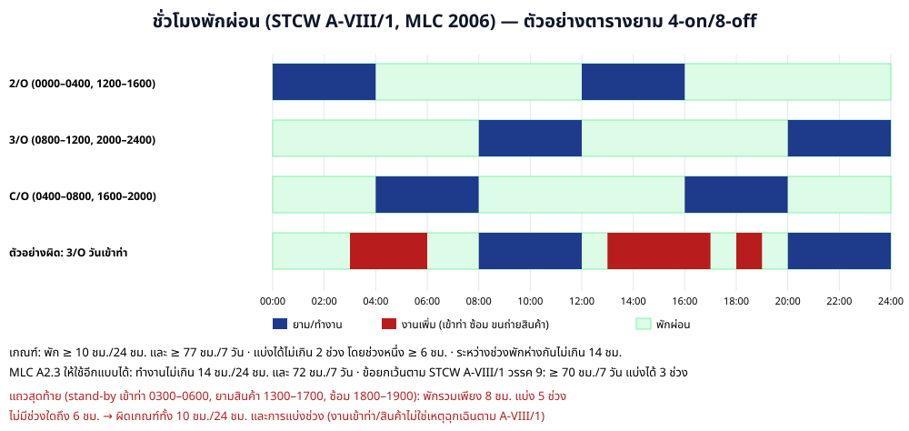
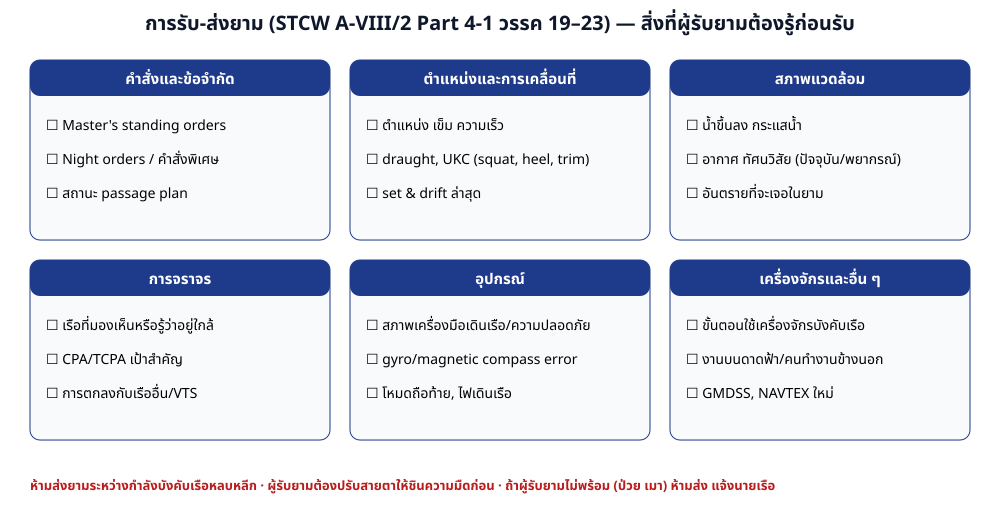
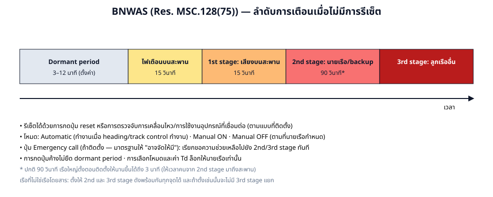

# 1.2.1 Watchkeeping (ภาค B) — หลักการเข้ายามเดินเรือ และการใช้ข้อมูลจากเครื่องมือเดินเรือ

> สมุดบันทึกการฝึก OOW · TIRAPHONG NANTAPAN
> สมรรถนะตาม STCW A-II/1: *Thorough knowledge of the Principles to be observed in keeping a navigational watch* และ *The use of information from navigational equipment for maintaining a safe navigational watch*
> อ้างอิงหลัก: STCW Regulation VIII/1, VIII/2; STCW Code **Section A-VIII/1** (Fitness for duty), **Section A-VIII/2** Part 1–5 (Watchkeeping arrangements and principles — เลข Part/วรรคตามฉบับแก้ไข Manila 2010: Part 3 หลัก BRM, Part 4 ยามในทะเล, Part 5 ยามในท่า), Section B-VIII/2 (guidance); SOLAS V/18, V/19, V/20, V/23, V/24, V/25, V/26, V/28; IMO Res. A.916(22) (Guidelines for recording events related to navigation), MSC.333(90) (VDR), MSC.572(110)/MSC.576(110) (pilot transfer arrangements), MSC.1/Circ.1598 (Fatigue); MLC 2006 Regulation 2.3; ICS *Bridge Procedures Guide* (6th Ed.) Part A–C และ Checklists; IMO Res. MSC.128(75) (BNWAS), MSC.302(87) (Bridge Alert Management), A.1106(29) (AIS operational use)

---

## 0. OOW คือใครในทางกฎหมาย

> STCW A-VIII/2 Part 4-1 วรรค 13 (ฉบับ 1995 เดิมอยู่ที่ Part 3-1 วรรค 12 — หนังสือเก่าบางเล่มยังอ้างเลขเดิม): "**The officer in charge of the navigational watch is the master's representative** and is primarily responsible at all times for the safe navigation of the ship and for complying with the International Regulations for Preventing Collisions at Sea, 1972, as amended."

แปลว่าเวลาเราอยู่ยาม **เราคือตัวแทนของนายเรือ** ความปลอดภัยของเรือ คน สินค้า และสิ่งแวดล้อมในช่วงเวลานั้นอยู่ในมือเรา ไม่ใช่แค่ "คนเฝ้าจอ" — ประโยคนี้ใช้ตอบได้เกือบทุกคำถามสัมภาษณ์ที่ขึ้นต้นด้วย "ในฐานะ OOW คุณจะ…"

---

## 1. ความพร้อมในการปฏิบัติหน้าที่ (Fitness for duty) — STCW A-VIII/1 และ MLC 2006

### 1.1 ชั่วโมงพักผ่อน (Hours of rest)

ทุกคนที่ได้รับมอบหมายหน้าที่ OOW หรือเป็นลูกเรือที่อยู่ในยาม และผู้ที่มีหน้าที่เกี่ยวกับความปลอดภัย การป้องกันมลพิษ และการรักษาความปลอดภัย ต้องได้พักผ่อน

| เกณฑ์ | ค่า |
|---|---|
| พักขั้นต่ำใน **24 ชั่วโมงใด ๆ** | **10 ชั่วโมง** |
| พักขั้นต่ำใน **7 วันใด ๆ** | **77 ชั่วโมง** |
| การแบ่งช่วงพัก | ไม่เกิน **2 ช่วง** และช่วงหนึ่งต้องยาว **≥ 6 ชั่วโมง** |
| ระยะห่างระหว่างช่วงพักติดกัน | ไม่เกิน **14 ชั่วโมง** |

- การซ้อม (muster/fire/abandon ship drills) ต้องจัดให้รบกวนการพักน้อยที่สุดและไม่ทำให้เหนื่อยล้า
- ถ้าถูกเรียก (on call) ในช่วงพัก เช่น Duty officer ในท่า ต้องได้รับการชดเชยเวลาพัก
- **ข้อยกเว้น** (ตามที่ Administration อนุญาต): ลดเหลือ **70 ชั่วโมงใน 7 วัน** ได้ไม่เกิน 2 สัปดาห์ติดกัน (ช่วงระหว่างข้อยกเว้นต้องยาวอย่างน้อย 2 เท่าของระยะเวลายกเว้น) และแบ่งพักใน 24 ชั่วโมงได้ไม่เกิน 3 ช่วง (ช่วงหนึ่ง ≥ 6 ชั่วโมง อีกสองช่วง ≥ 1 ชั่วโมง) ระยะห่างระหว่างช่วงไม่เกิน 14 ชั่วโมง และไม่เกินสองช่วง 24 ชั่วโมงใน 7 วัน
- **ไม่ใช้กับกรณีฉุกเฉิน** — นายเรือสั่งให้ทำงานเกินได้เพื่อความปลอดภัยของเรือ คน สินค้า หรือช่วยเรืออื่นที่ประสบภัย แต่หลังจากนั้นต้องจัดให้พักชดเชย
- **ต้องติดตารางยาม (watch schedule)** ในที่เข้าถึงง่าย และ **บันทึกชั่วโมงพักรายวัน** (record of hours of rest) ให้ลูกเรือลงชื่อรับรอง เจ้าหน้าที่ PSC ตรวจเรื่องนี้บ่อยมาก
  - จดไว้กันลืม (A-VIII/1 วรรค 5 และ 7): ทั้งตารางยามและบันทึกชั่วโมงพักต้องใช้ **รูปแบบมาตรฐาน (standardized format)** เป็นภาษาทำงานของเรือ **และภาษาอังกฤษ** — ลูกเรือแต่ละคนต้อง **ได้รับสำเนาบันทึกของตัวเอง** ที่นายเรือ (หรือผู้ที่นายเรือมอบหมาย) และตัวลูกเรือลงชื่อรับรองแล้ว แบบฟอร์มที่ใช้กันทั่วไปอิง IMO/ILO Guidelines for the development of tables of seafarers' shipboard working arrangements and formats of records of hours of work or hours of rest
  - ลงเวลาตามจริง ไม่ใช่ลอกตารางยาม — ถ้าบันทึกออกมา "สวยทุกวัน" ทั้งที่เพิ่งเข้าออกท่าติดกัน PSC จะสงสัยว่าเป็นบันทึกปลอม (falsified records) ซึ่งร้ายแรงกว่าการเกินชั่วโมงเสียอีก

**MLC 2006 Standard A2.3** ใช้เกณฑ์คู่ขนาน: ชั่วโมงทำงานสูงสุด **14 ชั่วโมงใน 24 ชั่วโมง และ 72 ชั่วโมงใน 7 วัน** หรือชั่วโมงพักขั้นต่ำ 10/77 ตามข้างบน



*ภาพที่ 1.2.1-B1 ระบบยาม 4-on/8-off ตามปกติเป็นไปตามเกณฑ์ แต่ถ้ามีงานเข้าท่า ซ้อม และงานสินค้าทับเวลาพัก (แถวล่าง) จะผิดเกณฑ์ทันที*

### 1.2 แอลกอฮอล์และสารเสพติด

- STCW A-VIII/1 วรรค 10: Administration ต้องกำหนดขีดจำกัดไม่เกิน **0.05% blood alcohol level (BAC)** หรือ **0.25 mg/l ในลมหายใจ** (หรือปริมาณแอลกอฮอล์ที่ทำให้ถึงระดับนั้น) สำหรับ **นายเรือ นายประจำเรือ และคนประจำเรืออื่นทุกคนขณะปฏิบัติหน้าที่ด้านความปลอดภัย การรักษาความปลอดภัย (security) และการป้องกันมลพิษที่ได้รับมอบหมาย** — จึงครอบคลุม OOW และลูกเรือในยามทุกคน แต่ไม่ได้จำกัดอยู่แค่คนเข้ายาม
- บริษัทส่วนใหญ่มี **Drug and Alcohol Policy** ที่เข้มกว่า (มัก **zero tolerance** — ห้ามดื่มบนเรือเลย หรือห้ามภายใน 4–8 ชั่วโมงก่อนเข้ายาม) และมีการตรวจแบบสุ่ม
- OOW ที่เห็นว่าผู้รับยามมีอาการมึนเมา ต้อง **ไม่ส่งยาม** และแจ้งนายเรือ

### 1.3 ความเหนื่อยล้า (Fatigue)

- IMO MSC.1/Circ.1598 *Guidelines on Fatigue* — สาเหตุ (นอนไม่พอ ทำงานต่อเนื่อง การเปลี่ยนเขตเวลา เสียง/สั่นสะเทือน สภาพอากาศ ความเครียด) อาการ (ตัดสินใจช้า ลืม ขาดสมาธิ "microsleep") และการจัดการ
- ช่วงเวลาที่ร่างกายง่วงที่สุดตามนาฬิกาชีวภาพ คือ **ประมาณ 0200–0600** — ยาม 0000–0400 และ 0400–0800 ต้องระวังเป็นพิเศษ (รายงานเกยตื้นหลายเรื่องเกิดช่วงนี้ เมื่อ OOW อยู่คนเดียวบนสะพานและหลับ)
- **BNWAS** มีไว้เพื่อป้องกันกรณีนี้ (ข้อ 8)

---

## 2. การจัดยาม (Watch arrangements) — STCW A-VIII/2 Part 3 และ Part 4-1 (วรรค 14–18)

> หมายเหตุเลขอ้างอิง: ตั้งแต่การแก้ไข Manila 2010 โครงสร้าง A-VIII/2 เป็น Part 1 Certification, Part 2 Voyage planning, **Part 3 หลักการเข้ายามทั่วไป (หลัก BRM วรรค 8)**, **Part 4 ยามในทะเล** (4-1 ยามเดินเรือ วรรค 13–51, 4-2 ยามห้องเครื่อง, 4-3 ยามวิทยุ) และ **Part 5 ยามในท่า** (วรรค 90–107) — ตำราที่อิงฉบับ 1995 จะเรียกยามเดินเรือว่า "Part 3-1" และเลขวรรคเลื่อนไปหนึ่ง เวลาตอบสอบให้ระบุฉบับปัจจุบัน

### 2.1 ระบบยามทั่วไป

| ยาม | เวลา | ผู้รับผิดชอบ (โดยทั่วไป) |
|---|---|---|
| Middle / Graveyard | 0000–0400 และ 1200–1600 | Second Officer (2/O) |
| Morning | 0400–0800 และ 1600–2000 | Chief Officer (C/O) |
| Forenoon / Evening | 0800–1200 และ 2000–2400 | Third Officer (3/O) |

(เรือบางลำใช้ 6-on/6-off เมื่อมีนายประจำเรือฝ่ายเดินเรือสองคน — ต้องตรวจชั่วโมงพักให้ดี)

ชื่อยามแบบดั้งเดิม (จดไว้กันลืม เพราะตารางข้างบนจัดกลุ่มตามคนเข้ายาม ไม่ใช่ตามชื่อ): 0000–0400 **Middle watch** · 0400–0800 **Morning watch** · 0800–1200 **Forenoon watch** · 1200–1600 **Afternoon watch** · 1600–2000 **Dog watches** (First dog 1600–1800, Last/Second dog 1800–2000 — แบ่งครึ่งเพื่อให้ยามหมุนเวียนในระบบดั้งเดิม) · 2000–2400 **First watch** — บนเรือสินค้าปัจจุบันมักเรียกตามคน เช่น "ยาม 2/O" "ยาม 12–4" มากกว่า

### 2.2 ปัจจัยในการกำหนดองค์ประกอบของยามบนสะพาน (A-VIII/2 Part 4-1 วรรค 17–18)

นายเรือต้องพิจารณา
1. ต้องไม่ปล่อยให้สะพานเดินเรือไม่มีคนอยู่ (the bridge shall not be left unattended)
2. สภาพอากาศ ทัศนวิสัย และกลางวัน/กลางคืน
3. ความใกล้ชิดของอันตรายทางการเดินเรือที่อาจทำให้ OOW ต้องทำหน้าที่เพิ่ม
4. การใช้และสภาพการทำงานของเครื่องช่วยการเดินเรือ เช่น ECDIS เรดาร์ เครื่องชี้ตำแหน่งอิเล็กทรอนิกส์ และอุปกรณ์อื่นที่มีผลต่อการเดินเรือ
5. เรือติดตั้งระบบถือท้ายอัตโนมัติหรือไม่
6. มีหน้าที่วิทยุที่ต้องทำหรือไม่
7. ระบบเตือน สัญญาณเตือน และเครื่องชี้วัดของห้องเครื่องที่ไม่มีคนเฝ้า (UMS) บนสะพาน ขั้นตอนการใช้ และข้อจำกัด
8. ความต้องการพิเศษจากสถานการณ์การเดินเรือ

**ระดับยามที่ BPG แนะนำ (ตัวอย่าง)** — บริษัทกำหนดใน SMS ตาม "bridge manning levels"

| ระดับ | สถานการณ์ | องค์ประกอบ |
|---|---|---|
| 1 | ทะเลเปิด ทัศนวิสัยดี การจราจรน้อย กลางวัน | OOW (อาจเป็น sole look-out ตามเงื่อนไข) + look-out พร้อมเรียกได้ทันที |
| 2 | กลางคืน หรือการจราจรปานกลาง | OOW + look-out |
| 3 | ชายฝั่ง/การจราจรหนาแน่น/ทัศนวิสัยจำกัด | OOW + look-out + นายท้าย (helmsman) / นายเรืออาจขึ้นมา |
| 4 | ร่องน้ำ นำร่อง ช่องแคบ ทัศนวิสัยจำกัดในที่หนาแน่น | นายเรือ (conning) + OOW + look-out + นายท้าย + ห้องเครื่อง standby |

### 2.3 Look-out — เงื่อนไขที่ OOW เป็น sole look-out ได้ (A-VIII/2 Part 4-1 วรรค 14–17; เงื่อนไข sole look-out อยู่ในวรรค 16)

- ผู้ดูต้นหนต้องให้ความสนใจเต็มที่ ห้ามมอบหน้าที่อื่นที่ขัดขวาง
- **หน้าที่ look-out กับ helmsperson ต้องแยกกัน** — นายท้ายขณะถือท้ายไม่นับเป็น look-out (ยกเว้นเรือเล็กที่มองเห็นรอบตัวได้ชัดจากตำแหน่งถือท้ายและไม่มีสิ่งรบกวนการมองตอนกลางคืน)
- **OOW เป็น sole look-out ได้เฉพาะในเวลากลางวัน (daylight)** เมื่อ
  1. ประเมินสถานการณ์อย่างรอบคอบแล้ว และ **มั่นใจโดยไม่มีข้อสงสัยว่าปลอดภัย**
  2. คำนึงถึงปัจจัยทั้งหมด เช่น สภาพอากาศ ทัศนวิสัย ความหนาแน่นของการจราจร ความใกล้ชิดของอันตราย ความจำเป็นในการเฝ้าระวังเมื่อแล่นในหรือใกล้ TSS
  3. **มีผู้ช่วยที่เรียกขึ้นมาบนสะพานได้ทันที** เมื่อสถานการณ์เปลี่ยน
- กลางคืน **ต้องมี look-out แยก** เสมอ (ตามแนวปฏิบัติและ SMS ส่วนใหญ่)
- วัตถุประสงค์ของ look-out ตามวรรค 14 (สรุปความ): เฝ้าระวังต่อเนื่องด้วย **สายตาและการฟัง** และทุกวิธีที่มี เพื่อจับการเปลี่ยนแปลงของสถานการณ์, ประเมินสถานการณ์และความเสี่ยงการโดนกัน เกยตื้น และอันตรายอื่นให้ครบ, และ **ตรวจจับเรือหรืออากาศยานที่ประสบภัย คนตกน้ำ/ผู้รอดชีวิต ซากเรือ และสิ่งกีดขวาง** — คำตอบสอบนิยมให้ครบสามข้อนี้
- วรรค 17: เวลาตัดสินว่ายามมีคนพอสำหรับ look-out ที่เหมาะสม นายเรือต้องคำนึงถึงทุกปัจจัยในวรรค 18 ด้วย (ดูข้อ 2.2)

### 2.4 หลักการจัดการทรัพยากรบนสะพาน/ห้องเครื่องที่ STCW บังคับใช้กับการเข้ายาม (A-VIII/2 Part 3 วรรค 8)

การแก้ไข Manila 2010 ใส่หลัก BRM/ERM ไว้ในตัวบทบังคับ (Part A) เลย — สรุปความเป็นของผมเอง 9 ข้อ

1. จัดคนเข้ายามให้เหมาะกับสถานการณ์
2. นำข้อจำกัดด้านคุณสมบัติหรือความพร้อมของแต่ละคนมาคิดตอนจัดคน
3. ทุกคนในยามเข้าใจบทบาท ความรับผิดชอบของตน และบทบาทของทีม
4. นายเรือ ต้นกลเรือ และผู้รับผิดชอบยาม ใช้ทรัพยากรที่มีให้เกิดประโยชน์สูงสุด — ข้อมูล อุปกรณ์ และคน
5. คนเข้ายามเข้าใจหน้าที่และการทำงานของอุปกรณ์ และใช้งานได้คล่อง
6. เข้าใจข้อมูลจากแต่ละสถานี/อุปกรณ์ และรู้ว่าต้องตอบสนองอย่างไร
7. แบ่งปันข้อมูลจากสถานี/อุปกรณ์ให้ทุกคนในยามรับรู้อย่างเหมาะสม
8. สื่อสารกันอย่างเหมาะสมในทุกสถานการณ์
9. **เมื่อสงสัยว่าจะทำอย่างไรเพื่อความปลอดภัย ให้แจ้งนายเรือ/ต้นกลเรือ/ผู้รับผิดชอบยามโดยไม่ลังเล**

(รายละเอียดเชิงปฏิบัติของ BRM — situational awareness, challenge and response, closed-loop — อยู่ในบท [1.2.2 Bridge Resource Management](1.2.2-bridge-resource-management.md))

---

## 3. การรับ-ส่งยาม (Taking over the watch) — A-VIII/2 Part 4-1 วรรค 19–23



*ภาพที่ 1.2.1-B2 รายการตรวจก่อนรับยาม — ใช้เป็นเช็คลิสต์ในใจทุกครั้ง*

### 3.1 หลักการ

1. **OOW ห้ามส่งยาม ถ้ามีเหตุผลให้เชื่อว่าผู้รับยามไม่สามารถปฏิบัติหน้าที่ได้อย่างมีประสิทธิภาพ** (ป่วย เหนื่อยล้ามาก มึนเมา) — ต้องแจ้งนายเรือ
2. ผู้รับยามต้องแน่ใจว่าสมาชิกในยามของตนพร้อมปฏิบัติหน้าที่ **โดยเฉพาะการปรับสายตาให้ชินกับความมืด** (night vision adaptation ใช้เวลาอย่างน้อยประมาณ 10–15 นาที — ขึ้นสะพานก่อนเวลาเพื่อการนี้; ตามหลักสรีรวิทยาสายตาจะปรับเต็มที่ราว 20–30 นาที และแสงขาวจ้าแวบเดียวทำให้ต้องเริ่มใหม่บางส่วน)
3. **ห้ามรับยามจนกว่าสายตาจะปรับตัวกับแสงเรียบร้อย**
4. ถ้าขณะส่งยามมี **การบังคับเรือหรือการหลบหลีกกำลังดำเนินอยู่** ต้อง **เลื่อนการส่งยาม** ออกไปจนกว่าการกระทำนั้นเสร็จ
5. (วรรค 21) ก่อนรับยาม ผู้รับยามต้องแน่ใจใน **ตำแหน่งเรือ (ประมาณหรือจริง)** ยืนยัน **เส้นทาง เข็ม และความเร็วที่ตั้งใจ** ตรวจ **ระบบควบคุมห้องเครื่องไร้คนเฝ้า (UMS) บนสะพาน** ตามที่เกี่ยวข้อง และรับรู้ **อันตรายที่คาดว่าจะพบระหว่างยาม**
6. (วรรค 22) ผู้รับยามต้องพอใจด้วยตนเอง (personally satisfy) ในเรื่องต่อไปนี้ก่อนรับ
   - คำสั่งประจำ (standing orders) และคำสั่งพิเศษของนายเรือเกี่ยวกับการเดินเรือ
   - ตำแหน่ง เข็ม ความเร็ว และอัตรากินน้ำลึกของเรือ
   - น้ำขึ้นลง กระแสน้ำ อากาศ ทัศนวิสัย ทั้งปัจจุบันและที่พยากรณ์ และผลต่อเข็มและความเร็ว
   - ขั้นตอนการใช้เครื่องจักรหลักเพื่อบังคับเรือเมื่ออยู่ภายใต้การควบคุมจากสะพาน
   - สถานการณ์การเดินเรือ รวมถึง
     - สภาพการทำงานของอุปกรณ์เดินเรือและความปลอดภัยทั้งหมดที่ใช้หรืออาจต้องใช้ระหว่างยาม
     - ความคลาดเคลื่อนของ gyro และ magnetic compass
     - การมีอยู่และการเคลื่อนที่ของเรือที่มองเห็นหรือรู้ว่าอยู่ใกล้
     - สภาพและอันตรายที่อาจพบระหว่างยาม
     - ผลที่อาจเกิดจากการเอียง (heel) trim ความหนาแน่นน้ำ และ squat ต่อ UKC

### 3.2 วิธีปฏิบัติจริง (แนวปฏิบัติที่ใช้กันทั่วไปบนเรือ)

- ขึ้นสะพานก่อนเวลา **อย่างน้อย 10–15 นาที** ตอนกลางคืน
- ดูแผนที่/ECDIS: ตำแหน่งล่าสุด เส้นทางที่เหลือในยาม WOP ถัดไป อันตราย จุดรายงาน
- อ่าน **Night Order Book** และลงชื่อ
- ดูเรดาร์ทั้งสองเครื่อง ระยะใกล้และไกล ระบุเป้าสำคัญ
- ดูหน้าต่างด้วยตาและกล้องส่องทางไกล
- ตรวจโหมดถือท้าย (auto/hand), เข็มที่ตั้ง, ไฟเดินเรือติดครบ, ไฟเตือนต่าง ๆ
- ฟังสรุปจาก OOW ยามก่อน (verbal handover) แล้วถามสิ่งที่ไม่ชัด
- เมื่อพร้อมจึงพูดชัด ๆ ว่า "**I have the watch**" / "ผมรับยามแล้ว" — ผู้ส่งยามตอบรับ แล้วจึงบันทึกในสมุดปูมเรือ
- ผู้ส่งยามยังรับผิดชอบจนกว่าจะส่งยามเรียบร้อย

---

## 4. การปฏิบัติหน้าที่ระหว่างยาม (Performing the navigational watch) — A-VIII/2 Part 4-1 วรรค 24–42

### 4.1 หน้าที่หลัก

1. **อยู่บนสะพานเดินเรือ** และ **ไม่ออกจากสะพาน** จนกว่าจะมีผู้รับยามอย่างถูกต้อง
2. แม้นายเรืออยู่บนสะพาน **OOW ยังคงรับผิดชอบ** จนกว่านายเรือจะแจ้งชัดเจนว่ารับผิดชอบเอง (master has taken over the con) และทั้งสองเข้าใจตรงกัน
3. **หาตำแหน่งเรือบ่อย ๆ** ด้วยวิธีที่เหมาะสม และเมื่อเห็นฝั่ง ใช้การสังเกตด้วยตา
4. **รู้ตำแหน่งและการใช้งาน** อุปกรณ์เดินเรือและความปลอดภัยทั้งหมด และรู้ข้อจำกัดในการใช้งาน
5. **ต้องไม่ได้รับมอบหมายหรือรับงานอื่นที่ขัดขวาง** การเดินเรือที่ปลอดภัย
6. **ตรวจสอบตำแหน่ง เข็ม ความเร็ว** อย่างสม่ำเสมอ และดูว่าเรือเป็นไปตามแผน
7. ตรวจสอบ **ความคลาดเคลื่อนของเข็มทิศ (compass error)** — **อย่างน้อยยามละครั้ง** และเมื่อเปลี่ยนเข็มมาก ด้วยวิธีดาราศาสตร์หรือภาคพื้นดิน เปรียบเทียบ gyro กับ magnetic compass บ่อย ๆ และตรวจว่า repeaters ตรงกับ master compass
8. เมื่อใช้ autopilot ต้อง **ทดสอบการถือท้ายด้วยมือ (manual steering) อย่างน้อยยามละครั้ง** (และตาม SOLAS V/24 ก่อนเข้าพื้นที่ที่ต้องใช้มือ) — บางบริษัทให้ทดสอบทุกยาม
9. **ไฟเดินเรือและสัญญาณ** ต้องแสดงถูกต้องและทำงานปกติ
10. ใช้ **เรดาร์** ทุกครั้งที่ทัศนวิสัยจำกัดหรือคาดว่าจะจำกัด และตลอดเวลาในน่านน้ำที่การจราจรหนาแน่น โดยคำนึงถึงข้อจำกัด เปลี่ยน range scale บ่อย ๆ เพื่อตรวจจับเป้าแต่เนิ่น
11. บันทึกกิจกรรมและเหตุการณ์สำคัญลงในสมุดปูมเรือ (เวลา เข็ม ความเร็ว ตำแหน่ง อากาศ เหตุการณ์ การเปลี่ยนแปลง)
12. ติดต่อสื่อสารทางวิทยุตามหน้าที่ (GMDSS watch) — ฟัง VHF ch 16, DSC ch 70 และ MF DSC 2187.5 kHz ตลอด ตรวจ NAVTEX/EGC
    - ขยายความตาม SOLAS IV/12: เฝ้า DSC ต่อเนื่องตามอุปกรณ์ที่เรือต้องมีตามพื้นที่ทะเล — VHF DSC ch 70 (ทุกลำ), MF DSC 2187.5 kHz (เรือที่ติดตั้ง MF สำหรับ A2 ขึ้นไป), HF DSC 8414.5 kHz + อีกอย่างน้อยหนึ่งความถี่ HF DSC ที่เหมาะกับเวลา/ตำแหน่ง (เรือที่ใช้ HF ใน A3/A4) และการรับ MSI ผ่าน NAVTEX/EGC; ส่วน **VHF ch 16 เป็น listening watch "เมื่อทำได้ (when practicable)"** ที่ตำแหน่งที่ใช้เดินเรือตามปกติ และหลายประเทศ/VTS กำหนดให้ฟัง ch 13 หรือช่องท้องถิ่นเพิ่ม
13. **ห้ามละสายตาจาก look-out** (วรรค 32): เรือที่ห้องแผนที่แยกจากสะพาน OOW ไปห้องแผนที่ได้เฉพาะเมื่อจำเป็น ช่วงสั้น ๆ และหลังแน่ใจว่าปลอดภัยและมี look-out ที่เหมาะสมอยู่
14. **ทดสอบอุปกรณ์เดินเรือขณะอยู่ในทะเล** บ่อยเท่าที่ทำได้ โดยเฉพาะก่อนคาดว่าจะเจอสภาพอันตราย และ **ก่อนเข้าและออกจากท่า** บันทึกผลเมื่อเหมาะสม (วรรค 33)
15. ตรวจว่า **ระบบควบคุม สัญญาณเตือน และเครื่องชี้วัดของ UMS** บนสะพานทำงานปกติ (วรรค 34.6)
16. เมื่อใช้ autopilot ต้องคิดล่วงหน้าเรื่อง **การจัดคนถือท้ายและเปลี่ยนเป็นมือแต่เนิ่น ๆ** — สถานการณ์ที่ OOW อยู่คนเดียวแล้วต้องทิ้ง look-out ไปจับพวงมาลัยในภาวะฉุกเฉินถือว่า "อันตรายอย่างยิ่ง" ตามวรรค 35
17. รู้จักเครื่องช่วยการเดินเรืออิเล็กทรอนิกส์ทุกตัว ทั้งความสามารถและข้อจำกัด และ **อย่าลืม echo sounder** ซึ่ง Code เน้นว่าเป็นเครื่องช่วยที่มีค่า (วรรค 36); เมื่อใช้เรดาร์ต้องเลือก range scale ให้เหมาะ เปลี่ยน scale บ่อยพอให้จับเป้าได้เร็ว และเริ่ม plot/วิเคราะห์อย่างเป็นระบบแต่เนิ่น ๆ (วรรค 38–39)

### 4.2 การใช้เครื่องจักรและการบังคับเรือ

- OOW **ต้องไม่ลังเล** ที่จะใช้หางเสือ เครื่องจักร และอุปกรณ์สัญญาณเสียงเมื่อจำเป็น — แต่ควรแจ้งห้องเครื่องล่วงหน้าเมื่อเป็นไปได้ (ยกเว้นฉุกเฉินที่ต้องทำทันที)
- ต้องรู้ **ลักษณะการบังคับเรือ** ของเรือตนเอง รวมถึง stopping distance และ turning circle — และตระหนักว่าเรือต่างลำมีลักษณะต่างกัน (Res. A.601(15) — wheelhouse poster, pilot card)

### 4.3 เมื่อใดต้องเรียกนายเรือ (Calling the master) — A-VIII/2 Part 4-1 วรรค 40 (และวรรค 41)

OOW ต้องแจ้งนายเรือทันทีเมื่อ
1. พบหรือคาดว่าจะพบ **ทัศนวิสัยจำกัด**
2. **สภาพการจราจรหรือการเคลื่อนที่ของเรืออื่น** ทำให้กังวล
3. **ยากที่จะรักษาเข็มเรือ**
4. **ไม่เห็นฝั่ง เครื่องหมายทางเรือ หรือไม่ได้ความลึก** ตามเวลาที่คาด
5. **เห็นฝั่งหรือเครื่องหมายทางเรือโดยไม่คาดคิด** หรือ **ความลึกเปลี่ยนโดยไม่คาดคิด**
6. **เครื่องจักรหลัก ระบบควบคุมระยะไกลของเครื่องจักร ระบบถือท้าย หรืออุปกรณ์เดินเรือที่จำเป็น** สัญญาณเตือน หรือเครื่องชี้วัด ขัดข้อง
7. **อุปกรณ์วิทยุ** ทำงานผิดปกติ
8. ในสภาพอากาศเลว ถ้าสงสัยว่าอาจเกิดความเสียหายจากสภาพอากาศ
9. เรือพบ **อันตรายต่อการเดินเรือ** เช่น น้ำแข็ง หรือซากลอยน้ำ (derelict)
10. **ภาวะฉุกเฉินอื่นใด** หรือ **เมื่อสงสัย (in any doubt)**

> **ประโยคทองที่ต้องจำ:** "Despite the requirement to notify the master immediately in the foregoing circumstances, **the officer in charge of the navigational watch shall in addition not hesitate to take immediate action for the safety of the ship**, where circumstances so require." — การเรียกนายเรือไม่ได้แปลว่าต้องรอนายเรือมาก่อนจึงทำอะไร

**Master's Standing Orders** มักเพิ่มเงื่อนไข เช่น เรียกเมื่อ CPA < 2 ไมล์ในทะเลเปิด (< 1 ไมล์ชายฝั่ง) เรียกก่อนเปลี่ยนเข็มตาม WOP ใกล้ฝั่ง เรียกเมื่อทัศนวิสัย < 3 ไมล์ เรียกเมื่อความกดอากาศลดผิดปกติ ฯลฯ — **อ่านและลงชื่อทุกครั้งที่ขึ้นเรือใหม่/นายเรือเปลี่ยน**

### 4.4 Master's Standing Orders และ Night Orders

| | Standing Orders | Night Orders |
|---|---|---|
| ลักษณะ | คำสั่งถาวรของนายเรือ ใช้ตลอดการปฏิบัติงานบนเรือ | คำสั่งเฉพาะคืนนั้น/ช่วงนั้น เขียนในสมุด Night Order Book |
| เนื้อหา | หลักการเข้ายาม การเรียกนายเรือ CPA ขั้นต่ำ การใช้อุปกรณ์ การจัดยาม ฯลฯ | ข้อควรระวังเฉพาะ เช่น "Call me at WP5 or 0400 whichever earlier", "Expect fishing boats off Terengganu", "Change to MGO at ECA boundary" |
| การรับทราบ | OOW ทุกคนอ่านและลงชื่อ | OOW ทุกยามอ่านและลงชื่อก่อนรับยาม |

---

## 5. การเข้ายามในสภาพและพื้นที่ต่าง ๆ — A-VIII/2 Part 4-1 วรรค 43–51

### 5.1 ทัศนวิสัยดี (Clear weather) — วรรค 43–44

- วัดแบริ่งเข็มทิศของเรือที่เข้าใกล้บ่อย ๆ เพื่อตรวจความเสี่ยงแต่เนิ่น (Rule 7)
- **ฝึกใช้เรดาร์ (radar practice)** ในทัศนวิสัยดี — เปรียบเทียบภาพเรดาร์กับสิ่งที่เห็นจริง เพื่อให้คุ้นเคยเมื่อทัศนวิสัยแย่

### 5.2 ทัศนวิสัยจำกัด (Restricted visibility) — วรรค 45

เมื่อพบหรือคาดว่าจะพบ OOW ต้อง
1. ปฏิบัติตาม COLREG โดยเฉพาะ **Rule 19** และให้ **สัญญาณหมอก (Rule 35)**
2. แล่นด้วย **ความเร็วปลอดภัย** และให้ **เครื่องจักรพร้อมบังคับเรือทันที** (แจ้งห้องเครื่อง standby)
3. **แจ้งนายเรือ**
4. จัด **look-out** ที่เหมาะสม (และอาจเพิ่มคนที่หัวเรือ — bow look-out)
5. **แสดงไฟเดินเรือ**
6. ใช้ **เรดาร์** ทั้งสองเครื่อง (ระยะสั้นและไกล), ARPA plot เป้าทั้งหมด
7. **ถือท้ายด้วยมือ** (เปลี่ยนจาก autopilot) เพื่อพร้อมบังคับเรือทันที
8. ปิดเสียงที่ไม่จำเป็นบนสะพาน เปิดประตูหรือระบบรับเสียงเพื่อฟังสัญญาณหมอก
9. ปิดประตูผนึกน้ำ (watertight doors) ตาม SMS

> แยกให้ออกตอนตอบสอบ: วรรค 45 บอกว่า **หน้าที่แรก** คือทำตาม COLREG โดยเฉพาะ **สัญญาณหมอก ความเร็วปลอดภัย และเครื่องจักรพร้อมบังคับเรือทันที** แล้ว **เพิ่มเติม** อีก 4 อย่าง คือ แจ้งนายเรือ จัด look-out ที่เหมาะสม เปิดไฟเดินเรือ และเปิดใช้เรดาร์ — ข้อ 4 (bow look-out), 6 (ARPA สองเครื่อง), 7 ถึง 9 ข้างบนเป็นแนวปฏิบัติตาม BPG/SMS ที่ต่อยอดจาก Code

### 5.3 ในเวลากลางคืน (Hours of darkness) — วรรค 46

- นายเรือและ OOW ต้องจัดการเฝ้าระวังโดยคำนึงถึง **ความปลอดภัยเป็นอันดับแรก** — ตัวบทวรรค 46 ระบุว่าเวลาจัด look-out ตอนกลางคืนต้องคำนึงถึง **อุปกรณ์บนสะพานและเครื่องช่วยการเดินเรือที่ใช้ได้ ข้อจำกัดของมัน รวมทั้งขั้นตอนและมาตรการป้องกัน (safeguards) ที่วางไว้**
- ลดแสงบนสะพาน (dimming) ให้เหลือน้อยที่สุด ไม่ให้รบกวน night vision — ปิดไฟห้องแผนที่หรือใช้ไฟแดง/ม่านบัง
- ห้ามให้แสงจากที่พักลูกเรือหรือดาดฟ้ารบกวนการมองไฟของเรืออื่น

### 5.4 น่านน้ำชายฝั่งและการจราจรหนาแน่น (Coastal and congested waters) — วรรค 47–48

1. ใช้ **แผนที่มาตราส่วนใหญ่ที่สุด** ที่เหมาะสมและเป็นปัจจุบัน
2. **หาตำแหน่งบ่อย ๆ ด้วยมากกว่าหนึ่งวิธี** (more than one method) เมื่อสถานการณ์เอื้อ
3. **ระบุเครื่องหมายทางเรือที่เกี่ยวข้องทั้งหมดให้แน่นอน**
4. **ถ้าใช้ ECDIS** (เพิ่มในวรรค 47 ตั้งแต่ Manila 2010): ใช้ ENC ที่มี **usage band/scale เหมาะกับพื้นที่** (เช่น Harbour/Approach ไม่ใช่ Overview) และ **ตรวจตำแหน่งเรือด้วยวิธีหาตำแหน่งอิสระ (independent means of position fixing)** เป็นระยะที่เหมาะสม — คือไม่เชื่อ GNSS ที่ป้อน ECDIS อย่างเดียว ใช้ radar overlay, ระยะ/แบริ่งจากจุดเด่น หรือ parallel index ตรวจซ้ำ (ดู 1.2.1-C และ 1.4)

### 5.5 การเดินเรือเมื่อมีนำร่องบนเรือ (Navigation with pilot on board) — วรรค 49–50

- **แม้นำร่องมีหน้าที่และพันธะ การมีนำร่องบนเรือไม่ยกเว้นนายเรือหรือ OOW จากหน้าที่และพันธะต่อความปลอดภัยของเรือ**
- นายเรือกับนำร่องต้อง **แลกเปลี่ยนข้อมูล** เกี่ยวกับวิธีการเดินเรือ สภาพท้องถิ่น และลักษณะของเรือ (MPX — Master/Pilot Exchange โดยใช้ pilot card, wheelhouse poster และ passage plan)
- นายเรือและ/หรือ OOW ต้อง **ร่วมมือใกล้ชิดกับนำร่อง** และ **ตรวจตำแหน่งและการเคลื่อนที่ของเรืออย่างแม่นยำตลอด**
- ถ้า **สงสัยในการกระทำหรือเจตนาของนำร่อง** OOW ต้อง **ขอคำชี้แจงจากนำร่อง** ถ้ายังสงสัย **แจ้งนายเรือทันที** และ **ดำเนินการที่จำเป็นก่อนนายเรือมาถึง**

แนวปฏิบัติเพิ่มเติมจาก BPG และ SOLAS V/23 (pilot transfer arrangements):
- เตรียมบันไดนำร่อง (pilot ladder) ตามมาตรฐาน SOLAS V/23 และ IMO Res. A.1045(27) (และข้อกำหนดใหม่ด้าน pilot transfer arrangements ที่มีผลตั้งแต่ 1 ม.ค. 2028 สำหรับอุปกรณ์ที่ติดตั้งใหม่ — ตามการแก้ไข SOLAS V/23 ที่ IMO รับรองแล้ว: Res. **MSC.572(110)** แก้ SOLAS V/23 และ **MSC.576(110)** *Performance Standards for Pilot Transfer Arrangements* ซึ่งกลายเป็นมาตรฐานบังคับ รับรองที่ MSC 110 เดือน มิ.ย. 2025 มีผล **1 ม.ค. 2028** — ส่วนการตรวจ การจัดเก็บ การบำรุงรักษา การเปลี่ยน และการทำความคุ้นเคย ใช้กับอุปกรณ์ทุกชุดตั้งแต่วันนั้น ส่วนอุปกรณ์ที่ติดตั้งก่อน 2028 ต้องปรับให้เป็นไปตามมาตรฐานใหม่ไม่เกิน **การตรวจเรือครั้งแรกตั้งแต่ 1 ม.ค. 2029** — มาตรฐานใหม่นี้มาแทนการอ้าง A.1045(27) ในทางปฏิบัติ ตรวจกับ circular ของ Flag/Class ฉบับปัจจุบัน) มีนายประจำเรือที่มีความรู้ควบคุม ไฟส่องสว่าง ห่วงชูชีพพร้อมไฟ เชือกช่วย (heaving line)
- นำร่องขึ้นเรือแล้วพาไปสะพานเดินเรือ ทำ MPX ให้นำร่องเห็น passage plan ยืนยัน UKC ข้อจำกัดของเรือ
- OOW plot ตำแหน่งต่อเนื่อง ตรวจคำสั่งหางเสือและเครื่องจักรว่าทำตามถูกต้อง (closed-loop communication) ทวนคำสั่งของนำร่องก่อนปฏิบัติ
- บันทึกเวลานำร่องขึ้น/ลง และคำสั่งสำคัญ

### 5.6 เรือทอดสมอ (Ship at anchor) — วรรค 51

ถ้านายเรือเห็นว่าจำเป็น ต้องจัดยามเดินเรือต่อเนื่องขณะทอดสมอ OOW ต้อง
1. **หาและ plot ตำแหน่งเรือ** บนแผนที่โดยเร็วที่สุด
2. **ตรวจว่าเรือยังจับสมอแน่นอยู่** ด้วยการวัดแบริ่งไปยังเครื่องหมายทางเรือหรือวัตถุบนฝั่งที่ระบุได้ง่าย เป็นระยะที่บ่อยพอ (ใช้ anchor watch alarm ใน GNSS/ECDIS ประกอบ แต่ไม่พึ่งอย่างเดียว)
3. **เฝ้าระวังที่เหมาะสม** อย่างต่อเนื่อง
4. **ตรวจเดินรอบเรือ (inspection rounds)** เป็นระยะ
5. **สังเกตสภาพอุตุนิยมวิทยา น้ำขึ้นลง และสภาพทะเล**
6. **แจ้งนายเรือและดำเนินการที่จำเป็น** ถ้าเรือ **สมอเกา (drags anchor)**
7. ให้ **เครื่องจักรหลักและเครื่องจักรอื่นพร้อม** ตามคำสั่งนายเรือ
8. ถ้า **ทัศนวิสัยแย่ลง** แจ้งนายเรือ
9. ให้เรือ **แสดงไฟและทุ่นวันที่เหมาะสม** และให้ **สัญญาณเสียง** ตามกฎ
10. ดำเนินการ **ป้องกันมลพิษ** จากเรือและปฏิบัติตามกฎหมายที่เกี่ยวข้อง

**สัญญาณบอกว่าสมอเกา (signs of dragging)**
- แบริ่งของวัตถุบนฝั่ง (โดยเฉพาะที่อยู่ตรงกราบ) เปลี่ยนไปเรื่อย ๆ ไม่แกว่งกลับ
- ตำแหน่ง GNSS ออกนอกวงแกว่ง (swinging circle) ที่คำนวณไว้
- เรือหันกราบรับลม (lying beam on to the wind) แทนที่จะหันหัวเข้าลม
- โซ่สมอสั่นสะเทือน/กระตุกเป็นจังหวะ (ได้ยินหรือรู้สึกที่ windlass)
- ระยะเรดาร์ถึงเรือที่ทอดสมอใกล้ ๆ หรือฝั่งเปลี่ยนต่อเนื่อง

---

## 6. ยามในท่าเรือ (Watchkeeping in port) — A-VIII/2 Part 5 วรรค 90–107 (สรุป)

> เลขอ้างอิงที่ถูกต้องตามฉบับปัจจุบัน: **Part 5** Watchkeeping in port — 5-1 Taking over the deck watch (วรรค 98–99), 5-2 Taking over the engineering watch, 5-3 Performing the deck watch (วรรค 102), 5-4 Performing the engineering watch, 5-5 Watch in port on ships carrying hazardous cargo (วรรค 105–106), 5-6 Cargo watch (วรรค 107) — ส่วน Part 4-2 เป็นยามห้องเครื่องในทะเล ไม่ใช่ยามในท่า

- นายเรือจัดยามในท่าให้เพียงพอตลอดเวลา (ship at anchor or moored safely) คำนึงถึงสภาพการผูกเรือ ประเภทเรือ สินค้า ข้อกำหนดท่าเรือ และ **การรักษาความปลอดภัย (ISPS Code – SSP)**
- Deck watch in port ต้อง
  - ตรวจเชือกผูกเรือ (moorings) บันไดทางขึ้น (gangway) ระยะ freeboard/draught สภาพน้ำขึ้นลง และปรับเชือก
  - ตรวจการขนถ่ายสินค้า stability ความเค้น บัลลาสต์ ตามแผน
  - ควบคุมการเข้าออกเรือตาม SSP และระดับ MARSEC/Security level
  - ดูแลความปลอดภัยของงานบนดาดฟ้า (permit to work)
  - ป้องกันมลพิษ (การรั่วไหล ไม่ทิ้งขยะ)
  - แสดงไฟและสัญญาณที่เหมาะสม เช่น ธง B/ไฟแดงเมื่อขนถ่ายสินค้าอันตราย ตามข้อกำหนดท่าเรือ
  - เตรียมพร้อมเหตุฉุกเฉิน (ไฟไหม้ มลพิษ) และติดต่อเจ้าหน้าที่ท่าเรือ
- การส่งยามในท่าใช้หลักเดียวกัน: ผู้รับยามต้องรู้สภาพเชือก draught, สินค้าที่กำลังขนถ่าย, บัลลาสต์, ระดับความปลอดภัย, คนแปลกหน้าบนเรือ, งานซ่อม, ข้อกำหนดท่าเรือ ฯลฯ

**จุดที่ต่างจากยามในทะเล (จดไว้กันลืม)** — วรรค 97: ถ้าตอนส่งยามมี **งานสำคัญกำลังทำอยู่** (เช่น กำลังเปลี่ยนท่อ bunker, กำลังยกของหนัก) ให้ **ผู้ส่งยามทำให้เสร็จเอง** เว้นแต่นายเรือหรือต้นกลเรือสั่งเป็นอย่างอื่น — คนละแบบกับในทะเลที่เลื่อนการส่งยามจนการบังคับเรือเสร็จ แต่หลักเดียวกันคือห้ามเปลี่ยนมือกลางงานวิกฤต

**สิ่งที่ผู้ส่งยามต้องบอก (วรรค 98) และผู้รับยามต้องตรวจเอง (วรรค 99) — สรุปความ**

| ผู้ส่งยามต้องแจ้ง (98) | ผู้รับยามต้องยืนยันเอง (99) |
|---|---|
| ความลึกที่ท่า draught เวลาและระดับน้ำขึ้น-ลง การผูกเชือก/สมอและความยาวโซ่ สภาพเครื่องจักรหลักและความพร้อมใช้ฉุกเฉิน | เชือกผูกเรือและโซ่สมอมั่นคงเพียงพอ |
| งานที่ทำบนเรือ ชนิด ปริมาณ และการจัดวางสินค้า รวมถึงสินค้าตกค้างหลังขนถ่าย | สัญญาณ ไฟ และเสียงที่เหมาะสมแสดงอยู่ถูกต้อง |
| ระดับน้ำในท้องเรือ (bilge) และถังบัลลาสต์ | มาตรการความปลอดภัยและการป้องกันอัคคีภัยยังคงอยู่ |
| สัญญาณ/ไฟที่แสดงอยู่ · จำนวนลูกเรือที่ต้องอยู่บนเรือและคนอื่นที่อยู่บนเรือ · สภาพอุปกรณ์ดับเพลิง | รู้ชนิดสินค้าอันตรายที่กำลังขนถ่ายและสิ่งที่ต้องทำเมื่อรั่วไหลหรือไฟไหม้ |
| ข้อกำหนดพิเศษของท่าเรือ · คำสั่งนายเรือ · ช่องทางติดต่อฝั่ง/เจ้าหน้าที่ท่าเมื่อฉุกเฉิน · ขั้นตอนแจ้งหน่วยงานเมื่อเกิดมลพิษ | ไม่มีสภาพภายนอกที่เป็นอันตรายต่อเรือ และเรือไม่เป็นอันตรายต่อผู้อื่น |

**ระหว่างยามในท่า (วรรค 102 — สรุปความ)**: เดินตรวจรอบเรือเป็นระยะ, ดู gangway โซ่สมอ และเชือก **โดยเฉพาะตอนน้ำเปลี่ยนทิศ (turn of tide) และท่าที่ระดับน้ำขึ้นลงมาก**, ดู draught/UKC, อากาศและสภาพทะเล, ระดับน้ำในท้องเรือและถัง, รู้ว่าใครอยู่บนเรือและอยู่ตรงไหน (โดยเฉพาะในที่อับอากาศ), แสดงไฟ/สัญญาณ, เตรียมรับพายุเมื่อได้คำเตือน, ป้องกันมลพิษ, ฉุกเฉินให้ส่งสัญญาณเตือน แจ้งนายเรือและขอความช่วยเหลือจากฝั่ง, **รู้ค่าเสถียรภาพเรือพอที่จะบอกหน่วยดับเพลิงฝั่งได้ว่าฉีดน้ำเข้าเรือได้ประมาณเท่าไร**, ช่วยเรือหรือคนที่ประสบภัย, ระวังก่อนหมุนใบจักร (ทดสอบเครื่องที่ท่า) และบันทึกเหตุการณ์สำคัญในปูมเรือ

---

## 7. การบันทึก (Record keeping)

- **Deck Log Book (สมุดปูมเรือ)** — เอกสารทางกฎหมาย (ใช้เป็นหลักฐานในศาล/การสอบสวน) ต้องเขียนด้วยปากกา ห้ามลบหรือฉีก แก้ไขด้วยการขีดเส้นเดียวและลงชื่อกำกับ บันทึก: เวลา เข็ม ความเร็ว ตำแหน่งและวิธีหา compass error อากาศ (ลม ความกด อุณหภูมิ ทัศนวิสัย สภาพทะเล) เหตุการณ์ (นำร่อง ทอดสมอ เปลี่ยนเข็ม การทดสอบอุปกรณ์ การซ้อม การเปลี่ยนเวลาเรือ) ลายมือชื่อ OOW
- **Bell Book / Movement Book** — บันทึกคำสั่งเครื่องจักรขณะเข้าออกท่า (หลายเรือใช้ระบบบันทึกอัตโนมัติ)
- **Compass Error Book**, **GMDSS Radio Log**, **Oil Record Book**, **Garbage Record Book** ฯลฯ ตามหน้าที่
- **ECDIS log** (voyage recording 12 ชั่วโมง + track history), **VDR** (บันทึกข้อมูลสะพานเดินเรือ 30 วันขึ้นไปสำหรับเครื่องรุ่นใหม่)
- **บันทึกชั่วโมงพัก**
- **ฐานทางกฎหมาย — SOLAS V/28 (Records of navigational activities and daily reporting)**: เรือที่เดินทางระหว่างประเทศต้องเก็บบันทึกกิจกรรมและเหตุการณ์ด้านการเดินเรือที่สำคัญต่อความปลอดภัย ละเอียดพอจะ **ย้อนสร้างการเดินทางทั้งหมดได้** โดยคำนึงถึง IMO Res. **A.916(22)** *Guidelines for the recording of events related to navigation* (ถ้าไม่ได้เก็บในสมุดปูมเรือ ต้องเก็บในรูปแบบอื่นที่ Administration รับรอง เช่น electronic log book) และเรือ **≥ 500 GT ที่เดินทางระหว่างประเทศเกิน 48 ชั่วโมง** ต้องส่ง **รายงานประจำวัน (daily report)** ให้บริษัท — ตำแหน่ง เข็ม ความเร็ว และสภาพภายนอก/ภายในที่กระทบการเดินทาง — บริษัทเก็บไว้ตลอดการเดินทาง

---

## 8. การใช้ข้อมูลจากเครื่องมือเดินเรือเพื่อการเข้ายามที่ปลอดภัย

### 8.1 อุปกรณ์ที่ SOLAS V/19 กำหนดให้มี (สรุปตามขนาดเรือ)

| ขนาดเรือ | อุปกรณ์ที่ต้องมี (สะสมจากแถวบน) |
|---|---|
| **ทุกขนาด** | เข็มทิศแม่เหล็กมาตรฐาน (หรือวิธีอื่นที่ไม่ใช้ไฟฟ้าหาทิศหัวเรือ) พร้อมแสดงที่ตำแหน่งถือท้าย, pelorus/อุปกรณ์วัดแบริ่ง 360°, วิธีแก้ heading/bearing เป็นทิศจริง, แผนที่และสิ่งพิมพ์ (ECDIS ยอมรับได้) และระบบสำรอง, เครื่องรับ GNSS, radar reflector (ถ้า < 150 GT), sound reception system (ถ้าสะพานปิดมิดชิด), โทรศัพท์ไปตำแหน่งถือท้ายฉุกเฉิน |
| **≥ 150 GT** (และเรือโดยสาร) | เข็มทิศแม่เหล็กสำรอง (spare magnetic compass) ที่สลับกับเข็มทิศมาตรฐานได้ (หรือวิธีอื่น), daylight signalling lamp (ไม่พึ่งแหล่งไฟฟ้าหลักเพียงอย่างเดียว), **BNWAS** |
| **≥ 300 GT** (และเรือโดยสาร) | echo-sounder, **เรดาร์ 9 GHz (X-band)**, electronic plotting aid, **AIS** (เรือเดินทางระหว่างประเทศ ≥ 300 GT; ไม่ใช่ระหว่างประเทศ ≥ 500 GT), speed and distance measuring device (ผ่านน้ำ), **THD – transmitting heading device** |
| **≥ 500 GT** | **gyro compass**, gyro repeater ที่ตำแหน่งถือท้ายฉุกเฉิน, gyro bearing repeaters, เครื่องชี้มุมหางเสือ รอบใบจักร แรงขับ pitch และโหมด, **automatic tracking aid** |
| **≥ 3,000 GT** | **เรดาร์เครื่องที่สอง** (3 GHz S-band หรือ 9 GHz ถ้า Administration เห็นสมควร) ที่ทำงานแยกอิสระ, automatic tracking aid เครื่องที่สอง |
| **≥ 10,000 GT** | **ARPA (automatic radar plotting aid)**, **heading or track control system** |
| **≥ 50,000 GT** | **rate-of-turn indicator**, speed and distance measuring device วัดความเร็ว **เทียบพื้นทั้งแนวหน้า-หลังและแนวขวาง** |
| **ECDIS** | ตามตารางบังคับ SOLAS V/19.2.10 (เรือโดยสาร ≥ 500 GT, เรือบรรทุกน้ำมัน ≥ 3,000 GT, เรือสินค้าอื่น ≥ 10,000 GT สร้างใหม่ และเรือที่มีอยู่ตามช่วงเวลาที่กำหนด) — ละเอียดขึ้น: เรือโดยสาร/เรือบรรทุกน้ำมันสร้างตั้งแต่ 1 ก.ค. 2012, เรือสินค้าอื่น ≥ 10,000 GT สร้างตั้งแต่ 1 ก.ค. 2013, เรือสินค้าอื่น 3,000–10,000 GT สร้างตั้งแต่ 1 ก.ค. 2014; เรือที่มีอยู่ทยอยบังคับปี 2014–2018 ตามขนาดและประเภท (ทุกกลุ่มครบกำหนดแล้ว; เรือสินค้าอื่น 3,000–10,000 GT ที่สร้างก่อน 2014 ไม่อยู่ในตารางบังคับ) |
| **VDR** | SOLAS V/20 — เรือโดยสาร, เรือสินค้า ≥ 3,000 GT ที่สร้างตั้งแต่ 1 ก.ค. 2002 (และ S-VDR สำหรับเรือที่มีอยู่ตามเงื่อนไข) |
| **LRIT** | SOLAS V/19-1 — เรือโดยสาร, เรือสินค้า ≥ 300 GT เดินทางระหว่างประเทศ, MODU |

### 8.2 หลักการใช้ข้อมูลจากเครื่องมือ — สิ่งที่ OOW ต้องจำ

1. **รู้ว่าข้อมูลมาจากไหน (know your sources)** — ในสะพานยุคใหม่ ข้อมูลเดียวกันอาจแสดงหลายจอ (ECDIS เรดาร์ conning display) ทั้งที่มาจาก **เซนเซอร์ตัวเดียว** เช่น GNSS ตัวเดียว ถ้าเซนเซอร์นั้นผิด ทุกจอก็ผิดพร้อมกัน "การตรวจซ้ำ" ต้องใช้ **แหล่งอิสระ** จริง ๆ
2. **ตรวจความสอดคล้อง (consistency/integrity checks)** — ตำแหน่ง GNSS เทียบกับเรดาร์ (radar overlay บน ECDIS, ระยะ/แบริ่งจากจุดเด่น), heading จาก gyro เทียบกับ magnetic, ความเร็วจาก log เทียบกับ SOG, ความลึกจาก echo sounder เทียบกับแผนที่
3. **รู้ข้อจำกัดของแต่ละเครื่อง** (รายละเอียดในบทที่เกี่ยวข้อง)

| อุปกรณ์ | ข้อมูลที่ให้ | ข้อจำกัด/ข้อควรระวังสำคัญ | บทที่เกี่ยวข้อง |
|---|---|---|---|
| GNSS | ตำแหน่ง COG SOG เวลา | jamming, spoofing, datum, HDOP, เสาอากาศบัง, lag | 1.1.3 |
| Gyro compass | ทิศหัวเรือจริง | error ตามละติจูด/ความเร็ว ต้อง settle หลังเปิดเครื่อง ไฟดับทำให้ผิด | 1.1.5 |
| Magnetic compass | ทิศหัวเรือแม่เหล็ก (สำรอง) | variation, deviation เปลี่ยนตามเข็มและสินค้า | 1.1.5 |
| Speed log | ความเร็วผ่านน้ำ/เทียบพื้น | การปรับเทียบ (calibration), น้ำตื้น, ฟองอากาศ | 1.1.3 |
| Echo sounder | ความลึกใต้ transducer | ตำแหน่ง transducer, ความเร็วเสียง, false echoes | 1.1.4 |
| Radar/ARPA | เป้า ระยะ แบริ่ง CPA/TCPA | เป้าเล็กหาย sea/rain clutter, false echoes, ความล่าช้าในการคำนวณ, ใช้ heading/speed input ผิด | 1.3 |
| AIS | ข้อมูลเรืออื่น (ชื่อ ประเภท COG SOG เจตนา) | ไม่ใช่ทุกเรือมี/เปิด ข้อมูลกรอกมือผิดได้ ตำแหน่งมาจาก GNSS ของเขา (อาจผิด/ปลอม) อัตราอัปเดต | 1.1.3, 1.3 |
| ECDIS | แผนที่ ตำแหน่ง เส้นทาง alarm | ความถูกต้องของ ENC (CATZOC), การตั้งค่า, over-reliance, overscale | 1.4 |
| Autopilot / Track control | ถือเข็ม/ตามเส้นทาง | ต้องตั้งค่าตามสภาพ ระวังเปลี่ยนโหมดผิด | 1.1.6 |
| BNWAS | เตือนเมื่อ OOW ไร้สมรรถภาพ | ต้องเปิดใช้ตามโหมดที่กำหนด ห้ามปิดหรือดัดแปลง | ข้อ 8.4 |
| VDR | บันทึกข้อมูลสะพาน | กด "save" หลังเกิดเหตุเพื่อเก็บข้อมูล | ข้อ 8.5 |
| NAVTEX / EGC | MSI คำเตือน พยากรณ์ | เลือก station/subject ถูกต้อง, ตรวจทุกยาม | 1.1.2-C |

4. **ระวัง "automation complacency"** — ความเชื่อใจระบบอัตโนมัติจนเลิกตรวจสอบ รายงานอุบัติเหตุหลายกรณี (เกยตื้นเพราะเชื่อ ECDIS ที่ตั้ง safety contour ผิด, ชนเพราะเชื่อ AIS ที่ไม่ได้ plot เรดาร์) เป็นตัวอย่าง
5. **Bridge Alert Management (BAM) — Res. MSC.302(87)** แบ่งการเตือนเป็นลำดับความสำคัญ
   - **Emergency alarm** — อันตรายต่อชีวิตหรือเรือทันที (เช่น ไฟไหม้ general alarm)
   - **Alarm** — ต้องการความสนใจและการกระทำทันทีของ OOW (เช่น CPA/TCPA, anti-grounding, ไฟฟ้าดับในอุปกรณ์หลัก)
   - **Warning** — ต้องรู้ทันทีเพื่อป้องกัน แต่ยังไม่ต้องทำทันที (อาจยกระดับเป็น alarm ถ้าไม่รับทราบ)
   - **Caution** — ข้อมูลที่ควรรู้ ไม่ต้องรับทราบ
   - OOW ต้อง **รับทราบ (acknowledge) และแก้ต้นเหตุ** ไม่ใช่แค่กดปิดเสียง — การปิดเสียง alarm ซ้ำ ๆ โดยไม่ดูสาเหตุคือ "alarm fatigue" ที่อันตราย
6. **CCRP (Consistent Common Reference Point)** — ระยะ แบริ่ง CPA ที่แสดงอ้างอิงจุดอ้างอิงเดียวกันบนเรือ (มักเป็นตำแหน่ง conning) — ต้องตั้งค่าตำแหน่งเสาอากาศ GNSS/เรดาร์ให้ถูก
7. **ระบบสำรองและการเปลี่ยนแหล่งข้อมูล** — รู้วิธีเปลี่ยน heading source, position source (GNSS 1/2), เปลี่ยนไป DR mode ใน ECDIS เมื่อ GNSS หาย

### 8.3 การทดสอบและตรวจสอบอุปกรณ์

- **ก่อนออกเรือ (pre-departure checklist ตาม BPG/SMS)** — เรดาร์ ECDIS gyro (settled และ error) magnetic compass หางเสือ (ทั้งสอง pump และ emergency steering communication) เครื่องชี้มุมหางเสือ ไฟเดินเรือ หวูด VHF/GMDSS นาฬิกาซิงโครไนซ์ telegraph/engine controls ทดสอบเครื่องจักรเดินหน้า-ถอยหลัง BNWAS VDR AIS ข้อมูล voyage-related (draught, destination, ETA, จำนวนคน, navigational status)
- **SOLAS V/26 — Steering gear: testing and drills**
  - ภายใน **12 ชั่วโมงก่อนออกเดินทาง** ต้องตรวจและทดสอบระบบหางเสือ (main & auxiliary, remote control systems, steering positions on bridge, emergency power supply, rudder angle indicators, alarms, automatic isolating arrangements) รวมถึงการหมุนหางเสือเต็มที่ทั้งสองด้าน ทดสอบเวลาเปลี่ยนหางเสือ
  - ต้องมีแผนผังขั้นตอนการเปลี่ยนไปใช้ระบบหางเสือสำรอง (block diagram) ติดไว้ที่สะพานและห้องหางเสือ
  - **ซ้อมถือท้ายฉุกเฉิน (emergency steering drill) อย่างน้อยทุก 3 เดือน** — ถือท้ายจากห้องหางเสือโดยตรง ใช้ระบบสื่อสารกับสะพาน และใช้แหล่งไฟฟ้าสำรองถ้ามี
  - บันทึกการทดสอบและการซ้อมในสมุดปูมเรือ
  - เรือที่เดินทางสั้นเป็นประจำ Administration อาจผ่อนผันการทดสอบก่อนออกทุกเที่ยว แต่ต้องทดสอบ **อย่างน้อยสัปดาห์ละครั้ง** (SOLAS V/26)
- **SOLAS V/24 — Use of heading and/or track control systems**: ในพื้นที่จราจรหนาแน่น ทัศนวิสัยจำกัด และสถานการณ์อันตรายอื่น ต้องสามารถเปลี่ยนเป็นถือท้ายด้วยมือได้ทันที; คนถือท้ายที่มีคุณสมบัติต้องพร้อม; การเปลี่ยนโหมดต้องทำโดยหรือภายใต้การดูแลของนายประจำเรือ; ทดสอบการถือท้ายด้วยมือหลังใช้ autopilot นาน และก่อนเข้าพื้นที่ที่ต้องระวัง
- **SOLAS V/25 — Operation of steering gear**: ในพื้นที่ที่ต้องระวังเป็นพิเศษ ต้องเปิด power unit มากกว่าหนึ่งชุดถ้าทำงานพร้อมกันได้
- **ระหว่างยาม** — compass error ทุกยาม, ทดสอบ manual steering, ตรวจ repeater alignment, ตรวจ AIS ข้อมูลเรือเราถูกต้อง, ตรวจ NAVTEX

### 8.4 BNWAS (Bridge Navigational Watch Alarm System)



*ภาพที่ 1.2.1-B3 ขั้นตอนการเตือนของ BNWAS ตาม Res. MSC.128(75)*

- จุดประสงค์: ตรวจจับว่า OOW **ไม่สามารถปฏิบัติหน้าที่ได้** (หลับ หมดสติ ออกจากสะพาน) แล้วเตือนต่อไปยังนายเรือหรือนายประจำเรือสำรอง
- บังคับตาม SOLAS V/19.2.2.3 สำหรับเรือโดยสารและเรือสินค้า **≥ 150 GT** (ทยอยบังคับปี 2011–2014)
- ลำดับ: **dormant period 3–12 นาที → ไฟเตือนบนสะพาน → 15 วินาที → เสียงเตือนบนสะพาน (1st stage) → 15 วินาที → เตือนที่ห้องนายเรือ/backup officer (2nd stage) → 90 วินาที (ถึง 3 นาทีสำหรับเรือใหญ่) → เตือนลูกเรืออื่น (3rd stage)**
- โหมด: Automatic (เปิดเมื่อ heading/track control ทำงาน), Manual ON (เปิดตลอด), Manual OFF (ปิด — ใช้เฉพาะเมื่อนายเรือสั่ง เช่น ในท่า) — การเลือกโหมดและ dormant period ควบคุมโดยนายเรือ (ใช้กุญแจ/รหัส)
- **Emergency call** — ปุ่มเรียกขอความช่วยเหลือข้ามขั้นไป 2nd/3rd stage ทันที (ตาม MSC.128(75) ข้อ 4.1.4 เป็นฟังก์ชันที่ "อาจจัดให้มี" — เครื่องส่วนใหญ่มี แต่ต้องดูเครื่องบนเรือตัวเอง)
- รายละเอียดที่มักถูกถาม (MSC.128(75) ข้อ 4.1.2–4.3):
  - เรือที่ **ไม่ใช่เรือโดยสาร** อาจตั้งให้ 2nd และ 3rd stage ดังพร้อมกันทุกจุดได้ ถ้าตั้งแบบนั้นจะตัด 3rd stage แยกออกได้
  - การรีเซ็ตต้องเป็น **การกระทำครั้งเดียวของ OOW** (ปุ่ม reset หรือสัญญาณจากอุปกรณ์อื่นที่บ่งว่า OOW ตื่นและใช้งานอยู่) และ **การกดค้าง/สัญญาณค้างต้องไม่ยืด dormant period** — ระบบที่ได้มาตรฐานจึงไม่ควรถูกหลอกด้วยการกดปุ่มค้างไว้
  - ปุ่ม reset มีได้เฉพาะบนสะพานในตำแหน่งที่ OOW ทำงาน (conning position, ตำแหน่งเดินเรือ/ควบคุมเรือ) ไม่ใช่ในห้องพัก
  - การเลือกโหมดและค่า dormant period ต้องมีการป้องกัน (security protected) ให้ **นายเรือเท่านั้น** เข้าถึงได้
- **ห้ามปิด ห้ามดัดแปลง หรือใช้วิธีรีเซ็ตอัตโนมัติ** (เคยมีกรณีผูกน้ำหนักกับปุ่ม หรือใช้ motion sensor กับพัดลม) — เป็นความผิดร้ายแรง

### 8.5 VDR (Voyage Data Recorder)

- บันทึก: วันเวลา ตำแหน่ง ความเร็ว heading เสียงบนสะพาน (ไมโครโฟน) การสื่อสาร VHF ภาพเรดาร์ ECDIS ความลึก alarm หลัก คำสั่งและการตอบสนองของหางเสือ/เครื่องจักร สถานะประตูผนึกน้ำ/ไฟไหม้ ความเร่งและความเค้นของตัวเรือ (ถ้ามี) ลม AIS ฯลฯ
- เก็บข้อมูลอย่างน้อย 30 วัน (เครื่องตามมาตรฐานปัจจุบัน) ในแคปซูลที่ทนไฟ แรงกระแทก และแรงดันน้ำ (fixed capsule) + float-free capsule + long-term storage
  - แยกให้ชัดตาม Res. **MSC.333(90)** (VDR ที่ติดตั้งตั้งแต่ 1 ก.ค. 2014): **fixed capsule และ float-free capsule เก็บข้อมูลอย่างน้อย 48 ชั่วโมงล่าสุด** ส่วน **long-term recording medium เก็บอย่างน้อย 30 วัน** — ตัวเลข 30 วันจึงเป็นของสื่อบันทึกระยะยาว ไม่ใช่ของแคปซูล; VDR รุ่นเก่าตาม A.861(20) เก็บเพียง 12 ชั่วโมง
- **หลังเกิดเหตุ** (โดน ชน เกยตื้น ไฟไหม้ near miss) นายเรือหรือผู้ได้รับมอบหมายต้อง **กดบันทึก/สำรองข้อมูล (save data)** โดยเร็วเพื่อไม่ให้ข้อมูลถูกเขียนทับ
- **ทดสอบประจำปี (annual performance test)** โดยผู้ได้รับอนุญาต
- ใช้ประโยชน์ในการสอบสวนอุบัติเหตุและการเรียนรู้ (บางบริษัทใช้ทบทวนการทำงานของสะพาน)

### 8.6 AIS — การใช้งานตาม Res. A.1106(29)

- **AIS ต้องเปิดตลอดเวลา** ขณะแล่นหรือทอดสมอ ยกเว้นตามข้อตกลงระหว่างประเทศ กฎ หรือมาตรฐานที่ให้คุ้มครองข้อมูลการเดินเรือ — นายเรืออาจปิดได้ในสถานการณ์ที่เป็นภัยต่อความปลอดภัย เช่น พื้นที่โจรสลัด (ต้องบันทึกในสมุดปูมเรือ และเปิดใหม่เมื่อพ้นเหตุ)
- OOW ต้องตรวจ **ข้อมูลเรือเรา** ให้ถูกต้อง: static (ชื่อ IMO MMSI ขนาด) — ตั้งตอนติดตั้ง; dynamic (ตำแหน่ง COG SOG heading ROT) — จากเซนเซอร์; **voyage-related (draught, ประเภทสินค้าอันตราย, destination, ETA, navigational status, จำนวนคน)** — **กรอกด้วยมือ ต้องอัปเดตทุกเที่ยว/เมื่อเปลี่ยน**
- **ข้อจำกัด**: เรือบางลำไม่มี AIS หรือปิดไว้ ข้อมูลอาจผิด ตำแหน่ง AIS มาจาก GNSS ของเรืออื่น (ไม่ได้ตรวจวัดโดยเรือเรา) COG/SOG ไม่ใช่ heading AIS **ไม่ได้ทดแทนเรดาร์และการเฝ้าระวังด้วยตา** — COLREG ไม่ได้ให้ใช้ AIS เป็นข้อมูลเดียวในการหลบเรือ
- **ระวังการระบุตัวด้วย AIS แล้วเรียก VHF** — ต้องยืนยันว่าตรงกับเป้าเรดาร์และสิ่งที่เห็น

---

## 9. ตัวอย่างจำลอง — การรับยามและการเรียกนายเรือ (MV "Andaman Pearl" สมมติ)

### 9.1 Night Orders (จำลอง)

```
11 Dec 2026 — Night Orders
- Course 159°T, 13.5 kn by passage plan. Next WP5 (04°30'N 103°55'E) ETA abt 0305.
- Expect numerous fishing boats off Terengganu coast — keep CPA ≥ 1.5' where possible.
- NAVTEX MALAYSIA nav warning: drilling rig moved to approx 05°48'N 103°27'E — pass min 2'.
- Call me: at WP5 or if any vessel CPA < 1.5', visibility < 3', or in any doubt.
- Compass error each watch. Manual steering test each watch.
                                         Master  (sign)
OOW 2000–2400 (sign) / 0000–0400 (sign) / 0400–0800 (sign)
```

### 9.2 บทสนทนาส่งยามเวลา 2350 (จำลอง)

> **3/O (ส่งยาม):** "Position at 2345 by GNSS checked with radar on Pulau X, 6 miles off. Course 160 by gyro, that is 159 true, autopilot, gyro error 1 degree high from azimuth at 2200. Speed 13.4 over ground, set about 0.4 knot to the south-west. Two targets: fishing vessel bearing 170 at 7 miles, CPA 1.3 miles, stationary — keep an eye on her. Tanker on port bow 9 miles, crossing, she's give-way, CPA 0.8 mile, I've been watching. I called the Master at 2335 about both — he said call him again if the tanker has not altered by 6 miles. NAVTEX for the rig is plotted on ECDIS. Weather fine, visibility good, wind NE 5. Manual steering test done at 2300. Night orders read. Any questions?"
>
> **2/O (รับยาม):** (ดูแผนที่ ดูเรดาร์ทั้งสองเครื่อง มองด้วยตาและกล้อง) "Tanker CPA 0.8 — has she altered yet?" — "Not yet." — "OK. I have the watch."

### 9.3 การตัดสินใจเรียกนายเรือ (จำลอง)

- **0012** — Tanker ทางกราบซ้าย ระยะ 6 ไมล์ CPA 0.6 ไมล์ ยังไม่เปลี่ยน → ตาม night orders CPA < 1.5' และตามที่นายเรือสั่งไว้ตอน 2335 (ถ้าถึง 6 ไมล์ยังไม่หลบให้เรียกอีก) **ต้องเรียกนายเรือ** — 2/O โทรเรียกนายเรือ เตรียมพร้อม 5 สั้น เฝ้าดูต่อ (เรือเราเป็น stand-on ตาม Rule 15/17)
- **0015** — Tanker เปลี่ยนเข็มไปทางขวาชัดเจน CPA ใหม่ 2.1 ไมล์ ผ่านท้ายเรา → แจ้งนายเรือ นายเรือรับทราบ
- **บันทึกปูมเรือ:** "0012 Called Master due tanker on port bow CPA 0.6'. 0015 Tanker altered to stbd, CPA 2.1', Master informed."

> บทเรียน: การเรียกนายเรือเร็วไม่ใช่ความอ่อนแอ แต่เป็นการทำตามคำสั่งและระบบ — นายเรือส่วนใหญ่ "อยากถูกเรียกเร็วเกินไปดีกว่าช้าเกินไป"

> ตรวจตัวเลขของตัวอย่าง (จดไว้กันลืม): gyro อ่าน 160° error 1° high → เข็มจริง 159°T ตรงกับ night orders; เป้าที่อยู่นิ่งที่แบริ่ง 170° ระยะ 7 ไมล์ ขณะเรือเราไป COG ประมาณ 159.5° → CPA ≈ 7 × sin(170° − 159.5°) ≈ 1.3 ไมล์ (ถ้าแบริ่ง 175° CPA จะเป็นราว 1.9 ไมล์) — ฝึกคิด CPA คร่าว ๆ ในใจแบบนี้ไว้เทียบกับ ARPA เสมอ
> และสังเกตว่าเป้าทั้งสองมี CPA ต่ำกว่าเกณฑ์ 1.5' ใน night orders ตั้งแต่ตอนส่งยาม — 3/O จึงต้องเรียกนายเรือก่อนแล้ว (2335) ถ้า 3/O ยังไม่ได้เรียก ผู้รับยามต้องเรียกทันทีหลังรับยาม ไม่ใช่รอให้แย่ลง

---

## 10. คำถามสอบปากเปล่า / สัมภาษณ์ — หลักการเข้ายาม

**ถาม:** STCW กำหนดชั่วโมงพักอย่างไร
**แนวตอบ:** อย่างน้อย 10 ชั่วโมงในทุก 24 ชั่วโมง และ 77 ชั่วโมงในทุก 7 วัน แบ่งได้ไม่เกิน 2 ช่วงโดยช่วงหนึ่ง ≥ 6 ชั่วโมง ช่วงห่างระหว่างพักไม่เกิน 14 ชั่วโมง ยกเว้นกรณีฉุกเฉิน มีข้อยกเว้นที่ Administration อนุญาตได้ (70 ชั่วโมง/7 วัน ไม่เกิน 2 สัปดาห์ติดกัน) ต้องติดตารางยามและบันทึกชั่วโมงพัก

**ถาม:** ขีดจำกัดแอลกอฮอล์ตาม STCW
**แนวตอบ:** BAC ไม่เกิน 0.05% หรือ 0.25 mg/l ในลมหายใจ (บริษัทส่วนใหญ่ใช้นโยบายเข้มกว่า)

**ถาม:** OOW เป็น sole look-out ได้เมื่อใด
**แนวตอบ:** เฉพาะในเวลากลางวัน หลังประเมินอย่างรอบคอบแล้วว่าปลอดภัยโดยไม่มีข้อสงสัย คำนึงถึงอากาศ ทัศนวิสัย การจราจร อันตราย TSS และมีผู้ช่วยที่เรียกขึ้นสะพานได้ทันที

**ถาม:** ก่อนรับยามต้องรู้อะไรบ้าง
**แนวตอบ:** standing/night orders, ตำแหน่ง เข็ม ความเร็ว draught, น้ำขึ้นลง กระแสน้ำ อากาศ ทัศนวิสัย, ขั้นตอนใช้เครื่องจักร, สภาพอุปกรณ์, compass errors, เรือในบริเวณ, อันตรายที่จะพบ, ผลของ heel/trim/density/squat ต่อ UKC และต้องให้สายตาชินความมืด

**ถาม:** กำลังหลบเรืออยู่ ถึงเวลาส่งยาม ทำอย่างไร
**แนวตอบ:** เลื่อนการส่งยามจนกว่าการบังคับเรือ/หลบหลีกเสร็จ

**ถาม:** เมื่อใดต้องเรียกนายเรือ
**แนวตอบ:** (10 ข้อตาม A-VIII/2) ทัศนวิสัยจำกัด การจราจรน่ากังวล ถือเข็มยาก ไม่เห็นฝั่ง/เครื่องหมาย/ความลึกตามคาด เห็นฝั่ง/เครื่องหมาย/ความลึกเปลี่ยนโดยไม่คาด เครื่องจักร หางเสือ อุปกรณ์เดินเรือขัดข้อง วิทยุขัดข้อง อากาศเลวอาจเสียหาย พบอันตรายเช่นน้ำแข็งหรือซาก ฉุกเฉินหรือเมื่อสงสัย — และต้องไม่ลังเลทำการที่จำเป็นทันทีเพื่อความปลอดภัย

**ถาม:** มีนำร่องบนเรือ OOW มีหน้าที่อย่างไร
**แนวตอบ:** นำร่องไม่ยกเว้นความรับผิดชอบของนายเรือและ OOW ต้องร่วมมือกับนำร่อง ติดตามตำแหน่งและการเคลื่อนที่ของเรือตลอด ถ้าสงสัยการกระทำของนำร่องให้ขอคำชี้แจง ถ้ายังสงสัยแจ้งนายเรือและทำการที่จำเป็นก่อนนายเรือมาถึง

**ถาม:** ยามทอดสมอต้องทำอะไร
**แนวตอบ:** plot ตำแหน่ง ตรวจว่าสมอไม่เกาด้วยแบริ่งวัตถุบนฝั่ง เฝ้าระวัง ตรวจเดินรอบเรือ สังเกตอากาศ น้ำขึ้นลง สภาพทะเล แจ้งนายเรือถ้าสมอเกาหรือทัศนวิสัยแย่ลง ให้เครื่องจักรพร้อมตามคำสั่ง แสดงไฟ/ทุ่นวัน/สัญญาณเสียง ป้องกันมลพิษ

**ถาม:** ตรวจ compass error บ่อยแค่ไหน
**แนวตอบ:** อย่างน้อยยามละครั้ง และทุกครั้งหลังเปลี่ยนเข็มมาก ด้วยวิธีดาราศาสตร์หรือภาคพื้นดิน (A-VIII/2)

**ถาม:** SOLAS กำหนดการทดสอบหางเสืออย่างไร
**แนวตอบ:** V/26 — ทดสอบภายใน 12 ชั่วโมงก่อนออกเรือ (หางเสือหลัก/สำรอง ระบบควบคุม ตำแหน่งถือท้าย ไฟฟ้าฉุกเฉิน เครื่องชี้มุม alarm การหมุนเต็มที่) และซ้อมถือท้ายฉุกเฉินอย่างน้อยทุก 3 เดือน บันทึกในสมุดปูมเรือ

**ถาม:** BNWAS ทำงานอย่างไร
**แนวตอบ:** หลัง dormant period 3–12 นาทีที่ไม่มีการรีเซ็ต จะมีไฟเตือน แล้วเสียงเตือนบนสะพาน (15 วินาที) แล้วเตือนนายเรือ/backup officer (อีก 15 วินาที) แล้วเตือนลูกเรืออื่น (อีก 90 วินาที–3 นาที) มีปุ่ม emergency call (มาตรฐานให้เป็นฟังก์ชันที่อาจจัดให้มี) — ตัวระบบ BNWAS บังคับสำหรับเรือ ≥ 150 GT และเรือโดยสารทุกขนาด (SOLAS V/19.2.2.3)

**ถาม:** ทำไมไม่ควรใช้ AIS อย่างเดียวในการหลบเรือ
**แนวตอบ:** ไม่ใช่ทุกเรือมี AIS ข้อมูลอาจผิด (กรอกผิด GNSS ของเขาผิด) อัปเดตไม่ต่อเนื่อง COG/SOG ไม่ใช่ heading และไม่ใช่การวัดของเรือเราเอง ต้องใช้เรดาร์ ARPA และการมองเห็นประกอบ

**ถาม:** หลังเกิดอุบัติเหตุต้องทำอะไรกับ VDR
**แนวตอบ:** กดบันทึก/save ข้อมูลโดยเร็วเพื่อป้องกันการเขียนทับ และเก็บรักษาไว้ให้หน่วยงานสอบสวน

**ถาม:** BAM แบ่งการเตือนกี่ระดับ
**แนวตอบ:** 4 ระดับ — emergency alarm, alarm, warning, caution

**ถาม:** หน้าที่ของ look-out ตาม STCW มีอะไรบ้าง
**แนวตอบ:** (A-VIII/2 Part 4-1 วรรค 14) เฝ้าระวังต่อเนื่องด้วยสายตา การฟัง และทุกวิธีที่มีต่อการเปลี่ยนแปลงสำคัญ, ประเมินสถานการณ์และความเสี่ยงการโดนกัน เกยตื้น และอันตรายอื่นให้ครบ, และตรวจจับเรือหรืออากาศยานที่ประสบภัย ผู้รอดชีวิต ซากเรือ และสิ่งกีดขวาง — look-out ต้องไม่มีหน้าที่อื่นที่ขัดขวาง และนายท้ายขณะถือท้ายไม่นับเป็น look-out

**ถาม:** STCW Code กำหนดหลัก BRM สำหรับการเข้ายามไว้ที่ไหน
**แนวตอบ:** Section A-VIII/2 Part 3 วรรค 8 (เพิ่มใน Manila 2010) — จัดคนให้เหมาะกับสถานการณ์ คำนึงถึงข้อจำกัดของแต่ละคน ทุกคนรู้บทบาท ใช้ทรัพยากร (ข้อมูล อุปกรณ์ คน) ให้คุ้ม เข้าใจอุปกรณ์และข้อมูล แบ่งปันข้อมูล สื่อสารอย่างเหมาะสม และเมื่อสงสัยให้แจ้งนายเรือ/ผู้รับผิดชอบยามโดยไม่ลังเล

**ถาม:** ใช้ ECDIS ในน่านน้ำชายฝั่ง STCW กำหนดอะไรเพิ่ม
**แนวตอบ:** (วรรค 47) ใช้ ENC ที่มี usage band/scale เหมาะกับพื้นที่ และตรวจตำแหน่งด้วยวิธีหาตำแหน่งอิสระเป็นระยะ นอกเหนือจากใช้แผนที่มาตราส่วนใหญ่ที่สุดที่แก้ไขแล้ว และหาตำแหน่งบ่อยด้วยมากกว่าหนึ่งวิธี

**ถาม:** ยามในท่า ถึงเวลาส่งยามแต่กำลังมีงานสำคัญ (เช่น bunkering กำลังเปลี่ยนถัง) ทำอย่างไร
**แนวตอบ:** ผู้ส่งยามทำงานนั้นให้เสร็จก่อน เว้นแต่นายเรือหรือต้นกลเรือสั่งเป็นอย่างอื่น (A-VIII/2 Part 5 วรรค 97) และห้ามส่งยามถ้าผู้รับยามดูไม่พร้อม — แจ้งนายเรือ

**ถาม:** VDR ตามมาตรฐานปัจจุบันเก็บข้อมูลนานเท่าไร
**แนวตอบ:** ตาม MSC.333(90) แคปซูล fixed และ float-free เก็บอย่างน้อย 48 ชั่วโมงล่าสุด ส่วนสื่อบันทึกระยะยาว (long-term recording medium) เก็บอย่างน้อย 30 วัน — หลังเกิดเหตุต้องกด save ข้อมูลโดยเร็ว

**ถาม:** SOLAS V/28 กำหนดเรื่องบันทึกการเดินเรืออย่างไร
**แนวตอบ:** เรือเดินทางระหว่างประเทศต้องบันทึกกิจกรรมและเหตุการณ์ด้านการเดินเรือที่สำคัญต่อความปลอดภัย ละเอียดพอจะย้อนสร้างการเดินทางได้ (อิง A.916(22)) และเรือ ≥ 500 GT ที่เดินทางระหว่างประเทศเกิน 48 ชั่วโมงต้องส่งรายงานประจำวันให้บริษัท (ตำแหน่ง เข็ม ความเร็ว และสภาพที่กระทบการเดินทาง)

**ถาม:** ในทัศนวิสัยจำกัด หน้าที่แรกของ OOW ตาม STCW คืออะไร
**แนวตอบ:** (วรรค 45) ทำตาม COLREG ที่เกี่ยวข้อง โดยเฉพาะให้สัญญาณหมอก แล่นด้วยความเร็วปลอดภัย และให้เครื่องจักรพร้อมบังคับเรือทันที แล้วเพิ่มเติม: แจ้งนายเรือ จัด look-out ที่เหมาะสม เปิดไฟเดินเรือ และเปิดใช้เรดาร์

---

*ก่อนหน้า ← [1.2.1-A COLREGs](1.2.1-A-colregs.md) · ถัดไป → [1.2.1-C Ships' Routeing, Ship Reporting, VTS และ Blind Pilotage](1.2.1-C-routeing-reporting-vts-blind-pilotage.md)*
