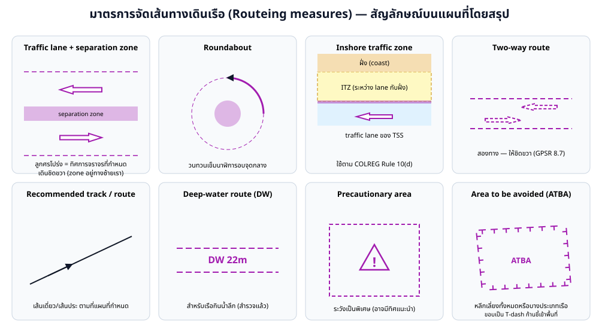
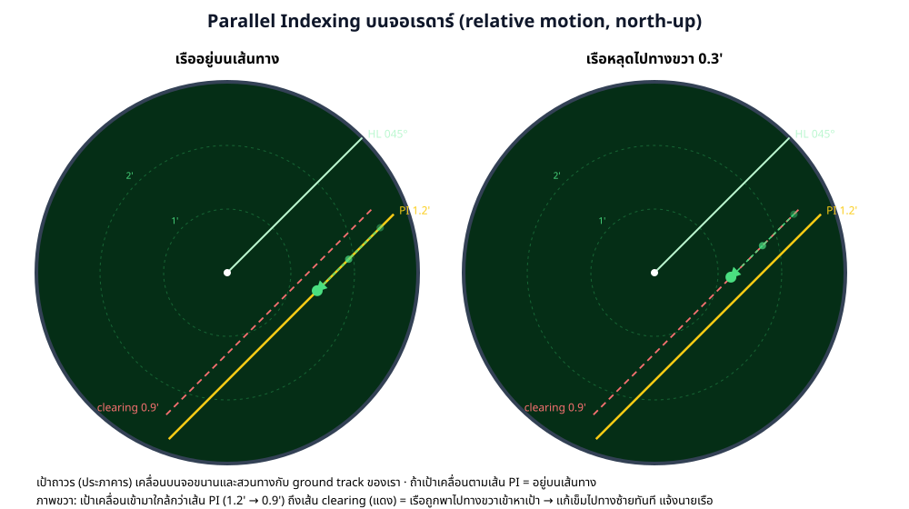
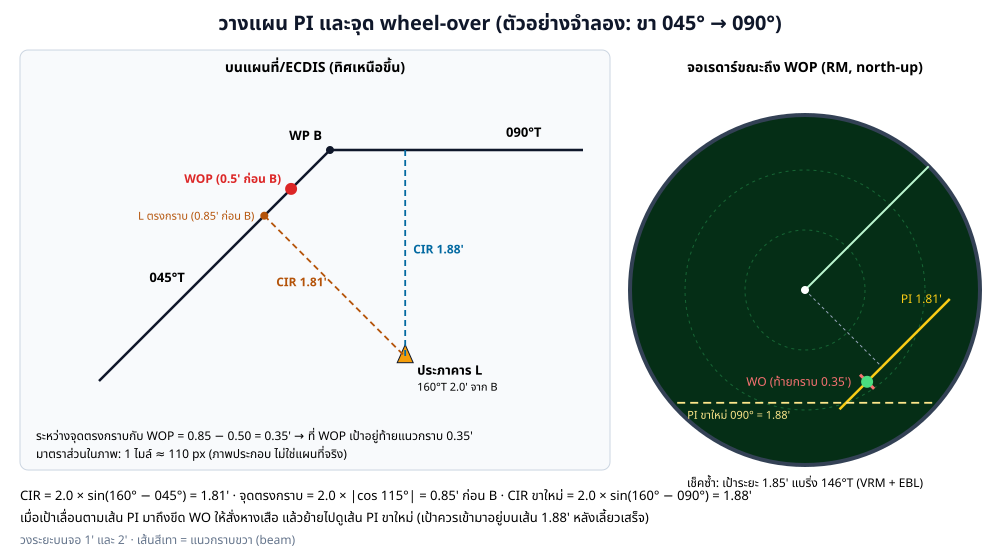

# 1.2.1 Watchkeeping (ภาค C) — Ships' Routeing, Ship Reporting, VTS และ Blind Pilotage

> สมุดบันทึกการฝึก OOW · TIRAPHONG NANTAPAN
> สมรรถนะตาม STCW A-II/1: *The use of routeing in accordance with the General Provisions on Ships' Routeing*; *Knowledge of blind pilotage techniques*; *The use of reporting in accordance with the General Principles for Ship Reporting Systems and with VTS procedures*
> อ้างอิงหลัก: SOLAS V/10 (Ships' routeing), V/11 (Ship reporting systems), V/12 (Vessel traffic services); IMO Res. **A.572(14) as amended** – *General Provisions on Ships' Routeing* (ตีพิมพ์ใน IMO publication *Ships' Routeing*); Res. **A.851(20)** – *General principles for ship reporting systems and ship reporting requirements*; Res. **A.1158(32)** – *Guidelines for Vessel Traffic Services* (แทน A.857(20)); IALA Guidelines/Recommendations on VTS; ADMIRALTY List of Radio Signals Vol 6 (NP286); IMO SMCP; BR 45; *Radar and ARPA Manual* (blind pilotage); ICS BPG

---

## ส่วนที่ 1 — Ships' Routeing (การจัดเส้นทางเดินเรือ)

### 1.1 ฐานทางกฎหมาย

- **SOLAS V/10** — ระบบจัดเส้นทางช่วยให้ชีวิตในทะเลปลอดภัย การเดินเรือปลอดภัยและมีประสิทธิภาพ และ/หรือคุ้มครองสิ่งแวดล้อมทางทะเล IMO เป็นองค์กรเดียวที่ **รับรอง (adopt)** ระบบจัดเส้นทางในระดับสากล ระบบที่ IMO รับรองอาจเป็น **บังคับ (mandatory)** สำหรับเรือทุกลำ บางประเภท หรือบางสินค้าได้ เรือต้องใช้ระบบตามที่ IMO รับรอง
  - จดไว้กันลืม: เรือต้องใช้ระบบจัดเส้นทาง **แบบบังคับ** ตามประเภทเรือ/สินค้าของตน เว้นแต่มี **เหตุจำเป็นที่หลีกเลี่ยงไม่ได้ (compelling reasons)** และ **ต้องบันทึกเหตุผลลงในสมุดปูมเรือ**
- **COLREG Rule 10** — กฎการปฏิบัติใน TSS (บท 1.2.1-A)
- **Res. A.572(14) as amended — General Provisions on Ships' Routeing (GPSR)** — นิยาม วัตถุประสงค์ ขั้นตอนการเสนอและรับรอง วิธีการออกแบบ และการใช้ระบบจัดเส้นทาง
- รายละเอียดของทุกระบบที่ IMO รับรองอยู่ในสิ่งพิมพ์ IMO ***Ships' Routeing*** (ฉบับรวมและแก้ไขเป็นระยะ) และแสดงบนแผนที่/ENC, Sailing Directions, ADMIRALTY Mariners' Routeing Guides (เช่นช่องแคบอังกฤษ)

### 1.2 วัตถุประสงค์ของการจัดเส้นทาง (GPSR ข้อ 1.1–1.2)

วัตถุประสงค์หลักคือ **เพิ่มความปลอดภัยของการเดินเรือในพื้นที่ที่เรือหนาแน่นหรือการเดินเรือถูกจำกัด** (ข้อ 1.1 ระบุบริเวณที่เส้นทางมาบรรจบกัน การจราจรหนาแน่น หรือเรือเคลื่อนที่ได้จำกัดเพราะพื้นที่แคบ สิ่งกีดขวาง ความลึกจำกัด หรือสภาพอุตุนิยมวิทยาไม่เอื้อ) โดยวัตถุประสงค์เฉพาะ (ข้อ 1.2) อาจรวมถึง
1. แยกกระแสการจราจรที่สวนทางกัน เพื่อลดการเกิด head-on
2. ลดอันตรายจากการ crossing ระหว่างเรือที่ข้ามกับเรือในเส้นทางที่กำหนด
3. ทำให้รูปแบบการจราจรง่ายขึ้นในบริเวณที่เส้นทางมาบรรจบกัน (convergence areas)
4. จัดการจราจรในพื้นที่ที่มีการสำรวจ/ขุดเจาะทรัพยากรนอกชายฝั่ง
5. จัดการจราจรในหรือรอบพื้นที่ที่การเดินเรืออาจเป็นอันตรายหรือไม่พึงประสงค์ (เช่น พื้นที่อ่อนไหวทางสิ่งแวดล้อม)
6. ลดความเสี่ยงการเกยตื้นด้วยแนวทางพิเศษในพื้นที่ที่ความลึกไม่แน่นอนหรือวิกฤติ
7. แนะนำเส้นทางให้หลีกเลี่ยงพื้นที่ประมงหรือจัดเส้นทางผ่านพื้นที่ประมง

(ฉบับแก้ไขภายหลังของ GPSR แยกเรื่อง **การจัดการจราจรในหรือรอบ หรือให้ห่างอย่างปลอดภัยจากพื้นที่อ่อนไหวทางสิ่งแวดล้อม** ออกเป็นข้อของตัวเอง — ในข้อ 5 ข้างบนผมรวมไว้เป็นตัวอย่าง)

### 1.3 มาตรการจัดเส้นทาง (Routeing measures) — นิยามตาม GPSR



*ภาพที่ 1.2.1-C1 สัญลักษณ์โดยสรุปของมาตรการจัดเส้นทาง (สัญลักษณ์จริงบนแผนที่ดู NP5011 หมวด M)*

| มาตรการ | นิยาม |
|---|---|
| **Routeing system** | ระบบใด ๆ ที่ประกอบด้วยเส้นทางหรือมาตรการจัดเส้นทางหนึ่งหรือหลายอย่าง เพื่อลดความเสี่ยงอุบัติเหตุ |
| **Traffic separation scheme (TSS)** | มาตรการแยกกระแสการจราจรสวนทางกันด้วยวิธีที่เหมาะสม และการกำหนด traffic lanes |
| **Separation zone or line** | เขตหรือเส้นที่แยก traffic lanes ที่เรือแล่นสวนทาง (หรือเกือบสวนทาง) กัน หรือแยก traffic lane ออกจากพื้นที่ทะเลข้างเคียง (adjacent sea area — เช่น ITZ) หรือแยก lanes ที่กำหนดสำหรับเรือบางประเภทที่แล่นทิศเดียวกัน |
| **Traffic lane** | พื้นที่ภายในขอบเขตที่กำหนดซึ่งมีการจราจรทางเดียว (one-way traffic) — ขอบเขตธรรมชาติก็ใช้เป็นขอบได้ |
| **Roundabout** | มาตรการที่ประกอบด้วยจุดหรือเขตแบ่งแนววงกลมและ traffic lane วงกลมรอบ ๆ — การจราจรเคลื่อน **ทวนเข็มนาฬิกา** รอบจุด/เขตกลาง |
| **Inshore traffic zone (ITZ)** | พื้นที่ระหว่างขอบด้านฝั่งของ TSS กับชายฝั่ง ใช้ตาม COLREG Rule 10(d) |
| **Two-way route** | เส้นทางในขอบเขตที่กำหนดซึ่งมีการจราจรสองทาง เพื่อให้เรือผ่านน่านน้ำที่การเดินเรือยากหรืออันตรายได้อย่างปลอดภัย |
| **Recommended route** | เส้นทางที่ไม่ได้กำหนดความกว้าง เพื่อความสะดวกของเรือผ่าน มักมีทุ่น center-line |
| **Recommended track** | เส้นทางที่ได้รับการตรวจสอบเป็นพิเศษว่าปลอดภัยจากอันตรายในระดับที่ทำได้ และแนะนำให้เรือใช้ |
| **Deep-water route (DW)** | เส้นทางในขอบเขตที่กำหนดซึ่ง **สำรวจอย่างละเอียด** ว่าความลึกและสิ่งกีดขวางเป็นไปตามที่แผนที่ระบุ — สำหรับเรือที่กินน้ำลึกเมื่อเทียบกับความลึกที่มี เรือที่ไม่จำเป็นต้องใช้ DW ควรหลีกเลี่ยง |
| **Precautionary area** | พื้นที่ในขอบเขตที่กำหนดซึ่งเรือต้องเดินเรือด้วยความระมัดระวังเป็นพิเศษ — อาจมีทิศทางการจราจรที่แนะนำ |
| **Area to be avoided (ATBA)** | พื้นที่ที่การเดินเรืออันตรายเป็นพิเศษ หรือจำเป็นต้องหลีกเลี่ยงอุบัติเหตุอย่างยิ่ง — ให้เรือทุกลำหรือบางประเภทหลีกเลี่ยง |
| **No anchoring area** | พื้นที่ห้ามทอดสมอ (เช่น เพื่อคุ้มครองแนวปะการัง ท่อ เคเบิล) — นิยาม GPSR: พื้นที่ในขอบเขตที่กำหนดซึ่งการทอดสมอเป็นอันตราย หรืออาจทำให้สิ่งแวดล้อมทางทะเลเสียหายจนรับไม่ได้ เรือทุกลำหรือบางประเภทควรหลีกเลี่ยงการทอดสมอ **ยกเว้นกรณีอันตรายเฉพาะหน้าต่อเรือหรือคนบนเรือ** |
| **Established direction of traffic flow** | รูปแบบทิศทางการจราจรใน TSS |
| **Recommended direction of traffic flow** | ทิศทางการจราจรที่แนะนำ (ไม่บังคับ) ในบริเวณที่ไม่สะดวกหรือไม่จำเป็นต้องกำหนดทิศทาง |
| **Archipelagic sea lanes** | ช่องทางเดินเรือในน่านน้ำหมู่เกาะตาม UNCLOS ข้อ 53 (เช่น ALKI ของอินโดนีเซีย) — IMO รับรองตาม GPSR ส่วนที่เกี่ยวข้อง |

### 1.4 การใช้ระบบจัดเส้นทาง (GPSR ส่วนที่ 8 "Use of routeing systems")

1. ระบบจัดเส้นทางที่ IMO รับรอง **แนะนำให้เรือทุกลำใช้** (หรือบังคับถ้ารับรองเป็น mandatory) เว้นแต่ระบุเป็นอย่างอื่น
2. เรือที่ใช้ TSS ต้องปฏิบัติตาม **COLREG Rule 10** และกฎอื่นของ COLREG ตามปกติ
3. ระบบจัดเส้นทาง **ไม่ได้ทำให้เรือมีสิทธิ์พิเศษ** และไม่ยกเว้นหน้าที่ภายใต้ COLREG
4. Deep-water routes ควรใช้เฉพาะเรือที่จำเป็นเพราะ draught — เรืออื่นควรหลีกเลี่ยงเพื่อไม่ให้ขัดขวาง
5. เรือที่แล่นใน two-way route ให้ **อยู่ทางขวา** เท่าที่ปฏิบัติได้
6. ในพื้นที่ precautionary area ให้ระวังเป็นพิเศษ และปฏิบัติตามทิศทางที่แนะนำ — และตาม GPSR 8.6 เรือที่ **ไม่ได้ใช้** TSS/DW ที่เชื่อมกับพื้นที่นั้น หรือไม่ได้เข้า-ออกท่าใกล้เคียง **ควรหลีกเลี่ยง precautionary area ถ้าทำได้**
7. ต้อง **หลีกเลี่ยงการทอดสมอ** ใน TSS และในบริเวณใกล้ปลาย TSS (ข้อนี้มาจาก COLREG Rule 10(g))
8. เรือควรใช้แผนที่มาตราส่วนที่เหมาะสมและข้อมูลล่าสุดเกี่ยวกับระบบจัดเส้นทาง
9. เส้นทางและ TSS อาจมีข้อกำหนดเพิ่มเติม เช่นระบบรายงานบังคับ ข้อจำกัดความเร็ว หรือ UKC ขั้นต่ำ — ต้องอ่าน Ships' Routeing และ Sailing Directions
10. (GPSR 8.1) ระบบจัดเส้นทางออกแบบให้ใช้ทั้งกลางวันกลางคืนทุกสภาพอากาศ ในน่านน้ำไม่มีน้ำแข็งหรือน้ำแข็งบาง ๆ ที่ไม่ต้องใช้เรือตัดน้ำแข็ง
11. (GPSR 8.2) การตัดสินใจใช้เส้นทางต้องคิดเรื่อง **UKC** — ความลึกบนแผนที่ โอกาสที่พื้นทะเลเปลี่ยนไปหลังการสำรวจครั้งล่าสุด และผลของอุตุนิยมวิทยาและน้ำขึ้นลงต่อความลึก
12. (GPSR 8.4) บริเวณรอยต่อเส้นทาง (junction) แยกการจราจรจริงไม่ได้ ต้องระวังมาก — การแล่นตามเส้นทางหลักไม่ได้ให้ **สิทธิ์ทาง (right of way)** พิเศษใด ๆ
13. (GPSR 8.8) **ลูกศรบนแผนที่บอกทิศทางการจราจรโดยทั่วไปเท่านั้น** ไม่จำเป็นต้องตั้งเข็มตามลูกศรเป๊ะ ๆ
14. (GPSR 8.9) สัญญาณ **YG** ตาม International Code of Signals แปลว่า "You appear not to be complying with the traffic separation scheme" — VTS/รัฐชายฝั่งอาจส่งมาทาง VHF หรือไฟสัญญาณ ถ้าได้รับต้องตรวจตัวเองทันที

### 1.5 ตัวอย่างที่ควรรู้ — ช่องแคบมะละกาและสิงคโปร์ (Straits of Malacca and Singapore)

เส้นทางสำคัญที่สุดสำหรับเรือที่ออกจากประเทศไทยไปยุโรป ตะวันออกกลาง อินเดีย

- มี **TSS ต่อเนื่อง** จากประมาณ One Fathom Bank ถึงช่องแคบสิงคโปร์ และ **Deep-Water Route** ในบางช่วง (ในรายละเอียดเป็น TSS หลายช่วงต่อกัน มี precautionary areas คั่นตรงทางเข้าออกท่าและจุดเปลี่ยนแนว ไปจนถึงแถว Horsburgh Lighthouse ทางตะวันออกของช่องแคบสิงคโปร์)
- ระบบรายงานเรือบังคับ **STRAITREP** (ตาม SOLAS V/11) — ครอบคลุมช่องแคบทั้งหมด ศูนย์ VTS ได้แก่ Klang VTS, Johor VTS และ Singapore VTIS
- **ข้อกำหนดสำหรับเรือกินน้ำลึกและ VLCC** (ตามกฎการเดินเรือในช่องแคบที่ IMO รับรอง): เรือกินน้ำลึก (draught ≥ 15 m) และ VLCC (≥ 150,000 DWT) ต้องรักษา **UKC อย่างน้อย 3.5 m** ตลอดการผ่าน และวางแผนการเดินทางให้เหมาะสม (ตรวจรายละเอียดฉบับปัจจุบันใน Ships' Routeing และ NP44/NP30)
- พื้นที่เสี่ยงการปล้นเรือ (ReCAAP ISC รายงานเหตุในช่องแคบสิงคโปร์อย่างสม่ำเสมอ) — ใช้มาตรการ SSP
- รายละเอียดช่อง VHF จุดรายงาน และข้อกำหนดอื่น ดู **ALRS Vol 6 (NP286)** และ Sailing Directions

---

## ส่วนที่ 2 — Ship Reporting Systems (ระบบรายงานเรือ)

### 2.1 ฐานทางกฎหมาย

- **SOLAS V/11** — ระบบรายงานเรือช่วยความปลอดภัยของชีวิตในทะเล ความปลอดภัยและประสิทธิภาพการเดินเรือ และ/หรือการคุ้มครองสิ่งแวดล้อม ระบบที่ IMO รับรองเป็น **mandatory** ได้ เรือต้องปฏิบัติตาม ส่วนระบบที่ไม่ได้รับรองเป็นบังคับ (voluntary) ส่งเสริมให้เข้าร่วม
- **Res. A.851(20)** — General principles for ship reporting systems and ship reporting requirements, including guidelines for reporting incidents involving dangerous goods, harmful substances and/or marine pollutants — กำหนด **รูปแบบมาตรฐาน (standard reporting format)** ให้ทุกระบบใช้ตรงกัน
- **SOLAS V/31–32** — การรายงานอันตราย (danger messages): น้ำแข็ง ซากลอย พายุหมุนเขตร้อน อุณหภูมิอากาศต่ำกว่าจุดเยือกแข็งพร้อมลมแรง (icing) ลมแรง Beaufort ≥ 10 ที่ไม่ได้รับคำเตือน — และตั้งแต่ **1 ม.ค. 2026 การรายงานตู้สินค้าสูญหายหรือพบตู้ลอย (containers lost/observed adrift)** (แก้ไข SOLAS V/31 และ V/32)
  - รายละเอียดที่ควรจำ: แก้ไขโดย Res. **MSC.550(108)** มีผล 1 ม.ค. 2026 — นายเรือของเรือที่ **ทำตู้สินค้าหาย** ต้องรายงานโดยเร็วไปยังเรือใกล้เคียง **รัฐชายฝั่งที่ใกล้ที่สุด** และ **รัฐเจ้าของธง** (บอกตำแหน่ง จำนวนตู้ และข้อมูลที่จำเป็นเท่าที่มี เช่น มีสินค้าอันตรายหรือไม่) ส่วนเรือที่ **พบตู้ลอย** ต้องรายงานเรือใกล้เคียงและรัฐชายฝั่งที่ใกล้ที่สุด — ฝั่ง MARPOL แก้ Protocol I ให้สอดคล้องด้วย Res. MEPC.384(81)
- **MARPOL Article 8 และ Protocol I** — รายงานเหตุการณ์มลพิษ (ดูบท 3.1)

### 2.2 ประเภทของรายงาน (Types of report) ตาม A.851(20)

| ชื่อย่อ | ชื่อเต็ม | เมื่อใด |
|---|---|---|
| **SP** | Sailing Plan | ก่อนหรือเมื่อออกจากท่าในพื้นที่ระบบ หรือเมื่อเข้าพื้นที่ระบบ |
| **PR** | Position Report | เมื่อจำเป็นเพื่อให้ระบบทำงานได้ (เป็นระยะ หรือที่จุดรายงาน) |
| **DR** | Deviation Report | เมื่อตำแหน่งเรือเบี่ยงจากที่คาดไว้อย่างมาก เนื่องจากเปลี่ยนเส้นทางหรือจุดหมาย หรือตามที่ระบบกำหนด |
| **FR** | Final Report | เมื่อถึงจุดหมายหรือออกจากพื้นที่ระบบ |
| **DG** | Dangerous Goods report | เมื่อเกิดเหตุการณ์ที่สินค้าอันตรายสูญหายหรืออาจสูญหายลงทะเล |
| **HS** | Harmful Substances report | เมื่อเกิดการปล่อยหรืออาจปล่อยน้ำมัน (MARPOL Annex I) หรือสารเหลวมีพิษ (Annex II) |
| **MP** | Marine Pollutants report | เมื่อสินค้าที่เป็นมลพิษทางทะเลในรูปบรรจุภัณฑ์สูญหายหรืออาจสูญหายลงทะเล (Annex III) |
| (อื่น ๆ) | Any other report | ตามที่ระบบกำหนด |

### 2.3 รูปแบบมาตรฐาน (Standard reporting format) — ตัวอักษรระบุข้อมูล (designators)

| ตัว | ข้อมูล |
|---|---|
| A | ชื่อเรือ สัญญาณเรียกขาน (call sign) หรือสถานีเรือ (ship station identity — MMSI) และ **ธง (flag)** ตาม A.851(20); หลายระบบขอ IMO number เพิ่ม |
| B | วันและเวลา (6 หลัก วันที่+ชั่วโมงนาที ระบุ UTC หรือเวลาท้องถิ่น) |
| C | ตำแหน่งด้วยละติจูดลองจิจูด |
| D | ตำแหน่งด้วยแบริ่งจริงและระยะจากสิ่งที่ระบุได้ |
| E | เข็มจริง (true course) |
| F | ความเร็ว (นอต ทศนิยม 1 ตำแหน่ง) |
| G | ท่าที่ออก (port of departure) |
| H | วันเวลาและจุดที่เข้าพื้นที่ระบบ |
| I | จุดหมายและ ETA |
| J | นำร่อง (มีนำร่องบนเรือหรือไม่ — deep-sea/local pilot) |
| K | วันเวลาและจุดที่ออกจากพื้นที่ระบบ |
| L | ข้อมูลเส้นทาง (route information) |
| M | สถานีวิทยุที่เฝ้าฟังและช่องที่ใช้ |
| N | เวลาของรายงานครั้งถัดไป |
| O | อัตรากินน้ำลึกสูงสุดในขณะนั้น (static draught) |
| P | สินค้าบนเรือ (รวมสินค้าอันตราย ประเภท ปริมาณ) |
| Q | ข้อบกพร่อง ความเสียหาย ความขัดข้อง หรือข้อจำกัดอื่น |
| R | คำอธิบายมลพิษหรือสินค้าอันตรายที่สูญหายลงทะเล |
| S | สภาพอากาศ |
| T | ข้อมูลติดต่อตัวแทน/เจ้าของเรือ |
| U | ขนาดและประเภทเรือ (ความยาว ความกว้าง ตันกรอส ประเภท) |
| V | บุคลากรทางการแพทย์บนเรือ |
| W | จำนวนคนบนเรือทั้งหมด |
| X | ข้อมูลอื่น ๆ (miscellaneous) |
| Y | ขอให้ส่งต่อรายงานไปยังระบบอื่น |
| Z | จบรายงาน (end of report) |

**ตัวอย่างจำลอง — Sailing Plan (SP) แบบใช้ designators**
```
SP
A/ANDAMAN PEARL/HSXX9/IMO 9XXXXXX
B/100600UTC+7
G/LAEM CHABANG
I/SINGAPORE/121610UTC+8
L/RHUMB LINE VIA WP1-WP7 THEN SINGAPORE STRAIT TSS
O/0960 (9.60 m)
P/CONTAINERS INCL IMDG CLASS 3, 8
U/172 m/27.6 m/CONTAINER SHIP
W/22
Z/EOR
```
(ข้อมูลสมมติ — รูปแบบจริงต้องตามที่แต่ละระบบกำหนด บางระบบใช้แบบฟอร์มออนไลน์หรือ AIS แทน)

### 2.4 ระบบรายงานที่ควรรู้จัก

| ระบบ | ประเภท | ข้อสังเกต |
|---|---|---|
| **AMVER** (Automated Mutual-assistance Vessel Rescue System) | สมัครใจ ทั่วโลก ดำเนินการโดย US Coast Guard | ใช้ประสานเรือที่อยู่ใกล้เหตุให้ไปช่วยเหลือ SAR — บริษัทส่วนใหญ่ให้เรือเข้าร่วม |
| **STRAITREP** | บังคับ (SOLAS V/11) | ช่องแคบมะละกาและสิงคโปร์ |
| **AUSREP** | บังคับสำหรับเรือบางประเภทในพื้นที่รับผิดชอบ SAR ของออสเตรเลีย | ดำเนินการโดย AMSA — **ปัจจุบัน AUSREP ถูกแทนด้วย MASTREP (Modernised Australian Ship Tracking and Reporting System) ตั้งแต่ 1 ก.ค. 2013** รายงานตำแหน่งอัตโนมัติผ่าน AIS (และ LRIT) ไม่ต้องส่ง SP/FR ด้วยมือ บังคับสำหรับเรือต่างชาติตั้งแต่ถึงท่าแรกในออสเตรเลียจนออกจากท่าสุดท้าย และเรือออสเตรเลียที่อยู่ในบังคับ — ชื่อ AUSREP ยังโผล่ในตำราและข้อสอบเก่า |
| **REEFREP** | บังคับ | Great Barrier Reef และ Torres Strait |
| **JASREP** | สมัครใจ | ญี่ปุ่น |
| **INSPIRES** | (อินเดีย) — บังคับสำหรับเรือธงอินเดีย สมัครใจสำหรับเรือต่างชาติ (ตรวจ ALRS Vol 1 ฉบับปัจจุบัน) | Indian Ship Position and Information Reporting System (กองทัพเรืออินเดียร่วมกับ DG Shipping) — มี **INDSAR** ของ Indian Coast Guard สำหรับงาน SAR ทำงานคู่กัน |
| **CALDOVREP / MAREP** | บังคับ | Dover Strait/Pas de Calais |
| **WETREP** | บังคับสำหรับเรือบรรทุกน้ำมันบางประเภท | Western European Particularly Sensitive Sea Area |
| **ระบบรายงานในพื้นที่เสี่ยงโจรสลัด** (UKMTO VRA, MSCHOA) | สมัครใจ (แต่แนะนำอย่างยิ่ง) | อ่าวเอเดน ทะเลแดง มหาสมุทรอินเดียตะวันตก |
| **LRIT** (SOLAS V/19-1) | บังคับ อัตโนมัติ | ส่งตำแหน่งทุก 6 ชั่วโมงผ่านดาวเทียม ไม่ต้องทำด้วยมือ (แต่ต้องตรวจว่าเครื่องทำงาน) |

รายละเอียดทุกระบบ (พื้นที่ จุดรายงาน ช่องทางสื่อสาร รูปแบบ) อยู่ใน **ALRS Vol 1 และ Vol 6** และ Sailing Directions

### 2.5 แนวปฏิบัติของ OOW ในการรายงาน

1. ตรวจในแผนการเดินทางว่าจะผ่านระบบรายงานใดบ้าง และเตรียมข้อมูลล่วงหน้า (แบบฟอร์ม/ข้อความ)
2. รายงานตรงเวลาและจุดที่กำหนด ใช้ **SMCP** ในการรายงานทางวิทยุ
3. บันทึกการรายงานในสมุดปูมเรือ/GMDSS log
4. การรายงานไม่ได้ทำให้ความรับผิดชอบด้านการเดินเรือเปลี่ยนไป
5. ถ้ามีเหตุที่ต้องรายงาน (DG/HS/MP, danger messages) รายงานทันทีไปยังรัฐชายฝั่งที่ใกล้ที่สุด

---

## ส่วนที่ 3 — Vessel Traffic Services (VTS)

### 3.1 ฐานทางกฎหมายและนิยาม

- **SOLAS V/12** — VTS ช่วยความปลอดภัยของชีวิตในทะเล ความปลอดภัยและประสิทธิภาพการเดินเรือ และคุ้มครองสิ่งแวดล้อม รัฐภาคีจัดตั้ง VTS ได้เมื่อปริมาณการจราจรหรือระดับความเสี่ยงสมควร **การใช้ VTS บังคับได้เฉพาะในทะเลอาณาเขตของรัฐชายฝั่ง** และรัฐต้องปฏิบัติตามแนวทางของ IMO เท่าที่ทำได้
  - แก้ความเข้าใจ: VTS ที่อยู่ **นอกทะเลอาณาเขต** ให้ได้เพียงข้อมูลและคำแนะนำบนพื้นฐาน **การเข้าร่วมโดยสมัครใจ** (A.1158(32) ข้อ 4.5) — สิ่งที่ IMO รับรองให้บังคับเกินทะเลอาณาเขตได้คือ **ระบบรายงานเรือ (V/11)** และ **ระบบจัดเส้นทาง (V/10)** ที่ VTS ไปทำงานร่วมด้วย เช่น STRAITREP หรือ CALDOVREP ไม่ใช่ตัว VTS เอง
- **IMO Res. A.1158(32) – Guidelines for Vessel Traffic Services** (รับรอง 15 ธ.ค. 2021 แทน A.857(20)) — ข้อความในกรอบข้างล่างเป็น **นิยามเดิมตาม A.857(20)** (ยังเห็นในตำราและ IALA เล่มเก่า) ส่วนนิยามปัจจุบันตาม A.1158(32) สรุปความได้ว่า VTS คือ **บริการที่รัฐ (Government) จัดให้ มีความสามารถในการปฏิสัมพันธ์กับการจราจรและตอบสนองต่อสถานการณ์ที่กำลังก่อตัวในพื้นที่ VTS** เพื่อเพิ่มความปลอดภัยและประสิทธิภาพของการเดินเรือ มีส่วนต่อความปลอดภัยของชีวิตในทะเล และสนับสนุนการคุ้มครองสิ่งแวดล้อม — นิยามเดิม:
  > "A service implemented by a Competent Authority, designed to improve the safety and efficiency of vessel traffic and to protect the environment. **The service should have the capability to interact with the traffic and to respond to traffic situations developing in the VTS area.**"
- **Competent Authority** — หน่วยงานรัฐที่รับผิดชอบความปลอดภัย รวมถึงการจัดตั้ง VTS (A.1158(32): หน่วยงานที่รัฐมอบให้รับผิดชอบ VTS)
- **VTS Provider** — หน่วยงานที่ได้รับมอบอำนาจให้ให้บริการ VTS
- **VTS area** — พื้นที่ที่กำหนดอย่างเป็นทางการ อาจแบ่งเป็น sub-areas/sectors
- **VTS Operator (VTSO)** — ผู้ปฏิบัติงานที่ผ่านการฝึกตามมาตรฐาน IALA (A.1158(32) ใช้คำรวมว่า **VTS personnel** — ผู้ทำงานด้าน VTS ที่ผ่านการฝึกและมีคุณสมบัติเหมาะสม)
- **Allied services** (A.1158(32)) — บริการอื่นที่ช่วยให้เรือผ่านพื้นที่ VTS อย่างปลอดภัย เช่น นำร่อง เรือลากจูง คนรับเชือก
- **Participating ship** (A.1158(32)) — เรือที่ถูกกำหนดให้ต้องเข้าร่วม VTS (เรืออื่นเข้าร่วมได้โดยทำตามข้อกำหนดของ VTS)

### 3.2 บริการของ VTS

**ตามแนวทางเดิม A.857(20)** (ยังสอนและถามกันบ่อย)

| บริการ | ลักษณะ |
|---|---|
| **Information Service (INS)** | ให้ข้อมูลที่จำเป็นต่อการตัดสินใจบนสะพานเดินเรือ เช่น ตำแหน่ง เจตนา และจุดหมายของเรืออื่น สภาพร่องน้ำ อากาศ อันตราย ทุ่นดับ — ออกอากาศตามเวลาหรือเมื่อร้องขอ |
| **Navigational Assistance Service (NAS)** | ช่วยการตัดสินใจทางการเดินเรือบนสะพานและติดตามผล โดยเฉพาะในสภาพการเดินเรือหรืออากาศที่ยาก หรือเมื่อเรือมีข้อบกพร่อง — ให้ตามที่เรือร้องขอหรือเมื่อ VTS เห็นว่าจำเป็น |
| **Traffic Organization Service (TOS)** | ป้องกันการเกิดสถานการณ์อันตรายด้วยการจัดการจราจรล่วงหน้า เช่น จัดลำดับ (sequencing) จัดสรรช่องว่าง (space allocation) การให้รายงานการเคลื่อนที่ ข้อกำหนดความเร็ว เส้นทางที่ต้องใช้ |

**ตามแนวทางใหม่ A.1158(32)** — เน้นที่ "ความสามารถในการปฏิสัมพันธ์กับการจราจร" แทนการแบ่งบริการเป็นสามประเภท VTS ให้ **information, warnings, advice และ instructions** ตามความเหมาะสม และรายละเอียดการให้บริการกำหนดตาม IALA standards/guidelines

จดไว้เทียบของเก่า-ใหม่ (A.1158(32) ข้อ 3 — สรุปความ): วัตถุประสงค์ของ VTS ทำผ่าน 3 งานหลัก

| งานตาม A.1158(32) | ตัวอย่างในแนวทาง | ใกล้เคียงบริการเดิม (A.857(20)) |
|---|---|---|
| ให้ข้อมูลที่ทันเวลาและเกี่ยวข้อง ช่วยการตัดสินใจบนเรือ | ตำแหน่ง ตัวตน เจตนา การเคลื่อนที่ของเรืออื่น, MSI, ข้อจำกัดของเรืออื่น, ระเบียบการรายงาน/ISPS, ประสานบริการร่วม | INS |
| เฝ้าติดตามและจัดการการจราจร | วางแผนการเคลื่อนที่ล่วงหน้า, จัดเรือที่กำลังแล่น, จัดสรรพื้นที่, ระบบ traffic clearance, ระบบ voyage/passage plan, แนะนำเส้นทาง, บังคับใช้ข้อกำหนดที่มีอำนาจ | TOS |
| ตอบสนองต่อสถานการณ์ไม่ปลอดภัยที่กำลังก่อตัว | เรือไม่แน่ใจตำแหน่ง/เส้นทาง, หลุดเส้นทาง, ต้องการนำไปที่ทอดสมอ, อุปกรณ์ขัดข้อง, อากาศเลว, เสี่ยงเกยตื้น/โดนกัน, เหตุฉุกเฉิน | NAS |

(การจับคู่คอลัมน์ขวาเป็นการเทียบของผมเองเพื่อช่วยจำ ไม่ใช่ข้อความในมติ — ตอบสอบให้บอกว่าแนวทางใหม่ไม่ได้แบ่ง "ประเภทบริการ" แบบเดิมแล้ว)

### 3.3 ความรับผิดชอบระหว่าง VTS กับเรือ

- **นายเรือยังคงรับผิดชอบการเดินเรือและการบังคับเรือ** ตลอดเวลา — ข้อมูลหรือคำแนะนำของ VTS **ไม่ได้ลบล้างความรับผิดชอบนี้**
- การตัดสินใจเรื่องการเดินเรือและการบังคับเรือจริง (การหลบเรือ ความเร็ว เข็ม) อยู่ที่สะพานเดินเรือ
- **Instructions** ของ VTS (ในพื้นที่ที่กฎหมายให้อำนาจ) เป็นแบบ "เน้นผลลัพธ์" (result-oriented) เช่น "do not enter the fairway before 1030" ไม่ใช่สั่งการบังคับเรือโดยละเอียด เช่นสั่งมุมหางเสือ
- ถ้าเรือไม่สามารถปฏิบัติตามคำแนะนำหรือคำสั่งได้ ต้องแจ้ง VTS และเหตุผล
- ตาม A.1158(32) ข้อ 6: เรือที่ต้องเข้าร่วมต้อง **ส่งรายงาน/ข้อมูลที่ VTS ต้องการ**, **นำข้อมูล คำแนะนำ และคำเตือนของ VTS มาพิจารณา**, **ปฏิบัติตามข้อกำหนดและ instructions ของ VTS เว้นแต่มีเหตุผลด้านความปลอดภัยหรือการคุ้มครองสิ่งแวดล้อมที่ขัดกัน** และ **รายงานมลพิษหรืออันตรายต่อการเดินเรือให้ VTS** — ถ้านายเรือตัดสินใจไม่ทำตาม instruction อาจถูกขอให้รายงานเหตุผลภายหลัง จึงต้องบันทึกในปูมเรือให้ชัด
- VTS ไม่ใช่ "การนำร่องจากฝั่ง" (shore-based pilotage) ซึ่งเป็นเรื่องแยกต่างหาก

### 3.4 การสื่อสารกับ VTS — ใช้ SMCP และ Message markers

ประโยคที่สื่อสารกับ VTS ควรเริ่มด้วย **message marker** (ตาม IMO SMCP – A.918(22)) เพื่อบอกประเภทของข้อความ

| Marker | ใช้เมื่อ | ตัวอย่าง |
|---|---|---|
| **INSTRUCTION** | สั่งการ (มีอำนาจตามกฎหมาย) | "INSTRUCTION. Do not overtake the vessel ahead." |
| **ADVICE** | แนะนำ ผู้รับตัดสินใจเอง | "ADVICE. Stand by on VHF channel 12." |
| **WARNING** | แจ้งอันตราย | "WARNING. Buoy No. 7 unlit." |
| **INFORMATION** | ให้ข้อเท็จจริง | "INFORMATION. MV X will overtake you on your port side." |
| **QUESTION** | ถาม | "QUESTION. What is your present maximum draft?" |
| **ANSWER** | ตอบคำถาม | "ANSWER. My present maximum draft is 9.6 metres." |
| **REQUEST** | ขอ (ให้ทำ หรือขอสิ่งใด) | "REQUEST. I require two tugs." |
| **INTENTION** | บอกเจตนาของตนเอง | "INTENTION. I will reduce speed." |

ขั้นตอนทั่วไปเมื่อเข้าพื้นที่ VTS
1. ฟังช่อง VHF ที่กำหนดล่วงหน้า (จาก ALRS Vol 6 / Sailing Directions / แผนที่)
2. รายงานที่จุดรายงาน (reporting point) — ชื่อเรือ ตำแหน่ง ETA draught สินค้าอันตราย ฯลฯ ตามที่ VTS กำหนด
3. เฝ้าฟังตลอดในพื้นที่ (continuous listening watch) ตอบเมื่อถูกเรียก
4. แจ้งการเปลี่ยนแปลง (เจตนา เวลา ข้อบกพร่อง)
5. รายงานออกจากพื้นที่

**ตัวอย่างจำลอง (เข้าพื้นที่ VTS ของท่าเรือสมมติ)**
> **Ship:** "Port Control, Port Control, this is Andaman Pearl, Andaman Pearl, over."
> **VTS:** "Andaman Pearl, Port Control, go ahead, over."
> **Ship:** "Port Control, Andaman Pearl. INFORMATION. My position: reporting point Bravo. ETA pilot station 1430 local time. Maximum draft 9.6 metres. Dangerous cargo on board IMDG class 3 and 8. Over."
> **VTS:** "Andaman Pearl, Port Control. INFORMATION. Pilot will board at 1430. ADVICE. Reduce speed to 10 knots; outbound vessel in the channel. Over."
> **Ship:** "Port Control, Andaman Pearl. INTENTION. I will reduce speed to 10 knots. Pilot boarding 1430. Out."

---

## ส่วนที่ 4 — Blind Pilotage (การนำร่องด้วยเรดาร์ในทัศนวิสัยจำกัด)

### 4.1 Blind pilotage คืออะไร

**Blind pilotage** คือการนำเรือผ่านน่านน้ำจำกัด (ร่องน้ำ ช่องแคบ ทางเข้าท่า) ในทัศนวิสัยจำกัด **โดยอาศัยเรดาร์เป็นหลัก** แทนการมองเห็นด้วยตา คำนี้มาจากการฝึกของกองทัพเรือ (Royal Navy) แต่หลักการใช้กับเรือพาณิชย์ทุกลำ และรวมถึงเทคนิคที่ใช้ตรวจตำแหน่งต่อเนื่องในทุกทัศนวิสัยด้วย

หลักการสำคัญ: **ไม่ต้อง plot ตำแหน่งลงแผนที่ทุกครั้ง** แต่วางแผนเส้นอ้างอิงบนเรดาร์ล่วงหน้า แล้ว "ดูว่าเป้าอยู่ตรงที่ควรอยู่หรือไม่" แบบต่อเนื่อง — เร็วกว่าการ fix แล้ว plot มาก เหมาะกับพื้นที่แคบที่เวลาน้อย

### 4.2 Parallel Indexing (PI)



*ภาพที่ 1.2.1-C2 Parallel indexing — เป้าถาวรเคลื่อนตามเส้น PI แสดงว่าเรืออยู่บนเส้นทาง (ซ้าย) ถ้าเป้าเข้ามาใกล้กว่าเส้น แสดงว่าเรือถูกพาไปทางนั้น (ขวา)*

**หลักการ** — ในโหมด **relative motion** วัตถุที่อยู่กับที่ (ประภาคาร ปลายแหลม เกาะเล็ก) จะเคลื่อนที่บนจอเรดาร์ **ขนานและสวนทางกับ ground track ของเรือเรา** ด้วยความเร็วเท่ากับ SOG ถ้าเรือแล่นบนเส้นทางที่วางไว้พอดี เป้าจะเคลื่อนไปตามเส้นตรงที่ขนานกับเส้นทาง ห่างจากจุดศูนย์กลางจอเท่ากับระยะที่เรือจะผ่านวัตถุนั้น

**นิยาม**
- **Cross Index Range (CIR)** — ระยะตั้งฉากจากเส้นทางที่วางแผนถึงวัตถุอ้างอิง (= ระยะที่เรือจะผ่านวัตถุตอนอยู่ตรงกราบ)
- **Parallel Index line** — เส้นบนเรดาร์ที่ขนานกับเส้นทาง ห่างจากจุดศูนย์กลาง (ตำแหน่งเรือ) เท่ากับ CIR ด้านที่วัตถุอยู่

**ขั้นตอนการวางแผน (บนแผนที่/ECDIS)**
1. เลือกวัตถุอ้างอิงที่ **เด่นบนเรดาร์ (radar conspicuous)** ระบุได้แน่นอน และอยู่ใกล้เส้นทาง (หน้าผาชัน ประภาคารบนหิน — ไม่ใช่ชายหาดลาดหรือทุ่นลอย)
2. ลากเส้นจากวัตถุตั้งฉากกับเส้นทาง วัด CIR
3. กำหนดว่าวัตถุอยู่ด้านไหน (ขวา/ซ้าย)
4. คำนวณ **ขอบเขตปลอดภัย** — ถ้าเรือเบี่ยงไปทางวัตถุ CIR จะลดลง ถ้าเบี่ยงออก CIR จะเพิ่ม เทียบกับ no-go area เพื่อตั้งค่า **clearing lines** บนเรดาร์ (เส้น PI เพิ่มเติมที่บอกขีดจำกัด)
5. กำหนด **wheel-over** ด้วย PI: วัดระยะตามแนวเส้นทางจาก WOP ถึงจุดที่วัตถุอยู่ตรงกราบ → บนเรดาร์ทำเครื่องหมายบนเส้น PI ว่าเมื่อเป้าถึงจุดนั้นให้เริ่มหักหางเสือ (หรือใช้ VRM ร่วม)
6. เตรียม **PI ชุดใหม่สำหรับเส้นทางถัดไป** หลังเปลี่ยนเข็ม
7. เขียนทุกอย่างลงในแผนการเดินทางและ "blind pilotage plan" ที่ทีมสะพานเดินเรือใช้

**ขั้นตอนบนเรดาร์ขณะใช้งาน**
1. ตั้งเรดาร์เป็น **relative motion** (north-up หรือ course-up ที่ stabilised ด้วย gyro) — ถ้าใช้ true motion ต้องเป็น **ground-stabilised** (ไม่ใช่ sea-stabilised) ไม่อย่างนั้นเป้าถาวรจะลอยไปตามกระแสน้ำ
   - ขยายความให้ถูกหลัก: เส้น PI บนเรดาร์รุ่นปัจจุบัน **ผูกกับตำแหน่งเรือเรา (own-ship referenced)** ระยะและทิศสัมพัทธ์ระหว่างเรือกับเป้าถาวรเป็นเรขาคณิตจริงไม่ขึ้นกับโหมดจอ เส้น PI จึงยังใช้ได้แม้ใน true motion — ที่เสียคือใน **sea-stabilised TM** เป้าถาวรจะ "ไหล" บนจอสวนกระแสน้ำ true trail/vector ของเป้าถาวรไม่เป็นศูนย์ (หลอกตาว่าเป็นเป้าเคลื่อนที่) และ **nav lines/maps ที่อ้างพิกัดพื้นโลก (geo-referenced)** จะเลื่อนไม่ตรงกับเป้า — ด้วยเหตุนี้จึงนิยม RM หรือ ground-stabilised TM เมื่อทำ blind pilotage
2. ตรวจ **heading line alignment** และ **gyro error** ก่อนใช้
3. ตั้ง EBL/PI line เป็นทิศ **ขนานกับเส้นทางจริง (true track)** ระยะ CIR ไปด้านที่วัตถุอยู่ (เรดาร์รุ่นใหม่มีเมนู PI lines หรือ nav lines/maps)
4. เลือก range scale ที่เหมาะสม (เห็นวัตถุอ้างอิงและเป้าถัดไป)
5. เฝ้าดูว่าเป้าเคลื่อนตามเส้น PI หรือไม่
   - เป้าอยู่บนเส้น → เรืออยู่บนเส้นทาง
   - เป้าเข้ามาใกล้เรือ (ระยะตั้งฉาก < CIR) → เรือถูกพาไปทางวัตถุ → **แก้เข็มออกจากด้านวัตถุ**
   - เป้าออกห่าง (> CIR) → เรือเบี่ยงออกจากวัตถุ → แก้เข็มเข้าหาด้านวัตถุ
6. **การเผื่อกระแสน้ำ** — ถ้าต้องถือเข็มเผื่อ (CTS ≠ track) PI ยังตั้งตาม **track** ไม่ใช่ heading เพราะเป้าเคลื่อนสวนทาง ground track

**ตัวอย่างจำลอง**
- เส้นทาง 045°T ประภาคารบนหิน (เด่นบนเรดาร์) อยู่ทางขวา ระยะผ่าน (CIR) 1.2 ไมล์ no-go area อยู่ห่างประภาคาร 0.8 ไมล์รอบตัว
- PI line: ขนานกับ 045°/225° ห่างจากเรือ 1.2' ทางขวา
- Clearing line (danger): PI ที่ 0.9' ทางขวา — ถ้าเป้าข้ามเส้นนี้เข้ามา แปลว่าเรือเข้าใกล้ no-go เกินขอบเขตปลอดภัย ต้องแก้ทันทีและแจ้งนายเรือ
- ระหว่างแล่น เป้าเคลื่อนที่ระยะตั้งฉาก 0.9' → เรือถูกพาไปทางขวา 0.3' → แก้เข็มไปทางซ้ายประมาณ 5°–10° (ขึ้นกับระยะทางที่เหลือ) แล้วดูว่าเป้ากลับเข้าเส้น จากนั้นถือเข็มเผื่อกระแสน้ำ
  - ตรวจตัวเลข: ถ้าต้องการกลับเข้าเส้นทาง 0.3' ภายในระยะทางประมาณ 2 ไมล์ มุมที่ต้องแก้ ≈ arctan(0.3 / 2) ≈ 8.5° — จึงอยู่ในช่วง 5°–10° ที่ว่า; ถ้าเหลือระยะ 1 ไมล์ จะต้องแก้ราว 17° (อย่าลืมว่ายังต้องบวกมุมเผื่อกระแสน้ำที่ทำให้หลุดตั้งแต่แรก)

**ตัวอย่างจำลอง 2 — คำนวณ CIR และจุด wheel-over ด้วย PI (MV "Andaman Pearl")**

- ขาแรกเข็ม **045°T** ถึง WP B แล้วเปลี่ยนเป็น **090°T** · ประภาคาร L อยู่ที่แบริ่ง **160°T ระยะ 2.0 ไมล์จาก WP B** · จากข้อมูลการหันเรือ (turning data) ได้ระยะ wheel-over **0.5 ไมล์ก่อนถึง B**
- แตกเวกเตอร์ B→L เทียบแนวขาแรก (045°): ตามแนวเส้นทาง = 2.0 × cos(160° − 045°) = 2.0 × cos 115° = **−0.85'** (คือจุดที่ L อยู่ตรงกราบ อยู่ **ก่อน** ถึง B 0.85') · ตั้งฉาก = 2.0 × sin 115° = **1.81' ทางขวา** → **CIR ขาแรก = 1.81'**
- ที่ WOP (0.5' ก่อน B) เรือ **เลยจุดตรงกราบมาแล้ว 0.85 − 0.5 = 0.35'** → บนเส้น PI ให้ทำเครื่องหมาย wheel-over ไว้ **ท้ายแนวกราบ 0.35'** เมื่อเป้าเลื่อนมาถึงขีดนี้ให้สั่งหางเสือ — เช็คซ้ำด้วยระยะ/แบริ่ง: ระยะ = √(1.81² + 0.35²) ≈ **1.85'** แบริ่ง ≈ 045° + 90° + arctan(0.35/1.81) ≈ **146°T** (ตั้ง VRM 1.85' และ EBL 146° ไว้เป็น cross-check)
- PI ชุดใหม่สำหรับขา 090°: แตก B→L เทียบ 090° ได้ตามแนวเส้นทาง = 2.0 × cos 70° = 0.68' (L ตรงกราบหลัง B 0.68') และตั้งฉาก = 2.0 × sin 70° = **1.88' ทางขวา** → **CIR ขาที่สอง = 1.88'** เส้น PI ขนาน 090°/270°
- ถ้าเพิ่งเลี้ยวเสร็จแล้วเป้าอยู่ห่างกว่า 1.88' แปลว่าเลี้ยวช้า/กว้างไป (เรืออยู่ซ้ายของเส้นทางใหม่) ถ้าใกล้กว่าแปลว่าเลี้ยวเร็ว/แคบไป



*ภาพที่ 1.2.1-C3 ตัวอย่างจำลอง 2 — ซ้าย: วางแผนบนแผนที่ (CIR ขา 045° = 1.81', ขา 090° = 1.88', WOP 0.5' ก่อน WP B) ขวา: จอเรดาร์ขณะถึง WOP เป้าอยู่บนเส้น PI ท้ายแนวกราบ 0.35' (ระยะ 1.85' แบริ่ง 146°T) และเตรียมเส้น PI ของขาถัดไปไว้แล้ว*

### 4.3 เทคนิคอื่นใน blind pilotage

- **Clearing ranges ด้วย VRM** — ตั้ง VRM ที่ระยะต่ำสุดจากฝั่ง/อันตราย ถ้าฝั่งเข้ามาในวง VRM แปลว่าใกล้เกินไป
- **Radar maps / Nav lines / Mapping** — วาดเส้นขอบร่องน้ำ no-go lines บนเรดาร์ (บันทึกล่วงหน้าได้) ต้อง ground-stabilised และตรวจการจัดแนว
- **ECDIS radar overlay** — ซ้อนภาพเรดาร์บน ENC ตรวจว่าแนวฝั่งบนเรดาร์ตรงกับ ENC หรือไม่ (ถ้าไม่ตรง แปลว่าตำแหน่ง GNSS/heading ผิด หรือ ENC ผิด) — ใช้เป็นการตรวจสอบ ไม่ใช่วิธีเดียว
- **Head-on / stern bearings (EBL)** — ใช้วัตถุที่อยู่ตรงหัวหรือท้ายตามแนวร่องน้ำ
- **Range and bearing จากวัตถุเดียวต่อเนื่อง** — เมื่อมีวัตถุจำกัด
- **Echo sounder** — ตรวจความลึกต่อเนื่อง ตั้ง shallow alarm

### 4.4 การจัดทีมสำหรับ blind pilotage (ตามแนว BRM)

| บทบาท | หน้าที่ |
|---|---|
| **Command / Conning officer (นายเรือหรือผู้ที่ได้รับมอบหมาย)** | สั่งการหางเสือและเครื่องจักร ตัดสินใจ |
| **Navigator / Blind pilotage officer** | ดูเรดาร์ PI รายงาน "on track / x cables to port/starboard", ระยะถึง WOP, คำแนะนำเข็ม |
| **Plotting / Back-up officer** | ตรวจตำแหน่งด้วยวิธีอิสระ (GNSS/ECDIS, fix) ดูการจราจร (ARPA) และฟัง VHF/VTS |
| **Helmsman** | ถือท้ายด้วยมือ ทวนคำสั่ง |
| **Look-out (รวม bow look-out)** | ฟังและดู รายงานสิ่งที่เห็น/ได้ยิน |

**รายงานมาตรฐานของ navigator (ตัวอย่าง)** — "On track, 6 cables to wheel-over", "Two cables to starboard of track, recommend 040", "Wheel-over… now", "New PI on Point Alpha, 8 cables to port"

### 4.5 ข้อจำกัดและความเสี่ยง

1. ระบุเป้าผิด — อาจใช้วัตถุผิดตัว (ป้องกันด้วยการตรวจรูปทรงชายฝั่งและวัตถุหลายตัว)
2. Heading line / gyro error — ทำให้ PI เอียงจากที่ควรเป็น
3. เรดาร์ใช้ sea-stabilised true motion — เป้าถาวรลอยตามกระแสน้ำ (ทำให้ nav lines/maps ที่อ้างพิกัดพื้นโลกเลื่อนไม่ตรงเป้า และ trail ของเป้าถาวรหลอกตา)
4. เป้าเล็กหายในคลื่นหรือฝน (clutter)
5. ภาพเรดาร์ของวัตถุบนแผนที่อาจไม่ตรงกับที่วางแผน (ขอบฝั่งลาด ต้นไม้ อาคารใหม่)
6. ข้อผิดพลาดในการวางแผน CIR หรือทิศ
7. ภาระงานสูง — ต้องแบ่งหน้าที่ชัดเจน

---

## คำถามสอบปากเปล่า / สัมภาษณ์ — Routeing, Reporting, VTS, Blind Pilotage

**ถาม:** IMO resolution ใดเป็น General Provisions on Ships' Routeing
**แนวตอบ:** A.572(14) as amended — รวมอยู่ในสิ่งพิมพ์ IMO "Ships' Routeing"

**ถาม:** มาตรการจัดเส้นทางมีอะไรบ้าง
**แนวตอบ:** TSS (traffic lanes, separation zones/lines), roundabout, inshore traffic zone, two-way route, recommended route, recommended track, deep-water route, precautionary area, area to be avoided, no anchoring area, archipelagic sea lanes

**ถาม:** Deep-water route ต่างจาก traffic lane อย่างไร
**แนวตอบ:** DW route สำรวจอย่างละเอียดเป็นพิเศษ ใช้สำหรับเรือที่กินน้ำลึกเทียบกับความลึกที่มี เรืออื่นควรหลีกเลี่ยงเพื่อไม่ให้ขัดขวาง ส่วน traffic lane เป็นทางเดินรถทางเดียวใน TSS

**ถาม:** ใน roundabout การจราจรเคลื่อนที่ทิศใด
**แนวตอบ:** ทวนเข็มนาฬิการอบจุดหรือเขตแบ่งกลาง

**ถาม:** ระบบรายงานเรือมีรายงานกี่ประเภท อะไรบ้าง
**แนวตอบ:** ตาม A.851(20): Sailing Plan (SP), Position Report (PR), Deviation Report (DR), Final Report (FR), Dangerous Goods (DG), Harmful Substances (HS), Marine Pollutants (MP) และรายงานอื่นตามระบบกำหนด

**ถาม:** STRAITREP คืออะไร
**แนวตอบ:** ระบบรายงานเรือบังคับในช่องแคบมะละกาและสิงคโปร์ตาม SOLAS V/11 ศูนย์ VTS คือ Klang VTS, Johor VTS, Singapore VTIS

**ถาม:** VTS ให้บริการอะไรบ้าง
**แนวตอบ:** ตามแนวทางเดิม A.857(20): Information Service, Navigational Assistance Service, Traffic Organization Service แนวทางปัจจุบัน A.1158(32) เน้นความสามารถในการปฏิสัมพันธ์กับการจราจร ให้ information, warnings, advice และ instructions ตามความเหมาะสม

**ถาม:** ถ้า VTS แนะนำให้ทำสิ่งหนึ่ง ใครรับผิดชอบ
**แนวตอบ:** นายเรือยังรับผิดชอบการเดินเรือและการบังคับเรือ คำแนะนำของ VTS ไม่ลบล้างความรับผิดชอบนี้ ถ้าทำตามไม่ได้ต้องแจ้ง VTS

**ถาม:** Message markers ใน SMCP มีอะไรบ้าง
**แนวตอบ:** Instruction, Advice, Warning, Information, Question, Answer, Request, Intention

**ถาม:** Parallel indexing ทำงานอย่างไร
**แนวตอบ:** ในโหมด relative motion (หรือ ground-stabilised true motion) วัตถุถาวรเคลื่อนบนจอขนานและสวนทางกับ ground track ของเรือ ตั้งเส้นขนานกับเส้นทางห่างเท่ากับระยะผ่านที่วางแผน (CIR) ถ้าเป้าเคลื่อนตามเส้น แปลว่าเรืออยู่บนเส้นทาง ถ้าเป้าเบี่ยงจากเส้น แปลว่าเรือหลุดไปทางที่เป้าเข้ามาใกล้

**ถาม:** ทำไมไม่ควรใช้ sea-stabilised true motion ใน parallel indexing
**แนวตอบ:** เพราะในโหมดนั้นเป้าถาวรจะเคลื่อนที่บนจอตามผลของกระแสน้ำ (set) — ถ้า PI/clearing lines เป็นเส้นที่ตรึงกับจอหรือเป็น nav lines/maps ที่อ้างพิกัดพื้นโลก เป้าจะดูเหมือนไม่อยู่บนเส้นทั้งที่อาจอยู่บนเส้นทาง หรือกลับกัน และ true trail ของเป้าถาวรจะไม่เป็นศูนย์ทำให้สับสน (ส่วนเส้น PI ที่ผูกกับเรือเรายังให้ระยะสัมพัทธ์ถูกต้อง) จึงใช้ relative motion หรือ ground-stabilised true motion

**ถาม:** ข้อดีของ PI เทียบกับการ fix แล้ว plot
**แนวตอบ:** เห็นตำแหน่งเทียบเส้นทางได้ต่อเนื่องทันที ไม่ต้องเสียเวลา plot เหมาะกับร่องน้ำแคบ ใช้วางจุด wheel-over และ clearing lines ได้ ใช้ได้แม้ GNSS ขัดข้อง

**ถาม:** ถ้าเรือจะไม่ใช้ระบบจัดเส้นทางแบบบังคับที่ IMO รับรอง ต้องทำอย่างไร
**แนวตอบ:** ใช้ได้เฉพาะเมื่อมีเหตุจำเป็นที่หลีกเลี่ยงไม่ได้ (compelling reasons) และต้องบันทึกเหตุผลลงในสมุดปูมเรือ (SOLAS V/10)

**ถาม:** สัญญาณ YG หมายถึงอะไร
**แนวตอบ:** "You appear not to be complying with the traffic separation scheme" (International Code of Signals) — ได้รับแล้วต้องตรวจตำแหน่ง เข็ม และการปฏิบัติตาม Rule 10 ทันที

**ถาม:** นิยาม VTS ตาม A.1158(32) ต่างจากเดิมอย่างไร
**แนวตอบ:** แนวทางใหม่ (รับรอง 15 ธ.ค. 2021 แทน A.857(20)) ให้ VTS เป็นบริการที่รัฐจัดให้ มีความสามารถปฏิสัมพันธ์กับการจราจรและตอบสนองต่อสถานการณ์ในพื้นที่ VTS และไม่แบ่งเป็น INS/NAS/TOS แล้ว แต่บรรยายงานเป็นการให้ข้อมูล การติดตามและจัดการจราจร และการตอบสนองต่อสถานการณ์ไม่ปลอดภัย โดยสื่อสารเป็น information, warnings, advice และ instructions; VTS นอกทะเลอาณาเขตให้ได้เพียงข้อมูลและคำแนะนำแบบสมัครใจ

**ถาม:** AUSREP ยังใช้อยู่หรือไม่
**แนวตอบ:** ไม่ — ตั้งแต่ 1 ก.ค. 2013 ออสเตรเลียใช้ MASTREP ซึ่งรับตำแหน่งอัตโนมัติผ่าน AIS/LRIT ไม่ต้องส่ง Sailing Plan/Final Report ด้วยมือ (ตรวจข้อกำหนดล่าสุดใน ALRS Vol 1)

**ถาม:** วัตถุอ้างอิงอยู่ที่แบริ่ง 160°T ระยะ 2.0' จาก WP ที่เรือแล่นเข้าหาด้วยเข็ม 045°T CIR เท่าไร และวัตถุอยู่ตรงกราบเมื่อใด
**แนวตอบ:** CIR = 2.0 × sin(160° − 045°) = 1.81' ทางขวา; วัตถุอยู่ตรงกราบก่อนถึง WP เท่ากับ 2.0 × |cos 115°| = 0.85' — ใช้ค่านี้วางขีด wheel-over บนเส้น PI

---

*ก่อนหน้า ← [1.2.1-B หลักการเข้ายามเดินเรือ](1.2.1-B-watchkeeping-principles.md) · ถัดไป → [1.2.2 Bridge Resource Management](1.2.2-bridge-resource-management.md)*
