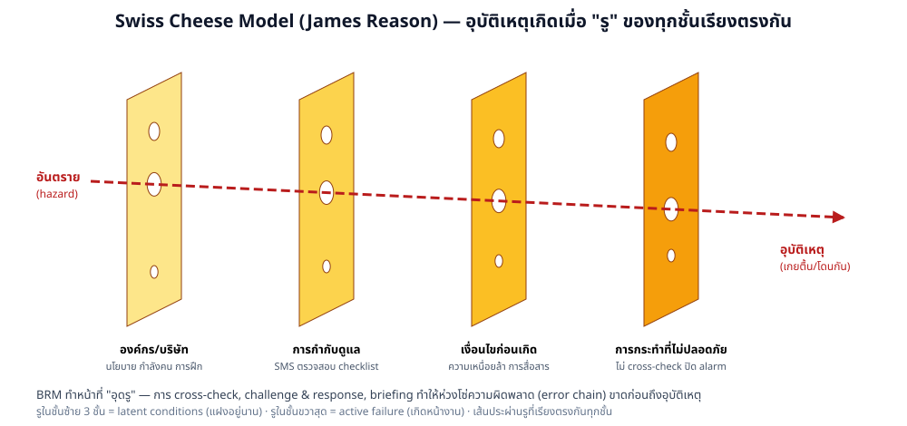
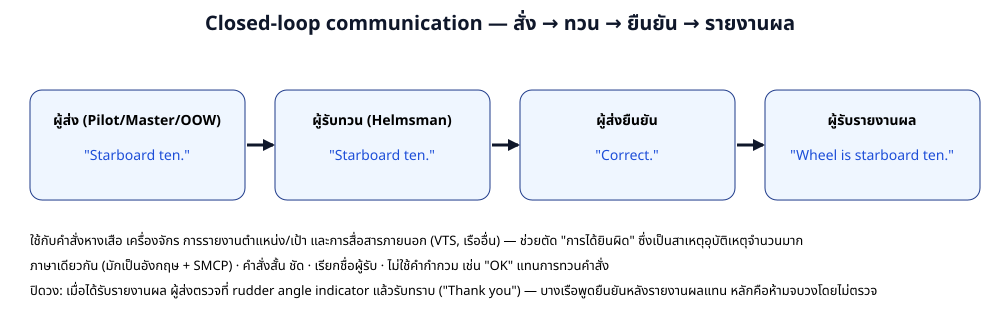
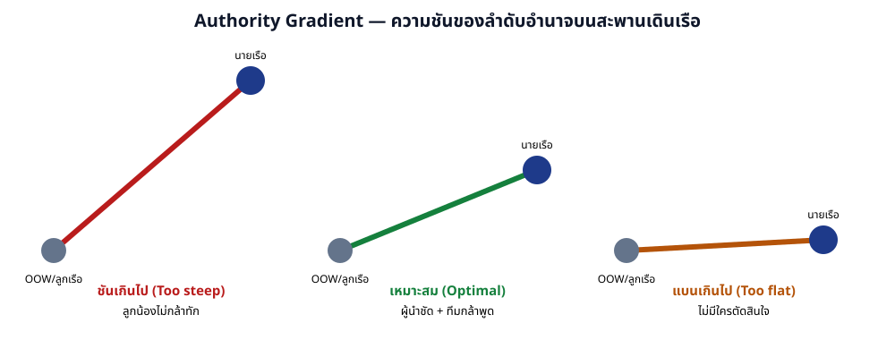
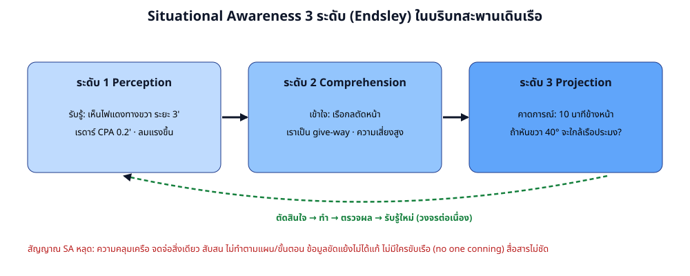

# 1.2.2 Bridge Resource Management (BRM) — การบริหารทรัพยากรบนสะพานเดินเรือ

> สมุดบันทึกการฝึก OOW · TIRAPHONG NANTAPAN
> สมรรถนะตาม STCW A-II/1: *Knowledge of bridge resource management principles, including: (1) allocation, assignment, and prioritization of resources; (2) effective communication; (3) assertiveness and leadership; (4) obtaining and maintaining situational awareness; (5) consideration of team experience*
> อ้างอิงหลัก: STCW Code A-II/1, A-VIII/2 Part 3 (วรรค 8 — หลัก bridge/engine-room resource management) และ Part 4-1, B-VIII/2; SOLAS V/14 (working language); IMO Model Course 1.22 *Ship Simulator and Bridge Teamwork*; ICS *Bridge Procedures Guide* (6th Ed.) บท Bridge Team Management; A.J. Swift *Bridge Team Management – A Practical Guide* (The Nautical Institute); *Human Factors* (Reason – *Human Error*; Endsley – Situation Awareness); IMO Res. A.947(23) *Human Element Vision, Principles and Goals for the Organization* และรายงานสอบสวนอุบัติเหตุของ MAIB/NTSB

---

## 0. BRM คืออะไร และทำไมถึงบังคับใน STCW 2010

**Bridge Resource Management (BRM)** คือ **การบริหารและใช้ทรัพยากรทั้งหมดที่มีอยู่ ทั้งคนและเทคโนโลยี อย่างมีประสิทธิภาพ เพื่อให้การเดินทางสำเร็จอย่างปลอดภัย** ทรัพยากรบนสะพานเดินเรือได้แก่
- **คน (human resources)** — นายเรือ OOW นำร่อง นายท้าย ผู้ดูต้นหน ช่างกลในห้องเครื่อง VTS เรือลากจูง ฯลฯ
- **อุปกรณ์ (equipment)** — เรดาร์ ARPA ECDIS GNSS AIS เข็มทิศ echo sounder VHF autopilot
- **ข้อมูล (information)** — แผนที่ สิ่งพิมพ์ passage plan ข้อมูลเรือ (pilot card, manoeuvring data) พยากรณ์อากาศ
- **เวลา (time)** — ทรัพยากรที่สำคัญที่สุดเมื่อเกิดสถานการณ์ — การวางแผนดีทำให้มีเวลาคิด
- **ขั้นตอน (procedures)** — SMS checklists, standing orders, passage plan

แนวคิดนี้มาจากวงการการบิน (**Crew Resource Management – CRM**) หลังพบว่าอุบัติเหตุส่วนใหญ่ไม่ได้เกิดจากการขาดความรู้ทางเทคนิค แต่เกิดจาก **การทำงานเป็นทีม การสื่อสาร และการตัดสินใจ** วงการเรือนำมาใช้ตั้งแต่ทศวรรษ 1990 และ **STCW 2010 (Manila Amendments)** ทำให้ BRM เป็นสมรรถนะบังคับในตาราง A-II/1 (ระดับ OOW) และ A-II/2 (ระดับบริหารเป็น "Bridge Resource Management" + leadership & managerial skills)

จดไว้กันลืม: นอกจากตาราง KUP แล้ว Manila 2010 ยังเขียนหลัก BRM ไว้ในตัวบทการเข้ายามด้วย คือ **Section A-VIII/2 Part 3 วรรค 8** — ให้การเข้ายามยึดหลักจัดการทรัพยากรบนสะพาน/ห้องเครื่อง 9 ข้อ (จัดคนตามสถานการณ์ คำนึงถึงข้อจำกัดของแต่ละคน ทุกคนรู้บทบาท ใช้ข้อมูล-อุปกรณ์-คนให้คุ้ม เข้าใจอุปกรณ์และข้อมูล แบ่งปันข้อมูล สื่อสาร และแจ้งผู้รับผิดชอบโดยไม่ลังเลเมื่อสงสัย — สรุปเต็มในบท [1.2.1-B ข้อ 2.4](1.2.1-B-watchkeeping-principles.md)) ส่วน Section B-VIII/2 เป็นคำแนะนำเพิ่มเติม — BRM จึงไม่ใช่แค่ "วิชาคอร์ส" แต่เป็นมาตรฐานการเข้ายามที่ PSC และผู้สอบสวนอุบัติเหตุใช้วัด

> **ตัวเลขที่ชอบอ้าง** — การศึกษาอุบัติเหตุทางทะเลหลายชิ้นประเมินว่า **ประมาณ 75–96%** ของอุบัติเหตุมีปัจจัยจากมนุษย์ (human element) เกี่ยวข้อง (ตัวเลขแตกต่างตามแหล่งและนิยาม) — ไม่ใช่เพราะคนโง่ แต่เพราะระบบงานไม่ได้ออกแบบให้ "จับ" ความผิดพลาดของคนก่อนกลายเป็นอุบัติเหตุ

---

## 1. พื้นฐาน Human Factors ที่ต้องเข้าใจก่อน BRM

### 1.1 ห่วงโซ่ความผิดพลาด (Error chain) และ Swiss Cheese Model

อุบัติเหตุแทบไม่เคยเกิดจากความผิดพลาดเดียว แต่เกิดจาก **ชุดของเหตุการณ์และความผิดพลาดเล็ก ๆ ต่อเนื่องกัน (error chain)** ถ้าตัดห่วงใดห่วงหนึ่งได้ อุบัติเหตุก็ไม่เกิด

*ภาพที่ 1.2.2-1 แบบจำลอง Swiss cheese ของ James Reason — แต่ละชั้นคือแนวป้องกัน "รู" คือจุดอ่อน อุบัติเหตุเกิดเมื่อรูเรียงกันพอดี*

- **Active failures** — ความผิดพลาดของคนที่อยู่หน้างาน (OOW ปิด alarm, ไม่ cross-check) ผลเกิดทันที
- **Latent conditions** — จุดอ่อนแฝงในระบบ (นโยบายบริษัท กำลังคนไม่พอ การฝึกไม่พอ ออกแบบสะพานไม่ดี ขั้นตอนไม่ชัด) ซ่อนอยู่นานจนรวมกับ active failure

### 1.2 ชนิดของความผิดพลาดของมนุษย์ (Reason)

| ประเภท | ลักษณะ | ตัวอย่างบนสะพานเดินเรือ |
|---|---|---|
| **Slip** | ตั้งใจถูก แต่ทำผิดโดยไม่ตั้งใจ (การกระทำ) | ตั้ง autopilot เป็น 195 แทน 159 |
| **Lapse** | ลืม (ความจำ) | ลืมเปลี่ยนเข็มที่ WOP, ลืมแจ้งห้องเครื่อง |
| **Mistake** | ตั้งใจทำตามแผน แต่แผน/การวินิจฉัยผิด | เข้าใจว่าเป็น crossing แต่จริงเป็น overtaking |
| **Violation** | ตั้งใจไม่ทำตามกฎ/ขั้นตอน (routine, situational, exceptional) | ปิด BNWAS, ใช้ safety contour ไม่ตรงนโยบาย "เพราะ alarm น่ารำคาญ" |

### 1.3 ปัจจัยที่ทำให้ประสิทธิภาพของคนลดลง

- **ความเหนื่อยล้า (fatigue)** — ดูบท 1.2.1-B
- **ความเครียด (stress)** และ **ภาระงาน (workload)** — ทั้งน้อยไป (เบื่อ ง่วง ขาดความตื่นตัว) และมากไป (ตกใจ มองข้ามข้อมูล) ตามหลัก Yerkes–Dodson ประสิทธิภาพสูงสุดอยู่ที่ภาระงาน "พอดี"
- **Complacency** — ความชะล่าใจเพราะเคยทำมาเป็นร้อยครั้งไม่เคยเกิดอะไร (เช่นแล่นเส้นทางเดิมทุกสัปดาห์)
- **Automation bias / over-reliance** — เชื่อเครื่องมากกว่าตาตัวเอง
- **Confirmation bias** — เลือกเห็นข้อมูลที่ยืนยันสิ่งที่เราเชื่ออยู่แล้ว (เห็นทุ่นแล้ว "บังคับ" ให้เป็นทุ่นที่คาดไว้)
- **Fixation / tunnel vision** — จดจ่อกับปัญหาเดียวจนลืมภาพรวม
- **Groupthink** — ทีมคล้อยตามกันโดยไม่มีใครค้าน
- **วัฒนธรรมและภาษา** — ลูกเรือหลายชาติ ความเกรงใจผู้อาวุโส การพูดอ้อม ๆ
- **สภาพแวดล้อม** — เสียง แสง อุณหภูมิ การออกแบบสะพาน (ergonomics)

### 1.4 SHELL Model (Edwards/Hawkins)

เป็นกรอบมองการทำงานของคน (L – **Liveware** ตรงกลาง) กับองค์ประกอบรอบตัว
- **S – Software**: ขั้นตอน checklists แผนที่ คู่มือ
- **H – Hardware**: อุปกรณ์ สะพานเดินเรือ จอ ปุ่ม
- **E – Environment**: อากาศ เสียง แสง การจราจร
- **L – Liveware (คนอื่น)**: ทีมงาน นำร่อง VTS
อุบัติเหตุมักเกิดที่ "รอยต่อ" ระหว่างคนกับองค์ประกอบเหล่านี้ที่ไม่สอดคล้องกัน

### 1.5 One-person error (single-person error) และหลัก "two heads"

หลักสำคัญของ BRM คือ **ไม่มีใครควรเป็นจุดล้มเหลวจุดเดียว (single point of failure)** การตัดสินใจสำคัญต้องมีคนอื่นตรวจทาน (cross-check) และทีมต้องรู้สึกว่า "ทักได้" แม้คนที่ผิดจะเป็นนายเรือหรือนำร่อง

---

## 2. หลักการ BRM ข้อที่ 1 — Allocation, assignment, and prioritization of resources (การจัดสรร มอบหมาย และจัดลำดับความสำคัญของทรัพยากร)

### 2.1 การจัดทีมสะพานเดินเรือ (Bridge team organization)

| บทบาท | หน้าที่ |
|---|---|
| **Person in charge (นายเรือ หรือ OOW)** | รับผิดชอบโดยรวม ตัดสินใจ มอบหมายงาน |
| **Conning officer** | ผู้สั่งการหางเสือและเครื่องจักร (ต้องระบุชัดว่าใคร "has the con") |
| **Navigating officer** | ติดตามตำแหน่ง ตรวจการเดินตามแผน รายงานความคลาดเคลื่อน |
| **Collision avoidance / radar officer** | ดูการจราจร ARPA เฝ้าระวัง |
| **Communications** | VHF กับ VTS นำร่อง เรือลากจูง เรืออื่น บันทึก |
| **Helmsman** | ถือท้ายตามคำสั่ง ทวนคำสั่ง |
| **Look-out** | เฝ้าดูและฟัง รายงาน |
| **Pilot** | ผู้ให้คำแนะนำเรื่องการเดินเรือท้องถิ่น (นายเรือยังรับผิดชอบ) |

หลักการ
- **มอบหมายงานชัดเจน** ว่าใครทำอะไร (ไม่ใช่ "ใครว่างก็ทำ")
- **ระบุชัดว่าใครเป็นผู้ควบคุมเรือ (who has the con)** — การส่งมอบ con ต้องพูดชัดและตอบรับ ("Captain has the con" / "Pilot has the con")
- จำนวนคนบนสะพานต้องสอดคล้องกับระดับความเสี่ยง (bridge manning levels — บท 1.2.1-B)
- **ใช้ทรัพยากรนอกสะพาน** ด้วย — ห้องเครื่อง (standby), ลูกเรือที่หัวเรือ/ท้ายเรือ, VTS, นำร่อง, เรือลากจูง

### 2.2 การจัดลำดับความสำคัญ (Prioritization)

เมื่อมีหลายงานพร้อมกัน ต้องเรียงลำดับตามความเสี่ยง หลักที่นิยมสอนคือ **"Aviate – Navigate – Communicate"** ในบริบทเรือ:
1. **ควบคุมเรือให้ปลอดภัย** (บังคับเรือ หลบเรือ หลีกเลี่ยงอันตรายเฉพาะหน้า)
2. **รู้ตำแหน่งและเดินเรือ** (navigation)
3. **สื่อสาร** (VHF รายงาน โทรศัพท์)
4. **งานเอกสารและงานรอง** (บันทึก อีเมล งานธุรการ)

ตัวอย่าง: ขณะเรือกำลังหลบเรือหลายลำ VTS เรียกถาม ETA — OOW ควรตอบสั้น ๆ "Stand by" แล้วจัดการเรื่องหลบเรือให้ปลอดภัยก่อน

### 2.3 การบริหารภาระงาน (Workload management)

- **วางแผนล่วงหน้า** ลดงานในช่วงวิกฤติ เช่น เตรียม PI, จุดรายงาน, ช่อง VHF, ข้อมูลรายงานไว้ก่อนเข้าช่องแคบ
- **มอบหมายงานรอง** ออกไป (look-out ช่วยดู NAVTEX, Cadet ช่วยบันทึก)
- **หลีกเลี่ยงงานที่ไม่จำเป็น** ในช่วงวิกฤติ (ไม่ทำงานธุรการ ไม่โทรศัพท์ส่วนตัว)
- **ขอความช่วยเหลือแต่เนิ่น** — เรียกนายเรือ เรียกคนเพิ่ม เมื่อรู้สึกว่าภาระงานเกินตัว
- **รู้จักสัญญาณ overload** — เริ่มลืม ทำงานช้า หงุดหงิด ไม่ได้ยินสิ่งที่คนอื่นพูด

---

## 3. หลักการ BRM ข้อที่ 2 — Effective communication (การสื่อสารที่มีประสิทธิภาพ)

### 3.1 องค์ประกอบของการสื่อสาร

ผู้ส่ง → ข้อความ → ช่องทาง → ผู้รับ → **การตอบกลับ (feedback)** — การสื่อสารสมบูรณ์เมื่อผู้ส่งรู้ว่าผู้รับเข้าใจตรงกัน

**อุปสรรคการสื่อสาร (barriers)** — ภาษา สำเนียง เสียงรบกวน ศัพท์เทคนิค ลำดับชั้น (กลัวทัก) วัฒนธรรม (พูดอ้อม) ความเหนื่อย สมมติฐานที่ไม่ได้พูดออกมา ข้อความยาวเกินไป ช่องทางไม่เหมาะ

### 3.2 Closed-loop communication

*ภาพที่ 1.2.2-2 การสื่อสารแบบวงปิด — ตัดโอกาส "ได้ยินผิด"*

ตัวอย่างคำสั่งหางเสือและเครื่องจักร (SMCP Wheel orders / Engine orders — บท 1.7)
- นำร่อง: "**Port twenty.**" → นายท้าย: "**Port twenty.**" → (หมุนพวงมาลัย) → นายท้าย: "**Wheel is port twenty.**" → นำร่อง/OOW: "**Thank you.**" (หรือ "Correct")
- OOW ต้อง **ตรวจที่ rudder angle indicator** ด้วยตาว่าหางเสือไปตามคำสั่งจริง
- คำสั่งเครื่องจักร: "**Half ahead.**" → ผู้ทำ: "**Half ahead.**" → (ปรับ telegraph) → "**Engine is half ahead.**" → ตรวจรอบเครื่องที่ indicator

### 3.3 Briefing และ Debriefing

**Briefing ก่อนเข้าช่วงวิกฤติ** (เข้าท่า ช่องแคบ ทอดสมอ) ตาม BPG — สิ่งที่ควรครอบคลุม
1. แผนการเดินทางช่วงนั้น (เส้นทาง WOP UKC tidal window จุด abort)
2. บทบาทและหน้าที่ของแต่ละคน
3. สภาพแวดล้อม (อากาศ กระแสน้ำ การจราจร)
4. ความเสี่ยงที่คาด และแผนฉุกเฉิน (contingency)
5. ช่องทางการสื่อสาร (VHF channels, การสื่อสารภายในเรือ)
6. อุปกรณ์ที่ขัดข้องหรือข้อจำกัด
7. **เปิดให้ถามและเสนอแนะ** — "Any questions? Any concerns?"

**Debriefing หลังจบ** — อะไรเป็นไปด้วยดี อะไรควรปรับปรุง (เน้นเรียนรู้ ไม่ใช่หาคนผิด) — ช่วยสร้างวัฒนธรรมความปลอดภัย (safety culture / just culture)

### 3.4 การสื่อสารกับคนนอกเรือ

- VTS, เรืออื่น, สถานีชายฝั่ง — ใช้ **SMCP** และ **message markers** (บท 1.7)
- ระบุตัวเรือให้ชัด (ชื่อ ตำแหน่ง MMSI) ก่อนตกลงเรื่องการหลบเรือ
- **Master/Pilot Information Exchange (MPX)** — แลกเปลี่ยนข้อมูลเมื่อนำร่องขึ้นเรือ: แผนการนำร่อง ข้อมูลเรือ (pilot card) สภาพอุปกรณ์ เรือลากจูง ข้อจำกัด UKC ความเห็นที่ต่างกัน

### 3.5 Shared mental model

ทีมที่ดีมี "ภาพในหัวตรงกัน" (shared mental model) ว่าแผนคืออะไร สถานการณ์เป็นอย่างไร และจะทำอะไรต่อ — สร้างได้ด้วย briefing การพูดความคิดออกมา (thinking aloud / "verbalising intentions") และการรายงานสถานการณ์เป็นระยะ เช่น "Next alteration in 5 minutes to 230, wheel-over at Buoy 7 abeam"

---

## 4. หลักการ BRM ข้อที่ 3 — Assertiveness and leadership (ความกล้าแสดงออกและภาวะผู้นำ)

### 4.1 Assertiveness คืออะไร

**Assertiveness** คือ **ความสามารถในการพูดความกังวล ความคิดเห็น หรือข้อมูลอย่างชัดเจน ตรงไปตรงมา และให้เกียรติ** โดยไม่ก้าวร้าว (aggressive) และไม่นิ่งเฉย (passive) — สำหรับ OOW และ cadet ที่อาวุโสน้อยกว่านายเรือหรือนำร่อง นี่คือทักษะที่ยากที่สุดแต่สำคัญที่สุด

| พฤติกรรม | ลักษณะ | ผล |
|---|---|---|
| Passive | เงียบ เกรงใจ "เขาคงรู้แล้ว" | ความผิดพลาดไม่ถูกจับ |
| **Assertive** | พูดชัด มีข้อเท็จจริง เสนอทางออก | ทีมได้ข้อมูลครบ ตัดสินใจดีขึ้น |
| Aggressive | ตำหนิ ขึ้นเสียง ข่มขู่ | ทีมแตก ไม่ร่วมมือ |

### 4.2 เทคนิคการทัก (Challenge and response) — การยกระดับความกังวล

หลายบริษัทและหลักสูตร BRM สอนการยกระดับเป็นขั้น (บางที่เรียก **graded assertiveness**) ตัวอย่างแบบที่นิยม:

1. **ดึงความสนใจ (Attention)** — เรียกชื่อ/ตำแหน่ง "Captain…"
2. **บอกความกังวล (Concern)** — "I'm concerned about our position…"
3. **บอกปัญหาตามข้อเท็จจริง (Problem)** — "We are 3 cables north of the track and the depth is decreasing to 14 metres."
4. **เสนอทางแก้ (Solution)** — "I suggest we alter to port to 190 now."
5. **ขอความเห็นชอบ (Agreement)** — "Do you agree?"

ถ้าสถานการณ์ยังอันตรายและไม่มีการตอบสนอง ต้องยกระดับ — พูดชัดขึ้น ("Captain, we are standing into danger. We must alter now.") และในที่สุด **ทำการที่จำเป็นเพื่อความปลอดภัย** ตามหน้าที่ OOW (A-VIII/2 Part 4-1) และตามระบบของบริษัท

วิธีช่วยจำอีกแบบที่ใช้กันคือ **"CUS"** — **C**oncerned → **U**ncomfortable → "This is unsafe — **S**top"

อีกแบบที่หลักสูตร CRM/BRM บางแห่งใช้คือ **PACE** — **P**robe (ถามเชิงสำรวจ "Captain, are we planning to alter at Buoy 5?") → **A**lert (บอกความกังวลพร้อมข้อเท็จจริง) → **C**hallenge (ทักตรง ๆ และเสนอทางแก้) → **E**mergency (ภาวะอันตรายเฉพาะหน้า ประกาศชัดและลงมือตามหน้าที่) — ชื่อเรียกต่างกันแต่หลักเดียวกัน คือ **ยกระดับเป็นขั้นจนกว่าความเสี่ยงจะถูกจัดการ** และบางบริษัทใช้กติกา "two-challenge rule" (ทักสองครั้งแล้วไม่ได้คำตอบที่สมเหตุผล ถือว่าผู้นำอาจไร้สมรรถภาพชั่วคราว ให้ผู้ทักดำเนินการเพื่อความปลอดภัย) — ต้องดูว่า SMS ของบริษัทเขียนไว้อย่างไร

> **ตัวอย่างที่ครูฝึก BRM มักยกมาให้คิด** — OOW เห็นเรือประมงทางกราบขวาแต่ไม่กล้าบอกนำร่องที่กำลังคุยโทรศัพท์ จนนายเรือมาเห็นเอง แม้ครั้งนั้นจะไม่เกิดอะไร แต่ประเด็นคือ "การทักให้ถูกวิธี" ไม่ใช่การเสียมารยาท นำร่องที่ดีจะขอบคุณเสมอ

### 4.3 Authority gradient (ความชันของลำดับอำนาจ)

*ภาพที่ 1.2.2-3 ความชันของลำดับอำนาจ — ชันเกินไปทีมไม่กล้าทัก แบนเกินไปไม่มีใครตัดสินใจ*

- **ชันเกินไป** — นายเรือแบบเผด็จการ ไม่ฟังใคร ลูกน้องไม่กล้าพูด (กรณีอุบัติเหตุหลายเรื่อง)
- **แบนเกินไป** — ไม่มีใครเป็นผู้นำ ตัดสินใจไม่ได้ ทุกคนรอกัน
- **เหมาะสม** — ผู้นำชัดเจนว่าใครตัดสินใจ แต่ **เปิดรับความเห็น** และ **ทีมกล้าพูด**

### 4.4 Leadership บนสะพานเดินเรือ

ผู้นำที่ดี (นายเรือ หรือ OOW ในยามของตน)
- **ตั้งเป้าหมายและมาตรฐานชัดเจน** (briefing, standing orders)
- **มอบหมายงานตามความสามารถ** และติดตามผล
- **สื่อสารเจตนา** ให้ทีมรู้ว่าจะทำอะไรต่อ
- **เปิดรับข้อมูลและการทัก** — พูดตั้งแต่แรกว่า "ถ้าเห็นอะไรผิดปกติ บอกได้ทันที"
- **ตัดสินใจเมื่อต้องตัดสินใจ** ไม่ลังเลจนสาย
- **เป็นแบบอย่าง** ทำตามขั้นตอนเอง
- **ดูแลทีม** — ความเหนื่อยล้า ความเครียด ขวัญกำลังใจ
- ภาวะผู้นำแบบ **ปรับตามสถานการณ์ (situational leadership)** — ภาวะฉุกเฉินต้องสั่งการชัดเจน (directive) ภาวะปกติใช้การมีส่วนร่วม (participative)

(รายละเอียดเรื่องภาวะผู้นำและการทำงานเป็นทีมระดับเรือทั้งลำอยู่ในบท 3.7)

---

## 5. หลักการ BRM ข้อที่ 4 — Obtaining and maintaining situational awareness (การรับรู้และรักษาความตระหนักรู้ในสถานการณ์)

### 5.1 นิยาม

**Situational awareness (SA)** ตาม Mica Endsley: "the perception of elements in the environment within a volume of time and space, the comprehension of their meaning, and the projection of their status in the near future"

*ภาพที่ 1.2.2-4 สามระดับของ SA — รับรู้ เข้าใจ คาดการณ์*

| ระดับ | คำถามที่ OOW ถามตัวเอง |
|---|---|
| 1. Perception | ตอนนี้มีอะไรอยู่รอบเรือ (เรือ ฝั่ง ทุ่น อากาศ alarm) |
| 2. Comprehension | สิ่งเหล่านั้นหมายความว่าอย่างไรต่อเรือเรา (ความเสี่ยงชน ระยะถึงอันตราย) |
| 3. Projection | อีก 10–30 นาทีข้างหน้าจะเป็นอย่างไร ถ้าเราทำ/ไม่ทำอะไร |

### 5.2 วิธีสร้างและรักษา SA

1. **วางแผนดี** — passage plan ที่ละเอียดคือ "แผนที่ในหัว" ล่วงหน้า
2. **Briefing** — ให้ทีมมี SA ร่วมกัน
3. **Scan อย่างเป็นระบบ** — หน้าต่าง → เรดาร์ → ECDIS → indicators → หน้าต่าง… ไม่จ้องจออย่างเดียว ("heads-up")
4. **Cross-check ข้อมูล** จากหลายแหล่ง
5. **คิดล่วงหน้า (think ahead)** — "ถ้า…จะทำอย่างไร" (contingency thinking)
6. **พูดความคิดออกมา** ให้ทีมได้ตรวจสอบ
7. **จัดการภาระงาน** ไม่ให้ overload
8. **ใช้ทีม** — look-out, นายท้าย, ห้องเครื่อง เป็น "ตาและหู" เพิ่ม
9. **ส่งต่อ SA ตอนส่งยาม** อย่างครบถ้วน

### 5.3 สัญญาณเตือนว่า SA เริ่มหลุด (Red flags)

- **ความคลุมเครือ (ambiguity)** — ข้อมูลสองแหล่งไม่ตรงกันแล้วไม่มีใครแก้
- **การจดจ่อ (fixation/preoccupation)** — สนใจปัญหาเดียวจนลืมอย่างอื่น
- **ความสับสน (confusion)** — ไม่แน่ใจว่าเรืออยู่ไหน/เกิดอะไรขึ้น
- **ไม่มีใครควบคุมเรือ (no one flying the ship / no one conning)**
- **ไม่ได้ทำตามแผนหรือขั้นตอน (departure from plan/SOP)** โดยไม่มีเหตุผลชัด
- **ไม่บรรลุเป้า (failure to meet targets)** — ไม่ถึง WOP ตามเวลา ไม่เห็นทุ่นตามคาด
- **สื่อสารไม่ชัด** หรือหยุดสื่อสาร
- **ข้อขัดแย้งที่ไม่ได้แก้ (unresolved discrepancy)**
- **การทำงานเกินขีดจำกัดของบุคคล/ระบบ**

เมื่อพบ red flag ให้ **หยุด ถอย ประเมินใหม่** — ลดความเร็ว เพิ่มคน ขอเวลา (เช่นแจ้ง VTS ว่าจะชะลอ) แล้วค่อยตัดสินใจ

---

## 6. หลักการ BRM ข้อที่ 5 — Consideration of team experience (การคำนึงถึงประสบการณ์ของทีม)

- **รู้จักทีม** — ใครเพิ่งขึ้นเรือ ใครเคยผ่านพื้นที่นี้ ใครชำนาญอุปกรณ์อะไร ใครภาษาอังกฤษไม่แข็ง
- **มอบหมายงานตามความสามารถ** — คนใหม่ไม่ควรได้งานที่ซับซ้อนที่สุดในช่วงวิกฤติโดยไม่มีคนดูแล
- **ใช้ประสบการณ์ของคนในทีม** — AB ที่อยู่เรือมา 10 ปีอาจรู้จักพฤติกรรมของเรือดีกว่า OOW ใหม่
- **ระวังความเชื่อมั่นเกินในคนที่มีประสบการณ์** — คนเก่งก็พลาดได้ (complacency)
- **Familiarization** — คนใหม่ต้องได้รับการแนะนำอุปกรณ์และขั้นตอนบนสะพาน (ISM Code ข้อ 6.3, STCW Reg I/14) ก่อนรับหน้าที่ — โดยเฉพาะ ECDIS ซึ่งต่างกันตามผู้ผลิต (type-specific familiarization)
- **ลูกเรือหลายชาติ** — ตกลงภาษาทำงาน (working language ตาม SOLAS V/14 — มักเป็นภาษาอังกฤษ) ใช้ SMCP ตรวจความเข้าใจ
  - SOLAS V/14 ละเอียดขึ้น: ภาษาทำงานต้อง **กำหนดและบันทึกไว้ในสมุดปูมเรือ** ลูกเรือทุกคนต้องเข้าใจภาษานี้และสามารถรับคำสั่ง/รายงานกลับได้ และการสื่อสารด้านความปลอดภัย **สะพาน-สะพาน สะพาน-ฝั่ง และระหว่างนำร่องกับคนเข้ายามบนสะพาน** ให้ใช้ **ภาษาอังกฤษ** (เว้นแต่ผู้สื่อสารทุกฝ่ายใช้ภาษาอื่นร่วมกัน) — ใช้ IMO SMCP
- **การฝึกและการซ้อม** — simulator training, drills, on-board training ช่วยให้ทีมมีประสบการณ์ร่วมกัน

---

## 7. การตัดสินใจ (Decision making) ใน BRM

ใช้กรอบคิดช่วยไม่ให้ตัดสินใจแบบตื่นตระหนก เช่น

**DECIDE**
- **D**etect — ตรวจพบการเปลี่ยนแปลง
- **E**stimate — ประเมินความสำคัญ
- **C**hoose — เลือกผลลัพธ์ที่ต้องการ
- **I**dentify — หาทางเลือก
- **D**o — ลงมือ
- **E**valuate — ประเมินผล

**FOR-DEC** (นิยมในการบิน/เรือในยุโรป)
- **F**acts → **O**ptions → **R**isks & Benefits → **D**ecision → **E**xecution → **C**heck

**OODA loop** — Observe → Orient → Decide → Act (วงจรต่อเนื่อง)

หลักร่วมกัน: **มีข้อมูลก่อน → หลายทางเลือก → ชั่งความเสี่ยง → ตัดสินใจ → ทำ → ตรวจผล** ถ้าเวลาน้อยมาก ใช้ "ขั้นตอนที่ฝึกไว้แล้ว" (เช่นการหลบเรือตาม COLREG, emergency checklists) เพราะสมองตอนเครียดคิดสิ่งใหม่ได้ยาก (รายละเอียดเพิ่มในบท 3.7)

---

## 8. BRM กับนำร่อง (Master–Pilot relationship)

- นำร่องคือ **สมาชิกชั่วคราวของทีมสะพานเดินเรือ** ที่มีความรู้ท้องถิ่น แต่ไม่รู้จักเรือและทีมของเรา
- MPX ต้องทำ **ทันทีที่นำร่องขึ้นสะพาน** — นำร่องเล่าแผน นายเรือ/OOW ตรวจเทียบกับ passage plan ของเรา ถ้าต่างกันต้องคุยให้ชัดก่อน
- ทีมต้อง **ติดตามและ cross-check** ต่อเนื่อง (ตำแหน่ง ความเร็ว UKC คำสั่งหางเสือ)
- **ภาษา** — นำร่องคุยกับเรือลากจูงหรือ VTS ด้วยภาษาท้องถิ่น ทีมควรถามสรุปเป็นภาษาอังกฤษ ("Pilot, what did the tug say?")
- ถ้าสงสัย ทักนำร่องตามขั้นตอน (ข้อ 4.2) และแจ้งนายเรือ

---

## 9. กรณีศึกษา (Case studies) — บทเรียน BRM

> ข้อมูลกรณีศึกษาจริงสรุปจากรายงานสอบสวนสาธารณะ (ย่อเฉพาะประเด็น BRM) ควรอ่านรายงานฉบับเต็มเพิ่มเติม

### 9.1 Royal Majesty (1995) — การพึ่งพาระบบอัตโนมัติ

- เรือโดยสารเกยตื้นที่ Rose and Crown Shoal ใกล้เกาะ Nantucket สหรัฐฯ (10 มิ.ย. 1995 — รายงาน NTSB/MAR-97/01)
- สายเสาอากาศ GPS หลุด ทำให้ GPS เปลี่ยนเป็นโหมด DR (แสดงสัญลักษณ์เล็ก ๆ ที่ไม่มีใครสังเกต) ระบบนำทางอัตโนมัติจึงพาเรือออกนอกเส้นทางไปเรื่อย ๆ **ประมาณ 34 ชั่วโมง** (ตอนเกยตื้นเรืออยู่ห่างเส้นทางที่ตั้งใจราว 17 ไมล์) โดยทีมสะพานไม่ได้ตรวจตำแหน่งด้วยวิธีอิสระ (เช่น Loran-C ที่มีอยู่) และเมื่อเห็นสิ่งที่ไม่ตรงกับคาด (ทุ่น ไฟ) ก็ตีความให้เข้ากับความเชื่อของตน
- **บทเรียน:** automation complacency, ต้อง cross-check ด้วยแหล่งอิสระ, confirmation bias, ความเข้าใจในโหมดของอุปกรณ์

### 9.2 Exxon Valdez (1989) — ความเหนื่อยล้าและการจัดทีม

- เรือบรรทุกน้ำมันเกยตื้นที่ Bligh Reef อะแลสกา น้ำมันดิบรั่วจำนวนมาก (24 มี.ค. 1989 — รายงาน NTSB/MAR-90/04)
- ปัจจัยที่รายงานสอบสวนชี้: นายเรือไม่อยู่บนสะพานในช่วงวิกฤติ OOW ต้องเดินเรือในพื้นที่ยากโดยลำพัง ความเหนื่อยล้าจากชั่วโมงทำงาน การเปลี่ยนเข็มกลับเข้า lane ไม่ทันเวลา ปัญหาการจัดกำลังคนและการกำกับดูแล
- NTSB สรุปสาเหตุที่น่าจะเป็นไว้หลายชั้น — OOW (third mate) บังคับเรือไม่ถูกต้องเพราะความเหนื่อยล้าและภาระงานมากเกินไป, นายเรือไม่จัดยามเดินเรือที่เหมาะสมเพราะ **มีอาการจากแอลกอฮอล์**, บริษัทไม่กำกับดูแลนายเรือและไม่จัดคนที่พักผ่อนเพียงพอ และระบบ VTS/นำร่องของรัฐไม่มีประสิทธิภาพ — ตรงกับ Swiss cheese ทุกชั้น
- **บทเรียน:** bridge manning ในพื้นที่วิกฤติ, fatigue, การสื่อสารคำสั่งที่ชัดเจน — เหตุการณ์นี้นำไปสู่ OPA 90 ของสหรัฐฯ (และเป็นหนึ่งในเหตุผลที่ STCW มีขีดจำกัดแอลกอฮอล์และชั่วโมงพัก — บท 1.2.1-B)

### 9.3 Costa Concordia (2012) — ออกนอกแผนและ authority gradient

- เรือโดยสารชนหินใกล้เกาะ Giglio อิตาลี มีผู้เสียชีวิต 32 คน (13 ม.ค. 2012 — รายงานสอบสวนของ Marine Casualties Investigative Body กระทรวงโครงสร้างพื้นฐานและการขนส่งอิตาลี)
- เรือเบี่ยงจากแผนการเดินทางเพื่อแล่นเข้าใกล้เกาะ (การ "ทักทาย" เกาะ) โดยไม่ได้วางแผนอย่างเป็นระบบ ทีมสะพานไม่ได้ทักท้วงอย่างมีประสิทธิภาพ การสื่อสารคำสั่งหางเสือมีปัญหาเรื่องภาษา และการจัดการเหตุฉุกเฉินหลังเกิดเหตุล่าช้า
- **บทเรียน:** ห้ามเปลี่ยนแผนโดยไม่วางแผนใหม่, authority gradient ที่ชันเกินไป, การสื่อสารหลายภาษา, การตัดสินใจภาวะฉุกเฉิน

### 9.4 กรณีจำลองเพื่อฝึก — "เชื่อจอมากกว่าตา"

> สถานการณ์สมมติเพื่อฝึกวิเคราะห์

เรือแล่นกลางคืนเข้าร่องน้ำ OOW ดู ECDIS เห็นเรืออยู่บนเส้นทางพอดี look-out รายงาน "ทุ่นเขียวทางซ้าย" ซึ่งตามแผนควรอยู่ทางขวา OOW คิดว่า look-out ดูผิดเพราะ ECDIS บอกว่าอยู่บนเส้นทาง ไม่ได้ตรวจเรดาร์ 5 นาทีต่อมา echo sounder alarm ดัง ความลึกลดเหลือ 1.5 m ใต้กระดูกงู

**วิเคราะห์ห่วงโซ่ความผิดพลาด**
1. GNSS ถูกรบกวน (สมมติ) ตำแหน่งบน ECDIS ผิด
2. ไม่มีการ cross-check ด้วยเรดาร์ (ไม่ได้ใช้ radar overlay/PI)
3. Confirmation bias — เชื่อจอ ไม่เชื่อ look-out
4. Look-out ไม่ได้ยกระดับความกังวล (assertiveness)
5. ไม่เรียกนายเรือเมื่อ "เห็นเครื่องหมายทางเรือโดยไม่คาดคิด" (ข้อ 5 ของรายการเรียกนายเรือ)

**จุดที่ BRM ตัดห่วงโซ่ได้** — ทันทีที่ข้อมูลขัดแย้ง (ข้อ 3) ต้อง **หยุด ลดความเร็ว ตรวจด้วยเรดาร์และสายตา เรียกนายเรือ**

---

## 10. คำถามสอบปากเปล่า / สัมภาษณ์ — BRM

**ถาม:** BRM คืออะไร
**แนวตอบ:** การบริหารและใช้ทรัพยากรทั้งหมดบนสะพานเดินเรือ ทั้งคน อุปกรณ์ ข้อมูล และเวลา อย่างมีประสิทธิภาพเพื่อให้การเดินทางปลอดภัย ครอบคลุมการจัดสรรและจัดลำดับทรัพยากร การสื่อสาร ความกล้าแสดงออกและภาวะผู้นำ situational awareness และการคำนึงถึงประสบการณ์ของทีม

**ถาม:** หลักการ BRM 5 ข้อตาม STCW มีอะไร
**แนวตอบ:** (1) allocation, assignment, prioritization of resources (2) effective communication (3) assertiveness and leadership (4) obtaining and maintaining situational awareness (5) consideration of team experience

**ถาม:** Situational awareness มีกี่ระดับ
**แนวตอบ:** 3 ระดับ — perception (รับรู้) comprehension (เข้าใจความหมาย) projection (คาดการณ์อนาคต)

**ถาม:** สัญญาณว่าทีมเสีย situational awareness มีอะไรบ้าง
**แนวตอบ:** ความคลุมเครือ/ข้อมูลขัดแย้งที่ไม่แก้ การจดจ่อสิ่งเดียว ความสับสน ไม่มีใครควบคุมเรือ ออกนอกแผน/ขั้นตอน ไม่บรรลุเป้าตามเวลา สื่อสารไม่ชัด

**ถาม:** Closed-loop communication คืออะไร ยกตัวอย่าง
**แนวตอบ:** ผู้ส่งสั่ง ผู้รับทวนคำสั่ง ผู้ส่งยืนยัน ผู้รับรายงานเมื่อทำเสร็จ เช่น "Starboard ten" – "Starboard ten" – (ทำ) – "Wheel is starboard ten" และ OOW ตรวจ rudder indicator

**ถาม:** ถ้าคุณเห็นว่านำร่องกำลังพาเรือเข้าใกล้อันตราย จะทำอย่างไร
**แนวตอบ:** ทักนำร่องทันทีอย่างสุภาพแต่ชัดเจน ด้วยข้อเท็จจริง (ตำแหน่ง ความลึก ระยะ) และเสนอทางแก้ ถ้ายังไม่ชัดเจนแจ้งนายเรือทันที และถ้าอันตรายเฉพาะหน้าต้องทำการที่จำเป็นเพื่อความปลอดภัยก่อนนายเรือมาถึง (STCW A-VIII/2) บันทึกเหตุการณ์

**ถาม:** Authority gradient คืออะไร
**แนวตอบ:** ความแตกต่างของอำนาจ/สถานะระหว่างผู้นำกับทีม ชันเกินไปทำให้ทีมไม่กล้าทัก แบนเกินไปทำให้ไม่มีผู้ตัดสินใจ ที่เหมาะสมคือผู้นำชัดเจนแต่เปิดรับความเห็น

**ถาม:** Briefing ก่อนเข้าท่าควรมีอะไรบ้าง
**แนวตอบ:** แผน (เส้นทาง WOP UKC abort point) บทบาทหน้าที่ สภาพแวดล้อม ความเสี่ยงและแผนฉุกเฉิน การสื่อสาร (ช่อง VHF) อุปกรณ์ขัดข้อง และเปิดให้ทีมถาม/เสนอความเห็น

**ถาม:** ชนิดของ human error ตาม Reason
**แนวตอบ:** slip (ทำผิดโดยไม่ตั้งใจ), lapse (ลืม), mistake (แผน/การวินิจฉัยผิด), violation (ตั้งใจไม่ทำตามกฎ/ขั้นตอน)

**ถาม:** Swiss cheese model อธิบายอะไร
**แนวตอบ:** ระบบมีหลายชั้นป้องกัน แต่ละชั้นมีจุดอ่อน (รู) จาก latent conditions และ active failures อุบัติเหตุเกิดเมื่อรูเรียงตรงกัน BRM ช่วยอุดรูด้วยการ cross-check การสื่อสาร และการทัก

**ถาม:** นอกจากตาราง A-II/1 แล้ว STCW เขียนหลัก BRM ไว้ที่ไหนอีก
**แนวตอบ:** Section A-VIII/2 Part 3 วรรค 8 (หลักการเข้ายามทั่วไป เพิ่มใน Manila 2010) — จัดคนตามสถานการณ์ คำนึงถึงข้อจำกัดของแต่ละคน รู้บทบาท ใช้ทรัพยากรให้คุ้ม เข้าใจอุปกรณ์และข้อมูล แบ่งปันข้อมูล สื่อสาร และแจ้งผู้รับผิดชอบโดยไม่ลังเลเมื่อสงสัย; คำแนะนำเพิ่มอยู่ใน B-VIII/2

**ถาม:** SOLAS กำหนดเรื่องภาษาบนเรืออย่างไร
**แนวตอบ:** SOLAS V/14 — ต้องกำหนดภาษาทำงานและบันทึกในสมุดปูมเรือ ลูกเรือทุกคนต้องเข้าใจคำสั่งและรายงานกลับได้ และการสื่อสารสะพาน-สะพาน/สะพาน-ฝั่งใช้ภาษาอังกฤษ (หรือภาษาที่ใช้ร่วมกัน) ประกอบกับ SMCP

**ถาม:** บทเรียน BRM สำคัญจาก Royal Majesty คืออะไร
**แนวตอบ:** automation complacency — GPS ตกไปโหมด DR เพราะสายเสาอากาศหลุดโดยไม่มีใครสังเกตราว 34 ชั่วโมง ทีมไม่ตรวจตำแหน่งด้วยแหล่งอิสระ (Loran-C/เรดาร์/สายตา) และตีความสิ่งที่เห็นให้เข้ากับความเชื่อ (confirmation bias) — ต้องรู้โหมดของอุปกรณ์และ cross-check ด้วยแหล่งอิสระเสมอ

**ถาม:** PACE หรือ graded assertiveness ใช้อย่างไร
**แนวตอบ:** ยกระดับการทักเป็นขั้น — Probe (ถาม) → Alert (บอกความกังวลพร้อมข้อเท็จจริง) → Challenge (ทักตรงและเสนอทางแก้) → Emergency (ประกาศชัดและลงมือเพื่อความปลอดภัย) จนกว่าความเสี่ยงจะถูกจัดการ และบันทึก/แจ้งนายเรือตามระบบของบริษัท

---

*ก่อนหน้า ← [1.2.1-C Routeing, Reporting, VTS, Blind Pilotage](1.2.1-C-routeing-reporting-vts-blind-pilotage.md) · ถัดไป → [1.3-A Radar Fundamentals](1.3-A-radar-fundamentals.md)*
