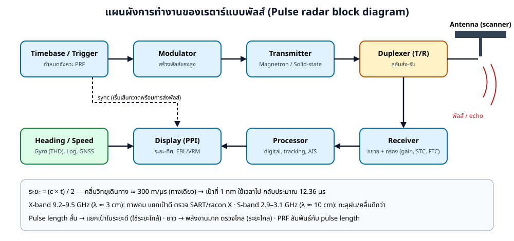
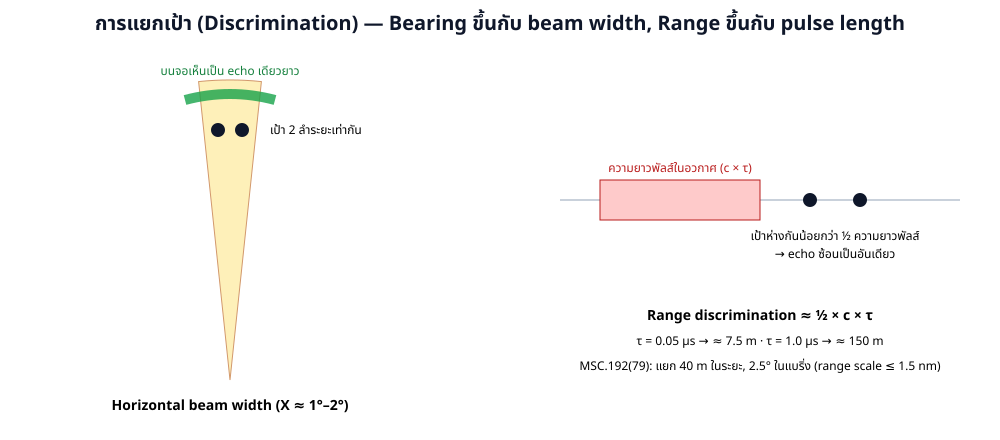
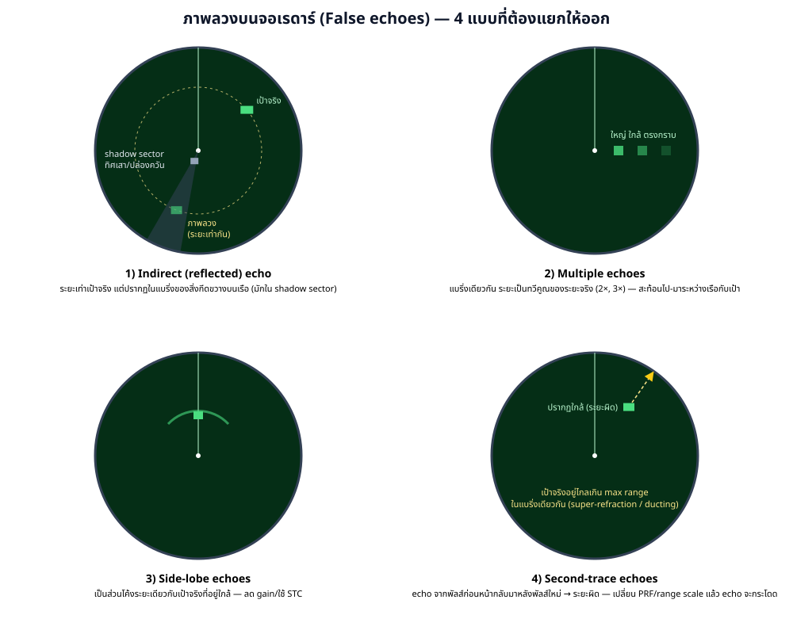
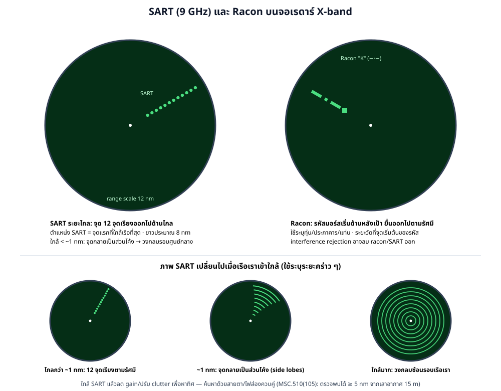

# 1.3 Use of Radar and ARPA to Maintain Safety of Navigation (ภาค A) — หลักการเรดาร์ สมรรถนะ การตั้งค่า และภาพลวง

> สมุดบันทึกการฝึก OOW · TIRAPHONG NANTAPAN
> สมรรถนะตาม STCW A-II/1: *Knowledge of the fundamentals of radar and automatic radar plotting aids (ARPA); Ability to operate and to interpret and analyse information obtained from radar, including performance (factors affecting performance and accuracy; setting up and maintaining displays; detection of misrepresentation of information, false echoes, sea return, etc., racons and SARTs)*
> หมายเหตุ STCW: วิธีพิสูจน์สมรรถนะในตาราง A-II/1 คือการประเมินหลักฐานจาก **การฝึกใน radar simulator และ ARPA simulator ที่ได้รับการรับรอง ร่วมกับประสบการณ์บนเรือ** (ดู Reg. I/12 และ Section A-I/12 เรื่องการใช้ simulator) — และมีหมายเหตุว่าผู้ที่ทำงานเฉพาะบนเรือที่ไม่ติดตั้ง ARPA ไม่ต้องฝึก/ประเมิน ARPA แต่ต้องระบุข้อจำกัดนี้ใน endorsement · หลักสูตรอ้างอิง: IMO Model Course **1.07** *Radar Navigation at Operational Level — Radar Navigation, Radar Plotting and Use of ARPA* (ระดับปฏิบัติการ สำหรับ OOW) และ Model Course **1.08** *Radar Navigation at Management Level* (ระดับบริหาร)
> อ้างอิงหลัก: SOLAS V/19; IMO Res. **MSC.192(79)** *Performance standards for radar equipment* (และ MSC.191(79) ด้านการแสดงผล); IEC 62388; Bole, Wall & Norris *Radar and ARPA Manual* (3rd Ed.); A.G. Bole *The Radar Navigation Handbook*; Bowditch (บท Radar Navigation); BR 45; IMO Res. A.823(19) (มาตรฐาน ARPA รุ่นเดิม ก่อนรวมเข้า MSC.192(79)); IMO Res. **MSC.510(105)** *Performance standards for search and rescue radar transponders* (แทน A.802(19) ตั้งแต่ 1 ม.ค. 2024); SN.1/Circ.243/Rev.2 (สัญลักษณ์บนจอเดินเรือ)

---

## 1. หลักการพื้นฐานของเรดาร์ (Radar fundamentals)

### 1.1 RADAR = RAdio Detection And Ranging

เรดาร์ทางทะเลเป็น **เรดาร์แบบพัลส์ (pulse radar)** — ส่งคลื่นวิทยุความถี่สูงมาก (microwave) เป็นช่วงสั้น ๆ (pulse) ออกไปจากเสาอากาศที่หมุนรอบตัว เมื่อคลื่นกระทบวัตถุ ส่วนหนึ่งสะท้อนกลับ (echo) เครื่องรับวัดเวลาที่คลื่นเดินทางไป-กลับเพื่อหา **ระยะ** และใช้ทิศของเสาอากาศขณะรับ echo เป็น **แบริ่ง**

```
ระยะ (Range) = (c × t) / 2
c = ความเร็วแสง ≈ 300,000 km/s = 300 m/µs (ความเร็วทางเดียว — หารด้วย 2 เพราะคลื่นเดินทางไป-กลับ)
1 nm = 1,852 m  → เวลาไป-กลับ ≈ 2 × 1,852 / 300 ≈ 12.35 µs  (ใช้ c = 299.79 m/µs ได้ ≈ 12.36 µs)
```

### 1.2 ส่วนประกอบ (Block diagram)



*ภาพที่ 1.3-A1 แผนผังเรดาร์แบบพัลส์*

| ส่วน | หน้าที่ |
|---|---|
| **Timebase / Trigger unit** | กำหนดจังหวะการส่งพัลส์ (PRF) และเริ่มเส้นกวาดบนจอให้ตรงกัน |
| **Modulator** | เก็บพลังงานแล้วปล่อยเป็นพัลส์แรงดันสูงสั้น ๆ ไปยัง transmitter (กำหนด pulse length) |
| **Transmitter** | สร้างคลื่น microwave — แบบดั้งเดิมใช้ **magnetron** (กำลังสูงหลายกิโลวัตต์ พัลส์สั้นมาก) แบบใหม่ใช้ **solid-state** (กำลังต่ำ พัลส์ยาวแล้วใช้ **pulse compression**) |
| **Duplexer (T/R switch / T/R cell, circulator)** | ให้ใช้เสาอากาศเดียวทั้งส่งและรับ — ป้องกันเครื่องรับจากพลังงานสูงขณะส่ง |
| **Antenna (scanner)** | เสาอากาศแบบ slotted waveguide หมุนประมาณ 20–30 รอบ/นาที (บางรุ่นเร็วกว่าสำหรับเรือเร็ว) กำหนด **horizontal beam width** (แคบ) และ **vertical beam width** (กว้าง ≈ 20°–25° ให้เห็นเป้าแม้เรือโคลง) |
| **Receiver** | ขยายสัญญาณ echo ที่อ่อนมาก ผสมความถี่ (mixer + local oscillator) ขยาย IF ตรวจจับ (detector) ควบคุมด้วย gain, tuning, STC (sea clutter), FTC (rain clutter) |
| **Processor** | ประมวลผลดิจิทัล ลดสัญญาณรบกวน correlation ระหว่างรอบ ติดตามเป้า (tracking) ผสาน AIS |
| **Display (PPI – Plan Position Indicator)** | แสดงภาพแบบแผนผัง ตำแหน่งเรือเราอยู่ที่ศูนย์กลาง (หรือเลื่อนได้ — off-centre) |
| **Sensor inputs** | heading จาก gyro (THD), ความเร็วจาก log (STW) หรือ GNSS (SOG/COG), ตำแหน่ง GNSS, AIS |

### 1.3 ความถี่: X-band กับ S-band

| | **X-band (9 GHz, ≈ 3 cm)** | **S-band (3 GHz, ≈ 10 cm)** |
|---|---|---|
| ย่านความถี่ตาม MSC.192(79) | **9.2–9.5 GHz** | **2.9–3.1 GHz** |
| ภาพ | คมชัด แยกเป้าดี (beam แคบกว่าเมื่อเสาอากาศขนาดเท่ากัน) | หยาบกว่า |
| ผลของฝน/คลื่น | ถูกฝนและคลื่นรบกวนมากกว่า (attenuation และ clutter สูงกว่า) | ทะลุฝน หมอก และ sea clutter ได้ดีกว่า |
| ระยะตรวจจับในสภาพเลว | ด้อยกว่า | ดีกว่า |
| เสาอากาศ | เล็กกว่า | ใหญ่กว่า หนักกว่า |
| **SART / Racon** | **ตรวจจับ SART 9 GHz ได้** และ racon X-band | ไม่เห็น SART (racon บางตัวตอบ S-band) |
| การใช้งาน | เรดาร์หลักสำหรับการเดินเรือชายฝั่ง ร่องน้ำ SAR | เรดาร์ระยะไกล/สภาพอากาศเลว |

SOLAS V/19: เรือ ≥ 300 GT ต้องมีเรดาร์ 9 GHz และเรือ ≥ 3,000 GT ต้องมีเรดาร์เครื่องที่สอง (3 GHz หรือ 9 GHz ตาม Administration) ที่ทำงานอิสระ

**จดไว้กันลืม — อุปกรณ์เรดาร์/plotting ตาม SOLAS V/19 (สรุปตามขนาดเรือ)**

| ขนาดเรือ | สิ่งที่ต้องมีเพิ่ม (สะสมจากแถวบน) | ข้อ |
|---|---|---|
| ≥ 300 GT และเรือโดยสารทุกขนาด | เรดาร์ 9 GHz + **EPA** (electronic plotting aid) + AIS | V/19.2.3.2, 2.3.5, 2.4 |
| ≥ 500 GT | **ATA** (automatic tracking aid) | V/19.2.5.5 |
| ≥ 3,000 GT | เรดาร์เครื่องที่สอง (3 GHz หรือ 9 GHz ที่สอง) ทำงานอิสระ + **ATA เครื่องที่สอง** | V/19.2.7.1–2.7.2 |
| ≥ 10,000 GT | **ARPA** (หรือเทียบเท่า) plot อัตโนมัติได้อย่างน้อย 20 เป้า ต่อกับ log วัดความเร็วผ่านน้ำ และมี trial manoeuvre | V/19.2.8.1 |

> เรดาร์ที่ติดตั้งตั้งแต่ 1 ก.ค. 2008 ต้องเป็นไปตาม MSC.192(79) ซึ่งรวมฟังก์ชัน tracking (TT) เข้าไปในเรดาร์และแบ่งสมรรถนะเป็น CAT 1/2/3 ตามขนาดเรือ (ข้อ 1.8)

### 1.4 พารามิเตอร์สำคัญ

| พารามิเตอร์ | ผล |
|---|---|
| **Pulse length (PL, τ)** — ระยะเวลาของพัลส์ (≈ 0.05–1.2 µs สำหรับ magnetron) | สั้น → แยกเป้าในแนวระยะดี ระยะต่ำสุด (minimum range) สั้น ใช้ระยะใกล้ / ยาว → พลังงานต่อพัลส์มาก ตรวจจับไกล แต่ภาพหยาบ ใช้ระยะไกล — เรดาร์เลือก PL อัตโนมัติตาม range scale (เลือกเองได้บางรุ่น) |
| **PRF (Pulse Repetition Frequency)** — จำนวนพัลส์ต่อวินาที | ต้องมีเวลาพอให้ echo จากระยะไกลสุดกลับมาก่อนพัลส์ถัดไป (มิฉะนั้นเกิด second-trace echo) — PRF สูงสำหรับระยะใกล้ PRF ต่ำสำหรับระยะไกล |
| **Horizontal beam width (HBW)** | แคบ → แยกเป้าในแนวแบริ่งดี และแบริ่งแม่นยำ — ขึ้นกับความยาวเสาอากาศและความยาวคลื่น (HBW ≈ 70λ/L องศา) |
| **Vertical beam width (VBW)** | กว้าง ≈ 20°–25° เพื่อให้ตรวจจับได้แม้เรือโคลง |
| **Antenna rotation rate** | เร็ว → อัปเดตภาพบ่อย (สำคัญสำหรับเรือเร็วและการติดตามเป้า) |
| **Peak power** | สูง → ตรวจจับไกลขึ้น (magnetron หลายสิบ kW, solid-state หลักร้อยวัตต์แต่ใช้ pulse compression) |

### 1.5 การแยกเป้า (Discrimination / Resolution)



*ภาพที่ 1.3-A2 bearing discrimination ขึ้นกับ beam width ส่วน range discrimination ขึ้นกับ pulse length*

- **Bearing discrimination** — ความสามารถแยกเป้าสองอันที่ระยะเท่ากันแต่แบริ่งต่างกันเล็กน้อย ≈ horizontal beam width (+ ขนาดจุดบนจอ) เป้าที่ห่างกันน้อยกว่านี้จะรวมเป็น echo เดียวยาว — ระวังทางเข้าท่าแคบที่อาจดูเหมือนปิด
- **Range discrimination** — แยกเป้าที่แบริ่งเดียวกันแต่ระยะต่างกัน ≈ **½ × c × τ** (เช่น τ = 0.05 µs ≈ 7.5 m; τ = 1 µs ≈ 150 m)
- **Minimum range** — ระยะใกล้สุดที่เห็นเป้าได้ ขึ้นกับ pulse length เวลาฟื้นตัวของ T/R cell และความสูงเสาอากาศ (vertical beam ไม่ส่องลงใกล้เรือ) — MSC.192(79) กำหนด **≤ 40 m**
- **Spot size / ความละเอียดของจอ** — ที่ range scale ไกล จุดแต่ละจุดแทนพื้นที่มาก ทำให้เป้าใกล้กันรวมกัน → ใช้ range scale เล็กเมื่อต้องการแยกเป้า

### 1.6 Radar horizon และระยะตรวจจับ

คลื่นเรดาร์โค้งตามผิวโลกมากกว่าแสงเล็กน้อย (standard refraction, k ≈ 4/3) ระยะขอบฟ้าเรดาร์จึงไกลกว่าขอบฟ้าที่มองเห็น

```
Radar horizon (nm) ≈ 2.21 √h          (h = ความสูงเสาอากาศ เป็นเมตร)
ระยะตรวจจับเป้าสูง H (nm) ≈ 2.21 (√h + √H)
```

**ตัวอย่าง:** เสาอากาศสูง 30 m, เป้าเป็นเรือที่มีส่วนสูง 16 m → 2.21 (5.48 + 4.00) ≈ **21 ไมล์** (ถ้าเป้าสะท้อนดีพอ)

### 1.7 ปัจจัยที่มีผลต่อการตรวจจับเป้า (Factors affecting detection)

**ก) ลักษณะของเป้า (target characteristics)**
1. **ขนาด** — ใหญ่ สะท้อนมาก
2. **รูปทรงและมุมที่หันเข้าหาเรดาร์ (shape & aspect)** — พื้นผิวที่ตั้งฉากกับลำคลื่นสะท้อนกลับดีมาก ผิวโค้งหรือเอียงสะท้อนออกไปทางอื่น (เช่น เรือที่หันหัวตรงมาอาจเห็นยากกว่าเรือที่หันกราบ)
3. **วัสดุ (material)** — โลหะสะท้อนดี ไม้ ไฟเบอร์กลาส ยาง สะท้อนน้อย (เรือประมงเล็ก เรือยอทช์ ทุ่นพลาสติกอาจหายในคลื่น)
4. **พื้นผิว (texture)** — ผิวขรุขระกระจายคลื่น
5. **ความสูง** — ตามข้อ 1.6
6. **Radar reflector / Racon / RTE** — ช่วยเพิ่มการสะท้อน

**ข) ลักษณะของเรดาร์** — peak power, pulse length, beam width, ความถี่, ความสูงเสาอากาศ, ความไวเครื่องรับ, การตั้งค่า (gain, tuning)

**ค) สภาพการแพร่คลื่น (propagation)**

| สภาพ | สาเหตุ | ผล |
|---|---|---|
| **Standard refraction** | บรรยากาศปกติ | radar horizon ≈ 2.21√h |
| **Super-refraction** | อากาศอุ่นอยู่เหนือผิวน้ำเย็น ความชื้นลดลงตามความสูงเร็ว (มักในเขตร้อน ใกล้ฝั่งทะเลทราย) | คลื่นโค้งลงมากกว่าปกติ → ตรวจจับได้ไกลขึ้น อาจเกิด second-trace echoes |
| **Ducting** | super-refraction รุนแรง คลื่นถูกกักในชั้นบรรยากาศ | ตรวจจับได้ไกลผิดปกติมาก |
| **Sub-refraction** | อากาศเย็นอยู่เหนือผิวน้ำอุ่น (เช่นบริเวณขั้วโลก) | คลื่นโค้งน้อยกว่าปกติ → ระยะตรวจจับลดลง เป้าต่ำอาจหาย |

**ง) Clutter และสภาพอากาศ**
- **Sea clutter (sea return)** — echo จากคลื่นทะเลรอบเรือ หนาแน่นในระยะใกล้ (โดยเฉพาะด้านเหนือลม) อาจกลบเป้าเล็ก
- **Rain/snow clutter** — echo จากฝน ทำให้เห็นเป็นกลุ่มฟุ้ง และ **ลดทอน (attenuate)** สัญญาณของเป้าที่อยู่หลังฝน (X-band มากกว่า S-band)
- **Interference** — จากเรดาร์เรืออื่นความถี่ใกล้กัน เห็นเป็นเส้นจุดโค้งหรือเกลียว (radar-to-radar interference) — ใช้ interference rejection (IR) แต่ระวัง IR อาจลบ racon/SART

**จ) สภาพเรือเราเอง**
- **Shadow sectors และ blind sectors** — เสา ปล่องควัน เครน ตู้สินค้า บังลำคลื่น ทำให้มีเขตที่ตรวจจับไม่ได้หรือได้ไม่ดี ต้องทราบและบันทึก (ทดสอบโดยดูการหายไปของ sea clutter หรือเป้าเล็กเมื่ออยู่ในทิศนั้น) — ตาม MSC.192(79) ต้องติดตั้งให้ blind sectors น้อยที่สุด และบันทึกไว้

### 1.8 มาตรฐานสมรรถนะ MSC.192(79) (สรุปที่ OOW ควรรู้)

| รายการ | ข้อกำหนด |
|---|---|
| ความแม่นยำระยะ (range accuracy) | ภายใน **30 m หรือ 1% ของ range scale** ที่ใช้ แล้วแต่ค่าใดมากกว่า |
| ความแม่นยำแบริ่ง (bearing accuracy) | ภายใน **1°** |
| Range discrimination | **40 m** (สองเป้าแบริ่งเดียวกัน ใน range scale ≤ 1.5 nm ที่ 50–100% ของ scale) |
| Bearing discrimination | **2.5°** (สองเป้าระยะเท่ากันต้องแยกเป็นสองเป้า — วัดใน range scale ≤ 1.5 nm ที่ 50–100% ของ scale; MSC.192(79) ระบุค่าเดียว ไม่แยกตามย่านความถี่ — ตำราบางเล่มอ้าง 4° สำหรับ S-band ให้ตรวจกับ IEC 62388) |
| Minimum range | **40 m** (ทุ่นมาตรฐาน เสาอากาศสูง 15 m ทะเลสงบ ต้องเห็นได้ตั้งแต่ 40 m ถึง 1 nm โดยปรับเฉพาะ range scale) |
| Range scales ที่ต้องมี | 0.25, 0.5, 0.75, 1.5, 3, 6, 12, 24 nm (เพิ่มเติมได้) |
| Range rings | มีวงระยะที่เหมาะสมกับแต่ละ scale |
| EBL / VRM | อย่างน้อย 2 ชุด |
| Heading line | เส้นหัวเรือแสดงตลอด (ปิดชั่วคราวได้) — ต้องมีวิธีปรับแนว (align) ทางอิเล็กทรอนิกส์ให้ละเอียดถึง **0.1°**; ความแม่นยำของการ stabilise ทิศภาพ (azimuth stabilisation) ต้องอยู่ภายใน **0.5°** |
| Target tracking (TT) | CAT 1 (≥ 10,000 GT): **40** เป้า, CAT 2 (500 – < 10,000 GT และ HSC < 10,000 GT): **30**, CAT 3 (< 500 GT): **20** |
| AIS targets | activated: 40 / 30 / 20 เป้า · sleeping: 200 / 150 / 100 เป้า (CAT 1 / 2 / 3) |
| Auto acquisition และ trial manoeuvre | บังคับเฉพาะ **CAT 1** (CAT 2/3 จับเป้าด้วยมือได้อย่างเดียวก็ผ่านมาตรฐาน) |
| ขนาดจอ (operational display) | เส้นผ่านศูนย์กลางพื้นที่ภาพ CAT 1: ≥ 320 mm, CAT 2: ≥ 250 mm, CAT 3: ≥ 180 mm |
| Parallel index lines | อย่างน้อย 4 เส้น |
| SART/racon | ต้องปิดฟังก์ชันประมวลผลที่อาจลบ SART/racon X-band ได้ และแสดงสถานะให้เห็น |
| Stabilisation | sea (STW + heading) และ ground (SOG/COG) |
| เวลาพร้อมใช้ | จาก standby สู่การทำงานภายใน 5 วินาที, จากปิดเครื่องภายใน 4 นาที |
| Trails / past positions | ต้องมี (relative และ true) |
| CCRP | อ้างอิงระยะ/แบริ่งกับจุดอ้างอิงร่วม |
| การตรวจจับในสภาพปกติ | ประเมินจากการเห็นเป้าอย่างน้อย 8 ใน 10 รอบสแกน (ตามตารางระยะตรวจจับเป้ามาตรฐานของ X และ S band) |

### 1.9 ความแม่นยำของระยะ/แบริ่ง และแหล่งความคลาดเคลื่อน (Factors affecting accuracy)

STCW แยก "performance" (เห็นเป้าหรือไม่) กับ "accuracy" (วัดได้ถูกแค่ไหน) — ตารางนี้ผมสรุปไว้ใช้ตอนตรวจ fix ด้วยเรดาร์

| แหล่งความคลาดเคลื่อน | กระทบ | วิธีลด/ตรวจ |
|---|---|---|
| **Heading line misalignment** (ติดตั้ง/ปรับไม่ตรง) | แบริ่งทุกเป้าผิดเท่ากัน (relative และ true) | ตรวจกับวัตถุตรงหัวเรือ หรือเทียบแบริ่งเรดาร์กับแบริ่งด้วยตาของจุดเด่นที่เห็นชัด ปรับใน service menu ได้ละเอียด 0.1° |
| **Gyro error / heading input ผิด** | แบริ่ง true ทั้งภาพหมุนไป, true vector ผิด | ตรวจ gyro error ทุกยาม (azimuth/transit) และป้อนค่าแก้ |
| **Horizontal beam width** | ขอบเป้า (เช่นแหลม) "บวม" ออกข้างละ ½ HBW | วัดแบริ่งขอบแผ่นดิน → แก้ครึ่ง beam width เข้าหาเป้า; ใช้แบริ่งเป้าจุดเล็กดีกว่า |
| **Pulse length / ความกว้างของจุดบนจอ** | echo ยืดออกด้านไกล (ด้านไกลไม่แม่น) | วาง VRM ที่ขอบใกล้ (leading edge) ของ echo |
| **Range scale ใหญ่ / VRM ไม่ calibrate** | ความผิดพลาดระยะเป็น % ของ scale | ใช้ scale เล็กที่สุดที่เป้ายังอยู่ในจอ ตรวจ VRM เทียบ fixed range rings |
| **CCRP / antenna offset ตั้งผิด** | ระยะ/แบริ่งวัดจากจุดผิด (เรือยาวยิ่งชัด) | ตรวจ CCRP และตำแหน่งเสาอากาศใน installation settings |
| **Off-centre display** | ถ้าวัดจากศูนย์จอแทน CCRP ค่าผิด | ใช้ EBL/VRM ที่ผูกกับ own ship |
| **การระบุจุดบนเป้าผิด** | เช่นชายหาดลาดต่ำ — วัดโดนเนินด้านใน | เลือกจุดเด่นที่ชันและระบุได้ชัด (หน้าผา ท่าเรือ ทุ่นมี racon) |

> สรุปแบบจำง่าย: **ระยะจากเรดาร์แม่นกว่าแบริ่ง** — fix ที่ดีที่สุดคือระยะจากวัตถุ 2–3 จุดที่ตัดกันเป็นมุมกว้าง

---

## 2. การตั้งค่าและดูแลภาพเรดาร์ (Setting up and maintaining displays)

### 2.1 ลำดับการเปิดเครื่องและตั้งค่า

1. **ตรวจก่อนเปิด** — ไม่มีคนอยู่ใกล้เสาอากาศ (อันตรายจากรังสีและการหมุน) สวิตช์นิรภัยของเสาอากาศ (antenna safety switch) อยู่ในตำแหน่ง ON
2. **เปิดเครื่อง → Standby** — รอ warm-up (magnetron ประมาณ 3 นาที)
3. **ตั้ง brilliance/ความสว่างจอ** ให้เหมาะกับกลางวัน/กลางคืน (day/night palette)
4. **Transmit (TX)**
5. **เลือก range scale** — เริ่มที่ระยะกลาง (เช่น 6 หรือ 12 nm) แล้วสลับใกล้-ไกลเป็นระยะ
6. **Tuning** — ส่วนใหญ่อัตโนมัติ ตรวจด้วย tuning indicator หรือดูเป้าระยะไกลให้ชัดที่สุด
7. **Gain** — เพิ่มจนเห็นเม็ดสัญญาณรบกวน (speckle/noise) จาง ๆ ทั่วจอ แล้วลดลงเล็กน้อย (ตั้งให้เป้าอ่อนยังเห็น)
8. **Sea clutter (STC – anti-clutter sea)** — ลดเท่าที่จำเป็นให้เห็นเป้าในบริเวณ clutter แต่ **อย่าลดจนเป้าเล็กหายไปด้วย** ตั้งค่าใหม่บ่อย ๆ ตามสภาพคลื่น (โหมด auto ใช้ได้แต่ต้องตรวจ)
9. **Rain clutter (FTC – anti-clutter rain)** — ใช้เมื่อมีฝน ทำให้เห็นขอบด้านหน้าของ echo (differentiator) แต่ลดความไวต่อเป้าอ่อน ปิดเมื่อไม่มีฝน
10. **Orientation และ motion** — เลือกตามความเหมาะสม (ข้อ 2.2)
11. **ตรวจ heading line** — ตรงกับ heading จาก gyro และตรงแนวหัวเรือจริง (heading marker alignment) — ตรวจด้วยวัตถุที่อยู่ตรงหัวเรือพอดี
12. **ตรวจ sensor inputs** — gyro heading, speed (STW/SOG), GNSS position, AIS
13. **Performance monitor / performance check** — ตรวจว่าประสิทธิภาพของเรดาร์ไม่ลดลง (magnetron เสื่อม waveguide มีปัญหา)
14. **ตั้ง alarm** — guard zones, CPA/TCPA limits, lost target
15. **Trails** — ตั้งความยาว trail (เช่น 3 หรือ 6 นาที) relative หรือ true ตามต้องการ

### 2.2 รูปแบบการแสดงผล (Presentation modes)

**การวางทิศภาพ (Orientation)**

| โหมด | ลักษณะ | ข้อดี | ข้อเสีย |
|---|---|---|---|
| **Head-up (unstabilised)** | หัวเรืออยู่ด้านบนเสมอ | เทียบกับที่เห็นจากหน้าต่างง่าย | ภาพหมุนเมื่อเรือส่าย/เปลี่ยนเข็ม เป้าเบลอ (smearing) วัดแบริ่งเป็น relative ต้องแปลง — **ไม่ควรใช้ในการ plot** |
| **North-up (stabilised)** | ทิศเหนืออยู่ด้านบน (stabilised ด้วย gyro) | เทียบกับแผนที่ง่าย ภาพนิ่งเมื่อเรือเปลี่ยนเข็ม เหมาะกับ plotting | ต้องคิดซ้าย/ขวาเมื่อเรือแล่นไปทางใต้ |
| **Course-up (stabilised)** | เข็มที่ตั้งไว้อยู่ด้านบน (stabilised) | คล้าย head-up แต่ภาพนิ่ง | เมื่อเปลี่ยนเข็มต้องรีเซ็ต course-up |

**การเคลื่อนที่ของภาพ (Motion)**

| โหมด | ลักษณะ | ใช้เมื่อ |
|---|---|---|
| **Relative Motion (RM)** | เรือเราอยู่กับที่ (ที่ศูนย์กลางหรือ off-centre) เป้าทุกอย่างเคลื่อนที่สัมพัทธ์กับเรา | ประเมินความเสี่ยงชน (เป้าที่เคลื่อนเข้าหาศูนย์กลางตรง ๆ คือเสี่ยงชน) parallel indexing |
| **True Motion (TM)** | เรือเราเคลื่อนที่บนจอตามเข็มและความเร็ว เป้าเคลื่อนตาม true motion ของตน วัตถุถาวรอยู่นิ่ง (ถ้า ground-stabilised) | ดูภาพรวมการจราจร ในร่องน้ำ แยกเป้านิ่ง/เคลื่อนที่ ต้องรีเซ็ตตำแหน่งเรือเมื่อเข้าใกล้ขอบจอ |

**Stabilisation (สำหรับ true motion และ true vectors)**

| แบบ | ข้อมูลที่ใช้ | ผล |
|---|---|---|
| **Sea-stabilised** | heading + **speed through the water (STW)** จาก log | true vector ของเป้าแสดง **heading/ทิศที่แล่นผ่านน้ำ** → บอก aspect ถูกต้อง **เหมาะกับการหลีกเลี่ยงการโดนกัน** (COLREG) แต่เป้าถาวร (ทุ่น ฝั่ง) จะ "ลอย" ไปตามกระแสน้ำ |
| **Ground-stabilised** | COG + **SOG** จาก GNSS (หรือ bottom-track log) | เป้าถาวรอยู่นิ่ง เหมาะกับการเดินเรือ/ตรวจตำแหน่ง แต่ true vector ของเรืออื่นแสดง COG ซึ่ง **อาจไม่ตรงกับ heading** เมื่อมีกระแสน้ำแรง → ประเมิน aspect ผิด อาจตีความสถานการณ์ COLREG ผิด |

> **จดไว้กันลืม** — สำหรับ collision avoidance ให้ใช้ **sea-stabilised** (ตามคำแนะนำในคู่มือ Radar/ARPA และแนวทางการฝึก) ส่วนการนำทางในร่องน้ำ/PI ใช้ ground-stabilised หรือ relative motion — CPA/TCPA ไม่ขึ้นกับ stabilisation (คำนวณจาก relative motion) แต่ **true vectors และ aspect ขึ้นกับ stabilisation**

### 2.3 Trails และ Past positions

- **Relative trails** — แสดงเส้นทางสัมพัทธ์ของเป้า (ดูความเสี่ยง: trail ชี้มาที่ศูนย์กลาง = เสี่ยง)
- **True trails** — แสดงเส้นทางจริงของเป้า (ดูว่าเป้าเปลี่ยนเข็มหรือไม่ วัตถุนิ่งไม่มี trail ในโหมด ground-stabilised)
- ระวังการแปลผิดเมื่อสลับโหมด trails

### 2.4 การวัดระยะและแบริ่ง

- **VRM (Variable Range Marker)** — วัดระยะ วางที่ขอบด้านใกล้ (leading edge) ของเป้า
- **EBL (Electronic Bearing Line)** — วัดแบริ่ง วางผ่านกึ่งกลางเป้า (เป้าจุด) หรือขอบ (เป้าแผ่นดิน — ต้องแก้ครึ่ง beam width)
- **Range rings** — ประเมินระยะคร่าว ๆ
- **ข้อผิดพลาดที่พบบ่อย** — ใช้ EBL แบบ relative ทั้งที่คิดว่า true, ลืมแก้ gyro error, heading line ไม่ตรง, ใช้ off-centre แล้ววัดจากจุดผิด (EBL/VRM ต้องตั้งจาก own ship/CCRP)
- **เรดาร์วัดระยะแม่นกว่าแบริ่ง** (ดูบท 1.1.2-A)

### 2.5 ความปลอดภัยในการใช้และดูแลเรดาร์

- รังสีไมโครเวฟ: อย่าเข้าใกล้เสาอากาศขณะส่ง (TX) — ระยะปลอดภัยระบุบนป้าย (มัก ≥ 1–2 m สำหรับเรดาร์เรือ แต่ให้ยึดตามคู่มือ)
- งานบนเสา (going aloft) ต้องปิดเรดาร์และล็อก/แขวนป้าย (lock-out/tag-out) ตาม permit to work
- แรงดันไฟสูงในเครื่อง — ซ่อมโดยผู้มีคุณสมบัติเท่านั้น
- บันทึกชั่วโมงการทำงานของ magnetron

---

## 3. ภาพลวงและข้อมูลที่ผิดพลาด (Misrepresentation of information, false echoes)



*ภาพที่ 1.3-A3 False echoes สี่แบบหลัก*

### 3.1 Indirect (reflected) echoes

- เกิดเมื่อพัลส์สะท้อนจากโครงสร้างบนเรือเรา (เสา ปล่องควัน ตู้สินค้า) ไปถึงเป้า แล้วกลับมาทางเดิม
- ภาพลวงปรากฏที่ **ระยะเท่ากับเป้าจริง (โดยประมาณ)** แต่ใน **แบริ่งของสิ่งกีดขวางบนเรือ** — มักอยู่ใน shadow sector
- ตรวจพบ: เป้าปรากฏในทิศของเสา/ปล่องควันเสมอ ระยะเปลี่ยนเหมือนเป้าจริง เปลี่ยนเข็มเรือแล้ว echo ยังอยู่ในแบริ่งสัมพัทธ์เดิม

### 3.2 Multiple echoes

- เกิดเมื่อเป้าขนาดใหญ่อยู่ **ใกล้มากและตรงกราบ** (เช่นเรือใหญ่ที่แซงใกล้ ท่าเรือ สะพาน) พัลส์สะท้อนไป-มาระหว่างเรือเรากับเป้าหลายรอบ
- ภาพลวงเรียงตาม **แบริ่งเดียวกัน** ที่ระยะ **2 เท่า 3 เท่า** ของระยะจริง และอ่อนลงตามลำดับ
- แก้: ลด gain, ใช้ STC — ภาพจะหายเมื่อเปลี่ยนมุม

### 3.3 Side-lobe echoes

- เสาอากาศมี side lobes (ลำคลื่นข้างที่อ่อน) ทำให้เป้าแรงที่อยู่ใกล้ปรากฏเป็น **ส่วนโค้งหรือจุดหลายจุดที่ระยะเดียวกัน** สองข้างของ echo จริง
- แก้: ลด gain/STC

### 3.4 Second-trace (multiple-trace) echoes

- เกิดเมื่อเป้าอยู่ **ไกลเกินระยะสูงสุดของรอบพัลส์นั้น** (มักในภาวะ super-refraction/ducting) echo กลับมาหลังพัลส์ถัดไปส่งออกไปแล้ว เรดาร์จึงแสดงเป้าที่ระยะใกล้ผิด
- ลักษณะ: แนวฝั่งดูผิดรูป เป้าเคลื่อนที่แปลก ๆ ทิศเดียวกับเป้าจริงแต่ระยะสั้นกว่า
- ตรวจพบ: **เปลี่ยน range scale (ทำให้ PRF เปลี่ยน)** echo จะกระโดดไปที่ระยะอื่น ในขณะที่เป้าจริงอยู่ที่เดิม (เรดาร์บางรุ่นใช้ PRF jitter ลดปัญหานี้)

### 3.5 ภาพลวงและข้อผิดพลาดอื่น

- **Power cable / bridge echoes** — สายไฟแรงสูงข้ามร่องน้ำให้ echo เดียวที่จุดตั้งฉากกับเรา ซึ่ง **เคลื่อนที่ไปกับเรือและดูเหมือนอยู่บนเส้นทางชน (collision course)** ตลอด — ระวังอย่าตกใจหลบผิด ตรวจกับแผนที่
- **Radar-to-radar interference** — เส้นประโค้งเป็นเกลียว เปลี่ยนตำแหน่งทุกรอบ
- **Sea clutter และ rain clutter** — กลบเป้า (ข้อ 1.7)
- **Shadow/blind sectors** — เป้าหายเมื่ออยู่ในทิศที่ถูกบัง
- **การระบุชายฝั่งผิด** — ชายหาดลาดต่ำไม่สะท้อน แต่เนินหลังชายหาดสะท้อน ทำให้ดูเหมือนฝั่งอยู่ไกลกว่าจริง (ระวังมากในการ fix ด้วยระยะ)
- **Spoking, จุดดำ, ภาพบิดเบี้ยว** — ปัญหาเครื่อง
- **AIS target ผิดตำแหน่ง** เมื่อซ้อนบนเรดาร์ (offset ของ GNSS antenna/AIS ไม่ถูกต้อง)

---

## 4. Racon และ SART บนจอเรดาร์



*ภาพที่ 1.3-A4 ลักษณะของ SART (ระยะไกล) และ racon บนจอ X-band*

### 4.1 Racon

- ตอบสนองต่อพัลส์เรดาร์ แสดงเป็น **รหัส Morse** ยื่นออกไปตามรัศมีด้านไกลจากตำแหน่ง racon (รายละเอียดใน 1.1.2-B)
- ใช้ระบุเป้า (ทุ่น ประภาคาร แท่น สะพาน) และวัดระยะ/แบริ่ง
- Racon รหัส "D" ใช้กับอันตรายใหม่/ซากเรือ
- อาจถูกกด/ลบโดย interference rejection, rain clutter

### 4.2 SART (Search and Rescue Transponder — Radar SART)

- อุปกรณ์ในเรือช่วยชีวิต (GMDSS) ทำงานในย่าน **9 GHz (X-band)** — เมื่อถูกเรดาร์ X-band ของเรือหรืออากาศยานกวาด จะส่งสัญญาณตอบ
- บนจอ: **จุด 12 จุด (12 dots)** เรียงต่อกันตามแนวรัศมี ยาวประมาณ **8 nm** — **ตำแหน่งของ SART โดยประมาณคือจุดแรกที่ใกล้เรือที่สุด** (จุดแรกอาจเลยตำแหน่งจริงออกไปเล็กน้อยเพราะความล่าช้าในการตอบสนองของเครื่อง)
- เมื่อเข้าใกล้ **ประมาณ 1 nm** จุดจะเริ่มกลายเป็น **ส่วนโค้ง** และใกล้มากจะเป็น **วงกลมซ้อน** รอบศูนย์กลาง (เพราะ SART ตอบ side lobes ด้วย)
- ระยะตรวจจับ: จากเรือ (เสาอากาศสูง ~15 m) **อย่างน้อยประมาณ 5 nm**; จากอากาศยานที่สูง 3,000 ft ต้องทำงานได้ถูกต้องที่ระยะถึงประมาณ **30 nm** (เดิมจดไว้ "30–40 nm" — ค่าในมาตรฐานคือ 30 nm สำหรับเรดาร์อากาศยานกำลังส่งอย่างน้อย 10 kW; ในทางปฏิบัติอาจไกลกว่านี้) (SART ต้องอยู่สูงเหนือน้ำ ≥ 1 m)
- **มาตรฐานปัจจุบัน**: MSC.510(105) (ใช้แทน A.802(19) และ A.530(13) ตั้งแต่ 1 ม.ค. 2024) — แบตเตอรี่ต้องพอ **standby 96 ชั่วโมง** แล้วยังส่งสัญญาณตอบได้อีก **8 ชั่วโมง** เมื่อถูกกวาดต่อเนื่อง ทนการตกลงน้ำจากที่สูง 20 m และมีสัญญาณแจ้งผู้ประสบภัยว่ามีเรดาร์กวาดถึงแล้ว
- **ทำไมเป็น 12 จุด**: SART กวาดความถี่ไปทั่วย่าน 9.2–9.5 GHz ช้า ๆ 12 รอบ ทุกครั้งที่ความถี่ตรงกับ passband ของเครื่องรับเรดาร์เราจะได้ "จุด" หนึ่งจุด ระยะห่างแต่ละจุดประมาณ 0.6 nm รวมเป็นเส้นยาว ~8 nm
- **การตั้งเรดาร์เพื่อหา SART**: ใช้ X-band, range 6 หรือ 12 nm, **ปิดหรือลด sea clutter (STC) และ rain clutter**, ปิด interference rejection, บางกรณี **detune เล็กน้อย** เพื่อให้สัญญาณ SART ชัดกว่า clutter, ลด gain เล็กน้อยเมื่อใกล้
- **AIS-SART** — ทางเลือกแทน radar SART ตาม SOLAS (ตั้งแต่ 2010) แสดงบน AIS display/ECDIS เป็นสัญลักษณ์วงกลมมีกากบาท (⊗) พร้อมข้อความ "SART ACTIVE" และ MMSI ที่ขึ้นต้นด้วย **970**

---

## 5. การใช้เรดาร์เพื่อการเดินเรือ (Navigational use — สรุป)

- **Position fixing** — ระยะจากวัตถุ 2–3 อย่าง (แม่นที่สุด), ระยะ + แบริ่ง, ใช้ร่วมกับ GNSS (radar overlay บน ECDIS) — บท 1.1.2-A
- **Parallel indexing และ blind pilotage** — บท 1.2.1-C
- **Clearing ranges/bearings, wheel-over** — บท 1.1 และ 1.2.1-C
- **ตรวจจับอันตรายและทุ่น** — แต่ระวังเป้าเล็กหายใน clutter
- **การตรวจสอบ GNSS** — ถ้าระยะเรดาร์ไม่ตรงกับตำแหน่ง GNSS บน ECDIS ต้องสงสัย GNSS ก่อน (หรือ heading/offset)

---

## 6. คำถามสอบปากเปล่า / สัมภาษณ์ — Radar fundamentals

**ถาม:** X-band กับ S-band ต่างกันอย่างไร ใช้อะไรหา SART
**แนวตอบ:** X-band (9 GHz, 3 cm) ภาพคม แยกเป้าดี แต่ถูกฝน/คลื่นรบกวนมาก S-band (3 GHz, 10 cm) ทะลุฝนและคลื่นดีกว่า ตรวจระยะไกลในสภาพเลวได้ดีกว่า SART ใช้ X-band (9 GHz)

**ถาม:** Pulse length มีผลอย่างไร
**แนวตอบ:** สั้น → range discrimination ดี minimum range สั้น ใช้ระยะใกล้ ยาว → พลังงานมาก ตรวจจับไกล แต่แยกเป้าในระยะได้ไม่ดี ใช้ระยะไกล

**ถาม:** อะไรกำหนด bearing discrimination
**แนวตอบ:** horizontal beam width (ขึ้นกับความยาวเสาอากาศและความยาวคลื่น) และขนาดจุดบนจอ

**ถาม:** ปัจจัยที่ทำให้เป้าตรวจจับได้ยาก
**แนวตอบ:** เป้าเล็ก วัสดุสะท้อนต่ำ (ไม้ ไฟเบอร์) รูปทรง/มุมไม่ดี ต่ำ อยู่ใน sea/rain clutter อยู่ใน shadow sector sub-refraction ตั้ง gain/clutter ไม่เหมาะ range scale ไม่เหมาะ

**ถาม:** Super-refraction เกิดเมื่อใด มีผลอย่างไร
**แนวตอบ:** อากาศอุ่นและแห้งอยู่เหนือผิวทะเลเย็น (temperature inversion, ความชื้นลดตามความสูงเร็ว) คลื่นโค้งลงมากกว่าปกติ ตรวจจับไกลขึ้น อาจเกิด ducting และ second-trace echoes

**ถาม:** Sea-stabilised กับ ground-stabilised ต่างกันอย่างไร ใช้อะไรในการหลบเรือ
**แนวตอบ:** sea-stabilised ใช้ STW + heading → true vector แสดง heading ของเป้า (aspect ถูก) เหมาะกับ collision avoidance; ground-stabilised ใช้ SOG/COG → วัตถุถาวรนิ่ง เหมาะกับการเดินเรือ แต่ aspect ของเป้าอาจผิดเมื่อมีกระแสน้ำ

**ถาม:** False echo มีกี่แบบ อธิบายวิธีแยก
**แนวตอบ:** indirect (ระยะเท่าเป้าจริง แต่อยู่ในแบริ่งของสิ่งกีดขวางบนเรือ), multiple (แบริ่งเดียวกัน ระยะเป็นทวีคูณ จากเป้าใหญ่ใกล้ตรงกราบ), side-lobe (ส่วนโค้งระยะเดียวกับเป้าใกล้ ลด gain), second-trace (ระยะผิดจากเป้าไกลเกิน max range เปลี่ยน range scale แล้ว echo กระโดด) และ power-cable echo ที่ดูเหมือนเสี่ยงชน

**ถาม:** SART บนจอเรดาร์มีลักษณะอย่างไร ตั้งเรดาร์อย่างไร
**แนวตอบ:** จุด 12 จุดเรียงออกไปด้านไกล ยาว ~8 nm ตำแหน่ง SART คือจุดแรกใกล้เรือ ใกล้ ~1 nm เป็นส่วนโค้งแล้ววงกลม ตั้ง X-band range 6–12 nm ลด/ปิด sea และ rain clutter ปิด IR อาจ detune เล็กน้อย

**ถาม:** คำนวณระยะตรวจจับเรือที่สูง 25 m ด้วยเสาอากาศสูง 36 m
**แนวตอบ:** 2.21 (√36 + √25) = 2.21 × 11 ≈ 24.3 ไมล์ (ถ้าสะท้อนพอ)

**ถาม:** Head-up unstabilised มีข้อเสียอะไร
**แนวตอบ:** ภาพหมุนตามการส่ายของเรือ เป้าเบลอ แบริ่งเป็น relative ต้องแปลง ไม่เหมาะกับ plotting และ ARPA

**ถาม:** MSC.192(79) แบ่งเรดาร์เป็น CAT 1/2/3 อย่างไร ต่างกันตรงไหน
**แนวตอบ:** แบ่งตามขนาดเรือ — CAT 3 เรือ < 500 GT, CAT 2 เรือ 500 ถึง < 10,000 GT (และ HSC < 10,000 GT), CAT 1 เรือ ≥ 10,000 GT; จอ ≥ 180/250/320 mm, tracking 20/30/40 เป้า, AIS activated 20/30/40 sleeping 100/150/200 และ auto acquisition กับ trial manoeuvre บังคับเฉพาะ CAT 1

**ถาม:** จะตรวจว่า heading line ของเรดาร์ตรงหรือไม่อย่างไร
**แนวตอบ:** เลือกวัตถุที่เห็นชัดทั้งด้วยตาและบนเรดาร์ หันหัวเรือให้ตรงกับวัตถุ (หรือวัดแบริ่งด้วยตาเทียบกับ EBL) ถ้า echo ไม่อยู่บน heading line แปลว่า heading marker misalignment ต้องแจ้งนายเรือ/ช่างปรับ (MSC.192(79) ให้ปรับได้ละเอียด 0.1°) เพราะทำให้แบริ่งทุกเป้าและ true vector ผิดเท่ากันหมด

**ถาม:** ทำไม fix ด้วยระยะเรดาร์ดีกว่าด้วยแบริ่งเรดาร์
**แนวตอบ:** แบริ่งได้รับผลจาก horizontal beam width (ขอบเป้าบวมครึ่ง beam width) heading line misalignment และ gyro error ส่วนระยะวัดจากเวลาไป-กลับของพัลส์ ความผิดพลาดต่ำ (มาตรฐาน 30 m หรือ 1% ของ scale) จึงควรใช้ระยะจากวัตถุ 2–3 จุดที่ตัดกันเป็นมุมกว้าง

**ถาม:** Radar SART ตามมาตรฐานปัจจุบันต้องทำงานได้นานเท่าไร
**แนวตอบ:** ตาม MSC.510(105) — standby ได้ 96 ชั่วโมง แล้วส่งสัญญาณตอบได้อีก 8 ชั่วโมงเมื่อถูกกวาดต่อเนื่อง เสาอากาศ SART ต้องสูงจากน้ำอย่างน้อย 1 m เพื่อให้เรือ (เสาอากาศ 15 m) ตรวจพบได้อย่างน้อย 5 nm

---

*ก่อนหน้า ← [1.2.2 BRM](1.2.2-bridge-resource-management.md) · ถัดไป → [1.3-B Radar Plotting และ ARPA](1.3-B-radar-plotting-and-arpa.md)*
