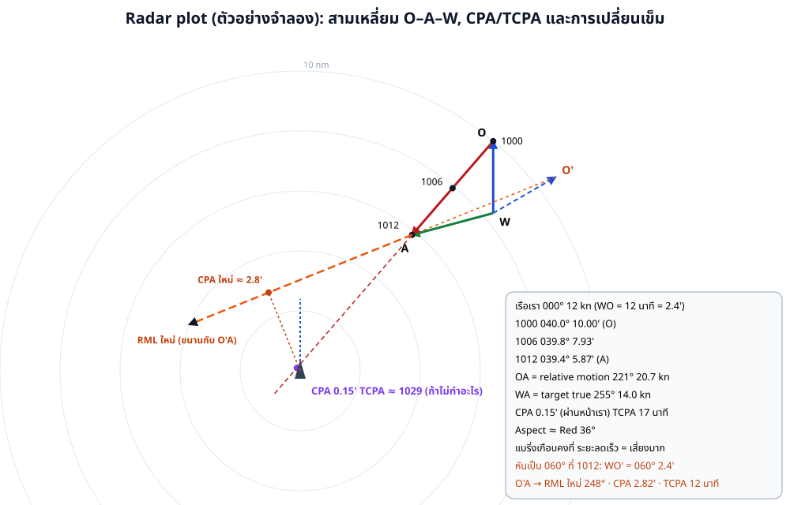
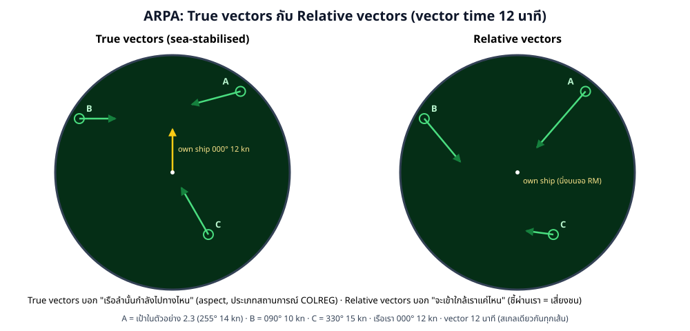

# 1.3 Use of Radar and ARPA (ภาค B) — Radar Plotting, การหลบเรือด้วยเรดาร์ และ ARPA

> สมุดบันทึกการฝึก OOW · TIRAPHONG NANTAPAN
> สมรรถนะตาม STCW A-II/1: *Use, including: (1) range and bearing; course and speed of other ships; time and distance of closest approach of crossing, meeting overtaking ships; (2) identification of critical echoes; detecting course and speed changes of other ships; effect of changes in own ship's course or speed or both; (3) application of COLREG; (4) plotting techniques and relative- and true-motion concepts; (5) parallel indexing* — และ *Principal types of ARPA, their display characteristics, performance standards and the dangers of over-reliance on ARPA; Ability to operate and to interpret and analyse information obtained from ARPA*
> อ้างอิงหลัก: IMO Res. MSC.192(79); IMO Model Course 1.07 *Radar Navigation at Operational Level* (ระดับ OOW) และ 1.08 *Radar Navigation at Management Level*; Bole, Wall & Norris *Radar and ARPA Manual*; COLREG Rules 5–8, 19; ICS BPG; SOLAS V/19 (ข้อกำหนดการติดตั้ง EPA/ATA/ARPA); IMO Res. A.823(19) (มาตรฐาน ARPA รุ่นเดิม)

---

## 1. Relative motion — แนวคิดที่ต้องเข้าใจให้ขาด

บนจอเรดาร์โหมด **relative motion** เรือเราอยู่กับที่ ทุกอย่างรอบตัวเคลื่อนที่ "สัมพัทธ์" กับเรา ถ้าเป้าใดเคลื่อนที่ **ตรงเข้าหาศูนย์กลาง** แปลว่าจะชนกัน (แบริ่งคงที่ ระยะลดลง — CBDR)

- **Relative motion ของเป้า = True motion ของเป้า − True motion ของเรา**
- จากการ plot ตำแหน่งเป้าบนจอที่เวลาต่างกัน เราได้ **relative motion line (RML)** → ต่อเส้นออกไปจะรู้ว่าเป้าจะผ่านเราใกล้แค่ไหน (CPA) และเมื่อไร (TCPA)
- แต่ถ้าจะรู้ว่าเป้า "จริง ๆ" กำลังแล่นไปทางไหนเร็วเท่าไร (เพื่อตัดสินสถานการณ์ตาม COLREG) ต้องแก้ด้วยการเคลื่อนที่ของเราเอง → สามเหลี่ยม **O–A–W**

---

## 2. Radar plotting — สามเหลี่ยม O, A, W

*ภาพที่ 1.3-B1 ตัวอย่างจำลอง: plot ทุก 6 นาที ได้สามเหลี่ยม OAW, CPA/TCPA และผลของการเปลี่ยนเข็ม*

### 2.1 สัญลักษณ์มาตรฐาน

| จุด/เส้น | ความหมาย |
|---|---|
| **O** | ตำแหน่งแรกของเป้าบน plot (Origin) |
| **A** | ตำแหน่งของเป้าหลังเวลาผ่านไป (Actual position) |
| **W** | ตำแหน่งที่เป้าจะอยู่ ถ้าเป้าอยู่นิ่ง (Way of own ship) — ได้จากการลากเวกเตอร์เรือเรา **ย้อนกลับ** จาก O |
| **WO** | เวกเตอร์ของเรือเรา (own ship's course & speed) ในช่วงเวลาที่ plot — ทิศ = เข็มเรา, ความยาว = ความเร็ว × เวลา |
| **OA** | **Relative motion** ของเป้า (relative course & speed) |
| **WA** | **True motion** ของเป้า (target's true course & speed) |
| CPA | ระยะตั้งฉากจากศูนย์กลาง (เรือเรา) ถึงเส้น OA ที่ต่อออกไป |
| TCPA | เวลาจาก A ถึงจุด CPA = (ระยะ A–CPA) ÷ ความเร็วสัมพัทธ์ |

> **วลีจำ:** "**W**ay → **O**wn ship → **A**ctual"  และ **WO + OA = WA** (own + relative = target true)

### 2.2 ขั้นตอนการ plot (บน reflection plotter หรือ plotting sheet)

1. Plot ตำแหน่งเป้าเป็นช่วงเวลาเท่ากัน — นิยม **ทุก 6 นาที** (= 1/10 ชั่วโมง คำนวณความเร็วง่าย: ระยะ 6 นาที × 10 = นอต) อย่างน้อย 3 จุด (ตรวจว่าเป้าเคลื่อนเป็นเส้นตรง = ไม่เปลี่ยนเข็ม/ความเร็ว)
2. ลากเส้นผ่านจุด O ถึง A ต่อออกไป = **relative motion line**
3. ลากเส้นตั้งฉากจากศูนย์กลางถึงเส้น → **CPA** วัดระยะและแบริ่ง
4. วัดระยะจาก A ถึงจุด CPA หารด้วยความเร็วสัมพัทธ์ → **TCPA** (บวกเวลาของ A)
5. จาก O ลากเวกเตอร์เรือเรา **ย้อนทิศ** (ตรงข้ามกับเข็มเรา) ยาวเท่าระยะที่เราแล่นในช่วง O–A → ได้จุด **W**
6. ลาก **WA** → วัดทิศ = เข็มจริงของเป้า ความยาว ÷ เวลา = ความเร็วจริงของเป้า
7. ประเมิน **aspect** — มุมระหว่างหัวเรือของเป้ากับแนวเส้นตรงจากเป้ามาหาเรา (Red/Green 0°–180°)
8. ตัดสินใจตาม COLREG และวางแผนการหลบ (ข้อ 3)

### 2.3 ตัวอย่างจำลอง — plot เป้าที่มีความเสี่ยง

**ข้อมูล:** เรือเรา เข็ม **000°** ความเร็ว **12.0 นอต** ทัศนวิสัยดี กลางคืน

| เวลา | แบริ่ง (T) | ระยะ (nm) |
|---|---|---|
| 1000 | 040.0° | 10.00 (O) |
| 1006 | 039.8° | 7.93 |
| 1012 | 039.4° | 5.87 (A) |

**การวิเคราะห์**
1. แบริ่งเปลี่ยนเพียง 0.6° ใน 12 นาที ระยะลดลงเร็ว → **ความเสี่ยงสูงมาก** (Rule 7(d))
2. Relative motion (OA): 4.13' ใน 12 นาที → **221° ที่ 20.7 นอต**
3. **CPA = 0.15 nm** (ผ่านด้านหน้า ทางหัวเรือซ้าย แบริ่ง CPA ≈ 311°) **TCPA ≈ 17 นาทีหลัง 1012 = ประมาณ 1029**
4. WO = เรือเรา 12 นาที = 2.4' ทิศ 000° → W อยู่ใต้ O 2.4'
5. WA → **เป้าแล่นเข็มจริง 255° ความเร็ว 14.0 นอต**
6. Aspect ≈ **Red 36°** (เป้าเห็นเราทางหัวเรือซ้ายของเขา 36° — เราเห็นกราบซ้ายของเขา = ไฟแดง)
7. สถานการณ์: เรือกลตัดกัน เป้าอยู่ **ทางกราบขวาของเรา** → **เราเป็น give-way vessel** (Rule 15) — เป้าจะตัดหน้าเราใกล้มาก

### 2.4 ผลของการเปลี่ยนเข็มและความเร็ว (Effect of own ship's manoeuvre)

หลักการ: เมื่อเรือเราเปลี่ยนเข็ม/ความเร็ว **เวกเตอร์ของเรา (WO) เปลี่ยนไป** ขณะที่ **เวกเตอร์ของเป้า (WA) ยังเหมือนเดิม** (ถ้าเป้าไม่เปลี่ยน) ผลคือ relative motion เปลี่ยนเป็นเส้น **O'A** วิธีปฏิบัติบน plot:
1. กำหนด **จุดเริ่มการเปลี่ยน (point of execution)** บนเส้น RML เดิม (เช่นตำแหน่งเป้าเมื่อเราจะเปลี่ยน)
2. ใช้สามเหลี่ยมเดิม: จาก **W** ลากเวกเตอร์เรือเราใหม่ (เข็ม/ความเร็วใหม่ ยาวตามเวลาเดียวกัน) ได้จุด **O'** → เส้น **O'A** คือทิศของ relative motion ใหม่
3. ลากเส้นขนานกับ O'A ผ่าน point of execution → RML ใหม่ → หา CPA ใหม่

**ผลการคำนวณสำหรับตัวอย่างข้างบน (ถ้าทำการทันทีที่ 1012)**

| การกระทำ | CPA ใหม่ | ผ่านอย่างไร | TCPA |
|---|---|---|---|
| ไม่ทำอะไร | 0.15' | เป้าตัดหน้าใกล้มาก | 17 นาที |
| เปลี่ยนเข็มเป็น 040° (ขวา 40°) | 1.96' | เป้าผ่านหน้าเราทางซ้าย / เราผ่านท้ายเป้า | 13 นาที |
| **เปลี่ยนเข็มเป็น 060° (ขวา 60°)** | **2.82'** | เราผ่านท้ายเป้าอย่างปลอดภัย | 12 นาที |
| เปลี่ยนเข็มเป็น 090° (ขวา 90°) | 3.97' | ผ่านท้ายห่างมาก | 10 นาที |
| ลดความเร็วเหลือ 6 นอต (คงเข็ม) | 1.53' | เป้าผ่านหน้า | 20 นาที |
| ลดความเร็วเหลือ 4 นอต | 2.12' | เป้าผ่านหน้า | 21 นาที |
| หยุดเรือ (0 นอต — ใช้เวลาหยุดจริงหลายนาที) | 3.42' | เป้าผ่านหน้า | 20 นาที |

**ถ้ารอไปทำที่ 1018 (ช้าไป 6 นาที)**: เปลี่ยนเป็น 060° ได้ CPA เพียง 1.87' และต้องหันถึง 100° จึงได้ 2.8' — นี่คือเหตุผลที่ COLREG Rule 8 และ 16 เน้น **"early and substantial action"**

> หมายเหตุ: ตัวเลขข้างบนคำนวณแบบสมมติว่าเรือเปลี่ยนเข็ม/ความเร็วทันที ในความจริงต้องเผื่อเวลาเลี้ยวและเวลาลดความเร็ว (โดยเฉพาะการลดความเร็วของเรือใหญ่ใช้เวลาหลายนาที) ARPA trial manoeuvre มักให้ใส่ "delay" ได้

**การกระทำที่เลือก (ตามหลัก COLREG):** เปลี่ยนเข็มไปทาง **ขวา 60° (เป็น 060°)** ทันที ให้สัญญาณ **1 สั้น** ตรวจด้วย trial manoeuvre ว่าไม่เกิดสถานการณ์ใกล้ชิดกับเป้าอื่น เฝ้าดูจน CPA ผ่านไปและเป้าพ้น (finally past and clear) แล้วกลับเข้าเส้นทางเดิม (ระวังอย่ากลับเร็วเกินไปจนตัดหน้าเป้า)

### 2.5 กฎทั่วไปของผลการเปลี่ยนเข็ม/ความเร็ว (Rules of thumb)

1. **เป้าอยู่ข้างหน้า (ใกล้หัวเรือ)** — การเปลี่ยนเข็มให้ผลต่อ CPA มาก การลดความเร็วให้ผลน้อยกว่า (และเป้าที่กำลังสวนมา การลดความเร็วแทบไม่เปลี่ยน CPA)
2. **เป้าตัดจากด้านข้าง** — การลดความเร็วทำให้เป้าผ่านหน้าเรามากขึ้น (เป้าได้เวลาเพิ่มในการผ่านหน้า) การเพิ่มความเร็วทำให้เราผ่านหน้าเป้า (ไม่แนะนำสำหรับ give-way)
3. **เป้าแซงจากด้านหลัง / เป้าที่ความเร็วสัมพัทธ์ต่ำ** — (แก้ไขจากที่จดไว้เดิมว่า "การเปลี่ยนเข็มให้ผลน้อย") ที่ถูกคือ เมื่อความเร็วสัมพัทธ์ต่ำ เวกเตอร์ของเราใหญ่เมื่อเทียบกับ relative velocity การเปลี่ยนเข็มเพียงเล็กน้อยจึงทำให้ **ทิศของ relative motion เปลี่ยนมาก และ CPA เปลี่ยนมาก** แต่เพราะเป้าเข้าใกล้ช้า สถานการณ์ใช้เวลานานกว่าจะเห็นผลและอาจยืดเวลาที่อยู่ใกล้กัน — ตัวอย่างจำลอง: เรา 000° 10 kn เป้าตรงท้าย 2 nm แล่น 000° 14 kn (CPA 0) ถ้าเราหันขวา 30° CPA จะเป็น ≈ 1.4 nm ขณะที่เป้าสวนตรงหน้า 2 nm (10 kn ทั้งคู่) การหัน 30° เท่ากันให้ CPA เพียง ≈ 0.5 nm
4. **การเปลี่ยนเข็มไปทางขวา (starboard)** สำหรับเป้าข้างหน้าหรือตัดจากขวา โดยทั่วไปทำให้เราผ่านท้ายเป้า — สอดคล้องกับเจตนาของ COLREG
5. **การเปลี่ยนไปทางซ้ายสำหรับเป้าข้างหน้า** มักทำให้เกิดสถานการณ์สับสน (เป้าอาจหันขวาตาม Rule 14/19) → หลีกเลี่ยง
6. **การเปลี่ยนต้องใหญ่พอ** (Rule 8(b)) — การเปลี่ยน 5°–10° อาจไม่เห็นบนเรดาร์ของอีกลำ

### 2.6 การตรวจจับการเปลี่ยนเข็ม/ความเร็วของเป้า

- จุดที่ plot **ไม่อยู่บนเส้นตรงเดิม** → เป้าเปลี่ยนเข็ม (หรือเรือเราเปลี่ยน)
- **ระยะห่างระหว่างจุด** เปลี่ยน (ทั้งที่ช่วงเวลาเท่ากัน) → ความเร็วสัมพัทธ์เปลี่ยน
- ต้องทำสามเหลี่ยมใหม่ทุกครั้งที่ RML เปลี่ยน (ตรวจว่าเป็นการเปลี่ยนของเป้าหรือของเรา)
- ใน ARPA: ดู true vector/true trails/past positions ที่เปลี่ยนทิศ, แต่ระวัง **ความล่าช้าในการประมวลผล** (ARPA ต้องใช้เวลาหลายรอบสแกน ~1–3 นาทีจึงแสดงการเปลี่ยนได้แม่นยำ)

**ตัวอย่างจำลอง (แบบฝึกต่อจากข้อ 2.3 — สมมติว่าเรายังคง 000° 12 kn เพื่อฝึกการตรวจจับเท่านั้น)**

| เวลา | คาดไว้ (ถ้าเป้าไม่เปลี่ยน) | วัดได้จริง |
|---|---|---|
| 1018 | 038.6° 3.80' | **043.3° 4.30'** |

1. จุด 1018 ไม่อยู่บนเส้น RML เดิม (แบริ่งเพิ่มขึ้นทางขวา ระยะมากกว่าที่คาด) → เป้าเปลี่ยนเข็มหรือความเร็ว
2. RML ใหม่ (1012 → 1018): 209° ความเร็วสัมพัทธ์ 16.1 kn → CPA ใหม่ ≈ 1.1' ที่แบริ่ง ≈ 119° (เป้าจะผ่าน **ท้ายเรา**) TCPA ≈ 16 นาทีหลัง 1018
3. สามเหลี่ยมใหม่ใช้ช่วง 6 นาที: WO = 000° 1.2' → WA = **255° 8 kn** → เป้าคงเข็มเดิมแต่ **ลดความเร็วจาก 14 เหลือ 8 นอต**
4. ข้อคิด: เรือ stand-on ทำการเองได้ตาม Rule 17(a)(ii) — เราต้องรีบตรวจด้วย plot/ARPA ว่าการหลบที่เราวางไว้ยังเข้ากันได้กับการกระทำของเขาหรือไม่ และอย่าสรุปจาก plot จุดเดียว (Rule 7(c)) — plot ต่ออีกอย่างน้อย 1–2 จุดเพื่อยืนยัน

### 2.7 Critical echoes (เป้าวิกฤติ)

เป้าที่ต้องจับตาเป็นพิเศษ ได้แก่
- CPA น้อยกว่าเกณฑ์ (เช่น < 2 nm ทะเลเปิด, < 1 nm ชายฝั่ง) และ TCPA ใกล้
- แบริ่งคงที่หรือเปลี่ยนช้า ระยะลดลง
- เป้าใหญ่มาก/เรือลาก (แม้แบริ่งเปลี่ยนก็อาจยังเสี่ยง — Rule 7(d)(ii))
- เป้าที่อยู่ในพื้นที่ที่จะทำให้การหลบของเราถูกจำกัด (เช่นอยู่ด้านขวาที่เราจะหันไป)
- เป้าที่พฤติกรรมไม่แน่นอน (เรือประมง เปลี่ยนเข็มบ่อย)

---

## 3. การใช้เรดาร์ร่วมกับ COLREG

| กฎ | การใช้เรดาร์ |
|---|---|
| Rule 5 Look-out | เรดาร์เป็นส่วนหนึ่งของ "all available means" ต้องใช้ทุกครั้งที่จำเป็น |
| Rule 6(b) Safe speed | ต้องคำนึงถึงข้อจำกัดของเรดาร์ (range scale, clutter, เป้าเล็กอาจไม่เห็น) |
| Rule 7(b) Risk of collision | ต้องใช้ long-range scanning และ radar plotting หรือการสังเกตอย่างเป็นระบบเทียบเท่า |
| Rule 7(c) | ห้ามสรุปจาก scanty radar information |
| Rule 8 | การหลบต้องใหญ่พอให้เห็นได้บนเรดาร์ของอีกลำ ตรวจผลจนผ่านพ้น |
| Rule 19(d) | ตรวจพบด้วยเรดาร์อย่างเดียว → ประเมิน close-quarters และทำแต่เนิ่น หลีกเลี่ยงการหันซ้ายสำหรับเป้าหน้าแนวกราบ (ยกเว้นถูกแซง) และหลีกเลี่ยงการหันเข้าหาเป้าที่ตรงกราบ/หลังกราบ |

**ข้อควรระวัง** — การใช้ ARPA/AIS ไม่ได้ทำให้ "เห็นกัน (in sight)" ตาม Rule 3(k) ถ้ามองไม่เห็นด้วยตา Section III (Rule 19) ยังใช้

---

## 4. Parallel indexing (สรุป)

หลักการและขั้นตอนอยู่ในบท [1.2.1-C](1.2.1-C-routeing-reporting-vts-blind-pilotage.md) ส่วนที่ 4 — สิ่งที่ต้องจำในบริบทเรดาร์คือ ต้องใช้ **relative motion** หรือ **ground-stabilised true motion** และตรวจ heading line alignment/gyro error ก่อนใช้

---

## 5. ARPA — Automatic Radar Plotting Aid

### 5.1 ประเภทของเครื่องช่วย plot (Principal types)

| ประเภท | ลักษณะ | ข้อกำหนดเดิม/ปัจจุบัน |
|---|---|---|
| **EPA (Electronic Plotting Aid)** | ผู้ใช้ plot ตำแหน่งเป้าด้วยมือบนจอ (เลือกจุด) เครื่องคำนวณให้ | เรือ 300–500 GT และเรือโดยสารทุกขนาด (SOLAS V/19.2.3.5) |
| **ATA (Automatic Tracking Aid)** | ติดตามเป้าอัตโนมัติหลังจับเป้า (acquire) แสดง vectors, CPA/TCPA | เรือ ≥ 500 GT (V/19.2.5.5); เรือ ≥ 3,000 GT ต้องมี **ATA เครื่องที่สอง** ทำงานอิสระ (V/19.2.7.2) |
| **ARPA (Automatic Radar Plotting Aid)** | ติดตามอัตโนมัติ + จับเป้าอัตโนมัติ (auto acquisition) + trial manoeuvre + alarm ครบ | เรือ ≥ 10,000 GT (V/19.2.8.1 — plot อัตโนมัติได้อย่างน้อย 20 เป้า ต่อกับ log วัด STW) |
| **Target Tracking (TT) ตาม MSC.192(79)** | มาตรฐานปัจจุบันรวมฟังก์ชัน tracking เข้ากับเรดาร์ แบ่งตาม CAT 1/2/3 — CAT 3 (< 500 GT) 20 เป้า, CAT 2 (500 – < 10,000 GT) 30 เป้า, CAT 1 (≥ 10,000 GT) 40 เป้า; **auto acquisition และ trial manoeuvre บังคับเฉพาะ CAT 1** | เรดาร์ที่ติดตั้งตั้งแต่ 1 ก.ค. 2008 |

### 5.2 การทำงานของ ARPA (Tracking process)

1. **Acquisition (การจับเป้า)**
   - **Manual** — ผู้ใช้เลือกเป้าเอง (แนะนำสำหรับเป้าสำคัญ)
   - **Automatic** — เครื่องจับเป้าที่เข้ามาใน **acquisition/guard zones** ที่ผู้ใช้กำหนด
   - **ข้อจำกัดของ auto acquisition**: อาจจับ clutter/ฝน/ฝั่ง เป็นเป้าปลอม อาจพลาดเป้าเล็ก/อ่อน อาจจับเป้ามากเกินจนเต็มความจุ จึงมี **exclusion areas** (พื้นที่ที่ไม่ให้ auto acquire เช่น ใกล้ฝั่ง ในท่า) และต้องตั้ง zones ให้เหมาะ
2. **Tracking** — เครื่องเปรียบเทียบตำแหน่งเป้าในแต่ละรอบสแกน (tracking gate/window) กรองข้อมูล (smoothing — เช่น α-β filter / Kalman filter) แล้วคำนวณ relative และ true motion
3. **Display** — แสดงสัญลักษณ์เป้า vectors CPA/TCPA ข้อมูลตัวเลข past positions
4. **Alarm** — CPA/TCPA, guard zone, lost target ฯลฯ

### 5.3 ความแม่นยำและความล่าช้า (Performance & processing delays)

ตาม MSC.192(79) ความแม่นยำของการติดตามเป้า (95% probability) ภายใต้สภาวะทดสอบมาตรฐาน:

| เวลาหลังเริ่มติดตามแบบ steady state | Relative course | Relative speed | CPA | TCPA | True course | True speed |
|---|---|---|---|---|---|---|
| **1 นาที** (แนวโน้ม – trend) | ±11° | ±1.5 kn หรือ 10% | ±1.0 nm | – | – | – |
| **3 นาที** (ค่าเต็ม – motion prediction) | ±3° | ±0.8 kn หรือ 1% | ±0.3 nm | ±0.5 นาที | ±5° | ±0.5 kn หรือ 1% |

ความหมายในทางปฏิบัติ
- **ข้อมูลในนาทีแรกหลังจับเป้าเป็นเพียงแนวโน้ม** อย่าตัดสินใจจากค่าแรกที่ขึ้น
- **หลังเป้าหรือเราเปลี่ยนเข็ม/ความเร็ว** ARPA ต้องใช้เวลา (หลายรอบสแกน ~1–3 นาที) กว่าค่า vector และ CPA จะถูกต้อง — ในช่วงนั้นค่าที่เห็นยัง "ตามหลัง" (lag) ความจริง
- ความแม่นยำขึ้นกับ **ความแม่นยำของ sensor** (gyro, log, GNSS) และสภาพเป้า (เป้าอ่อน clutter)

### 5.4 ผลของความคลาดเคลื่อนจาก sensor

| ความผิดพลาด | ผลต่อ relative motion / CPA | ผลต่อ true vector ของเป้า |
|---|---|---|
| **Gyro (heading) error** | Relative motion วัดจากภาพเรดาร์ — ถ้าภาพ stabilised ด้วย heading ที่ผิด แบริ่งทั้งหมดหมุนไป ทิศ CPA ผิด ระยะ CPA ใกล้เคียงเดิม | true course ของเป้าผิด (และของเราด้วย) → aspect ผิด |
| **Speed log error** | ไม่กระทบ CPA/TCPA (เพราะได้จากการวัดตำแหน่งสัมพัทธ์) | true speed/course ของเป้าผิด → อาจตีความสถานการณ์ผิด (เช่นเป้าที่จอดนิ่งดูเหมือนเคลื่อนที่) |
| **ใช้ SOG/COG (ground) แทน STW** | ไม่กระทบ CPA | true vector เป็นทิศเทียบพื้น ไม่ใช่ heading — aspect ผิดเมื่อมีกระแสน้ำ |
| **Heading line misalignment** | แบริ่งทั้งหมดผิดเท่ากัน | true course ผิด |
| **Target swap** | เมื่อเป้าสองอันอยู่ใกล้กัน tracking อาจสลับไปเกาะเป้าอีกอัน → ข้อมูลกระโดดผิด | ผิด |
| **Lost target** | เป้าหายในคลื่น/ฝน/shadow sector → ไม่มีข้อมูล + alarm | – |

### 5.5 การแสดงผล (Display characteristics)

*ภาพที่ 1.3-B2 เป้าเดียวกันแสดงด้วย true vectors (ซ้าย) และ relative vectors (ขวา)*

- **Vectors** — เส้นจากเป้าแสดงตำแหน่งในอนาคตตาม **vector time** ที่ตั้ง (เช่น 6, 12 นาที)
  - **True vector** — บอกทิศและความเร็วจริงของเป้า (sea หรือ ground stabilised) → ใช้ประเมิน aspect และสถานการณ์ COLREG
  - **Relative vector** — บอกทิศที่เป้าเคลื่อนเทียบกับเรา → ถ้าชี้ผ่านหรือเข้าใกล้ศูนย์กลาง = เสี่ยง ใช้ดูความเสี่ยงได้เร็ว
  - **ใช้สลับดูทั้งสองแบบเสมอ**
- **Past positions** — จุดตำแหน่งที่ผ่านมาของเป้า (ช่วงเวลาเท่ากัน) ใช้ดูการเปลี่ยนเข็ม/ความเร็วของเป้า (true past positions) — **ต้องมีอย่างน้อย 4 จุด** ตามมาตรฐาน (ค่านี้มาจากมาตรฐาน ARPA เดิม A.422(XI)/A.823(19): อย่างน้อย 4 จุดเว้นช่วงเท่ากันครอบคลุมเวลาไม่น้อยกว่า 8 นาที; MSC.192(79) ปัจจุบันกำหนดให้มี trails และ/หรือ past positions เลือก true/relative ได้ และต้องแสดงกลับมาได้ภายใน 2 รอบสแกนหลังเปลี่ยน range scale/offset/โหมด trails)
- **ข้อมูลเป้า (target data readout)** — แบริ่ง ระยะ CPA TCPA true course true speed BCR/BCT (Bow Crossing Range/Time — ระยะ/เวลาที่เป้าจะตัดผ่านหน้าเรือเรา) ข้อมูล AIS ถ้า associated
- **สัญลักษณ์** (ตาม IEC 62288/MSC.191(79)) — tracked target (วงกลม) dangerous target (สีแดง/กะพริบ) lost target (กากบาท) AIS sleeping/activated (สามเหลี่ยม) acquisition in progress ฯลฯ
- **Graphic representation of danger areas** — ARPA รุ่นเก่าบางรุ่นแสดง **PPC (Predicted Point of Collision)** และ **PAD (Predicted Area of Danger)** — พื้นที่รูปวงรีรอบ PPC ที่ไม่ควรให้ heading line ของเราชี้เข้าไป (มาตรฐานปัจจุบันไม่บังคับ แต่ยังเจอในการสอบและเรือเก่า)

### 5.6 Trial manoeuvre

- จำลองผลของการเปลี่ยนเข็มและ/หรือความเร็วของเรือเรา **ก่อนทำจริง** — เห็น CPA ใหม่ของทุกเป้า
- ใส่ **delay** (เวลาก่อนเริ่มเปลี่ยน) และบางรุ่นใช้ข้อมูลการบังคับเรือ (turning rate, deceleration) ของเรือ
- ข้อกำหนดตาม MSC.192(79) (สรุป): ต้องคิดรวม **ลักษณะการบังคับเรือของเราเอง (own ship dynamics)**, ปรับเข็ม/ความเร็วจำลองได้, มี **เวลานับถอยหลังถึงจุดเริ่มหลบ (time to manoeuvre countdown)**, ระหว่างจำลองต้อง **tracking ต่อและแสดงข้อมูลจริงของเป้า** และต้องใช้กับเป้าที่ tracking ทั้งหมดและ AIS activated ทั้งหมด — บังคับเฉพาะเรดาร์ CAT 1
- ขณะอยู่ในโหมด trial ต้องมีสัญลักษณ์ชัดเจน (เช่นตัว "T" ใหญ่) เพื่อไม่ให้สับสนกับข้อมูลจริง
- ใช้ตรวจว่าการหลบเป้าหนึ่งจะไม่สร้างปัญหากับเป้าอื่น

### 5.7 Operational warnings, alarms และ system tests

**Alarms/Warnings หลัก**
- **CPA/TCPA alarm** — เป้าที่จะเข้าใกล้กว่าค่าที่ตั้ง (เช่น CPA < 2 nm และ TCPA < 20 นาที) — ตั้งค่าตามนโยบายนายเรือ/SMS
- **Guard zone / Acquisition zone alarm** — เป้าใหม่เข้ามาในเขต
- **Lost target alarm** — เครื่องติดตามเป้าไม่ได้หลายรอบสแกน
- **Sensor failure warnings** — heading, speed, position input ขาดหาย/ผิดปกติ
- **Target capacity** — เต็มความจุ tracking
- **Trial mode indication**
- **Track change** (เป้าเปลี่ยนเข็ม/ความเร็วอย่างมีนัยสำคัญ — บางรุ่น)

**System tests**
- **Performance check / built-in test** — ตรวจการทำงานของระบบ
- **Test scenarios / simulated targets** — เรดาร์บางรุ่นมี test program ให้ตรวจว่าการคำนวณ CPA/TCPA ถูกต้องตามข้อมูลจำลองที่รู้คำตอบ
- **ตรวจด้วยการ plot มือ** เทียบกับ ARPA เป็นระยะ (โดยเฉพาะเป้าวิกฤติ)

### 5.8 การรวม AIS กับเรดาร์ (AIS integration)

- **Association** — เมื่อเป้าเรดาร์ (tracked target) และเป้า AIS อยู่ตำแหน่งเดียวกันและเคลื่อนที่คล้ายกัน เครื่องจะรวมเป็นเป้าเดียว (เลือกแสดงข้อมูลจากแหล่งใดตามการตั้งค่า)
- **AIS sleeping target** (สามเหลี่ยมเล็ก) และ **activated target** (สามเหลี่ยมพร้อม vector/heading line)
- **ข้อดี**: รู้ชื่อเรือ ประเภท heading จริง ROT จากเรือเป้า ข้อมูลมาเร็วกว่า ARPA (ไม่ต้องรอ tracking) เห็นเป้าหลังเกาะ/โค้ง
- **ข้อจำกัด**: ข้อมูลจาก GNSS/เซนเซอร์ของเรือเป้า อาจผิด ไม่ใช่ทุกเรือมี AIS → **เรดาร์ยังเป็นหลักในการตรวจจับ** ระวังเป้าที่มีแต่ AIS ไม่มีเรดาร์ (อาจเป็นข้อมูลปลอม/ตำแหน่งผิด หรือเป้าเล็กที่เรดาร์ไม่เห็น) และเป้าที่มีแต่เรดาร์ไม่มี AIS (เรือเล็ก เรือประมง เรือรบ)

### 5.9 อันตรายจากการพึ่งพา ARPA มากเกินไป (Dangers of over-reliance)

1. **ARPA ดีเท่า sensor ที่ป้อนเข้า** — gyro/log ผิด ข้อมูลผิดทั้งหมด
2. **Processing delay** — ข้อมูลตามหลังความจริงเมื่อมีการเปลี่ยนแปลง
3. **เป้าที่ไม่ได้ถูก acquire** ไม่มี vector ไม่มี alarm — ผู้ใช้อาจลืมว่ามีเป้าอยู่
4. **เป้าเล็กหายจากการ tracking** ในคลื่น/ฝน
5. **Target swap** ในที่เป้าหนาแน่น
6. **Auto acquisition ไม่สมบูรณ์**
7. **ความชะล่าใจ (complacency)** — ไม่มองนอกหน้าต่าง ไม่ฟัง ไม่ plot ตรวจ
8. **ตีความ true vector ผิด** เมื่อใช้ ground stabilisation ในกระแสน้ำแรง
9. **"CPA ดูปลอดภัย" แต่ไม่ได้คิดถึงอนาคต** — เป้าอาจเปลี่ยนเข็ม (เรือประมง เรือที่กำลังเข้าร่องน้ำ)
10. ARPA **ไม่ได้บอกว่าใครเป็น give-way** — OOW ต้องตัดสินตาม COLREG เอง

> ARPA เป็น "เครื่องช่วย (aid)" ไม่ใช่ผู้ตัดสินใจ — OOW ต้อง look-out ด้วยตาและหู ตรวจข้อมูล และตัดสินใจตาม COLREG

### 5.10 การตั้งค่า ARPA ที่ควรทำทุกยาม

- ตรวจ **sensor inputs** (heading, speed STW/SOG, position) และเลือก **stabilisation** ให้เหมาะ (sea สำหรับ collision avoidance)
- ตั้ง **CPA/TCPA limits** ตาม standing orders
- ตั้ง **acquisition zones** และ **exclusion areas** ให้เหมาะกับพื้นที่
- ตั้ง **vector time** และ **past positions** ให้เหมาะกับ range scale และความเร็ว
- ตรวจว่า **เป้าสำคัญทั้งหมดถูก acquire** (manual acquire เป้าวิกฤติ)
- ตรวจความสอดคล้อง ARPA กับ AIS และสิ่งที่มองเห็น

---

## 6. สถานการณ์จำลอง — หลายเป้าพร้อมกัน (ทัศนวิสัยจำกัด)

> สถานการณ์สมมติเพื่อฝึกวิเคราะห์

**ข้อมูล:** ทัศนวิสัย 1 ไมล์ (หมอก) เรือเรา 000° 10 นอต (ลดความเร็วแล้ว) ให้สัญญาณหมอก เครื่องพร้อม ARPA แสดง

| เป้า | แบริ่ง | ระยะ | CPA | TCPA | True course/speed | หมายเหตุ |
|---|---|---|---|---|---|---|
| A | 355° | 7.0' | 0.44' | 22 นาที | 177° 9 kn | สวนมาเกือบตรง ทางหัวเรือซ้ายเล็กน้อย |
| B | 055° | 6.5' | 1.0' | 37 นาที | 290° 8 kn | ตัดจากขวา จะผ่านท้ายเรา |
| C | 250° | 3.0' | 2.4' | 26 นาที | 005° 14 kn | อยู่หลังแนวกราบซ้าย กำลังแซงเรา |

**การวิเคราะห์ (Rule 19 — ไม่มี stand-on/give-way)**
- **A** — หน้าแนวกราบทางซ้าย CPA 0.44' = close-quarters → ต้องทำการแต่เนิ่น **ห้ามหันซ้าย** (19(d)(i)) → หันขวาและ/หรือลดความเร็ว
- **B** — หน้าแนวกราบทางขวา CPA 1.0' ผ่านท้ายเรา — การหันขวาของเราอนุญาต (กฎห้ามเฉพาะหันซ้าย) แต่ต้องดูว่า B จะเปลี่ยนไปผ่านหน้าเราด้วย CPA เท่าไร → ต้อง trial
- **C** — หลังแนวกราบทางซ้าย กำลังแซง — การหันขวาของเรา "ไม่ได้หันเข้าหา" C (19(d)(ii) ห้ามหันเข้าหาเป้าที่ตรงกราบ/หลังกราบ — C อยู่ซ้าย หันขวาจึงไม่ขัด)

**Trial manoeuvre (ผลคำนวณสมมติว่าเปลี่ยนทันทีและเป้าไม่เปลี่ยน)**

| ทางเลือก | CPA A | CPA B | C |
|---|---|---|---|
| คงเดิม 000° 10 kn | 0.44' | 1.0' (ผ่านท้าย) | 2.4' |
| หันขวาเป็น 040° 10 kn | 2.9' | 1.7' (B ผ่านหน้า) | ระยะเปิดออก ≈ 2.8' |
| **หันขวาเป็น 070° 10 kn** | **4.6'** | **3.5'** (B ผ่านหน้า) | ระยะเปิดออก ≈ 2.9' |
| ลดเหลือ 5 kn + หันเป็น 045° | 2.3' | 3.3' | ≈ 3.0' |

**การตัดสินใจที่สมเหตุสมผล** — หันขวาอย่างชัดเจน (เช่นเป็น 070°) ถ้าพื้นที่ทะเลทางขวาปลอดภัย หรือใช้การลดความเร็วร่วมกับหันขวาปานกลางถ้าที่ว่างจำกัด แจ้งนายเรือ (ทัศนวิสัยจำกัด + close-quarters) เฝ้าดูทุกเป้าต่อเนื่อง ระวังว่า A อาจหันขวาตามกฎเช่นกัน (ช่วยกันเพิ่มระยะ) และถ้าได้ยินสัญญาณหมอกของ A ทางหน้าแนวกราบ → ลดความเร็วต่ำสุดที่ถือท้ายได้ตาม 19(e) เมื่อทุกเป้าผ่านพ้นแล้วจึงค่อย ๆ กลับเข้าเส้นทาง

> สังเกตว่าเราไม่ได้เลือก "คำตอบเดียวที่ถูก" — ในชีวิตจริงต้องดูพื้นที่ทะเล อันตรายทางการเดินเรือ และการเคลื่อนที่ของเป้าทั้งหมด แต่หลักที่ต้องยึดคือ: **ทำแต่เนิ่น ใหญ่พอ ไม่หันซ้ายให้เป้าหน้าแนวกราบ ไม่หันเข้าหาเป้าตรงกราบ/หลังกราบ ตรวจผลด้วย trial และติดตามต่อเนื่อง**

---

## 7. คำถามสอบปากเปล่า / สัมภาษณ์ — Plotting และ ARPA

**ถาม:** อธิบายสามเหลี่ยม O–A–W
**แนวตอบ:** O ตำแหน่งแรกของเป้า A ตำแหน่งหลังเวลาผ่านไป W ตำแหน่งที่เป้าจะอยู่ถ้าเป้านิ่ง (ลากเวกเตอร์เรือเราย้อนจาก O) WO = own ship vector, OA = relative motion, WA = target true motion

**ถาม:** CPA และ TCPA คืออะไร หาอย่างไร
**แนวตอบ:** CPA ระยะใกล้ที่สุดที่เป้าจะผ่าน = ระยะตั้งฉากจากเรือเรา (ศูนย์กลาง) ถึงเส้น relative motion ที่ต่อออกไป TCPA เวลาที่จะถึงจุดนั้น = ระยะจากตำแหน่งปัจจุบันถึงจุด CPA ÷ ความเร็วสัมพัทธ์

**ถาม:** ทำไม plot ทุก 6 นาที
**แนวตอบ:** 6 นาที = 1/10 ชั่วโมง ระยะที่ได้ × 10 = ความเร็ว (นอต) คำนวณง่าย และ plot อย่างน้อย 3 จุดเพื่อยืนยันว่าเป้าเคลื่อนที่เป็นเส้นตรง

**ถาม:** ARPA มีความแม่นยำเท่าไรหลัง 1 และ 3 นาที
**แนวตอบ:** หลัง 1 นาที (trend) relative course ±11°, relative speed ±1.5 kn/10%, CPA ±1.0 nm; หลัง 3 นาที relative course ±3°, relative speed ±0.8 kn/1%, CPA ±0.3 nm, TCPA ±0.5 นาที, true course ±5°, true speed ±0.5 kn/1%

**ถาม:** ถ้า log ให้ความเร็วผิด CPA จะผิดไหม
**แนวตอบ:** CPA/TCPA ไม่ผิด เพราะคำนวณจากการเคลื่อนที่สัมพัทธ์ที่วัดจากภาพเรดาร์ แต่ true course/speed ของเป้าผิด ทำให้ตีความสถานการณ์/aspect ผิดได้

**ถาม:** ควรใช้ sea หรือ ground stabilisation ในการหลบเรือ
**แนวตอบ:** sea stabilisation (heading + STW) เพราะ true vector ของเป้าจะแสดง heading ของเป้าผ่านน้ำ ทำให้ประเมิน aspect และสถานการณ์ COLREG ได้ถูก

**ถาม:** อันตรายของการพึ่งพา ARPA มากเกินไปมีอะไรบ้าง
**แนวตอบ:** ข้อมูลผิดถ้า sensor ผิด ล่าช้าหลังการเปลี่ยนแปลง เป้าที่ไม่ได้ acquire ไม่มี alarm เป้าเล็กหาย target swap auto acquisition ไม่สมบูรณ์ ความชะล่าใจไม่ look-out และ ARPA ไม่บอกว่าใครต้องหลบตาม COLREG

**ถาม:** Trial manoeuvre คืออะไร
**แนวตอบ:** ฟังก์ชันจำลองผลการเปลี่ยนเข็มและ/หรือความเร็วของเรือเราต่อ CPA/TCPA ของทุกเป้าก่อนทำจริง ใส่เวลาหน่วง (delay) ได้ ใช้ตรวจว่าการหลบเป้าหนึ่งไม่สร้างปัญหากับเป้าอื่น

**ถาม:** เป้าอยู่ตรงหน้าสวนมา ลดความเร็วช่วยไหม
**แนวตอบ:** ช่วยน้อยมากในการเพิ่ม CPA (เพิ่มเวลาให้คิดเท่านั้น) การเปลี่ยนเข็มไปทางขวาให้ผลดีกว่า

**ถาม:** เป้าตัดจากขวา เราลดความเร็ว ผลเป็นอย่างไร
**แนวตอบ:** เป้าจะผ่านหน้าเรามากขึ้น (CPA เพิ่มขึ้นทางหน้าเรา) — เป็นทางเลือกที่ใช้ได้สำหรับ give-way ถ้าลดมากพอและทำแต่เนิ่น แต่ต้องคำนึงเวลาที่เรือใช้ลดความเร็วจริง

**ถาม:** Exclusion area ใน ARPA คืออะไร
**แนวตอบ:** พื้นที่ที่กำหนดไม่ให้ auto acquisition ทำงาน (เช่น ใกล้ฝั่ง ในท่า บริเวณ clutter) เพื่อไม่ให้จับเป้าปลอมจนเต็มความจุ แต่ต้องระวังว่าเป้าจริงในพื้นที่นั้นจะไม่ถูกจับอัตโนมัติ

**ถาม:** EPA ATA และ ARPA ต่างกันอย่างไร เรือขนาดใดต้องมีอะไร
**แนวตอบ:** EPA ต้อง plot ตำแหน่งเป้าเองบนจอ เครื่องคำนวณให้ (เรือ ≥ 300 GT และเรือโดยสาร) ATA ติดตามเป้าอัตโนมัติหลังเรา acquire (เรือ ≥ 500 GT และ ≥ 3,000 GT ต้องมีสองเครื่อง) ARPA ติดตามได้อย่างน้อย 20 เป้า มี auto acquisition และ trial manoeuvre (เรือ ≥ 10,000 GT) — เรดาร์ตาม MSC.192(79) เรียกรวมว่า target tracking แบ่ง CAT 1/2/3

**ถาม:** เป้าแซงเรามาจากท้ายด้วยความเร็วสัมพัทธ์ต่ำ การเปลี่ยนเข็มของเรามีผลอย่างไร
**แนวตอบ:** ทิศของ relative motion เปลี่ยนมากแม้เปลี่ยนเข็มไม่มาก เพราะเวกเตอร์ของเราใหญ่เมื่อเทียบกับความเร็วสัมพัทธ์ CPA จึงเปลี่ยนมาก แต่เป้าเข้าใกล้ช้า สถานการณ์จะยืดยาว ต้องติดตามจนผ่านพ้นจริง และในทัศนวิสัยดีเราเป็น stand-on (Rule 13/17) ส่วนในทัศนวิสัยจำกัดใช้ Rule 19

**ถาม:** ถ้า plot แล้วจุดใหม่ไม่อยู่บน RML เดิม ทำอย่างไร
**แนวตอบ:** แปลว่าเป้า (หรือเรา) เปลี่ยนเข็ม/ความเร็ว — ตรวจก่อนว่าเราไม่ได้เปลี่ยนเอง แล้วเริ่มสามเหลี่ยมใหม่จากจุดล่าสุด หา RML CPA/TCPA และ true course/speed ใหม่ plot เพิ่มเพื่อยืนยัน ไม่สรุปจากข้อมูลน้อย (Rule 7(c)) และทบทวนแผนการหลบ

**ถาม:** Trial manoeuvre ตาม MSC.192(79) ต้องมีคุณสมบัติอะไร
**แนวตอบ:** จำลองโดยคิดลักษณะการบังคับเรือของเราเอง ปรับเข็ม/ความเร็วได้ มีเวลานับถอยหลังถึงการหลบ ระหว่างจำลองยัง tracking และแสดงข้อมูลจริง ใช้กับทุกเป้าที่ tracking และ AIS activated และต้องแสดงชัดว่าอยู่ในโหมด trial — บังคับสำหรับเรดาร์ CAT 1

---

*ก่อนหน้า ← [1.3-A Radar Fundamentals](1.3-A-radar-fundamentals.md) · ถัดไป → [1.4 ECDIS](1.4-ecdis.md)*
