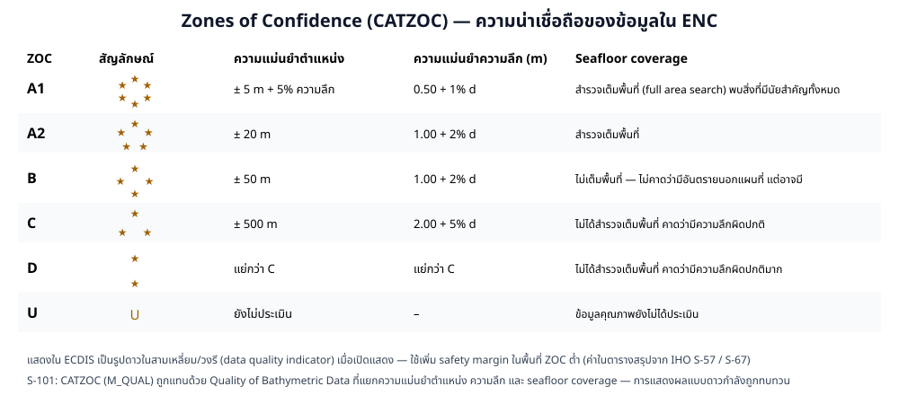
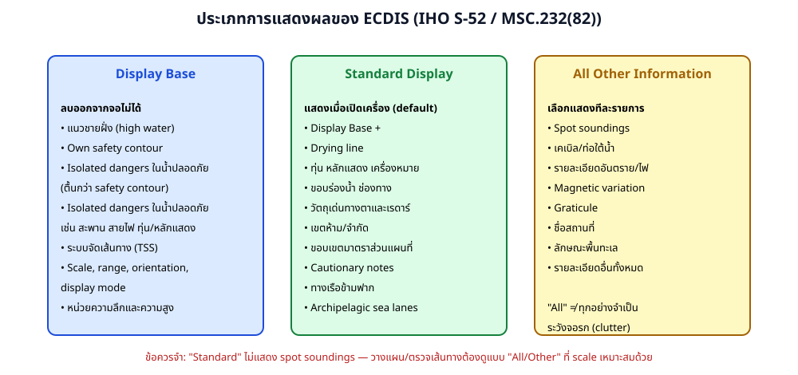
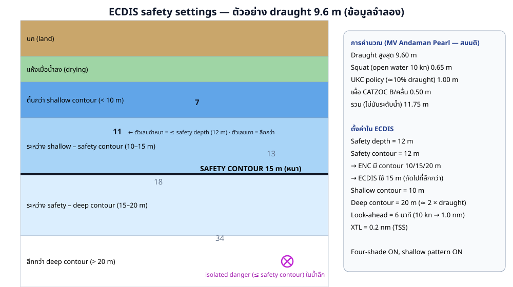
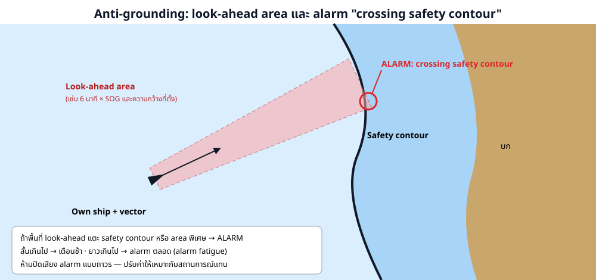
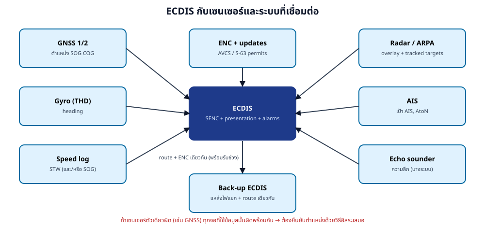

# 1.4 Use of ECDIS to Maintain the Safety of Navigation — ECDIS

> สมุดบันทึกการฝึก OOW · TIRAPHONG NANTAPAN
> สมรรถนะตาม STCW A-II/1: *Navigation using ECDIS — Knowledge of the capability and limitations of ECDIS operations…; Proficiency in operation, interpretation, and analysis of information obtained from ECDIS…*
> อ้างอิงหลัก: SOLAS V/19, V/27; IMO Res. **MSC.232(82)** *Revised performance standards for ECDIS* และ **MSC.530(106)/Rev.1** (S-100 ECDIS); **MSC.1/Circ.1503/Rev.1** *ECDIS – Guidance for good practice*; IHO **S-52** (Presentation Library), **S-57/S-101** (ENC), **S-63** (data protection), **S-64** (test data), **S-100** framework; IEC 61174; IMO Model Course **1.27** *Operational use of ECDIS*; ADMIRALTY **NP231** *Guide to the Practical Use of ENCs*, **NP232** *Guide to ECDIS Implementation, Policy and Procedures*, **NP5012** *Guide to ENC Symbols used in ECDIS*; MAIB reports (เช่น *Ovit*, 2013); IMO Res. **MSC.302(87)** (Bridge Alert Management); SN.1/Circ.266/Rev.1 (การดูแลซอฟต์แวร์ ECDIS); IHO **S-67** *Mariners' Guide to Accuracy of Depth Information in ENCs*; IEC 61174 Ed.4 (2015)

---

## 0. ทำไม ECDIS เป็นเรื่องใหญ่สำหรับ OOW ยุคนี้

เรือสินค้าส่วนใหญ่ที่เราจะขึ้นไปทำงานเป็น **paperless** — ใช้ ECDIS เป็นระบบแผนที่หลักสองเครื่อง (primary + back-up) แผนที่กระดาษแทบไม่มี ECDIS จึงเป็นเครื่องมือที่ OOW ใช้มากที่สุดในยาม และเป็นเครื่องมือที่ "ทำให้เกยตื้นได้ง่ายที่สุด" ถ้าตั้งค่าผิดหรือเชื่อมันมากเกินไป รายงานสอบสวนหลายเรื่องเรียกว่า **"ECDIS-assisted grounding"**

STCW 2010 เพิ่ม ECDIS เป็นสมรรถนะบังคับ (generic training ตาม Model Course 1.27 — โดยทั่วไปหลักสูตร 40 ชั่วโมง) และ ISM Code/STCW Reg. I/14 กำหนดให้ต้องได้รับ **type-specific familiarization** กับ ECDIS ยี่ห้อ/รุ่นที่ใช้บนเรือแต่ละลำ

> หมายเหตุในตาราง A-II/1: ผู้ที่ทำงานเฉพาะบนเรือที่ไม่ติดตั้ง ECDIS ไม่ต้องฝึก/ประเมินเรื่อง ECDIS แต่ต้องระบุข้อจำกัดนี้ใน endorsement — และวิธีพิสูจน์สมรรถนะคือประสบการณ์ฝึกบนเรือที่ได้รับการรับรอง และ/หรือการฝึกใน ECDIS simulator ที่ได้รับการรับรอง

---

## 1. นิยามและข้อกำหนดทางกฎหมาย

### 1.1 นิยามตาม MSC.232(82)

- **ECDIS (Electronic Chart Display and Information System)** — ระบบข้อมูลการเดินเรือที่ **เมื่อมีระบบสำรองที่เพียงพอ (adequate back-up arrangements)** สามารถยอมรับได้ว่าเป็นไปตามข้อกำหนดแผนที่ที่เป็นปัจจุบันตาม SOLAS V/19 และ V/27 โดยแสดงข้อมูลที่เลือกจาก **SENC** พร้อมข้อมูลตำแหน่งจากเซนเซอร์ เพื่อช่วยผู้เดินเรือในการ **วางแผนเส้นทาง (route planning)** และ **ติดตามเส้นทาง (route monitoring)** และแสดงข้อมูลอื่นที่เกี่ยวกับการเดินเรือได้
- **ENC (Electronic Navigational Chart)** — ฐานข้อมูลที่มีมาตรฐานด้านเนื้อหา โครงสร้าง และรูปแบบ ออกให้ใช้กับ ECDIS **โดยหรือภายใต้อำนาจของรัฐบาล สำนักงานอุทกศาสตร์ที่ได้รับอนุญาต หรือหน่วยงานรัฐที่เกี่ยวข้อง** และเป็นไปตามมาตรฐาน IHO — ประกอบด้วยข้อมูลแผนที่ทั้งหมดที่จำเป็นต่อความปลอดภัยในการเดินเรือ และอาจมีข้อมูลเพิ่มเติม (เช่นจาก Sailing Directions)
- **SENC (System ENC)** — ฐานข้อมูลในรูปแบบภายในของ ECDIS ที่ได้จากการแปลง ENC + updates + ข้อมูลที่ผู้เดินเรือเพิ่ม เป็นสิ่งที่ ECDIS ใช้แสดงผลจริง
- **RCDS mode** — โหมดแสดง **RNC (Raster Navigational Chart)** เช่น ARCS ใช้ได้เฉพาะพื้นที่ที่ไม่มี ENC และต้องมี **แผนที่กระดาษชุดที่เหมาะสม (appropriate folio of up-to-date paper charts)** ตามที่ flag state กำหนด — ใน RCDS ไม่มี anti-grounding alarm อัตโนมัติจากข้อมูลความลึก (เพราะเป็นภาพ)

### 1.2 ข้อกำหนดการติดตั้ง (SOLAS V/19.2.10)

ECDIS บังคับสำหรับเรือเดินทางระหว่างประเทศตามตารางเวลา (2012–2018) — เรือโดยสาร ≥ 500 GT, เรือบรรทุกน้ำมัน ≥ 3,000 GT, เรือสินค้าอื่น ≥ 10,000 GT (สำหรับเรือใหม่ และเรือที่มีอยู่ตามขนาด/ประเภท) — เรือที่ไม่บังคับก็ใช้ ECDIS แทนแผนที่กระดาษได้ถ้ามีระบบสำรองที่ได้รับการยอมรับ

ตารางเวลาละเอียด (SOLAS V/19.2.10) — จดไว้เพราะข้างบนยังขาดกลุ่มเรือสินค้า 3,000–10,000 GT ที่สร้างใหม่

| ประเภทเรือ | เรือสร้างใหม่ (สร้างตั้งแต่) | เรือที่มีอยู่ (ภายใน survey ครั้งแรกตั้งแต่) |
|---|---|---|
| เรือโดยสาร ≥ 500 GT | 1 ก.ค. 2012 | 1 ก.ค. 2014 |
| เรือบรรทุกน้ำมัน ≥ 3,000 GT | 1 ก.ค. 2012 | 1 ก.ค. 2015 |
| เรือสินค้าอื่น ≥ 10,000 GT | 1 ก.ค. 2013 | ≥ 50,000 GT: 1 ก.ค. 2016 · 20,000–50,000 GT: 1 ก.ค. 2017 · 10,000–20,000 GT: 1 ก.ค. 2018 |
| เรือสินค้าอื่น 3,000 – < 10,000 GT | 1 ก.ค. 2014 | (ไม่บังคับย้อนหลัง) |

> ECDIS ที่ติดตั้งตั้งแต่ 1 ม.ค. 2009 ต้องเป็นไปตาม MSC.232(82) (เครื่องรุ่นก่อนนั้นใช้ A.817(19) เดิม) — และ Administration อาจยกเว้นเรือที่จะเลิกใช้งานถาวรภายใน 2 ปีหลังวันที่บังคับ

### 1.3 Back-up arrangements

ต้องมีระบบสำรองที่ให้ **ทำหน้าที่ได้อย่างปลอดภัยตลอดการเดินทางที่เหลือ** เมื่อ ECDIS หลักขัดข้อง — ที่ยอมรับได้คือ
1. **ECDIS เครื่องที่สอง** ที่ต่อกับแหล่งไฟฟ้าอิสระ (independent power supply) และมีตำแหน่ง GNSS อิสระ (หรือแยก) — นิยมที่สุด
2. **แผนที่กระดาษชุดที่เหมาะสมและเป็นปัจจุบัน** สำหรับการเดินทาง

> เรื่องแผนที่กระดาษ: UKHO เคยประกาศ (2022) ว่าจะเลิกผลิต ADMIRALTY paper charts ภายในปลายปี 2026 ต่อมาเลื่อนเป็น "อย่างน้อยถึงปี 2030" และในปี 2026 มีถ้อยแถลงว่าจะยังจัดส่งแผนที่กระดาษต่อไปตราบที่ยังมีความจำเป็น — ใครใช้แผนที่กระดาษเป็น back-up ให้ติดตามประกาศล่าสุดของ UKHO/ผู้ผลิตแผนที่ของรัฐตน (ตรวจกับฉบับปัจจุบัน)

### 1.4 มาตรฐานรุ่นใหม่ — S-100 ECDIS (MSC.530(106)/Rev.1)

- รับรองปี 2022 (Rev.1 เพิ่มเรื่อง route exchange) — MSC.530(106) รับรองที่ MSC 106 (พ.ย. 2022) และฉบับ **Rev.1 รับรองที่ MSC 108 (พ.ค. 2024)** เพื่อรองรับการแลกเปลี่ยนเส้นทางแบบดิจิทัลตามมาตรฐาน S-421
- ECDIS ที่ติดตั้ง **ตั้งแต่ 1 ม.ค. 2026** เลือกได้ว่าจะเป็นไปตาม MSC.232(82) (S-57) หรือ MSC.530(106)/Rev.1 (S-100)
- ECDIS ที่ติดตั้ง **ตั้งแต่ 1 ม.ค. 2029** ต้องเป็นไปตาม MSC.530(106)/Rev.1 (รองรับ S-100 และยังแสดง S-57 ได้ในช่วงเปลี่ยนผ่าน)
- ECDIS เดิมที่ติดตั้งแล้วยังใช้ได้ต่อ
- S-100 ทำให้ ECDIS แสดงชั้นข้อมูลได้มากขึ้น เช่น **S-101** (ENC รุ่นใหม่), **S-102** (bathymetric surface ความละเอียดสูง), **S-104** (ระดับน้ำ dynamic), **S-111** (กระแสน้ำผิวน้ำ), **S-124** (navigational warnings), **S-129** (UKC management), **S-421** (route exchange) — นำไปสู่ UKC ที่คำนวณได้แบบ dynamic
- (ข้อสังเกต ณ เวลาที่จด: มาตรฐานทดสอบ IEC สำหรับ S-100 ECDIS ยังอยู่ระหว่างจัดทำ ต้องติดตามประกาศของ flag state และผู้ผลิต)
- **สถานะปี 2026 (อัปเดต ต.ค. 2026 — ตรวจกับฉบับปัจจุบัน)**: แม้ตั้งแต่ 1 ม.ค. 2026 จะ "อนุญาต" ให้ติดตั้ง ECDIS ตาม MSC.530(106)/Rev.1 ได้แล้ว แต่มาตรฐานทดสอบเพื่อ type approval (**IEC 61174 Edition 5**) ยังไม่ประกาศใช้ (คาดการณ์ราวปี 2027) UKHO ประเมิน (ธ.ค. 2025) ว่า S-100 ECDIS ที่ได้รับ type approval จะเริ่มมีขายราวปี 2028 — ปี 2026 จึงยังเป็นช่วง ENC S-57 เป็นหลัก ส่วน S-101 อยู่ในช่วงทดสอบ/เริ่มผลิตคู่ขนาน ("dual fuel") และยังไม่มีกำหนดวันเลิกใช้ S-57
- ผลต่อ OOW: เรือส่วนใหญ่ที่เราจะขึ้นในช่วงนี้ยังใช้ ECDIS ตาม MSC.232(82) + ENC S-57 — แต่ต้องรู้ว่า S-100 ECDIS จะแสดงข้อมูลหลายชั้น (เช่น S-102 + S-104) ซึ่งเปลี่ยนวิธีคิด safety contour เป็นแบบ dynamic ได้

---

## 2. ข้อมูล ENC (ENC data) — ต้องเข้าใจก่อนเชื่อจอ

### 2.1 โครงสร้าง S-57

ENC เป็นข้อมูลแบบ **vector** ประกอบด้วย **วัตถุ (objects/features)** แต่ละอย่างมี **คุณลักษณะ (attributes)** และ **รูปทรงเชิงพื้นที่ (spatial: point, line, area)**

| ตัวอย่าง object (S-57 acronym) | ความหมาย | attributes สำคัญ |
|---|---|---|
| DEPARE | Depth area | DRVAL1 (ความลึกต่ำสุด), DRVAL2 (สูงสุด) |
| DEPCNT | Depth contour | VALDCO (ค่าความลึกของเส้น) |
| SOUNDG | Sounding | ค่าความลึกแต่ละจุด |
| UWTROC / WRECKS / OBSTRN | หินใต้น้ำ / ซากเรือ / สิ่งกีดขวาง | VALSOU (ความลึก), WATLEV, QUASOU |
| LIGHTS | ไฟ | COLOUR, LITCHR, SIGPER, VALNMR, SECTR1/2 |
| BOYLAT / BOYCAR / BOYISD / BOYSAW / BOYSPP | ทุ่นแต่ละประเภท | CATLAM, CATCAM, COLOUR |
| TSSLPT / TSELNE / TSEZNE | TSS | ORIENT |
| RESARE | Restricted area | CATREA, RESTRN |
| M_QUAL | Meta object คุณภาพข้อมูล | **CATZOC** |
| M_COVR | ขอบเขตข้อมูล | |

- **Cell** — ENC แบ่งเป็นแผ่นข้อมูล (cell) ชื่อเช่น "TH4xxxxx" (2 ตัวแรก = รหัสผู้ผลิต, ตัวที่ 3 = usage band)
- **Base cell** (.000) + **update files** (.001, .002 …) — ต้องโหลดตามลำดับ
- **Edition** — เมื่อมีการเปลี่ยนแปลงมาก ผู้ผลิตออก new edition แทน

### 2.2 Navigational purpose / Usage bands

| Band | ชื่อ | มาตราส่วนโดยประมาณ |
|---|---|---|
| 1 | Overview | < 1:1 500 000 |
| 2 | General | 1:350 000 – 1:1 500 000 |
| 3 | Coastal | 1:90 000 – 1:350 000 |
| 4 | Approach | 1:22 000 – 1:90 000 |
| 5 | Harbour | 1:4 000 – 1:22 000 |
| 6 | Berthing | > 1:4 000 |

- **Compilation scale** — มาตราส่วนที่ข้อมูลถูกจัดทำ — ถ้าซูมใหญ่กว่านี้ ECDIS แสดง **overscale indication** (แถบลายเส้นแนวตั้ง) เตือนว่าภาพดูละเอียดกว่าข้อมูลจริง
- **SCAMIN** — attribute ที่ทำให้วัตถุบางอย่างหายไปเมื่อซูมออก (เพื่อลดความรกของจอ) — **ระวัง: ซูมออกมากแล้วอันตรายบางอย่างหายจากจอ** ระหว่างตรวจเส้นทางต้องดูที่ scale เหมาะสม
- **Larger scale ENC available** — ECDIS แสดง indication ว่ามีข้อมูลละเอียดกว่าในพื้นที่ — ควรใช้ (ECDIS เลือกอัตโนมัติได้)

### 2.3 ความแม่นยำของข้อมูล — CATZOC

*ภาพที่ 1.4-1 ความหมายของ CATZOC A1–U — ใช้ประเมินระยะเผื่อความปลอดภัย*

**ข้อสำคัญที่สุด:** ENC ไม่ได้แม่นยำกว่าการสำรวจที่ใช้ทำ — แผนที่ที่ "ดูคมชัด" บนจอ อาจมาจากการสำรวจด้วยลูกดิ่งเมื่อร้อยปีก่อน (ZOC C หรือ D) ซึ่งตำแหน่งอาจคลาดได้ถึงหลายร้อยเมตรและอาจมีหินที่ไม่เคยพบ → **เพิ่ม safety margin และ UKC ในพื้นที่ ZOC ต่ำ** (NP231 แนะนำวิธีคิด)

ตัวอย่างการคิด: ร่องน้ำ ZOC B (±50 m, ความลึก ±1 m + 2%) ที่ความลึกแผนที่ 14 m → ความลึกจริงอาจตื้นกว่า 1 + 0.28 = 1.28 m → ต้องเผื่อเพิ่มในการคำนวณ UKC

ตัวอย่างจำลองเพิ่ม (เทียบ ZOC) ที่ความลึกแผนที่ 14 m เท่ากัน:

| ZOC | ความคลาดเคลื่อนความลึก | ที่ 14 m | ความคลาดเคลื่อนตำแหน่ง |
|---|---|---|---|
| A1 | ±(0.5 m + 1%) | ±0.64 m | ±(5 m + 5% ของความลึก) ≈ ±5.7 m |
| A2 / B | ±(1.0 m + 2%) | ±1.28 m | ±20 m / ±50 m |
| C | ±(2.0 m + 5%) | ±2.70 m | ±500 m |
| D | แย่กว่า C | > 2.7 m | แย่กว่า C |

> นอกจากความแม่นยำแล้ว **seafloor coverage** สำคัญไม่แพ้กัน — ZOC B/C/D หมายถึงยังไม่ได้สำรวจครอบคลุมเต็มพื้นที่ อาจมีอันตรายที่ไม่อยู่บนแผนที่ ระยะผ่านอันตรายและ XTL จึงต้องเผื่อมากขึ้น ไม่ใช่แค่ UKC

**CATZOC ใน S-101 (รุ่นใหม่)** — ใน S-101 meta object M_QUAL/CATZOC ของ S-57 ถูกแทนด้วย meta feature **Quality of Bathymetric Data (QoBD)** ที่แยกองค์ประกอบออกเป็นความแม่นยำตำแหน่ง ความแม่นยำความลึก และ seafloor coverage/feature detection ชัดเจนขึ้น (ยังมีค่า zone of confidence A1–U ให้อ้างอิง) และ IHO ได้ทบทวนการแสดงผลแบบ "ดาว" ใหม่ เพราะผลสำรวจผู้เดินเรือพบว่า CATZOC เข้าใจยาก — คู่มือสำหรับผู้เดินเรือดู IHO **S-67** (ตรวจรายละเอียดกับฉบับปัจจุบันของ S-101/S-67)

### 2.4 Datum

- **Horizontal datum** — ENC ทุกแผ่นใช้ **WGS 84** (ไม่มีปัญหา datum shift แบบแผนที่กระดาษ ถ้า GNSS ตั้ง WGS 84)
- **Vertical/sounding datum** — ใช้ chart datum ท้องถิ่น (มัก LAT) — ECDIS ไม่ได้บวกความสูงน้ำขึ้นลงให้เอง (สำหรับ S-57) ต้องคิดเองในการตั้งค่า
- **ECDIS แจ้ง alarm "different geodetic datum"** ถ้าตำแหน่งจากเซนเซอร์ไม่ใช่ WGS 84

### 2.5 Chart data formats อื่น

| รูปแบบ | สถานะ |
|---|---|
| **ENC (S-57)** | official vector — ใช้เป็นแผนที่หลักได้ |
| **S-101 ENC** (S-100) | official vector รุ่นใหม่ — ทยอยเริ่มให้บริการ |
| **RNC** (ARCS ของ UKHO, ของบางประเทศ) | official raster — ใช้ใน RCDS mode ได้เฉพาะเมื่อไม่มี ENC + ต้องมีแผนที่กระดาษ |
| **Private/commercial vector charts (non-official)** | **ไม่ใช่ ENC** — ใช้แทนแผนที่ทางการตาม SOLAS ไม่ได้ ECDIS ต้องแสดงคำเตือนเมื่อแสดงข้อมูลไม่ทางการ |

### 2.6 การได้มาซึ่ง ENC และการอัปเดต

- **ENC Service** เช่น **AVCS** (UKHO), PRIMAR, IC-ENC — รวม ENC จากหลายประเทศ
- **S-63 data protection** — ENC เข้ารหัส ต้องมี **User Permit** (ผูกกับเครื่อง ECDIS) และ **Cell Permits** (สิทธิ์ใช้แต่ละ cell มีวันหมดอายุ)
- **อัปเดตรายสัปดาห์** — ผ่าน online (ADMIRALTY e-Navigator / ระบบผู้ให้บริการ) อีเมล หรือ CD/DVD — ติดตั้งตามลำดับ ตรวจรายงานการติดตั้ง (update log) ว่าสำเร็จ ไม่มี error
- **ตรวจสถานะการอัปเดต (chart update status)** — ECDIS รายงานว่า cell ไหนอัปเดตถึงเมื่อไร (เทียบกับ AVCS weekly update) — PSC ตรวจบ่อย
- **Temporary & Preliminary (T&P) NMs** — ADMIRALTY นำเข้า ENC แล้วในหลายกรณี (หรือมี **ADMIRALTY Information Overlay – AIO** แสดง T&P และ NAVAREA ที่ไม่ได้อยู่ใน ENC ทับบน ENC) — ตรวจว่าเปิด AIO แล้ว
- **Manual updates** — ผู้เดินเรือเพิ่มข้อมูลจาก NAVTEX/NM ที่ยังไม่อยู่ใน ENC (สัญลักษณ์ manual update ต้องต่างจากข้อมูลทางการ และไม่แก้ไขข้อมูล ENC เดิม)
- **บันทึก** — ENC & ECDIS maintenance record (เช่น NP133C)

---

## 3. กฎการแสดงผล (Presentation rules — IHO S-52)

### 3.1 ประเภทการแสดงผล (Display categories)

*ภาพที่ 1.4-2 Display Base / Standard Display / All Other Information ตาม MSC.232(82) Appendix 2*

- **Display Base** — แสดงตลอด ลบไม่ได้ (แต่ไม่พอสำหรับการเดินเรือปลอดภัย)
- **Standard Display** — แสดงทันทีเมื่อเปิด ECDIS ต้องกลับมาที่ standard ได้ด้วยการกดครั้งเดียว
- **All Other Information** — แสดงเพิ่มตามต้องการ (spot soundings ฯลฯ)

> **กับดักสำคัญ** — Standard display **ไม่แสดง spot soundings** ถ้าตั้ง safety contour ไม่เหมาะ อาจไม่เห็นจุดตื้นในพื้นที่ "น้ำลึก" — ใช้ "other/all" หรือเปิด spot soundings ขณะวางแผนและเดินในน้ำจำกัด

### 3.2 Safety settings — ค่าที่ OOW ต้องเข้าใจและตั้งเป็น

*ภาพที่ 1.4-3 การแรเงาความลึก 4 ระดับ เส้น safety contour และตัวเลขความลึกหนา/บาง (ข้อมูลจำลอง)*

| ค่า | ความหมาย | วิธีกำหนด (แนวทาง) |
|---|---|---|
| **Safety contour** | เส้นชั้นความลึกที่แบ่ง "น้ำปลอดภัย" กับ "น้ำไม่ปลอดภัย" สำหรับเรือเรา — แสดงเป็นเส้นหนา และใช้ใน **anti-grounding alarm** | draught + UKC ขั้นต่ำ + squat + เผื่อ (ZOC, คลื่น) — (หักความสูงน้ำได้เฉพาะถ้านโยบายอนุญาตและรู้แน่) ถ้าค่าที่ตั้งไม่มีใน ENC → **ECDIS ใช้เส้นชั้นความลึกถัดไปที่ลึกกว่า** (เช่น ตั้ง 12 m แต่ ENC มี 10/15/20 → ใช้ 15 m) |
| **Safety depth** | ความลึกที่ใช้แยก spot soundings — ตัวเลข **≤ safety depth แสดงเป็นตัวหนา (สีดำ)** ลึกกว่าเป็นสีเทา | มักตั้งเท่ากับ safety contour ที่ต้องการจริง |
| **Shallow contour** | ใช้ในการแรเงา 4 ระดับ (ระดับตื้น) | มักเท่ากับ draught หรือค่าที่นโยบายกำหนด |
| **Deep contour** | ใช้ในการแรเงา 4 ระดับ (ระดับลึก) | มัก 2 เท่าของ draught หรือมากกว่า |
| **Two/four shades** | การแรเงาความลึก | four-shade ให้ข้อมูลมากกว่า |
| **Shallow water pattern** | ลายตารางทับพื้นที่ตื้นกว่า safety contour | ช่วยเห็นชัดตอนกลางคืน/ฝ้า |
| **Isolated danger** | สัญลักษณ์ (วงกลมม่วงแดงมีกากบาท) สำหรับอันตรายที่ตื้นกว่า safety contour ที่อยู่ใน "น้ำปลอดภัย" | แสดงอัตโนมัติตาม safety contour |
| **Look-ahead / anti-grounding area** | พื้นที่ข้างหน้าที่ ECDIS ตรวจหาอันตราย (เป็นเวลาหรือระยะ + ความกว้าง) | ขึ้นกับความเร็วและพื้นที่ (เช่น 6–12 นาทีในชายฝั่ง) |
| **XTL (cross track limit)** | ระยะเบี่ยงที่ยอมให้ก่อน alarm | ตาม passage plan |

**หลักการ:** ค่าที่ตั้งต้อง **ตรงกับ draught ปัจจุบัน และนโยบาย UKC ของบริษัท** ต้องปรับเมื่อ draught เปลี่ยน (หลังขนสินค้า) และตรวจทุกครั้งที่รับยาม

### 3.3 Display options อื่น ๆ

- **Day / Dusk / Night palettes** — เปลี่ยนตามแสง (กลางคืนใช้ night เพื่อรักษา night vision — สีบางอย่างจะดูต่างไป)
- **Simplified vs Paper-chart symbols** (โดยเฉพาะทุ่น/สัญลักษณ์จุด)
- **Plain vs Symbolized boundaries** (ขอบเขตพื้นที่)
- **Full light sectors** — แสดงเส้น sector ของไฟยาวเต็ม
- **Text** — ชื่อ ข้อมูลไฟ ฯลฯ
- **Date-dependent objects** — วัตถุที่มีผลเฉพาะช่วงเวลา (เช่นเขตฝึกชั่วคราว) — ตรวจวันที่ที่ตั้งในการแสดงผล
- **Data quality indicator (CATZOC)** — เปิดดูได้
- **Overscale / Larger scale available indications**
- **Customised display indication** — เมื่อการแสดงผลไม่ใช่ standard

### 3.4 Alarms และ Indications ตาม MSC.232(82) Appendix 5

| ประเภท | รายการ |
|---|---|
| **Alarms** | Crossing safety contour (ภายในเวลาที่กำหนด) · Deviation from route (เกิน XTL) · Positioning system failure · Approach to critical point (เช่น WOP) · Different geodetic datum · Malfunction of ECDIS · Area with special conditions (เข้าพื้นที่ที่กำหนด — alarm หรือ indication ตามที่เลือก) |
| **Indications** | Default safety contour (ใช้ 30 m เพราะไม่ได้ตั้ง) · Information overscale · Larger scale ENC available · Different reference system · No ENC available · Customized display · Route planning across safety contour · Route planning across specified area · System test failure |

**การจัดการ alarm** — ตอบรับ (acknowledge) แล้วหาสาเหตุ แก้ไข — **ห้ามปิดเสียง alarm ถาวรหรือตั้งค่าให้ไม่มี alarm** (เป็นปัจจัยในอุบัติเหตุหลายกรณี)

**Alarm กับ Indication ต่างกันอย่างไร (จดไว้กันสับสน)**
- **Alarm** — สัญญาณที่มีเสียงและภาพ (audible + visual) แจ้งสภาวะที่ต้องให้ผู้เดินเรือสนใจ **ทันที** และต้องตอบรับ
- **Indication** — ข้อมูลแสดงบนจอ (visual) บอกสถานะของระบบหรือการแสดงผล ไม่มีเสียง ไม่ต้องตอบรับ (เช่น overscale, larger scale available)
- **ภายใต้ Bridge Alert Management (BAM — MSC.302(87))** ECDIS รุ่นใหม่ที่ทดสอบตาม IEC 61174 Ed.4 จัดลำดับ alert เป็น **Emergency alarm > Alarm > Warning > Caution** — รายการที่ MSC.232(82) เรียกว่า "indication" ส่วนใหญ่จะเป็น warning/caution บนเครื่องรุ่นใหม่ (ชื่อเรียกต่างกันตามผู้ผลิต ต้องเรียนจาก type-specific familiarization)
- **Area with special conditions** เป็นข้อเดียวในรายการที่ผู้ใช้เลือกได้ว่าจะให้เป็น alarm หรือ indication — ต้องตั้งให้เหมาะกับพื้นที่ (เช่นใน TSS หรือ PSSA ควรเป็น alarm)

**ซอฟต์แวร์ ECDIS และมาตรฐาน IHO** — ECDIS ต้องมีซอฟต์แวร์ที่รองรับมาตรฐาน IHO ฉบับปัจจุบัน (S-52 Presentation Library, S-63, S-64) มิฉะนั้นอาจแสดง ENC หรือ alarm ไม่ถูกต้อง ตรวจได้ด้วย ECDIS check dataset ของ IHO/ผู้ให้บริการ ENC และบันทึกเวอร์ชันซอฟต์แวร์ไว้ (แนวทาง SN.1/Circ.266/Rev.1 และ MSC.1/Circ.1503/Rev.1) — PSC มักตรวจเรื่องนี้

*ภาพที่ 1.4-4 Anti-grounding look-ahead — ถ้าพื้นที่ข้างหน้าแตะ safety contour ECDIS ต้องเตือน*

---

## 4. ฟังก์ชันที่มาตรฐานกำหนด (Functions required by performance standards)

*ภาพที่ 1.4-5 ECDIS เป็นศูนย์รวมข้อมูลจากหลายเซนเซอร์ — ความถูกต้องของจอขึ้นกับความถูกต้องของเซนเซอร์*

| ฟังก์ชัน | สาระ |
|---|---|
| **Route planning** | สร้าง/แก้ไขเส้นทาง (waypoints, legs, XTL, turn radius) เพิ่ม/ลบ/ย้าย waypoint, วางแผนเส้นทางสำรอง, **route check (validation)** ตรวจการข้าม safety contour และพื้นที่ที่กำหนดภายใน XTL, คำนวณระยะทาง เวลา |
| **Route monitoring** | แสดงตำแหน่งเรือ (symbol ตามขนาดจริงเมื่อ scale ใหญ่) heading, COG/SOG vector, **past track** ทำเครื่องหมายเวลา, เส้นทางที่เลือก, ระยะ/เวลาถึง WP, XTE, alarms ทั้งหมด, เลื่อนดูพื้นที่ข้างหน้า (look-ahead) |
| **Voyage recording** | บันทึกข้อมูลการเดินทาง **12 ชั่วโมงล่าสุด ทุก 1 นาที** (ตำแหน่ง เวลา heading ความเร็ว ENC ที่ใช้ — cell, edition, update) และ **past track ทั้งเที่ยว ทุก 4 ชั่วโมง** — ห้ามแก้ไขข้อมูลที่บันทึก |
| **Calculations** | ระยะทางและแบริ่งระหว่างจุด, การแปลงพิกัด, rhumb/great circle, เวลา |
| **Display of other navigational information** | Radar image overlay, ARPA tracked targets, AIS targets, NAVTEX (บางรุ่น), เส้น EBL/VRM, LOP |
| **Mariner's information / User charts** | ข้อความ เส้น พื้นที่ ที่ผู้ใช้เพิ่ม (no-go, PI lines, clearing lines, notes) — แสดงแยกจาก ENC |
| **Manual updates** | เพิ่มการแก้ไข (จาก NM/NAVTEX) — ต้องแยกแยะได้และไม่ลบข้อมูล ENC |
| **Chart update log** | บันทึกการอัปเดต ENC |
| **System self-test** | ทดสอบฟังก์ชันหลัก แจ้ง indication เมื่อล้มเหลว |
| **Back-up** | ส่งเส้นทางและข้อมูลไปเครื่องสำรอง |
| **Sensor monitoring** | ตรวจการเชื่อมต่อและความผิดปกติของเซนเซอร์ (position, heading, speed) แสดง alarm เมื่อขาดหาย |
| **Mode** | ภาพ North-up/Course-up/Head-up, True motion/Relative motion, ตั้ง reset ตำแหน่งเรือบนจอ |

---

## 5. การใช้งาน ECDIS ในยาม — ตามหัวข้อ STCW (Proficiency in operation, interpretation, and analysis)

### 5.1 การใช้ฟังก์ชันที่เชื่อมกับระบบเดินเรืออื่น — การทำงานถูกต้องและการปรับตั้ง

ตอนรับยามหรือเมื่อเปลี่ยนสภาพการเดินเรือ ตรวจ (checklist จาก MSC.1/Circ.1503/Rev.1 และ NP232)
- **Position source**: GNSS ตัวไหนเป็น primary ตัวไหนเป็น secondary, ค่า HDOP/สถานะ (no fix, DR mode, differential), datum WGS 84, **antenna offset/CCRP** ตั้งถูก
- **Heading source**: gyro ตัวไหน ตรงกับ repeater และ magnetic compass
- **Speed source**: STW (log) หรือ SOG (GNSS) — เลือกให้เหมาะ (ARPA overlay ใช้ STW ในการหลบเรือ)
- **Time**: ซิงโครไนซ์กับ UTC
- **Radar overlay**: alignment ถูกต้อง (ดูว่าฝั่ง/ทุ่นบนเรดาร์ทับกับ ENC)
- **AIS/ARPA targets**: แสดงผลและ association ถูกต้อง
- **Route ที่ active** ตรงกับ route ที่นายเรืออนุมัติ และเครื่อง back-up โหลด route เดียวกัน

### 5.2 การติดตามและปรับข้อมูลอย่างปลอดภัย

| หัวข้อ (STCW) | สิ่งที่ OOW ทำ |
|---|---|
| **Own position** | ตรวจ symbol ตำแหน่งเรือ, past track ต่อเนื่อง, ไม่มีการกระโดดของตำแหน่ง (position jump — อาจเป็นสัญญาณ GNSS ผิดปกติ/spoofing) |
| **Sea area display** | แสดงพื้นที่ข้างหน้ามากพอ (offset centre / look-ahead) ใช้ scale ที่เหมาะสม |
| **Mode and orientation** | True motion สำหรับการเดินเรือ (reset อัตโนมัติ), north-up สำหรับเทียบแผนที่, course-up ในร่องน้ำบางกรณี |
| **Chart data displayed** | standard + ข้อมูลเพิ่มที่จำเป็น (spot soundings, ไฟ) — ไม่รกเกินไป ตรวจ date-dependent |
| **Route monitoring** | XTE, ระยะ/เวลาถึง WOP, alarms, ตรวจว่าเรืออยู่ใน corridor |
| **User-created information layers** | PI lines, clearing lines, no-go, notes, reporting points — โหลดและแสดงอยู่ |
| **Contacts (AIS/radar tracking)** | ระบุเป้า ดู vectors, CPA/TCPA — แต่ **การหลบเรือหลักใช้เรดาร์/ARPA และการมองเห็น** |
| **Radar overlay** | ใช้ยืนยันตำแหน่ง ตรวจ alignment ระวังว่า overlay ทำให้จอรก |

### 5.3 การยืนยันตำแหน่งเรือด้วยวิธีอื่น (Confirmation of vessel position by alternative means)

ตำแหน่งบน ECDIS มาจาก GNSS — **ต้องยืนยันด้วยวิธีอิสระเป็นระยะตามแผน**
1. **Radar overlay** — ฝั่ง/ทุ่น/วัตถุบนภาพเรดาร์ตรงกับ ENC หรือไม่ (ถ้าเหลื่อมทั้งภาพ → สงสัยตำแหน่ง GNSS; ถ้าหมุนเอียง → สงสัย heading)
2. **Radar range and bearing** — ใช้ EBL/VRM ของ ECDIS หรือเรดาร์ วัดระยะ/แบริ่งไปยังจุดเด่นแล้ว plot เป็น **LOP บน ECDIS** (ECDIS มีฟังก์ชัน manual LOP/EP)
3. **Visual bearings** — gyro repeater/azimuth circle ไปยังวัตถุ แล้วเทียบ
4. **Parallel indexing** บนเรดาร์ (ไม่พึ่ง GNSS)
5. **Depth** — echo sounder เทียบกับ ENC (ระวัง ZOC)
6. **GNSS ตัวที่สอง** — ช่วยได้บางส่วน แต่ถ้าถูก jamming/spoofing ทั้งสองตัวอาจผิดพร้อมกัน → ไม่นับเป็น "อิสระ" เต็มที่
7. **DR/EP** — ตรวจความสมเหตุสมผล

> ถ้าพบความไม่สอดคล้อง → ใช้ตำแหน่งที่ได้จากวิธีอิสระที่น่าเชื่อถือ ใส่ **manual position/offset** หรือเปลี่ยนเป็น **DR mode** ตามขั้นตอนของเครื่อง แจ้งนายเรือ และลดความเสี่ยง (ลดความเร็ว เพิ่มระยะห่าง)

### 5.4 การตั้งค่าให้สอดคล้องกับขั้นตอนการปฏิบัติงาน (Efficient use of settings)

- **Alarm parameters for anti-grounding** — safety contour, safety depth, look-ahead ให้ตรงกับนโยบาย
- **Proximity to contacts** — CPA/TCPA alarm สำหรับ AIS/ARPA (ถ้าใช้บน ECDIS)
- **Special areas** — เลือกประเภทพื้นที่ที่จะให้เตือน (TSS, restricted areas, PSSA, ECA, military areas, cable areas…)
- **Completeness of chart data** — ตรวจว่ามี ENC ครอบคลุมทั้งเส้นทาง ไม่มี "no ENC available"
- **Chart update status** — อัปเดตถึงสัปดาห์ล่าสุด permits ไม่หมดอายุ T&P/AIO แสดง
- **Back-up arrangements** — เครื่องสำรองพร้อม route เดียวกัน ENC อัปเดตเหมือนกัน

### 5.5 การปรับค่าให้เหมาะกับสภาพปัจจุบัน (Adjustment of settings and values to suit the present conditions)

| สถานการณ์ | การปรับ |
|---|---|
| Draught เปลี่ยน (หลังขนถ่าย/บัลลาสต์) | ปรับ safety contour/depth/shallow/deep ใหม่ |
| เข้าน่านน้ำจำกัด | XTL แคบลง, look-ahead สั้นลงตามความเร็ว, เปิด spot soundings, scale ใหญ่ขึ้น |
| ทะเลเปิด | XTL กว้าง, look-ahead ยาวขึ้น |
| กลางคืน | night palette, ลดความสว่าง |
| ทัศนวิสัยจำกัด | radar overlay + ARPA targets, ใช้ร่วมกับเรดาร์ |
| ความเร็วเปลี่ยน | ปรับ look-ahead (เวลา × ความเร็ว), vector time |
| พื้นที่ ZOC ต่ำ | เพิ่ม safety margin ใน safety contour/XTL |

### 5.6 Situational awareness ขณะใช้ ECDIS

STCW ระบุหัวข้อย่อยที่ต้องรักษา SA:
1. **Safe water and proximity of hazards** — รู้ตลอดว่าน้ำปลอดภัยอยู่ไหน อันตรายใกล้สุดอยู่ทางไหน ระยะเท่าไร
2. **Set and drift** — เปรียบเทียบ heading กับ COG, STW กับ SOG — รู้ว่ากระแสน้ำ/ลมพาไปทางไหน (ECDIS แสดง vector ทั้งสองได้)
3. **Chart data and scale selection** — ใช้ ENC ที่ scale เหมาะสม ไม่ overscale ไม่ underscale จน SCAMIN ซ่อนอันตราย
4. **Suitability of route** — เส้นทางยังเหมาะกับสถานการณ์หรือไม่ (อากาศ การจราจร คำเตือนใหม่)
5. **Contact detection and management** — เป้า AIS/ARPA บน ECDIS ช่วยภาพรวม แต่ไม่ทดแทนการเฝ้าระวัง
6. **Integrity of sensors** — ตรวจสถานะเซนเซอร์ตลอด เตรียมพร้อมเมื่อเซนเซอร์ขัดข้อง

> **"Heads-up" ไม่ใช่ "heads-down"** — ECDIS ดึงสายตา OOW ให้จ้องจอได้นาน ต้องฝืนนิสัยนี้ — มองออกนอกหน้าต่าง ตรวจเรดาร์ ฟังเสียงรอบตัว

---

## 6. อันตรายของการพึ่งพา ECDIS มากเกินไป (Dangers of over-reliance)

1. **ข้อมูล ENC ไม่แม่นเท่าที่ดู** (CATZOC ต่ำ ข้อมูลเก่า) — ภาพสวยไม่ได้แปลว่าแม่น
2. **ตำแหน่ง GNSS ผิด** (jamming, spoofing, multipath, antenna) — ECDIS แสดงตำแหน่งผิดอย่างมั่นใจ
3. **Heading/speed sensor ผิด** — vector และ radar overlay ผิด
4. **ตั้งค่าผิด** — safety contour ไม่ตรง draught (เช่นปล่อยเป็นค่า default 30 m จน alarm ดังตลอดแล้วปิดเสียง หรือตั้งต่ำเกินไปจนไม่เตือน)
5. **Alarm fatigue** — alarm มากจนคนเพิกเฉยหรือปิดเสียง
6. **Overscale/SCAMIN** — ดูละเอียดเกินข้อมูลจริง / ซูมออกแล้วอันตรายหาย
7. **ข้อมูลไม่ครบ** — ไม่มี ENC บางพื้นที่, ไม่ได้อัปเดต, T&P ไม่แสดง, permit หมดอายุ
8. **ไม่ตรวจเส้นทางด้วยตา** — เชื่อ route check อัตโนมัติอย่างเดียว
9. **ขาดการฝึก/ไม่คุ้นเครื่อง** — ไม่รู้วิธีเปลี่ยน setting, ไม่รู้ความหมายสัญลักษณ์
10. **ความชะล่าใจ** — มองจออย่างเดียว ไม่มองข้างนอก

### กรณีศึกษา: Ovit (2013) — MAIB

- เรือบรรทุกสารเคมี *Ovit* เกยตื้นบน **Varne Bank** ในช่องแคบโดเวอร์ (กันยายน 2013)
- รายงาน MAIB ชี้ว่า: เส้นทางที่วางใน ECDIS **ผ่านข้ามสันดอน** โดยไม่มีใครตรวจพบเพราะไม่ได้ตรวจเส้นทางด้วยตาอย่างเหมาะสม, **การตั้งค่าความปลอดภัยไม่เหมาะ** และ **เสียง alarm ถูกปิด**, OOW ไม่ได้ติดตามตำแหน่งอย่างมีประสิทธิภาพ และการฝึก/ความคุ้นเคยกับ ECDIS ไม่เพียงพอ
- **บทเรียน:** ตรวจเส้นทางด้วยตาที่ scale เหมาะสมเสมอ ตั้งค่า safety ตาม draught และนโยบาย ห้ามปิด alarm ต้องฝึกจนใช้เครื่องเป็นจริง

---

## 7. ECDIS ขัดข้อง — ขั้นตอนฉุกเฉิน (ตัวอย่างตามแนว NP232/SMS)

1. แจ้งนายเรือทันที
2. เปลี่ยนไปใช้ **ECDIS สำรอง** (ซึ่งต้องโหลด route และเปิดอยู่แล้ว) หรือแผนที่กระดาษ (ถ้าเป็น back-up)
3. ตรวจตำแหน่งด้วยเรดาร์/สายตา บันทึกตำแหน่งล่าสุด
4. ถ้าอยู่ในพื้นที่วิกฤติ พิจารณาลดความเร็ว เลื่อนการเข้าพื้นที่ หรือทอดสมอรอ
5. บันทึกเหตุการณ์ แจ้งบริษัท ดำเนินการซ่อม
6. ถ้า ECDIS ทั้งสองเครื่องใช้ไม่ได้ (เรือ paperless) — ปฏิบัติตามแผนฉุกเฉินของบริษัท (เช่น ใช้ข้อมูลจากเรดาร์ที่มี chart overlay, ขอแผนที่กระดาษ/ENC ฉุกเฉิน, แจ้ง flag state)

---

## 8. ตัวอย่างจำลอง — ตั้งค่า ECDIS ก่อนเข้าช่องแคบสิงคโปร์ (MV "Andaman Pearl")

> ค่าทั้งหมดสมมติตามนโยบายบริษัทจำลอง

| รายการ | ค่า | เหตุผล |
|---|---|---|
| Draught สูงสุด | 9.60 m | จากการคำนวณ stability ก่อนออก |
| Squat (10 kn, Cb 0.65, open water) | ประมาณ 0.65 m | สูตร Barrass (open water) Cb × V²/100 = 0.65 × 100/100 |
| UKC policy (ช่องแคบ) | 10% draught ≈ 1.0 m | SMS |
| เผื่อ ZOC B / คลื่น | 0.5 m | ร่องน้ำ ZOC B |
| **Safety depth** | **11.75 m → ตั้ง 12 m** | รวมข้างบน (ไม่หักระดับน้ำเพื่อความปลอดภัย) |
| **Safety contour** | **12 m** (ECDIS ใช้ 15 m ถ้า ENC ไม่มี 12) | |
| Shallow contour | 10 m | ใกล้ draught |
| Deep contour | 20 m | ≈ 2 × draught |
| XTL | 0.2 nm ใน TSS | passage plan |
| Look-ahead | 6 นาที | ความเร็ววางแผนในช่องแคบ 10 kn → 1.0 nm ข้างหน้า (เดิมจดไว้ 12 kn → 1.2 nm — แก้ให้ตรงกับความเร็วที่ใช้คำนวณ squat; ถ้าเร่งเป็น 12 kn ต้องคำนวณ squat ใหม่ ≈ 0.94 m และปรับ safety contour ตาม) |
| Special areas alarm | TSS, precautionary areas, anchorage, restricted areas | |
| Palette | Night (เข้าตอนกลางคืน) | |
| Radar overlay | ON (ตรวจ alignment กับ Horsburgh และเกาะ) | ยืนยันตำแหน่ง |
| AIS targets | แสดง + CPA alarm 1 nm | ใช้ประกอบ ไม่ใช่หลัก |
| Route | "LCB-SIN Rev2" อนุมัติโดยนายเรือ (route check passed + visual check) | backup ECDIS โหลดแล้ว |
| ENC update | ถึง Week 41 (สมมติ) / AIO ON | |

---

## 9. คำถามสอบปากเปล่า / สัมภาษณ์ — ECDIS

**ถาม:** ENC กับ RNC ต่างกันอย่างไร
**แนวตอบ:** ENC เป็นข้อมูล vector (objects + attributes) ตาม S-57/S-101 ECDIS นำไปคำนวณ alarm ได้ (เช่น anti-grounding) และปรับการแสดงผลได้ RNC เป็นภาพสแกนของแผนที่กระดาษ (raster) ใช้ใน RCDS mode เฉพาะพื้นที่ที่ไม่มี ENC ต้องมีแผนที่กระดาษประกอบ และไม่มี alarm จากข้อมูลความลึก

**ถาม:** SENC คืออะไร
**แนวตอบ:** System ENC — ฐานข้อมูลภายในของ ECDIS ที่แปลงจาก ENC + updates + ข้อมูลผู้ใช้ ECDIS ใช้แสดงผลจริง

**ถาม:** Safety contour กับ safety depth ต่างกันอย่างไร
**แนวตอบ:** safety contour คือเส้นชั้นความลึกที่แบ่งน้ำปลอดภัย/ไม่ปลอดภัย ใช้ใน anti-grounding alarm และแสดงเป็นเส้นหนา (ถ้าค่าที่ตั้งไม่มี ECDIS ใช้เส้นที่ลึกกว่าถัดไป) safety depth ใช้กับ spot soundings — ตัวเลขที่ตื้นกว่าหรือเท่ากับแสดงเป็นตัวหนา

**ถาม:** ถ้าไม่ได้ตั้ง safety contour จะเกิดอะไร
**แนวตอบ:** ECDIS ใช้ค่า default 30 m และแสดง indication "default safety contour" — อาจมี alarm มากเกินจริงหรือไม่สะท้อนความปลอดภัยของเรือเรา ต้องตั้งให้ตรง draught และนโยบาย

**ถาม:** CATZOC คืออะไร มีผลอย่างไรต่อการวางแผน
**แนวตอบ:** Category of Zone of Confidence บอกคุณภาพข้อมูลสำรวจ (A1, A2, B, C, D, U) ความแม่นยำตำแหน่งและความลึก และว่าสำรวจเต็มพื้นที่หรือไม่ ใช้เพิ่ม safety margin ใน UKC และระยะผ่านอันตรายในพื้นที่ ZOC ต่ำ

**ถาม:** Display categories มีอะไรบ้าง
**แนวตอบ:** Display Base (ลบไม่ได้: ชายฝั่ง safety contour isolated dangers TSS scale/orientation/mode หน่วย), Standard Display (default เมื่อเปิด: เพิ่ม drying line ทุ่น ขอบร่องน้ำ วัตถุเด่น เขตห้าม ขอบ scale cautionary notes), All Other Information (spot soundings เคเบิล รายละเอียดไฟ ชื่อสถานที่ ฯลฯ)

**ถาม:** Alarm ที่ ECDIS ต้องมีมีอะไรบ้าง
**แนวตอบ:** crossing safety contour, deviation from route, positioning system failure, approach to critical point, different geodetic datum, malfunction of ECDIS (และ area with special conditions เป็น alarm หรือ indication)

**ถาม:** ECDIS บันทึกข้อมูลการเดินทางอะไรบ้าง
**แนวตอบ:** 12 ชั่วโมงล่าสุดทุก 1 นาที (ตำแหน่ง เวลา heading ความเร็ว และข้อมูล ENC ที่ใช้) และ past track ทั้งเที่ยวทุก 4 ชั่วโมง ห้ามแก้ไข

**ถาม:** ยืนยันตำแหน่งบน ECDIS อย่างไร
**แนวตอบ:** radar overlay, ระยะ/แบริ่งเรดาร์จากจุดเด่น plot เป็น LOP, แบริ่งด้วยตา, parallel indexing, ความลึก, GNSS ตัวที่สอง (ไม่อิสระเต็มที่), DR ตรวจความสมเหตุสมผล

**ถาม:** Overscale คืออะไร อันตรายอย่างไร
**แนวตอบ:** การซูมภาพใหญ่กว่า compilation scale ของ ENC ทำให้ข้อมูลดูละเอียดแม่นยำเกินจริง ECDIS แสดงแถบลายเตือน ต้องระวังเรื่องความแม่นยำ และควรเปลี่ยนไปใช้ ENC ที่ scale ใหญ่กว่า (ถ้ามี)

**ถาม:** Back-up arrangement ของ ECDIS คืออะไร
**แนวตอบ:** ECDIS เครื่องที่สองที่มีแหล่งไฟฟ้าอิสระ หรือแผนที่กระดาษชุดที่เหมาะสมและเป็นปัจจุบัน ให้เดินทางที่เหลือได้อย่างปลอดภัย

**ถาม:** S-100 ECDIS เริ่มบังคับเมื่อไร
**แนวตอบ:** ตาม MSC.530(106)/Rev.1 — ECDIS ที่ติดตั้งตั้งแต่ 1 ม.ค. 2026 เลือกมาตรฐานเดิมหรือใหม่ได้ ตั้งแต่ 1 ม.ค. 2029 ECDIS ที่ติดตั้งใหม่ต้องเป็นไปตามมาตรฐานใหม่ เครื่องเดิมใช้ต่อได้

**ถาม:** ทำไม route check อัตโนมัติไม่พอ
**แนวตอบ:** route check ตรวจได้เฉพาะสิ่งที่ถูกเข้ารหัสใน ENC ภายใน XTL ตามค่าที่ตั้ง อาจพลาดถ้าตั้งค่าผิด ข้อมูลไม่ครบ หรือวัตถุบางอย่างไม่ trigger — ต้องตรวจด้วยตาทั้งเส้นทางที่ scale เหมาะสม (บทเรียนจากกรณี Ovit)

**ถาม:** Alarm กับ indication ของ ECDIS ต่างกันอย่างไร
**แนวตอบ:** alarm มีทั้งเสียงและภาพ ต้องการความสนใจทันทีและต้องตอบรับ (เช่น crossing safety contour, deviation from route, positioning system failure) ส่วน indication เป็นข้อมูลบนจอบอกสถานะ ไม่มีเสียง (เช่น overscale, larger scale ENC available, default safety contour) — บนเครื่องรุ่นใหม่ตาม BAM จะเรียกเป็น alarm/warning/caution

**ถาม:** ปี 2026 นี้ S-100 ECDIS ใช้งานได้หรือยัง
**แนวตอบ:** ตามข้อกำหนดตั้งแต่ 1 ม.ค. 2026 ติดตั้ง ECDIS ตาม MSC.530(106)/Rev.1 ได้ แต่มาตรฐานทดสอบ IEC 61174 Ed.5 ยังไม่ออก จึงยังไม่มีเครื่องที่ได้ type approval (คาดราวปี 2028) เรือยังใช้ MSC.232(82) + ENC S-57 เป็นหลัก ช่วงเปลี่ยนผ่าน S-57 กับ S-101 ใช้คู่ขนาน ตั้งแต่ 1 ม.ค. 2029 ECDIS ที่ติดตั้งใหม่ต้องเป็นตามมาตรฐานใหม่ (ตรวจกับประกาศล่าสุด)

**ถาม:** ZOC C ที่ความลึกแผนที่ 14 m ความลึกจริงอาจคลาดได้เท่าไร
**แนวตอบ:** ±(2.0 m + 5% ของ 14 m) = ±2.7 m และตำแหน่งคลาดได้ ±500 m และไม่ได้สำรวจเต็มพื้นที่ จึงต้องเผื่อทั้ง UKC และระยะผ่านอันตราย/XTL มากขึ้น

**ถาม:** เรือสินค้าขนาด 5,000 GT ต้องมี ECDIS หรือไม่
**แนวตอบ:** ถ้าเป็นเรือสินค้า (ไม่ใช่เรือบรรทุกน้ำมัน) เดินทางระหว่างประเทศที่สร้างตั้งแต่ 1 ก.ค. 2014 ต้องมี (SOLAS V/19.2.10 — เรือใหม่ 3,000 ถึง < 10,000 GT) ถ้าเป็นเรือเก่าที่สร้างก่อนนั้นไม่บังคับย้อนหลัง แต่ใช้แผนที่กระดาษหรือ ECDIS พร้อม back-up ที่ได้รับการยอมรับได้

---

*ก่อนหน้า ← [1.3-B Radar Plotting และ ARPA](1.3-B-radar-plotting-and-arpa.md) · ถัดไป → [1.5 Emergency Procedures](1.5-emergency-procedures.md)*
