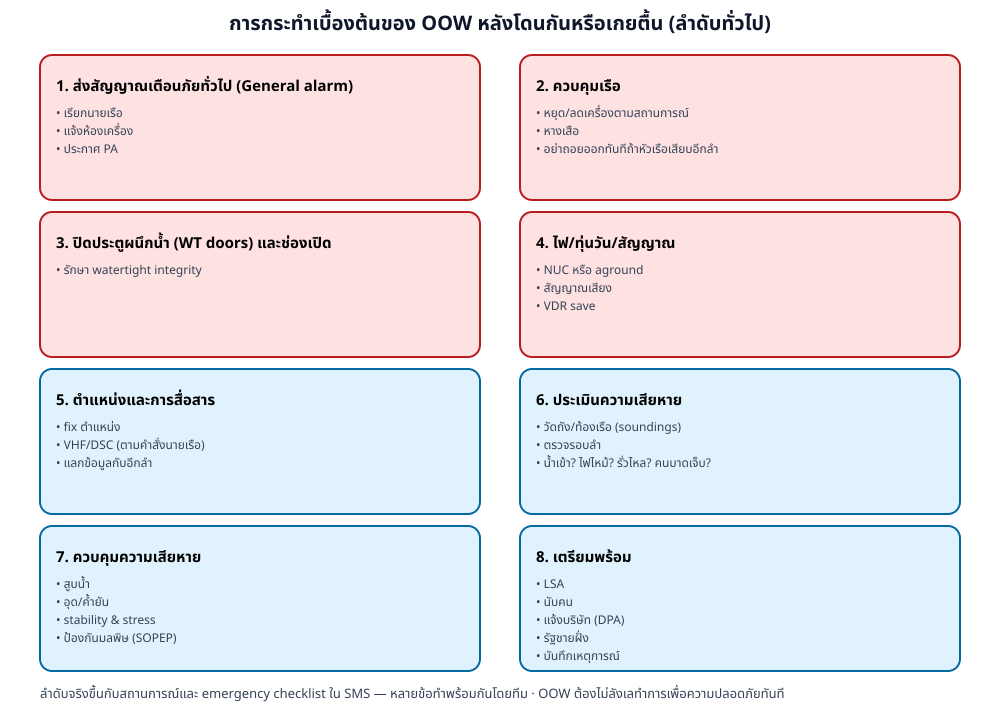
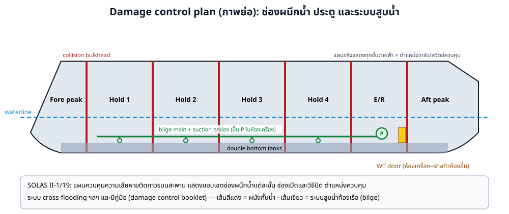

# 1.5 Respond to Emergencies — การตอบสนองต่อเหตุฉุกเฉิน

> สมุดบันทึกการฝึก OOW · TIRAPHONG NANTAPAN
> สมรรถนะตาม STCW A-II/1: *Emergency procedures — Precautions for the protection and safety of passengers in emergency situations; Initial action to be taken following a collision or a grounding; initial damage assessment and control; Appreciation of the procedures to be followed for rescuing persons from the sea, assisting a ship in distress, responding to emergencies which arise in port*
> เกณฑ์ประเมิน: *The type and scale of the emergency is promptly identified; Initial actions and, if appropriate, manoeuvring of the ship are in accordance with contingency plans and are appropriate to the urgency of the situation and nature of the emergency*
> อ้างอิงหลัก: ISM Code ข้อ 8 (Emergency preparedness); SOLAS II-1/19 (damage control information), II-1/22 (watertight doors), II-2 (fire), III/8, III/19, III/27, III/37 (muster list & drills), III/17-1 (recovery of persons from the water), V/33 (distress situations: obligations and procedures); STCW A-V/2 (passenger ships – crowd management); ICS *Bridge Procedures Guide* (Emergency checklists); IAMSAR Manual Vol III; MSC.1/Circ.1182/Rev.1 (Guide to recovery techniques); MSC.1/Circ.1447 (Guidelines for the development of plans and procedures for recovery of persons from the water); International Convention on Salvage 1989; Brussels Collision Convention 1910 (Art. 8); MARPOL Annex I Reg. 37 (SOPEP และบริการคำนวณ damage stability ทางฝั่งสำหรับเรือบรรทุกน้ำมัน); BMP Maritime Security (2025)

---

## 0. หลักคิดของ OOW เมื่อเกิดเหตุฉุกเฉิน

1. **ระบุชนิดและขนาดของเหตุให้เร็ว** (เกณฑ์ STCW) — ไฟไหม้? น้ำเข้า? โดนกัน? เกยตื้น? คนตกน้ำ? เครื่องดับ?
2. **เตือนภัยและเรียกนายเรือทันที** — ไม่ต้องรอแน่ใจ 100%
3. **ทำการเบื้องต้นตาม emergency checklist / contingency plan** ใน SMS — "ทำสิ่งที่ฝึกมา"
4. **ควบคุมเรือให้ปลอดภัย** ก่อนทำอย่างอื่น (หลีกเลี่ยงเหตุต่อเนื่อง เช่น หลังเครื่องดับต้องดูว่าเรือจะลอยไปไหน)
5. **สื่อสารชัดเจน** — ภายในเรือ (PA, VHF/UHF) และภายนอก (เรืออื่น VTS MRCC บริษัท)
6. **บันทึก** — เวลา ตำแหน่ง การกระทำ (และ save VDR)

> ISM Code ข้อ 8: บริษัทต้องระบุเหตุฉุกเฉินที่อาจเกิดบนเรือ จัดทำขั้นตอนตอบสนอง จัดโปรแกรมการซ้อม และมีมาตรการให้องค์กรของบริษัทตอบสนองได้ทุกเวลา (DPA/emergency response team ฝั่ง)

### 0.1 สัญญาณเตือนภัยบนเรือ (ทั่วไปตาม SOLAS/ LSA Code และ muster list)

| สัญญาณ | ความหมาย |
|---|---|
| **7 เสียงสั้น + 1 เสียงยาว** (หวูดเรือและกริ่ง) — ตามข้อกำหนดคือ "7 เสียงสั้นหรือมากกว่า" ตามด้วยเสียงยาว 1 ครั้ง ทางหวูด/ไซเรน และระบบกริ่งหรือ klaxon (SOLAS III/6.4.2, LSA Code 7.2.1) | **General emergency alarm** — ไปจุดรวมพล (muster station) ตาม muster list |
| สัญญาณไฟไหม้ (ตามที่เรือกำหนด เช่นกริ่งต่อเนื่อง) | Fire alarm — ทีมดับเพลิงไปจุดรวม |
| คำสั่ง **สละเรือ (abandon ship)** | **ด้วยวาจาของนายเรือ** (ตาม muster list) — ไม่มีสัญญาณเสียงเฉพาะในกฎสากล |
| คนตกน้ำ (MOB) | ตามที่เรือกำหนด (หลายเรือใช้ 3 เสียงยาว — ตรงกับ "O" ในรหัสมอร์ส −−−) + ประกาศ PA |
| อื่น ๆ | Security alert (SSAS/ประกาศ), CO₂ release alarm, ฯลฯ |

---

## 1. Precautions for the protection and safety of passengers in emergency situations

แม้ OOW ส่วนใหญ่จะทำงานบนเรือสินค้า STCW ก็กำหนดให้รู้หลักการคุ้มครองผู้โดยสาร (และคนที่ไม่ใช่ลูกเรือ เช่น ช่างซ่อม ผู้ติดตามเรือ)

### 1.1 ข้อกำหนดหลัก

- **SOLAS III/8 และ III/37 — Muster list and emergency instructions**: ระบุสัญญาณเตือนภัย หน้าที่ของลูกเรือแต่ละคน (ปิดประตูผนึกน้ำ ช่องเปิด อุปกรณ์ LSA ดูแลผู้โดยสาร ดับเพลิง สื่อสาร) ผู้รับผิดชอบดูแลอุปกรณ์ ผู้แทนเมื่อคนสำคัญบาดเจ็บ — ติดในที่เห็นชัด ภาษาที่เข้าใจได้ (และภาษาอังกฤษ)
- หน้าที่ต่อผู้โดยสารใน muster list: **เตือนผู้โดยสาร, ดูว่าแต่งกายเหมาะและสวมเสื้อชูชีพถูกต้อง, รวบรวมที่จุดรวมพล, ควบคุมการเคลื่อนที่ตามทางเดินและบันได, ดูแลว่ามีผ้าห่ม/อุปกรณ์ในเรือช่วยชีวิต**
- **SOLAS III/19.2.2** — เรือโดยสารที่ผู้โดยสารจะอยู่บนเรือเกิน 24 ชั่วโมง ต้องจัด **การรวมพลผู้โดยสารที่เพิ่งขึ้นเรือ (muster of newly embarked passengers)** **ก่อนหรือทันทีที่ออกเดินทาง (prior to or immediately upon departure)** — ตามการแก้ไข SOLAS ที่มีผลปี 2015 (เดิมกำหนดภายใน 24 ชั่วโมง) อธิบายการใช้เสื้อชูชีพและการปฏิบัติในเหตุฉุกเฉิน
- **SOLAS III/27 — Information on passengers**: นับจำนวนผู้โดยสารทั้งหมดก่อนออกเรือ บันทึกชื่อ เพศ ประเภทอายุ (ผู้ใหญ่ เด็ก ทารก) ความต้องการพิเศษ (สำหรับเรือที่กำหนด) ส่งให้หน่วย SAR ได้
- **STCW A-V/2** — การฝึก **crowd management**, crisis management และ human behaviour สำหรับลูกเรือบนเรือโดยสาร
- **Safe return to port (SOLAS II-2/21–22, II-1/8-1)** — เรือโดยสารใหม่ออกแบบให้กลับท่าได้เองหลังเหตุบางระดับ ทำให้ "เรือเป็นเรือช่วยชีวิตที่ดีที่สุด"

### 1.2 หลักปฏิบัติในการคุ้มครองผู้โดยสาร

1. **ข้อมูลที่ชัดเจนและสงบ** — ประกาศ PA หลายภาษา บอกสิ่งที่ต้องทำ ไม่ทำให้ตื่นตระหนก
2. **นำทางไปจุดรวมพล** — ลูกเรือประจำทางแยก บันได ใช้ป้ายและไฟฉุกเฉิน (low-location lighting)
3. **ตรวจห้อง (cabin search)** — ทำเครื่องหมายห้องที่ตรวจแล้ว
4. **นับคน** ที่จุดรวมพล รายงานผู้สูญหาย
5. **ดูแลกลุ่มพิเศษ** — เด็ก ผู้สูงอายุ ผู้พิการ ผู้บาดเจ็บ ผู้ไม่เข้าใจภาษา
6. **ควบคุมฝูงชน (crowd control)** — ป้องกันการแตกตื่น ใช้คำสั่งสั้นชัด ภาษากาย
7. **เตรียมเสื้อชูชีพ ผ้าห่ม อุปกรณ์** และพร้อมขึ้นเรือช่วยชีวิตตามคำสั่ง
8. **ห้ามใช้ลิฟต์** ในเหตุไฟไหม้/น้ำเข้า

---

## 2. Initial action following a collision (การโดนกัน)

*ภาพที่ 1.5-1 ลำดับการกระทำเบื้องต้นโดยทั่วไป*

### 2.1 ทันทีที่เกิดเหตุ (หรือเมื่อเห็นว่าหลีกเลี่ยงไม่ได้)

1. **ก่อนชน (ถ้ายังมีเวลา)** — ทำทุกอย่างเพื่อลดความรุนแรง: ลดความเร็ว/ถอยหลัง หันให้การกระแทกเป็นแบบเฉียด (glancing blow) แทนการชนตั้งฉาก หลีกเลี่ยงการถูกชนกลางลำบริเวณห้องเครื่อง/ช่องสินค้าใหญ่ ส่งสัญญาณเสียงเตือน
2. **ส่ง general alarm** และ **เรียกนายเรือ**
3. **บังคับเรือ** — ถ้าหัวเรือเราเสียบเข้าไปในเรืออีกลำ **อย่าถอยออกทันที** เพราะอาจเปิดรูให้น้ำเข้าเรืออีกลำจนจมเร็ว (และของเราด้วย) — ใช้เครื่องเดินหน้าช้า ๆ ประคองให้อยู่ในตำแหน่งจนประเมินสถานการณ์ได้ (ตามคำสั่งนายเรือ)
4. **ปิดประตูผนึกน้ำ (watertight doors)** และช่องเปิดทั้งหมด (ventilators, scuttles, hatch)
5. **แจ้งห้องเครื่อง** ให้ standby
6. **แสดงไฟ/ทุ่นวันที่เหมาะสม** (เช่น NUC ถ้าบังคับเรือไม่ได้) และให้สัญญาณเสียง
7. **หาตำแหน่งเรือ** บันทึกเวลา ตำแหน่ง เข็ม ความเร็ว
8. **กด save VDR**
9. **สื่อสาร** — ตามคำสั่งนายเรือ: ติดต่อเรืออีกลำ (ชื่อ ท่าทะเบียน ท่าต้นทาง/ปลายทาง ความเสียหาย ต้องการความช่วยเหลือหรือไม่) แจ้ง VTS/สถานีชายฝั่ง ส่ง distress (MAYDAY) หรือ urgency (PAN PAN) ถ้าจำเป็น

### 2.2 การประเมินความเสียหาย (Damage assessment)

- **วัดระดับในถังและช่องว่างทั้งหมด (sounding)** — ถังบัลลาสต์ ถังน้ำมัน void spaces cofferdams bilge wells — เทียบกับค่าก่อนเกิดเหตุ (ข้อมูลจาก tank sounding record) หาช่องที่น้ำเข้า
- **ตรวจด้วยตา** — ตัวเรือด้านนอก ดาดฟ้า ช่องสินค้า ห้องเครื่อง
- **ไฟไหม้? การรั่วไหลของน้ำมัน/สินค้าอันตราย?** — เริ่มแผนดับเพลิง/SOPEP
- **คนบาดเจ็บหรือสูญหาย?** — นับคนที่จุดรวมพล
- **ความเสียหายต่อระบบ** — หางเสือ เครื่องจักร ไฟฟ้า อุปกรณ์เดินเรือ วิทยุ
- **Stability และ stress** — คำนวณสภาพหลังน้ำเข้าด้วยข้อมูล damage stability / loading computer, ดูมุมเอียง trim freeboard ความเค้นตัวเรือ
- **ความช่วยเหลือคำนวณทางฝั่ง (shore-based emergency response)** — เรือบรรทุกน้ำมัน ≥ 5,000 DWT ต้องเข้าถึงโปรแกรมคำนวณ damage stability และ residual structural strength ทางฝั่งได้ทันที (MARPOL Annex I Reg. 37.4) ส่วนเรือโดยสาร (ตาม SOLAS II-1/8-1.3) ต้องมี onboard stability computer หรือ shore-based support สำหรับข้อมูลหลังน้ำเข้า — เรือสินค้าหลายลำสมัครบริการแบบนี้กับ class (เช่น ERS/SERS) ด้วย OOW ควรรู้ว่าเรือเราสมัครไว้หรือไม่ เบอร์ติดต่ออยู่ที่ไหน และต้องส่งข้อมูลอะไร (draught อ่านได้ หลังเหตุ, soundings ทุกถัง, มุมเอียง, ช่องที่น้ำเข้า, loading condition ล่าสุด)

### 2.3 การควบคุมความเสียหาย (Damage control)

- **ใช้ระบบสูบน้ำ (bilge/ballast pumps)** ลดน้ำ — ดูว่าอัตราน้ำเข้ามากกว่าอัตราสูบหรือไม่
- **อุดรู/ค้ำยัน (plugging, patching, shoring)** — ใช้วัสดุบนเรือ (ไม้ ลิ่ม ซีเมนต์ แผ่นอุด)
- **ปรับ stability** — ถ่ายบัลลาสต์เพื่อแก้เอียง/trim (ระวัง free surface)
- **ตามข้อมูลใน Damage Control Plan และ Damage Control Booklet** (SOLAS II-1/19)
- **ป้องกันมลพิษ** — ถ่ายน้ำมันออกจากถังที่เสียหาย ปิดวาล์ว ใช้ SOPEP
- **พิจารณาเกยตื้นแบบควบคุม (beaching)** ถ้าเรือมีแนวโน้มจม (การตัดสินใจของนายเรือ)
- **เตรียม LSA** สำหรับกรณีต้องสละเรือ

*ภาพที่ 1.5-2 Damage control plan (ภาพย่อ) — OOW ต้องรู้ตำแหน่งผนังกั้นน้ำ ประตูผนึกน้ำ และวิธีปิด*

### 2.4 หน้าที่ทางกฎหมายหลังโดนกัน

- **Brussels Collision Convention 1910 Art. 8 / กฎหมายภายในของหลายประเทศ** — นายเรือแต่ละลำต้องให้ความช่วยเหลือแก่อีกลำ ลูกเรือ และผู้โดยสาร เท่าที่ทำได้โดยไม่เป็นอันตรายร้ายแรงต่อเรือตน และต้องแจ้ง **ชื่อเรือ ท่าทะเบียน ท่าที่มาและท่าที่จะไป**
- รายงานต่อ flag state รัฐชายฝั่ง บริษัท (ตาม SMS) และ P&I
- **อย่ายอมรับความผิด** ในการสื่อสารหรือเอกสาร (เรื่องกฎหมายให้บริษัท/ทนายจัดการ)
- เก็บหลักฐาน: สมุดปูมเรือ (ห้ามแก้ไข) ECDIS/VDR data แผนที่ บันทึกเรดาร์ ภาพถ่าย

---

## 3. Initial action following a grounding (การเกยตื้น)

### 3.1 การกระทำทันที

1. **หยุดเครื่อง (stop engines)** — ป้องกันความเสียหายเพิ่ม และอย่า **ถอยหลังทันทีด้วยกำลังสูง** โดยยังไม่ประเมิน (อาจทำให้รูใหญ่ขึ้น หรือหลุดไปจมในน้ำลึก หรือดูดทราย/โคลนเข้าระบบน้ำหล่อเย็น)
2. **General alarm** และเรียกนายเรือ
3. **ปิดประตูผนึกน้ำ**
4. **แสดงไฟและทุ่นวันเรือเกยตื้น** (anchor lights + 2 red / 3 balls) และ **สัญญาณเสียงในหมอก** (Rule 35(h))
5. **แจ้งห้องเครื่อง** — เปลี่ยน sea suction เป็น high suction ถ้าอยู่ในที่ตื้น/โคลน
6. **หาตำแหน่ง** บันทึกเวลา และ **save VDR**
7. **สื่อสาร** — VTS/สถานีชายฝั่ง (ตามคำสั่งนายเรือ) แจ้งเรืออื่นในบริเวณ (อาจขัดขวางร่องน้ำ)

### 3.2 การประเมินความเสียหายและสถานการณ์

- **Soundings ถังและช่องว่างทั้งหมด** หาน้ำเข้าและการรั่วไหลของน้ำมัน
- **วัดความลึกรอบลำเรือ (soundings around the ship)** — ด้วยลูกดิ่ง/เครื่องวัด ที่หัว กลาง ท้าย ทั้งสองกราบ → รู้ว่าเกยตรงไหน (หัว/กลาง/ท้าย) และน้ำลึกอยู่ด้านไหน
- **ลักษณะพื้นทะเล** จากแผนที่และการสังเกต (หิน ทราย โคลน ปะการัง) — หินเสี่ยงรูรั่วมาก ทราย/โคลนดูดเรือไว้
- **ระดับน้ำ (tide)** ตอนนี้ขึ้นหรือลง เวลาน้ำขึ้นสูงสุดครั้งถัดไปเท่าไร — ถ้าเกยตอนน้ำขึ้นสูงสุดจะยากมาก
- **สภาพอากาศและคลื่น** — คลื่นทำให้เรือกระแทกพื้น (pounding) เสียหายเพิ่ม หรือพาเรือขึ้นไปลึกขึ้น
- **Draught ที่อ่านได้ (หัว-ท้าย) ก่อนและหลัง** — คำนวณน้ำหนักที่พื้นรองรับ (ground reaction) จากการเปลี่ยน displacement
- **Stability** — ground reaction ที่กระดูกงูทำให้ **GM ลดลง (virtual rise of G)** เมื่อน้ำลด อาจเสียเสถียรภาพได้ (บท 3.2.1)
- **Hull stress** — การเกยที่หัวหรือท้ายอย่างเดียวทำให้ bending moment สูงมาก

### 3.3 การตัดสินใจหลังการประเมิน (นายเรือ/บริษัท)

- **อย่าพยายามลอยเรือออก (refloat)** จนกว่าจะรู้ว่าเรือเสียหายแค่ไหน — ถ้ามีรูใหญ่ เรืออาจจมเมื่อหลุดออกจากที่ตื้น
- ถ้าจำเป็นให้เรือ **อยู่นิ่ง** ไม่ให้ถูกคลื่นพาไปลึกขึ้น — อาจ **ถ่วงบัลลาสต์เพิ่ม** ให้เรือนั่งแน่น หรือ **ทิ้งสมอ (lay out anchors)** ด้วยเรือเล็กไปยังน้ำลึก เพื่อใช้ช่วยดึงตอนลอยเรือ
- วางแผนลอยเรือ: ลดน้ำหนัก (ถ่ายบัลลาสต์ ถ่ายสินค้า/น้ำมัน — ระวังมลพิษ) ปรับ trim ลอยตอนน้ำขึ้น ใช้เรือลากจูง
- แจ้งบริษัทเพื่อติดต่อ **salvage** (Lloyd's Open Form – LOF ฯลฯ) และ P&I
- ทุกการกระทำต้องบันทึก

---

## 4. Rescuing persons from the sea (การช่วยเหลือคนในน้ำ)

### 4.1 คนตกน้ำจากเรือเรา (Man Overboard – MOB)

**การกระทำทันทีของ OOW** (ตาม BPG MOB checklist)
1. **โยนห่วงชูชีพพร้อมไฟและควัน (MOB marker / lifebuoy with self-activating light and smoke signal)** ที่ปีกสะพาน — ไปทางกราบที่คนตก
2. **กดปุ่ม MOB** บน GNSS/ECDIS เพื่อบันทึกตำแหน่ง (Datum)
3. **ตะโกนและส่งสัญญาณเตือน** — "Man overboard, starboard side!" ส่งสัญญาณเตือนตามที่เรือกำหนด ประกาศ PA
4. **ให้ look-out ชี้และจ้องคนในน้ำตลอดเวลา (keep visual contact)** — ห้ามละสายตา
5. **เริ่มการหันเรือกลับ** ตามสถานการณ์ — Williamson / Anderson (single turn) / Scharnow (รายละเอียดในบท 1.9)
6. **แจ้งนายเรือและห้องเครื่อง** — เตรียมเครื่อง manoeuvring
7. **ชักธง "O"** (Man overboard) และ/หรือให้สัญญาณเสียง "O" (− − −) — ตามความเหมาะสม
8. **ส่งข่าว** — PAN PAN หรือ MAYDAY relay ตามคำสั่ง แจ้ง MRCC เรือใกล้เคียง
9. **เตรียมเรือกู้ภัย (rescue boat)** และอุปกรณ์รับคนขึ้นเรือ (SOLAS III/17-1 — แผนและขั้นตอนการกู้คนจากน้ำ)
10. **บันทึก** เวลา ตำแหน่ง ลม กระแสน้ำ

**ถ้าไม่เห็นคนตก (delayed action / person missing)** — หันกลับตามเส้นทางเดิม (Scharnow หรือ Williamson) ค้นหาตามรูปแบบ IAMSAR (expanding square/sector) แจ้ง MRCC

### 4.2 วิธีนำคนขึ้นจากน้ำ (Recovery)

- **Rescue boat** — วิธีหลัก เรือเรากันลม (make a lee) ให้เรือกู้ภัย
- **Scramble nets, pilot ladders, lifebuoys with lines**
- **Rescue sling/cradle (เช่น Jason's cradle), recovery basket**
- **ยกแนวนอน (horizontal lift)** — คนที่อยู่ในน้ำเย็นนานควรยกในท่านอน เพื่อลดความเสี่ยงความดันเลือดตกและหัวใจหยุด (post-rescue collapse)
- MSC.1/Circ.1182/Rev.1 — *Guide to recovery techniques*
- **SOLAS III/17-1** (มีผล 1 ก.ค. 2014) — เรือทุกลำต้องมี **แผนและขั้นตอนเฉพาะเรือ (ship-specific plans and procedures)** สำหรับการกู้คนจากน้ำ จัดทำตามแนวทาง MSC.1/Circ.1447 — OOW ควรรู้ว่าบนเรือตัวเองแผนนี้อยู่ที่ไหน ใช้อุปกรณ์อะไร (เช่น rescue boat, เครน + ตะกร้า, Jason's cradle) และฝึกซ้อมตามรอบที่กำหนด
- การปฐมพยาบาล hypothermia, จมน้ำ (บท 3.5)

---

## 5. Assisting a ship in distress (การช่วยเหลือเรือที่ประสบภัย)

### 5.1 หน้าที่ตามกฎหมาย — SOLAS V/33

- นายเรือที่อยู่ในฐานะที่ช่วยได้ เมื่อได้รับข้อมูลว่ามีบุคคลประสบภัยในทะเล **ต้องรีบไปช่วยเหลือด้วยความเร็วสูงสุด (proceed with all speed)** และแจ้งหน่วย SAR ถ้าเป็นไปได้ — **โดยไม่คำนึงถึงสัญชาติ สถานะ หรือสถานการณ์ของบุคคลนั้น**
- ถ้าไม่สามารถหรือเห็นว่าไม่สมเหตุสมผลที่จะไป ต้อง **บันทึกเหตุผลในสมุดปูมเรือ** และแจ้งหน่วย SAR
- นายเรืออาจถูก **requisition** โดย RCC หรือนายเรือของเรือที่ประสบภัย ให้มาช่วย — ต้องปฏิบัติ
- ได้รับการปลดหน้าที่เมื่อทราบว่ามีเรืออื่นถูก requisition แล้ว หรือได้รับแจ้งว่าไม่ต้องการความช่วยเหลือแล้ว
- **SOLAS V/33.1-1** — รัฐต้องประสานให้ผู้ที่ได้รับการช่วยเหลือขึ้นฝั่งในที่ปลอดภัย (place of safety) โดยเร็ว เพื่อไม่ให้เรือที่ช่วยเหลือต้องเบี่ยงจากการเดินทางมากเกินจำเป็น
- UNCLOS Art. 98 และ International Convention on Salvage 1989 Art. 10 ก็กำหนดหน้าที่ช่วยเหลือ

### 5.2 การปฏิบัติเมื่อได้รับสัญญาณ distress (ร่วมกับบท 1.6)

1. **รับทราบ (acknowledge)** ตามขั้นตอน GMDSS (เช่น DSC distress ทาง VHF — โดยทั่วไปให้ตอบรับด้วยวิทยุโทรศัพท์บนช่อง 16 และให้ฝั่ง (CRS/RCC) เป็นผู้ acknowledge ทาง DSC ตามแนวทาง IMO)
2. **บันทึก** ข้อมูล: ชื่อ ตำแหน่ง ลักษณะเหตุ จำนวนคน ความช่วยเหลือที่ต้องการ เวลา
3. **Plot** ตำแหน่ง คำนวณ ETA แจ้งนายเรือ
4. **ติดต่อ RCC** แจ้งชื่อ ตำแหน่ง ETA ความสามารถของเรือเรา
5. **เตรียมเรือ** — ตาม IAMSAR Vol III checklist: เตรียมเรือกู้ภัย ห่วงชูชีพ บันได/ตาข่าย เชือก ไฟส่องค้นหา (searchlights) อุปกรณ์ปฐมพยาบาล ผ้าห่ม เสบียง พื้นที่พักผู้รอดชีวิต ระบบสื่อสาร (VHF มือถือ) เพิ่ม look-out
6. **เฝ้าฟังวิทยุ** (VHF ch 16, MF 2182 kHz, ช่อง/ความถี่ SAR ที่ RCC กำหนด) — เรดาร์ตั้งหา SART, AIS ดู AIS-SART
7. **เข้าใกล้** ตามคำแนะนำของ OSC/RCC — ระวังผู้ประสบภัยในน้ำ ซากลอยน้ำ เชือก
8. **ช่วยเหลือ** — ตามความเหมาะสม: เรือใหญ่สร้าง lee ให้แพชูชีพ/เรือเล็กเทียบด้านใต้ลม พิจารณาการลอยของเรือเรากับของเป้า (เรือใหญ่ลอยตามลมเร็วกว่าแพ อาจทับคนในน้ำ — ต้องระวัง)

### 5.3 การช่วยเหลือเรือที่เสียการบังคับ (ลากจูง/คุ้มกัน)

- อาจต้องยืนเคียง (standing by) จนเรือลากจูงมาถึง หรือช่วยลากจูงฉุกเฉิน (emergency towing) ตามความสามารถของเรือ
- เรือบรรทุกน้ำมัน/เคมี ≥ 20,000 DWT มี **emergency towing arrangements** (SOLAS II-1/3-4) และเรือทุกลำต้องมี **emergency towing procedures** (ship-specific)
- ประสานกับ RCC/ทางฝั่ง เรื่อง salvage

---

## 6. Responding to emergencies which arise in port (เหตุฉุกเฉินในท่าเรือ)

| เหตุ | การตอบสนองเบื้องต้นของ duty officer |
|---|---|
| **ไฟไหม้ในท่า** | ส่ง alarm แจ้งการท่าเรือ/หน่วยดับเพลิงท่าเรือทันที (เบอร์/ช่องจากข้อมูลท่า) หยุดงานสินค้าและ bunkering เริ่มดับเพลิงตาม muster list เตรียม **International shore connection** และ **fire control plan ชุดสำรองที่อยู่ในกล่องกันน้ำนอกที่พัก (SOLAS II-2/15.2.4)** ให้ทีมดับเพลิงฝั่ง ให้ข้อมูลสินค้าอันตราย จำนวนคน คนสูญหาย |
| **น้ำมัน/สารรั่วไหล** | หยุดการถ่าย/เติม ปิดวาล์ว ใช้ SOPEP/SMPEP อุดช่องระบายดาดฟ้า (scuppers) ทำความสะอาด แจ้งการท่าเรือ/หน่วยงานรัฐ บันทึกใน Oil Record Book |
| **เชือกขาด/เรือหลุดจากท่า** | แจ้งนายเรือ ห้องเครื่อง standby ใส่เชือกเพิ่ม แจ้ง port control เรียกเรือลากจูง/นำร่อง เตรียมสมอ |
| **สภาพอากาศเลว/พายุ/สึนามิ** | ตามคำสั่งการท่าเรือ — เพิ่มเชือก อาจต้องออกจากท่า เตรียมเครื่อง |
| **คนบาดเจ็บ/เจ็บป่วยฉุกเฉิน** | ปฐมพยาบาล เรียกรถพยาบาลผ่านตัวแทน/การท่าเรือ |
| **คนตกน้ำระหว่างท่ากับเรือ** | ตะโกน โยนห่วงชูชีพ แจ้งท่าเรือ หยุดการเคลื่อนเรือ/เครน ระวังคนถูกบีบระหว่างเรือกับท่า |
| **อุบัติเหตุในที่อับอากาศ (enclosed space)** | ห้ามลงไปช่วยโดยไม่มีอุปกรณ์ช่วยหายใจ (SCBA) — ส่ง alarm ทีมกู้ภัยตาม drill (SOLAS III/19 ซ้อม enclosed space ทุก 2 เดือน) |
| **เหตุด้านการรักษาความปลอดภัย** | ตาม Ship Security Plan — แจ้ง SSO/PFSO, ควบคุมการเข้าถึง |
| **สินค้าอันตรายรั่ว** | ตาม EmS (IMDG) และ MFAG — ห่างจากพื้นที่ แจ้งท่าเรือ |

---

## 7. เหตุฉุกเฉินอื่นที่ OOW ต้องพร้อม (สรุปจาก BPG checklists)

| เหตุ | การกระทำเบื้องต้นของ OOW |
|---|---|
| **Steering failure** | เปลี่ยนไปใช้ระบบหางเสือสำรอง/อีก pump ตาม block diagram, แจ้งนายเรือ/ห้องเครื่อง, แสดงไฟ NUC ถ้าบังคับไม่ได้, ส่งคนไปห้องหางเสือ (emergency steering), ลดความเร็ว, ระวังเรืออื่น, ส่งสัญญาณเตือน |
| **Main engine failure / blackout** | แจ้งนายเรือ, ตรวจตำแหน่ง/การลอยของเรือ, NUC lights/shapes, เตรียมสมอถ้าใกล้ฝั่ง/น้ำตื้น, แจ้ง VTS/เรืออื่น, ไฟฉุกเฉิน |
| **Gyro failure** | เปลี่ยนไปใช้ magnetic compass (แก้ error), ตรวจ autopilot/ARPA/ECDIS ที่ใช้ heading, แจ้งนายเรือ |
| **GNSS failure / spoofing** | ใช้เรดาร์/สายตา/DR, ECDIS DR mode หรือ manual position, แจ้งนายเรือ, รายงาน (ผ่าน NAVTEX/VTS) |
| **Flooding** | alarm, ปิด WT doors, หาแหล่งน้ำเข้า, สูบ, stability |
| **Heavy weather** | ลดความเร็ว/เปลี่ยนเข็มลดการโคลง ระวัง parametric/synchronous rolling, ปิดช่องเปิด ผูกยึดสินค้า ไม่ให้คนออกดาดฟ้าที่อันตราย (บท 1.1.7/1.9) |
| **Piracy/armed robbery** | ตาม SSP/BMP: alarm, เพิ่มความเร็ว/บังคับเรือหลบ, แจ้ง UKMTO/ReCAAP/RCC, SSAS, ลูกเรือเข้าห้องนิรภัย (citadel) ตามแผน — หมายเหตุ: ตั้งแต่ มี.ค. 2025 อุตสาหกรรมรวม BMP5, Global BMP และ BMP West Africa เป็นเล่มเดียวชื่อ **BMP Maritime Security (BMP MS)** ใช้ร่วมกับรายงานภัยคุกคาม MISTO ที่ปรับปรุงเป็นระยะ |
| **Fire** | บท 3.3 |
| **Abandon ship** | บท 3.4 |

---

## 8. สถานการณ์จำลอง — โดนกันในช่องแคบตอนกลางคืน

> สถานการณ์สมมติเพื่อฝึกลำดับความคิด

0310 เรือเรา (เรือตู้ 172 m) ในช่องแคบ เรือประมงขนาดกลางที่ไม่มี AIS เปลี่ยนเข็มกะทันหันตัดหน้าระยะใกล้ OOW สั่งหางเสือเต็มขวาและหยุดเครื่องแล้ว แต่หัวเรือเราชนกราบซ้ายของเรือประมงที่ 0312

**การกระทำของ OOW (จำลอง)**
- 0312 กด general alarm, โทรเรียกนายเรือ, แจ้งห้องเครื่อง "Collision forward — stand by"
- 0312 กด MOB บน ECDIS (อาจมีคนจากเรือประมงตกน้ำ), ให้ look-out ส่องไฟค้นหาบริเวณหัวเรือ โยนห่วงชูชีพ
- 0313 ให้เครื่องหยุดไว้ — หัวเรือเราไม่ได้เสียบค้างในเรือประมง (เรือประมงลอยออกไปทางซ้าย)
- 0313 กด VDR save, จดตำแหน่ง/เวลา
- 0314 นายเรือขึ้นสะพาน รับ con OOW รายงานสั้น ๆ (เกิดอะไร ทำอะไรไปแล้ว)
- 0315 ทีมตรวจความเสียหาย: forepeak, bosun store, ballast tank No.1 — sounding เทียบค่าเดิม
- 0316 VHF ch 16 เรียกเรือประมง (ไม่ตอบ) → นายเรือสั่ง **PAN PAN** แจ้ง VTS และเรือใกล้เคียง ขอให้ช่วยเฝ้าดู
- 0320 เห็นคนบนเรือประมงโบกไฟฉาย เรือยังลอยอยู่ → ติดต่อทาง VHF ได้ ไม่มีคนบาดเจ็บ แต่น้ำเข้า → นายเรือส่ง MAYDAY RELAY/ประสาน VTS-MRCC เตรียมเรือกู้ภัย
- 0330 sounding: forepeak ระดับเพิ่ม 1.2 m (น้ำเข้า) → ปิด WT access, เริ่มสูบ, คำนวณ stability (trim by head เพิ่มเล็กน้อย ยังปลอดภัย)
- 0345 แจ้งบริษัท (DPA), flag state ผ่านบริษัท, บันทึกทุกอย่างในปูมเรือ

**บทเรียนในสถานการณ์นี้** — การทำการแต่เนิ่น (Rule 8) อาจป้องกันได้, เรือประมงไม่มี AIS ต้องใช้เรดาร์/สายตา, เมื่อเกิดเหตุแล้วการทำตาม checklist และการสื่อสารชัดเจนลดความเสียหายต่อเนื่อง

---

## 9. คำถามสอบปากเปล่า / สัมภาษณ์ — Emergencies

**ถาม:** หลังโดนกัน OOW ต้องทำอะไรทันที
**แนวตอบ:** general alarm เรียกนายเรือ ควบคุมเรือ (ถ้าเสียบอีกลำอย่าถอยออกทันที) ปิดประตูผนึกน้ำ แจ้งห้องเครื่อง แสดงไฟ/สัญญาณที่เหมาะสม หาตำแหน่งและบันทึก save VDR สื่อสาร (อีกลำ VTS MRCC ตามคำสั่ง) ประเมินความเสียหาย (soundings ไฟไหม้ มลพิษ คนบาดเจ็บ stability) ควบคุมความเสียหาย เตรียม LSA

**ถาม:** หลังเกยตื้นทำไมไม่ควรถอยหลังออกทันที
**แนวตอบ:** อาจทำให้รูรั่วใหญ่ขึ้น หลุดไปสู่น้ำลึกแล้วจม ดูดทราย/โคลนเข้าระบบหล่อเย็น และยังไม่รู้สภาพความเสียหาย ต้องประเมินก่อน (soundings ถัง ความลึกรอบลำ ระดับน้ำ พื้นทะเล stability)

**ถาม:** การเกยตื้นมีผลต่อเสถียรภาพอย่างไร
**แนวตอบ:** แรงปฏิกิริยาจากพื้น (ground reaction) ที่กระดูกงูเท่ากับการเอาน้ำหนักออกที่ระดับกระดูกงู ทำให้ GM ลดลง (virtual rise of G) เมื่อน้ำลดลงแรงนี้เพิ่ม อาจทำให้เสียเสถียรภาพ

**ถาม:** SOLAS ข้อใดกำหนดหน้าที่ช่วยเหลือผู้ประสบภัย
**แนวตอบ:** SOLAS V/33 — ต้องไปช่วยด้วยความเร็วสูงสุดโดยไม่คำนึงถึงสัญชาติหรือสถานะ ถ้าไม่ไปต้องบันทึกเหตุผลในสมุดปูมเรือและแจ้ง SAR

**ถาม:** คนตกน้ำ OOW ทำอะไรบ้าง
**แนวตอบ:** โยนห่วงชูชีพพร้อมไฟ/ควัน กด MOB ตะโกนเตือน/ส่งสัญญาณ ให้คนชี้และจ้องคนในน้ำ เริ่มหันเรือกลับ (Williamson/Anderson/Scharnow ตามสถานการณ์) แจ้งนายเรือ/ห้องเครื่อง ชักธง O ส่งข่าว PAN PAN/แจ้ง MRCC เตรียมเรือกู้ภัย บันทึก

**ถาม:** Damage control plan คืออะไร
**แนวตอบ:** แผนผังตาม SOLAS II-1/19 ที่ติดถาวรบนสะพาน แสดงขอบเขตช่องผนึกน้ำแต่ละชั้น ช่องเปิดและวิธีปิด ตำแหน่งควบคุม และระบบแก้การเอียง พร้อมคู่มือ (booklet) ใช้ในการควบคุมความเสียหาย

**ถาม:** ไฟไหม้ในท่าเรือ ต้องเตรียมอะไรให้หน่วยดับเพลิงฝั่ง
**แนวตอบ:** แจ้งทันที ให้ fire control plan (ชุดในกล่องกันน้ำนอกที่พัก) ข้อมูลสินค้าอันตราย จำนวนคน/ผู้สูญหาย ตำแหน่งไฟ international shore connection และคนนำทาง

**ถาม:** สัญญาณ general emergency alarm คืออะไร
**แนวตอบ:** เสียงสั้น 7 ครั้งตามด้วยเสียงยาว 1 ครั้ง ทางหวูดเรือและระบบกริ่ง

**ถาม:** ทำไมคนที่อยู่ในน้ำเย็นนานควรยกขึ้นในท่านอน
**แนวตอบ:** ลดความเสี่ยงความดันเลือดลดฉับพลันและหัวใจหยุดหลังการช่วยเหลือ (post-rescue collapse) จากการเปลี่ยนแรงดันน้ำรอบตัวและภาวะ hypothermia

**ถาม:** หลังเกิดน้ำเข้า ต้องเตรียมข้อมูลอะไรให้ shore-based damage stability service หรือบริษัท
**แนวตอบ:** ตำแหน่งและเวลา ลักษณะความเสียหาย ช่อง/ถังที่น้ำเข้าและระดับ (soundings ทุกถังเทียบค่าก่อนเหตุ) draught หัว-กลาง-ท้ายทั้งสองกราบ มุมเอียงและ trim loading condition ล่าสุด สภาพอากาศ และการกระทำที่ทำไปแล้ว (สูบน้ำ ถ่ายบัลลาสต์) — เรือบรรทุกน้ำมัน ≥ 5,000 DWT ต้องเข้าถึงบริการนี้ตาม MARPOL Annex I Reg. 37.4

**ถาม:** SOLAS III/17-1 กำหนดอะไรเรื่องคนตกน้ำ
**แนวตอบ:** เรือทุกลำต้องมีแผนและขั้นตอนเฉพาะเรือสำหรับกู้คนขึ้นจากน้ำ (จัดทำตาม MSC.1/Circ.1447 และดูเทคนิคใน MSC.1/Circ.1182/Rev.1) ระบุอุปกรณ์ที่ใช้และวิธีปกป้องคนกู้ และต้องฝึกซ้อม

**ถาม:** เรือของเราชนแล้วหัวเรือเสียบค้างอยู่ในอีกลำ ทำไมไม่ควรถอยออกทันที
**แนวตอบ:** หัวเรือเราทำหน้าที่เหมือนจุกอุดรู ถ้าถอยออกน้ำจะทะลักเข้าเรืออีกลำ (และเข้าเรือเราที่หัวเรือเสียหาย) อาจจมเร็วหรือเกิดไฟ/มลพิษเพิ่ม — ใช้เครื่องเดินหน้าช้า ๆ ประคองตำแหน่งจนประเมินความเสียหายทั้งสองลำและนายเรือตัดสินใจ

---

*ก่อนหน้า ← [1.4 ECDIS](1.4-ecdis.md) · ถัดไป → [1.6 Search and Rescue](1.6-search-and-rescue.md)*
