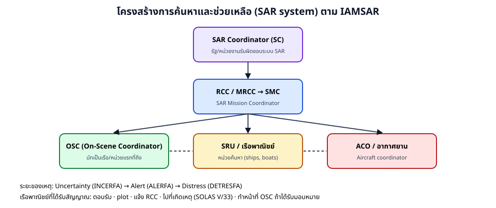
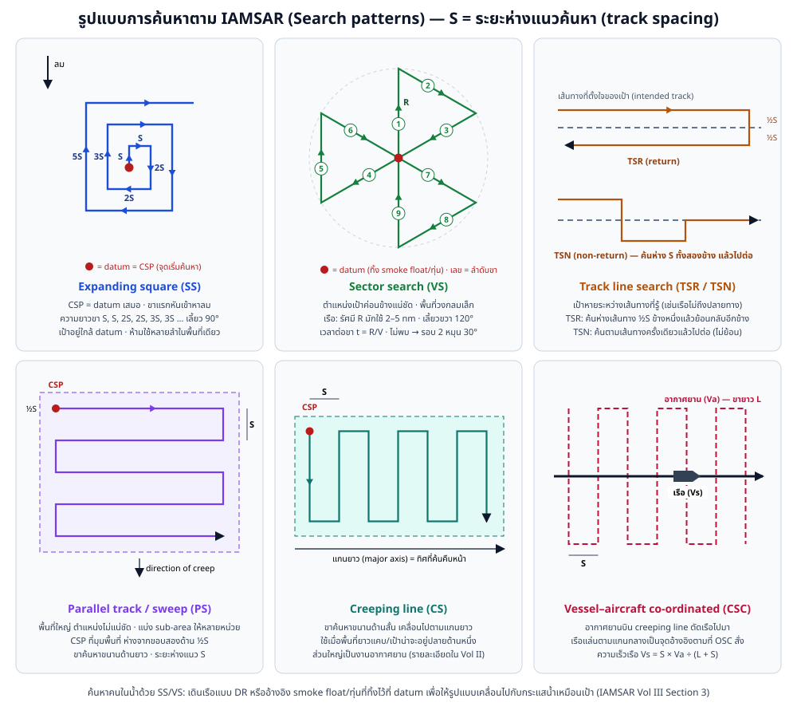

# 1.6 Respond to a Distress Signal at Sea — Search and Rescue (IAMSAR)

> สมุดบันทึกการฝึก OOW · TIRAPHONG NANTAPAN
> สมรรถนะตาม STCW A-II/1: *Search and rescue — Knowledge of the contents of the International Aeronautical and Maritime Search and Rescue (IAMSAR) Manual*
> เกณฑ์ประเมิน: *The distress or emergency signal is immediately recognized; Contingency plans and instructions in standing orders are implemented and complied with*
> อ้างอิงหลัก: **IAMSAR Manual Vol III (Mobile Facilities), ฉบับ 2025** (มีผล 1 ม.ค. 2026 ตาม MSC.1/Circ.1686 — ต้องมีบนเรือตาม SOLAS V/21); International Convention on Maritime Search and Rescue (SAR) 1979 as amended; SOLAS IV (GMDSS), V/7, V/21, V/29 (Life-saving signals), V/33; ITU Radio Regulations; COLREG Annex IV; ICS *Guide to Helicopter/Ship Operations*; **MSC.1/Circ.1657** *Procedure for responding to DSC distress alerts by ships* (มีผล 1 ม.ค. 2024 แทน COMSAR/Circ.25); **MSC.496(105)** แก้ไข SOLAS IV — GMDSS modernization (มีผล 1 ม.ค. 2024); International Code of Signals (ตาราง life-saving signals)

---

## 1. ระบบ SAR ระดับโลก

### 1.1 อนุสัญญาและแนวคิด

- **SAR Convention 1979** — แบ่งมหาสมุทรของโลกเป็น **Search and Rescue Regions (SRRs)** แต่ละ SRR มีรัฐรับผิดชอบจัด **Rescue Co-ordination Centre (RCC)** หรือ **MRCC** (สำหรับทะเล) และอาจมี **Rescue Sub-Centre (RSC)**
- **SOLAS V/7** — รัฐภาคีต้องจัดบริการ SAR ชายฝั่ง และประสานงาน
- **GMDSS** (SOLAS IV) — ระบบสื่อสารที่ทำให้ "ใครก็ตามที่ประสบภัย ส่งสัญญาณแล้วมีผู้รับแน่นอน" (DSC, NAVTEX, Inmarsat/Iridium EGC, EPIRB 406 MHz ผ่าน COSPAS-SARSAT, SART/AIS-SART)
- **COSPAS-SARSAT** — ระบบดาวเทียมรับสัญญาณ EPIRB 406 MHz (LEOSAR, GEOSAR และ MEOSAR ที่ทำให้ตรวจจับและหาตำแหน่งได้เร็วขึ้นมาก)
- **AMVER** — ระบบรายงานเรือแบบสมัครใจของ US Coast Guard ใช้หาเรือที่อยู่ใกล้เหตุ

### 1.2 IAMSAR Manual — 3 เล่ม

| เล่ม | ชื่อ | สำหรับ |
|---|---|---|
| **Vol I** | Organization and Management | รัฐบาล ผู้บริหารระบบ SAR |
| **Vol II** | Mission Co-ordination | RCC/RSC เจ้าหน้าที่วางแผนการค้นหา |
| **Vol III** | **Mobile Facilities** | **เรือ อากาศยาน หน่วย SAR** — **ต้องมีบนเรือ (SOLAS V/21)** ฉบับปัจจุบัน |

IMO และ ICAO จัดทำร่วมกัน แก้ไขทุกประมาณ 3 ปี (ฉบับ 2022 → **2025** มีผล 1 ม.ค. 2026 — การแก้ไขล่าสุดรวมแนวทางเรื่อง SAR ในพื้นที่ฟาร์มกังหันลมนอกชายฝั่ง และการค้นหาตอนกลางคืน)

จดเพิ่มเรื่องฉบับ 2025 (ตรวจกับเล่มจริงบนเรือ): การแก้ไขชุดนี้อนุมัติด้วย **MSC.1/Circ.1686** มีผล 1 ม.ค. 2026 สาระที่ classification society สรุปไว้คือ (1) ปรับถ้อยคำทั้งสามเล่มให้ตรงกับ **GMDSS ที่แก้ไขใหม่ใน SOLAS IV (มีผล 1 ม.ค. 2024)** เช่นใช้คำว่า recognized mobile satellite service แทนการเอ่ยชื่อ Inmarsat อย่างเดียว (2) เพิ่มแนวทาง SAR ในพื้นที่ **ฟาร์มกังหันลม/พลังงานหมุนเวียนนอกชายฝั่ง** (ส่วนใหญ่อยู่ใน Vol II สำหรับ RCC) (3) แนวทาง **ค้นหาตอนกลางคืน** ด้วยกล้อง EO/IR และกล้องมองกลางคืน (NVD) ซึ่งเน้นอากาศยาน (4) เรื่องการใช้ระบบติดตามเที่ยวบิน (flight tracking) ประกอบการวางแผน — สิ่งที่ OOW ต้องทำคือ **ตรวจว่าบนเรือมี Vol III ฉบับ 2025 แล้ว** และอ่านส่วนที่เปลี่ยน

### 1.3 โครงสร้างของ IAMSAR Vol III

| ส่วน | เนื้อหา |
|---|---|
| **Section 1 — Overview** | ระบบ SAR, ความรับผิดชอบ, ระบบสื่อสาร, การเตรียมพร้อม |
| **Section 2 — Rendering assistance** | สิ่งที่ต้องทำเมื่อได้รับสัญญาณ distress (เรือและอากาศยาน), การเตรียมตัว, การสื่อสาร, การเข้าถึงที่เกิดเหตุ |
| **Section 3 — On-scene co-ordination** | หน้าที่ OSC, การวางแผนค้นหา, รูปแบบการค้นหา, การสื่อสาร, การดูแลผู้รอดชีวิต, การยุติการค้นหา |
| **Section 4 — On-board emergencies** | เหตุฉุกเฉินบนเรือตนเอง/อากาศยาน (เช่นคนตกน้ำ ไฟไหม้ การสละเรือ การลงจอดฉุกเฉินของอากาศยานบนน้ำ — ditching, การช่วยเหลือทางการแพทย์ทางไกล) |
| **Appendices** | แบบฟอร์ม/ข้อความมาตรฐาน (SITREP), ตาราง (track spacing, sweep width), สัญญาณช่วยชีวิต, checklists |

### 1.4 GMDSS หลังการปรับปรุง (GMDSS modernization) — SOLAS IV แก้ไขโดย MSC.496(105) มีผล 1 ม.ค. 2024

ผมจดไว้เพราะกรรมการชอบถามว่า "อะไรเปลี่ยนไปเมื่อ 2024" — สาระสำคัญ (สรุปเป็นภาษาตัวเอง ตรวจกับตัวบท SOLAS IV ฉบับปัจจุบัน)

| เขตทะเล (Sea area) | นิยามโดยสรุป | ความหมายในทางปฏิบัติ |
|---|---|---|
| **A1** | อยู่ในรัศมีวิทยุโทรศัพท์ของสถานีชายฝั่ง **VHF** อย่างน้อยหนึ่งสถานีที่มี DSC alerting ต่อเนื่อง (รัฐชายฝั่งประกาศ) | โดยทั่วไปไม่กี่สิบไมล์จากฝั่ง |
| **A2** | นอก A1 แต่อยู่ในรัศมีของสถานีชายฝั่ง **MF** ที่มี DSC alerting ต่อเนื่อง | โดยทั่วไปประมาณร้อยกว่าไมล์ — ดู ALRS Vol 5 / GMDSS Master Plan |
| **A3** | นอก A1 และ A2 แต่อยู่ในพื้นที่ครอบคลุมของ **recognized mobile satellite service (RMSS)** ที่ ship earth station บนเรือรองรับ และมี alerting ต่อเนื่อง | **ขึ้นกับผู้ให้บริการที่เรือติดตั้ง** — Inmarsat (ดาวเทียมค้างฟ้า ไม่ครอบคลุมขั้วโลก) หรือ Iridium (วงโคจรต่ำ ครอบคลุมทั่วโลกรวมขั้วโลก) |
| **A4** | พื้นที่นอก A1, A2 และ A3 | สำหรับเรือที่ใช้ Inmarsat คือแถบขั้วโลก — ต้องพึ่ง HF |

สิ่งที่เปลี่ยน/ควรรู้
- คำว่า "Inmarsat" ใน SOLAS IV ถูกแทนด้วย **recognized mobile satellite service** — ปัจจุบัน IMO รับรอง **Inmarsat** และ **Iridium** (Iridium ได้รับการรับรองโดย **MSC.451(99)** ปี 2018 เปิดให้บริการ GMDSS จริงเดือน ธ.ค. 2020); ระบบ **BeiDou (BDMSS)** ได้รับการรับรองแบบมีเงื่อนไขเฉพาะพื้นที่ภูมิภาคโดย MSC 106 (2022) — สถานะใช้งานจริงให้ตรวจกับ IMO/IMSO ฉบับล่าสุด
- **Cargo Ship Safety Radio Certificate** (Form R) ระบุผู้ให้บริการ RMSS ที่เรือใช้ เพราะเขต A3 ของเรือขึ้นกับระบบนั้น
- **NBDP (radiotelex) ไม่บังคับแล้ว** สำหรับการสื่อสาร distress/safety บน MF/HF
- ข้อกำหนด **SART/AIS-SART** และ **วิทยุ VHF สองทาง (two-way VHF)** สำหรับเรือช่วยชีวิต ย้ายจาก SOLAS III มาอยู่ใน SOLAS IV
- เขต A1 ไม่ยอมรับ **VHF EPIRB** อีกต่อไป — ใช้ EPIRB 406 MHz (COSPAS-SARSAT)
- การรับ **MSI**: NAVTEX ในพื้นที่ที่มีบริการ, **EGC** ผ่าน Inmarsat **SafetyNET** หรือ Iridium **SafetyCast** นอกพื้นที่ NAVTEX และ HF MSI ตามที่มีบริการ
- อุปกรณ์ที่ติดตั้งก่อนวันมีผลยังใช้มาตรฐานสมรรถนะเดิมได้ตามช่วงเปลี่ยนผ่านที่ IMO กำหนด (มีการกล่าวถึงถึง 1 ม.ค. 2028 — ตรวจกับ flag circular ของรัฐเจ้าของธง)
- ขั้นตอนตอบสนอง DSC distress alert ปรับปรุงเป็น **MSC.1/Circ.1657** (มีผล 1 ม.ค. 2024) — ดูข้อ 4.1

---

## 2. โครงสร้างการประสานงาน (SAR organization)



*ภาพที่ 1.6-1 บทบาทในการค้นหาและช่วยเหลือ — เรือพาณิชย์อาจได้รับมอบหมายเป็น OSC*

| บทบาท | หน้าที่ |
|---|---|
| **SAR Coordinator (SC)** | หน่วยงานระดับรัฐที่รับผิดชอบการจัดตั้งและดูแลระบบ SAR |
| **SAR Mission Coordinator (SMC)** | เจ้าหน้าที่ใน RCC ที่สั่งการเหตุการณ์หนึ่ง ๆ — วางแผนค้นหา จัดสรรหน่วย |
| **On-Scene Coordinator (OSC)** | ผู้ประสานงานในที่เกิดเหตุ (มักเป็นหน่วยแรกที่ไปถึงหรือเรือที่เหมาะสม) — กำหนดโดย SMC |
| **SAR Unit (SRU)** | หน่วยค้นหาที่ได้รับมอบหมาย (เรือ อากาศยาน) |
| **Aircraft Co-ordinator (ACO)** | ประสานอากาศยานหลายลำในพื้นที่ |

**ระยะของเหตุการณ์ (Emergency phases)**
1. **Uncertainty phase (INCERFA)** — สงสัยว่ามีปัญหา (เช่นเรือไม่รายงานตามกำหนด)
2. **Alert phase (ALERFA)** — มีความกังวลต่อความปลอดภัย (ข้อมูลบ่งชี้ปัญหา)
3. **Distress phase (DETRESFA)** — มั่นใจว่ามีอันตรายร้ายแรงและต้องการความช่วยเหลือทันที

---

## 3. การสื่อสารในภาวะอันตราย (Distress communications)

### 3.1 ลำดับความสำคัญของข้อความ

| ระดับ | คำเรียก | ใช้เมื่อ |
|---|---|---|
| **Distress** | **MAYDAY** | เรือ/อากาศยาน/บุคคลอยู่ในอันตรายร้ายแรงและใกล้จะเกิด ต้องการความช่วยเหลือทันที |
| **Urgency** | **PAN PAN** | ข้อความเร่งด่วนเกี่ยวกับความปลอดภัยของเรือหรือบุคคล (เช่นคนตกน้ำที่ยังไม่ถึงขั้น distress, ป่วยหนัก, เครื่องเสียใกล้ฝั่ง) |
| **Safety** | **SECURITE** | ข้อความความปลอดภัยการเดินเรือหรืออุตุนิยมวิทยา (คำเตือน) |

### 3.2 ศัพท์ควบคุมการสื่อสาร

- **MAYDAY RELAY** — ส่งต่อข่าว distress แทนผู้ประสบภัย (เมื่อผู้ประสบภัยส่งเองไม่ได้ หรือไม่มีใครตอบ)
- **SEELONCE MAYDAY** — คำสั่งให้หยุดส่งข้อความอื่นบนช่องนั้น (ใช้โดยผู้ประสบภัยหรือผู้ควบคุมการสื่อสาร)
- **SEELONCE DISTRESS** — ใช้โดยสถานีอื่นที่ช่วยควบคุม (ตาม ITU RR คือสถานีอื่นใดที่อยู่ใกล้ผู้ประสบภัยใช้สั่งให้เงียบเมื่อจำเป็น ส่วน SEELONCE MAYDAY ใช้โดย RCC สถานีผู้ประสบภัย หรือสถานีที่ควบคุม distress traffic)
- **PRUDONCE** — กลับมาใช้ช่องได้แบบจำกัด (ยังมีการสื่อสาร distress อยู่)
- **SEELONCE FEENEE** — สิ้นสุดภาวะอันตราย ช่องกลับมาใช้ตามปกติ

### 3.3 ความถี่สำคัญ

| ความถี่ | ใช้ |
|---|---|
| VHF ch **70** (156.525 MHz) | DSC distress/urgency/safety |
| VHF ch **16** (156.8 MHz) | วิทยุโทรศัพท์ distress และ calling |
| VHF ch **06** (156.3 MHz) | การสื่อสารเรือ–อากาศยานในการ SAR (on-scene) |
| VHF ch 13 | ความปลอดภัยการเดินเรือ bridge-to-bridge |
| MF **2187.5 kHz** / **2182 kHz** | DSC / วิทยุโทรศัพท์ distress |
| HF DSC 4207.5, 6312, 8414.5, 12577, 16804.5 kHz | DSC distress |
| HF วิทยุโทรศัพท์ 4125, 6215, 8291, 12290, 16420 kHz | ช่องวิทยุโทรศัพท์ distress ที่คู่กับ HF DSC แต่ละแบนด์ (ฟังช่องคู่นี้หลังได้รับ HF DSC alert) |
| NBDP 2174.5, 4177.5, 6268, 8376.5, 12520, 16695 kHz | radiotelex distress (หลัง 2024 ไม่บังคับมีแล้ว แต่ความถี่ยังอยู่ใน RR) |
| NAVTEX 518 kHz (สากล) / 490 kHz (ภาษาท้องถิ่น) / 4209.5 kHz (HF) | MSI รวมคำเตือนและ SAR info |
| ดาวเทียม (L-band) ผ่าน RMSS — Inmarsat / Iridium | ship-to-shore distress alert, EGC (SafetyNET / SafetyCast) |
| **121.5 MHz / 123.1 MHz** | ความถี่การบินฉุกเฉิน / on-scene ระหว่างอากาศยาน-เรือ (ถ้ามีเครื่อง) — 121.5 MHz ยังใช้เป็น homing signal ของ EPIRB |
| **406 MHz** | EPIRB → COSPAS-SARSAT |
| **9 GHz** | Radar SART |
| AIS (161.975/162.025 MHz) | AIS-SART, MOB devices |

### 3.4 รูปแบบข้อความ MAYDAY (ทางวิทยุโทรศัพท์ หลังส่ง DSC alert)

```
MAYDAY MAYDAY MAYDAY
THIS IS ANDAMAN PEARL, ANDAMAN PEARL, ANDAMAN PEARL
CALL SIGN HSXX9, MMSI 567XXXXXX
MAYDAY ANDAMAN PEARL, CALL SIGN HSXX9, MMSI 567XXXXXX
POSITION 05 DEGREES 25 DECIMAL 9 MINUTES NORTH, 103 DEGREES 39 DECIMAL 3 MINUTES EAST
I AM ON FIRE AFTER EXPLOSION IN ENGINE ROOM
I REQUIRE IMMEDIATE ASSISTANCE
22 PERSONS ON BOARD, ABANDONING SHIP BY LIFEBOATS
WIND NORTHEAST FORCE 5, SEA ROUGH
OVER
```
(ข้อมูลสมมติ — รายละเอียดการใช้ภาษาอยู่ในบท 1.7 SMCP)

---

## 4. เมื่อเรือได้รับสัญญาณ distress — การกระทำตาม IAMSAR Vol III Section 2

### 4.1 Immediate action (ทันที)

1. **รับรู้ว่าเป็นสัญญาณ distress** (เกณฑ์ STCW) — DSC alarm, MAYDAY ทาง VHF/MF, EGC distress relay, แฟลร์แดง, สัญญาณ Annex IV อื่น
2. **แจ้งนายเรือทันที**
3. **รับทราบ (acknowledge)** ตามขั้นตอน:
   - DSC distress บน VHF/MF ในพื้นที่ที่มีสถานีชายฝั่ง → **ฟังช่อง 16/2182 ประมาณ 5 นาที รอให้สถานีชายฝั่งตอบรับทาง DSC** แล้วเรือ **ตอบรับทางวิทยุโทรศัพท์บนช่อง 16/2182** (ถ้าไม่มีใครตอบรับและ alert ยังส่งซ้ำ ให้ตอบรับทางวิทยุโทรศัพท์และแจ้งฝั่ง/RCC; ไม่ส่ง DSC acknowledgement เองเว้นแต่ **ได้ปรึกษา RCC/สถานีชายฝั่งแล้ว** และนายเรืออนุญาต — ดูตาราง Circ.1657 ด้านล่าง)
   - ถ้าเป็นข้อความ MAYDAY ทางวิทยุโทรศัพท์ → ตอบรับ "MAYDAY [ชื่อเรือผู้ประสบภัย ×3] THIS IS [เรือเรา ×3] RECEIVED MAYDAY"
   - แจ้งข้อมูลเรือเรา: ตำแหน่ง ความเร็ว ETA และความช่วยเหลือที่ให้ได้
4. **เฝ้าฟังต่อเนื่อง** บนความถี่ distress
5. **ถ้าทำได้ หาแบริ่ง (DF)** สัญญาณผู้ประสบภัย
6. **ส่งข่าวต่อ (relay) ให้ RCC/สถานีชายฝั่ง** ถ้าคิดว่าฝั่งยังไม่ได้รับ (กรณี alert มาทาง VHF/MF DSC ให้แจ้งด้วยวิทยุโทรศัพท์ ดาวเทียม หรือโทรศัพท์ — **ไม่ใช่ DSC distress relay**)
7. **บันทึก** ทุกอย่างใน GMDSS log และสมุดปูมเรือ

**จดเพิ่มตาม MSC.1/Circ.1657 (มีผล 1 ม.ค. 2024 แทน COMSAR/Circ.25 — แผนผังขนาด A4 ควรติดบนสะพาน)**

| ได้รับ | ขั้นตอนโดยสรุป |
|---|---|
| **VHF ch 70 / MF 2187.5 kHz DSC distress alert** | ฟังช่อง 16 / 2182 kHz **ประมาณ 5 นาที** → ถ้าสถานีชายฝั่ง/RCC ตอบรับแล้วและมี distress traffic อยู่ → ถ้าเราช่วยได้ ติดต่อ/แจ้ง RCC ตามที่สั่ง → ถ้า **ไม่มีใครตอบรับ และ DSC call ยังส่งซ้ำมา** → **ตอบรับทางวิทยุโทรศัพท์** ถึงเรือผู้ประสบภัยบนช่อง 16 / 2182 kHz และแจ้งสถานีชายฝั่ง/RCC ด้วยวิธีใดก็ได้ → reset เครื่อง บันทึกใน log |
| (ข้อสังเกต) | การ **ตอบรับทาง DSC** ทำได้เฉพาะเมื่อยังได้รับ alert ซ้ำจากแหล่งเดิม ผู้ประสบภัยอยู่ใกล้เราแน่นอน และ **ได้ปรึกษา RCC หรือสถานีชายฝั่งแล้ว** — เพื่อหยุดการส่งซ้ำ; **ห้ามส่ง DSC distress alert relay** เมื่อได้รับ DSC distress alert บน VHF ch 70 หรือ MF 2187.5 kHz เด็ดขาด |
| **HF DSC distress alert** | ฟังช่องวิทยุโทรศัพท์ที่คู่กัน (เช่น 8414.5 ↔ 8291 kHz) ประมาณ 5 นาที → ถ้าสถานีชายฝั่งไม่ตอบรับ/relay ภายในเวลานั้นและการสื่อสาร distress ไม่เกิดขึ้น → ส่ง **distress relay ไปยังสถานีชายฝั่ง/RCC ที่เหมาะสม** (กดส่งด้วยมือ ไม่ใช้ auto) และแจ้ง RCC; ถ้าเราอยู่ไกลและมีเรืออื่นเหมาะกว่า อย่าส่งข้อความเกินจำเป็นที่รบกวนการ SAR |
| ทุกกรณี | distress alert, การตอบรับ และ distress relay **ส่งได้เมื่อนายเรืออนุญาตเท่านั้น** (Circ.1657 ข้อ 4) |

> ITU-R M.541 กำหนดว่าเรือส่ง distress call relay ได้เพียง 2 กรณี: (1) ได้รับ HF alert ที่สถานีชายฝั่งไม่ตอบรับภายใน 5 นาที (relay ถึงสถานีชายฝั่ง) และ (2) รู้ว่าเรือผู้ประสบภัยส่ง alert เองไม่ได้และนายเรือเห็นว่าต้องการความช่วยเหลือเพิ่ม — Circ.1657 ย้ำว่า relay ที่ไม่จำเป็นเพิ่มภาระและความสับสนให้ RCC และทำให้การตอบสนองช้าลง อย่ากด relay บน VHF ทันทีที่ได้ยิน alarm

### 4.2 ข้อมูลที่ควรได้จากผู้ประสบภัย (ถ้าเป็นไปได้)

ตำแหน่ง ชื่อเรือ call sign MMSI ลักษณะเหตุ ความช่วยเหลือที่ต้องการ จำนวนคนบนเรือ คนบาดเจ็บ ลักษณะเรือ (สี ขนาด) อุปกรณ์ช่วยชีวิตที่มี/ใช้ (แพ เรือชูชีพ EPIRB SART) สภาพอากาศที่จุดเกิดเหตุ เจตนาของนายเรือ (จะสละเรือหรือไม่)

### 4.3 ระหว่างเดินทางไปยังที่เกิดเหตุ (Proceeding to the area)

- **ติดต่อ RCC** ให้ข้อมูลเรือเรา ETA รับคำสั่ง
- **Plot** ตำแหน่งผู้ประสบภัยและเรือ/อากาศยานอื่นที่ช่วย
- **เตรียมเรือ** (IAMSAR Vol III checklist):
  - เรือกู้ภัย/เรือชูชีพ พร้อมลูกเรือ
  - ห่วงชูชีพ เชือก (heaving lines) line-throwing apparatus
  - บันได ตาข่ายปีนข้างเรือ (scramble nets) อุปกรณ์ยกคน (rescue sling, cradle)
  - แพชูชีพสำรองเพื่อให้ผู้รอดชีวิตใช้
  - ไฟส่องค้นหา (searchlights) ไฟดาดฟ้า
  - อุปกรณ์ปฐมพยาบาล ผ้าห่ม เสื้อผ้าแห้ง อาหาร น้ำ ที่พัก
  - VHF มือถือสำหรับประสานงาน
  - เพิ่ม **look-out** ตำแหน่งสูง กล้องส่องทางไกล
  - **เรดาร์ X-band** ตั้งหา SART, ดู AIS-SART บน AIS/ECDIS
  - เตรียมพื้นที่สำหรับ helicopter (ถ้ามี)
  - แผนการสื่อสาร (ช่องที่จะใช้)
- **เฝ้าระวังระหว่างทาง** — อาจเจอผู้รอดชีวิต แพ ซาก น้ำมัน ก่อนถึงตำแหน่ง

### 4.4 เมื่อถึงที่เกิดเหตุ

- รายงานต่อ OSC/SMC ทำตามคำสั่ง
- ถ้าเป็นหน่วยแรก → อาจทำหน้าที่ OSC จนกว่าจะมีคำสั่ง
- เริ่มค้นหาตามรูปแบบที่ได้รับมอบหมาย (หรือที่เหมาะสมถ้าไม่มีคำสั่ง)
- **แนวทาง Vol III (Initiation of search):** หน่วยที่ไปถึงก่อนให้ตรงไปที่ datum แล้วเริ่ม **expanding square (SS)** ทันที; ถ้าทำได้ทิ้งแพชูชีพหรือทุ่นลอยที่มี leeway ใกล้เคียงเป้าไว้ที่ datum เพื่อใช้ตรวจ drift และเป็นเครื่องหมาย datum ตลอดการค้นหา; เมื่อหน่วยอื่นมาถึง OSC เลือกรูปแบบที่เหมาะและแบ่ง sub-area ให้แต่ละหน่วย (ถ้าทัศนวิสัยดีและหน่วยพอ อาจให้ลำแรกทำ SS ต่อ ขณะที่ลำอื่นทำ parallel track ผ่านพื้นที่เดียวกัน)
- ถ้ายังไม่มีเวลาคำนวณ ให้ถือรัศมีพื้นที่ค้นหาเริ่มต้น **R = 10 nm** รอบ datum (ดูข้อ 6.1)

### 4.5 หน้าที่ตามกฎหมาย — SOLAS V/33 (Distress situations: obligations and procedures)

สรุปเป็นภาษาตัวเอง (ตรวจกับตัวบท SOLAS ฉบับรวมล่าสุด)
- **33.1** นายเรือที่อยู่ในฐานะจะช่วยได้ เมื่อได้รับข่าวจาก **แหล่งใดก็ตาม** ว่ามีคนประสบภัยในทะเล ต้อง **ไปช่วยโดยเร็วที่สุด** และถ้าทำได้แจ้งผู้ประสบภัยหรือหน่วย SAR ว่ากำลังไป — หน้าที่นี้ใช้ **ไม่ว่าผู้ประสบภัยจะมีสัญชาติหรือสถานะใด หรืออยู่ในสถานการณ์ใด**
- ถ้าไปช่วยไม่ได้ หรือในสถานการณ์นั้นเห็นว่าไม่สมเหตุสมผล/ไม่จำเป็น ต้อง **บันทึกเหตุผลลงสมุดปูมเรือ** และแจ้งหน่วย SAR ที่เกี่ยวข้องตามสมควร
- **33.1-1** รัฐภาคีต้องประสานกันให้นายเรือที่รับผู้รอดชีวิตขึ้นเรือ **ถูกปล่อยจากภาระโดยเบี่ยงเส้นทางน้อยที่สุด** และให้ผู้รอดชีวิตขึ้นฝั่ง ณ **place of safety** โดยเร็วที่สุดเท่าที่ทำได้
- **33.2** นายเรือของเรือที่ประสบภัย หรือหน่วย SAR **เรียกใช้ (requisition)** เรือที่เห็นว่าเหมาะสมได้ และเรือที่ถูกเรียกต้องปฏิบัติ
- **33.3–33.4** นายเรือพ้นหน้าที่เมื่อรู้ว่าเรืออื่นถูกเรียกใช้และกำลังปฏิบัติ หรือเมื่อได้รับแจ้งจากผู้ประสบภัย หน่วย SAR หรือนายเรือลำอื่นที่ไปถึงแล้วว่าไม่ต้องการความช่วยเหลือแล้ว
- **33.6** นายเรือที่รับผู้ประสบภัยขึ้นเรือต้องปฏิบัติต่อพวกเขาอย่างมีมนุษยธรรมตามขีดความสามารถของเรือ
- เกี่ยวข้อง: **V/34-1** ห้ามบริษัท ผู้เช่าเรือ หรือบุคคลอื่นขัดขวางการตัดสินใจของนายเรือที่จำเป็นต่อความปลอดภัยในทะเลและการช่วยชีวิต; IMO **MSC.167(78)** แนวทางการปฏิบัติต่อผู้ที่ช่วยขึ้นมาจากทะเล

> OOW ไม่ได้ตัดสินใจแทนนายเรือ แต่ต้องรู้หน้าที่นี้ — รับข่าว distress แล้วเรียกนายเรือทันที และเตรียมข้อมูล (ระยะ ETA สภาพอากาศ ความพร้อมของเรือ) ให้นายเรือใช้ตัดสินใจและบันทึก

---

## 5. On-scene co-ordination — หน้าที่ของ OSC (IAMSAR Vol III Section 3)

ถ้าเรือเราได้รับมอบหมายเป็น OSC (นายเรือรับผิดชอบ OOW ช่วยปฏิบัติ)
1. **ประสานงาน** กับ SMC และหน่วยทั้งหมดในที่เกิดเหตุ
2. **รับแผนการค้นหา** จาก SMC หรือวางแผนเองถ้าไม่มี (ตาม Vol III)
3. **แบ่งพื้นที่/มอบหมาย** ให้หน่วยต่าง ๆ แยกเส้นทาง ความสูง (อากาศยาน) ป้องกันการชนกัน
4. **กำหนดช่องสื่อสาร** on-scene
5. **ส่ง SITREP** (Situation Report) ให้ SMC เป็นระยะ — รูปแบบใน Vol III (ระบุ: ระบุตัว, เหตุการณ์, พื้นที่ที่ค้นแล้ว, ผล, สภาพอากาศ, แผนต่อไป, ข้อสรุป)
6. **บันทึก** พื้นที่ที่ค้นแล้ว ผลการค้นหา
7. **ปรับแผน** ตามสถานการณ์ (ทัศนวิสัย อากาศ การพบสิ่งของ)
8. **ดูแลผู้รอดชีวิต** และรายงาน
9. **เสนอยุติ/ระงับการค้นหา** ต่อ SMC เมื่อเห็นสมควร (การตัดสินใจขั้นสุดท้ายเป็นของ SMC)

---

## 6. การวางแผนการค้นหา (Search planning) — สรุปตาม Vol III

### 6.1 Datum และ drift

- **Datum** — ตำแหน่งที่น่าจะเป็นที่สุดของเป้าหมาย ณ เวลาหนึ่ง (เริ่มจากตำแหน่งที่รายงาน แล้วปรับด้วย drift)
- **Drift** = **total water current** (กระแสน้ำทะเล + กระแสน้ำขึ้นลง + wind current) + **leeway** (การลอยตามลมของวัตถุ — ขึ้นกับชนิด: คนในน้ำลอยตามลมน้อย แพชูชีพมีถุงถ่วง (drogue) ลอยปานกลาง เรือเล็กลอยมาก)
- ระยะเวลาที่ผ่านไปมาก → พื้นที่ค้นหาใหญ่ขึ้น

**การกำหนดพื้นที่ค้นหาแบบง่ายของ Vol III (เมื่อ OSC ต้องวางแผนเอง)**
- ถ้าต้องเริ่มทันที ใช้ **R = 10 nm** รอบ datum
- ถ้ามีเวลาคำนวณ: พื้นที่ที่หน่วยหนึ่งค้นได้ **A = S × V × T** (S = track spacing nm, V = ความเร็วค้นหา kn, T = เวลาค้นที่มี h); หลายหน่วย **At = A1 + A2 + …** (ถ้าเท่ากันหมด At = N × A); รัศมี **R = √At ÷ 2**
- วาดวงกลมรัศมี R รอบ datum แล้วสร้างสี่เหลี่ยมจัตุรัสสัมผัสวงกลม (ด้านยาว 2R) แบ่งเป็น sub-area ให้แต่ละหน่วย

> **ตัวอย่างจำลอง:** MV Andaman Pearl เป็น OSC มีเรือค้นหา 3 ลำ (รวมเรือเรา) S = 2 nm, V = 12 kn, เหลือแสงอีก T = 3 h
> A = 2 × 12 × 3 = **72 nm²** ต่อลำ → At = 3 × 72 = **216 nm²** → R = √216 ÷ 2 = **7.35 nm** → สี่เหลี่ยมด้านละประมาณ **14.7 nm** แบ่งเป็น 3 แถบกว้างแถบละประมาณ 4.9 nm ให้เรือแต่ละลำทำ parallel track (คำนวณตรวจด้วย python แล้ว)

### 6.2 Sweep width, track spacing, POD

- **Sweep width (W)** — ความกว้างที่หน่วยค้นหาสามารถตรวจพบเป้าได้ (ขึ้นกับชนิดเป้า ทัศนวิสัย สภาพทะเล ความสูงของผู้มอง) — ตารางใน Vol III
- **Track spacing (S)** — ระยะห่างระหว่างเส้นทางค้นหาที่ขนานกัน — Vol III มีตารางแนะนำ S ตามชนิดเป้าและทัศนวิสัย (ปรับด้วย weather correction factor)
- **Coverage factor (C = W/S)** และ **Probability of Detection (POD)** — C มาก POD สูงแต่ใช้เวลามาก
- **Search speed** — เรือหลายลำค้นพร้อมกันควรใช้ความเร็วเท่ากัน (ตามความเร็วของลำที่ช้าที่สุด)
- ค่า S ที่ใช้จริง = **S จากตาราง (uncorrected) × weather correction factor (fw)** — ลมแรง/คลื่นสูงทำให้ fw น้อยกว่า 1 (โดยเฉพาะเป้าเล็กอย่างคนในน้ำ) จึงต้องค้นถี่ขึ้น; ตัวเลขในตารางให้ใช้จาก Vol III ฉบับบนเรือ ไม่ควรจำค่าจากแหล่งอื่น

### 6.3 รูปแบบการค้นหา (Search patterns)



*ภาพที่ 1.6-2 รูปแบบการค้นหาหลักใน IAMSAR Vol III — expanding square (SS), sector (VS), track line (TSR/TSN), parallel track (PS), creeping line (CS) และ co-ordinated vessel–aircraft (CSC) พร้อมตำแหน่ง CSP และระยะ S*

| รูปแบบ | ตัวย่อ | ใช้เมื่อ | ลักษณะ |
|---|---|---|---|
| **Expanding square** | **SS** | เป้าน่าจะอยู่ใกล้ datum พื้นที่ค่อนข้างเล็ก **เรือลำเดียว** | เริ่มที่ datum ขาแรกยาว S แล้ว **เลี้ยวขวา 90°** ทุกขา ความยาวขาเพิ่มทุก 2 ขา (S, S, 2S, 2S, 3S, 3S…) — ต้องการการเดินเรือแม่นยำ · CSP คือ datum เสมอ · **ขาแรกมักหันเข้าหาลม** เพื่อลดความคลาดเคลื่อน · เหมาะกับคนในน้ำหรือเป้าที่ leeway น้อย · ห้ามให้หลายลำทำ SS พร้อมกันในพื้นที่เดียว |
| **Sector search** | **VS** | ตำแหน่งเป้าค่อนข้างแน่ชัด รัศมีค้นหาเล็ก (เช่นเพิ่งเห็นคนตกน้ำ) | เริ่มที่ datum ขาออกยาวเท่ารัศมี **เลี้ยวขวา 120°** — ครอบคลุมพื้นที่วงกลมเป็น 3 รูปสามเหลี่ยม อาจทิ้งทุ่น/เครื่องหมายไว้ที่ datum ถ้าไม่พบ เริ่มรอบที่สองโดยหมุน 30° · สำหรับเรือ **รัศมีมักอยู่ระหว่าง 2–5 nm** (อากาศยาน 5–20 nm) · เวลาต่อขา t = R ÷ V · ห้ามหลายลำทำพร้อมกัน แต่เรือกับอากาศยานทำ VS แยกกันในพื้นที่เดียวได้ |
| **Track line search** | **TS** (TSR = return, TSN = non-return) | เป้าหายระหว่างเส้นทางที่รู้ (เช่นเรือที่ไม่ถึงปลายทาง) | ค้นตามเส้นทางที่เป้าน่าจะใช้ ไปและกลับ (return) หรือทางเดียว |
| **Parallel track / Parallel sweep** | **PS** | พื้นที่ใหญ่ ตำแหน่งไม่แน่ชัด **หลายหน่วยค้นพร้อมกัน** | เส้นทางขนานกันห่างเท่า S ครอบคลุมพื้นที่สี่เหลี่ยม เริ่มที่มุม (CSP — commence search point) · CSP อยู่ **ห่างจากขอบสองด้านของมุมนั้นด้านละ ½S** · ขาค้นหาขนานกับ **ด้านยาว** ของ sub-area · Vol III มีแบบสำหรับ 2, 3, 4 และ 5 ลำขึ้นไป (เรียงแนวหน้ากระดานห่างกัน S) |
| **Co-ordinated vessel–aircraft search** | | มีเรือและอากาศยานร่วมกัน | เรือแล่นตามแนวในพื้นที่ อากาศยานบินตัดสลับ ใช้เรือเป็นจุดอ้างอิง · มักใช้แบบ **creeping line search, co-ordinated (CSC)** · ใช้เมื่อมี OSC สั่งการและสื่อสาร · ให้ POD สูงกว่าอากาศยานค้นลำเดียว · ความเร็วเรือ **Vs = (S × Va) ÷ (L + S)** (Va = TAS ของอากาศยาน, L = ความยาวขาของอากาศยาน) |
| **Creeping line search** | **CS** | พื้นที่ยาวแคบ หรือเป้าน่าจะอยู่ปลายด้านหนึ่งของพื้นที่ (อากาศยานเป็นหลัก — รายละเอียดใน Vol II) | ขาค้นหาขนาน **ด้านสั้น** แล้วคืบไปตามแกนยาว (ต่างจาก PS ที่ขาขนานด้านยาว) |
| **Contour search** | **OS** | อากาศยานค้นรอบภูเขา/หุบเขา | บินวนตามระดับความสูง เริ่มจากยอดลงล่าง (เรือไม่ใช้ แต่ควรรู้ชื่อ) |

**จุดที่มักพลาด — เดินเรือแบบไหนตอนทำ SS/VS หาคนในน้ำ:** Vol III แนะนำว่าเรืออาจใช้ **DR (dead reckoning)** หรือทำรูปแบบอ้างอิงกับ **smoke float/ทุ่นที่ทิ้งไว้ที่ datum** แทนการเดินตาม GNSS อย่างแม่นยำ เพราะ GNSS ทำให้รูปแบบ "นิ่งเทียบกับพื้นทะเล" ขณะที่คนในน้ำลอยไปกับกระแส — เป้าอาจหลุดออกนอกพื้นที่ก่อนเราไปถึงขานั้น ส่วน DR จะชดเชยกระแสที่กระทำต่อทั้งเราและเป้าไปโดยอัตโนมัติ

**ตัวอย่างจำลอง (ตรวจตัวเลขด้วย python แล้ว)**
- **SS:** S = 1 nm ความเร็ว 10 kn ค้น 8 ขา (1, 1, 2, 2, 3, 3, 4, 4 nm) = ระยะรวม **20 nm** ใช้เวลา **2 ชั่วโมง** ครอบคลุมสี่เหลี่ยมประมาณ 4 × 4 nm รอบ datum
- **VS:** รัศมี R = 2 nm ความเร็ว 10 kn → t = 2 ÷ 10 h = **12 นาทีต่อขา** (ตรงกับตาราง sector search ใน Vol III) รอบหนึ่งมี 9 ขา = **108 นาที**
- **CSC:** อากาศยาน Va = 150 kn บินขายาว L = 30 nm ระยะห่าง S = 3 nm → เรือต้องแล่น Vs = 3 × 150 ÷ 33 ≈ **13.6 kn** ตามแกนกลางพื้นที่

### 6.4 การค้นหาในเวลากลางคืนและทัศนวิสัยจำกัด

- ใช้ไฟส่องค้นหา, เรดาร์ (SART), AIS, เครื่องมือ thermal imaging (ถ้ามี), ลดความเร็ว, เพิ่ม look-out และหมุนเวียนให้พักบ่อย (ความเหนื่อยลดความสามารถในการมองเห็น)
- ระวังอันตรายต่อคนในน้ำจากเรือเราเอง (ใบจักร การชน)

---

## 7. สัญญาณช่วยชีวิต (Life-saving signals) — SOLAS V/29

SOLAS V/29 กำหนดให้มี **ตาราง life-saving signals** (ภาพประกอบสัญญาณ) **พร้อมให้ OOW ใช้ได้ทันที** บนสะพาน — ใช้สื่อสารระหว่างเรือ อากาศยาน หน่วยกู้ภัยฝั่ง และผู้ประสบภัย ได้แก่
1. **สัญญาณตอบรับจากหน่วยกู้ภัยต่อผู้ประสบภัย** — เช่น สัญญาณควันสีส้ม หรือสัญญาณแสง-เสียง (thunder-light) 3 ครั้งห่างกันประมาณ 1 นาที หมายถึง "You are seen — assistance will be given as soon as possible"
2. **Landing signals for the guidance of small boats** — สัญญาณนำเรือเล็กเข้าฝั่ง (ปลอดภัย/อันตราย ให้ไปทางซ้าย/ขวา)
3. **Air-to-surface direction signals** — อากาศยานนำเรือไปหาผู้ประสบภัย: **บินวนรอบเรืออย่างน้อยหนึ่งครั้ง → บินตัดหน้าเรือในระดับต่ำพร้อมโยกปีก (หรือเปิด-ปิดคันเร่ง/เปลี่ยนใบพัด) → บินไปทางที่ต้องการให้เรือตาม** และเมื่อ **ไม่ต้องการความช่วยเหลือแล้ว: บินตัดท้ายเรือ (crossing the wake) ระดับต่ำโยกปีก**
4. **Surface-to-air signals** — เรือตอบอากาศยาน: **ตอบรับ** — ชักธง Code pennant ขึ้นสุด (close up) หรือแวบไฟ "T" (−) หรือเปลี่ยนเข็มตาม; **ปฏิเสธ (ทำตามไม่ได้)** — ชักธง "N" หรือแวบไฟ "N" (−·)
5. **Air-to-surface replies**
6. **Surface-to-air signals by survivors** (ใช้ผ้า/สัญลักษณ์บนพื้น/ร่างกาย)
7. **Shore-to-ship signals** สำหรับการใช้อุปกรณ์กู้ภัยจากฝั่ง (breeches buoy เป็นต้น)

(ข้อความนี้สรุปเนื้อหา — สัญญาณที่ใช้จริงต้องดูตารางฉบับทางการบนเรือ)

**ขยายความแต่ละกลุ่ม (ตรวจกับตาราง life-saving signals ใน ICS และ IAMSAR Vol III — สรุปด้วยภาษาตัวเอง)**

| กลุ่ม | สัญญาณ | ความหมาย |
|---|---|---|
| ตอบผู้ประสบภัยจากสถานีกู้ภัย/หน่วยกู้ภัยทางทะเล | กลางวัน: ควันสีส้ม หรือ thunder-light 3 นัด ห่างกันราว 1 นาที · กลางคืน: จรวดดาวสีขาว 3 นัด ห่างกันราว 1 นาที (ใช้สลับกลางวัน/กลางคืนได้ถ้าจำเป็น) | "เห็นคุณแล้ว จะช่วยโดยเร็วที่สุด" |
| นำเรือเล็กเข้าฝั่ง — **ที่นี่ขึ้นฝั่งได้ดีที่สุด** | โบกธงขาว/แขน (กลางคืนไฟขาว) **ขึ้นลงแนวตั้ง** หรือดาวสีเขียว หรือส่ง **K (−·−)** ด้วยไฟ/เสียง | ทางนี้ (อาจตั้งไฟขาวนิ่งต่ำกว่าเป็นแนวนำ) |
| นำเรือเล็ก — **อันตรายมาก** | โบกธงขาว/แขน **แนวนอน** หรือดาวสีแดง หรือ **S (···)** | ห้ามขึ้นฝั่งที่นี่ |
| นำเรือเล็ก — **อันตราย ไปที่ที่ดีกว่า** | โบกแนวนอนแล้วปักธงลงพื้น ถือธงอีกผืนไปทางที่ชี้ หรือดาวแดงขึ้นตรงแล้วดาวขาวไปทางนั้น หรือ **S ตามด้วย R (·−·)** = ไปทางขวา / **S ตามด้วย L (·−··)** = ไปทางซ้าย (เทียบทิศที่เรือเล็กกำลังเข้ามา) | มีที่ขึ้นฝั่งดีกว่าทางนั้น |
| อุปกรณ์กู้ภัยจากฝั่ง (shore life-saving apparatus) | ธงขาว/แขน/ไฟ **แนวตั้ง** หรือดาวเขียว = ยืนยัน (จับสาย rocket line ได้แล้ว, tail block/hawser ผูกแล้ว, คนอยู่ใน breeches buoy แล้ว, **haul away**) · **แนวนอน** หรือดาวแดง = ปฏิเสธ (**slack away**, **avast hauling**) | |
| อากาศยานนำเรือ / ยกเลิก | วนรอบเรือ → บินตัดหน้าเรือต่ำโยกปีก → บินไปทางที่ต้องการ · บินตัดท้ายเรือต่ำโยกปีก = ไม่ต้องช่วยแล้ว (เปิด-ปิดคันเร่ง/เปลี่ยน pitch ใบพัดใช้แทนได้ แต่บนเรือเสียงดังอาจไม่ได้ยิน) | |
| เรือตอบอากาศยาน | ชัก code/answering pennant close up หรือเปลี่ยนเข็มตาม หรือแวบไฟ **T** = รับทราบ · ชักธง **N** หรือแวบไฟ **N** = ทำตามไม่ได้ | |
| ผู้รอดชีวิตส่งถึงอากาศยาน (ICAO visual symbols) | **V** = ต้องการความช่วยเหลือ · **X** = ต้องการความช่วยเหลือทางการแพทย์ · **N** = ไม่/ปฏิเสธ · **Y** = ใช่/ตอบรับ · **ลูกศร** = กำลังไปทางนี้ | |
| อากาศยานตอบผู้รอดชีวิต/เรือ | ทิ้งข้อความ, โยกปีก (กลางวัน), กะพริบไฟลงจอด/ไฟเดินอากาศ 2 ครั้ง (กลางคืน), หรือแวบ **T/R** = เข้าใจ · บินตรงระดับไม่โยกปีก หรือ **RPT** = ไม่เข้าใจ ให้ส่งซ้ำ | |

> จำง่าย: **แนวตั้ง/เขียว = ใช่ ทำได้**, **แนวนอน/แดง = ไม่ อันตราย**; และ K กับ S เป็นสัญญาณอักษรเดียวที่ ICS ระบุว่ามีความหมายพิเศษเป็นสัญญาณนำเรือเล็กขึ้นฝั่ง

**สัญญาณแสดงอันตราย (COLREG Annex IV) ที่ OOW ต้องจำได้ทันที** — รายละเอียดครบอยู่ในบท [1.2.1-A COLREG](1.2.1-A-colregs.md) โดยสรุป: ปืน/ระเบิดทุกราว 1 นาที, เสียงหมอกต่อเนื่อง, จรวดดาวแดง, SOS, MAYDAY, NC, ธงสี่เหลี่ยมกับลูกกลม, เปลวไฟบนเรือ, พลุร่ม/พลุมือแสงแดง, ควันสีส้ม, ยกแขนขึ้นลงช้า ๆ, DSC distress alert, distress alert ผ่านดาวเทียม (RMSS), สัญญาณ EPIRB และสัญญาณที่รับรองอื่น เช่น SART — ถ้าเห็น/ได้ยิน **ถือเป็นข่าว distress ตาม SOLAS V/33 ทันที** และเรียกนายเรือ

---

## 8. การปฏิบัติร่วมกับเฮลิคอปเตอร์ (Helicopter operations) — สรุป

ตาม IAMSAR Vol III และ ICS *Guide to Helicopter/Ship Operations*
- ติดต่อเฮลิคอปเตอร์/RCC: ตำแหน่ง เข็ม ความเร็ว ลมสัมพัทธ์ พื้นที่ winching ที่เตรียมไว้ สิ่งกีดขวาง จำนวนคนที่ต้องยก/สภาพผู้ป่วย
- **เตรียมพื้นที่ winching** — ไม่มีสิ่งกีดขวาง ไม่มีของหลวม (อาจถูกลมใบพัดพัดปลิว) ลดเสาอากาศ/ธง ไฟส่องดาดฟ้าตอนกลางคืน (ไม่ส่องเข้าหานักบิน)
- **ทิศของเรือ** — โดยทั่วไปให้ **ลมสัมพัทธ์อยู่ประมาณ 30° ทางกราบซ้ายหัวเรือ** (สำหรับพื้นที่ winching ตรงกลางหรือท้ายเรือ — นักบินนั่งขวาจะเห็นเรือ) ความเร็วคงที่ตามที่นักบินขอ — ทำตามที่นักบินร้องขอเป็นหลัก
- **ทีมดับเพลิงพร้อม** (โฟม สายดับเพลิง) ทีมกู้ภัย
- **ไฟฟ้าสถิต** — ห้ามจับสายเคเบิล/hook ก่อนที่จะแตะดาดฟ้าหรือน้ำ (หรือก่อน discharged ด้วย earthing stick)
- **ห้ามผูกสาย winch กับเรือ**
- ลูกเรือสวมหมวกนิรภัยรัดคาง แว่นกันลม เสื้อชูชีพ เสื้อผ้าไม่หลวม
- สัญญาณมือมาตรฐาน — ยกนิ้วโป้ง/โบกแขนตามคู่มือ

---

## 9. การดูแลผู้รอดชีวิต (Care of survivors)

- ยกขึ้นเรือด้วยความระมัดระวัง (ยกแนวนอนถ้าอยู่ในน้ำเย็นนาน)
- ประเมินอาการ: hypothermia, จมน้ำ, บาดเจ็บ, ขาดน้ำ, ไฟไหม้/สำลักน้ำมัน
- ปฐมพยาบาล (บท 3.5) ขอคำปรึกษาแพทย์ทางวิทยุ (TMAS — Telemedical Assistance Service ผ่าน RCC)
- จัดที่พัก อาหาร น้ำ เสื้อผ้า
- **บันทึก**: ชื่อ สัญชาติ อาการ เวลาและตำแหน่งที่ช่วยได้
- **ซักถาม (debrief)**: จำนวนคนบนเรือที่ประสบภัย มีคนอื่นในน้ำหรือไม่ อุปกรณ์ช่วยชีวิตที่ใช้ — ข้อมูลสำคัญต่อการค้นหาต่อ
- รายงาน RCC และประสานการส่งขึ้นฝั่ง (place of safety — SOLAS V/33.1-1)
- พิจารณาด้านความปลอดภัย (security) และสุขภาพ (โรคติดต่อ)

---

## 10. สถานการณ์จำลอง — ได้รับ DSC distress กลางทะเลจีนใต้

> สถานการณ์สมมติ

- **0145** DSC alarm บน VHF: "DISTRESS — Fire/explosion — MMSI 533xxxxxx — position 05°31'N 103°55'E — 0143 UTC" (เวลาท้องถิ่นสมมติตามเรือ)
- 0145 OOW (2/O) กดรับทราบเสียง alarm บนเครื่อง (ไม่ส่ง DSC ack) เรียกนายเรือ, plot: ระยะ 18 nm แบริ่ง 040° จากเรา, ETA ~1.3 ชม. ที่ 14 kn
- 0146 ฟังช่อง 16 (ตาม MSC.1/Circ.1657 ฟังราว 5 นาที) — ได้ยินเรือประมงแจ้ง MAYDAY: ไฟไหม้ห้องเครื่อง 12 คน กำลังสละเรือขึ้นแพ
- 0150 ฟังครบประมาณ 5 นาทีแล้วสถานีชายฝั่งยังไม่ตอบ และ DSC alert ยังส่งซ้ำ → นายเรือสั่งตอบรับทางวิทยุโทรศัพท์บนช่อง 16: "MAYDAY … THIS IS ANDAMAN PEARL … RECEIVED MAYDAY. MY POSITION … I AM PROCEEDING TO YOUR POSITION, ETA 0310." และแจ้ง MRCC ที่รับผิดชอบด้วยวิธีอื่นที่ไม่ใช่ DSC relay (เช่น เรียกสถานีชายฝั่งทางวิทยุโทรศัพท์ โทรศัพท์หรือข้อความผ่านดาวเทียม RMSS) — **ไม่กดส่ง DSC distress relay** เพราะ alert มาทาง VHF ch 70 (Circ.1657)
- 0151 เปลี่ยนเข็มไปจุดเกิดเหตุ ความเร็วเต็มที่ (18 nm ที่ 14 kn ≈ 77 นาที → ETA ราว 0308–0310) แจ้งห้องเครื่อง เตรียมเรือกู้ภัย ไฟส่อง ตาข่าย บันได ผ้าห่ม ปฐมพยาบาล เรดาร์ X-band 12 nm clutter ลด — ดู SART
- 0230 MRCC ติดต่อ แต่งตั้งเรือเราเป็น **OSC** จนกว่าจะมีเรือรัฐมาถึง
- 0255 เรดาร์เห็น **SART 12 จุด** ที่ประมาณ 3 nm แบริ่ง 038° และ AIS-SART บน ECDIS ตรงกัน (ตรวจความสอดคล้อง: แล่นมา 64 นาทีที่ 14 kn ≈ 14.9 nm เหลืออีกราว 3 nm; SART แสดง 12 จุดเมื่ออยู่ไกลกว่าราว 1 nm และเรดาร์เรือทั่วไปตรวจจับ SART ในแพได้ราว 5 nm)
- 0310 พบแพชูชีพ 1 ลำ เรือเราเข้าทางเหนือลมแล้วสร้าง lee ให้แพ (ระวังเรือลอยทับแพ) ใช้ตาข่ายและเรือกู้ภัยช่วยขึ้นเรือ — 10 คน ผู้รอดแจ้งว่ายังมี 2 คนในน้ำ
- 0330 เริ่ม **sector search (VS)** รอบตำแหน่งแพ รัศมี 2 nm (Vol III: เรือมักใช้รัศมี 2–5 nm; ที่ 10 kn ขาละ 12 นาที) เลือก VS แทน SS เพราะรู้ตำแหน่งที่คนตกน้ำค่อนข้างแน่จากคำบอกของผู้รอด ทิ้งทุ่นทำเครื่องหมาย datum และเดินเรืออ้างอิงทุ่นนั้น
- 0405 พบอีก 2 คน (สวมเสื้อชูชีพ) ช่วยขึ้นด้วยเรือกู้ภัย → ส่ง SITREP แจ้ง MRCC: ช่วยได้ครบ 12 คน อาการ hypothermia เล็กน้อย 2 ราย
- 0430 MRCC ยกเลิกการค้นหา ประสานนำผู้รอดชีวิตขึ้นฝั่งที่ท่าปลายทาง บันทึกทุกอย่าง

---

## 11. คำถามสอบปากเปล่า / สัมภาษณ์ — SAR

**ถาม:** IAMSAR มีกี่เล่ม เรือต้องมีเล่มไหน
**แนวตอบ:** 3 เล่ม — Vol I Organization and Management, Vol II Mission Co-ordination, Vol III Mobile Facilities เรือต้องมี Vol III ฉบับปัจจุบัน (SOLAS V/21) — ฉบับ 2025 มีผลตั้งแต่ 1 ม.ค. 2026

**ถาม:** OSC คือใคร ทำอะไร
**แนวตอบ:** On-Scene Coordinator ได้รับแต่งตั้งโดย SMC (หรือหน่วยแรกที่ถึงทำหน้าที่ชั่วคราว) ประสานหน่วยค้นหาในที่เกิดเหตุ วางแผน/มอบพื้นที่ กำหนดช่องสื่อสาร ส่ง SITREP บันทึกผล

**ถาม:** ระยะของเหตุ SAR มีอะไรบ้าง
**แนวตอบ:** Uncertainty (INCERFA), Alert (ALERFA), Distress (DETRESFA)

**ถาม:** Expanding square ใช้เมื่อไร ทำอย่างไร
**แนวตอบ:** เมื่อเป้าน่าจะอยู่ใกล้ datum พื้นที่เล็ก เรือลำเดียว เริ่มที่ datum เลี้ยวขวา 90° ทุกขา ความยาวขาเพิ่มทุกสองขา (S, S, 2S, 2S, 3S…)

**ถาม:** Sector search ต่างจาก expanding square อย่างไร
**แนวตอบ:** sector search ใช้เมื่อตำแหน่งแน่ชัดกว่าและรัศมีเล็ก เลี้ยวขวา 120° ทุกขา ทุกขาผ่าน/กลับมาที่ datum ครอบคลุมพื้นที่วงกลม ส่วน expanding square เป็นสี่เหลี่ยมขยายออก

**ถาม:** ได้รับ DSC distress ทาง VHF ควรทำอย่างไร
**แนวตอบ:** แจ้งนายเรือ อ่านข้อมูล plot ตำแหน่ง ฟังช่อง 16 รอให้สถานีชายฝั่งตอบรับทาง DSC แล้วตอบรับทางวิทยุโทรศัพท์บนช่อง 16 ส่งต่อให้ RCC ถ้าฝั่งไม่ได้รับ (MAYDAY RELAY ทางวิทยุโทรศัพท์หรือช่องทางอื่น — ห้ามส่ง DSC distress relay เมื่อ alert มาทาง VHF/MF ตาม MSC.1/Circ.1657) ไปช่วยตาม SOLAS V/33 บันทึกใน GMDSS log

**ถาม:** อากาศยานบินวนรอบเรือแล้วบินตัดหน้าโยกปีก หมายความว่าอะไร ตอบอย่างไร
**แนวตอบ:** ต้องการให้เรือตามไปในทิศที่อากาศยานบินไป (นำไปหาผู้ประสบภัย) ตอบรับด้วยการชักธง code pennant ขึ้นสุด หรือแวบไฟ T แล้วเปลี่ยนเข็มตาม ถ้าทำไม่ได้ชักธง N หรือแวบไฟ N

**ถาม:** SEELONCE MAYDAY และ SEELONCE FEENEE หมายถึงอะไร
**แนวตอบ:** SEELONCE MAYDAY = สั่งให้หยุดการสื่อสารอื่นบนช่องเพราะมี distress traffic; SEELONCE FEENEE = สิ้นสุด distress traffic ใช้ช่องได้ตามปกติ

**ถาม:** ก่อนเฮลิคอปเตอร์มารับคนบนเรือต้องเตรียมอะไร
**แนวตอบ:** แจ้งข้อมูลเรือและพื้นที่ winching เคลียร์พื้นที่และของหลวม ลดเสาอากาศ/ธง ไฟส่องดาดฟ้า ทีมดับเพลิงและกู้ภัยพร้อม ตั้งเข็มให้ลมสัมพัทธ์ตามที่นักบินขอ (ทั่วไปประมาณ 30° ทางซ้ายหัวเรือ) ห้ามจับ hook ก่อนปล่อยไฟฟ้าสถิต ห้ามผูกสาย winch กับเรือ

**ถาม:** Life-saving signals ตาม SOLAS V/29 คืออะไร
**แนวตอบ:** ตารางสัญญาณภาพที่ใช้ระหว่างหน่วยกู้ภัย เรือ อากาศยาน และผู้ประสบภัย ต้องมีพร้อมบนสะพานให้ OOW ใช้ได้ทันที

**ถาม:** หลังปี 2024 นิยาม Sea Area A3 เปลี่ยนไปอย่างไร
**แนวตอบ:** SOLAS IV ที่แก้ไขโดย MSC.496(105) (มีผล 1 ม.ค. 2024) นิยาม A3 ว่าเป็นพื้นที่นอก A1/A2 ที่อยู่ในความครอบคลุมของ recognized mobile satellite service ที่ ship earth station บนเรือรองรับและมี alerting ต่อเนื่อง จึงขึ้นกับผู้ให้บริการที่เรือใช้ (Inmarsat หรือ Iridium) และระบุไว้ในใบสำคัญวิทยุของเรือ ส่วน A4 คือพื้นที่นอก A1–A3

**ถาม:** ได้รับ HF DSC distress alert จากเรือที่อยู่ไกล ทำอย่างไร
**แนวตอบ:** ฟังช่องวิทยุโทรศัพท์ที่คู่กับความถี่ DSC นั้นราว 5 นาที ถ้าสถานีชายฝั่งไม่ตอบรับหรือ relay และไม่มีการสื่อสาร distress เกิดขึ้น ให้ส่ง distress relay (กดด้วยมือ) ไปยังสถานีชายฝั่งหรือ RCC ที่เหมาะสมเมื่อนายเรืออนุญาต แจ้ง RCC บันทึก log ถ้าชัดเจนว่าเราอยู่ไกลและมีเรืออื่นเหมาะกว่า ให้หลีกเลี่ยงการส่งข้อความที่ไม่จำเป็น

**ถาม:** ถ้านายเรือตัดสินใจไม่ไปช่วยเรือที่ประสบภัย ต้องทำอะไร
**แนวตอบ:** SOLAS V/33.1 — ต้องบันทึกเหตุผลที่ไม่ไปช่วยลงในสมุดปูมเรือ และแจ้งหน่วย SAR ที่เกี่ยวข้องตามสมควร หน้าที่ช่วยเหลือใช้กับผู้ประสบภัยทุกคนไม่ว่าสัญชาติหรือสถานะใด

**ถาม:** Expanding square ขาแรกควรวางทิศอย่างไร และทำไมการค้นหาคนในน้ำจึงแนะนำให้ใช้ DR
**แนวตอบ:** ขาแรกมักหันเข้าหาลมเพื่อลดความคลาดเคลื่อนในการเดินเรือ ส่วน DR (หรืออ้างอิงทุ่น/smoke float ที่ทิ้งไว้ที่ datum) ทำให้รูปแบบเคลื่อนไปกับกระแสน้ำเหมือนเป้า ถ้าเดินตาม GNSS แม่นยำ รูปแบบจะนิ่งเทียบกับพื้นทะเลและเป้าอาจลอยหลุดออกจากพื้นที่

**ถาม:** CSP ของ parallel track search อยู่ที่ไหน และ creeping line ต่างจาก parallel track อย่างไร
**แนวตอบ:** CSP อยู่ที่มุมหนึ่งของ sub-area ห่างจากขอบสองด้านด้านละครึ่งหนึ่งของ track spacing ขาค้นหาของ PS ขนานกับด้านยาวของพื้นที่ ส่วน creeping line ขาค้นหาขนานกับด้านสั้นและคืบไปตามแกนยาว ใช้เมื่อพื้นที่ยาวแคบหรือเป้าน่าจะอยู่ทางปลายด้านหนึ่ง

**ถาม:** OSC ต้องเริ่มค้นทันทีแต่ยังไม่มีแผนจาก SMC จะกำหนดพื้นที่ค้นหาอย่างไร
**แนวตอบ:** ตาม Vol III ถ้าต้องเริ่มทันทีใช้รัศมี 10 nm รอบ datum ถ้ามีเวลาคำนวณ A = S × V × T ต่อหน่วย รวมทุกหน่วยเป็น At แล้ว R = √At ÷ 2 สร้างสี่เหลี่ยมสัมผัสวงกลมและแบ่ง sub-area ให้แต่ละหน่วย

**ถาม:** เรือของเราทำ co-ordinated search ร่วมกับอากาศยานที่บิน 150 kn ขายาว 30 nm ระยะห่าง 3 nm เรือต้องแล่นเร็วเท่าไร
**แนวตอบ:** Vs = (S × Va) ÷ (L + S) = (3 × 150) ÷ 33 ≈ 13.6 kn ตามแกนกลางพื้นที่ตามที่ OSC สั่ง

**ถาม:** สถานีกู้ภัยบนฝั่งโบกธงขาวแนวนอน หรือส่ง S ตามด้วย R หมายความว่าอะไร
**แนวตอบ:** โบกแนวนอน (หรือดาวแดง หรือ S) = ขึ้นฝั่งที่นี่อันตรายมาก ถ้าส่ง S ตามด้วย R แปลว่ามีที่ขึ้นฝั่งดีกว่าอยู่ทางขวาเมื่อมองตามทิศที่เรือเล็กกำลังเข้ามา (ถ้าตามด้วย L คือทางซ้าย)

---

*ก่อนหน้า ← [1.5 Emergency Procedures](1.5-emergency-procedures.md) · ถัดไป → [1.7 English Language และ IMO SMCP](1.7-english-and-smcp.md)*
