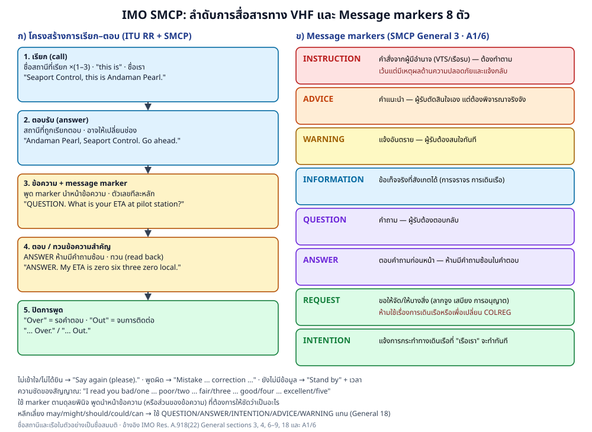
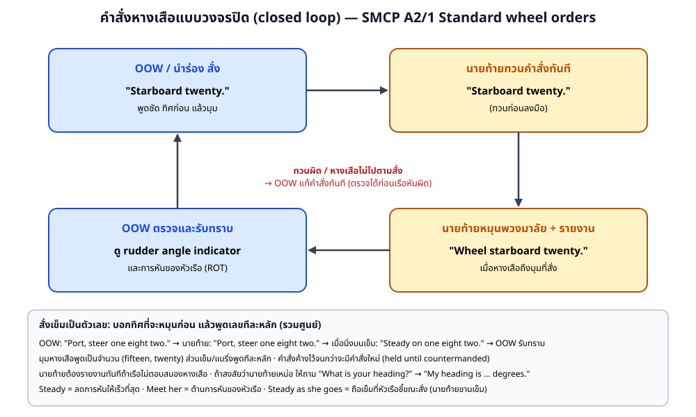

# 1.7 Use the IMO Standard Marine Communication Phrases and Use English in Written and Oral Form

> สมุดบันทึกการฝึก OOW · TIRAPHONG NANTAPAN
> สมรรถนะตาม STCW A-II/1: *English language — Adequate knowledge of the English language to enable the officer to use charts and other nautical publications, to understand meteorological information and messages concerning ship's safety and operation, to communicate with other ships, coast stations and VTS centres and to perform the officer's duties also with a multilingual crew, including the ability to use and understand the IMO Standard Marine Communication Phrases (IMO SMCP)*
> อ้างอิงหลัก: IMO Res. **A.918(22)** *IMO Standard Marine Communication Phrases* (2001); SOLAS V/14.3–14.4 (working language); IMO Model Course **3.17** *Maritime English*; ITU Radio Regulations (Appendix 14 – phonetic alphabet); International Code of Signals; IMO Res. **A.1158(32)** *Guidelines for Vessel Traffic Services* (2021 — ยกเลิกและแทน A.857(20) ที่ SMCP อ้างถึงตอนออกปี 2001)

---

## 0. ทำไมภาษาอังกฤษถึงเป็นเรื่องความปลอดภัย

อุบัติเหตุหลายครั้งเกิดจาก "การเข้าใจผิด" — นำร่องพูด "port" นายท้ายได้ยิน "starboard", เรือสองลำตกลงทาง VHF แต่ต่างคนต่างเข้าใจคนละแบบ, ลูกเรือหลายชาติอ่านป้ายเตือนไม่ออก IMO จึงพัฒนา **SMCP** — ชุดวลีมาตรฐานภาษาอังกฤษแบบ "ง่าย สั้น ไม่กำกวม" ใช้ทั่วโลก และ STCW กำหนดให้ OOW ใช้ได้

**SOLAS V/14.3–14.4**
- บริษัทต้องกำหนด **ภาษาทำงาน (working language)** บนเรือและบันทึกในสมุดปูมเรือ ลูกเรือทุกคนต้องเข้าใจ คำสั่งและคำแนะนำต้องแปลเป็นภาษาทำงาน
- บนเรือที่ใช้ SOLAS Chapter I **ต้องใช้ภาษาอังกฤษบนสะพานเดินเรือ** สำหรับการสื่อสาร bridge-to-bridge และ bridge-to-shore และระหว่างนำร่องกับลูกเรือในยามบนสะพาน **เว้นแต่ผู้สื่อสารใช้ภาษาอื่นร่วมกันได้**

---

## 1. โครงสร้างของ IMO SMCP

| ส่วน | เนื้อหา |
|---|---|
| **General** | ขั้นตอนการพูด ตัวอักษรโฟเนติก ตัวเลข message markers คำตอบมาตรฐาน คำสั่งจัดการสื่อสาร (corrections, readiness, repetition) วิธีพูดตำแหน่ง แบริ่ง เข็ม เวลา ฯลฯ — ในตัวบทแบ่งเป็น 18 หัวข้อ: Procedure, Spelling, Message markers, Responses, Distress/urgency/safety signals, Standard organizational phrases, Corrections, Readiness, Repetition, Numbers, Positions, Bearings, Courses, Distances, Speed, Time, Geographical names, Ambiguous words และมี **Glossary** (ศัพท์ทั่วไป + ศัพท์ VTS) |
| **Part A — A1 External communication phrases** | A1/1 Distress traffic (1.1 distress communications · 1.2 search and rescue communications · 1.3 requesting medical assistance) · A1/2 Urgency traffic · A1/3 Safety communications (3.1 meteorological and hydrological conditions · 3.2 navigational warnings · 3.3 environmental protection communications) · A1/4 Pilotage (pilot request · embarking/disembarking pilot · tug request) · A1/5 Specials (helicopter operations · ice-breaker operations) · A1/6 **VTS standard phrases** |
| **Part A — A2 On-board communication phrases** | A2/1 **Standard wheel orders** · A2/2 **Standard engine orders** · A2/3 **Pilot on the bridge** (propulsion system · manoeuvring · radar · draft and air draft · anchoring · tug assistance · berthing and unberthing) |
| **Part B — On-board communication phrases** | B1 Operative ship handling (ทอดสมอ ผูกเรือ ลากจูง ฯลฯ — เริ่มด้วย B1/1 **Handing over the watch** และ B1/2 Trim, list and stability) · B2 Safety on board (ดับเพลิง ซ้อม อุบัติเหตุ) · B3 Cargo and cargo handling · B4 Passenger care |

> Part A คือส่วนที่ STCW บังคับให้ต้องใช้ได้ ส่วน Part B ใช้ตามความเหมาะสม

---

## 2. หลักการพูดตาม SMCP (General)

### 2.1 Procedure

- พูด **ช้า ชัด** ใช้ประโยคสั้น หลีกเลี่ยงคำเชื่อมยาว ๆ
- **ระบุตัวตนเสมอ** — "This is MV Andaman Pearl" และเรียกชื่อผู้รับ
- ใช้ **message markers** เมื่อจำเป็นต้องชัดเจนว่าข้อความเป็นอะไร (บท 1.2.1-C)
- **ทวนข้อความสำคัญ** (read back)
- หลีกเลี่ยงคำกำกวม: **may, might, should, could, can** — แทนด้วยรูปที่ชัด เช่น "QUESTION. Do I have permission to enter the fairway?" ไม่ใช่ "May I enter?"; ตอบ "ANSWER. You have permission to…"
- ไม่ใช้คำว่า "OK" ในการตอบรับคำสั่งสำคัญ — ให้ทวนคำสั่ง
- ใช้ **"I say again"** เมื่อพูดซ้ำ, **"Mistake… correction…"** เมื่อพูดผิด, **"Stand by"** เมื่อให้รอ, **"Over"** จบการพูดรอคำตอบ, **"Out"** จบการสนทนา
- จดเพิ่มจากตัวบท SMCP General 6–9:
  - **ถามความชัดของสัญญาณ** "How do you read (me)?" — ตอบ "I read you bad/one · poor/two · fair/three · good/four · excellent/five"
  - **ขอให้อยู่ช่องเดิม** "Stand by on VHF Channel …" → ตอบ "Standing by on VHF Channel …" · **ขอให้เปลี่ยนช่อง** "Advise (you) change to VHF Channel …" → ตอบ "Changing to VHF Channel …"
  - **ความพร้อม** "I am / I am not ready to receive your message."
  - **ย้ำส่วนสำคัญ** ใช้คำว่า "Repeat" กลางข้อความ เช่น "Do not overtake — repeat — do not overtake." ส่วนเมื่อ **ฟังไม่ชัด** ให้ขอ "Say again (please)."
  - ตัวบทย้ำว่าขั้นตอนวิทยุโทรศัพท์ทุกอย่างต้องเป็นไปตาม **ITU Radio Regulations** (SMCP เป็น "เนื้อความ" ภายในการเรียก–ตอบตามกฎ ITU)

### 2.2 ตัวอักษรโฟเนติก (Phonetic alphabet)

| | | | | | |
|---|---|---|---|---|---|
| A **Alfa** | B **Bravo** | C **Charlie** | D **Delta** | E **Echo** | F **Foxtrot** |
| G **Golf** | H **Hotel** | I **India** | J **Juliett** | K **Kilo** | L **Lima** |
| M **Mike** | N **November** | O **Oscar** | P **Papa** | Q **Quebec** | R **Romeo** |
| S **Sierra** | T **Tango** | U **Uniform** | V **Victor** | W **Whiskey** | X **X-ray** |
| Y **Yankee** | Z **Zulu** | | | | |

### 2.3 ตัวเลข (Figures)

| ตัวเลข | ออกเสียง | ตัวเลข | ออกเสียง |
|---|---|---|---|
| 0 | ZERO (ZEERO) | 5 | FIVE (FIFE) |
| 1 | ONE (WUN) | 6 | SIX |
| 2 | TWO (TOO) | 7 | SEVEN (SEV-EN) |
| 3 | THREE (TREE) | 8 | EIGHT (AIT) |
| 4 | FOUR (FOW-ER) | 9 | NINE (NIN-ER) |
| . | DECIMAL (หรือ POINT) — ICS กำหนดการออกเสียง DAY-SEE-MAL | 1000 | THOUSAND (TOUSAND) |

- พูดตัวเลข **ทีละหลัก** — "one-five-zero degrees" (150°), "two decimal five miles" (2.5')
- ยกเว้นคำสั่งหางเสือที่ใช้ตัวเลขแบบรวม (port ten, starboard twenty)

### 2.4 วิธีพูดข้อมูลการเดินเรือ

| ข้อมูล | วิธีพูด | ตัวอย่าง |
|---|---|---|
| **Position** (lat/long) | องศาและลิปดา (ทศนิยม) N/S E/W | "Position: one three degrees zero three decimal zero minutes North, one zero zero degrees four eight decimal zero minutes East" |
| **Position** (bearing/distance) | แบริ่ง **จาก** จุดอ้างอิง | "Position: bearing two two five degrees from Horsburgh Lighthouse, distance three miles" (แบริ่งจากวัตถุไปหาเรา) |
| **Bearing** | 3 หลัก องศาจริง | "Bearing zero four five degrees" |
| **Course** | 3 หลัก องศาจริง | "Course one five nine degrees" |
| **Heading** | 3 หลัก | "Heading zero nine zero degrees" |
| **Wind** | ทิศที่ลม**มาจาก** | "Wind north-east, force five" |
| **Distance** | nautical miles / cables (1 cable = 1/10 nm) — **ต้องบอกหน่วยทุกครั้ง** | "Distance two decimal five miles" |
| **Speed** | knots — ถ้าไม่ระบุ หมายถึง **ความเร็วผ่านน้ำ**; ถ้าเป็นความเร็วเทียบพื้นให้พูด **"ground speed"** | "Speed one three decimal five knots" · "Ground speed one two knots" |
| **Time** | 24 ชั่วโมง ระบุ UTC/local | "Time one four three zero UTC" |
| **Geographical names** | ใช้ชื่อตามแผนที่/Sailing Directions | ถ้าผู้ฟังไม่เข้าใจชื่อ ให้บอกเป็น lat/long แทน |
| **Relative bearing** | องศาจากหัวเรือ มักอ้างกราบซ้าย/ขวา | "Buoy zero three zero degrees on your port bow" |

### 2.5 คำตอบมาตรฐาน (Standard responses)

- คำถามแบบ yes/no ตอบ **"Yes, …"** หรือ **"No, …"** แล้วตามด้วยประโยคเต็ม: "QUESTION. Is the pilot on board? — ANSWER. Yes, the pilot is on board."
- ถ้าไม่มีข้อมูล: **"No information."**
- ถ้าไม่เข้าใจ: **"I do not understand. Please say again."**
- ปฏิเสธการทำตามคำสั่ง: **"I am unable to comply."** (แล้วให้เหตุผล)
- รับทราบ: **"Received."** หรือ **"Understood."**

**ตามตัวบท SMCP General 4 (Responses) — จดเพิ่ม**
- ข้อมูลยังไม่พร้อมแต่จะได้เร็ว ๆ นี้: **"Stand by"** ตามด้วยเวลาที่จะได้ข้อมูล เช่น "Stand by — two minutes."
- ตอบรับ INSTRUCTION หรือ ADVICE: ถ้าจะทำ **"I will / I can …"** ตามด้วยคำสั่ง/คำแนะนำเต็ม ๆ; ถ้าไม่ทำ **"I will not / I cannot …"** ตามด้วยข้อความเต็ม — เช่น ADVICE. Do not overtake the vessel North of you. → "I will not overtake the vessel North of me."
- คำตอบของคำสั่งและคำถามที่สำคัญเป็นพิเศษ (เช่นคำสั่งหางเสือ) ให้ใช้ถ้อยคำตามวลีในหมวดนั้นโดยตรง
- หมายเหตุ: "I do not understand", "I am unable to comply", "Received/Understood" เป็นวลีที่ใช้กันทั่วไปและอยู่ในวลีหมวดต่าง ๆ แต่รูปแบบที่หมวด General กำหนดไว้คือ "Say again (please)" (ฟังไม่ชัด), "No information" และ "I will not / I cannot …" — ตอนสอบควรตอบตามตัวบทก่อน

### 2.6 Message markers 8 ตัว และโครงสร้างการเรียก–ตอบทาง VHF



*ภาพที่ 1.7-1 ลำดับการเรียก ตอบ ส่งข้อความ และปิดการพูดทาง VHF (ซ้าย) และความหมายของ message markers 8 ตัวพร้อมข้อจำกัดการใช้ (ขวา) ตาม SMCP General 3 และ A1/6*

| Marker | ใช้เมื่อ | ข้อควรระวังตามตัวบท |
|---|---|---|
| **INSTRUCTION** | ผู้ส่งต้องการให้ผู้รับทำตามข้อกำหนด (regulation) | ผู้ส่งต้องมีอำนาจเต็ม เช่น VTS หรือเรือรบ — ผู้รับต้องทำตาม เว้นแต่มีเหตุผลด้านความปลอดภัยที่ขัดกัน ซึ่งต้องแจ้งกลับผู้ส่ง |
| **ADVICE** | แนะนำ (recommendation) | ผู้รับตัดสินใจเอง แต่ต้องพิจารณาอย่างรอบคอบ |
| **WARNING** | แจ้งอันตราย | ผู้รับต้องให้ความสนใจทันที ผลที่ตามมาเป็นความรับผิดชอบของผู้รับ |
| **INFORMATION** | ข้อเท็จจริงที่สังเกตได้ | มักใช้กับข้อมูลการเดินเรือและการจราจร |
| **QUESTION** | คำถาม | ขจัดข้อสงสัยว่าเป็นคำถามหรือคำบอกเล่า ผู้รับต้องตอบ |
| **ANSWER** | ตอบคำถามก่อนหน้า | **ห้ามมีคำถามซ้อน** ในคำตอบ |
| **REQUEST** | ขอให้จัดหา/ดำเนินการ (ลากจูง เสบียง การอนุญาต) | **ห้ามใช้กับเรื่องการเดินเรือหรือเพื่อเปลี่ยนแปลงการปฏิบัติตาม COLREG** |
| **INTENTION** | แจ้งการกระทำทางเดินเรือที่ "เรือเรา" จะทำทันที | จำกัดเฉพาะการกระทำของเรือผู้ส่งเอง |

- การใช้ marker เป็นดุลยพินิจของเจ้าหน้าที่ฝั่งหรือนายประจำเรือ ถ้าใช้ ให้พูด **นำหน้า** ข้อความ (หรือส่วนของข้อความ) นั้น
- SMCP อ้างแนวทาง VTS ของ IMO ว่าข้อความที่ส่งถึงเรือควรชัดเจนว่าเป็น information, advice, warning หรือ instruction (ตอนออก SMCP คือ A.857(20) ซึ่งปัจจุบันถูกแทนด้วย Res. A.1158(32) — ตรวจถ้อยคำกับฉบับใหม่)

---

## 3. Part A1 — External communication phrases (ตัวอย่างที่ต้องจำ)

### 3.1 Distress traffic (A1/1) — ตัวอย่างวลีตามประเภทเหตุ

| เหตุ | วลีตัวอย่าง |
|---|---|
| **Fire, explosion** | "I am on fire (after explosion)." · "Where is the fire?" · "Fire is in engine room / cargo hold." · "Is the fire under control?" · "Fire not under control." |
| **Flooding** | "I am flooding below water line." · "Flooding is under control." · "I require pumps." |
| **Collision** | "I have collided with MV … / unknown vessel / object." · "I have damage above/below water line." |
| **Grounding** | "I am aground." · "I expect to refloat at … UTC." · "I require tug assistance." |
| **List / danger of capsizing** | "I have a list of 20 degrees to port." · "I am in danger of capsizing." |
| **Sinking** | "I am sinking." |
| **Disabled and adrift** | "I am not under command." · "I am drifting at 2 knots to north-east." · "I require tow." |
| **Armed attack / piracy** | "I am under attack by pirates." · "Pirates are on board." |
| **Undesignated distress** | "I am in distress. I require immediate assistance." |
| **Abandoning vessel** | "I am abandoning vessel." · "… persons are in the lifeboats/liferafts." |
| **Person overboard** | "Person overboard at position … Please keep sharp look-out." |
| **Search and rescue** | "I am proceeding to your assistance. ETA …" · "Search area is …" · "Survivor(s) in sight." |

### 3.2 Urgency traffic (A1/2)

- **Medical assistance**: "PAN PAN … I require medical assistance." · "I have a person with severe injuries / burns." · "I require helicopter with doctor." · "Request medical advice." (ผ่าน TMAS)
- "PAN PAN … I have engine breakdown in position … I require tug."

### 3.3 Safety communications (A1/3)

- **Navigational warnings**: "SECURITE … Light on Buoy No. 7 unlit." · "Dangerous wreck in position …" · "Drilling rig in position …" · "Mine-clearance operations in progress …"
- **Meteorological**: "Tropical storm … with centre in position …, moving …" · "Visibility … miles" · "Wind veering to …" · "Gale warning."
- **Environmental protection (A1/3.3)**: "I have spilled … tonnes of crude oil in position …"
- **Pilot request (A1/4.1 — หมวด A1/4 Pilotage ซึ่งมี A1/4.3 Tug request ด้วย)**: "I require a pilot." · "Where is the pilot boarding position?" · "Pilot will board at … UTC." · "Rig pilot ladder on starboard side, 2 metres above water."

### 3.4 VTS standard phrases (A1/6)

- "Port Control, this is MV Andaman Pearl. INFORMATION. My ETA at pilot station is 1430 local time."
- "QUESTION. What is your present maximum draft?" — "ANSWER. My present maximum draft is nine decimal six metres."
- "ADVICE. Do not overtake in the fairway."
- "INSTRUCTION. Proceed to anchorage Alfa."
- "WARNING. Vessel leaving berth number three."
- "INTENTION. I will reduce speed to one zero knots."
- "REQUEST. I require berthing instructions."

A1/6 แบ่งเป็น 6.1 วลีขอ/ให้ข้อมูลเพื่อสร้างภาพการจราจร (ชื่อเรือ call sign ธง ตำแหน่ง เข็ม ความเร็ว ท่าปลายทาง ETA/ETD กินน้ำลึก freeboard air draft ฯลฯ) · 6.2 วลีให้บริการ VTS (information, navigational assistance, traffic organization) · 6.3 การส่งต่อไปยัง VTS อื่น · 6.4 การสื่อสารกับหน่วยฉุกเฉินและหน่วยที่เกี่ยวข้อง — ตัวอย่างวลีที่ใช้บ่อย: "What is your air draft?" — "My air draft is … metres." · "What is your ETA in position …?" — "My ETA is … UTC."

### 3.5 การสื่อสารระหว่างเรือ (ship-to-ship) — ด้วยความระมัดระวัง

```
A: "Vessel in position bearing zero four zero degrees, distance six miles from me,
    on course two five five, this is container vessel Andaman Pearl. Over."
B: "Andaman Pearl, this is bulk carrier Ocean Star. Over."
A: "Ocean Star, Andaman Pearl. INTENTION. I will alter course to starboard
    to pass astern of you. Over."
B: "Andaman Pearl, Ocean Star. Understood. I will keep my course and speed. Over."
A: "Ocean Star, Andaman Pearl. Received. Out."
```
(ข้อสังเกต: ใช้เพื่อ **แจ้งเจตนาที่สอดคล้อง COLREG** ระบุตัวเรือให้แน่ชัดด้วยตำแหน่ง/ชื่อจาก AIS — ไม่ใช้ตกลงทำสิ่งที่ขัดกฎ)

---

## 4. Part A2 — On-board communication phrases

### 4.1 Standard wheel orders (A2/1)

| คำสั่ง | ความหมาย |
|---|---|
| **Midships** | หางเสือตรงกลาง (0°) |
| **Port five / ten / fifteen / twenty / twenty-five** | หางเสือซ้าย 5° / 10° / 15° / 20° / 25° |
| **Hard-a-port** | หางเสือซ้ายสุด |
| **Starboard five … twenty-five / Hard-a-starboard** | ด้านขวาเช่นเดียวกัน |
| **Ease to five / ten / fifteen / twenty** | ลดมุมหางเสือลงเหลือ … |
| **Meet her** | ใช้หางเสือต้าน (check) การหันของหัวเรือขณะกำลังเลี้ยว (SMCP A2/1 ข้อ 9) |
| **Steady** | ลดการหันของหัวเรือให้เร็วที่สุดจนหยุดหัน (หยุดการหมุน) |
| **Steady as she goes** | ถือเข็มที่หัวเรือชี้อยู่ ณ ขณะสั่ง (นายท้ายตอบด้วยเข็มที่ถือ เช่น "Steady as she goes — course one five nine") |
| **Keep the buoy / mark / beacon … on port/starboard side** | ให้ทุ่น/เครื่องหมายอยู่ทางซ้าย/ขวา |
| **Report if she does not answer the wheel** | รายงานถ้าเรือไม่ตอบสนองหางเสือ |
| **Finished with wheel / No more steering** | เลิกถือท้าย |
| **Steer one five nine** (ตัวเลขทีละหลัก) | ถือเข็ม 159° — นายท้ายทวน "Steer one five nine" และรายงานเมื่อถึง "Steady on one five nine" · ตามตัวบทให้ **บอกทิศที่จะหมุนก่อน** เช่น "Port, steer one eight two" / "Starboard, steer zero eight two" (พูดศูนย์ด้วย) และผู้สั่งต้อง **รับทราบ** คำรายงานของนายท้าย |
| **Steer on … buoy / mark / beacon** | ถือหัวเรือตรงไปยังทุ่น/เครื่องหมายที่กำหนด (ผู้สั่งรับทราบคำตอบ) |
| **What is your heading?** | ถามเมื่อสงสัยว่านายท้ายไม่ตั้งใจ — นายท้ายตอบ "My heading is … degrees." |
| **Nothing to port / Nothing to starboard** | ห้ามให้หัวเรือหันเลยไปทางซ้าย/ขวาของเข็มที่ถือ |

> **ทุกคำสั่งต้องทวน (repeat)** โดยนายท้าย และ OOW/นำร่องต้องตรวจว่าทำถูกต้อง (rudder angle indicator) และนายท้ายรายงานเมื่อหางเสือถึงมุมที่สั่ง: "Wheel is port twenty."
>
> จดเพิ่มจากตัวบท A2/1: คำสั่งหางเสือ **คงไว้จนกว่าจะมีคำสั่งใหม่** (held until countermanded) · OOW ต้องดูให้คำสั่งถูกปฏิบัติ **ถูกต้องและทันที** · นายท้ายต้อง **รายงานทันที** ถ้าเรือไม่ตอบสนองหางเสือ · มุมหางเสือพูดเป็นจำนวน ("fifteen", "twenty") ไม่พูดทีละหลัก (SMCP General 10)



*ภาพที่ 1.7-2 คำสั่งหางเสือแบบวงจรปิด: สั่ง → นายท้ายทวน → หมุนพวงมาลัยและรายงานเมื่อหางเสือถึงมุม → OOW ตรวจ rudder angle indicator และรับทราบ พร้อมรูปแบบการสั่งเข็มเป็นตัวเลข*

### 4.2 Standard engine orders (A2/2)

| คำสั่ง |
|---|
| **Full ahead** · **Half ahead** · **Slow ahead** · **Dead slow ahead** |
| **Stop engine** |
| **Dead slow astern** · **Slow astern** · **Half astern** · **Full astern** |
| **Emergency full ahead / astern** |
| **Stand by engine** · **Engine is on stand-by** |
| **Finished with engine** (FWE) |
| (สำหรับ thrusters) **Bow thruster full to port / starboard** · **Stop bow thruster** (ถ้อยคำตามตัวบท: "Bow thruster full / half to port / starboard", "Stern thruster full / half to port / starboard", "**Bow / stern thruster stop**") |
| (เรือสองใบจักร) เติม **"both"** เมื่อสั่งทั้งสองเครื่อง เช่น "Full ahead both", "Slow astern both" แต่ใช้ **"Stop all engines"**; สั่งแยกเครื่องให้ระบุข้าง เช่น "Full ahead starboard", "Half astern port" |

ผู้รับทวนคำสั่ง แล้วรายงานเมื่อทำแล้ว: "Engine is half ahead."

ความหมายตามตัวบท: **Stand by engine** = ห้องเครื่องพร้อมเต็มที่สำหรับการบังคับเรือ และมีคนประจำสะพานเพื่อส่งต่อคำสั่งเครื่อง · **Finished with engines** = ไม่ต้องใช้เครื่องบังคับเรืออีก · ผู้ที่ทำงานกับ telegraph ต้องทวนทุกคำสั่ง และ OOW ดูให้ปฏิบัติถูกต้องทันที (A2/2)

### 4.3 Pilot on the bridge (A2/3)

- "Pilot, this is the pilot card and the wheelhouse poster."
- "The draft is nine decimal six metres forward and aft." · "The air draft is four one decimal five metres."
- "Rudder is hard over to hard over in … seconds." · "The ship is right-handed (fixed pitch propeller)."
- "Bow thruster is available / not available."
- "Pilot, what is your intention?" · "Pilot, please confirm the course to steer."
- "Captain, the pilot says …"

A2/3 ในตัวบทแบ่งหัวข้อ: 3.1 ระบบขับเคลื่อน (ดีเซล/เทอร์ไบน์ ใบจักร thrusters) · 3.2 การบังคับเรือ (เช่น "How long does it take from hard-a-port to hard-a-starboard?") · 3.3 เรดาร์ · 3.4 กินน้ำลึกและ air draft · 3.5 การทอดสมอ · 3.6 การใช้เรือลากจูง · 3.7 การเข้า/ออกท่า — ใช้คู่กับ pilot card ตาม A.601(15) และการแลกเปลี่ยนข้อมูล Master–Pilot

---

## 5. ภาษาอังกฤษในการอ่านเอกสารและข้อมูลอุตุนิยมวิทยา

### 5.1 การอ่านแผนที่และสิ่งพิมพ์

OOW ต้องอ่าน Sailing Directions, List of Lights, ALRS, NMs, IMO publications ภาษาอังกฤษได้คล่อง — ตัวย่อที่พบบ่อย: *conspic* (conspicuous), *PA* (position approximate), *ED* (existence doubtful), *Rep* (reported), *Obstn* (obstruction), *Wk* (wreck), *Fl* (flashing), *Occas* (occasional), *T* (temporary), *P* (preliminary), *vis* (visible), *dist* (distance), *approx* (approximately), *fm* (fathom), *Ldg* (leading) ฯลฯ

### 5.2 การเข้าใจข้อมูลอุตุนิยมวิทยา (NAVTEX/SafetyNET/Weather fax)

| ศัพท์ | ความหมาย |
|---|---|
| **Gale** | Beaufort 8 (34–40 kn) |
| **Severe gale** | Beaufort 9 (41–47 kn) |
| **Storm / Violent storm / Hurricane force** | Beaufort 10 / 11 / 12 |
| **Veering** | ลมเปลี่ยนทิศตามเข็มนาฬิกา (เช่น S → SW → W) |
| **Backing** | ลมเปลี่ยนทิศทวนเข็มนาฬิกา |
| **Imminent** | ภายใน 6 ชั่วโมง (ในศัพท์พยากรณ์ของ UK Met Office) |
| **Soon** | 6–12 ชั่วโมง |
| **Later** | มากกว่า 12 ชั่วโมง |
| **Visibility: good / moderate / poor / very poor (fog)** | > 5 nm / 2–5 nm / 1000 m – 2 nm / < 1000 m (ศัพท์ตามแบบ Met Office) |
| **Sea state: slight / moderate / rough / very rough / high** | ความสูงคลื่นตาม Douglas scale (ตาม WMO sea state code: smooth 0.1–0.5 m · slight 0.5–1.25 m · moderate 1.25–2.5 m · rough 2.5–4 m · very rough 4–6 m · high 6–9 m · very high 9–14 m · phenomenal > 14 m) |
| **Tropical depression / storm / typhoon** | ความรุนแรงพายุหมุนเขตร้อน (บท 1.1.7) |

**ตัวอย่าง NAVTEX จำลอง**

```
ZCZC FA31
110230 UTC DEC 26
MALAYSIA NAVAREA XI ... COASTAL WARNING 123/26
SOUTH CHINA SEA. OFF TERENGGANU.
DRILLING RIG XYZ MOVED TO 05-48.0N 103-27.0E.
WIDE BERTH REQUESTED. 500 METRES SAFETY ZONE.
CANCEL 118/26.
NNNN
```
**แปลความ:** เวลา 0230 UTC 11 ธ.ค. — คำเตือนชายฝั่งหมายเลข 123/26 — ทะเลจีนใต้ นอกตรังกานู — แท่นขุดเจาะ XYZ ย้ายไปที่พิกัดดังกล่าว — ขอให้ผ่านห่าง ๆ — มีเขตปลอดภัย 500 เมตร — ยกเลิกคำเตือน 118/26 (ข้อความสมมติ)

---

## 6. การสื่อสารกับลูกเรือหลายชาติ (Multilingual crew)

- ใช้ **ภาษาทำงานที่กำหนด** (มักเป็นอังกฤษ) และ **SMCP Part B** สำหรับงานบนดาดฟ้า
- พูดช้า ประโยคสั้น ใช้คำง่าย หลีกเลี่ยงสำนวน (idioms) คำแสลง ตัวย่อที่ไม่เป็นมาตรฐาน
- **ตรวจความเข้าใจ** — ให้ผู้ฟังทวนสิ่งที่เข้าใจ ไม่ใช่ถามแค่ "Understand?" (คำตอบ "Yes" อาจไม่ได้แปลว่าเข้าใจ)
- ใช้ **ภาษาท่าทางและสัญญาณมือมาตรฐาน** (เช่นสัญญาณเครน การลากจูง การผูกเรือ)
- ใช้ **ภาพ ป้าย แผนผัง** ในการ briefing
- ระวังความต่างทางวัฒนธรรม (การพูดตรง/อ้อม การเกรงใจผู้อาวุโส)
- ประกาศสำคัญ (ความปลอดภัย) อาจต้องแปลหลายภาษา

---

## 7. ภาษาอังกฤษแบบเขียน (Written English)

### 7.1 บันทึกในสมุดปูมเรือ (Deck log) — ตัวอย่าง

```
0000  Took over the watch. Position 06°45.7'N 103°08.3'E by GPS, checked by radar.
      Co 159°(T) by gyro, gyro error 1° high. Speed 13.4 kn. Wind NE 5, sea moderate,
      vis good. Barometer 1009.5 hPa.
0012  Called Master due tanker on port bow CPA 0.6'.
0015  Tanker altered to starboard, CPA 2.1'. Master informed.
0200  Manual steering tested, found in order.
0215  Compass error by azimuth of star Capella: 1.0° high.
0400  Handed over the watch to C/O. All navigation lights burning brightly.
```

### 7.2 รายงานเหตุการณ์ (Incident report) — โครงร่าง

- Date/time (UTC & LT), position, weather
- Description of the incident (what happened, sequence)
- Immediate actions taken
- Damage/injuries/pollution
- Persons notified (Master, Company, authorities)
- Attachments (log extracts, ECDIS/VDR data, photos)
- Signature

### 7.3 Note of Protest (คำแถลงต่อเจ้าหน้าที่เพื่อสงวนสิทธิ์) — ทำโดยนายเรือ เมื่อเกิดเหตุที่อาจเกิดความเสียหายต่อเรือหรือสินค้า (เช่น อากาศเลวรุนแรง) OOW ช่วยเตรียมข้อมูลจากสมุดปูมเรือ

---

## 8. ตัวอย่างบทสนทนาจำลองแบบเต็ม — ขอนำร่องและเข้าท่า

```
Ship : "Seaport Control, Seaport Control, this is Andaman Pearl,
        Andaman Pearl, on channel one two. Over."
Port : "Andaman Pearl, Seaport Control. Go ahead. Over."
Ship : "Seaport Control, Andaman Pearl. INFORMATION. My position: bearing one eight zero
        degrees from Point Alfa Lighthouse, distance eight miles. My ETA at pilot
        station: zero six three zero local time. Maximum draft nine decimal six metres.
        REQUEST. I require a pilot. Over."
Port : "Andaman Pearl, Seaport Control. ANSWER. Pilot will board at zero six four five
        local time at pilot boarding position. INSTRUCTION. Rig pilot ladder on
        starboard side, one decimal five metres above water. Over."
Ship : "Seaport Control, Andaman Pearl. Pilot boarding zero six four five. Pilot ladder
        starboard side, one decimal five metres above water. Over."
Port : "Andaman Pearl, Seaport Control. Correct. Out."
```
(ชื่อสถานี "Seaport Control" และ "Point Alfa Lighthouse" เป็นชื่อสมมติเพื่อฝึกรูปแบบภาษา — ช่อง VHF และข้อมูลจริงต้องดูจาก ALRS Vol 6 และ Sailing Directions)

---

## 9. คำถามสอบปากเปล่า / สัมภาษณ์ — English & SMCP (ตัวอย่างที่กรรมการมักให้ตอบเป็นภาษาอังกฤษ)

**Q:** What is the IMO SMCP and why was it introduced?
**A (แนว):** The IMO Standard Marine Communication Phrases, adopted by Resolution A.918(22), is a set of standardized English phrases for external and on-board communications. It was introduced to reduce misunderstandings caused by language barriers and to improve safety of navigation.

**Q:** Name the eight message markers.
**A:** Instruction, Advice, Warning, Information, Question, Answer, Request, Intention.

**Q:** What is the difference between "Steady" and "Steady as she goes"?
**A:** "Steady" means reduce the swing of the ship as rapidly as possible (stop the ship's head from turning). "Steady as she goes" means steer the course on which the ship's head is pointing at the moment the order is given; the helmsman reports the course.

**Q:** How do you report your position by bearing and distance?
**A:** By giving the bearing from a charted object to the ship and the distance, for example: "Position: bearing two two five degrees from Horsburgh Lighthouse, distance three miles."

**Q:** What is the difference between veering and backing?
**A:** Veering is a clockwise change in wind direction; backing is an anti-clockwise change.

**Q:** According to SOLAS, which language must be used on the bridge?
**A:** English shall be used on the bridge for bridge-to-bridge and bridge-to-shore safety communications as well as for communications on board between the pilot and bridge watchkeeping personnel, unless those directly involved in the communication speak a common language other than English (SOLAS V/14.4).

**Q:** Why should "may" and "can" be avoided in VTS communications?
**A:** Because they are ambiguous — they could mean permission or possibility. SMCP uses clear forms such as "QUESTION. Do I have permission to…?" and "ANSWER. You have permission to…"

**Q:** How do you pronounce the number 9 and the decimal point?
**A:** "NINER" and "DECIMAL".

**ถาม (ไทย):** ทำไมต้องทวนคำสั่งหางเสือ
**แนวตอบ:** เพื่อยืนยันว่าได้ยินและเข้าใจถูกต้อง (closed-loop) ผู้สั่งตรวจได้ทันทีถ้าผิด แล้วนายท้ายรายงานเมื่อหางเสือถึงมุมที่สั่ง

**Q:** What is the meaning of "Meet her"?
**A:** Check the swing of the ship's head in a turn — the helmsman applies opposite rudder to stop the swing (SMCP A2/1).

**Q:** How should the OOW order a course of 082° to be steered?
**A:** State the direction to turn the wheel first, then each digit separately including zero: "Starboard, steer zero eight two." The helmsman repeats the order and, when steady, reports "Steady on zero eight two"; the OOW acknowledges.

**Q:** A VTS station gives you an ADVICE you do not intend to follow. How do you respond according to SMCP?
**A:** Respond in the negative with the advice in full, using "I will not …" or "I cannot …", for example "I will not overtake the vessel north of me." An INSTRUCTION must be followed unless there are contradictory safety reasons, which must be reported to the sender.

**Q:** Why must REQUEST not be used for navigational matters?
**A:** SMCP restricts REQUEST to asking for something to be arranged or provided (tugs, stores, permission). It must not be used for navigation or to modify the COLREGs; navigational actions of your own ship are announced with INTENTION.

**Q:** When speed is given without any notation, what does it mean?
**A:** Speed through the water. Speed over the ground must be stated as "ground speed".

**Q:** How do you order the engines of a twin-screw ship and the bow thruster?
**A:** Add "both" for orders affecting both shafts, e.g. "Half ahead both", but use "Stop all engines"; for one engine name it, e.g. "Slow astern port". Thruster orders: "Bow thruster full (or half) to port/starboard" and "Bow thruster stop".

**ถาม (ไทย):** Message marker มีกี่ตัว ตัวไหนห้ามใช้เรื่องการเดินเรือ และ ANSWER มีข้อห้ามอะไร
**แนวตอบ:** 8 ตัว — Instruction, Advice, Warning, Information, Question, Answer, Request, Intention; REQUEST ห้ามใช้กับการเดินเรือหรือเพื่อเปลี่ยนการปฏิบัติตาม COLREG; ANSWER ห้ามมีคำถามซ้อนอยู่ในคำตอบ และพูด marker นำหน้าข้อความ

**ถาม (ไทย):** SMCP ส่วน A1 แบ่งเป็นหมวดอะไรบ้าง
**แนวตอบ:** A1/1 Distress traffic, A1/2 Urgency traffic, A1/3 Safety communications (รวม environmental protection), A1/4 Pilotage, A1/5 Specials (helicopter, ice-breaker), A1/6 VTS standard phrases — ส่วน A2 คือ wheel orders, engine orders และ pilot on the bridge

---

*ก่อนหน้า ← [1.6 Search and Rescue](1.6-search-and-rescue.md) · ถัดไป → [1.8 Visual Signalling](1.8-visual-signalling.md)*
