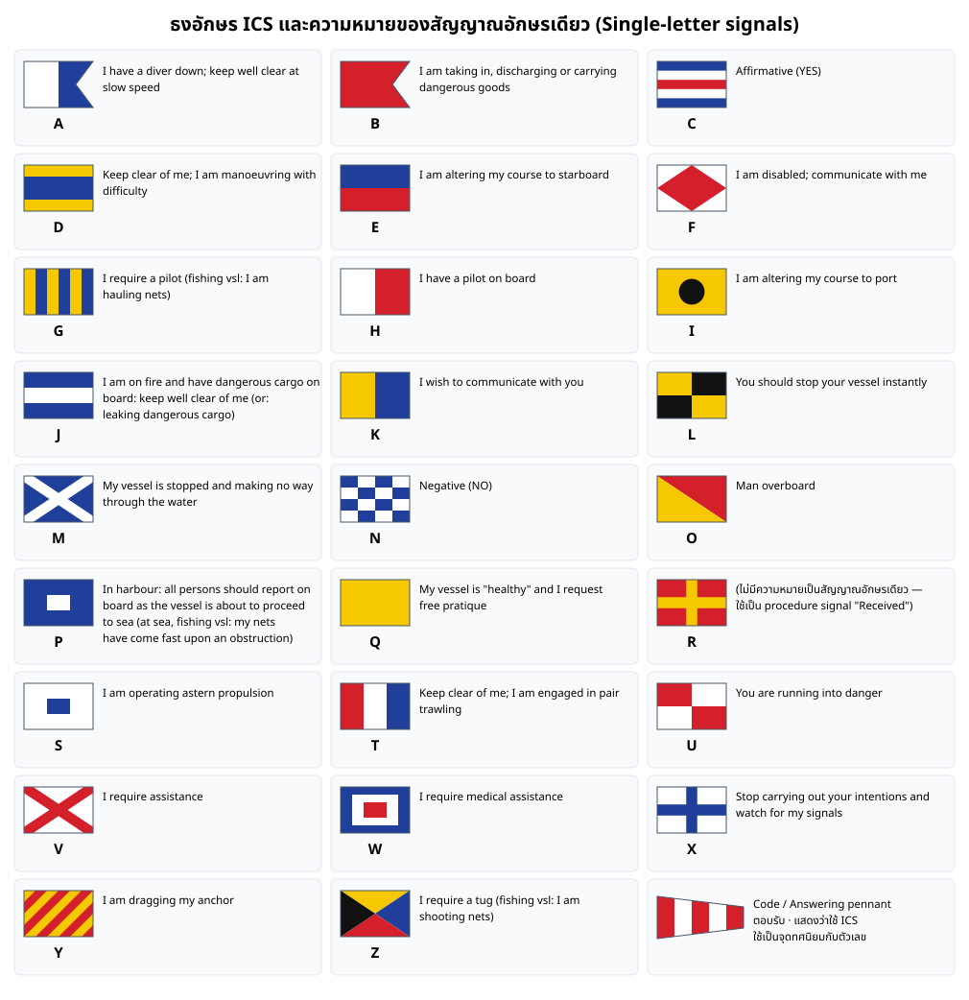
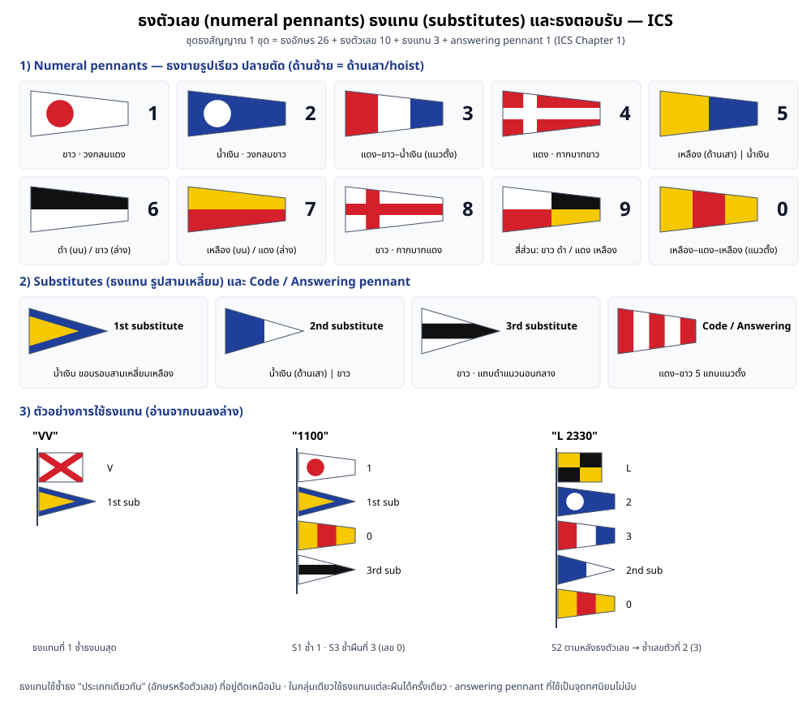
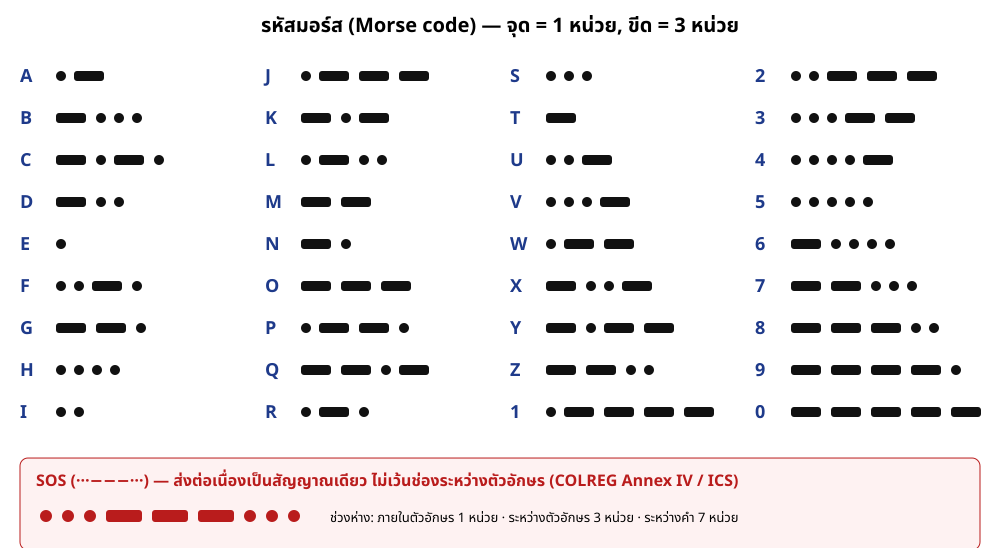

# 1.8 Transmit and Receive Information by Visual Signalling — การส่งและรับสัญญาณด้วยภาพ

> สมุดบันทึกการฝึก OOW · TIRAPHONG NANTAPAN
> สมรรถนะตาม STCW A-II/1: *Visual signalling — Ability to use the International Code of Signals; Ability to transmit and receive, by Morse light, distress signal SOS as specified in Annex IV of COLREG, and appendix 1 of the International Code of Signals, and visual signalling of single-letter signals as also specified in the International Code of Signals*
> เกณฑ์ประเมิน: *Communications within the operator's area of responsibility are consistently successful*
> อ้างอิงหลัก: **International Code of Signals (ICS)** ฉบับ IMO (1965 as amended — ฉบับพิมพ์ปัจจุบันของ IMO); COLREG Annex IV; SOLAS V/19.2.2.2 (daylight signalling lamp), V/29 (life-saving signals); IMO SMCP; NGA **Pub. 102** *International Code of Signals* (US edition ของ ICS 1969 ฉบับปรับปรุง 2020 — ใช้ตรวจถ้อยคำ)

---

## 0. ทำไมยังต้องเรียนสัญญาณธงและไฟ

ทุกวันนี้เราคุยกันด้วย VHF/โทรศัพท์ดาวเทียม แต่สัญญาณภาพยังใช้จริงในหลายกรณี
- **ธงที่ต้องชักตามกฎ/ประเพณี** เช่น **H** (มีนำร่องบนเรือ), **G** (ต้องการนำร่อง), **Q** (ขอ free pratique), **B** (สินค้าอันตราย — ในท่า), **A** (มีนักดำน้ำ), ธงชาติ (courtesy flag)
- **เมื่อวิทยุใช้ไม่ได้** หรือต้องการสื่อสารแบบเงียบ (เช่น เรือรบ/การรักษาความปลอดภัย)
- **การสื่อสารกับอากาศยาน SAR** (life-saving signals)
- **สัญญาณ distress ด้วยไฟ (SOS)**
- **สัญญาณเสียงที่เป็นตัวอักษรเดียว** ในหมอก (เช่น ICS "U" = You are running into danger)
- STCW กำหนดให้ **ส่งและรับ SOS ด้วยไฟมอร์ส** และ **ใช้สัญญาณอักษรเดียว** ได้

---

## 1. International Code of Signals (ICS)

### 1.1 ความเป็นมาและวัตถุประสงค์

- ICS ฉบับปัจจุบันรับรองโดย IMCO (ปัจจุบันคือ IMO) ปี 1965 มีผลใช้ปี 1969 ปรับปรุงเป็นระยะ
- จุดประสงค์: **ให้สื่อสารได้ในสถานการณ์ที่เกี่ยวกับความปลอดภัยของการเดินเรือและบุคคล โดยเฉพาะเมื่อมีปัญหาด้านภาษา** — แต่ละสัญญาณมีความหมายครบในตัว (complete meaning) และหนังสือมีหลายภาษา (อังกฤษ ฝรั่งเศส อิตาลี เยอรมัน ญี่ปุ่น สเปน นอร์เวย์ รัสเซีย กรีก) ความหมายของรหัสเหมือนกันทุกภาษา

### 1.2 วิธีการส่งสัญญาณ (Methods of signalling) ที่ ICS กำหนด

1. **Flag signalling** — ธง
2. **Flashing light signalling** — ไฟกะพริบด้วยรหัสมอร์ส
3. **Sound signalling** — เสียงด้วยรหัสมอร์ส (หวูด ไซเรน แตรหมอก)
4. **Voice over a loud hailer** — ประกาศด้วยโทรโข่ง
5. **Radiotelegraphy / Radiotelephony** (ICS นับแยกเป็น 2 วิธี — รวมทั้งหมดจึงเป็น 7 วิธี)
6. **Morse signalling by hand-flags or arms**

(ระบบ semaphore ถูกตัดออกจาก ICS แล้ว)

### 1.3 โครงสร้างของหนังสือ ICS

| ส่วน | เนื้อหา |
|---|---|
| Signalling instructions 1 – Explanation and general remarks | คำอธิบาย (วัตถุประสงค์ โครงสร้างรหัสอักษรเดียว/สองตัว/สามตัว) |
| 2 – Definitions | นิยาม (hoist, group, at the dip, close up, tackline …) |
| 3 – Methods of signalling | 7 วิธี · ชุดธง 40 ผืน · สัดส่วนจังหวะมอร์ส · อัตรามาตรฐานไฟกะพริบ |
| 4 – General instructions | ผู้ส่ง/ผู้รับ (Master ถึง Master) · identity signals · การสะกดชื่อเรือ/สถานที่ |
| 5 – Flag signalling | ธง การชัก การตอบ substitutes |
| 6 – Flashing light signalling | ขั้นตอนไฟกะพริบ |
| 7 – Sound signalling | |
| 8 – Radiotelephony | |
| 9 – Morse signalling by hand flags or arms | |
| 10 – Morse symbols, phonetic tables, procedure signals | สัญญาณขั้นตอน (AA, AR, AS, R, T…) และตารางสะกดอักษร/ตัวเลข |
| Single-letter signals | ความหมายอักษรเดียว + single-letter signals with complements + สัญญาณระหว่างเรือตัดน้ำแข็งกับเรือที่ถูกช่วย |
| Distress signals | สัญญาณแสดงอันตราย (ตาม COLREG Annex IV) — อยู่ใน Appendix 1 |
| **General section** | สัญญาณสองตัวอักษร จัดหมวด: Distress–Emergency, Casualties–Damages, Aids to navigation–Navigation–Hydrography, Manoeuvres, Miscellaneous, Meteorology–Weather, Routeing of ships, Communications, International Sanitary Regulations |
| **Medical section** | สัญญาณสามตัวอักษรขึ้นต้นด้วย **M** (เช่น MAA…) สำหรับการขอคำปรึกษาทางการแพทย์ |
| **Appendices** | Appendix 1: Distress signals (ตาม COLREG Annex IV), Appendix 2 (procedures/signals ในการ SAR — life-saving signals), Appendix 3 (radiotelephone procedures) ฯลฯ |
| Indexes | ดัชนีคำสำคัญ |

> หมายเหตุลำดับหัวข้อ: ผมเทียบกับ NGA Pub. 102 ซึ่งจัด "Signalling instructions" เป็น Chapter 1 Sections 1–10 ตามด้วย General signal code, Medical signal code และ Distress and life-saving signals; ฉบับพิมพ์ของ IMO เรียงเนื้อหาลำดับเดียวกันแต่เลขบท/ภาคผนวกอาจเรียกต่างกัน — ตรวจกับเล่มบนเรือ

### 1.4 ประเภทของสัญญาณ

| ประเภท | ตัวอย่าง |
|---|---|
| **Single-letter signals** | สัญญาณสำคัญมากหรือใช้บ่อย (ตารางข้อ 2) |
| **Two-letter signals** | General section (เช่น **NC** = I am in distress and require immediate assistance; **CB** = I require immediate assistance; **UW** = I wish you a pleasant voyage) |
| **Three-letter signals (M…)** | Medical section |
| **Complements** | ตัวเลขต่อท้ายเพื่อเปลี่ยน/ขยายความหมาย (complement tables I, II, III) |

---

## 2. Single-letter signals — สัญญาณอักษรเดียว (ต้องจำทั้งหมด)



*ภาพที่ 1.8-1 ธงอักษร 26 ผืนพร้อมความหมายของสัญญาณอักษรเดียว และธง code/answering pennant*

| อักษร | ความหมาย (ICS) | หมายเหตุการใช้งาน |
|---|---|---|
| **A** | I have a diver down; keep well clear at slow speed. | เรือที่มีงานดำน้ำ (ร่วมกับ Rule 27(e)) |
| **B** | I am taking in, or discharging, or carrying dangerous goods. | ชักในท่าเรือ (กลางคืนใช้ไฟแดง all-round ตามข้อกำหนดท่า) |
| **C** | Affirmative — "YES" (or "The significance of the previous group should be read in the affirmative"). | |
| **D** | Keep clear of me; I am manoeuvring with difficulty. | |
| **E** | I am altering my course to starboard. | เสียง: · (1 สั้น) — ตรงกับ COLREG Rule 34 |
| **F** | I am disabled; communicate with me. | |
| **G** | I require a pilot. (เรือประมงที่ทำการประมงใกล้กัน: "I am hauling nets.") | |
| **H** | I have a pilot on board. | |
| **I** | I am altering my course to port. | เสียง: ·· (2 สั้น) |
| **J** | I am on fire and have dangerous cargo on board: keep well clear of me. (or: I am leaking dangerous cargo.) | |
| **K** | I wish to communicate with you. | ไฟ/เสียง K (−·−) ใช้เรียกเรืออื่น |
| **L** | You should stop your vessel instantly. | |
| **M** | My vessel is stopped and making no way through the water. | |
| **N** | Negative — "NO". | ส่งได้เฉพาะด้วยภาพหรือเสียง — ทางวิทยุ/เสียงพูดให้ใช้คำว่า "NO" |
| **O** | Man overboard. | |
| **P** | In harbour: All persons should report on board as the vessel is about to proceed to sea. At sea: (fishing vessels) My nets have come fast upon an obstruction. | ชักก่อนออกเรือ ("Blue Peter") · Pub. 102 ระบุว่าใช้เป็น **สัญญาณเสียง** หมายถึง "I require a pilot" ได้ด้วย |
| **Q** | My vessel is "healthy" and I request free pratique. | ชักเมื่อเข้าท่าต่างประเทศ (กลางคืนไฟแดงบนขาว ตามข้อกำหนดบางท่า) |
| **R** | — (ไม่มีความหมายเป็นสัญญาณอักษรเดียว ใช้เป็น procedure signal "Received") | |
| **S** | I am operating astern propulsion. | เสียง: ··· (3 สั้น) |
| **T** | Keep clear of me; I am engaged in pair trawling. | |
| **U** | You are running into danger. | สำคัญมาก — ใช้เตือนเรือที่กำลังเข้าสู่อันตราย ทั้งไฟและเสียง (··−) |
| **V** | I require assistance. | |
| **W** | I require medical assistance. | |
| **X** | Stop carrying out your intentions and watch for my signals. | |
| **Y** | I am dragging my anchor. | |
| **Z** | I require a tug. (เรือประมงที่ทำการประมงใกล้กัน: "I am shooting nets.") | |

> **หมายเหตุ ICS:** สัญญาณอักษรเดียวบางตัว (ที่มีเครื่องหมายในหนังสือ) เมื่อส่งด้วยเสียง ให้ใช้ได้เฉพาะตาม COLREG Rules 34 และ 35 เท่านั้น — เช่น E, I, S ตรงกับสัญญาณบังคับเรือ (ตัวที่มีดอกจันใน ICS คือ **B, C, D, E, G, H, I, S, T, Z** — ตรวจกับ NGA Pub. 102)
> **K และ S** มีความหมายพิเศษเป็นสัญญาณนำเรือเล็กขึ้นฝั่งในตาราง life-saving signals (K = ขึ้นฝั่งที่นี่ได้, S = อันตราย) — ดูบท 1.6 ข้อ 7
> สัญญาณขั้นตอน **C, N/NO, RQ** ใช้ร่วมกับสัญญาณอักษรเดียวไม่ได้
> **สัญญาณอักษรเดียวพร้อม complement** — เช่น **A + ตัวเลข 3 หลัก** = azimuth/bearing, **C + 3 หลัก** = course, **D + 2, 4 หรือ 6 หลัก** = date, **G + 4–5 หลัก** = longitude (สองหลักท้ายคือลิปดา), **K + 1 หลัก** = I wish to communicate with you by… (วิธีสื่อสาร), **L + 4 หลัก** = latitude (สองหลักแรกคือองศา), **R + ตัวเลข** = distance in nautical miles, **S + ตัวเลข** = speed in knots, **T + 4 หลัก** = local time, **V + ตัวเลข** = speed in km/h, **Z + 4 หลัก** = UTC (ICS เดิมเขียน GMT), **Z + 1 หลัก** = เรียกสถานีสัญญาณภาพบนฝั่ง (ตัวเลขตามที่ท่ากำหนด) — (ตามตารางในหนังสือ ICS)

**สัญญาณอักษรเดียวระหว่างเรือตัดน้ำแข็ง (icebreaker) กับเรือที่ถูกช่วย** — ICS มีตารางแยกที่ความหมายต่างจากตารางปกติ ใช้ได้เฉพาะด้วยเสียง ภาพ หรือวิทยุโทรศัพท์ระหว่างสองฝ่ายนี้เท่านั้น ตัวอย่าง (ฝั่ง icebreaker สั่ง): **WM** เริ่มการช่วยเหลือ ให้เฝ้าฟังสัญญาณตลอด · **WO** จบการช่วยเหลือ ไปปลายทางได้ · **A** ไปข้างหน้าตามร่องน้ำแข็ง · **G** ผมกำลังไป ตามผมมา · **J** อย่าตามผม · **P** ลดความเร็ว · **N** หยุดเครื่อง · **H** ถอยเครื่อง · **L** หยุดเรือทันที · **4** หยุด ผมติดน้ำแข็ง · **Q** ลดระยะห่าง · **B** เพิ่มระยะห่าง · **5** ระวัง (attention) · **Y** เตรียมรับ/ปลดเชือกลาก — เรือที่ถูกช่วยตอบด้วยอักษรเดียวกันในความหมายว่ากำลังทำตาม และการใช้ตารางนี้ไม่ทำให้พ้นหน้าที่ตาม COLREG

### 2.1 ธงตัวเลข ธงแทน และธงตอบรับ



*ภาพที่ 1.8-2 ธงตัวเลข 0–9 ธงแทน 3 ผืน และ code/answering pennant พร้อมตัวอย่างการใช้ธงแทน ("VV", "1100", "L 2330")*

- **ชุดธงสัญญาณ 1 ชุด** = ธงอักษร 26 + ธงตัวเลข 10 + ธงแทน 3 + answering pennant 1 = **40 ผืน** (ICS Methods of signalling)
- สี/ลายธงตัวเลข (จำคู่กับภาพ): **1** ขาววงกลมแดง · **2** น้ำเงินวงกลมขาว · **3** แดง–ขาว–น้ำเงิน แนวตั้ง · **4** แดงกากบาทขาว · **5** เหลือง (ด้านเสา) กับน้ำเงิน · **6** ดำบน ขาวล่าง · **7** เหลืองบน แดงล่าง · **8** ขาวกากบาทแดง · **9** สี่ส่วน ขาว–ดำ (บน) แดง–เหลือง (ล่าง) · **0** เหลือง–แดง–เหลือง แนวตั้ง
- ธงแทน (สามเหลี่ยม): **1st** น้ำเงินขอบรอบสามเหลี่ยมเหลือง · **2nd** น้ำเงิน (ด้านเสา) กับขาว · **3rd** ขาวมีแถบดำแนวนอนกลาง · **Answering pennant** แดง–ขาว 5 แถบแนวตั้ง (แดงด้านเสา)

- **Numeral pennants (0–9)** — ธงชายธงรูปสามเหลี่ยมยาว 10 ผืน ใช้ส่งตัวเลข
- **Substitutes (1st, 2nd, 3rd)** — ใช้ซ้ำธงในชุดเดียวกัน: **1st substitute** ซ้ำธง **ผืนแรก** (บนสุด) ของ **ประเภทเดียวกัน** (อักษรหรือตัวเลข) ที่อยู่เหนือมันในชุด, **2nd** ซ้ำผืนที่สอง, **3rd** ซ้ำผืนที่สาม — ธงแทนไม่ซ้ำ code pennant
  - ตัวอย่าง: ส่ง "**AA**" ใช้ธง A + 1st substitute
  - ส่งตัวเลข "**1100**" ใช้ numeral 1 + 1st substitute + numeral 0 + 3rd substitute
  - ส่ง "**L 2330**" ใช้ L + 2 + 3 + **2nd substitute** + 0 — ธงแทนที่ 2 ตามหลังธงตัวเลข จึงซ้ำตัวเลขผืนที่ 2 (คือ 3) ไม่ใช่ธง L
  - ในกลุ่มเดียวกัน **ใช้ธงแทนแต่ละผืนได้ครั้งเดียว** และ answering pennant ที่ใช้เป็นจุดทศนิยมไม่นับเมื่อเลือกธงแทน
- **Code / Answering pennant** — แถบแดงขาว ใช้
  - ชักเพื่อแสดงว่าสัญญาณที่ตามมาใช้ ICS
  - ตอบรับสัญญาณธง (ชัก "at the dip" = ครึ่งเสา เมื่อเห็นสัญญาณ → "close up" = ขึ้นสุด เมื่อเข้าใจแล้ว)
  - ใช้เป็น **decimal point** ระหว่างตัวเลข

### 2.2 ขั้นตอนการส่งสัญญาณธง (Flag signalling procedure)

1. ผู้ส่งชักสัญญาณ ("hoist") ในที่ที่ผู้รับเห็นชัด (ธงสะบัดได้ ไม่โดนควัน) อ่านจากบนลงล่าง — ICS ปัจจุบันให้ **ชักทีละ hoist** เป็นหลัก และถ้ามีหลายกลุ่มบนเชือกเส้นเดียวต้องคั่นด้วย **tackline** (เชือกยาวราว 2 m) ส่วนลำดับการอ่านหลาย hoist พร้อมกันตามเสา/ราว (หัวไปท้าย ขวาไปซ้าย) เป็นแนวปฏิบัติแบบเก่า/ทางทหาร ผมไม่พบในตัวบท ICS ที่ตรวจ (NGA Pub. 102) — ถ้าจำเป็นต้องชักหลาย hoist ให้ตรวจกับเล่มบนเรือ
2. ผู้รับชัก **answering pennant at the dip** (ครึ่งเสา) เมื่อเห็นสัญญาณ แล้วชัก **close up** เมื่อเข้าใจความหมาย
3. ผู้ส่งลดสัญญาณลง ผู้รับลด answering pennant กลับไป at the dip (แล้วชัก close up อีกเมื่อเข้าใจ hoist ถัดไป) — เมื่อจบทั้งสัญญาณ **ผู้ส่งชัก answering pennant เดี่ยว ๆ** หลัง hoist สุดท้ายเพื่อบอกว่าจบ ผู้รับตอบแบบเดียวกับ hoist อื่น
4. ถ้าไม่เข้าใจ ผู้รับคง answering pennant at the dip และส่งสัญญาณขอให้ส่งซ้ำ/ชี้แจง — ถ้าอ่านธงไม่ชัดให้คง at the dip; ถ้าอ่านได้แต่ไม่เข้าใจความหมาย ชัก **ZQ** (สัญญาณดูเหมือนเข้ารหัสผิด ให้ตรวจและส่งใหม่ทั้งหมด) หรือ **ZL** (ได้รับแล้วแต่ไม่เข้าใจ)
5. ถ้าจะเรียกเรือเฉพาะลำ ชัก **identity signal (call sign)** ของเรือนั้นก่อน — ถ้าไม่ชัก identity หมายถึงส่งถึงทุกสถานีในระยะมองเห็น; ถ้าไม่รู้ identity ของอีกฝ่าย ชัก **VF** (ให้ชัก identity signal) หรือ **CS** (เรือคุณชื่ออะไร/identity อะไร) พร้อมชัก identity ของเราเอง หรือใช้ **YQ** (ต้องการติดต่อด้วยวิธี … กับเรือที่แบริ่ง … จากเรา)
6. ถ้าส่งเป็นภาษาธรรมดา (plain language) ทีละตัวอักษร ใช้ procedure ตาม ICS — ชื่อเรือ/สถานที่ต้องสะกดด้วยธงอักษร อาจนำด้วย **YZ** (คำที่ตามมาเป็นภาษาธรรมดา)
7. เรือรบที่ต้องการติดต่อเรือสินค้าจะชัก **code pennant** ในที่เห็นชัดตลอดเวลาที่ส่งสัญญาณ

---

## 3. Flashing light signalling — ไฟกะพริบด้วยรหัสมอร์ส

### 3.1 รหัสมอร์ส



*ภาพที่ 1.8-3 ตารางรหัสมอร์ส A–Z และ 0–9 พร้อมสัญญาณ SOS*

**จังหวะมาตรฐาน**
- **จุด (dot)** = 1 หน่วย
- **ขีด (dash)** = 3 หน่วย
- ช่วงห่างระหว่างสัญลักษณ์ภายในตัวอักษร = 1 หน่วย
- ระหว่างตัวอักษร = 3 หน่วย
- ระหว่างคำ = 7 หน่วย
- ความเร็วโดยประมาณสำหรับไฟ (ICS) — ประมาณ 40 ตัวอักษรต่อนาที (8 คำ/นาที) เป็นมาตรฐานการฝึก (ICS เรียกว่า **standard rate** ของไฟกะพริบ)
- ICS แนะนำว่าเวลาส่งด้วยไฟหรือเสียง **ทำจุดให้สั้นกว่าสัดส่วนเล็กน้อย** จะแยกจุดกับขีดได้ชัดขึ้น

**ช่วยจำตัวที่ใช้บ่อย** — E (·), T (−), I (··), M (−−), S (···), O (−−−), A (·−), N (−·), U (··−) "You are running into danger", K (−·−), R (·−·), V (···−), D (−··)

### 3.2 อุปกรณ์

- **Daylight signalling lamp** — SOLAS V/19.2.2.2: เรือ ≥ 150 GT (และเรือโดยสาร) ต้องมีไฟสัญญาณกลางวัน (หรือวิธีอื่น) ที่ใช้ได้ทั้งกลางวันและกลางคืน **ไม่พึ่งแหล่งไฟฟ้าหลักของเรือเพียงอย่างเดียว** (มีแบตเตอรี่สำรอง)
- Aldis lamp (มือถือ มีที่จับและไกกดหรือบานเกล็ด) และไฟกะพริบบนเสา (masthead flashing light — ไม่ควรใช้แทนไฟสัญญาณ Rule 34(b) ผิดวัตถุประสงค์)
  - ขยายความ: ไฟตาม **COLREG Rule 34(b)** คือไฟขาวรอบตัว (all-round) ที่ใช้ **เสริมสัญญาณหวูดบังคับเรือ** (1, 2, 3 แวบ) เท่านั้น ส่วนการส่งมอร์สให้ใช้ไฟสัญญาณกลางวัน/Aldis; ไม่ควรเอาไฟดวงเดียวกันมาส่งข้อความจนเรืออื่นสับสนกับสัญญาณบังคับเรือ (Rule 36 ห้ามสัญญาณเรียกความสนใจที่อาจสับสนกับสัญญาณที่ COLREG กำหนด)

### 3.3 Procedure signals สำหรับไฟกะพริบ (ICS Chapter 3 และ 7)

| สัญญาณ | ความหมาย/การใช้ |
|---|---|
| **AA AA AA …** | เรียกสถานีที่ไม่รู้จัก/เรียกทั่วไป (call for unknown station or general call) |
| **TTTT …** | ตอบรับการเรียก (answering signal) |
| **T** | ผู้รับส่งหลังรับแต่ละคำ (word received) |
| **AR** (·−·−·) | จบการส่งข้อความ (ending signal / end of transmission) |
| **R** (·−·) | ได้รับแล้ว (received / I have received your last signal) |
| **AS** (·−···) | รอ (waiting signal / period) |
| **RPT** | ขอให้ส่งซ้ำ (repeat) — ใช้ร่วมกับ AA, AB, WA, WB ฯลฯ |
| **EEEEEEEE…** | ส่งผิด (erase signal) — แล้วส่งคำที่ถูกใหม่ |
| **CS** | ถามชื่อหรือ identity signal ของเรือ — "What is the name or identity signal of your vessel?" |
| **DE** | "from…" ใช้นำหน้าชื่อ/สัญญาณเรียกขานของผู้ส่ง |
| **K** | invitation to transmit |
| **C** / **N** | Affirmative / Negative (ใช้ร่วมกับ plain language) |
| **AB, AA, WA, WB** | all before / all after / word after / word before (ใช้กับ RPT) |
| **BN** | all between … and … (ใช้กับ RPT เช่น ขอส่งซ้ำทุกคำระหว่างสองคำที่ระบุ) |
| **OK** | รับรองว่าการส่งซ้ำถูกต้อง หรือ "It is correct" |
| **RQ** | ทำให้กลุ่มก่อนหน้าเป็นคำถาม (ส่งต่อท้ายสัญญาณหลัก) |
| **AAA** (·−·−·−) | full stop หรือจุดทศนิยม (ไฟกะพริบ) |
| **CQ** | เรียกทั่วไป/สถานีที่ไม่รู้จัก — ใช้กับธง วิทยุโทรศัพท์ วิทยุโทรเลข |
| **YU** | ข้อความต่อไปเป็นกลุ่มรหัส ICS (ส่งนำหน้าใน text ของไฟกะพริบ) |
| คำพูดทางเสียง | **INTERCO** (ต่อไปเป็นกลุ่มรหัส ICS), **STOP** (จุด), **DECIMAL** (DAY-SEE-MAL), **CORRECTION** (ยกเลิกคำล่าสุด คำที่ถูกตามมา) |

**ขั้นตอนทั่วไป (ไฟกะพริบ)**
1. **เรียก (call)** — AA AA AA … หรือ identity signal ของสถานีที่ต้องการ
2. **ผู้รับตอบ** — TTTT …
3. **ระบุตัวผู้ส่ง (identity)** — DE + call sign ของผู้ส่ง → ผู้รับทวน identity นั้น แล้วส่ง identity ของตนเอง ซึ่งผู้ส่งทวนกลับ (ตาม ICS; ถ้าติดต่อกันอยู่แล้วข้ามขั้น call และ identity ได้)
4. **ข้อความ (text)** — ส่งทีละคำ ผู้รับส่ง **T** หลังรับแต่ละคำ (หรือกลุ่ม) — ถ้าเป็นกลุ่มรหัส ICS ให้นำด้วย **YU**; ถ้าส่งผิดใช้ **EEEEEE…** ผู้รับตอบด้วย E ชุดเดียวกัน แล้วผู้ส่งส่งคำที่ถูกต้องล่าสุดซ้ำแล้วส่งต่อ
5. **จบ (ending)** — ผู้ส่ง **AR** → ผู้รับ **R**

### 3.4 การส่ง SOS ด้วยไฟมอร์ส (Distress by flashing light)

- **SOS = ···−−−···** — ส่งเป็นสัญญาณเดียวต่อเนื่อง **ไม่เว้นช่องระหว่าง S-O-S** (ICS Appendix 1 / COLREG Annex IV (d))
- ส่งซ้ำ ๆ เป็นระยะ (เว้นช่วงพอให้ผู้รับตั้งตัว) ชี้ไปทางเรือ/ฝั่ง/อากาศยานที่อาจเห็น หรือกวาดไปรอบ ๆ
- ตามด้วยข้อมูลถ้าทำได้ (ตำแหน่ง ลักษณะเหตุ) ด้วย ICS เช่น "NC"
- **การรับ SOS**: สังเกตลักษณะ 3 สั้น 3 ยาว 3 สั้น ต่อเนื่อง → แจ้งนายเรือทันที ตอบรับ (เช่น ด้วยไฟ "R" หรือ TTTT แล้วสื่อสารต่อ หรือใช้วิทยุ) plot ทิศ แจ้ง RCC (ถือเป็นข้อมูล distress ตาม SOLAS V/33)

### 3.5 ตัวอย่างการฝึกไฟกะพริบ (จำลอง)

```
เรือ A  : AA AA AA AA      (เรียกต่อเนื่องจนกว่ามีผู้ตอบ)
เรือ B  : TTTT            (ตอบต่อเนื่องจนกว่า A หยุดเรียก)
เรือ A  : DE HSXX9        (call sign เรือ A)
เรือ B  : HSXX9           (ทวน identity ของ A)
เรือ B  : DE HSYY8        (identity ของเรือ B — สมมติ)
เรือ A  : HSYY8           (ทวน identity ของ B)
เรือ A  : YU              (ต่อไปเป็นรหัส ICS)
เรือ B  : T
เรือ A  : U               (You are running into danger)
เรือ B  : T
เรือ A  : AR
เรือ B  : R
```
(call sign ทั้งสองเป็นค่าสมมติ — เดิมผมจดให้ B ตอบ T หลัง DE ซึ่งไม่ตรง ICS: ขั้น identity ต้องทวนกลับและแลก identity กัน; ในสถานการณ์เร่งด่วนจริง เช่นเรือกำลังวิ่งเข้าหาอันตราย มักส่ง U ซ้ำ ๆ ด้วยไฟ/เสียงทันทีโดยไม่ผ่านขั้นตอนเต็ม)

---

## 4. Sound signalling ด้วยรหัสมอร์ส

- ใช้หวูด/ไซเรน/แตรหมอกส่งรหัสมอร์ส **ช้า ๆ** — แต่ **ควรใช้เฉพาะกรณีจำเป็นมาก** เพราะอาจสับสนกับสัญญาณ COLREG และในหมอกอาจได้ยินไม่ชัด
- สัญญาณอักษรเดียวที่ใช้เสียงได้บ่อย: **U** (··− You are running into danger), **D** (−·· Keep clear of me), **V**, **W**, **O** (−−− Man overboard — หลายเรือใช้เป็นสัญญาณภายใน)
- ICS เตือนว่าการใช้สัญญาณเสียงในทัศนวิสัยจำกัดต้องไม่ขัดกับ COLREG Rule 35
- รายละเอียดจากหมวด Sound signalling ของ ICS (สรุปเอง): เสียงส่งได้ช้าและถ้าใช้ผิดจะสร้างความสับสนรุนแรง จึง **ลดการใช้ในหมอกให้น้อยที่สุด**; สัญญาณที่ไม่ใช่อักษรเดียวให้ใช้ **เฉพาะเหตุฉุกเฉินร้ายแรง และห้ามใช้ในน่านน้ำที่มีการจราจรหนาแน่น**; ส่งช้า ๆ ชัด ๆ ถ้าซ้ำให้เว้นช่วงนานพอไม่ให้อักษรเดียวถูกอ่านเป็นกลุ่มสองตัว
- เรือตัดน้ำแข็งอาจส่ง **K (−·−)** ด้วยเสียงหรือไฟเพื่อเตือนเรือที่ถูกช่วยให้เฝ้าฟังวิทยุตลอด

---

## 5. Morse signalling by hand-flags or arms

- ใช้ธงมือ (หรือแขน) ส่งรหัสมอร์ส: **ยกขึ้นเหนือศีรษะ = จุด**, **กางออกด้านข้างระดับไหล่ = ขีด** (ตามที่ ICS อธิบาย), ลดลงด้านหน้า = ช่วงห่าง — ใช้น้อยมากในปัจจุบัน
- ขั้นตอนตาม ICS: ผู้ที่ต้องการติดต่อด้วยวิธีนี้ส่ง **K1** ด้วยวิธีใดก็ได้ (หรือเรียก **AA AA AA**) → ผู้ถูกเรียกตอบด้วย answering signal (**T**) หรือถ้าทำไม่ได้ตอบ **YS1** ด้วยวิธีอื่น → โดยปกติใช้สองแขน (ถ้าลำบากใช้แขนเดียวได้) → ทุกข้อความจบด้วย **AR**; ช่วงห่างระหว่างจุด/ขีด/ตัวอักษรให้ยาวพอให้ผู้รับอ่านทัน — ท่าทางแขนสำหรับแยกตัวอักษรและการลบ ให้ดูภาพในเล่ม ICS

---

## 6. ธงที่ OOW ต้องชักในชีวิตประจำวัน (Practical flag etiquette)

| สถานการณ์ | ธง |
|---|---|
| ออกจากท่า (ทุกคนกลับเรือ) | **P** (Blue Peter) |
| ต้องการนำร่อง | **G** |
| นำร่องอยู่บนเรือ | **H** (กลางคืนตามข้อกำหนดท้องถิ่นบางท่า) |
| ขนถ่าย/บรรทุกสินค้าอันตรายในท่า | **B** (กลางคืนไฟแดง all-round ตามข้อกำหนดท่า) |
| เข้าท่าต่างประเทศ ขอ free pratique | **Q** |
| ธงชาติของเรือ (ensign) | ที่ท้ายเรือ/gaff ตามประเพณี |
| ธงชาติของประเทศที่เยือน (courtesy flag) | ราวขวาของเสาหน้า (starboard yardarm) |
| ธงบริษัท (house flag) | ตามประเพณีบริษัท |
| Call sign ของเรือ | เมื่อเข้าออกท่าตามข้อกำหนด/เมื่อถูกถาม |
| คนตกน้ำ | **O** |
| ต้องการเรือลากจูง | **Z** |

---

## 7. คำถามสอบปากเปล่า / สัมภาษณ์ — Visual signalling

**ถาม:** สัญญาณ U หมายถึงอะไร ส่งอย่างไร
**แนวตอบ:** "You are running into danger" ส่งได้ทั้งธง ไฟ (··−) และเสียง ใช้เตือนเรือที่กำลังมุ่งสู่อันตราย

**ถาม:** ธง H, G, Q, P, B, O หมายถึงอะไร
**แนวตอบ:** H มีนำร่องบนเรือ; G ต้องการนำร่อง; Q เรือปลอดโรคขอ free pratique; P (ในท่า) ทุกคนกลับเรือเพราะเรือจะออก; B ขนถ่าย/บรรทุกสินค้าอันตราย; O คนตกน้ำ

**ถาม:** ส่ง SOS ด้วยไฟอย่างไร
**แนวตอบ:** ···−−−··· ต่อเนื่องเป็นสัญญาณเดียวไม่เว้นช่องระหว่างตัวอักษร ส่งซ้ำ ๆ ชี้ไปทางผู้ที่อาจเห็น

**ถาม:** Substitute flag ใช้อย่างไร
**แนวตอบ:** ใช้ซ้ำธงประเภทเดียวกันในชุดเดียวกัน — 1st substitute ซ้ำผืนแรก 2nd ซ้ำผืนที่สอง 3rd ซ้ำผืนที่สาม เช่น AA = A + 1st substitute

**ถาม:** Answering pennant at the dip กับ close up ต่างกันอย่างไร
**แนวตอบ:** at the dip (ครึ่งเสา) = เห็นสัญญาณแล้วกำลังอ่าน/ไม่เข้าใจ; close up (ขึ้นสุด) = เข้าใจแล้ว

**ถาม:** AA AA และ TTTT ในไฟกะพริบคืออะไร
**แนวตอบ:** AA AA = เรียกสถานีที่ไม่รู้จัก/เรียกทั่วไป; TTTT = ตอบรับการเรียก

**ถาม:** ICS ฉบับปัจจุบันใช้วิธีสื่อสารอะไรบ้าง
**แนวตอบ:** ธง ไฟกะพริบ เสียง โทรโข่ง วิทยุโทรเลข/โทรศัพท์ มอร์สด้วยธงมือหรือแขน

**ถาม:** สัญญาณ NC คืออะไร
**แนวตอบ:** I am in distress and require immediate assistance — เป็นสัญญาณ distress ใน COLREG Annex IV

**ถาม:** SOLAS กำหนดอะไรเกี่ยวกับไฟสัญญาณกลางวัน
**แนวตอบ:** V/19 — เรือ ≥ 150 GT และเรือโดยสารต้องมี daylight signalling lamp หรือวิธีอื่น ใช้ได้ทั้งกลางวันกลางคืน และไม่พึ่งแหล่งไฟฟ้าหลักอย่างเดียว

**ถาม:** ชุดธงสัญญาณ ICS มีกี่ผืน อะไรบ้าง
**แนวตอบ:** 40 ผืน — ธงอักษร 26 ธงตัวเลข 10 ธงแทน 3 และ answering pennant 1

**ถาม:** ส่ง "L 2330" ด้วยธงชุดเดียวอย่างไร
**แนวตอบ:** L, 2, 3, 2nd substitute, 0 — ธงแทนที่ 2 ตามหลังธงตัวเลขจึงซ้ำตัวเลขผืนที่สองของกลุ่มตัวเลข (คือ 3) ในกลุ่มหนึ่งใช้ธงแทนแต่ละผืนได้ครั้งเดียว

**ถาม:** บอกสีของธง Y และธงตัวเลข 9
**แนวตอบ:** Y เป็นแถบทแยงเหลืองสลับแดง 10 แถบ เหลืองที่มุมบนด้านเสา; ธงตัวเลข 9 แบ่งสี่ส่วน ขาว (บนด้านเสา) ดำ (บนด้านปลาย) แดง (ล่างด้านเสา) เหลือง (ล่างด้านปลาย)

**ถาม:** ผู้รับอ่านธงได้แต่ไม่เข้าใจความหมาย ควรทำอย่างไร
**แนวตอบ:** ถ้าอ่านไม่ชัดให้คง answering pennant at the dip; ถ้าอ่านได้แต่ไม่เข้าใจ ชัก ZQ (สัญญาณน่าจะเข้ารหัสผิด ให้ตรวจและส่งใหม่) หรือ ZL (ได้รับแต่ไม่เข้าใจ)

**ถาม:** ผู้ส่งบอกว่าสัญญาณธงจบแล้วอย่างไร
**แนวตอบ:** ผู้ส่งชัก answering pennant เดี่ยว ๆ หลัง hoist สุดท้าย ผู้รับตอบเหมือน hoist อื่น (at the dip แล้ว close up)

**ถาม:** ขั้น identity ในการส่งไฟกะพริบทำอย่างไร
**แนวตอบ:** ผู้ส่งส่ง DE ตามด้วย identity ของตน ผู้รับทวน identity นั้นแล้วส่ง identity ของตนเอง ผู้ส่งทวนกลับ จากนั้นจึงส่งข้อความ (กลุ่มรหัสนำด้วย YU) ผู้รับตอบ T ทีละคำ จบด้วย AR และ R

**ถาม:** สัญญาณ OK, RQ และ BN ใช้อย่างไร
**แนวตอบ:** OK = รับรองว่าการส่งซ้ำถูกต้องหรือ "It is correct"; RQ = ส่งต่อท้ายเพื่อทำให้สัญญาณเป็นคำถาม; BN = ใช้หลัง RPT ขอให้ส่งซ้ำทุกอย่างระหว่างสองคำที่ระบุ — C, N/NO และ RQ ใช้กับสัญญาณอักษรเดียวไม่ได้

**ถาม:** ICS กำหนดเรื่องการใช้สัญญาณเสียงในหมอกอย่างไร
**แนวตอบ:** ลดให้น้อยที่สุด สัญญาณที่ไม่ใช่อักษรเดียวใช้เฉพาะเหตุฉุกเฉินร้ายแรงและห้ามใช้ในน่านน้ำที่การจราจรหนาแน่น อักษรเดียวที่มีดอกจันส่งด้วยเสียงได้เฉพาะตามที่ COLREG กำหนด

**ถาม:** สัญญาณ K และ S บนฝั่งเมื่อนำเรือเล็กขึ้นฝั่งหมายถึงอะไร
**แนวตอบ:** ตามตาราง life-saving signals: K (หรือโบกแนวตั้ง/ดาวเขียว) = ขึ้นฝั่งที่นี่ได้ดีที่สุด; S (หรือโบกแนวนอน/ดาวแดง) = ที่นี่อันตรายมาก; S ตามด้วย R หรือ L = มีที่ดีกว่าทางขวาหรือซ้าย

---

*ก่อนหน้า ← [1.7 English และ SMCP](1.7-english-and-smcp.md) · ถัดไป → [1.9 Ship Manoeuvring and Handling](1.9-ship-manoeuvring-and-handling.md)*
