# 1.9 Manoeuvre the Ship — การบังคับเรือและการควบคุมเรือ (Ship Manoeuvring and Handling)

> สมุดบันทึกการฝึก OOW · TIRAPHONG NANTAPAN
> สมรรถนะตาม STCW A-II/1: *Manoeuvre the ship* — Ship manoeuvring and handling. Knowledge of:
> .1 the effects of deadweight, draught, trim, speed and under-keel clearance on turning circles and stopping distances
> .2 the effects of wind and current on ship handling
> .3 manoeuvres and procedures for the rescue of person overboard
> .4 squat, shallow-water and similar effects
> .5 proper procedures for anchoring and mooring
> เกณฑ์ประเมิน: *Safe operating limits of ship propulsion, steering and power systems are not exceeded in normal manoeuvres · Adjustments made to the ship's course and speed to maintain safety of navigation*
> อ้างอิงหลัก: STCW Code A-II/1 และ A-VIII/2 Part 4-1 (ข้อ 51 — watchkeeping at anchor); IMO Model Course 7.03 (Ship manoeuvring and handling); IMO Res. **A.601(15)** Provision and display of manoeuvring information on board ships; IMO Res. **MSC.137(76)** Standards for ship manoeuvrability และ **MSC/Circ.1053** (Explanatory notes); SOLAS II-1/28 (means of going astern), II-1/29 (steering gear), **II-1/3-8** (towing and mooring equipment) พร้อม MSC.1/Circ.1619 และ 1620; SOLAS III/17-1 (recovery of persons from the water) และ MSC.1/Circ.1447; SOLAS V/24–26; IAMSAR Manual Vol III (ฉบับ 2025 — ฉบับแก้ไขมีผล 1 ม.ค. 2026); MSC.1/Circ.1228 (adverse weather guidance); IACS UR A1 (anchoring equipment — Rev.7) และ IACS Rec. 10 (Anchoring, mooring and towing equipment); MSC.1/Circ.1175/Rev.1 (shipboard towing and mooring equipment); MSC.1/Circ.1627 (interim guidelines on second generation intact stability criteria); OCIMF *Mooring Equipment Guidelines* (MEG4); UK MCA *Code of Safe Working Practices for Merchant Seafarers* (COSWP); ICS *Bridge Procedures Guide*; C.B. Barrass *Ship Squat and Interaction*; R.W. Rowe *The Shiphandler's Guide* (The Nautical Institute); M.C. Armstrong *Practical Ship Handling*; D.H. MacElrevey & D.E. MacElrevey *Shiphandling for the Mariner*; *Admiralty Manual of Seamanship*

---

## 0. ทำไม OOW ต้องเข้าใจการบังคับเรือ

ช่วงเป็นนักเรียนฝึก เราจะเห็นนายเรือหรือนำร่องเป็นคนสั่งเครื่องและหางเสือตอนเข้าออกท่าเกือบทุกครั้ง จึงอาจคิดว่าเรื่องการบังคับเรือเป็นของคนอื่น แต่ในยามจริง **OOW คือคนแรกที่ต้องบังคับเรือ** เมื่อ
- ต้องเปลี่ยนเข็มหลบเรือตาม COLREG — ต้องรู้ว่าเรือจะเริ่มหันเมื่อไร หันได้แค่ไหน ใช้ระยะเท่าไร
- ต้องหยุดเรือหรือลดความเร็วฉุกเฉิน — ต้องรู้ว่าเรือหยุดได้ในระยะเท่าไร หัวเรือจะปัดไปทางไหน
- มีคนตกน้ำ — ต้องหันเรือกลับทันทีโดยไม่ต้องรอใคร
- เข้าร่องน้ำตื้น/แคบ — ต้องรู้เรื่อง squat, bank effect, interaction เพื่อคุมความเร็ว
- อยู่ยามสมอ — ต้องรู้ว่าเรือลากสมอเมื่อไร และต้องทำอะไร
- ช่วยนายเรือ/นำร่องที่สะพานเดินเรือ หรือเป็นนายประจำหัว/ท้ายเรือตอนผูกเรือ — ต้องเข้าใจว่าคำสั่งแต่ละคำมีผลกับเรืออย่างไร

เกณฑ์ STCW เขียนไว้สั้นแต่ลึก: **ไม่ใช้ระบบขับเคลื่อน หางเสือ และระบบไฟฟ้าเกินขีดจำกัดที่ปลอดภัย** และ **ปรับเข็มและความเร็วเพื่อรักษาความปลอดภัยในการเดินเรือ** — หมายความว่าเราต้องรู้ว่าเรือของเรา "ทำอะไรได้ และทำอะไรไม่ได้" ก่อนจะสั่งมัน

### 0.1 ข้อมูลการบังคับเรือที่ต้องมีบนเรือ — IMO Res. A.601(15)

IMO แนะนำให้เรือ (โดยเฉพาะเรือยาวตั้งแต่ 100 m ขึ้นไป เรือบรรทุกเคมีและเรือบรรทุกก๊าซทุกขนาด) มีข้อมูลการบังคับเรือ 3 รูปแบบ — จดให้ชัด: ตาม A.601(15) **pilot card** แนะนำให้มีบนเรือใหม่ทุกลำที่ SOLAS ใช้บังคับ ส่วน **ครบทั้งสามรายการ** (pilot card + wheelhouse poster + manoeuvring booklet) แนะนำสำหรับเรือใหม่ยาวตั้งแต่ 100 m และเรือบรรทุกเคมี/ก๊าซทุกขนาด รวมทั้งเรือที่มีขนาดหรือคุณลักษณะผิดปกติจนอาจเป็นอันตราย

| เอกสาร | อยู่ที่ไหน | เนื้อหาหลัก |
|---|---|---|
| **Pilot card** | นายเรือกรอกและมอบให้นำร่องเมื่อขึ้นเรือ | สภาพเรือปัจจุบัน — draught หัว/ท้าย ระวางขับน้ำ air draught ชนิดเครื่องและใบจักร (ขวา/ซ้าย, FPP/CPP) ความเร็วตามคำสั่งเครื่องแต่ละขั้นทั้งตอนบรรทุกและเรือเปล่า bow/stern thruster สมอ ข้อบกพร่องของอุปกรณ์ที่มีผลต่อการบังคับเรือ |
| **Wheelhouse poster** | ติดถาวรในสะพานเดินเรือ | ข้อมูลทั่วไปของเรือและ **ลักษณะการบังคับเรือ** — วงเลี้ยว (turning circle) ทั้งบรรทุกเต็มและเรือเปล่า ระยะหยุด (crash stop, inertia stop) เวลาที่ใช้ เวลาเปลี่ยนจาก full ahead เป็น full astern ผลของน้ำตื้นต่อวงเลี้ยวและ squat ความเร็วต่ำสุดที่ยังบังคับเรือได้ ข้อจำกัดของ thruster ฯลฯ |
| **Manoeuvring booklet** | เก็บบนสะพานเดินเรือ | ข้อมูลละเอียดจากการทดลองเรือ (sea trials) และการคำนวณ — วงเลี้ยวในหลายความเร็ว/มุมหางเสือ zig-zag test, stopping test, ผลของลม (เช่นมุมลมที่เรือยังรักษาเข็มได้) ผลของน้ำตื้น squat ฯลฯ |

> **เทคนิคจากการฝึก:** วันแรกที่ขึ้นเรือใหม่ ให้ถ่ายรูป/จดค่าสำคัญจาก wheelhouse poster ไว้ในสมุด เช่น advance, tactical diameter, crash stop distance, เวลาเปลี่ยนเครื่องจาก full ahead → full astern, ความเร็วแต่ละขั้น เพราะคำถามแรก ๆ ที่นายเรือหรือ surveyor มักถามคือ "เรือเราหยุดได้ในกี่เคเบิล"

### 0.2 มาตรฐานความสามารถในการบังคับเรือของ IMO — MSC.137(76)

ใช้กับเรือทุกแบบหางเสือและระบบขับเคลื่อนที่สร้างตั้งแต่ 1 ม.ค. 2004 ที่ยาวตั้งแต่ 100 m ขึ้นไป และเรือบรรทุกเคมี/ก๊าซทุกขนาด ทดสอบตอนทดลองเรือที่ **บรรทุกเต็ม (full load) even keel ในน้ำลึกไม่จำกัด ทะเลสงบ** ที่ test speed (อย่างน้อย 90% ของความเร็วที่ 85% MCR)

| ความสามารถ | เกณฑ์ |
|---|---|
| **Turning ability** | Advance ≤ 4.5 L · Tactical diameter ≤ 5 L (หางเสือสูงสุด) |
| **Initial turning ability** | หางเสือ 10° → หัวเรือเปลี่ยน 10° ภายในระยะเดินไม่เกิน 2.5 L |
| **Yaw-checking & course-keeping** (zig-zag test 10°/10° และ 20°/20°) | overshoot ครั้งแรกของ 10/10 ขึ้นกับ L/V (≤ 10° เมื่อ L/V < 10 s; ≤ 20° เมื่อ L/V ≥ 30 s; ระหว่างนั้นใช้สูตร 5 + ½(L/V) องศา) · overshoot ครั้งที่สองของ 10/10 ก็เป็นเกณฑ์ตาม L/V เช่นกัน (≤ 25° เมื่อ L/V < 10 s; ≤ 40° เมื่อ L/V ≥ 30 s; ระหว่างนั้น 17.5 + 0.75(L/V) องศา) — ที่ปลายทั้งสองข้างจะเท่ากับเกณฑ์ครั้งแรก + 15° พอดี จึงมีคนจำแบบย่อว่า "ครั้งแรก + 15°" แต่ช่วงกลางไม่ตรงทีเดียว · overshoot ครั้งแรกของ 20/20 ≤ 25° |
| **Stopping ability** | Full astern stopping test: **track reach ≤ 15 L** (Administration ผ่อนได้สำหรับเรือระวางขับน้ำสูงมาก แต่ไม่เกิน 20 L) |

L = ความยาวเรือ, V = ความเร็ว (m/s) — ค่าเหล่านี้คือ "เพดาน" ไม่ใช่ค่าที่เรือเราจะทำได้จริงในทุกสภาพ เพราะตอนใช้งานจริงเรืออาจเรือเปล่า มี trim อยู่ในน้ำตื้น หรือมีลม

**ตัวอย่างจำลอง: เทียบข้อมูลทดลองเรือของ MV Andaman Pearl กับเกณฑ์ MSC.137(76)** (ตัวเลขสมมุติตามตาราง 2.2)
> L = 172 m · สมมุติความเร็วที่ 85% MCR = 19 kn → test speed อย่างน้อย 0.9 × 19 ≈ 17.1 kn ≈ 8.8 m/s
> - Advance ≈ 420 m = 2.4 L ≤ 4.5 L (774 m) → ผ่าน · Tactical diameter ≈ 575 m = 3.3 L ≤ 5 L (860 m) → ผ่าน
> - Initial turning: ต้องเปลี่ยนหัว 10° ภายในระยะเดิน 2.5 L = 430 m (ค่านี้ต้องดูจากผล trial จริง)
> - Zig-zag 10°/10°: L/V = 172 ÷ 8.8 ≈ 19.6 s (อยู่ช่วง 10–30 s) → overshoot ครั้งแรกไม่เกิน 5 + ½(19.6) ≈ 14.8° และครั้งที่สองไม่เกิน 17.5 + 0.75(19.6) ≈ 32.2°
> - Stopping: track reach ของ crash stop จาก test speed ต้อง ≤ 15 L = 2,580 m — ตัวอย่างนี้ได้ประมาณ 1,700 m (≈ 10 L) → ผ่าน
>
> ข้อสังเกต: เกณฑ์ทั้งหมดวัดที่ **บรรทุกเต็ม even keel น้ำลึก** — ในน้ำตื้น h/T 1.2 tactical diameter ของเรือลำเดียวกันอาจเกือบ 1,100 m (≈ 6.4 L) ซึ่งเกินตัวเลข 5 L ไปแล้ว นี่คือเหตุผลที่ต้องอ่าน manoeuvring booklet ส่วนน้ำตื้นก่อนเข้าร่องน้ำ ไม่ใช่ดูแค่ wheelhouse poster

---

## 1. พื้นฐาน: แรงที่ทำให้เรือเคลื่อนที่และหมุน

เรือในน้ำเคลื่อนที่ได้ 6 แบบ (six degrees of freedom) — surge (หน้า-หลัง), sway (ข้าง), heave (ขึ้นลง), roll (โคลง), pitch (โต้), yaw (หันหัว) สำหรับการบังคับเรือเราสนใจหลัก ๆ คือ **surge, sway และ yaw** ซึ่งเกิดจากแรงเหล่านี้
- แรงขับจากใบจักร (propeller thrust) และแรงด้านข้างของใบจักร (transverse thrust)
- แรงจากหางเสือ (rudder force)
- แรงต้านของน้ำต่อตัวเรือ (hull resistance / hydrodynamic forces) รวมถึงแรงจากน้ำตื้น ตลิ่ง และเรือลำอื่น
- ลม กระแสน้ำ คลื่น
- แรงภายนอกที่เราควบคุมได้ — thruster, เรือลากจูง (tug), สมอ, เชือก

### 1.1 Pivot point (จุดหมุนที่ปรากฏ)

เมื่อเรือหันหัว เราจะรู้สึกเหมือนเรือหมุนรอบจุดหนึ่งบนแนวกลางลำ เรียกว่า **pivot point** — มันไม่ใช่จุดตายตัว แต่ **เลื่อนไปตามการเคลื่อนที่ของเรือ**
- **เรือมี headway** — pivot point เลื่อนไปข้างหน้า ประมาณ **1/4 ถึง 1/3 ของความยาวเรือจากหัว** (ยิ่งเร็วและเลี้ยวคงที่ ยิ่งไปข้างหน้า)
- **เรือหยุดนิ่ง ไม่มี way** — แรงที่กระทำ (เช่น thruster หรือ tug) จะหมุนเรือรอบจุดใกล้ **กลางลำ** (ใกล้ centre of lateral resistance)
- **เรือมี sternway** — pivot point เลื่อนไปท้าย ประมาณ **1/4 L จากท้าย**

ทำไมต้องรู้? เพราะ **แรงหมุน = แรง × ระยะจากแรงถึง pivot point (lever)** เช่น
- เรือเดินหน้า หางเสือ (อยู่ท้าย) ห่างจาก pivot point มาก → หางเสือได้ผลดี แต่ **bow thruster** (อยู่หัว ใกล้ pivot point) แทบไม่มีผล
- เรือถอยหลัง pivot point มาอยู่ท้าย → bow thruster และ tug ที่หัวได้ผลดีมาก แต่หางเสือแทบไม่ช่วย
- ลมที่กระทำบนที่พัก (accommodation) ท้ายเรือ จะมีผลต่างกันมากระหว่างเดินหน้ากับถอยหลัง (ดูข้อ 4)

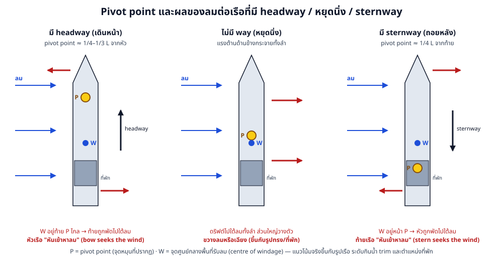
*ภาพที่ 1.9-1 ตำแหน่ง pivot point เมื่อเรือมี headway หยุดนิ่ง และมี sternway กับผลของลมด้านข้าง (แนวโน้มทั่วไป เรือจริงแต่ละลำต่างกัน)*

### 1.2 หางเสือ (Rudder)

- หางเสือสร้างแรงยก (lift) แบบปีก เมื่อมีน้ำไหลผ่าน แรงหางเสือแปรผันตาม **พื้นที่หางเสือ × (ความเร็วของน้ำที่ไหลผ่านหางเสือ)²** — น้ำที่ไหลผ่านหางเสือมี 2 ส่วน คือจากความเร็วเรือผ่านน้ำ และจาก **กระแสน้ำจากใบจักร (propeller wash / slipstream)**
- ดังนั้นที่ความเร็วต่ำ เราสามารถเพิ่มแรงหางเสือได้ด้วย **"kick ahead"** คือสั่งเครื่องเดินหน้าแรงขึ้นช่วงสั้น ๆ ขณะหางเสือหัน — ได้แรงหันหัวมากโดยความเร็วเรือเพิ่มขึ้นไม่มาก (เทคนิคที่นำร่องใช้บ่อย)
- เมื่อหยุดเครื่อง (stop engine) และความเร็วต่ำ เรือจะเสียการบังคับ (loss of steerage) — ความเร็วต่ำสุดที่ยังบังคับเรือได้อยู่ใน pilot card/wheelhouse poster
- หางเสือปกติหันได้สูงสุด **35°** แต่ละข้าง (hard over) — เกินนั้นน้ำแยกตัวจากผิวหางเสือ (stall) แรงยกลดลง หางเสือพิเศษ (เช่น flap rudder, Schilling) หันได้มากกว่า
- **SOLAS II-1/29**: เครื่องถือท้ายหลัก (main steering gear) ต้องหันหางเสือจาก 35° ข้างหนึ่งไป 35° อีกข้างได้ที่ draught สูงสุดและความเร็วเดินหน้าสูงสุด และ **จาก 35° ข้างหนึ่งไป 30° อีกข้างภายใน 28 วินาที** ส่วน **เครื่องถือท้ายสำรอง (auxiliary steering gear)** ต้องหันหางเสือจาก 15° ข้างหนึ่งไป 15° อีกข้างได้ภายใน 60 วินาที ที่ draught สูงสุดและความเร็วครึ่งหนึ่งของความเร็วเดินหน้าสูงสุดหรือ 7 นอต (ค่าที่มากกว่า) — ตัวเลขนี้คือเหตุผลที่การเลี้ยวด้วย auxiliary/emergency steering ต้องใช้ความเร็วต่ำ
- ผลข้างเคียงที่ต้องระวังเมื่อใช้หางเสือมากที่ความเร็วสูง: **เรือเอียง (heel) ออกนอกวงเลี้ยว** และความเร็วลดลงมาก — เรือที่ GM น้อย (เช่น container ที่บรรทุกบนดาดฟ้าสูง) อาจเอียงมากจนสินค้าเคลื่อนหรือคนบาดเจ็บ (รายละเอียดใน 3.2.1)

### 1.3 ใบจักร (Propeller) และแรงผลักด้านข้าง (Transverse thrust)

**ชนิดของใบจักร**
- **Fixed pitch propeller (FPP)** — มุมใบคงที่ เดินหน้า/ถอยหลังโดย **กลับทิศหมุนของเครื่อง** (เครื่องดีเซล 2 จังหวะต่อตรงต้องหยุดเครื่อง กลับ camshaft แล้วสตาร์ทด้วยลมอัด — ใช้เวลาและมี **จำนวนครั้งการสตาร์ทจำกัด** ตามความจุถังลมอัด)
- **Controllable pitch propeller (CPP)** — เพลาหมุนทิศเดียวตลอด เปลี่ยนมุมใบเพื่อเดินหน้า/ถอยหลัง → ตอบสนองเร็ว ปรับความเร็วได้ละเอียด แต่ **ที่ pitch ศูนย์ ใบจักรยังหมุน** และน้ำที่ไหลผ่านหางเสือแบบปั่นป่วนทำให้หางเสือได้ผลน้อย (ต้องระวังเรื่องคนตกน้ำ/เรือเล็กใกล้ท้ายเรือ)
- **ใบจักรคู่ (twin screw)** — ส่วนมากหมุนออกด้านนอก (outward turning) ใช้เครื่องสองข้างต่างทิศทางเพื่อหมุนเรือในที่แคบได้
- **Azimuth thruster / podded propulsion** — หันทิศแรงขับได้รอบตัว บังคับเรือได้ดีมาก แต่วิธีสั่งต่างจากเรือทั่วไป

**Transverse thrust (paddle-wheel effect)** — ใบจักรนอกจากผลักไปข้างหน้า/หลังแล้ว ยังสร้างแรงด้านข้างที่ท้ายเรือ เพราะน้ำส่วนล่างกับส่วนบนของวงใบจักรไหลไม่เท่ากัน (ใบส่วนล่างอยู่ในน้ำที่ลึกและหนาแน่นกว่า น้ำไหลเข้าไม่สม่ำเสมอเพราะรูปท้ายเรือ ฯลฯ)
- ใบจักร **เวียนขวา (right-handed)** = เมื่อเดินหน้า มองจากท้ายเรือ หมุน **ตามเข็มนาฬิกา**
- เมื่อ **ถอยหลัง** (หมุนทวนเข็มนาฬิกา) **ท้ายเรือปัดไปทางซ้าย (stern cants to port) หัวเรือหันขวา** — ผลนี้ชัดมาก โดยเฉพาะเมื่อเรือหยุดหรือช้า
- เมื่อเดินหน้า มีแรงด้านข้างเช่นกันแต่น้อยกว่ามาก และหางเสือแก้ได้
- ผลในทางปฏิบัติ: เรือใบจักรเดียวเวียนขวา **ชอบเข้าเทียบกราบซ้าย (port side to)** เพราะเมื่อสั่งถอยเพื่อหยุดเรือ ท้ายจะเข้าหาท่าและลำเรือขนานท่าเอง ถ้าเทียบกราบขวา การถอยจะดึงท้ายออกจากท่า ต้องใช้ tug/thruster ช่วย
- ใน crash stop หัวเรือมักปัดไปทางขวา (เรือใบจักรเวียนขวา) — ตอนวางแผนหลบภัยจึงต้องคิดเผื่อ
- **CPP**: ทิศ transverse thrust ตอน pitch ถอยหลังขึ้นกับทิศหมุนของเพลา — CPP ส่วนมากหมุนซ้าย (left-handed) และมักให้ผลตอนถอยคล้าย FPP เวียนขวา แต่ต้องยืนยันจาก pilot card และสังเกตจากเรือจริง

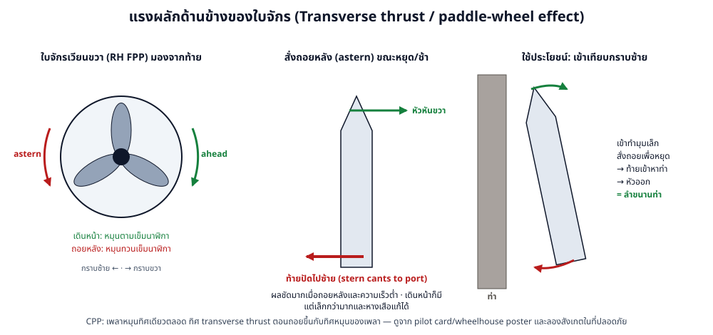
*ภาพที่ 1.9-2 ใบจักรเวียนขวามองจากท้ายเรือ ผลของ transverse thrust เมื่อถอยหลัง และการใช้ประโยชน์เมื่อเข้าเทียบกราบซ้าย*

### 1.4 Thruster และ tug

- **Bow/stern thruster** ได้ผลดีเมื่อเรือช้ามาก (โดยทั่วไปต่ำกว่าประมาณ 2–4 นอต) เมื่อเร็วกว่านั้นน้ำที่ไหลผ่านปากอุโมงค์ทำให้แรงลดลงมาก, ใช้ไฟฟ้ามาก (ต้องมีเครื่องไฟเพียงพอ — เกี่ยวกับเกณฑ์ "power systems" ของ STCW), มีเวลาจำกัดในการใช้ต่อเนื่องตามผู้ผลิต และเมื่อเรือกินน้ำตื้น (ballast) อุโมงค์อาจใกล้ผิวน้ำจนดูดอากาศ
- **Tug** — ตำแหน่งและวิธีผูก (center lead forward/aft, on the shoulder, push-pull) ขึ้นกับแผน ผู้ทำงานที่หัว/ท้ายต้องรู้คำสั่ง ระวังเชือกขาด และระวัง tug ถูก **girting** (ถูกดึงด้านข้างจนล่ม) หรือถูก interaction เมื่อเรือใหญ่ยังเร็วอยู่ (ข้อ 5.4)

### 1.5 เครื่องจักรใหญ่: ขีดจำกัดที่ OOW ต้องรู้

- **เวลาเปลี่ยนจาก full ahead → full astern** (ใน wheelhouse poster) — เครื่องดีเซลต่อตรงอาจต้องรอให้รอบลดก่อนกลับทิศ
- **Barred speed range (critical rpm)** — ช่วงรอบที่ทำให้เกิดการสั่นสะเทือนเชิงบิด (torsional vibration) ห้ามเดินเครื่องค้างในช่วงนั้น ต้องผ่านเร็ว ๆ
- **ลมสตาร์ท (starting air)** — สั่งเปลี่ยนทิศเครื่องถี่เกินไปทำให้ลมอัดหมด เครื่องสตาร์ทไม่ติดในเวลาวิกฤต ห้องเครื่องจะแจ้งจำนวนครั้งที่เหลือ
- **Load programme** — เครื่องบางรุ่นเพิ่มรอบจาก manoeuvring full ไป sea speed ได้ช้า (ใช้เวลาหลายสิบนาที) เพื่อปกป้องเครื่อง ในกรณีฉุกเฉินนายเรือเท่านั้นสั่ง override ได้
- **Manoeuvring speed vs sea speed** — "Full ahead" ใน telegraph ระหว่าง manoeuvring มักต่ำกว่า sea speed มาก ต้องรู้ทั้งสองค่า
- **Steering gear**: SOLAS V/25 ให้ใช้ steering power unit มากกว่าหนึ่งชุดในพื้นที่ที่ต้องระวังเป็นพิเศษ (ร่องน้ำ เขตจราจรหนาแน่น ทัศนวิสัยจำกัด) ถ้าทำได้ และ V/26 ให้ทดสอบระบบถือท้ายภายใน 12 ชั่วโมงก่อนออกเรือ (รายละเอียดใน 1.1.6)

---

## 2. วงเลี้ยว (Turning circle) และผลของ deadweight, draught, trim, speed, UKC

### 2.1 องค์ประกอบของวงเลี้ยว

เมื่อสั่งหางเสือ hard over (เช่น 35°) ที่ความเร็วคงที่ เรือจะเดินเป็นเส้นโค้งที่เรียกว่า turning circle มีคำศัพท์สำคัญดังนี้

| คำศัพท์ | ความหมาย |
|---|---|
| **Advance** | ระยะที่เรือเดินไป **ตามแนวเข็มเดิม** นับจากจุดสั่งหางเสือ (wheel over) จนหัวเรือเปลี่ยนไป 90° |
| **Transfer** | ระยะที่เรือเคลื่อนไป **ตั้งฉากกับเข็มเดิม** เมื่อหัวเรือเปลี่ยนไป 90° |
| **Tactical diameter** | ระยะตั้งฉากกับเข็มเดิม เมื่อหัวเรือเปลี่ยนไป **180°** |
| **Final (steady) diameter** | เส้นผ่านศูนย์กลางของวงเลี้ยวเมื่อเรือเลี้ยวคงที่แล้ว (มักเล็กกว่า tactical diameter เล็กน้อย) |
| **Drift angle** | มุมระหว่างแนวหัวเรือกับทิศทางที่ศูนย์ถ่วงเรือเคลื่อนที่จริงขณะเลี้ยว — หัวเรือ "ชี้เข้าใน" วง ท้ายเรือกวาดออกนอกวง |
| **Kick** | ช่วงแรกหลังสั่งหางเสือ แรงหางเสือดันท้ายเรือออกไปด้านตรงข้ามกับทิศเลี้ยว ทำให้ศูนย์ถ่วงเรือขยับออกเล็กน้อยก่อนเริ่มเข้าวง — **ใช้ประโยชน์ได้ เช่น คนตกน้ำกราบขวา หันหางเสือขวาทันทีเพื่อเหวี่ยงท้ายและใบจักรออกจากคน** |
| **Reach** | ระยะที่เรือเดินไปข้างหน้าก่อนเริ่มหันจริง (ช่วงหน่วงหลังสั่งหางเสือ) |
| **Rate of turn (ROT)** | อัตราการเปลี่ยนหัวเรือ (องศา/นาที) |

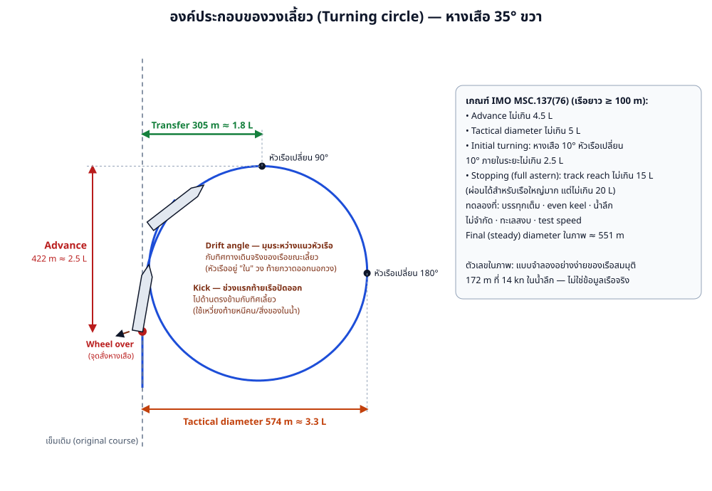
*ภาพที่ 1.9-3 องค์ประกอบของวงเลี้ยว (แบบจำลองอย่างง่ายของเรือสมมุติ 172 m ที่ 14 นอต หางเสือ 35° ขวา ในน้ำลึก)*

ขณะเลี้ยว
- **ความเร็วลดลงมาก** (อาจเหลือ 50–70% ของความเร็วเดิมเมื่อหางเสือ hard over) เพราะแรงต้านเพิ่มจาก drift angle และหางเสือ — การเลี้ยวแรงจึงเป็นวิธีลดความเร็วอย่างหนึ่ง
- **เรือเอียง** ช่วงแรกเอียงเข้าในวงเลี้ยวเล็กน้อย (แรงหางเสืออยู่ต่ำกว่าศูนย์ถ่วง) จากนั้นเอียงออกนอกวงเลี้ยว (แรงหนีศูนย์กลาง) และถ้าคืนหางเสือ midships ทันทีที่เรือเอียงออกสุด อาจเอียงเพิ่มชั่วขณะ — ถ้าต้องหยุดเลี้ยวที่ความเร็วสูง ให้ลดมุมหางเสือทีละขั้น

### 2.2 ตัวอย่างข้อมูลวงเลี้ยวและการหยุดเรือ (Pilot card สมมุติ — MV Andaman Pearl)

> ตัวเลขด้านล่างเป็นค่าสมมุติเพื่อการเรียน (คำนวณจากแบบจำลองอย่างง่ายให้สอดคล้องกัน) ไม่ใช่ข้อมูลของเรือจริงลำใด
> MV Andaman Pearl — container 1,700 TEU, LOA 172 m (LBP 162 m), B 27.3 m, Cb ≈ 0.65 (ค่าประมาณเพื่อการฝึก — ค่าตามข้อมูลบท 3.2.1 ≈ 0.71 ดูหมายเหตุในข้อ squat), ใบจักร FPP เวียนขวา ใบเดียว, bow thruster 1 ตัว

| รายการ | บรรทุกเต็ม (T 9.6 m) น้ำลึก | เรือเปล่า/ballast (T 6.5 m, trim by stern 2 m) | บรรทุกเต็ม น้ำตื้น h/T ≈ 1.2 |
|---|---|---|---|
| Full ahead (manoeuvring) | 14.0 kn | 15.0 kn | ≈ 11–12 kn (ความต้านทานเพิ่ม) |
| Half / Slow / Dead slow ahead | 11.0 / 8.0 / 5.5 kn | 12.0 / 8.5 / 6.0 kn | ลดลงตามกัน |
| Advance (35°, 14 kn) | ≈ 420 m (2.5 L) | ≈ 380 m | ≈ 650 m |
| Tactical diameter (35°) | ≈ 575 m (3.3 L) | ≈ 500 m | ≈ 1,100 m (เกือบ 2 เท่า) |
| เวลาเปลี่ยนหัว 90° / 180° | ≈ 1.5 / 2.8 นาที | สั้นกว่าเล็กน้อย | นานขึ้นมาก |
| Crash stop จาก 14 kn | ≈ 1,200 m (7 L) ≈ 5.5 นาที | สั้นกว่า (มวลน้อยกว่า) | ไม่ควรคาดหวังว่าจะสั้นลง |
| Crash stop จาก sea speed 19 kn | ≈ 1,700 m (10 L) ≈ 6 นาที | — | — |
| Inertia stop จาก 19 kn ถึง 2 kn | ≈ 7,100 m (3.9 nm) ≈ 46 นาที | สั้นกว่า | — |
| Full ahead → full astern (เวลาเครื่อง) | ≈ 45 วินาทีก่อนได้แรงถอย | | |
| Bow thruster ใช้ได้ผล | ต่ำกว่า ≈ 3 kn | | |

### 2.3 ผลของ deadweight (ระวางขับน้ำ)

- **บรรทุกมาก (displacement มาก)** → มวลและโมเมนตัมมาก **เรือเริ่มหันช้า วงเลี้ยว (advance, tactical diameter) โตขึ้น และหยุดยากขึ้น** — เมื่อเริ่มหันแล้วก็หยุดหันยากด้วย (ต้องใช้ counter rudder เร็วขึ้นและมากขึ้น)
- **เรือเปล่า** → มวลน้อย ตอบสนองเร็ว วงเลี้ยวเล็กลง หยุดได้เร็วกว่า **แต่** พื้นที่รับลมมากขึ้น (freeboard สูง) และหางเสือ/ใบจักรอาจโผล่พ้นน้ำบางส่วน ทำให้ประสิทธิภาพลดลง (เรือเปล่าจึงต้อง ballast ให้ใบจักรจมพอ — ข้อพิจารณาของ MARPOL/BWM ไม่ทำให้ละเลยข้อนี้ได้)

### 2.4 ผลของ draught (กินน้ำลึก)

- กินน้ำลึกขึ้น → พื้นที่ด้านข้างใต้น้ำ (lateral resistance) มากขึ้น ต้านการเลี้ยวและการไถลด้านข้างมากขึ้น → **วงเลี้ยวโตขึ้นและตอบสนองช้า** แต่ลมมีผลน้อยลงเพราะ freeboard ต่ำลง
- กินน้ำลึกในน้ำที่ไม่ลึกมาก → h/T ลดลง → เข้าสู่ผลของน้ำตื้น (ข้อ 2.7 และ 5)
- Draught ยังกำหนดความลึกของหางเสือและใบจักร — ยิ่งจมดียิ่งมีประสิทธิภาพ

### 2.5 ผลของ trim (ความต่างของกินน้ำหัว-ท้าย)

- **Trim by the stern (ท้ายจม)** — centre of lateral resistance เลื่อนไปทางท้าย เรือ **ทรงทิศดี (directionally stable) ถือท้ายง่าย แต่หันยากขึ้น วงเลี้ยวโตขึ้น**; หางเสือและใบจักรจมดี — เป็นเหตุผลที่เรือมักแล่นโดยมี trim by stern เล็กน้อย
- **Trim by the head (หัวจม)** — centre of lateral resistance เลื่อนไปข้างหน้า เรือ **หันง่ายขึ้น วงเลี้ยวเล็กลง แต่ทรงทิศไม่ดี ถือท้ายยาก มีแนวโน้ม sheer** (หัวเรือส่ายหาทิศเอง) โดยเฉพาะในลมและคลื่นตาม — ไม่ควรเดินเรือ trim by head ถ้าเลี่ยงได้
- squat ในน้ำตื้นทำให้ trim เปลี่ยนขณะแล่น (ข้อ 5.1) — เรือที่จอดนิ่ง even keel อาจกลายเป็น trim by head เมื่อแล่นเร็วในน้ำตื้น

### 2.6 ผลของความเร็ว (speed)

- ในน้ำลึก ที่หางเสือเท่ากันและเครื่องคงที่ **ขนาดของวงเลี้ยวเปลี่ยนไม่มากตามความเร็ว** เพราะทั้งแรงหางเสือและแรงต้านแปรผันตามความเร็วยกกำลังสองพอ ๆ กัน — แต่ **เวลาที่ใช้** เลี้ยวจะสั้นลงเมื่อเร็วขึ้น
- ที่ความเร็วต่ำมาก แรงหางเสือน้อย ถ้า **เร่งเครื่องขณะเริ่มเลี้ยว (kick ahead)** น้ำจากใบจักรที่ผ่านหางเสือเพิ่มแรงหันได้มากในขณะที่เรือยังไม่ทันเร็ว → **วงเลี้ยวเล็กลงได้มาก** — เทคนิคหันเรือในที่แคบ
- ถ้า **ลดเครื่องหรือหยุดเครื่องขณะเลี้ยว** แรงหางเสือลดทันที แต่เรือยังมีโมเมนตัม → วงเลี้ยวโตขึ้น และเสียการบังคับได้
- ความเร็วสูงในน้ำตื้นเพิ่ม squat และ interaction — ความเร็วจึงเป็นตัวแปรเดียวที่ OOW ควบคุมได้ทันทีและมีผลกับทุกเรื่อง

### 2.7 ผลของ Under-keel clearance (UKC) — น้ำตื้น

- เมื่อความลึกน้ำ (h) เทียบกับกินน้ำ (T) ลดลง น้ำใต้ท้องเรือไหลผ่านยากขึ้น เรือจะ "หนัก" ขึ้นทั้งตามยาวและด้านข้าง
- ผลต่อวงเลี้ยว: เริ่มเห็นชัดเมื่อ h/T ต่ำกว่าประมาณ 1.5–2 และ **ที่ h/T ประมาณ 1.2 tactical diameter อาจโตขึ้นเกือบ 2 เท่า** ของน้ำลึก, การตอบสนองต่อหางเสือช้า, บางลำทรงทิศดีขึ้น (หันยาก) บางลำเกิด sheer
- ผลต่อการหยุดเรือ: ความต้านทานตัวเรือเพิ่มทำให้ความเร็วลดลงเร็วกว่าในบางช่วง แต่ **มวลน้ำที่ติดไปกับเรือ (added mass) เพิ่ม** ใบจักรทำงานในน้ำที่ปั่นป่วน และการปัดหัวตอนถอยหลังอาจรุนแรงหรือคาดเดายาก — **อย่าถือว่าเรือจะหยุดได้สั้นลงในน้ำตื้น** ให้ใช้ข้อมูลจาก manoeuvring booklet และเผื่อระยะ

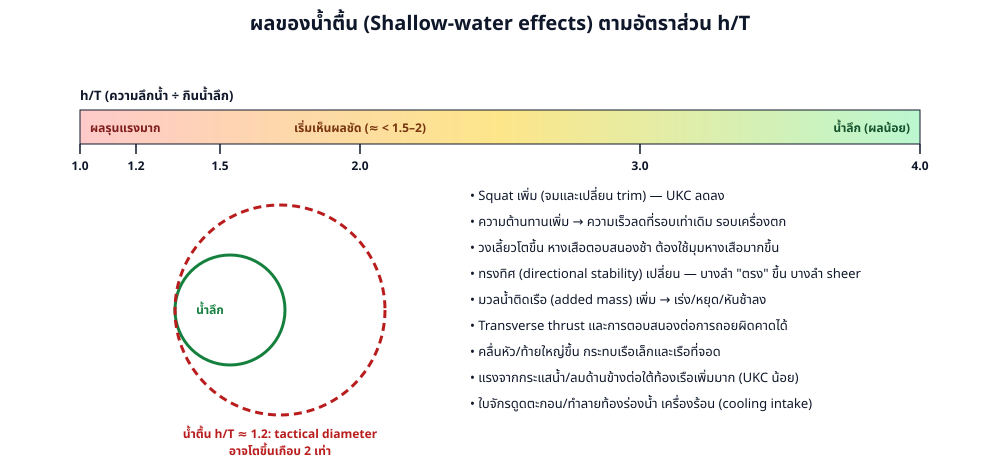
*ภาพที่ 1.9-4 ผลของน้ำตื้นตามอัตราส่วน h/T และการเปรียบเทียบขนาดวงเลี้ยวน้ำลึก/น้ำตื้น*

### 2.8 ปัจจัยอื่นที่มีผลต่อวงเลี้ยว

- **Heel/list** — เรือที่เอียงมีความต้านทานไม่สมมาตร โดยทั่วไปเรือมีแนวโน้มหันหัวไปทางด้านที่สูง (away from the low side) ขนาดของผลขึ้นกับรูปเรือ — ทำให้ต้องใช้หางเสือถ่วง (standing helm)
- **ลมและกระแสน้ำ** — วงเลี้ยวเทียบกับพื้น (over ground) จะ "ยืด" ไปตามทิศกระแส (ข้อ 4)
- **สภาพตัวเรือ** — ท้องเรือสกปรก (hull fouling) เพิ่มแรงต้าน
- **รูปเรือ** — เรือป้อม (Cb สูง) เช่น tanker/bulk หันง่ายแต่ทรงทิศไม่ดีนัก; เรือเพรียว (container) ทรงทิศดี หันยากกว่าเมื่อเทียบความยาว
- **ประเภทหางเสือ/ใบจักร** — flap rudder, twin rudder, azimuth ทำให้วงเลี้ยวเล็กกว่ามาก

**สรุปผลต่อวงเลี้ยวและการหยุดเรือ (จำง่ายสำหรับสอบปากเปล่า)**

| ปัจจัยที่เพิ่มขึ้น | วงเลี้ยว | ระยะหยุดเรือ | หมายเหตุ |
|---|---|---|---|
| Deadweight/displacement ↑ | โตขึ้น ตอบสนองช้า | **ยาวขึ้น** (โมเมนตัม = มวล × ความเร็ว) | เรือเปล่าโดนลมมาก |
| Draught ↑ | โตขึ้น | ยาวขึ้น (มวลมากขึ้น) | h/T ลด → น้ำตื้น |
| Trim by stern ↑ | โตขึ้น ทรงทิศดี | แทบไม่เปลี่ยน แต่ควบคุมหัวเรือตอนหยุดดีกว่า | trim by head → sheer, หันง่าย |
| Speed ↑ | น้ำลึก: ขนาดใกล้เดิม เวลาสั้นลง | **ยาวขึ้นมาก** (พลังงาน ∝ V²) | kick ahead จากความเร็วต่ำ → วงแคบ |
| UKC ↓ (น้ำตื้น) | **โตขึ้นมาก** (h/T 1.2 ≈ ×2) | ไม่แน่นอน อย่าคาดว่าจะสั้นลง | squat เพิ่ม หางเสือช้า |

### 2.9 นำความรู้ไปใช้: Wheel-over point และ rate of turn

ในการวางแผนเดินทาง (1.1.0) และ ECDIS เราใช้รัศมีเลี้ยว (radius of turn) และ wheel-over point (WOP)
- ความสัมพันธ์: **ROT (องศา/นาที) ≈ 0.955 × V (นอต) ÷ R (ไมล์ทะเล)** เช่น V 12 นอต รัศมี 0.5 nm → ROT ≈ 22.9°/นาที
- ระยะจาก WOP ถึงจุดตัดของสองเข็ม ≈ **R × tan(มุมเปลี่ยนเข็ม ÷ 2)** + ระยะหน่วงกว่าเรือเริ่มหัน — เช่นเปลี่ยนเข็ม 40° ที่ R = 0.5 nm → 0.5 × tan 20° ≈ 0.18 nm ก่อนถึงจุดตัด (บวกระยะหน่วงตามข้อมูลเรือ)
- การเลี้ยวด้วย ROT/radius คงที่ (เช่นใช้ autopilot โหมด radius หรือสั่ง "Port 10, steady on…") ทำให้เรืออยู่บนเส้นทางที่วางแผนได้แม่นกว่าหัน hard over แล้วแก้
- ควรตรวจ WOP ด้วย parallel index หรือ bearing/range ของจุดอ้างอิง (blind pilotage — 1.2.1-C)

---

## 3. ระยะหยุดเรือ (Stopping distances)

### 3.1 คำศัพท์และวิธีหยุดเรือ

| คำศัพท์ | ความหมาย |
|---|---|
| **Crash stop (emergency full astern)** | สั่งจาก full ahead เป็น full astern ทันที — ระยะสั้นที่สุดที่หยุดได้ด้วยเครื่อง |
| **Inertia stop (coasting stop)** | หยุดเครื่องแล้วปล่อยให้เรือไหลไปจนหยุด/ช้ามาก — ระยะยาวมาก ใช้วางแผนลดความเร็วล่วงหน้า |
| **Head reach** | ระยะตามแนวเข็มเดิมจากจุดสั่งจนเรือหยุด (ไม่มี way เมื่อเทียบน้ำ) |
| **Track reach** | ระยะตามเส้นทางที่เรือเดินจริง (ยาวกว่า head reach เมื่อเรือเบน) |
| **Lateral deviation** | ระยะที่เรือเบนออกด้านข้างจากแนวเข็มเดิม |
| **Stopping time** | เวลาที่ใช้จนเรือหยุด |

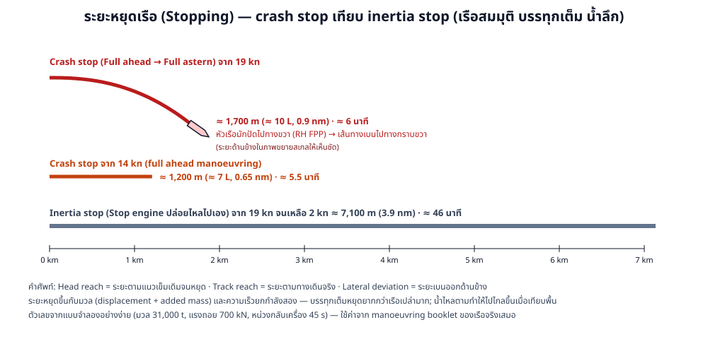
*ภาพที่ 1.9-5 เปรียบเทียบ crash stop กับ inertia stop (ค่าสมมุติจากแบบจำลองอย่างง่าย)*

**ทำไม crash stop ยังไกล?** พลังงานจลน์ของเรือ = ½ × มวล × ความเร็ว² — เรือ 31,000 ตันที่ 19 นอต มีพลังงานมหาศาล แต่แรงถอยหลังของใบจักรมีเพียงเศษเสี้ยวของแรงเดินหน้า (ใบจักรออกแบบให้ทำงานเดินหน้า ประสิทธิภาพถอยหลังต่ำ; เครื่อง turbine บางชนิดมีกำลังถอยหลังเพียงประมาณ 40% ของเดินหน้า) และเครื่องต้องใช้เวลากลับทิศ ระหว่างนั้นเรือยังไหลไปด้วยความเร็วเกือบเท่าเดิม
- **SOLAS II-1/28** กำหนดให้เรือมีกำลังถอยหลังเพียงพอที่จะควบคุมเรือในสภาวะปกติ และต้องสาธิตและบันทึกความสามารถในการหยุดเรือในการทดลองเรือ (ข้อมูลนี้คือที่มาของ wheelhouse poster)

**ระหว่าง crash stop**
- หัวเรือมักปัดไปทางหนึ่งอย่างคาดเดาได้ยาก (ใบจักรเวียนขวาส่วนมากปัดขวา) เมื่อความเร็วลดลง หางเสือเริ่มไม่มีผล
- อาจมีการสั่นสะเทือนมาก เครื่องรับภาระหนัก — จึงใช้เฉพาะเมื่อจำเป็นจริง (เพื่อหลีกเลี่ยงการโดนกัน/เกยตื้น) และ **COLREG Rule 8(e)** สนับสนุนให้ลดความเร็วหรือหยุดเรือเพื่อให้มีเวลาประเมิน แต่ต้องสั่งเร็วพอ

### 3.2 ผลของปัจจัยต่าง ๆ ต่อระยะหยุด

- **Deadweight/displacement** — ระยะหยุดแปรผันตามมวลโดยประมาณ (มวลน้ำที่ติดไปกับเรือรวมด้วย) เรือบรรทุกเต็มหยุดยากกว่าเรือเปล่าชัดเจน; VLCC บรรทุกเต็มอาจใช้หลายไมล์ทะเลและกว่า 15 นาที
- **Draught** — มากขึ้น = มวลมากขึ้น และ h/T ลดลงในน้ำตื้น
- **Trim** — มีผลน้อยต่อระยะ แต่ trim by head ทำให้หัวเรือปัดง่ายขึ้นขณะหยุด; trim by stern ใบจักรจมดีได้แรงถอยเต็มที่
- **Speed** — ผลมากที่สุด พลังงานแปรผันตามความเร็วยกกำลังสอง (ลดความเร็วจาก 19 เป็น 14 นอต ระยะ crash stop จาก ~1,700 m เหลือ ~1,200 m ในตัวอย่าง) — สังเกตว่าระยะไม่ได้ลดตาม V² เต็มที่ (19² ÷ 14² ≈ 1.84 แต่ 1,700 ÷ 1,200 ≈ 1.4) เพราะที่ความเร็วสูง **แรงต้านของตัวเรือ (∝ V²) ช่วยเบรกมาก** และช่วงที่เครื่องกำลังกลับทิศเรือยังเดินด้วยความเร็วเกือบเท่าเดิม (ส่วนนี้ ∝ V) — ใช้ตัวเลขจาก manoeuvring booklet จริงเสมอ
- **UKC/น้ำตื้น** — ดูข้อ 2.7 อย่าคาดหวังว่าจะสั้นลง ใบจักรอาจดูดตะกอน การปัดหัวรุนแรงขึ้น
- **ลมและกระแสน้ำ** — กระแสตามเพิ่มระยะเทียบพื้น; ลมต้านช่วยลด; ลมด้านข้างทำให้เรือเบน
- **ชนิดเครื่อง** — CPP และ diesel-electric ตอบสนองเร็วกว่า FPP ดีเซลต่อตรง; turbine กำลังถอยต่ำ
- **สภาพใบจักร/ตัวเรือ** — ท้องเรือสกปรกเพิ่มแรงต้าน (ช่วยลด) แต่ใบจักรสกปรก/เสียหายลดแรงถอย

### 3.3 วิธีลดความเร็วหรือหลีกเลี่ยงสิ่งกีดขวางนอกจาก crash stop

- **Hard-over turn** — ถ้ามีที่ว่างด้านข้าง การหันหางเสือสุดทำให้ **ระยะเดินไปข้างหน้า (advance) สั้นกว่า head reach ของ crash stop มาก** และยังบังคับเรือได้ตลอด — ในหลายสถานการณ์การหันหลบดีกว่าการพยายามหยุด
- **Rudder cycling** — หันหางเสือ hard over สลับซ้าย-ขวาเพื่อเพิ่มแรงต้าน ลดความเร็วโดยไม่เสียการบังคับ (ใช้ได้เมื่อมีที่ว่าง)
- **ลดความเร็วล่วงหน้าตามแผน** — ใช้ข้อมูล inertia stop วางแผนจุดลดเครื่อง (เช่นก่อนถึง pilot station) อย่ารอให้ต้องถอยเครื่อง
- **สมอ (emergency anchoring)** — ที่ความเร็วต่ำมาก สมอช่วยหยุด/คุมหัวเรือได้ แต่ที่ความเร็วสูงอุปกรณ์สมอจะเสียหายหรือสูญหาย และอาจทำให้เรือเสียหาย (ข้อ 7.8)
- **Tug** ในเขตท่า

---

## 4. ผลของลมและกระแสน้ำต่อการบังคับเรือ

### 4.1 ลม (Wind)

**ปัจจัยที่กำหนดผลของลม**
- **พื้นที่รับลม (windage area)** — ด้านข้างและด้านหน้า เรือ container ที่มีตู้บนดาดฟ้าสูง เรือขนรถ (PCTC) เรือโดยสาร และเรือเปล่า (freeboard สูง) ได้รับผลมาก
- **ตำแหน่งจุดศูนย์กลางพื้นที่รับลม (centre of windage)** เทียบกับ pivot point — เรือที่พักอยู่ท้าย จุดนี้มักอยู่ค่อนท้าย
- **ความเร็วเรือ** — ที่ความเร็วต่ำ แรงหางเสือน้อย ลมจึงมีผล "สัมพัทธ์" มากขึ้นมาก เรือที่ถือท้ายง่ายที่ 14 นอตอาจคุมไม่อยู่ที่ 4 นอตในลม 30 นอต
- **ความลึกน้ำใต้ท้องเรือ** — ในน้ำตื้นแรงต้านด้านข้างของตัวเรือสูง เรือไถลตามลมน้อยลง

**พฤติกรรมของเรือในลมด้านข้าง (แนวโน้มทั่วไป)** — ภาพที่ 1.9-1
- **มี headway**: pivot point อยู่หน้า ลมที่กระทำบริเวณกลาง-ท้ายมี lever ยาว → **ท้ายถูกพัดไปใต้ลม หัวเรือหันเข้าหาลม** (ต้องถือหางเสือถ่วงไปทางใต้ลม)
- **หยุดนิ่ง**: เรือไถลไปใต้ลมทั้งลำ ส่วนมากจะวางตัวขวางลมหรือเฉียง ขึ้นกับรูปทรงและที่พัก
- **มี sternway**: pivot point อยู่ท้าย → **ท้ายเรือหันเข้าหาลม (stern seeks the wind)** หัวตกไปใต้ลม — ร่วมกับ transverse thrust อาจเสริมหรือหักล้างกัน
- เรือแล่นช้าในลมแรงมี **leeway** — ต้องคำนวณเข็มถือเผื่อเหมือนกระแสน้ำ

**การประมาณแรงลม** — แรงลม ≈ ½ × ρ(อากาศ) × Cd × A × V²
- ρ อากาศ ≈ 1.225 kg/m³, Cd ≈ 1.0 (ประมาณสำหรับลมด้านข้าง), A = พื้นที่รับลม (m²), V = ความเร็วลม (m/s)
- **ตัวอย่าง:** Andaman Pearl บรรทุกเต็มมีตู้บนดาดฟ้า พื้นที่ด้านข้างเหนือน้ำ ≈ 172 × 22 ≈ 3,800 m² ลมขวางลำ 25 นอต (12.9 m/s) → แรง ≈ 0.5 × 1.225 × 1.0 × 3,800 × 12.9² ≈ 385 kN ≈ **39 ตัน** — ถ้าลม 35 นอต แรงเพิ่มเป็น ≈ **77 ตัน** (ลมเพิ่ม 40% แรงเพิ่มเกือบ 2 เท่า เพราะแปรผันตาม V²)
- ใช้ตัวเลขแบบนี้ประเมินว่าต้องใช้ tug กำลังลาก (bollard pull) รวมเท่าไรเพื่อดันเรือเข้าท่า/กันเรือไม่ให้ถูกพัดเข้าท่า และเผื่อส่วนปลอดภัย

**ลมกับการเข้าออกท่า**
- **ลมพัดออกจากท่า (off the berth)** — ต้องเข้ามุมกว้างขึ้นและส่งเชือกเร็ว เรือจะถูกพัดออกเมื่อช้าลง
- **ลมพัดเข้าท่า (on the berth)** — เรือจะถูกพัดเข้าหาท่าเร็วเกินไป ต้องหยุดเรือห่างท่าแล้วให้ลมพัดเข้าช้า ๆ โดยมี tug ควบคุมอัตราการเข้า (อย่าให้กระแทกท่า)
- ตอนออกจากท่าในลมพัดเข้าท่า ต้องมี tug ดึงออก — springing off (ข้อ 8) อาจไม่พอ

### 4.2 กระแสน้ำ (Current / tidal stream)

**หลักสำคัญ**: เรือเคลื่อนไปกับมวลน้ำ — กระแสน้ำ **ไม่เปลี่ยนการบังคับเรือเทียบกับน้ำ** แต่เปลี่ยน **ทางเดินและความเร็วเทียบพื้น (over ground)** ปัญหาจึงเกิดเมื่อ
1. **อยู่ใกล้สิ่งที่อยู่กับที่** — ท่า ทุ่น ตลิ่ง สมอ เรือทอดสมอ
2. **กระแสไม่เท่ากันตลอดลำ** — หัวกับท้ายอยู่ในกระแสต่างกัน (ทางเข้าท่าที่มีกระแสขวาง ปากแม่น้ำ หัวโค้งแม่น้ำ ปลายเขื่อนกันคลื่น) เกิดแรงหมุนที่เราไม่ได้สั่ง
3. **ความเร็วเทียบน้ำต่ำ** — เมื่อลดความเร็วเพื่อเข้าท่า กระแสน้ำที่ส่งผลเท่าเดิมกลายเป็นสัดส่วนที่ใหญ่ขึ้น

**แนวปฏิบัติ**
- **Stem the current (หันหัวเข้าหากระแส)** เมื่อเข้าท่า ทอดสมอ หรือรอ — ความเร็วเทียบน้ำยังมีพอให้หางเสือทำงาน แต่ความเร็วเทียบพื้นต่ำ ควบคุมได้ดี
- **กระแสตาม (following current)** อันตรายเมื่อเข้าท่าหรือเข้าโค้ง — ความเร็วเทียบพื้นสูงทั้งที่ความเร็วเทียบน้ำต่ำ หางเสือไม่พอ และหยุดยาก
- **โค้งแม่น้ำ** — กระแสแรงด้านนอกโค้ง (outer bank) และมักลึกกว่า, ด้านในโค้งมีน้ำตื้นและกระแสอ่อน/ไหลวน
- **ทางเข้าท่าที่มีกระแสขวาง** — ขณะหัวเรือเข้าสู่น้ำนิ่งหลังเขื่อนกันคลื่น ท้ายยังอยู่ในกระแส → ท้ายถูกพัด เรือหันเอง ต้องเตรียมหางเสือและเครื่อง
- **การเลี้ยวในกระแส** — วงเลี้ยวเทียบพื้นจะถูกพัดไปตามกระแส ถ้ากลับลำ (turn round) ในแม่น้ำ ให้หันหัวเข้าหากระแสในช่วงที่เรือขวางลำน้อยที่สุด

**แรงของกระแสน้ำ** — สูตรเดียวกับลม แต่ใช้ความหนาแน่นของน้ำทะเล (≈ 1,025 kg/m³ ≈ 830 เท่าของอากาศ) และพื้นที่ใต้น้ำ
- กระแสขวางลำ 1 นอตบนพื้นที่เดียวกัน ≈ ลมขวางลำประมาณ **29 นอต** (√830 ≈ 29)
- **ตัวอย่าง:** Andaman Pearl กินน้ำ 9.6 m พื้นที่ด้านข้างใต้น้ำ ≈ 172 × 9.6 ≈ 1,650 m² กระแสขวาง 1 นอต (0.51 m/s) Cd ≈ 0.8 → แรง ≈ **18 ตัน** — และในน้ำตื้นที่ UKC น้อย Cd ด้านข้างเพิ่มได้หลายเท่า (น้ำไหลลอดใต้ท้องเรือไม่ได้) แรงจึงอาจเป็น 50 ตันขึ้นไป **กระแสขวางจึงอันตรายมากในท่าน้ำตื้น**

**ตัวอย่างจำลอง: คำนวณเข็มถือเผื่อกระแส (course to steer)**
> ต้องการเดินตาม track 090° ความเร็วเรือผ่านน้ำ 10 นอต กระแสน้ำไหลไปทิศ 180° (set) ความเร็ว 1.5 นอต (drift)
> - องค์ประกอบกระแสที่ตั้งฉากกับ track = 1.5 × sin(180° − 90°) = 1.5 นอต ไปทางขวาของ track
> - มุมแก้ = arcsin(1.5 ÷ 10) ≈ 8.6° → **ต้องถือเข็มเข้าหากระแส: CTS ≈ 081°**
> - ความเร็วเทียบพื้น ≈ 10 × cos 8.6° ≈ **9.9 นอต**
> ตรวจผลด้วย cross track error บน ECDIS/เรดาร์ และปรับเมื่อกระแสเปลี่ยน (โดยเฉพาะเมื่อเข้าใกล้ฝั่ง)

### 4.3 ลมและกระแสร่วมกัน

- เมื่อลมกับกระแสไปทางเดียวกัน ผลเสริมกัน; สวนกัน ผลหักล้างและเกิดคลื่นสั้นชัน (wind against tide)
- เรือทอดสมอหรือเรือหยุดจะวางตัวตาม **ผลรวม** ของลมและกระแส — เรือเปล่าตามลมมากกว่า เรือบรรทุกเต็มตามกระแสมากกว่า ทำให้เรือที่ทอดสมอใกล้กันอาจหันไปคนละทิศ (ระวังวงแกว่งทับกัน)
- ตอนเข้าท่า ให้ประเมินทั้งสองอย่างจากพยากรณ์ อุปกรณ์วัดลมบนเรือ ATT/Tidal stream atlas ข้อมูล VTS/นำร่อง และสังเกตทุ่น (ทุ่นเอียง/น้ำวนที่ทุ่นบอกกระแสได้ดี)

---

## 5. Squat, ผลของน้ำตื้น และผลที่คล้ายกัน (bank effect, interaction)

### 5.1 Squat

**นิยาม**: การที่เรือ **จมลงทั้งลำและเปลี่ยน trim** เมื่อแล่นผ่านน้ำ — เกิดเพราะน้ำที่ถูกเรือแทนที่ต้องไหลผ่านข้างและใต้ท้องเรือเร็วขึ้น ตามหลัก Bernoulli ความดันลดลง ระดับน้ำรอบเรือต่ำลง เรือจึงจมลง (ไม่ใช่เรือ "หนัก" ขึ้น แต่ผิวน้ำรอบเรือลดลง) ยิ่งน้ำตื้นหรือร่องแคบ น้ำต้องไหลเร็วขึ้น squat ยิ่งมาก

**ปัจจัยหลัก**
1. **ความเร็วผ่านน้ำ (ไม่ใช่เทียบพื้น)** — squat แปรผันประมาณ **V²** (สูตรทั่วไปของ Barrass ใช้ V^2.08) → **ปัจจัยที่สำคัญที่สุดและควบคุมได้**
2. **Block coefficient (Cb)** — เรือป้อมมี squat มากกว่า
3. **Blockage factor (S)** = พื้นที่หน้าตัดกลางลำเรือที่จมน้ำ ÷ พื้นที่หน้าตัดร่องน้ำ = (b × T) ÷ (B × h) สำหรับร่องสี่เหลี่ยม
4. **h/T** — ยิ่งน้อยยิ่งมาก (เริ่มมีนัยสำคัญเมื่อ h/T ต่ำกว่าประมาณ 1.5–2)
5. **Static trim** — squat มักไปเพิ่มด้านที่จมอยู่แล้ว
6. **การผ่าน/แซงเรืออื่นในร่องน้ำ** — พื้นที่หน้าตัดที่น้ำไหลได้ลดลงชั่วขณะ squat ของทั้งสองลำเพิ่ม (อาจเกือบ 2 เท่า)

**สูตรของ Barrass (ใช้ประมาณ — V เป็นนอต ผลเป็นเมตร)**
- **น้ำเปิด (open water, S < ~0.10)**: squat สูงสุด ≈ **Cb × V² ÷ 100**
- **ร่องน้ำจำกัด (confined channel, S ≈ 0.10–0.265)**: squat สูงสุด ≈ **Cb × V² ÷ 50** (ประมาณ 2 เท่าของน้ำเปิด)
- สูตรทั่วไป: squat สูงสุด ≈ **Cb × S^0.81 × V^2.08 ÷ 20**
- ข้อจำกัด (จดกันลืม): สูตรของ Barrass เป็นสูตรเชิงประสบการณ์ ใช้ได้ดีในช่วง h/T ที่ไม่ตื้นมากหรือลึกมาก (ตำราของ Barrass ระบุช่วงราว h/T 1.1–1.4 — ตรวจกับตำรา) และให้ค่า **squat สูงสุดที่หัวหรือท้าย** ไม่ใช่ค่าเฉลี่ย; บริษัท/ท่าบางแห่งใช้วิธีอื่น (เช่น ICORELS, PIANC) — ใช้ค่าที่ระบบ UKC ของท่าหรือบริษัทกำหนด

**squat เกิดที่หัวหรือท้าย?** (ในกรณีเรือ even keel ขณะจอด)
- **Cb > 0.7** (tanker, bulk carrier — เรือป้อม) → squat สูงสุดที่ **หัว** (trim by head)
- **Cb < 0.7** (container, เรือโดยสาร — เรือเพรียว) → squat สูงสุดที่ **ท้าย** (trim by stern)
- **Cb ≈ 0.7** → จมเกือบเท่ากันทั้งลำ
- ถ้าเรือมี static trim อยู่แล้ว squat สูงสุดมักเกิดที่ปลายที่จมกว่า

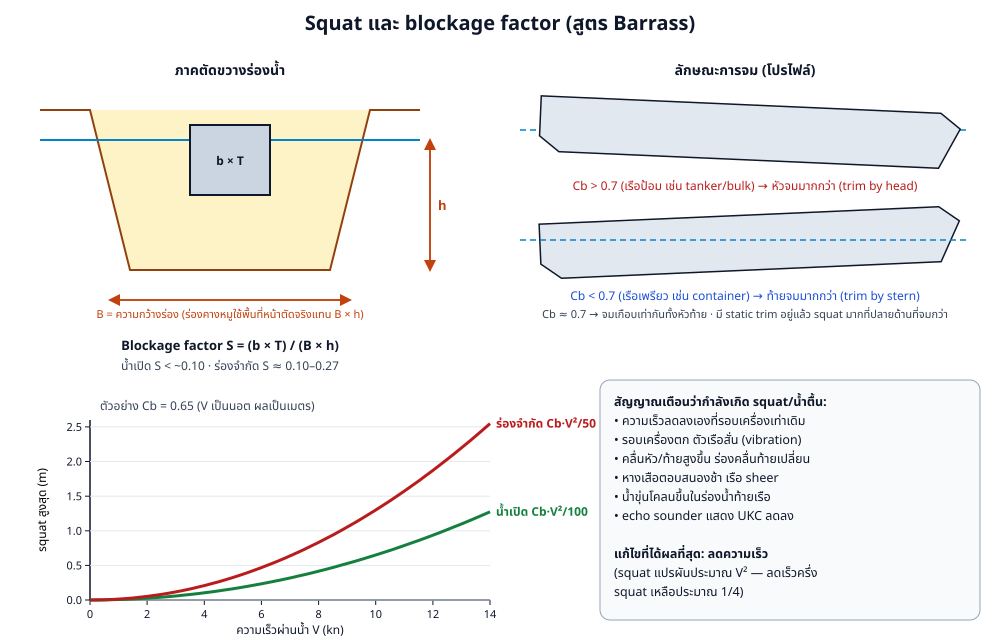
*ภาพที่ 1.9-6 Blockage factor ลักษณะการจมตาม Cb และกราฟ squat เทียบความเร็ว (Cb 0.65)*

**ตัวอย่างจำลอง: ตรวจ squat ก่อนเข้าร่องน้ำ (ร่องน้ำสมมุติ)**
> Andaman Pearl: T = 9.6 m (even keel), b = 27.3 m, Cb = 0.65 · ความลึกน้ำจริงในร่อง (charted depth + height of tide) h = 11.5 m → h/T = 1.2 · static UKC = 1.9 m · นโยบายบริษัท: dynamic UKC ขั้นต่ำ 10% ของ draught = 0.96 m
>
> **กรณี A — ร่องน้ำกว้าง 200 m**: S = (27.3 × 9.6) ÷ (200 × 11.5) ≈ 0.114
>
> | ความเร็วผ่านน้ำ | squat (สูตรทั่วไป) | dynamic UKC | ผล |
> |---|---|---|---|
> | 6 kn | ≈ 0.23 m | ≈ 1.67 m | ผ่าน |
> | 8 kn | ≈ 0.42 m | ≈ 1.48 m | ผ่าน |
> | 10 kn | ≈ 0.67 m | ≈ 1.23 m | ผ่าน |
> | 12 kn | ≈ 0.98 m | ≈ 0.92 m | **ไม่ผ่าน** (ต่ำกว่า 0.96 m) |
>
> **กรณี B — ช่วงร่องแคบ 100 m**: S ≈ 0.228
>
> | ความเร็วผ่านน้ำ | squat | dynamic UKC | ผล |
> |---|---|---|---|
> | 6 kn | ≈ 0.41 m | ≈ 1.49 m | ผ่าน |
> | 8 kn | ≈ 0.74 m | ≈ 1.16 m | ผ่าน |
> | 10 kn | ≈ 1.18 m | ≈ 0.72 m | **ไม่ผ่าน** |
> | 12 kn | ≈ 1.72 m | ≈ 0.18 m | **อันตรายมาก** |
>
> **ข้อสรุปที่บันทึกในแผน**: ช่วงร่องกว้างจำกัดความเร็วผ่านน้ำไม่เกิน 10 นอต ช่วงร่องแคบไม่เกิน 8 นอต (ต้องเผื่อคลื่น/การโคลงและความคลาดเคลื่อนของความลึกด้วย — ดู 1.1.0) ถ้ามีกระแสตาม ความเร็วเทียบพื้นจะมากกว่านี้แต่ **squat ขึ้นกับความเร็วผ่านน้ำ** และเมื่อสวนกับเรือลำอื่นในร่องแคบให้ลดความเร็วเพิ่มอีก

> **จดไว้กันลืม — ความสอดคล้องของค่า Cb ในสมุดเล่มนี้**: ตัวอย่างในบทนี้ใช้ Cb ≈ 0.65 ซึ่งเป็นค่าประมาณเพื่อการฝึก แต่ถ้าคำนวณจากข้อมูลเรือลำเดียวกันในบท 3.2.1 (LBP 162 m, B 27.3 m, T 9.6 m, Δ 31,000 t ในน้ำทะเล 1.025 t/m³) จะได้ Cb = 31,000 ÷ (1.025 × 162 × 27.3 × 9.6) ≈ **0.71** — สูตร squat แปรผันตรงกับ Cb จึงต้องใช้ค่า Cb ตามจริงจากเอกสารของเรือ (คิดจาก LBP ที่ draught นั้น) เสมอ ถ้าคำนวณใหม่ด้วย Cb 0.71: กรณี A ที่ 10 kn squat ≈ 0.74 m (dynamic UKC ≈ 1.16 m ผ่าน) และที่ 12 kn ≈ 1.08 m (UKC ≈ 0.82 m ไม่ผ่าน); กรณี B ที่ 8 kn squat ≈ 0.81 m (UKC ≈ 1.09 m ผ่าน) และที่ 10 kn ไม่ผ่าน — ข้อสรุปเรื่องจำกัดความเร็วยังเหมือนเดิม แต่ระยะเผื่อแคบลงประมาณ 10%

**สัญญาณเตือนว่ากำลังเกิด squat/น้ำตื้นมาก**
- ความเร็วลดลงเองทั้งที่รอบเครื่องเท่าเดิม และรอบเครื่องตก
- ตัวเรือสั่น (vibration) มากผิดปกติ
- คลื่นหัวเรือ/ท้ายเรือสูงขึ้น คลื่นท้ายเรือเปลี่ยนรูป ร่องคลื่นตามตัวเรือชัด
- หางเสือตอบสนองช้า เรือส่าย/sheer
- น้ำขุ่นโคลนในร่องน้ำท้ายเรือ
- echo sounder แสดง UKC ลดลง (ถ้าตั้ง offset ถูกต้อง — 1.1.4)

**การแก้/ป้องกัน**: **ลดความเร็วผ่านน้ำ** (ลดเร็วครึ่งหนึ่ง squat เหลือประมาณ 1/4), วางแผน UKC ที่รวม squat ไว้ (1.1.0 และ safety contour ใน ECDIS 1.4), รักษาตำแหน่งกลางร่อง หลีกเลี่ยงการสวน/แซงในช่วงแคบที่สุด, ปรับ trim ก่อนเข้าร่องถ้าจำเป็น, เฝ้าดู echo sounder

### 5.2 ผลอื่นของน้ำตื้น (Shallow-water effects)

รวบรวมจากข้อ 2.7 และภาพที่ 1.9-4
- ความต้านทานเพิ่ม → ความเร็วลด รอบเครื่องตก เครื่องรับภาระมากขึ้น (ระวังเกินขีดจำกัด — เกณฑ์ STCW)
- วงเลี้ยวโตขึ้น หางเสือตอบสนองช้า ต้องใช้มุมหางเสือมากขึ้น
- มวลน้ำติดเรือ (added mass) เพิ่ม → เร่ง หยุด หัน ช้าลง
- ทรงทิศเปลี่ยน, transverse thrust และพฤติกรรมตอนถอยเปลี่ยน
- คลื่นที่เรือสร้าง (wash) ใหญ่ขึ้น กระทบเรือเล็ก เรือที่จอด และตลิ่ง
- แรงจากกระแสและลมด้านข้างต่อตัวเรือเพิ่ม
- ใบจักรดูดตะกอน ท่อน้ำระบายความร้อนของเครื่อง (sea chest) อาจดูดโคลนจนเครื่องร้อน — แจ้งห้องเครื่องก่อนเข้าน้ำตื้น ให้เปลี่ยนไปใช้ high sea chest ถ้ามี

### 5.3 Bank effect (ผลของตลิ่ง)

เมื่อเรือแล่นขนานและใกล้ตลิ่งหรือขอบร่องน้ำ (รวมทั้งขอบร่องที่อยู่ใต้น้ำ)
- น้ำระหว่างเรือกับตลิ่งไหลเร็วขึ้น ความดันลด → **ท้ายเรือถูกดูดเข้าหาตลิ่ง (bank suction)** — ท้ายเรือรับผลมากกว่าเพราะใบจักรดูดน้ำด้านนั้นด้วย
- ที่หัวเรือ น้ำถูกอัดระหว่างหัวกับตลิ่ง → **หัวเรือถูกดันออก (bank cushion)**
- ผลรวม: **เรือหันหัวหนีตลิ่ง (sheer away) และทั้งลำถูกดึงเข้าตลิ่ง** — ถ้าไม่แก้ เรืออาจ sheer ข้ามร่องไปชนตลิ่งฝั่งตรงข้ามหรือเรือที่สวนมา
- **ปัจจัย**: ความเร็ว (สำคัญที่สุด), ระยะจากตลิ่ง, UKC น้อย, ตลิ่งชัน
- **การแก้**: ลดความเร็ว (แต่ต้องรักษาแรงหางเสือ), รักษาระยะจากตลิ่ง, **ถือหางเสือเข้าหาตลิ่ง (standing helm toward the bank)** เพื่อชดเชย — ฟังดูขัดความรู้สึกแต่ถูกต้อง, ระวังเมื่อตลิ่งเปลี่ยน (ปลายตลิ่ง ช่องเปิด) แรงจะหายทันทีและหางเสือที่ถืออยู่จะหันเรือเข้าตลิ่ง
- ผลคล้ายกัน: **"smelling the ground"** — เมื่อหัวเรือเข้าใกล้สันดอนใต้น้ำ น้ำที่ถูกอัดดันหัวเรือออก (บางครั้งเตือนเราได้ว่ามีที่ตื้นอยู่ใกล้)

### 5.4 Interaction ระหว่างเรือ (Ship-to-ship interaction)

เรือที่แล่นมี **สนามความดัน (pressure field)** — ความดันสูงที่หัวและท้าย ความดันต่ำช่วงกลางลำ เมื่อสนามความดันของสองลำซ้อนกันจะเกิดแรงผลัก/ดูดและแรงหมุน ผลมากเมื่อ **ความเร็วสูง ระยะด้านข้างน้อย น้ำตื้น ร่องแคบ และเรือขนาดต่างกันมาก** (ลำเล็กโดนมากกว่า)

**การแซงในร่องน้ำแคบ (overtaking)** — อันตรายกว่าการสวน เพราะใช้เวลานานกว่าที่เรือจะอยู่ในสนามความดันของกันและกัน
1. **หัวเรือแซงเข้าใกล้ท้ายเรือถูกแซง** — ความดันสูงเจอกัน (+/+) ผลักกัน: ท้ายเรือถูกแซงถูกดันออก ทำให้ **หัวเรือถูกแซงหันเข้าหาทางเรือแซง**; หัวเรือแซงถูกผลักออก
2. **ขนานกันช่วงกลางลำ** — ความดันต่ำเจอกัน (−/−) **ดึงเข้าหากันทั้งสองลำ**
3. **หัวเรือถูกแซงอยู่ช่วงกลาง-ท้ายเรือแซง** — หัวเรือถูกแซงถูกดูดเข้าหา แล้วอาจ **sheer ตัดท้ายเรือแซง** — ช่วงที่เกิดอุบัติเหตุบ่อยที่สุด

**การสวนกัน (head-on passing)** — ตอนหัวเรือใกล้กัน หัวทั้งสองถูกผลักออก (ช่วยให้แยกกัน) ช่วงกลางลำดูดเข้าหากัน และเมื่อท้ายผ่านกัน ท้ายถูกผลักออกทำให้หัวหันเข้าหากลางร่อง/เข้าหาท้ายอีกลำได้ — ต้องเตรียมหางเสือแก้

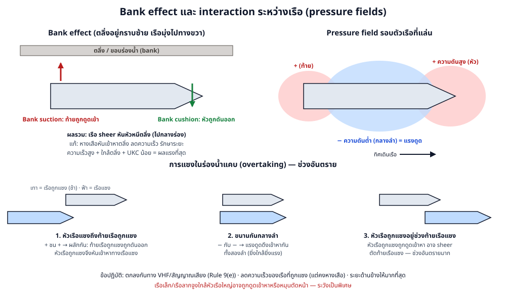
*ภาพที่ 1.9-7 Bank effect, pressure field รอบตัวเรือ และช่วงต่าง ๆ ของการแซงในร่องน้ำแคบ*

**กรณีอื่น**
- **ผ่านเรือที่จอดเทียบท่า** — แรงดูด/ผลักทำให้เรือที่จอดเคลื่อน (surge/sway) เชือกขาด ทางขึ้นเรือ (gangway) หลุด แขนขนถ่ายน้ำมันเสียหาย → **ลดความเร็วก่อนถึง** (ไม่ใช่ขณะผ่าน) และรักษาระยะ
- **เรือลากจูง/เรือเล็กใกล้หัวเรือใหญ่** — อาจถูกดูดเข้าหัวเรือ หรือถูกผลักแล้วหมุนตัดหน้าเรือใหญ่จนถูกชน (เป็นเหตุให้ tug ล่มมาแล้ว) → เรือใหญ่ต้องช้าเมื่อ tug เข้ามาผูก (โดยทั่วไปไม่เกินประมาณ 6 นอต ตามที่ตกลงกับนำร่อง/tug master)
- **ในประตูน้ำ (lock) และคลอง** — ผล piston (น้ำถูกอัดหน้าเรือ) ทำให้เรือเข้าช้าลงหรือกระเด้งกลับ
- **กรณีศึกษาทางประวัติศาสตร์**: การโดนกันระหว่าง RMS *Olympic* กับเรือรบ HMS *Hawke* ในปี 1911 บริเวณ Solent ประเทศอังกฤษ ถูกอธิบายว่าเกิดจากแรงดูดระหว่างเรือ (interaction) เป็นตัวอย่างที่ถูกยกในตำราการบังคับเรือ

**ข้อปฏิบัติของ OOW**
- ตกลงกันก่อนแซง/สวนในร่องแคบทาง VHF และสัญญาณเสียงตาม **COLREG Rule 9(e)** (ดู 1.2.1-A)
- เรือที่ถูกแซง **ลดความเร็ว** (ช่วยให้แซงเสร็จเร็วและลดผล) แต่ต้องคงแรงหางเสือพอ; เรือแซงใช้ความเร็วที่จำเป็นต่ำสุด
- ระยะด้านข้างมากที่สุดเท่าที่ร่องน้ำอนุญาต
- หางเสือพร้อมแก้ — มีคนถือท้ายด้วยมือ (hand steering) ไม่ใช้ autopilot ในร่องแคบ
- เลือกจุดสวน/แซงในที่กว้างที่สุดตามแผน (passing places)

---

## 6. การหันเรือและขั้นตอนช่วยคนตกน้ำ (Person overboard)

> การกระทำทันทีของ OOW (โยนห่วงชูชีพ, กด MOB, แจ้งเหตุ, ชักธง O ฯลฯ) อยู่ในบท 1.5 และการค้นหาตาม IAMSAR อยู่ในบท 1.6 — บทนี้เน้น **การบังคับเรือ**

### 6.1 สามสถานการณ์ตาม IAMSAR Vol III

| สถานการณ์ | ลักษณะ | การหันเรือที่เหมาะ |
|---|---|---|
| **Immediate action** | เห็นคนตกน้ำจากสะพานเดินเรือหรือได้รับแจ้งทันที | **Anderson (single turn)** หรือ **Williamson** |
| **Delayed action** | ผู้พบเห็นรายงานเหตุหลังเกิดไประยะหนึ่ง (รู้เวลาโดยประมาณ) | **Williamson** หรือ **Scharnow** |
| **Person missing** | รู้ว่าคนหายไปจากเรือแต่ไม่รู้ว่าเมื่อไร | **Williamson** (หรือ Scharnow) กลับตามเส้นทางเดิม แล้วค้นหาตามรูปแบบ IAMSAR |

### 6.2 ขั้นตอนการหันเรือ (ตาม IAMSAR Vol III)

**Williamson turn**
1. หางเสือ hard over (กรณี immediate action — **ไปทางกราบที่คนตก** เพื่อเหวี่ยงท้าย/ใบจักรออก)
2. เมื่อหัวเรือเบนจากเข็มเดิม **60°** → หางเสือ hard over ไปอีกข้าง
3. เมื่อหัวเรือ **ห่างจากเข็มกลับ (reciprocal) 20°** → หางเสือ midships ให้เรือหันต่อไปจนอยู่บนเข็มกลับ
- **ข้อดี**: กลับมาบน **แนวเส้นทางเดิม (ทิศตรงข้าม)** — ดีมากเมื่อมองไม่เห็นคน กลางคืน ทัศนวิสัยจำกัด delayed action; ทำง่าย
- **ข้อเสีย**: ใช้เวลานาน และในกรณี immediate action จะพาเรือห่างจากจุดเกิดเหตุมากกว่าวิธีอื่น
- (มุม 60° เป็นค่าทั่วไป เรือแต่ละลำอาจปรับตามการทดลอง — ควรทดลองและบันทึกค่าที่เหมาะกับเรือของเรา)

**Anderson turn (single turn / 270° manoeuvre)**
1. หางเสือ hard over (กรณี immediate action — ไปทางกราบที่คนตก)
2. เมื่อหัวเรือเบนจากเข็มเดิมประมาณ **250°** → หางเสือ midships และเริ่ม **หยุดเรือ (stopping manoeuvre)**
- **ข้อดี**: **เร็วที่สุด** สำหรับ immediate action; เหมาะกับเรือที่เลี้ยวแคบและมีกำลังเครื่องมาก (เช่นเรือใบจักรคู่)
- **ข้อเสีย**: เรือใบจักรเดียวทำได้ยาก เพราะการเข้าหาคนไม่เป็นเส้นตรง ต้องกะจังหวะหยุดเรือให้ดี

**Scharnow turn**
1. หางเสือ hard over
2. เมื่อหัวเรือเบนจากเข็มเดิม **240°** → หางเสือ hard over ไปอีกข้าง
3. เมื่อหัวเรือห่างจากเข็มกลับ 20° → midships ให้เรือหันจนอยู่บนเข็มกลับ
- **ข้อดี**: พาเรือกลับเข้า **ร่องคลื่นท้ายเรือเดิม (wake)** โดยใช้ระยะทางน้อยกว่า Williamson ประหยัดเวลา
- **ข้อเสีย**: **ใช้ไม่ได้ผลถ้าไม่รู้เวลาที่เกิดเหตุถึงเวลาเริ่มหันเรือ** และไม่เหมาะ immediate action (เรือจะกลับมาที่เส้นทางเดิมเลยจุดคนตกไปแล้ว)

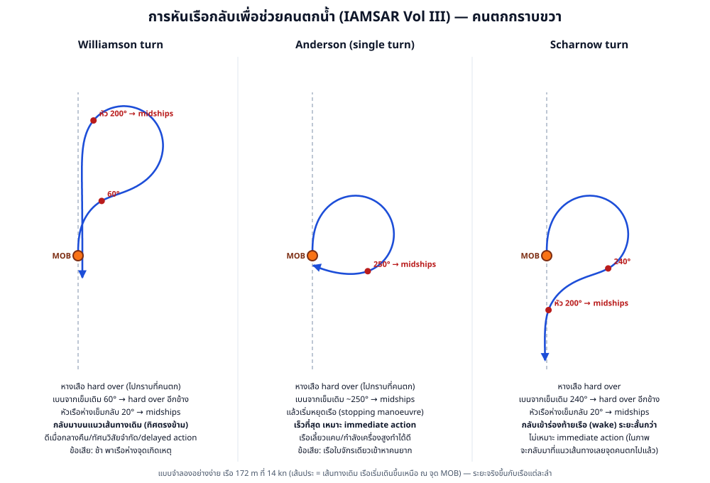
*ภาพที่ 1.9-8 Williamson, Anderson และ Scharnow turn (แบบจำลองอย่างง่าย คนตกกราบขวาที่จุด MOB)*

### 6.3 การเข้าหาและเก็บคนขึ้นเรือ

- **ให้ผู้ชี้ (pointer/spotter) ชี้ไปที่คนตลอดเวลา** ห้ามละสายตา — ระหว่างหันเรือเป็นเรื่องง่ายมากที่จะเสียเป้า; ห่วงชูชีพที่มีไฟ/ควันและ MOB marker บน ECDIS/GNSS ช่วยได้
- ลดความเร็วตั้งแต่เนิ่น ๆ ตอนเข้าใกล้ — ใช้ข้อมูลวงเลี้ยวและการหยุดเรือของเรา
- **ระวังใบจักร**: เมื่ออยู่ใกล้คนในน้ำ หยุดเครื่อง (FPP) หรือระวังเป็นพิเศษกับ CPP ที่ใบยังหมุน
- **สร้างที่กำบังลม (lee)**: วางเรือให้คนอยู่ **ด้านใต้ลม** ของเรือที่มีคลื่นสงบกว่า — แต่เรือที่มีพื้นที่รับลมมากจะไถลไปใต้ลมเร็วกว่าคนในน้ำ ต้องระวังไม่ให้เรือไถลทับคน (ตำแหน่งที่เหมาะขึ้นกับเรือ ลม และวิธีเก็บคน — นายเรือตัดสิน)
- **วิธีเก็บคนขึ้นเรือ**:
  - **เรือกู้ภัย (rescue boat)** — ปล่อยจากด้านใต้ลมเมื่อสภาพทะเลอนุญาต (3.4)
  - **เก็บจากข้างเรือ** — ตาข่าย (scrambling net), อุปกรณ์ช่วยเก็บคน (เช่น Jason's cradle, recovery sling, basket), บันไดนำร่อง/ladder, เครน
  - **SOLAS III/17-1**: เรือต้องมี **แผนและขั้นตอนเฉพาะเรือสำหรับการเก็บคนจากน้ำ (recovery of persons from the water)** ตามแนวทาง MSC.1/Circ.1447 (ตัวข้อบังคับเน้นให้มีแผนที่ระบุอุปกรณ์และมาตรการลดความเสี่ยงต่อผู้ช่วย ส่วนการฝึกซ้อมตามแผนเป็นคำแนะนำในแนวทางและ SMS — มีผลกับเรือทุกลำตั้งแต่ 1 ก.ค. 2014)
- **ภาวะตัวเย็นเกิน (hypothermia)**: ยกคนขึ้นในท่า **นอนราบ (horizontal)** ถ้าทำได้ เพื่อป้องกันความดันโลหิตตกฉับพลันหลังพ้นน้ำ (post-rescue collapse) ดูแลตามบท 3.5
- ถ้าไม่พบ: แจ้ง MRCC และค้นหาตาม IAMSAR (sector search เมื่อตำแหน่งค่อนข้างแน่ชัด, expanding square) — บท 1.6

**ตัวอย่างจำลอง: คนตกน้ำกลางคืน (immediate action)**
> 0215 ทะเลจีนใต้ ลม NE 15 นอต คลื่น 1.5 m Andaman Pearl เข็ม 210° ความเร็ว 13.5 นอต (sea speed — เครื่องยังอยู่ในโหมดเดินทะเล) ลูกเรือที่ปีกสะพานขวาตะโกน "Man overboard starboard side!"
> - 0215:05 OOW สั่ง **"Hard a starboard"** (ไปกราบที่คนตก — ท้ายเหวี่ยงออก) โยนห่วงชูชีพพร้อมไฟ/ควันจากปีกขวา กด MOB บน ECDIS ให้ลูกเรือคนนั้นชี้คนในน้ำไม่ละสายตา
> - 0215:20 เปิด general alarm/ส่งสัญญาณคนตกน้ำ โทรแจ้งนายเรือและห้องเครื่อง (เตรียมลดความเร็ว — standby engine)
> - 0215:40 ตัดสินใจใช้ **Williamson** เพราะเป็นกลางคืน มองเห็นคนได้เฉพาะไฟของห่วงชูชีพ — ประมาณ 0216:10 หัวเรือเบนถึง 270° (เบน 60°) สั่ง **"Hard a port"**
> - ประมาณ 0220 หัวเรือผ่าน 050° (ห่างเข็มกลับ 030° อยู่ 20°) สั่ง **"Midships"** แล้ว **"Steady on 030"** — เรือกลับมาบนเส้นทางเดิม (ในแบบจำลอง เรือผ่านกลับมาใกล้จุด MOB ประมาณ 7–8 นาทีหลังเกิดเหตุ) ลดความเร็วตามคำสั่งนายเรือ (นายเรือรับการบังคับเรือ — "Captain has the con" บันทึกเวลา)
> - ระหว่างนั้น: ชักธง O (กลางวัน), ส่ง PAN PAN/แจ้ง MRCC และเรือใกล้เคียงตามคำสั่งนายเรือ, เตรียมเรือกู้ภัยด้านใต้ลม (เมื่ออยู่บนเข็ม 030° ลม NE จะเข้าทางหัวค่อนขวา ด้านใต้ลมจึงเป็นกราบซ้าย), เปิดไฟส่องค้นหา, ตรวจนับคน
> - ทุกเวลาและคำสั่งบันทึกใน deck log และ bell book/VDR

---

## 7. การทอดสมอ (Anchoring)

### 7.1 อุปกรณ์สมอที่ต้องรู้จัก

| อุปกรณ์ | หน้าที่/สิ่งที่ต้องรู้ |
|---|---|
| **สมอ (anchor)** | เรือพาณิชย์ส่วนมากใช้ **stockless anchor** (เช่นแบบ Hall, Spek) หรือ **High Holding Power (HHP)** เช่น AC-14 — ปีกสมอ (flukes) พลิกจิกลงดินเมื่อถูกลากแนวนอน |
| **โซ่สมอ (anchor cable)** | โซ่ชนิดมีข้อค้ำ (stud link) แบ่งเป็นช่วง ๆ เรียกว่า **shackle** — **1 shackle = 15 fathoms = 27.5 m** (15 fathoms คิดละเอียดคือ 27.43 m — ในทางปฏิบัติและในกฎ class ใช้ 27.5 m) ต่อกันด้วย joining shackle (เช่นแบบ Kenter) มี swivel ใกล้สมอเพื่อไม่ให้โซ่บิด |
| **เครื่องกว้านสมอ (windlass)** | มี **cable lifter (gypsy)** ที่จับข้อโซ่, **clutch** (ต่อ/ปลดกำลัง), **brake** (เบรกแถบ) — การ "let go" คือปลด clutch แล้วปล่อยเบรก; การ "walk back" คือใส่ clutch แล้วกลับทิศมอเตอร์ปล่อยโซ่ลงอย่างควบคุม |
| **Bow stopper / guillotine / devil's claw** | ตัวกันโซ่ที่ดาดฟ้าหัวเรือ — รับแรงโซ่แทนเบรกเมื่อจอดทอดสมอหรือเมื่อเดินทะเล (สมอเก็บในที่) |
| **Hawse pipe, spurling pipe, chain locker** | ท่อทางโซ่จากดาดฟ้าออกข้างเรือ, ท่อลงห้องเก็บโซ่, ห้องเก็บโซ่ — ปิดฝา spurling pipe/ช่องเปิดเมื่อเดินทะเลกันน้ำเข้า |
| **Bitter end** | ปลายโซ่ยึดกับตัวเรือในห้องโซ่ ด้วยอุปกรณ์ปลดเร็ว (quick release) ที่ปลดได้จากนอกห้องโซ่ — ใช้กรณีต้องทิ้งโซ่ทั้งหมดฉุกเฉิน |
| **Cable marking** | ทำเครื่องหมายแต่ละ shackle ให้รู้ว่าโซ่ออกไปเท่าไร ระบบที่นิยม: ทาสี joining shackle และข้อโซ่ข้างเคียง โดยนับข้อสีขาวแต่ละข้างเท่ากับลำดับ shackle (shackle ที่ 1 = ข้อที่ 1 ข้างละข้อ, shackle ที่ 2 = ข้อที่ 2 ฯลฯ) พันลวดที่ stud ของข้อที่ทำเครื่องหมาย และทาสีเตือน (แดง/เหลือง) ใน shackle ท้าย ๆ — **แต่ละเรืออาจต่างกัน ต้องตรวจจากคู่มือของเรือ** |

**ขีดจำกัดของอุปกรณ์สมอ (สำคัญมาก)** — ตามแนวคิดของเกณฑ์สมาคมจัดชั้น (IACS UR A1) อุปกรณ์สมอออกแบบมาสำหรับ **การจอดชั่วคราวในท่าหรือบริเวณที่มีที่กำบัง** รอเทียบท่า รอน้ำขึ้น ฯลฯ โดยสมมุติสภาพลมและกระแสที่กำหนด (เกณฑ์ดั้งเดิม: ลมประมาณ 25 m/s กระแสประมาณ 2.5 m/s ไม่มีคลื่นใหญ่ ใช้โซ่ยาว 6–10 เท่าของความลึก บนพื้นที่ยึดดี) และ **ไม่ได้ออกแบบมาเพื่อยึดเรือนอกฝั่งที่เปิดโล่งในคลื่นลมแรง หรือเพื่อหยุดเรือที่กำลังเคลื่อนที่หรือลอยไป** — ฉบับปรับปรุง (UR A1 Rev.7) เพิ่มทางเลือกสำหรับเรือยาวเกิน 135 m ให้พิจารณาสภาพที่ไม่มีที่กำบัง (unsheltered) ได้ที่กระแสประมาณ 1.54 m/s ลมประมาณ 11 m/s และคลื่นสูงนัยสำคัญไม่เกิน 2 m และแนะนำให้ดู IACS Rec. 10 สำหรับการทอดสมอในน้ำลึก/ที่เปิดโล่ง (ตัวเลขเหล่านี้ใช้ออกแบบ ไม่ใช่ขีดจำกัดใช้งานที่รับรองว่าปลอดภัย)
- เครื่องกว้านมาตรฐานออกแบบให้ยกสมอขณะโซ่ห้อยประมาณ 3 shackles (82.5 m) ด้วยความเร็วเฉลี่ยราว 9 m/นาที — การทอดสมอในน้ำลึกกว่าที่ออกแบบ (deep-water anchoring) ต้องมีขั้นตอนพิเศษ เสี่ยงทั้งยกสมอไม่ขึ้นและเบรก/กว้านเสียหาย
- สาเหตุที่เรือสูญเสียสมอบ่อย: let go ขณะเรือยังมีความเร็ว, ปล่อยโซ่วิ่งเร็วเกินจนเบรกคุมไม่อยู่, let go ในน้ำลึกเกินไป, ทอดสมอต่อในสภาพอากาศเกินขีดออกแบบ, เบรกสึก/ปรับไม่ดี

### 7.2 การวางแผนทอดสมอ

**การเลือกที่ทอดสมอ**
- ใช้ที่ทอดสมอที่กำหนดบนแผนที่/โดยท่าเรือหรือ VTS (และตรวจ Sailing Directions, Notices to Mariners, ข้อมูลท่า)
- **ความลึก** เหมาะสมกับความยาวโซ่และกำลังกว้าน, UKC เพียงพอเมื่อน้ำลงต่ำสุดและเรือแกว่งรอบวง
- **พื้นท้องทะเล (holding ground)** — ดูสัญลักษณ์ใน INT 1 หมวด J: **M** mud, **Cy** clay, **S** sand, **G** gravel, **St** stones, **R** rock, **Sh** shells, **Wd** weed, **Co** coral — ดินเหนียวและโคลนแน่น/ทรายยึดดี; หิน ปะการัง เปลือกหอย สาหร่ายยึดไม่ดีและเสี่ยงสมอติด
- **ที่กำบัง** ลมและคลื่นตามพยากรณ์, กระแสน้ำ
- **ที่ว่างสำหรับวงแกว่ง (swinging room)** — ห่างจากอันตราย เรือลำอื่น สายเคเบิล/ท่อใต้น้ำ เขตห้ามทอดสมอ ทุ่น และร่องน้ำ
- เส้นทางเข้า-ออกที่ปลอดภัยถ้าต้องออกจากที่ทอดสมอฉุกเฉินตอนกลางคืน/ทัศนวิสัยจำกัด

**แผนการเข้าทอดสมอ (approach plan)**
- กำหนด **ตำแหน่งปล่อยสมอ (let-go position)** — ระวัง: ตำแหน่ง GNSS คือตำแหน่งเสาอากาศ ไม่ใช่ hawse pipe ต้องคิด offset (ECDIS ส่วนมากตั้ง CCRP/offset ได้)
- เข้าทาง **หันหัวเข้าหาลม/กระแส (head to wind or tide — ตามที่แรงกว่า)** เส้นทางเข้าสุดท้ายควรยาวพอและเป็นเส้นตรง มี **head mark/transit/clearing bearing** หรือ parallel index ช่วย
- **แผนลดความเร็ว** จากข้อมูล inertia stop — ให้เรือเกือบหยุดเทียบพื้นที่ let-go position
- กำหนดจำนวน shackle ที่จะใช้ (ข้อ 7.4) และ anchor (ซ้าย/ขวา — โดยทั่วไปใช้สมอด้านที่อยู่ "ต้นลม/ต้นกระแส" หรือด้านที่ไม่ทำให้โซ่ลอดใต้ท้องเรือเมื่อเรือตกไปท้าย; บริษัทบางแห่งสลับใช้ซ้าย-ขวาเพื่อการสึกหรอเท่ากัน)
- แจ้ง VTS/ท่าเรือ, เตรียมเครื่อง standby, ทีมหัวเรือ, ไฟ/ทุ่นสัญญาณ

### 7.3 การเตรียมสมอ (ที่หัวเรือ)

1. **Toolbox talk/risk assessment** — PPE (หมวก แว่นกันสะเก็ด ถุงมือ รองเท้า ที่ครอบหู), ห้ามยืนแนวโซ่, สื่อสาร
2. ตรวจไฮดรอลิก/ไฟฟ้าของกว้าน ทดลองเดินตัวเปล่า (clutch ปลด)
3. ถอด lashings, เปิดฝา spurling pipe, ปลดสิ่งกีดขวาง
4. ใส่ clutch → ปลด bow stopper/guillotine → ปล่อยเบรก → **walk back** สมอให้พ้นท่อ (clear of the hawse pipe) — ในน้ำลึก walk back จนสมอใกล้พื้น
5. เบรกให้แน่น ปลด clutch (ถ้าจะ let go) — รายงานสะพานเดินเรือ **"Anchor ready for letting go"** (หรือ "walked out to … shackles, on the brake")
6. เตรียมลูกบอลดำ (anchor ball) และไฟทอดสมอ ระฆัง

### 7.4 ความยาวโซ่ที่ใช้ (Scope)

- **หลักทางกลศาสตร์**: สมอยึดได้ดีเมื่อแรงที่สมอเป็น **แนวนอน** — ต้องมีโซ่ส่วนหนึ่งนอนบนพื้นเสมอ ส่วนที่ห้อยเป็นเส้นโค้ง **catenary** ทำหน้าที่เป็นสปริงดูดซับแรงกระชาก
- **สูตร catenary**: ความยาวโซ่ส่วนโค้งที่ทำให้แรงที่สมอเป็นแนวนอนพอดี **s = √(y² + 2·a·y)** โดย a = H ÷ w (H = แรงดึงแนวนอนจากลม กระแส คลื่น, w = น้ำหนักโซ่ในน้ำต่อเมตร, y = ความลึก + ความสูงของช่องโซ่เหนือน้ำ) แล้วบวกโซ่ที่นอนพื้นเพิ่มอีก
- **กฎหัวแม่มือที่ใช้กันทั่วไป**: จำนวน shackle ≈ **1.5 × √(ความลึกเป็นเมตร)**; หรือความยาวโซ่ประมาณ 4–5 เท่าของความลึกในสภาพอากาศดี และ 6–8 เท่าหรือมากกว่าเมื่ออากาศเลว (ต้องไม่เกินที่อุปกรณ์รับได้ — ดูนโยบายบริษัท)

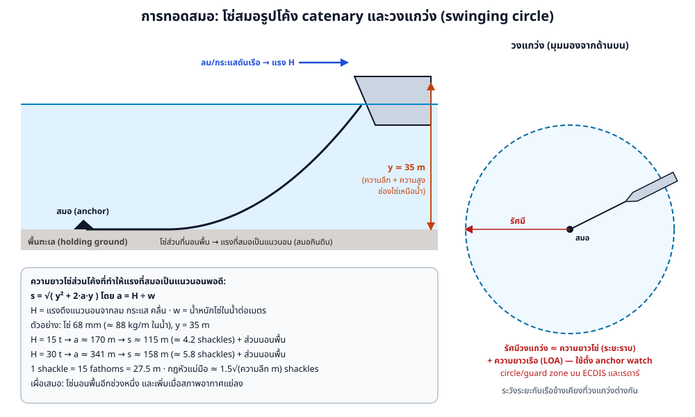
*ภาพที่ 1.9-9 โซ่สมอรูป catenary สูตรคำนวณ และวงแกว่งของเรือที่ทอดสมอ*

**ตัวอย่างจำลอง: คำนวณโซ่และวงแกว่ง (ที่ทอดสมอสมมุติ "Anchorage Bravo")**
> ความลึก 25 m พื้นโคลน (M) ช่องโซ่สูงจากน้ำ ≈ 10 m → y ≈ 35 m · โซ่ 68 mm น้ำหนักในน้ำ ≈ 88 kg/m
> - คาดแรงดึงจากลม 20–25 นอตทางหัวและกระแส 1 นอต รวมการส่ายของเรือ (yawing) ≈ 15 ตัน → a = 15,000 ÷ 88 ≈ 170 m → s = √(35² + 2 × 170 × 35) ≈ **115 m (≈ 4.2 shackles)** + โซ่นอนพื้นอีกอย่างน้อย 1–2 shackles
> - กฎหัวแม่มือ 1.5 × √25 = 7.5 shackles
> - **ตัดสินใจ: 6 shackles in the water** (165 m) — ถ้าพยากรณ์ลมแรงขึ้น เตรียมเพิ่มเป็น 7–8 shackles หรือยกสมอออกทะเล
> - **วงแกว่ง**: ระยะราบของโซ่ ≈ √(165² − 35²) ≈ 161 m + LOA 172 m ≈ **333 m ≈ 0.18 nm** → ตั้ง anchor watch circle/guard ring บน ECDIS และเรดาร์ที่ประมาณ 0.2 nm รอบตำแหน่งสมอ (ไม่ใช่รอบตำแหน่งเรือขณะปล่อย) และตรวจระยะกับเรือข้างเคียงและอันตราย

### 7.5 ขั้นตอนการทอดสมอ

1. **เข้าตามแผน** ลดความเร็วตามแผน เฝ้าดูความเร็วเทียบพื้น (SOG) และระยะถึงจุดปล่อย
2. **ใกล้จุดปล่อย**: หยุดเครื่อง เรือหยุดเทียบพื้น หรือ **มี sternway เล็กน้อย (ประมาณ 0.5 นอต)** — ห้ามปล่อยสมอขณะเรือยังวิ่งไปข้างหน้า (โซ่จะถูกลากใต้หัวเรือ ขูดหัวเรือ/bulbous bow และกองทับสมอ)
3. **Let go** (หรือ walk back ในน้ำลึก) ตามคำสั่ง — บันทึกเวลาและตำแหน่ง ชักลูกบอลดำ/เปิดไฟทอดสมอ (และเมื่อเรือยาว ≥ 100 m เปิดไฟส่องดาดฟ้า — COLREG Rule 30)
4. **วางโซ่ (laying out the cable)**: เมื่อสมอถึงพื้น ให้เรือถอยหลังช้า ๆ (หรือให้ลม/กระแสพาเรือ) ขณะปล่อยโซ่ออกพอดีกับการเคลื่อนที่ — ใช้เบรกคุม ไม่ให้โซ่กองบนสมอ และไม่ให้ตึงจนกระชาก
5. **รายงานจากหัวเรือ** — ทิศโซ่ด้วยตำแหน่งนาฬิกา (เช่น "cable leading 1 o'clock") หรือ "leading ahead / astern / up and down"; แรงตึง ("slack", "moderate strain", "heavy strain"); จำนวน shackle ("three shackles in the water")
6. เมื่อได้ความยาวตามแผน เบรกให้แน่น ใส่ bow stopper
7. **Brought up (สมอกินดิน)**: สังเกตโซ่ค่อย ๆ ตึงยกขึ้นจากน้ำ แล้วหย่อนกลับลง (เรือถูกดึงกลับไปข้างหน้าเล็กน้อย) หัวเรือนิ่งเข้าหาสมอ ตำแหน่งไม่เปลี่ยนต่อเนื่อง — หัวเรือรายงาน **"Brought up"** สะพานเดินเรือยืนยันด้วยตำแหน่ง
8. หยุดเครื่องตามคำสั่ง (นายเรือกำหนดสถานะความพร้อมเครื่อง เช่น 15 นาที/1 ชั่วโมง standby) **บันทึก**: เวลา let go/brought up, ตำแหน่งสมอ, ความลึก, พื้นท้องทะเล, จำนวน shackle, ทิศหัวเรือ, สภาพอากาศ — แจ้ง VTS/ท่า "Anchored"

### 7.6 ยามสมอ (Anchor watch) — STCW Code A-VIII/2 Part 4-1 (ข้อ 51)

ขณะทอดสมอ OOW ต้อง
1. **กำหนดและลงตำแหน่งเรือบนแผนที่** โดยเร็วที่สุด
2. เมื่อสถานการณ์อนุญาต **ตรวจบ่อยพอว่าเรือยังจอดอยู่อย่างมั่นคง** โดยใช้แบริ่งของเครื่องหมายเดินเรือที่อยู่กับที่หรือวัตถุบนฝั่งที่ชัดเจน (รวมทั้ง range เรดาร์ และ ECDIS/GNSS)
3. **รักษาการเฝ้าระวัง (lookout)** ที่เหมาะสม
4. ให้มี **การเดินตรวจรอบเรือ** เป็นระยะ
5. **สังเกตสภาพอากาศ น้ำขึ้นลง และสภาพทะเล**
6. **แจ้งนายเรือและทำทุกอย่างที่จำเป็นถ้าเรือลากสมอ (drags anchor)**
7. ให้ **เครื่องจักรใหญ่และเครื่องจักรอื่นพร้อม** ตามคำสั่งนายเรือ
8. ถ้าทัศนวิสัยลดลง **แจ้งนายเรือ**
9. ให้เรือแสดง **ไฟ ทุ่นสัญญาณ** และส่ง **สัญญาณเสียง** ที่ถูกต้อง (ทัศนวิสัยจำกัด: สั่นระฆังเร็วประมาณ 5 วินาที ทุกช่วงไม่เกิน 1 นาที และเรือ ≥ 100 m ตีฆ้อง (gong) ท้ายเรือต่อ — COLREG Rule 35(g); และอาจเป่าหวีด สั้น-ยาว-สั้น เพิ่มเพื่อเตือนเรือที่เข้ามาใกล้)
10. **ป้องกันมลพิษ** จากเรือและปฏิบัติตามกฎเกี่ยวกับมลพิษ

**สัญญาณว่าเรืออาจกำลังลากสมอ (dragging)**
- แบริ่ง/ระยะของจุดอ้างอิงเปลี่ยนต่อเนื่องเกินกว่าการแกว่งปกติ, เรือออกนอกวงแกว่ง (ECDIS/anchor watch alarm)
- เรือ **ไม่หันหัวเข้าลม** แต่วางตัวขวางลมและไถลไปด้านข้าง
- โซ่ตึงค้างตลอดไม่มีจังหวะหย่อน, โซ่สั่น/กระตุก ได้ยินเสียงสมอครูดพื้น (สัมผัสโซ่ได้ที่หัวเรือ)
- ความเร็วเทียบพื้น (SOG) บน GNSS แสดงค่าต่อเนื่องไปทิศเดียว

**การกระทำเมื่อเรือลากสมอ** — **แจ้งนายเรือทันที**, ให้ห้องเครื่องเตรียมเครื่อง (อาจต้องใช้ทันที), เรียกทีมหัวเรือ, ตามคำสั่งนายเรือ: ปล่อยโซ่เพิ่ม/ปล่อยสมออีกตัว (ช่วยลดการส่ายและเพิ่มแรงยึด), ใช้เครื่องช่วยลดแรงดึง, หรือยกสมอและทอดใหม่/ออกทะเล; แจ้ง VTS และเรือใกล้เคียงถ้ามีความเสี่ยงโดนกัน; บันทึกทุกอย่าง

> **ข้อคิดจากการฝึก:** ลมที่แรงขึ้นทีละน้อยตอนกลางคืนเป็นสถานการณ์ลากสมอที่พบบ่อย — การโทรปลุกนายเรือ "เร็วเกินไป" ไม่เคยเป็นความผิด แต่ "ช้าเกินไป" อาจทำให้เรือเกยตื้นหรือชนเรือลำอื่น

### 7.7 การยกสมอ (Heaving up / weighing anchor)

1. แจ้งเครื่อง standby, ทีมหัวเรือพร้อม, เปิดน้ำล้างโซ่ (wash down) เพื่อล้างโคลน
2. ใส่ clutch → ปลด bow stopper → ปล่อยเบรก → heave in — **ใช้เครื่องช่วย** ถ้าโซ่ตึงมากจากลม/กระแส (นายเรือ/OOW สั่ง "dead slow ahead" ตามที่หัวเรือรายงานทิศโซ่) ไม่ให้กว้านรับแรงเกิน
3. รายงานจากหัวเรือ: ทิศและแรงตึงโซ่, จำนวน shackle ที่เหลือในน้ำ ("two shackles in the water"), **"Anchor aweigh"** (สมอพ้นพื้น — **เรือกลายเป็น underway**, ลดลูกบอลดำ/เปลี่ยนไฟเป็นไฟเดินเรือ), **"Anchor sighted and clear"** (เห็นสมอ ไม่พันโซ่/สายเคเบิล — ถ้าพันเรียก **"foul anchor"**), **"Anchor home"** (เข้าที่ใน hawse pipe), "anchor secured" (bow stopper, lashings, ปิดฝา spurling pipe)
4. บันทึกเวลา "anchor aweigh" และตำแหน่ง

### 7.8 การทอดสมอแบบอื่นและการใช้สมอในการบังคับเรือ

| วิธี | ลักษณะ | ใช้เมื่อ |
|---|---|---|
| **Running moor** | ปล่อยสมอตัวแรกขณะเรือยังมี headway ช้า ๆ วิ่งต่อปล่อยโซ่ประมาณ 2 เท่าที่ต้องการ แล้วปล่อยตัวที่สอง จากนั้นเก็บตัวแรกจนสองตัวเท่ากัน | ต้องการจอดด้วยสองสมอในที่แคบที่กระแสกลับทิศ (เรือแกว่งในวงเล็ก) |
| **Standing moor** | ปล่อยตัวแรกขณะเรือถอย/ไหลตามกระแส ปล่อยโซ่ยาว แล้วปล่อยตัวที่สอง และเก็บตัวแรก | เหมือนข้างบน แต่ทำโดยเรือเคลื่อนถอยหลังตามกระแส |
| **Open moor** | สองสมอแยกกันกว้าง (มุมระหว่างโซ่มาก) ไปทางที่ลม/กระแสมา | ลม/กระแสแรงมาจากทิศเดียว ต้องการแรงยึดมาก |
| **Mediterranean moor** | ปล่อยสองสมอข้างหน้าแล้วถอยท้ายเข้าผูกกับท่า (stern-to) | ท่าที่พื้นที่หน้าท่าจำกัด (ทะเลเมดิเตอร์เรเนียน, ท่าเรือขนาดเล็ก) |
| **Second anchor underfoot** | ปล่อยสมอตัวที่สองโซ่สั้น ๆ (ประมาณ 1–1.5 เท่าความลึก) | ลดการส่ายของเรือ (yawing) ที่ทอดสมอในลมแรง |
| **Dredging the anchor** | ปล่อยสมอโซ่สั้น ให้สมอครูดพื้นโดยตั้งใจขณะเรือเดินช้า | นำร่องใช้คุมหัวเรือในที่แคบ/ลดความเร็ว (ต้องมีประสบการณ์) |
| **Emergency anchoring** | ปล่อยสมอเพื่อหยุดเรือหรือไม่ให้ลอยไปเกยตื้น (เช่นเครื่องเสียใกล้ฝั่ง) | ความเร็วต่ำ — ที่ความเร็วสูงสมอ/โซ่/กว้านอาจเสียหายหรือหลุดหาย แต่ถ้าเป็นทางเลือกสุดท้ายก่อนเกยตื้น นายเรืออาจตัดสินใจใช้ |

---

## 8. การผูกเรือ (Mooring) — การเข้า/ออกจากท่าและความปลอดภัย

### 8.1 อุปกรณ์ผูกเรือ

- **Mooring winch** — ส่วนมากเป็นแบบ **split drum** (ส่วน tension drum สำหรับรับแรง และ storage drum เก็บเชือก) มีเบรกแถบ: ตามแนวทาง OCIMF เบรกควรตั้งให้ **ลื่น (render) ก่อนเชือกขาด** โดยทั่วไปที่ประมาณ 60% ของกำลังรับแรงขาดตามการออกแบบของเชือก และต้องทดสอบเบรกเป็นระยะ; ทิศการม้วนเชือกบนดรัมต้องถูกต้อง (เบรกจับแน่นในทิศที่ออกแบบ); ขณะจอดให้ปลดเกียร์และใช้เบรก
- **Warping drum / capstan** — ใช้ดึงเชือกที่ไม่ได้ม้วนบนดรัมของตัวเอง พันเชือกจำนวนรอบพอที่จะจับแน่น และ **ห้ามมือใกล้ดรัม**, ระวังเชือกพันทับกัน (riding turn)
- **Fairleads/chocks** — roller fairlead, pedestal roller, **closed chock (Panama chock)** สำหรับผ่านคลองปานามาและเชือกที่มุมก้ม/เงยมาก
- **Bitts/bollards** — ผูก eye หรือ figure-of-eight ที่ bitts; รู้ **SWL** ที่ทำเครื่องหมายไว้บนอุปกรณ์ (ตามแผนอุปกรณ์ลากจูงและผูกเรือของเรือ)
- **Stoppers** — ใช้ถ่ายแรงเชือกจากดรัมไป bitts: เชือกลวดใช้ chain stopper, เชือกใยสังเคราะห์ใช้ stopper ใยสังเคราะห์ชนิดที่เรือกำหนด; ผูกถูกวิธีและห้ามยืนแนวเชือก
- **Heaving line, messenger** — ส่งเชือกไปยังท่า/tug (ปลายถ่วงน้ำหนักห้ามใส่ของแข็งอันตราย)
- **เชือกผูกเรือ (mooring lines)** — วัสดุ: polyester, polypropylene/polyester ผสม, nylon (ยืดมาก สะสมพลังงานมาก — ใช้ทำ tail ดูดซับแรง), **HMPE** (ยืดน้อย เบา แข็งแรงมาก ต้องใช้ tail), เชือกลวด (wire) — **ความยืดหยุ่นต่างกันมาก** เชือกที่ยืดน้อยจะรับแรงเกือบทั้งหมดถ้าใช้ปนกับเชือกที่ยืดมากในทิศเดียวกัน
- **ข้อกำหนดใหม่**: **SOLAS II-1/3-8** (แก้ไขมีผล 1 ม.ค. 2024) — เรือสร้างใหม่ (ขนาด 3,000 GT ขึ้นไป; เรือเล็กกว่านั้นใช้แนวทางเท่าที่ทำได้) ต้องออกแบบระบบผูกเรือและเลือกอุปกรณ์ตามแนวทาง **MSC.1/Circ.1619**, และ **ทุกลำ** (รวมเรือเก่า) ต้องตรวจและบำรุงรักษาอุปกรณ์ผูกเรือรวมทั้งเชือกตามแนวทาง **MSC.1/Circ.1620** (มีแผนตรวจ บันทึก เกณฑ์เปลี่ยนเชือก/tail); ข้อมูล SWL ของอุปกรณ์อยู่ใน towing and mooring arrangements plan ตาม MSC.1/Circ.1175/Rev.1; OCIMF MEG4 ใช้แนวคิด **SDMBL (Ship Design Minimum Breaking Load)** และ LDBF ในการเลือกเชือก

### 8.2 ชื่อและหน้าที่ของเชือก

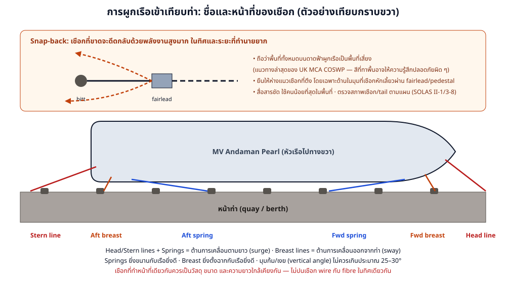
*ภาพที่ 1.9-10 ชื่อและหน้าที่ของเชือกผูกเรือ และอันตรายจาก snap-back*

| เชือก | นำจาก → ไป | หน้าที่หลัก |
|---|---|---|
| **Head line** | หัวเรือ → ท่าข้างหน้าเรือ | กันเรือเลื่อนไปท้าย และช่วยกันหัวออก |
| **Forward breast line** | หัวเรือ → ท่าตั้งฉาก | กันหัวเรือออกจากท่า (sway) |
| **Forward spring (fore spring / back spring)** | หัวเรือ → ท่าทางท้าย | กันเรือเลื่อนไปข้างหน้า; ใช้ในการ springing off |
| **Aft spring (after spring)** | ท้ายเรือ → ท่าทางหน้า | กันเรือเลื่อนไปท้าย |
| **Aft breast line** | ท้ายเรือ → ท่าตั้งฉาก | กันท้ายเรือออกจากท่า |
| **Stern line** | ท้ายเรือ → ท่าข้างหลังเรือ | กันเรือเลื่อนไปข้างหน้า และช่วยกันท้ายออก |

**หลักการจัดเชือก (mooring pattern)**
- Breast lines ยิ่ง **ตั้งฉากกับเรือ** ยิ่งต้านการเคลื่อนออกจากท่าได้ดี; springs ยิ่ง **ขนานกับเรือ** ยิ่งต้านการเคลื่อนตามยาวได้ดี; head/stern lines ทำหน้าที่ผสม (ประสิทธิภาพต่ำกว่า)
- **มุมก้ม/เงย (vertical angle)** ไม่ควรเกินประมาณ 25–30° — มุมยิ่งชันยิ่งเสียแรงยึดแนวนอน
- **เชือกที่ทำหน้าที่เดียวกันควรเป็นวัสดุ ขนาด และความยาวใกล้เคียงกัน** เพื่อแบ่งแรงเท่ากัน — ห้ามปน wire กับ fibre ในทิศเดียวกัน
- ความยาวเชือกจาก fairlead ถึงท่าไม่ควรสั้นเกิน (เชือกสั้นยืดได้น้อย รับแรงกระชากมาก)

### 8.3 ความปลอดภัยในการผูกเรือ

การผูกเรือเป็นงานที่ทำให้คนเรือบาดเจ็บสาหัสและเสียชีวิตมากที่สุดงานหนึ่ง
- **Snap-back** — เชือกที่ขาดดีดกลับด้วยพลังงานสูงมากในทิศที่คาดยาก โดยเฉพาะเชือกที่ยืดมาก (nylon) — แนวทางล่าสุดของ UK MCA COSWP ให้ **ถือว่าพื้นที่ทั้งหมดบนดาดฟ้าผูกเรือเป็นพื้นที่เสี่ยง** เพราะเส้นทาสี "snap-back zone" อาจทำให้รู้สึกปลอดภัยผิด ๆ — ใช้การวางแผนและการยืนในที่กำบังแทน
- **ห้ามยืนในวงเชือก (bight)** และในแนวเชือกที่ตึง โดยเฉพาะด้านในของมุมที่เชือกหักเลี้ยวผ่าน fairlead/roller
- ห้ามมือใกล้ดรัม/fairlead ขณะเชือกเคลื่อน; ไม่สวมแหวน/ถุงมือหลวมที่อาจถูกดึง
- **คนน้อยที่สุดเท่าที่จำเป็น** ในพื้นที่; คนควบคุมกว้านต้องมองเห็นเชือกหรือมีคนสื่อสาร
- **สื่อสารชัด**: UHF ช่องที่กำหนด ทวนคำสั่ง ใช้คำมาตรฐาน (SMCP — 1.7) เช่น "Send the head line", "Heave on the spring", "Slack away", "Hold on", "Make fast", "Single up", "Let go"
- **Toolbox talk** ก่อนเริ่ม: แผนการผูก ลำดับเชือก ตำแหน่ง tug ความเสี่ยงเฉพาะ (ลม กระแส ท่าที่ไม่คุ้นเคย)
- ตรวจสภาพเชือก/tail/stopper ก่อนใช้ เก็บเชือกพ้นแสงแดดและสารเคมี บันทึกการตรวจตามแผน (MSC.1/Circ.1619)
- ความเหนื่อยล้า (fatigue) ตอนเข้าออกท่าถี่ ๆ — ดู 3.8 และ hours of rest (1.2.1-B)

### 8.4 การเข้าเทียบท่า (Berthing) — สิ่งที่ OOW/นายประจำหัว-ท้ายต้องรู้

- **ข้อมูลก่อนเข้าท่า**: กราบที่เทียบ, ลำดับเชือกและจำนวน (เช่น 3-2-2 / 3-2-2 = head 3, breast 2, spring 2 หัวและท้าย), ตำแหน่ง tug และวิธีผูก, ความสูงท่า/fender, ข้อมูลลม กระแส น้ำขึ้นลง, gangway/pilot ladder — ได้จาก master/pilot exchange (MPX) และ port information
- **ความเร็วเข้าหาท่า**: ช่วงสุดท้ายต้องช้ามาก (ระดับเซนติเมตรต่อวินาที) — ท่าและ fender ออกแบบรับพลังงานจำกัด
- **รายงานจากหัว/ท้าย**: ระยะถึงท่า ("forward 15 m off, aft 25 m off"), ระยะถึงเรือข้างหน้า/หลัง, สถานะ tug ("tug made fast", "tug let go"), สถานะเชือก ("head line ashore", "all fast forward"), สิ่งผิดปกติในน้ำ (เรือเล็ก เชือก/ขยะใกล้ใบจักร)
- **เทียบกราบซ้าย/ขวา**: ดูข้อ 1.3 (transverse thrust) — เรือใบจักรเวียนขวาใบเดียวเทียบกราบซ้ายง่ายกว่า
- **Bow thruster** ใช้ได้ผลเมื่อเรือช้ามาก, tug ทำงานดีที่ความเร็วต่ำ — ห้ามเร่งเครื่องแรง ๆ ขณะ tug ผูกอยู่ท้ายเรือโดยไม่แจ้ง

### 8.5 การออกจากท่า (Unberthing) และ springing off

- **Single up** — เก็บเชือกจนเหลือเฉพาะเส้นที่จำเป็น (เช่น head line + forward spring, stern line + aft spring)
- **ก่อนใช้เครื่องต้องแน่ใจว่า "propeller clear"** — ไม่มีเชือกในน้ำใกล้ใบจักร ท้ายเรือรายงานทุกครั้งที่เชือกท้ายถูกปลด ("all gone aft, propeller clear")
- **Springing off (ใช้ forward spring)** — ภาพที่ 1.9-11: เรือเทียบกราบซ้าย เหลือ forward spring + fender ที่หัว → **slow/dead slow ahead หางเสือ hard to port (หันเข้าหาท่า)** → หัวเรือถูก spring ยึดไว้ (เรือเดินหน้าไม่ได้) แรงหางเสือดันท้ายออกจากท่า → เมื่อท้ายออกได้มุมพอ **stop engine, let go spring** แล้ว **ถอยหลัง** ออก (ท้ายปัดซ้ายจาก transverse thrust ซึ่งในกรณีเทียบกราบซ้ายคือ **ท้ายกลับเข้าหาท่า** มุมที่ได้จะหดลง — จึงต้องให้ท้ายออกได้มุมพอก่อนสั่งถอย และระวังท้าย/ใบจักรเข้าใกล้ท่า) จากนั้นเดินหน้าออกเมื่อพ้นท่า
- ถ้าลมพัดเข้าท่าแรงหรือเรือขนาดใหญ่ — ใช้ tug ดึงออกทั้งลำ

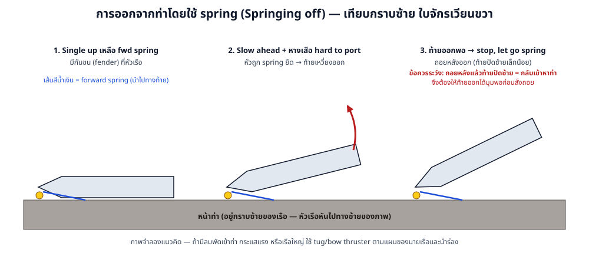
*ภาพที่ 1.9-11 การออกจากท่าโดยใช้ forward spring (แนวคิด — เทียบกราบซ้าย ใบจักรเวียนขวา)*

### 8.6 ยามขณะจอดเทียบท่า (Mooring watch)

- **ดูแลเชือก (tending moorings)** — ระดับน้ำขึ้นลงและ draught ที่เปลี่ยนระหว่างขนถ่ายสินค้าทำให้เชือกหย่อน/ตึงเกิน ต้องปรับให้ตึงพอดีและแบ่งแรงเท่ากัน — **ไม่ทิ้งกว้านไว้ในโหมด auto-tension** ขณะจอด (เรืออาจ "เดิน" ไปตามท่าเพราะกว้านหัว-ท้ายดึงสู้กันและปล่อยเชือกออกเอง) เว้นแต่ขั้นตอนของเรือ/ท่าอนุญาต
- เฝ้าดู **ranging/surging** (เรือเลื่อนไปมา) จากคลื่นและเรือที่ผ่าน — แจ้งท่า/VTS ถ้าเรือผ่านเร็วเกิน, เพิ่มเชือก
- ตรวจ **gangway** (ความสูงเปลี่ยน, ตาข่ายกันตก, ห่วงชูชีพพร้อมเชือก), fender, ไฟส่องสว่าง, สภาพอากาศ (ลมแรง → เพิ่มเชือก/เตรียม tug/เตรียมเครื่อง)
- ปฏิบัติตามข้อกำหนดของท่า (เช่นเรือบรรทุกน้ำมันที่ท่าบางแห่งต้องมี emergency towing-off pennants)
- บันทึกการปรับเชือกและเหตุการณ์ใน log

---

## 9. ความรู้เพิ่มเติม: การบังคับเรือในคลื่นลมแรง (MSC.1/Circ.1228)

แม้ STCW A-II/1 เน้น 5 หัวข้อข้างต้น แต่ OOW ต้องรู้จักอันตรายในคลื่นลมแรงเพื่อแจ้งนายเรือได้ทันเวลา แนวทาง **MSC.1/Circ.1228** (Revised guidance to the master for avoiding dangerous situations in adverse weather and sea conditions) ระบุอันตรายหลัก
- **Surf-riding และ broaching-to** — ในคลื่นตาม (following/quartering sea) เรือที่เร็วใกล้ความเร็วคลื่นอาจถูกคลื่นพาไป (surf-riding) แล้วหันขวางคลื่นอย่างควบคุมไม่ได้ (broaching) จนเอียงมาก/ล่ม
- **การลดลงของเสถียรภาพบนยอดคลื่น** — เมื่อกลางลำอยู่บนยอดคลื่นยาวพอ ๆ กับเรือ ระนาบน้ำ (waterplane) เปลี่ยน GZ ลดลงชั่วขณะ
- **Synchronous rolling** — คาบการเจอคลื่น (encounter period) ใกล้คาบโคลงตามธรรมชาติของเรือ → โคลงสะสมรุนแรง
- **Parametric rolling** — คาบการเจอคลื่นประมาณ **ครึ่งหนึ่ง** ของคาบโคลง (มักเกิดในคลื่นหัว/ท้าย กับเรือ container ที่หัว-ท้ายบานมาก) → โคลงหนักฉับพลันแม้คลื่นมาจากหัว
- **กลุ่มคลื่นสูง (high wave groups)**
- **การแก้**: เปลี่ยนเข็มและ/หรือความเร็วเพื่อเปลี่ยนคาบการเจอคลื่น (ใช้ polar diagram ตามแนวทาง), ลดความเร็วเพื่อลด slamming และน้ำท่วมดาดฟ้า (green water), ยึดของให้แน่น, หลีกเลี่ยงระบบอากาศ (weather routing), **heave-to** (หันหัวรับคลื่นเฉียงด้วยความเร็วต่ำที่พอบังคับเรือ) ตามที่นายเรือตัดสิน
- OOW: แจ้งนายเรือเมื่อเรือเริ่มโคลง/โต้หนักผิดปกติ ความเร็วตก หรือคลื่นลมเกินพยากรณ์ (Standing orders)
- ข้อมูลเพิ่มเติม: IMO ออก **Interim guidelines on the second generation intact stability criteria (MSC.1/Circ.1627, 2020)** ซึ่งรวมแนวคิด "operational guidance" สำหรับ parametric rolling, pure loss of stability, surf-riding/broaching ฯลฯ — เรือบางลำมีคู่มือ/ระบบเตือนตามแนวทางนี้ (ใช้แบบสมัครใจ ตรวจว่าเรือเรามีหรือไม่)

---

## 10. การสั่งเครื่องและหางเสือบนสะพานเดินเรือ (ทบทวนเชิงปฏิบัติ)

- ใช้ **คำสั่งมาตรฐาน SMCP** (1.7) ชัด ทวนคำสั่ง (closed loop — 1.2.2) และตรวจด้วยตา (rudder angle indicator, rpm/pitch indicator) ว่าคำสั่งถูกปฏิบัติจริง
- **ใครมีอำนาจบังคับเรือ (the con)** ต้องชัดเจนและบันทึก — เมื่อนายเรือขึ้นสะพานแล้วรับการบังคับเรือต้องพูดชัด ("I have the con") ไม่เช่นนั้น OOW ยังรับผิดชอบอยู่; เมื่อมีนำร่อง OOW ยังต้องตรวจตำแหน่งและท้วงถ้าไม่แน่ใจ (1.2.1-B)
- **บันทึก** เวลาเปลี่ยนเครื่อง (bell book/engine movement log หรือระบบอัตโนมัติ), เวลาเปลี่ยนเข็มสำคัญ, เหตุการณ์
- **อย่าเกินขีดจำกัด**: ไม่เดินในช่วง barred rpm, ไม่สั่งกลับทิศเครื่องถี่จนลมสตาร์ทหมด, ไม่ใช้ bow thruster เกินเวลาที่กำหนด, ไม่ใช้หางเสือ hard over ที่ความเร็วสูงโดยไม่จำเป็น (เอียงมาก สินค้าเคลื่อน), ใช้ steering pump สองชุดในพื้นที่ต้องระวัง และ **แจ้งห้องเครื่องล่วงหน้า** ก่อนลดความเร็วตามแผน (ยกเว้นฉุกเฉิน ซึ่ง OOW ต้องไม่ลังเลใช้เครื่องทันที)

---

## 11. คำถามสอบปากเปล่า / สัมภาษณ์

**ถาม:** ข้อมูลการบังคับเรือบนเรือมีอะไรบ้างตาม IMO
**แนวตอบ:** ตาม A.601(15) — Pilot card (นายเรือกรอกให้นำร่อง), Wheelhouse poster (ติดถาวรบนสะพาน แสดงวงเลี้ยว ระยะหยุด ฯลฯ), Manoeuvring booklet (ข้อมูลละเอียดจากการทดลองเรือ)

**ถาม:** Advance, transfer, tactical diameter คืออะไร
**แนวตอบ:** Advance = ระยะตามแนวเข็มเดิมจากจุดสั่งหางเสือจนหัวเรือเปลี่ยน 90°; Transfer = ระยะตั้งฉากกับเข็มเดิมเมื่อหัวเปลี่ยน 90°; Tactical diameter = ระยะตั้งฉากกับเข็มเดิมเมื่อหัวเปลี่ยน 180° — IMO กำหนด advance ≤ 4.5 L, tactical diameter ≤ 5 L

**ถาม:** Trim by head กับ trim by stern มีผลต่อการบังคับเรืออย่างไร
**แนวตอบ:** Trim by stern — ทรงทิศดี หันยากขึ้น วงเลี้ยวโต หางเสือ/ใบจักรจมดี; Trim by head — หันง่าย วงเลี้ยวเล็กลง แต่ทรงทิศไม่ดี ถือท้ายยาก มีแนวโน้ม sheer

**ถาม:** ความเร็วมีผลต่อวงเลี้ยวและระยะหยุดอย่างไร
**แนวตอบ:** ในน้ำลึก ขนาดวงเลี้ยวที่หางเสือเท่ากันเปลี่ยนไม่มาก แต่เวลาสั้นลง; kick ahead จากความเร็วต่ำทำให้วงเลี้ยวแคบ; ระยะหยุดเพิ่มมากตามความเร็ว เพราะพลังงานจลน์แปรผันตาม V²

**ถาม:** น้ำตื้นมีผลอะไรบ้าง
**แนวตอบ:** squat เพิ่ม, ความเร็ว/รอบเครื่องลด, ตัวเรือสั่น, วงเลี้ยวโตขึ้น (h/T ≈ 1.2 อาจเกือบ 2 เท่า), หางเสือตอบสนองช้า, added mass เพิ่ม, พฤติกรรมตอนถอยเปลี่ยน, คลื่นใหญ่ขึ้น, แรงจากกระแส/ลมด้านข้างเพิ่ม, ใบจักร/sea chest ดูดตะกอน

**ถาม:** Squat คืออะไร คำนวณอย่างไร และจะลดได้อย่างไร
**แนวตอบ:** การจมลงและเปลี่ยน trim ของเรือที่แล่น เพราะน้ำไหลเร็วขึ้นรอบตัวเรือ ความดันลด (Bernoulli) — Barrass: น้ำเปิด ≈ Cb × V²/100, ร่องจำกัด ≈ Cb × V²/50 (V นอต ผลเมตร) — ลดได้ดีที่สุดโดยลดความเร็วผ่านน้ำ

**ถาม:** เรือ tanker Cb 0.82 กับเรือ container Cb 0.62 squat ที่หัวหรือท้าย
**แนวตอบ:** Tanker (Cb > 0.7) squat มากที่หัว (trim by head); container (Cb < 0.7) squat มากที่ท้าย (trim by stern)

**ถาม:** Bank effect คืออะไร แก้อย่างไร
**แนวตอบ:** ใกล้ตลิ่ง ท้ายเรือถูกดูดเข้าตลิ่ง หัวถูกดันออก เรือ sheer หนีตลิ่ง — ลดความเร็ว รักษาระยะ ถือหางเสือเข้าหาตลิ่งเพื่อชดเชย ระวังเมื่อตลิ่งสิ้นสุด

**ถาม:** การแซงในร่องน้ำแคบมีอันตรายอะไร
**แนวตอบ:** Interaction — ช่วงแรกท้ายเรือถูกแซงถูกผลักทำให้หัวหันเข้าหาเรือแซง, ช่วงกลางลำดูดเข้าหากัน, ช่วงที่หัวเรือถูกแซงอยู่ใกล้ท้ายเรือแซงอาจ sheer ตัดท้าย — ตกลงกันก่อน (Rule 9(e)), เรือถูกแซงลดความเร็ว, ระยะด้านข้างมาก, ถือท้ายด้วยมือ

**ถาม:** Pivot point อยู่ที่ไหน มีผลอย่างไร
**แนวตอบ:** มี headway อยู่ประมาณ 1/4–1/3 L จากหัว, ถอยหลังอยู่ประมาณ 1/4 L จากท้าย, หยุดนิ่งใกล้กลางลำ — เดินหน้าหางเสือได้ผลดี bow thruster ได้ผลน้อย; ถอยหลังกลับกัน; ลมทำให้หัวหันเข้าลมเมื่อเดินหน้า และท้ายหันเข้าลมเมื่อถอยหลัง (แนวโน้มทั่วไป)

**ถาม:** Transverse thrust ของใบจักรเวียนขวาเป็นอย่างไร และใช้ประโยชน์อย่างไร
**แนวตอบ:** ถอยหลัง ท้ายปัดซ้าย หัวหันขวา — เข้าเทียบกราบซ้ายง่าย เพราะเมื่อถอยเพื่อหยุด ท้ายเข้าหาท่าเอง; ใน crash stop หัวมักปัดขวา

**ถาม:** กระแสขวาง 1 นอต เทียบกับลมเท่าไร
**แนวตอบ:** น้ำทะเลหนาแน่นกว่าอากาศประมาณ 830 เท่า กระแส 1 นอตบนพื้นที่เท่ากันให้แรงเท่ากับลมประมาณ 29 นอต — และในน้ำตื้นแรงเพิ่มอีกหลายเท่า

**ถาม:** Williamson, Anderson, Scharnow ต่างกันอย่างไร ใช้เมื่อไร
**แนวตอบ:** Williamson — hard over, เบน 60° hard over อีกข้าง, ห่างเข็มกลับ 20° midships; กลับมาบนเส้นทางเดิม ดีเมื่อกลางคืน/ทัศนวิสัยจำกัด/delayed action แต่ช้า. Anderson — hard over, เบน ~250° midships แล้วหยุดเรือ; เร็วที่สุดสำหรับ immediate action แต่เรือใบจักรเดียวทำยาก. Scharnow — hard over, เบน 240° hard over อีกข้าง, ห่างเข็มกลับ 20° midships; กลับเข้า wake ระยะสั้นกว่า แต่ใช้ไม่ได้ผลถ้าไม่รู้เวลาที่เกิดเหตุ ไม่เหมาะ immediate action

**ถาม:** ทำไมคนตกกราบขวาต้องหันหางเสือขวา
**แนวตอบ:** เพื่อใช้ kick เหวี่ยงท้ายเรือและใบจักรออกห่างจากคนในน้ำ และเริ่มเลี้ยวกลับไปด้านที่คนอยู่

**ถาม:** SOLAS III/17-1 เกี่ยวกับอะไร
**แนวตอบ:** เรือต้องมีแผนและขั้นตอนเฉพาะเรือสำหรับการเก็บคนขึ้นจากน้ำ (recovery of persons from the water) ตามแนวทาง MSC.1/Circ.1447 (แผนต้องระบุอุปกรณ์ที่ใช้และมาตรการลดความเสี่ยงต่อลูกเรือที่ช่วย) และควรฝึกซ้อมตามแผน

**ถาม:** เลือกที่ทอดสมอพิจารณาอะไร
**แนวตอบ:** ที่ทอดสมอที่กำหนด, ความลึก, พื้นท้องทะเล (holding ground), ที่กำบังลมคลื่น, กระแส, ที่ว่างสำหรับวงแกว่ง, ห่างอันตราย/เรืออื่น/สายเคเบิล/ท่อ/เขตห้าม, ทางออกฉุกเฉิน

**ถาม:** ใช้โซ่กี่ shackle
**แนวตอบ:** ขึ้นกับความลึก สภาพอากาศ พื้นท้องทะเล — กฎหัวแม่มือ 1.5√(ความลึก m) shackles หรือ 4–5 เท่าความลึกในอากาศดี มากกว่านั้นในอากาศเลว; หลักคือแรงที่สมอต้องเป็นแนวนอน มีโซ่นอนพื้นเสมอ (สูตร catenary s = √(y² + 2ay))

**ถาม:** "Brought up" สังเกตอย่างไร
**แนวตอบ:** โซ่ค่อย ๆ ตึงยกขึ้นแล้วหย่อนกลับลง เรือถูกดึงกลับเข้าหาสมอเล็กน้อย หัวเรือนิ่งเข้าหาสมอ ตำแหน่งไม่เปลี่ยนต่อเนื่อง

**ถาม:** หน้าที่ OOW ขณะทอดสมอตาม STCW มีอะไรบ้าง
**แนวตอบ:** ลงตำแหน่ง, ตรวจว่าเรือไม่ลากสมอด้วยแบริ่ง/ระยะ, lookout, เดินตรวจรอบเรือ, สังเกตอากาศ น้ำขึ้นลง สภาพทะเล, แจ้งนายเรือและทำการที่จำเป็นถ้าลากสมอ, เครื่องพร้อมตามคำสั่ง, แจ้งนายเรือเมื่อทัศนวิสัยลด, ไฟ ทุ่น สัญญาณเสียงถูกต้อง, ป้องกันมลพิษ

**ถาม:** รู้ได้อย่างไรว่าเรือลากสมอ และทำอย่างไร
**แนวตอบ:** แบริ่ง/ระยะเปลี่ยนต่อเนื่อง ออกนอกวงแกว่ง เรือวางตัวขวางลม โซ่ตึงค้าง/สั่น SOG ต่อเนื่อง — แจ้งนายเรือทันที เตรียมเครื่อง เรียกทีมหัวเรือ ปล่อยโซ่เพิ่ม/ปล่อยสมออีกตัว/ยกสมอทอดใหม่หรือออกทะเลตามคำสั่ง แจ้ง VTS/เรือใกล้เคียง บันทึก

**ถาม:** อุปกรณ์สมอออกแบบมาเพื่ออะไร
**แนวตอบ:** การจอดชั่วคราวในท่าหรือบริเวณที่มีที่กำบังในสภาพลม/กระแสที่กำหนด ไม่ได้ออกแบบให้ยึดเรือในทะเลเปิดที่มีคลื่นลมแรง หรือหยุดเรือที่กำลังเคลื่อนที่ (แนวคิด IACS UR A1)

**ถาม:** ชื่อและหน้าที่ของเชือกผูกเรือ
**แนวตอบ:** Head/stern lines และ springs ต้านการเคลื่อนตามยาว (springs มีประสิทธิภาพสุด), breast lines ต้านการเคลื่อนออกจากท่า — forward spring นำจากหัวไปทางท้าย aft spring นำจากท้ายไปทางหน้า

**ถาม:** ทำไมห้ามปนเชือกลวดกับเชือกใยสังเคราะห์ในทิศเดียวกัน
**แนวตอบ:** ความยืดต่างกันมาก เชือกที่ยืดน้อย (ลวด/HMPE) จะรับแรงเกือบทั้งหมดจนขาด แล้วแรงถ่ายไปเส้นอื่นต่อเนื่อง

**ถาม:** Snap-back zone คืออะไร แนวทางปัจจุบันเป็นอย่างไร
**แนวตอบ:** บริเวณที่เชือกขาดอาจดีดกลับไปกระทบ — แนวทางปัจจุบันของ UK MCA COSWP ให้ถือว่าทั้งดาดฟ้าผูกเรือเป็นพื้นที่เสี่ยง ไม่พึ่งเส้นทาสี วางแผนตำแหน่งยืนและใช้คนน้อยที่สุด

**ถาม:** SOLAS II-1/3-8 ฉบับแก้ไขใหม่กำหนดอะไร
**แนวตอบ:** (มีผล 1 ม.ค. 2024) เรือใหม่ (3,000 GT ขึ้นไป) ต้องออกแบบระบบผูกเรือและเลือกอุปกรณ์ตาม MSC.1/Circ.1619 และทุกลำต้องตรวจและบำรุงรักษาอุปกรณ์ผูกเรือรวมทั้งเชือกตาม MSC.1/Circ.1620

**ถาม:** Springing off ทำอย่างไร
**แนวตอบ:** (เทียบกราบซ้าย) single up เหลือ forward spring + fender ที่หัว, slow ahead หางเสือหันเข้าหาท่า → ท้ายเหวี่ยงออก, stop, let go spring, ถอยหลังออก, ตรวจ "propeller clear" ก่อนใช้เครื่องทุกครั้ง

**ถาม:** Parametric rolling คืออะไร
**แนวตอบ:** การโคลงรุนแรงเมื่อคาบการเจอคลื่นประมาณครึ่งหนึ่งของคาบโคลงของเรือ มักเกิดในคลื่นหัว/ท้ายกับเรือที่หัว-ท้ายบาน — แก้โดยเปลี่ยนเข็ม/ความเร็วตาม MSC.1/Circ.1228

**ถาม:** เกณฑ์ MSC.137(76) ใช้กับเรือใด และทดสอบในสภาพใด
**แนวตอบ:** เรือที่สร้างตั้งแต่ 1 ม.ค. 2004 ยาวตั้งแต่ 100 m และเรือบรรทุกเคมี/ก๊าซทุกขนาด — ทดสอบที่บรรทุกเต็ม even keel น้ำลึกไม่จำกัด ทะเลสงบ ที่ test speed (อย่างน้อย 90% ของความเร็วที่ 85% MCR) — advance ≤ 4.5 L, tactical diameter ≤ 5 L, initial turning 10° ภายใน 2.5 L, track reach ของ full astern ≤ 15 L

**ถาม:** ตาม A.601(15) เรือแบบใดต้องมี pilot card, wheelhouse poster และ manoeuvring booklet
**แนวตอบ:** Pilot card แนะนำสำหรับเรือใหม่ทุกลำที่ SOLAS ใช้บังคับ; ครบทั้งสามรายการสำหรับเรือใหม่ยาวตั้งแต่ 100 m เรือบรรทุกเคมี/ก๊าซทุกขนาด และเรือที่มีขนาด/คุณลักษณะผิดปกติ

**ถาม:** IAMSAR Vol III แบ่งสถานการณ์คนตกน้ำเป็นกี่แบบ
**แนวตอบ:** 3 แบบ — immediate action (เห็นเองจากสะพาน เริ่มทันที), delayed action (มีผู้เห็นรายงานมาภายหลังเล็กน้อย), person missing (รู้ว่าหายแต่ไม่รู้เวลา) — แต่ละแบบเลือกวิธีหันเรือต่างกัน

**ถาม:** ทำไมระยะ crash stop ไม่เพิ่มตามความเร็วยกกำลังสองเต็มที่
**แนวตอบ:** แม้พลังงานจลน์ ∝ V² แต่ที่ความเร็วสูงแรงต้านของตัวเรือ (∝ V²) ช่วยเบรกมาก และช่วงเครื่องกลับทิศระยะเพิ่มแบบ ∝ V — ระยะจึงเพิ่มน้อยกว่า V² แต่ก็ยังเพิ่มมาก ต้องใช้ค่าจาก manoeuvring booklet

**ถาม:** หันหลบด้วยหางเสือ hard over กับ crash stop อะไรดีกว่า
**แนวตอบ:** ถ้ามีที่ว่างด้านข้าง การหัน hard over มักใช้ระยะไปข้างหน้า (advance) สั้นกว่า head reach ของ crash stop มาก และยังบังคับเรือได้ — crash stop ใช้เมื่อหันไม่ได้หรือต้องลดพลังงานการชน; หลายครั้งใช้ทั้งสองอย่างร่วมกันตามสถานการณ์

**ถาม:** เรือใบจักรเวียนขวาเทียบกราบซ้าย springing off แล้วถอยหลัง ต้องระวังอะไร
**แนวตอบ:** เมื่อถอย ท้ายปัดซ้ายเข้าหาท่า มุมที่ได้จาก spring จะลดลง — ต้องให้ท้ายออกได้มุมพอก่อนถอย ตรวจ propeller clear และใช้ tug/thruster ถ้าลมพัดเข้าท่า

**ถาม:** อุปกรณ์สมอตาม IACS UR A1 ออกแบบที่สภาพใด
**แนวตอบ:** จอดชั่วคราวในที่กำบัง ลมประมาณ 25 m/s กระแสประมาณ 2.5 m/s ไม่มีคลื่น โซ่ 6–10 เท่าความลึก พื้นยึดดี (Rev.7 เพิ่มทางเลือกสำหรับเรือยาวเกิน 135 m ในที่ไม่มีที่กำบัง: กระแส ~1.54 m/s ลม ~11 m/s คลื่น Hs ≤ 2 m) — กว้านยกสมอที่โซ่ห้อย 3 shackles ด้วยความเร็วเฉลี่ยอย่างน้อย 9 m/นาที

**ถาม:** เรือ bulk Cb 0.80 แล่น 10 นอตในน้ำเปิดและในร่องจำกัด squat ประมาณเท่าไร
**แนวตอบ:** น้ำเปิด ≈ 0.80 × 10² ÷ 100 = 0.80 m; ร่องจำกัด ≈ 0.80 × 10² ÷ 50 = 1.60 m — Cb > 0.7 จึงจมมากที่หัว; ลดเหลือ 7 นอต squat น้ำเปิดเหลือ ≈ 0.39 m

**ถาม:** หาระยะ wheel-over ก่อนจุดเปลี่ยนเข็มอย่างไร
**แนวตอบ:** ระยะจาก WOP ถึงจุดตัดเข็ม ≈ R × tan(มุมเปลี่ยนเข็ม ÷ 2) บวกระยะหน่วงก่อนเรือเริ่มหัน; ROT (°/นาที) ≈ 0.955 × V(นอต) ÷ R(nm) — เช่น 12 นอต R 0.5 nm ROT ≈ 23°/นาที

**ถาม:** เรือที่มีมุมเอียง (list) มีแนวโน้มหันหัวไปทางใด
**แนวตอบ:** โดยทั่วไปหันหนีด้านที่จม (ไปทางด้านที่สูง) เพราะรูปตัวเรือใต้น้ำไม่สมมาตร ต้องถือหางเสือถ่วง — ผลจริงขึ้นกับรูปเรือและความลึกน้ำ

---

*ก่อนหน้า ← [1.8 Visual Signalling](1.8-visual-signalling.md) · ถัดไป → [2.1 การขนถ่าย จัดวาง และยึดสินค้า](../02-cargo/2.1-cargo-handling-stowage-securing.md)*
