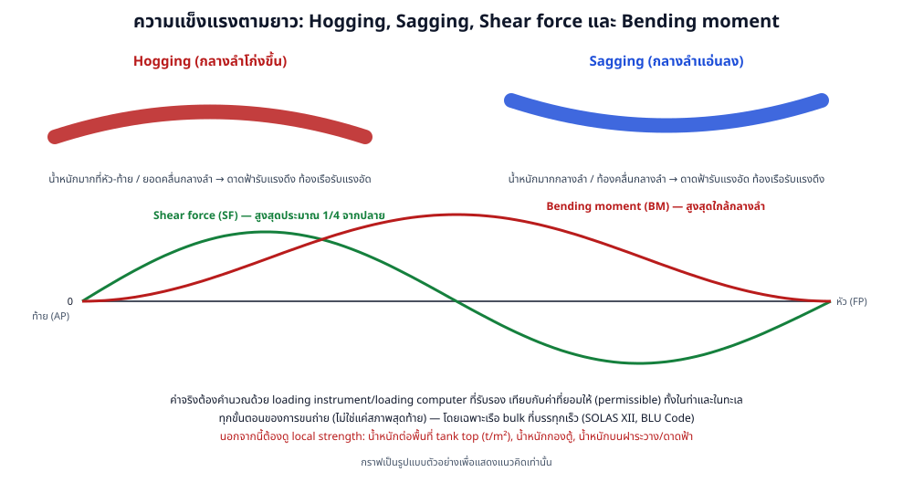
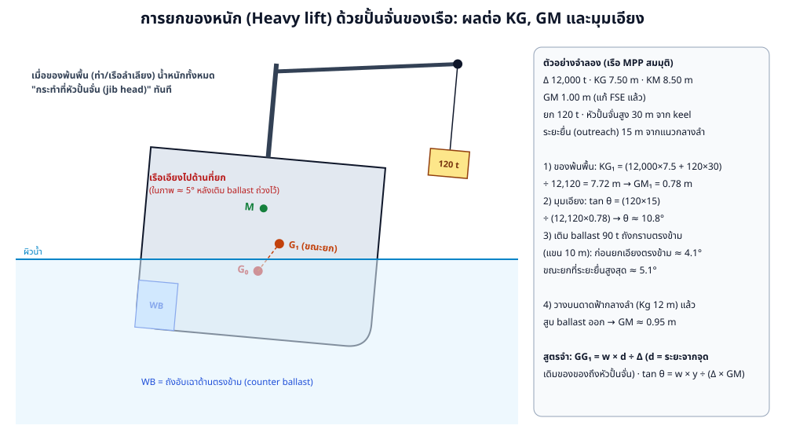
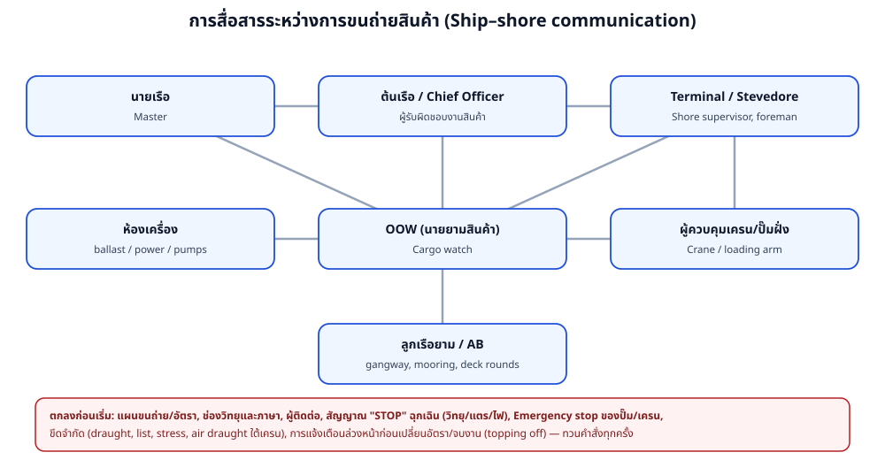
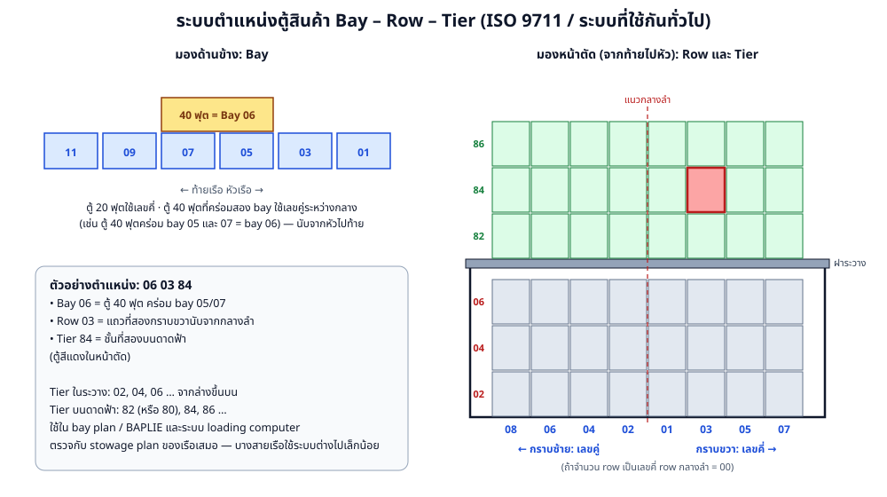
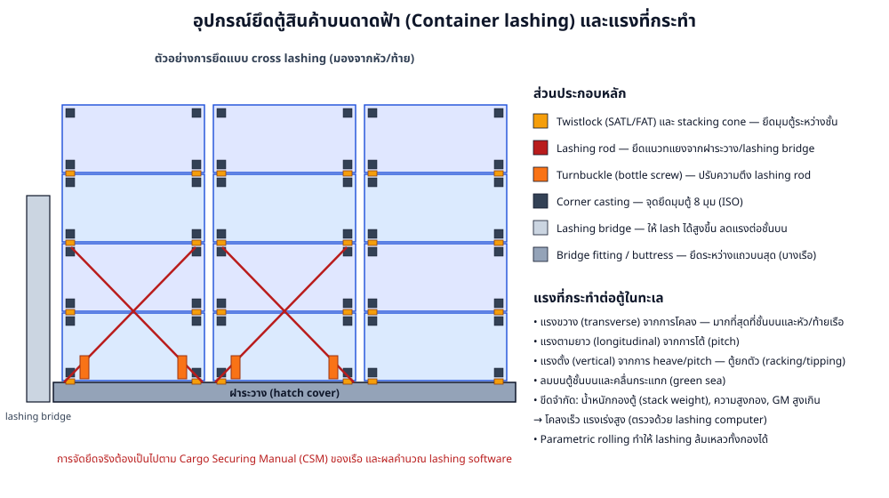
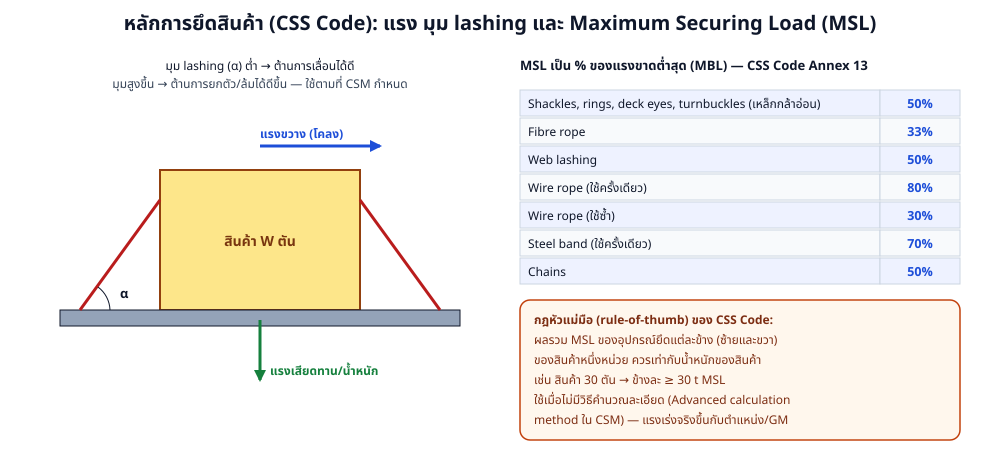
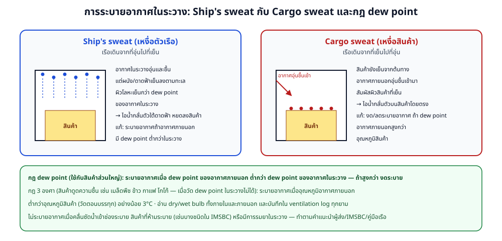
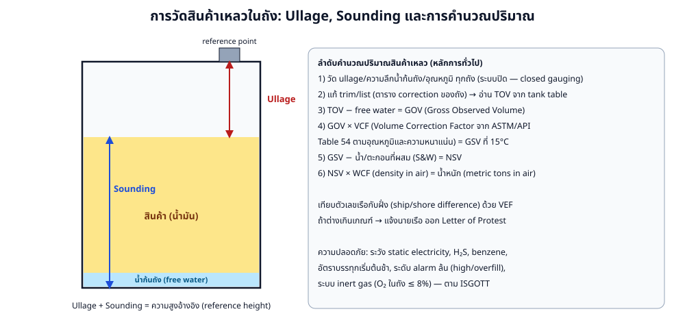
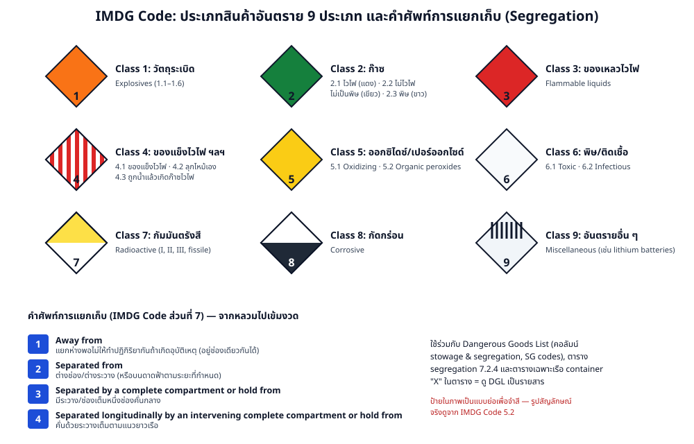

# 2.1 Monitor the Loading, Stowage, Securing, Care during the Voyage and the Unloading of Cargoes — การขนถ่าย จัดวาง ยึด และดูแลสินค้า

> สมุดบันทึกการฝึก OOW · TIRAPHONG NANTAPAN
> Function 2: **Cargo handling and stowage at the operational level**
> สมรรถนะตาม STCW A-II/1: *Monitor the loading, stowage, securing, care during the voyage and the unloading of cargoes* — Cargo handling, stowage and securing:
> - Knowledge of the effect of cargo, including heavy lifts, on the seaworthiness and stability of the ship
> - Knowledge of safe handling, stowage and securing of cargoes, including dangerous, hazardous and harmful cargoes, and their effect on the safety of life and of the ship
> - Ability to establish and maintain effective communications during loading and unloading
>
> เกณฑ์ประเมิน: *Cargo operations are carried out in accordance with the cargo plan or other documents and established safety rules/regulations, equipment operating instructions and shipboard stowage limitations · The handling of dangerous, hazardous and harmful cargoes complies with international regulations and recognized standards and codes of safe practice · Communications are clear, understood and consistently successful*
>
> อ้างอิงหลัก: STCW Code A-II/1 และ A-VIII/2 Part 5 (Watchkeeping in port — ข้อความรวม 2010); IMO Model Course 7.03 (Function 2); SOLAS บทที่ VI (Carriage of cargoes), VII (Carriage of dangerous goods), XII (Bulk carriers), II-2/19–20, **II-1/3-13** (Lifting appliances and anchor handling winches — MSC.532(107) มีผล 1 ม.ค. 2026) พร้อม MSC.1/Circ.1663 และ 1662, V/22 (visibility), V/31 และ V/32 (การรายงานตู้สินค้าสูญหาย/พบตู้ลอย — MSC.550(108) มีผล 1 ม.ค. 2026) และ CCC.1/Circ.7/Rev.1 (แบบฟอร์มรายงาน), XI-1/7; **IMDG Code** (Amendment 42-24 บังคับใช้ 1 ม.ค. 2026); **IMSBC Code**; International Grain Code (MSC.23(59)); **CSS Code** และ Cargo Securing Manual ตาม MSC.1/Circ.1353/Rev.2; Timber Deck Cargo Code 2011; **BLU Code** และ BLU Manual; IBC Code; IGC Code; MARPOL Annex I, II, III, V; **ISGOTT 6th edition**; IMO/ILO/UNECE **CTU Code** (2014); MSC.1/Circ.1475 (VGM); MSC.1/Circ.1264 และ 1265 (fumigation); IMO Res. MSC.581(110) (Revised recommendations for entering enclosed spaces aboard ships — มีผล 3 ธ.ค. 2025 แทน A.1050(27)); ILO C152; Hague-Visby Rules; *Thomas' Stowage*; D.J. House *Cargo Work for Maritime Operations*

---

## 0. บทบาทของ OOW ในงานสินค้า

บนเรือพาณิชย์ **ต้นเรือ (Chief Officer)** เป็นผู้วางแผนและรับผิดชอบงานสินค้าภายใต้นายเรือ แต่คนที่อยู่หน้างานตลอด 24 ชั่วโมงในท่าคือ **OOW ที่เข้ายามสินค้า (cargo watch)** — STCW ใช้คำว่า **"Monitor"** คือเฝ้าดูให้การบรรทุก จัดวาง ยึด ดูแลระหว่างทาง และขนลง เป็นไปตามแผนและกฎ รู้ว่าอะไรผิดปกติ และหยุด/แจ้งได้ทันเวลา

ในทางกฎหมาย ผู้ขนส่ง (carrier) มีหน้าที่ตาม **Hague-Visby Rules (Article III)** — ใช้ความระมัดระวังตามสมควร (due diligence) ทำให้เรือ **พร้อมเดินทะเล (seaworthy)** มีคน อุปกรณ์ เสบียงเหมาะสม และทำให้ระวางสินค้า ห้องเย็น และส่วนที่บรรทุกสินค้า **พร้อมรับ ขนส่ง และรักษาสินค้า (cargoworthy)** และต้อง **บรรทุก ขนย้าย จัดวาง ขนส่ง เก็บรักษา ดูแล และขนลงสินค้าอย่างเหมาะสมและระมัดระวัง** — บันทึกของ OOW (log, cargo watch record, damage report) คือหลักฐานสำคัญเมื่อมีข้อพิพาท

**หลักคิดสามข้อของงานสินค้า**
1. **ความปลอดภัยของคนและเรือ** มาก่อน — เสถียรภาพ ความแข็งแรง การยึด สินค้าอันตราย
2. **ป้องกันความเสียหายของสินค้า** — การจัดวาง การแยก การระบายอากาศ อุณหภูมิ การยึด
3. **ใช้พื้นที่และระวางบรรทุกให้คุ้ม** และขนถ่ายได้เร็ว — แต่ไม่ยอมแลกกับสองข้อแรก

---

## 1. คำศัพท์และการคำนวณพื้นฐาน

| คำศัพท์ | ความหมาย |
|---|---|
| **Displacement (Δ)** | น้ำหนักทั้งหมดของเรือ = น้ำหนักเรือเปล่า (lightship) + deadweight |
| **Deadweight (DWT)** | น้ำหนักที่เรือบรรทุกได้ = สินค้า + น้ำมันเชื้อเพลิง + น้ำจืด + น้ำอับเฉา + เสบียง + คน + ค่าคงที่ (constant) |
| **Cargo deadweight** | ส่วนของ DWT ที่เหลือให้สินค้า |
| **Bale capacity / Grain capacity** | ปริมาตรระวางสำหรับสินค้าหีบห่อ (วัดถึงด้านในของโครงเรือ/ไม้กั้น) / สำหรับสินค้าเทกอง (วัดเต็มถึงผิวเหล็ก) — grain capacity มากกว่า |
| **Stowage factor (SF)** | ปริมาตรที่สินค้า 1 ตันใช้ (m³/t หรือ ft³/LT) |
| **Broken stowage** | ที่ว่างที่เสียไปจากรูปทรงระวาง ไม้รอง (dunnage) ช่องว่างระหว่างหีบห่อ — คิดเป็น % |
| **TPC** | ตันที่ทำให้ draught เปลี่ยน 1 cm |
| **FWA / DWA** | Fresh Water Allowance / Dock Water Allowance — การจมเพิ่มเมื่อเรือจากน้ำทะเลเข้าน้ำจืด/น้ำกร่อย |
| **Air draught** | ความสูงจากผิวน้ำถึงจุดสูงสุดของเรือ — สำคัญเมื่อผ่านใต้สะพาน/สายไฟ และใต้เครนท่า |

**ตัวอย่างจำลอง 1 — สินค้าเต็มระวางได้กี่ตัน (volume-limited)**
> ระวางมี bale capacity 5,000 m³ สินค้า SF 1.6 m³/t broken stowage 10% → สินค้า = 5,000 × (1 − 0.10) ÷ 1.6 ≈ **2,812 ตัน**
> ถ้าเหลือ DWT สำหรับระวางนี้มากกว่า 2,812 ตัน แสดงว่าระวาง "เต็มก่อนหนัก" — สินค้าเบา (measurement cargo); ถ้าน้อยกว่า เรือ "หนักก่อนเต็ม" — สินค้าหนัก (deadweight cargo)

**ตัวอย่างจำลอง 2 — บรรทุกในน้ำกร่อย (Dock Water Allowance)**
> Δ ที่ summer draught 31,000 t, TPC 42 → **FWA = Δ ÷ (4 × TPC) = 31,000 ÷ 168 ≈ 184.5 mm**
> ท่าเรือความหนาแน่นน้ำ 1.010 t/m³ → **DWA = FWA × (1,025 − 1,010) ÷ 25 ≈ 110.7 mm**
> แปลว่าในท่าบรรทุกได้จน summer load line จมลงไปประมาณ **111 mm** และเมื่อออกสู่ทะเล (1.025) เรือจะลอยขึ้นมาอยู่ที่ summer mark พอดี (ถ้าไม่มีการใช้น้ำมัน/น้ำระหว่างทางที่ต้องคิด) — อย่าลืมตรวจโซน load line ตลอดเส้นทาง (Tropical/Summer/Winter ฯลฯ ตาม Load Line Convention)

**ตัวอย่างจำลอง 3 — สินค้ามากที่สุดที่บรรทุกได้ (deadweight-limited)**
> Summer DWT 23,000 t · constant 250 t · น้ำมัน น้ำจืด เสบียงขาออก 1,800 t · ไม่มีน้ำอับเฉา → cargo DWT สูงสุด = 23,000 − 250 − 1,800 = **20,950 t** — แล้วตรวจว่าเมื่อถึงโซน load line ที่เข้มงวดที่สุดบนเส้นทาง เรือจะไม่จมเกินเครื่องหมายของโซนนั้น (คิดน้ำมันที่ใช้ไปถึงจุดนั้น)

---

## 2. ผลของสินค้าต่อความพร้อมเดินทะเลและเสถียรภาพ (Seaworthiness and stability)

### 2.1 เสถียรภาพตามขวาง

- **GM น้อยเกินไป (tender ship)** — โคลงช้า มุมโคลงมาก ฟื้นตัวช้า เสี่ยงล่มเมื่อสินค้าเคลื่อน/มีน้ำเข้า/ลมแรง
- **GM มากเกินไป (stiff ship)** — โคลงเร็วและแรง แรงเร่งต่อสินค้าและ lashing สูงมาก (ตู้ล้ม สินค้าเคลื่อน คนบาดเจ็บ โครงสร้างเสียหาย) — เรือ container และเรือบรรทุกสินค้าหนักใต้ระวาง (เหล็ก แร่) ต้องระวัง
- **Free surface effect** — ของเหลวในถังที่ไม่เต็ม (slack tanks) ทำให้ GM ที่มีผล (fluid GM) ลดลง — ระหว่างขนถ่ายต้องเลี่ยงการมีถังหย่อนหลายถังพร้อมกัน
- **การเคลื่อนของสินค้า (cargo shift)** — เมล็ดพืช (grain) สินค้าเทกองที่ไหลได้หรือเหลว (liquefaction) สินค้าหีบห่อที่ยึดไม่ดี → เรือเอียงถาวร อาจล่ม
- รายละเอียดการคำนวณเสถียรภาพอยู่ใน **บท 3.2.1** — บทนี้เน้นผลที่เกิดจากสินค้า

### 2.2 ความแข็งแรงของตัวเรือ

*ภาพที่ 2.1-1 Hogging, sagging, shear force และ bending moment (รูปแบบแนวคิด)*

- **Longitudinal strength** — การกระจายน้ำหนักตามยาวไม่สมดุลกับแรงลอยตัว ทำให้เกิด **shear force (SF)** และ **bending moment (BM)**; **hogging** (กลางลำโก่งขึ้น — น้ำหนักมากหัว/ท้าย) และ **sagging** (กลางลำแอ่นลง — น้ำหนักมากกลางลำ)
- ต้องตรวจด้วย **loading instrument/loading computer ที่รับรอง** ว่าไม่เกินค่าที่ยอมให้ **ทั้งในท่า (harbour limits) และในทะเล (seagoing limits)** และ **ทุกขั้นตอนของการขนถ่าย** — เรือ bulk carrier ยาว ≥ 150 m ต้องมี loading instrument ตาม SOLAS XII/11
- **Local strength** — น้ำหนักต่อพื้นที่ของ tank top (t/m²), น้ำหนักกองตู้ (stack weight), น้ำหนักบนฝาระวาง/ดาดฟ้า/ทางลาดของเรือ ro-ro — เกินแล้วโครงสร้างเสียหายเฉพาะจุดได้แม้ SF/BM ปกติ
- **Torsion** — เรือ container ที่มีช่องเปิดดาดฟ้ากว้าง การบรรทุกไม่สมมาตรทำให้ตัวเรือบิด

### 2.3 Trim, draught และ air draught

- Trim ที่เหมาะสมต่อการบังคับเรือ (1.9) การกินน้ำของใบจักร และความเร็ว
- Draught สูงสุดตาม load line และข้อจำกัดท่า/ร่องน้ำ (UKC — 1.1.0)
- **Air draught** — ผ่านใต้สะพาน สายไฟ หรือใต้เครนท่า (เครนชนเสาเรือ/ตู้)

### 2.4 ทัศนวิสัยจากสะพานเดินเรือ (SOLAS V/22)

สินค้าบนดาดฟ้า (โดยเฉพาะตู้) ต้องไม่บังทัศนวิสัยเกินเกณฑ์ — **ผิวน้ำข้างหน้าหัวเรือต้องมองเห็นได้ไม่ไกลเกิน 2 เท่าความยาวเรือหรือ 500 m (ค่าที่น้อยกว่า)** ในช่วง 10° ทั้งสองข้างของหัวเรือ ในทุกสภาพ draught trim และสินค้าบนดาดฟ้า และมุมบังจากสินค้าต้องอยู่ในขีดจำกัด (สรุปจาก V/22: มุมบังแต่ละช่วงหน้าแนวขวางลำไม่เกิน 10° รวมทุกช่วงไม่เกิน 20° และช่องมองเห็นระหว่างมุมบังกว้างอย่างน้อย 5°) — การวางแผนตู้ชั้นสูงหน้าสะพานต้องคำนึงถึงข้อนี้ (loading computer ส่วนมากคำนวณ "visibility line" ให้)

### 2.5 ผลอื่นของสินค้าต่อความปลอดภัย

- สินค้าที่ให้ความร้อนหรือก๊าซ (ถ่านหิน — มีเทน/ร้อนเอง, เมล็ดพืชรมยา, DRI — ไฮโดรเจน) → ไฟไหม้ ระเบิด ขาดออกซิเจนในระวาง
- สินค้าเหลว (liquefaction) ใน Group A ของ IMSBC
- สินค้ากัดกร่อนทำลายโครงสร้าง (ดู 2.2)
- น้ำเข้าระวางทางฝาระวาง → สินค้าเสียหาย และบางชนิด (เช่นถูกน้ำแล้วเกิดก๊าซไวไฟ) เป็นอันตราย

---

## 3. การยกของหนัก (Heavy lifts)

### 3.1 ทำไมการยกของหนักด้วยปั้นจั่นของเรือจึงอันตรายต่อเสถียรภาพ

**ทันทีที่ของพ้นพื้น** น้ำหนักทั้งหมดจะกระทำที่ **หัวปั้นจั่น/หัวเดอร์ริก (jib head / derrick head)** — ไม่ใช่ที่ตำแหน่งของมันบนท่า ดังนั้น
- **G ของเรือขึ้นทันที** ตามสูตร **GG₁ = w × d ÷ Δ** (d = ระยะแนวตั้งจากตำแหน่งเดิมของของถึงหัวปั้นจั่น) → GM ลดลง
- เมื่อปั้นจั่นยื่นออกนอกกราบ เกิด **มุมเอียง: tan θ = (w × ระยะยื่นจากแนวกลางลำ) ÷ (Δ × GM ใหม่)**
- ยิ่ง GM ลดลง มุมเอียงยิ่งมาก — ถ้า GM เหลือน้อยหรือติดลบ เรืออาจเอียงมากจนอันตราย
- เมื่อวางของลงแล้ว G ของของจะอยู่ที่ตำแหน่งวาง (บนดาดฟ้าสูง → G เรือสูงขึ้นถาวร)

*ภาพที่ 2.1-2 การยกของหนักด้วยปั้นจั่นของเรือ ผลต่อ KG, GM และมุมเอียง พร้อมตัวอย่างคำนวณ*

**ตัวอย่างจำลอง 4 — ยกเครื่องแปลงไฟฟ้า 120 ตัน (เรือ MPP สมมุติ)**
> Δ 12,000 t · KG 7.50 m · KM 8.50 m · GM 1.00 m (แก้ free surface แล้ว) · หัวปั้นจั่นสูง 30 m จาก keel · ระยะยื่น 15 m จากแนวกลางลำ
> 1. **ของพ้นท่า**: Δ ใหม่ 12,120 t · KG₁ = (12,000 × 7.5 + 120 × 30) ÷ 12,120 = **7.72 m** → GM₁ = **0.78 m**
> 2. **มุมเอียง**: tan θ = (120 × 15) ÷ (12,120 × 0.78) ≈ 0.19 → **θ ≈ 10.8°** — มากเกินกว่าที่แผนยกยอมรับ (สมมุติไม่เกิน 5°)
> 3. **แก้ด้วย counter ballast**: เติมน้ำ 90 t ในถังข้างกราบตรงข้าม (แขน 10 m, Kg 1.0 m) ก่อนยก → เรือเอียงไปด้านตรงข้ามก่อน ≈ **4.1°** (GM ≈ 1.05 m) และขณะยกที่ระยะยื่นสูงสุดเอียงไปด้านยก ≈ **5.1°** (GM ≈ 0.83 m)
> 4. **วางบนดาดฟ้ากลางลำ (Kg 12 m)** แล้วสูบ ballast ออก → KG = (90,000 + 120 × 12) ÷ 12,120 ≈ 7.545 m · GM ≈ **0.95 m** (คิดละเอียด 0.955 m — ของบนดาดฟ้าทำให้ GM ลดลงถาวรประมาณ 0.045 m)
>
> (ตัวเลขข้อ 1–4 คิด KM คงที่ 8.50 m เพื่อความง่าย — จริงต้องอ่าน KM ใหม่จาก hydrostatic table ที่ระวางขับน้ำใหม่ และถ้าถัง ballast ไม่เต็มต้องหัก free surface ด้วย)
>
> บทเรียน: ต้องคำนวณก่อนยกทุกครั้ง และวางแผนการถ่ายน้ำอับเฉาให้ทันจังหวะ (ปั๊มต้องเร็วพอ หรือเติมล่วงหน้า)

### 3.2 อุปกรณ์ยกของเรือและข้อกำหนด

- **ปั้นจั่น (crane)** และ **เดอร์ริก (derrick)** — เดอร์ริกแบบ union purchase (สองต้นทำงานคู่), swinging derrick, heavy lift derrick (เช่นแบบ Stülcken), ปั้นจั่นคู่ทำงานพร้อมกัน (tandem lift — ต้องมีแผนพิเศษ)
- **SWL (Safe Working Load)** ทำเครื่องหมายบนอุปกรณ์ — **ห้ามเกิน**; SWL ของปั้นจั่นมักลดลงเมื่อระยะยื่นมากขึ้น (load chart/load moment)
- **Register of lifting appliances and cargo handling gear** — บันทึกการทดสอบและตรวจ: **ตรวจละเอียด (thorough examination) อย่างน้อยทุก 12 เดือน** และ **ทดสอบรับน้ำหนัก (proof load test) อย่างน้อยทุก 5 ปี** และหลังซ่อมใหญ่ (ตามแนว ILO C152 และกฎสมาคมจัดชั้น/รัฐเจ้าของธง)
- **SOLAS II-1/3-13** (ข้อใหม่ มีผล 1 ม.ค. 2026) — กำหนดการออกแบบ สร้าง ติดตั้ง ตรวจ ทดสอบ และบำรุงรักษาอุปกรณ์ยกบนเรือ (lifting appliances) และกว้าน anchor handling (anchor handling winches) พร้อมอุปกรณ์ยกเสริม (loose gear) ตามแนวทาง MSC.1/Circ.1663 (Guidelines for lifting appliances) และ MSC.1/Circ.1662 (Guidelines for anchor handling winches) — การทดสอบน้ำหนักและการตรวจละเอียด (thorough examination) ทำโดยผู้มีความสามารถ (competent person) (ขอบเขตการใช้ เช่นขนาด SWL ที่ครอบคลุม ให้ดูจากข้อบังคับและคู่มือของเรือ)
  - สรุปที่ตรวจแล้ว: ครอบคลุมอุปกรณ์ยกและกว้าน anchor handling ที่ **SWL ตั้งแต่ 1,000 kg** (ต่ำกว่านั้นแล้วแต่ Administration) เช่นเครนสินค้า เครนห้องเครื่อง เครนเสบียง/ขนคน แต่ไม่รวมระบบปล่อยเรือชูชีพตาม LSA และอุปกรณ์บางประเภทบนหน่วยขุดเจาะ/เรือก่อสร้างนอกชายฝั่ง
  - อุปกรณ์ยก: **ทดสอบรับน้ำหนักทุก 5 ปี** และ **ตรวจละเอียดทุกปี** (และหลังทดสอบ); ทำเครื่องหมาย SWL ถาวร
  - อุปกรณ์ที่ติดตั้งก่อน 1 ม.ค. 2026 ต้องทดสอบ ตรวจละเอียด และทำเครื่องหมายให้เรียบร้อย **ไม่ช้ากว่า SAFCON renewal survey ครั้งแรกตั้งแต่ 1 ม.ค. 2026** — ใบรับรองที่ออกตามมาตรฐานอื่น (เช่น ILO C152) ก่อนวันนั้นนับว่าใช้ได้
- อุปกรณ์ประกอบ: wire rope, shackle, hook, sling, spreader, lifting beam — ต้องมีใบรับรองและ SWL เหมาะกับงาน

### 3.3 การเตรียมการและขั้นตอนการยกของหนัก (Heavy lift checklist)

**ก่อนยก**
1. **Lift plan** ที่นายเรือ/ต้นเรือรับรอง — น้ำหนักจริง จุดศูนย์ถ่วงของของ จุดยก (lifting points) ระยะยื่น ความสูง ตำแหน่งวาง
2. **คำนวณเสถียรภาพ** (GM ขณะยก มุมเอียงสูงสุด) และ **แผน ballast** — กด ballast ให้เต็มหรือว่าง (press up) ลด free surface
3. ตรวจ SWL ปั้นจั่นที่ระยะยื่นที่ใช้, ใบรับรองอุปกรณ์, สภาพ wire/limit switch/เบรก
4. **ความแข็งแรงของจุดวาง** — ดาดฟ้า/ฝาระวาง/tank top รับน้ำหนักได้ (ใช้ไม้รองกระจายน้ำหนัก — load spreading)
5. **เชือกผูกเรือ** — ปรับให้หย่อนพอให้เรือเอียงได้โดยเชือกไม่ขาด และมีคนดูแลตลอด; **gangway** ยกให้พ้นท่า
6. ปิดช่องเปิดที่อาจถูกน้ำเข้าเมื่อเรือเอียง; ยึดของหลวมบนเรือ
7. สภาพอากาศ — **ลม** อยู่ในเกณฑ์ (ของขนาดใหญ่รับลมมาก), คลื่น/คลื่นจากเรือผ่าน (swell ในท่า)
8. คนทำงาน: ผู้ให้สัญญาณ (signalman) คนเดียวที่ชัดเจน, tag lines ควบคุมการหมุน, กันพื้นที่ใต้ของ ห้ามคนอยู่ใต้ของ
9. สื่อสาร: วิทยุช่องเฉพาะ สัญญาณมือตามมาตรฐาน คำสั่งหยุดฉุกเฉิน

**ขณะยก** — ยกพ้นพื้นเล็กน้อยแล้ว **หยุดตรวจ (test lift)** ดูเรือเอียง เบรก sling สมดุล แล้วค่อยยกต่อ, เคลื่อนช้าและนุ่มนวล ไม่กระชาก, เฝ้ามุมเอียงด้วย inclinometer, ballast ตามแผน

**หลังวาง** — **sea fastening** (ค้ำยัน เชื่อมตัวกัน (welded stoppers) โซ่/ลวดยึดตาม CSM หรือแผนเฉพาะ) คำนวณแรงยึดให้พอกับแรงเร่งในทะเล, ตรวจเสถียรภาพสภาพสุดท้าย, บันทึก

---

## 4. แผนสินค้าและเอกสารที่เกี่ยวข้อง

**ข้อมูลสินค้าก่อนบรรทุก (SOLAS VI/2)** — ผู้ส่ง (shipper) ต้องให้ข้อมูลสินค้าที่เหมาะสมล่วงหน้าแก่นายเรือ เพื่อวางแผนการจัดวางและยึด รวมทั้ง
- **Verified Gross Mass (VGM)** ของตู้สินค้า — ตู้ที่ไม่มี VGM **ห้ามบรรทุก** (MSC.1/Circ.1475 — Method 1 ชั่งทั้งตู้ หรือ Method 2 ชั่งของทุกชิ้นรวมน้ำหนักตู้เปล่า)
- สินค้าเทกอง: ข้อมูลตาม IMSBC (ชื่อสินค้า BCSN, กลุ่ม, ความชื้น/TML, ใบรับรอง)
- สินค้าอันตราย: เอกสารตาม IMDG (ข้อ 11)

**เอกสารและบันทึกที่ OOW ต้องรู้จัก**

| เอกสาร | ความหมาย/การใช้ |
|---|---|
| **Cargo plan / Stowage plan / Bay plan** | แผนการจัดวางสินค้า (เรือ container ใช้ bay plan และไฟล์ BAPLIE) |
| **Loading/Discharging sequence** | ลำดับการขนถ่ายพร้อมการถ่าย ballast (สำคัญมากในเรือ bulk และ tanker) |
| **Mate's receipt** | ใบรับสินค้าที่ต้นเรือลงนาม ระบุสภาพสินค้า — ถ้าสินค้ามีตำหนิต้องหมายเหตุ (clause) ไว้ ซึ่งจะไปปรากฏใน B/L |
| **Bill of Lading (B/L)** | ใบตราส่ง — หลักฐานสัญญาขนส่ง ใบรับสินค้า และเอกสารสิทธิในสินค้า |
| **Cargo manifest** | รายการสินค้าทั้งหมดบนเรือ |
| **Dangerous goods manifest / list** | รายการสินค้าอันตรายและตำแหน่ง (SOLAS VII/4) |
| **Notice of Readiness (NOR), Statement of Facts (SOF)** | เอกสารเวลาความพร้อมและเหตุการณ์ (เกี่ยวกับ laytime) |
| **Draught survey report, Ullage report** | การวัดปริมาณสินค้า (เทกอง/เหลว) |
| **Damage report / Stevedore damage report** | บันทึกความเสียหายจากคนงานท่าหรืออุปกรณ์ — ให้หัวหน้าคนงานลงนามรับทราบ |
| **Letter of Protest (LOP)** | หนังสือคัดค้านเมื่อมีเรื่องไม่ถูกต้อง (ตัวเลขต่างกัน ความล่าช้าจากท่า ความเสียหาย) |
| **Cargo Securing Manual (CSM)** | คู่มือการยึดสินค้าของเรือ ได้รับอนุมัติจาก Administration (SOLAS VI/5, VII/5) — **บังคับใช้** สำหรับสินค้าที่ไม่ใช่เทกองแห้ง/เหลว |
| **Document of Compliance (DOC) for DG** | ใบรับรองว่าเรือเหมาะกับการบรรทุกสินค้าอันตรายประเภทใดในพื้นที่ใด (SOLAS II-2/19) |
| **Document of authorization (Grain)** | อนุญาตให้บรรทุกเมล็ดพืชเทกอง พร้อม grain stability booklet |

---

## 5. หน้าที่ของ OOW ระหว่างยามสินค้าในท่า (Cargo watch)

ตาม STCW Code A-VIII/2 Part 5 (Watchkeeping in port) และ SMS ของบริษัท OOW ยามสินค้าต้อง
1. **เข้าใจแผน** — รับมอบยามโดยอ่าน cargo plan/sequence ล่าสุด สถานะ (ขนไปเท่าไร เหลือเท่าไร ระวาง/ถังใดกำลังทำงาน) คำสั่งของต้นเรือ ข้อจำกัด (draught สูงสุด, trim, list, stress, air draught)
2. **เฝ้าดูให้การขนถ่ายเป็นไปตามแผน** — ถูกระวาง/ถัง ถูกลำดับ ถูกตำแหน่ง ถ้าคลาดเคลื่อน **หยุดและแจ้งต้นเรือ**
3. **ตรวจ draught หัว-กลาง-ท้าย ทั้งสองกราบ เป็นระยะ** เทียบกับที่คาด, ตรวจ **list** — เรือเอียงขณะขนถ่ายเป็นสัญญาณเตือน (ผิดแผน ถังน้ำรั่ว ปั๊ม ballast ผิดถัง)
4. **ประสานการถ่ายน้ำอับเฉา (ballast)** ตามลำดับกับห้องเครื่อง/ระบบ — ให้ทันกับอัตราการบรรทุก ไม่ให้เกิน stress และปฏิบัติตาม BWM (บันทึก Ballast Water Record Book)
5. **เชือกผูกเรือและ gangway** — draught เปลี่ยนเร็วระหว่างขนถ่าย ต้องปรับเชือก ตรวจ gangway (ความสูง/ตาข่าย)
6. **ตรวจความปลอดภัยของงาน** — คนงานท่าใช้ PPE ทางเดินปลอดภัย ไฟส่องสว่าง ห้ามสูบบุหรี่ในพื้นที่ห้าม การทำงานบนที่สูง ไม่มีคนในพื้นที่ใต้ของที่ยก
7. **ดูแลสินค้า** — สภาพสินค้าที่บรรทุก (เปียก เสียหาย รั่ว) — สินค้าเสียหายก่อนขึ้นเรือต้องหมายเหตุ/ปฏิเสธ แจ้งต้นเรือ ถ่ายภาพ; ป้องกันฝน (ปิดฝาระวางเมื่อฝนตกสำหรับสินค้าที่ห้ามเปียก)
8. **สินค้าอันตราย** — ตรวจป้าย (labels/placards) สภาพหีบห่อ/ตู้ ตำแหน่งตามแผน เอกสาร เตรียมอุปกรณ์ดับเพลิง
9. **ความเสียหายต่อเรือ** จากการขนถ่าย (เครน/grab กระแทกฝาระวาง ผนัง บันได ท่อ) → บันทึก ถ่ายภาพ ให้หัวหน้าคนงาน/ท่าเซ็นรับ **stevedore damage report** ทันที (ดู 2.2)
10. **Security (ISPS)** — ควบคุมการขึ้นลงเรือตามระดับ security
11. **ป้องกันมลพิษ** — scupper plugs (เรือบรรทุกน้ำมัน/ขณะรับน้ำมันเชื้อเพลิง), ขยะ, การรั่วไหล
12. **สภาพอากาศ** — ลมแรง (หยุดเครน), ฝน, พายุ
13. **บันทึก** — เวลาเริ่ม/หยุดแต่ละระวาง เหตุการณ์ ความล่าช้า draught ปริมาณ การสื่อสารสำคัญ
14. **แจ้งต้นเรือ/นายเรือ** ทันทีเมื่อมีสิ่งผิดปกติ — ไม่ต้องรอจนจบยาม

---

## 6. การสื่อสารระหว่างการขนถ่าย (Communications during loading and unloading)

STCW ให้ความสำคัญเรื่องนี้เป็นหัวข้อเฉพาะ เพราะอุบัติเหตุงานสินค้าจำนวนมากเกิดจากการสื่อสารผิดพลาด — เรือคิดว่าตกลงอัตราไว้อย่างหนึ่ง ฝั่งทำอีกอย่าง; สั่งหยุดแล้วอีกฝ่ายไม่ได้ยิน; ภาษาไม่ตรงกัน

*ภาพที่ 2.1-3 สายการสื่อสารระหว่างการขนถ่ายสินค้า และเรื่องที่ต้องตกลงกันก่อนเริ่ม*

### 6.1 ก่อนเริ่มงาน

- **แลกเปลี่ยนข้อมูลล่วงหน้า** — เรือแจ้ง ETA draught ความต้องการ ข้อจำกัด; ท่าแจ้งข้อมูลท่า อุปกรณ์ อัตรา ข้อกำหนดท่า (BLU Code กำหนดข้อมูลที่ต้องแลกเปลี่ยนสำหรับเรือ bulk)
- **Pre-operation meeting** ระหว่างต้นเรือกับตัวแทนท่า/หัวหน้าคนงาน — แผนและลำดับ อัตรา ระดับ/จุดหยุด ballast ข้อจำกัด จำนวนเครน/ปั๊ม ตำแหน่ง DG การทำงานกะ
- **Ship/shore safety checklist** — เรือ bulk (BLU Code ภาคผนวก), เรือ tanker (ISGOTT) ตรวจร่วมกันและลงนาม พร้อมตรวจซ้ำเป็นระยะ
- **ตกลงวิธีสื่อสาร**: ช่องวิทยุ (และช่องสำรอง), ภาษา (อังกฤษ — ใช้ SMCP), ชื่อผู้ติดต่อแต่ละฝ่าย, **สัญญาณหยุดฉุกเฉิน (emergency stop)** ทั้งทางวิทยุและทางเสียง/มือ, การตรวจวิทยุเป็นระยะ (radio check)
- **ตกลงการแจ้งล่วงหน้า** — เช่น แจ้งก่อน 30 นาทีและ 10 นาทีก่อนจบ (topping off/trimming), แจ้งก่อนเปลี่ยนอัตรา, แจ้งเมื่อจะเปลี่ยนระวาง

### 6.2 ระหว่างงาน

- ใช้ **closed-loop communication** — ผู้รับทวนคำสั่ง ผู้สั่งยืนยัน (1.2.2)
- รายงานตามเวลา: ปริมาณที่ขนแล้ว draught อัตรา ballast
- **คำสั่ง "Stop" ต้องได้รับการปฏิบัติทันที** ไม่ถกเถียง — ถกเถียงหลังหยุดแล้ว (นายเรือมีอำนาจหยุดการขนถ่ายเมื่อใดก็ได้ถ้าเห็นว่าไม่ปลอดภัย — BLU Code ระบุชัดสำหรับเรือ bulk)
- ส่งมอบยามระหว่าง OOW และระหว่างกะคนงานฝั่ง ต้องแจ้งสถานะครบ
- ภาษา: ใช้ประโยคสั้น ชัด ตัวเลขอ่านทีละหลัก ใช้ IMO SMCP ส่วน cargo handling (1.7)

### 6.3 ตัวอย่างการสื่อสาร (จำลอง — เรือ bulk บรรทุกถ่านหิน ท่าสมมุติ)

> **OOW:** "Loading Master, this is Andaman Star, duty officer, over." *(ชื่อเรือสมมุติ)*
> **Loading Master:** "Andaman Star, Loading Master, go ahead."
> **OOW:** "Request you **stop loading** hold number four. I repeat, **stop loading** hold number four. Ship is listing two degrees to port. Over."
> **Loading Master:** "Stop loading hold number four, ship listing two degrees port. Stopping now. Over."
> **Loading Master:** "Andaman Star, loading stopped at time one-four-two-five. Over."
> **OOW:** "Loading stopped one-four-two-five. Thank you. We will correct the list with ballast and advise when ready to resume. Out."
>
> จากนั้น OOW แจ้งต้นเรือ ตรวจสาเหตุ (เทลงด้านซ้ายของระวางมากไป/ปั๊ม ballast ผิดถัง) แก้ไขตามคำสั่ง บันทึกเวลาและเหตุผลใน log

---

## 7. เรือคอนเทนเนอร์ (Container ships)

### 7.1 ระบบตำแหน่ง Bay – Row – Tier

*ภาพที่ 2.1-4 ระบบตำแหน่งตู้ Bay-Row-Tier และตัวอย่างการอ่านตำแหน่ง*

- **Bay** — ตำแหน่งตามยาว นับจากหัวไปท้าย ตู้ 20 ฟุตใช้เลขคี่ (01, 03, 05…) ตู้ 40 ฟุตที่คร่อมสอง bay ใช้เลขคู่ระหว่างกลาง (02, 06, 10…)
- **Row** — ตำแหน่งตามขวาง นับจากแนวกลางลำออกไป กราบขวาเลขคี่ (01, 03…) กราบซ้ายเลขคู่ (02, 04…) ถ้าจำนวน row เป็นเลขคี่ row กลางลำคือ 00
- **Tier** — ตำแหน่งแนวตั้ง ในระวาง 02, 04, 06… จากล่างขึ้นบน บนดาดฟ้าเริ่ม 82 (บางเรือ 80) แล้ว 84, 86…
- ตัวอย่าง **06 03 84** = ตู้ 40 ฟุต bay 06 แถวที่สองกราบขวา ชั้นที่สองบนดาดฟ้า

### 7.2 การวางแผนและข้อจำกัด

- ตำแหน่งตามท่าปลายทาง (port rotation) — ตู้ที่จะลงก่อนต้องไม่อยู่ใต้ตู้ที่ลงทีหลัง (ลด restow)
- **น้ำหนักกอง (stack weight)** ในระวางและบนดาดฟ้า และ **น้ำหนักต่อชั้น** ตามที่ lashing system รับได้ — ตู้หนักไว้ล่าง ตู้เบาไว้บน (ปกติ) แต่บางตำแหน่งต้องคำนวณแรงเฉพาะ
- **GM** ต้องพอ (เสถียรภาพ) แต่ไม่มากเกิน (แรงเร่งต่อ lashing) — loading computer คำนวณแรง lashing ตาม GM จริง
- **Visibility line** (SOLAS V/22), air draught, ความแข็งแรง (SF, BM, torsion)
- **Reefer** — ต้องอยู่ในตำแหน่งที่มีปลั๊กไฟ (reefer sockets) จำนวนจำกัด และพลังงานเครื่องไฟพอ
- **OOG (out of gauge)** — ตู้ flat rack/open top ที่ของยื่นเกิน ใช้หลายช่อง ต้องยึดพิเศษ
- **สินค้าอันตราย** — ตำแหน่งต้องตรงตาม DOC และ IMDG (stowage category, segregation, ห่างจากที่พักหรือแหล่งความร้อน) ข้อ 11
- **VGM** — ตรวจว่าทุกตู้มี VGM และน้ำหนักในแผนตรงกับความจริง (ตู้น้ำหนักผิด → stack weight เกิน lashing ล้มเหลว เสถียรภาพผิด)

### 7.3 อุปกรณ์และการยึดตู้ (Container lashing)

*ภาพที่ 2.1-5 อุปกรณ์ยึดตู้บนดาดฟ้าและแรงที่กระทำต่อตู้ในทะเล*

- **Twistlock** — ยึดมุมตู้ระหว่างชั้น (แบบกึ่งอัตโนมัติ SATL ต้องตรวจว่าล็อกแล้ว, แบบอัตโนมัติ FAT ล็อกเอง) และ **stacking cone** (ในระวางหรือบางตำแหน่ง)
- **Lashing rod + turnbuckle** — ยึดแนวทแยงจากฝาระวางหรือ **lashing bridge** ไปที่ corner casting ของตู้ชั้นล่าง ๆ — ความตึงพอดี ไม่หย่อน ไม่ตึงเกิน
- **Bridge fitting / buttress / stacking cone ชั้นบนสุด** — บางระบบ
- ในระวางใช้ **cell guides** (ราง) ส่วนมากไม่ต้อง lash
- **การตรวจของ OOW ก่อนออกเรือ**: twistlock ล็อกทุกตัว (ดูด้วยตาทีละ bay — ด้ามล็อกอยู่ตำแหน่งปิด), lashing rod ใส่ถูกจุดตามแผน turnbuckle ขันพอดี ไม่มีอุปกรณ์ชำรุด, ตู้ไม่ยุบ/เสียหาย, ฝาระวางปิดล็อก, ไม่มีอุปกรณ์หลวมบนดาดฟ้า

### 7.4 ความเสี่ยงสำคัญของเรือคอนเทนเนอร์

- **การสูญเสียตู้กลางทะเล** — สาเหตุ: lashing ไม่ถูกต้อง, น้ำหนักตู้ผิด, GM สูงเกิน, คลื่นลมแรง, **parametric rolling** (กรณีศึกษาทางประวัติศาสตร์: เรือ *APL China* ปี 1998 ประสบ parametric rolling ในแปซิฟิกเหนือ ตู้เสียหายและสูญหายจำนวนมาก — เป็นกรณีที่ทำให้วงการตื่นตัวเรื่องนี้)
- **การรายงานตู้สูญหาย** — SOLAS V/31 และ V/32 (แก้ไขโดย MSC.550(108) มีผล 1 ม.ค. 2026): นายเรือต้อง **รายงานการสูญหายของตู้สินค้า** (และตู้ที่พบลอยในทะเล) ไปยังเรือใกล้เคียง รัฐชายฝั่งที่ใกล้ที่สุด และรัฐเจ้าของธง พร้อมข้อมูลที่กำหนด (ตำแหน่ง จำนวน ชนิด มีสินค้าอันตรายหรือไม่)
  - รายละเอียดเพิ่ม (จดกันลืม): ข้อมูลตาม V/32 รวมถึงชื่อ/IMO number/call sign/MMSI ของเรือ เวลาและตำแหน่ง จำนวนตู้ มีสินค้าอันตรายหรือไม่ ลักษณะตู้ และสภาพอากาศ — ส่งรายงานแรกโดยเร็ว แล้ว **ส่งรายงานติดตามเมื่อนับจำนวนได้แน่นอน โดยระบุว่าเป็นรายงานสุดท้าย (final)**; ถ้าเรือถูกละทิ้งหรือรายงานไม่ได้ **บริษัท (Company ตาม SOLAS IX)** ต้องรายงานแทน; รัฐเจ้าของธงส่งข้อมูลต่อให้ IMO ผ่าน GISIS; แบบฟอร์มดู CCC.1/Circ.7/Rev.1
  - รายงานนี้ต่างจากการรายงานสินค้าอันตรายตกน้ำตาม SOLAS VII/6 และ MARPOL Protocol I (ข้อ 11.7) — ถ้าตู้ที่หายมี DG ต้องทำทั้งสองส่วน
- **ไฟไหม้ในตู้** — สินค้าสำแดงเท็จ (misdeclared) เช่นสินค้าอันตรายที่ไม่ได้แจ้ง สาเหตุสำคัญของไฟไหม้เรือ container ใหญ่หลายครั้ง — การดับไฟในกองตู้ทำได้ยากมาก (ดู 3.3)
- **การทำงานบนดาดฟ้า** — ตกจากที่สูงบน lashing bridge, ถูกตู้ทับ, lashing rod หล่นใส่

### 7.5 ตู้เย็น (Reefer containers)

- ตรวจ **อุณหภูมิที่ตั้ง (set point)** เทียบกับ manifest/reefer list และ **อุณหภูมิจริง (supply/return)** เมื่อรับตู้และตามรอบ (เช่นทุก 4–6 ชั่วโมง หรือตามระบบ remote monitoring)
- สินค้าแช่แข็ง (frozen) ทั่วไปประมาณ −18°C หรือต่ำกว่า; สินค้าแช่เย็น (chilled) เช่นผลไม้ ต้องควบคุมอุณหภูมิละเอียดและการระบายอากาศ (fresh air vent) — ตรวจตามคำสั่งผู้ส่ง
- ปลั๊กเสียบแน่น ไม่มี alarm, บันทึกใน reefer log, แจ้งช่างไฟ (ETO) เมื่อมีปัญหา
- ตู้ที่ใช้ controlled atmosphere หรือมีก๊าซ (เช่นการรมผลไม้) ระวังการเปิดตู้

### 7.6 ตัวอย่างจำลอง: ยามสินค้าเรือ container ที่แหลมฉบัง

> สถานการณ์สมมุติ — MV Andaman Pearl ขนตู้ขึ้นลงที่ท่าเทียบเรือแห่งหนึ่งในแหลมฉบัง 9 ธ.ค. 2026 ยาม 1600–2000
> - **1600** รับยาม: อ่าน bay plan ล่าสุดและ DG list (มีตู้ class 3 จำนวน 6 ตู้, class 9 lithium batteries 2 ตู้), ข้อจำกัดจากต้นเรือ: draught ท้ายไม่เกิน 9.70 m, list ไม่เกิน 1°, ballast ถัง 3P/3S ตามลำดับที่กำหนด
> - **1640** ตรวจ draught: หัว 8.92 ท้าย 9.48 กลาง 9.21/9.23 m (P/S) — ตรงกับที่ loading computer คาด
> - **1715** ระหว่างตรวจบนดาดฟ้า พบตู้ DG class 3 วางที่ bay 18 ใต้ดาดฟ้า ซึ่งตาม plan ควรอยู่บนดาดฟ้า bay 18 → **ขอให้หยุดเครนที่ bay นั้นทันที** แจ้งต้นเรือ ต้นเรือตรวจ DOC และ IMDG แล้วสั่งให้ท่าย้ายตู้ตามแผน (re-stow) — บันทึกเหตุการณ์
> - **1800** reefer list แสดงตู้ 1 ตู้ alarm "high temp" — แจ้ง ETO ตรวจพบปลั๊กหลวม แก้ไข บันทึกอุณหภูมิก่อน/หลัง
> - **1900** ตรวจ lashing bay 02–14 ที่ลงเสร็จแล้ว พบ twistlock 2 ตัวที่ bay 06 row 03 tier 86 ยังไม่ล็อก → แจ้งหัวหน้า lashing gang แก้ไข และตรวจซ้ำ
> - **1930** ลมแรงขึ้น 25 นอต ท่าหยุดเครนตามเกณฑ์ลมของท่า — บันทึกเวลา ตรวจเชือกผูกเรือ ปรับให้ตึงเท่ากัน
> - **1950** ส่งยาม: แจ้งสถานะ bay ที่เหลือ เหตุการณ์ DG re-stow, reefer, twistlock, ลม และ draught ล่าสุด

---

## 8. สินค้าทั่วไป (General cargo / break bulk) และการยึดสินค้า

### 8.1 หลักการจัดวาง

- **Dunnage (ไม้รอง/วัสดุรอง)** — กันสินค้าจากน้ำและเหงื่อที่ท้องระวาง ช่วยระบายอากาศ กระจายน้ำหนัก กันการเสียดสี และยึดสินค้า
- **Separation** — แยกสินค้าของผู้รับต่างราย/ท่าต่างกัน (ตาข่าย ผ้าใบ สี)
- **สินค้าที่ไม่ถูกกัน** — สินค้าที่มีกลิ่นแรงกับสินค้าที่ดูดกลิ่น (เช่นชา กาแฟ แป้ง) สินค้าเปียกกับสินค้าแห้ง สินค้าที่ทำให้สกปรก (dirty cargo) กับสินค้าสะอาด
- **สินค้าหนักไว้ล่าง สินค้าเบา/เปราะไว้บน**, ไม่ทิ้งช่องว่างให้สินค้าเคลื่อน (เติมช่องว่าง ใช้ไม้ค้ำ ถุงลม)
- **เหล็กม้วน (steel coils)** — วางบนไม้รองตามขวาง แถวแรกต้องยึดแน่น ล็อกด้วยม้วนกุญแจ (key coil) ยึดด้วยลวด/สายรัด ตรวจ tank top load
- **สินค้าบรรจุถุง (bagged cargo)** — วางสลับให้แน่น ระบายอากาศดี ป้องกันการเสียดสีกับโครงเรือ

### 8.2 การยึดสินค้าตาม CSS Code และ Cargo Securing Manual (CSM)

*ภาพที่ 2.1-6 หลักการยึดสินค้า มุม lashing และค่า MSL ตาม CSS Code*

- **CSS Code** (Code of Safe Practice for Cargo Stowage and Securing) แบ่งสินค้าเป็น
  - **Standardized** — เรือออกแบบระบบยึดไว้เฉพาะ (เช่นตู้ในเรือ container ที่มี cell guides)
  - **Semi-standardized** — ระบบยึดรองรับสินค้าหลายแบบแต่จำกัด (เช่นรถในเรือ ro-ro)
  - **Non-standardized** — ต้องจัดยึดเฉพาะแต่ละครั้ง (เช่นเครื่องจักร ของหนัก)
- **Cargo Securing Manual** (บังคับตาม SOLAS VI/5 และ VII/5 ทำตาม MSC.1/Circ.1353/Rev.2) — บอกอุปกรณ์ยึดที่มีบนเรือ (ชนิด จำนวน MSL ที่ตั้ง) วิธียึด วิธีคำนวณ การตรวจและบำรุงรักษา
- **Maximum Securing Load (MSL)** — แรงที่อุปกรณ์ยึดรับได้อย่างปลอดภัย คิดเป็น % ของแรงขาด (MBL) ตาม CSS Code Annex 13 (ดูตารางในภาพ)
- **กฎหัวแม่มือ (rule-of-thumb)** — ผลรวม MSL ของอุปกรณ์ยึดแต่ละข้าง (ซ้ายและขวา) ของสินค้าแต่ละหน่วย ควรเท่ากับน้ำหนักของสินค้า (เช่นสินค้า 30 ตัน → ข้างละอย่างน้อย 30 ตัน MSL); ถ้าต้องการละเอียดใช้ **advanced calculation method** ที่คิดแรงเร่งตามตำแหน่ง ขนาดเรือ GM และความเร็ว
- **มุม lashing**: มุมต่ำต้านการเลื่อนได้ดี มุมสูงต้านการยกตัว/ล้มได้ดีขึ้น — ทำตามที่ CSM กำหนด; lashing ในทิศเดียวกันควรมีความยืดใกล้เคียงกัน (ไม่ปนลวดกับโซ่)
- **แรงเสียดทาน** ช่วยต้านการเลื่อน — ใช้วัสดุเพิ่มแรงเสียดทาน (ไม้ แผ่นยาง) ระวังพื้นเหล็กเปียก/มีน้ำมัน
- ก่อนเข้าสภาพอากาศเลว **ตรวจและขัน lashing** และหลังผ่านพ้นตรวจอีกครั้ง — แต่ไม่ส่งคนออกดาดฟ้าระหว่างคลื่นลมแรงถ้าไม่จำเป็นอย่างยิ่ง

### 8.3 สินค้าไม้บนดาดฟ้า (Timber deck cargo)

- ปฏิบัติตาม **Timber Deck Cargo Code 2011** และ CSM — ความสูงกอง ระยะ uprights การ lash ทั้งแบบ hog lashing และ wrap-around lashing ทางเดินปลอดภัยบนกองไม้ (walkway/ราวกั้น)
- ข้อพิจารณาเสถียรภาพ: ไม้ดูดน้ำ (และน้ำแข็งเกาะในเขตหนาว) ทำให้น้ำหนักบนดาดฟ้าเพิ่ม GM ลด — ต้องคิดเผื่อในการคำนวณ; เรือที่มี timber load line บรรทุกได้ลึกกว่าเมื่อบรรทุกไม้ตามเงื่อนไข
- ในทะเลต้องตรวจและขัน lashing บ่อย

### 8.4 การระบายอากาศในระวาง (Hold ventilation)

*ภาพที่ 2.1-7 Ship's sweat กับ cargo sweat และกฎการระบายอากาศ*

- **Ship's sweat** — เกิดเมื่อเรือเดินจาก **ที่อุ่นไปที่เย็น**: อากาศในระวางอุ่นชื้น ผนัง/ดาดฟ้าเย็นลงจนต่ำกว่า dew point ของอากาศในระวาง → น้ำกลั่นตัวที่ใต้ดาดฟ้าและผนัง หยดลงสินค้า → **ระบายอากาศ** (ถ้าอากาศภายนอกแห้งกว่า)
- **Cargo sweat** — เกิดเมื่อเรือเดินจาก **ที่เย็นไปที่อุ่น**: สินค้ายังเย็น อากาศภายนอกอุ่นชื้นเข้ามาสัมผัส → น้ำกลั่นตัวบนสินค้าโดยตรง → **งดระบาย** ถ้า dew point อากาศภายนอกสูงกว่าอุณหภูมิสินค้า
- **กฎ dew point** — ระบายเมื่อ dew point ภายนอก **ต่ำกว่า** dew point ในระวาง
- **กฎ 3 องศา** (สินค้าดูดความชื้น — hygroscopic เช่นเมล็ดพืช ข้าว กาแฟ โกโก้ เมื่อวัด dew point ในระวางไม่ได้) — ระบายเมื่ออุณหภูมิอากาศภายนอก **ต่ำกว่าอุณหภูมิสินค้าตอนบรรทุกอย่างน้อย 3°C**
- วัด dry/wet bulb ภายในและภายนอก บันทึกใน **ventilation log** ทุกยาม (หลักฐานกรณีสินค้าเสียหายจากความชื้น)
- ไม่ระบายเมื่อน้ำทะเลซัดเข้าช่องระบาย สินค้าที่ห้ามระบาย/ต้องระบายเฉพาะผิว (เช่นถ่านหิน — surface ventilation) หรือระหว่างรมยา (fumigation)

---

## 9. สินค้าเทกองแห้ง (Dry bulk cargoes)

### 9.1 IMSBC Code

**International Maritime Solid Bulk Cargoes Code** (บังคับตาม SOLAS VI และ VII) แบ่งสินค้าเป็น 3 กลุ่ม
- **Group A** — สินค้าที่ **อาจเกิดการเหลว (liquefy)** ถ้าความชื้นเกิน **TML (Transportable Moisture Limit)** เช่น หัวแร่เข้มข้น (mineral concentrates) แร่นิกเกิลบางชนิด ถ่านหินละเอียดบางชนิด
- **Group B** — สินค้าที่มี **อันตรายทางเคมี** (เช่น ถ่านหิน — มีเทน/ร้อนเอง, กำมะถัน, ammonium nitrate based fertilizer, DRI) — บางชนิดเป็นทั้ง A และ B
- **Group C** — ไม่เหลวและไม่มีอันตรายทางเคมี (แต่ยังมีอันตรายทั่วไป เช่นทำให้ขาดออกซิเจนในระวาง)

**Liquefaction (การเหลว)** — สินค้าที่ดูเหมือนแห้งแต่มีความชื้นสูง เมื่อถูกเขย่าจากการโคลงและเครื่องยนต์ น้ำระหว่างเม็ดดันให้เม็ดแยกจากกัน สินค้ากลายเป็นของเหลวข้น ไหลไปด้านหนึ่งของระวาง เรือเอียงและอาจล่มอย่างรวดเร็ว — กรณีศึกษา: เรือ bulk carrier *Bulk Jupiter* ล่มนอกชายฝั่งเวียดนามในเดือนมกราคม 2015 ขณะบรรทุกบอกไซต์ (bauxite) โดยการสอบสวนชี้ว่าเกี่ยวข้องกับการเหลวของสินค้า ลูกเรือเสียชีวิตเกือบทั้งหมด — นำไปสู่การแก้ไข IMSBC เกี่ยวกับบอกไซต์

**เอกสาร/ข้อมูลจากผู้ส่ง** — ชื่อสินค้าตาม IMSBC (BCSN), กลุ่ม, **ใบรับรอง TML และความชื้น (moisture content)** ตามระยะเวลาที่ IMSBC กำหนด (จดไว้: ผลทดสอบ TML ไม่เก่ากว่าประมาณ 6 เดือนก่อนเริ่มบรรทุก และการเก็บตัวอย่าง/ทดสอบความชื้นห่างจากวันเริ่มบรรทุกไม่เกิน 7 วัน — ตรวจกับฉบับปัจจุบันของ IMSBC section 4), angle of repose (สินค้าที่ไม่เหนียว), ข้อมูลอันตรายเฉพาะ — นายเรือ **ปฏิเสธการบรรทุกได้** ถ้าข้อมูลไม่ครบหรือมีข้อสงสัย

**TML กับ FMP** — Flow Moisture Point (FMP) คือความชื้นที่สินค้าเริ่มไหลในการทดสอบห้องปฏิบัติการ; TML ที่ได้จากวิธี flow table หรือ penetration test โดยทั่วไปกำหนดเป็น **90% ของ FMP** (บางวิธีทดสอบสำหรับสินค้าเฉพาะ เช่น modified Proctor/Fagerberg คิดต่างกัน) — ความชื้นจริงของสินค้าต้อง **ต่ำกว่า TML** จึงบรรทุกเรือทั่วไปได้

**Can test** — การทดสอบเบื้องต้นบนเรือ (IMSBC section 8): ใส่ตัวอย่างในกระป๋องขนาดประมาณ 0.5–1 ลิตรครึ่งหนึ่ง กระแทกกับพื้นแข็งจากความสูงประมาณ 0.2 m ประมาณ 25 ครั้ง ห่างกันครั้งละ 1–2 วินาที ถ้ามีน้ำเยิ้มที่ผิวหรือตัวอย่างไหลได้ **ต้องสงสัยและแจ้งนายเรือ** ให้ตรวจในห้องปฏิบัติการก่อนบรรทุกเพิ่ม (can test เป็นเพียงการตรวจเช็ก ไม่ใช่การรับรองว่าปลอดภัย)

**การ trim สินค้า** — เกลี่ยให้ผิวสินค้าเรียบพอสมควรเพื่อลดการไหลเลื่อนและการเอียง (ตามตาราง/ข้อกำหนดของสินค้า)

### 9.2 เมล็ดพืช (Grain) — International Grain Code

- เมล็ดพืชเทกองเลื่อนได้เมื่อเรือโคลง ผิวที่ว่างด้านบน (void) ทำให้เกิด **grain heeling moment** — เรือต้องมี **document of authorization** และ **grain loading booklet**
- **เกณฑ์เสถียรภาพ** (ตลอดการเดินทาง)
  - มุมเอียงจากการเลื่อนของเมล็ดพืช **ไม่เกิน 12°** (หรือสำหรับเรือที่สร้างตั้งแต่ 1 ม.ค. 1994 ไม่เกินมุมที่ขอบดาดฟ้าจมน้ำ ถ้าน้อยกว่า)
  - พื้นที่ที่เหลือ (residual dynamic stability) ระหว่างเส้น heeling arm กับ righting arm ไม่น้อยกว่า **0.075 m-rad** (ถึงมุมที่กำหนด)
  - **GM เริ่มต้นหลังแก้ free surface ไม่น้อยกว่า 0.30 m**
- ระวางเต็ม (filled compartment) trim ให้เต็มที่สุด ลดช่องว่าง; ระวางไม่เต็ม (partly filled) ต้องเกลี่ยผิวและอาจต้องยึดผิว (overstowing/strapping/bagged grain saucer)
- เมล็ดพืชอาจมีการรมยา (in-transit fumigation) — ทำตาม MSC.1/Circ.1264 (ข้อ 11.6)

### 9.3 การบรรทุก/ขนลงเรือ bulk carrier — BLU Code

- **Loading/unloading plan** ตกลงเป็นลายลักษณ์อักษรระหว่างนายเรือกับตัวแทนท่า (แบบฟอร์มตาม BLU Code) — ลำดับระวาง ปริมาณแต่ละครั้ง (pour) อัตรา การถ่าย ballast ให้สัมพันธ์ ไม่ให้เกิน SF/BM/local strength และ draught/air draught
- **อัตราการบรรทุกต้องสัมพันธ์กับอัตราการปล่อย ballast** — ท่าบางแห่งบรรทุกเร็วมาก (หลายพันตัน/ชั่วโมง) ถ้า ballast ปล่อยไม่ทัน stress เกินหรือ draught เกิน
- **นายเรือหยุดการขนถ่ายได้ทุกเมื่อ**, ท่าต้องหยุดเมื่อเรือร้องขอ
- ระวังความเสียหายจาก grab/bulldozer/ค้อนทุบสินค้า (ดู 2.2) — บันทึกและแจ้งทันที
- **Draught survey** — วัด draught 6 จุด ความหนาแน่นน้ำ ถัง ballast/น้ำมัน/น้ำจืด ก่อนและหลัง เพื่อหาน้ำหนักสินค้า
- **ถ่านหิน**: ตรวจวัดมีเทน ออกซิเจน คาร์บอนมอนอกไซด์ และอุณหภูมิตามที่ IMSBC กำหนด, ระบายอากาศ **ผิวสินค้า (surface ventilation)** เท่านั้นเพื่อระบายมีเทน (ไม่เป่าผ่านเนื้อสินค้าซึ่งเร่งการร้อนเอง), ห้ามสูบบุหรี่/ประกายไฟ, อุปกรณ์ไฟฟ้าชนิดปลอดภัยในบริเวณที่กำหนด
- การทำความสะอาดระวางและการทิ้งกากสินค้า (cargo residues) ตาม **MARPOL Annex V** (สาร HME ห้ามทิ้ง)

---

## 10. สินค้าเหลวเทกอง (Tankers) และสินค้าประเภทอื่น

### 10.1 เรือบรรทุกน้ำมัน (Oil tankers)

- **ISGOTT** (International Safety Guide for Oil Tankers and Terminals, 6th edition) — มาตรฐานความปลอดภัยงานเรือ-ท่าน้ำมัน รวมทั้ง **Ship/Shore Safety Checklist** ที่ตรวจร่วมกันก่อนและระหว่างงาน
- **Inert gas (IG)** — ก๊าซเฉื่อยที่ส่งเข้าถังต้องมีออกซิเจนไม่เกิน 5% และ **ในถังสินค้าต้องรักษาออกซิเจนไม่เกิน 8% และความดันบวก** (SOLAS II-2, FSS Code) — ป้องกันบรรยากาศไวไฟ
- **Crude oil washing (COW)** — ล้างถังด้วยน้ำมันดิบระหว่างขนลง (MARPOL Annex I)
- **การบรรทุก**: เริ่มด้วยอัตราช้าจนแน่ใจว่าสินค้าเข้าถังถูกและไม่มีรั่ว (และลดการเกิดไฟฟ้าสถิต — ความเร็วไหลในท่อเข้าถังต่ำช่วงแรก), เพิ่มอัตราตามที่ตกลง, **topping off** แจ้งฝั่งล่วงหน้าและลดอัตรา, เฝ้า ullage ทุกถัง ระบบเตือนระดับสูง/ล้น (high level/overfill alarm), ระบบปิด (closed operations), ระวัง **ไฟฟ้าสถิต, H₂S, benzene**, การเก็บตัวอย่างและวัดแบบปิด
- **การคำนวณปริมาณ** (ภาพที่ 2.1-8): ullage → TOV → GOV → GSV (ด้วย VCF จากตาราง ASTM/API) → NSV → น้ำหนัก (WCF) เทียบตัวเลขเรือ-ฝั่ง ถ้าต่างเกินเกณฑ์ → LOP
- **ป้องกันมลพิษ** — scupper plugs, drip trays, SOPEP พร้อม, บันทึก Oil Record Book Part II

*ภาพที่ 2.1-8 การวัด ullage/sounding และลำดับการคำนวณปริมาณสินค้าเหลว*

**ตัวอย่างจำลอง: คำนวณปริมาณน้ำมันดิบในถังหนึ่งถัง (เรือ tanker สมมุติ "MT Andaman Spirit")**
> ข้อมูล: อ่าน ullage แล้วแก้ trim/list → จาก tank table ได้ **TOV = 4,850.000 m³** · วัดน้ำก้นถัง (free water) ได้ 12.000 m³ · อุณหภูมิสินค้าเฉลี่ย 30.0°C · density ที่ 15°C = 850.0 kg/m³ (จากใบรับรองฝั่ง) · S&W 0.20%
> 1. **GOV** = 4,850.000 − 12.000 = **4,838.000 m³**
> 2. **VCF** (ตาราง 54A สำหรับน้ำมันดิบ — หลักการ: α₁₅ = 613.9723 ÷ ρ₁₅², VCF = e^(−α₁₅·ΔT·(1 + 0.8·α₁₅·ΔT))) → α₁₅ ≈ 0.000850, ΔT = 15°C → **VCF ≈ 0.9872**
> 3. **GSV** = 4,838.000 × 0.9872 ≈ **4,776.07 m³** (ที่ 15°C)
> 4. หัก S&W 0.20% ≈ 9.55 m³ → **NSV ≈ 4,766.52 m³**
> 5. **WCF** (ตาราง 56) = 0.8500 − 0.0011 = 0.8489 → น้ำหนักในอากาศ: GSV × WCF ≈ **4,054.4 t (gross)** · NSV × WCF ≈ **4,046.3 t (net)**
> 6. เทียบกับฝั่ง: ตัวเลขเรือ ÷ VEF (สมมุติ VEF 1.0012) ≈ 4,049.5 t เทียบ B/L 4,055 t → ต่าง −5.5 t ≈ **−0.13%** (อยู่ในเกณฑ์ที่บริษัทสมมุติ ±0.3% จึงไม่ต้องออก LOP — ถ้าเกินเกณฑ์ แจ้งต้นเรือ/นายเรือ และออก LOP)
>
> หมายเหตุ: ในงานจริงใช้ตาราง/ซอฟต์แวร์ตาม API MPMS Chapter 11.1 ฉบับที่ท่าและเรือตกลงกัน (ฉบับปี 1980 กับฉบับใหม่ปัดเศษต่างกันเล็กน้อย) และผลิตภัณฑ์ (ตาราง 54B) ใช้ค่าคงที่ต่างจากน้ำมันดิบ

### 10.2 เรือบรรทุกเคมี (Chemical tankers)

- **IBC Code** — เรือต้องมี **Certificate of Fitness** ระบุสารที่บรรทุกได้และชนิดถัง (ship type 1, 2, 3 ตามระดับอันตราย)
- **MARPOL Annex II** — สารเหลวมีพิษเทกอง (NLS) แบ่ง **Category X** (อันตรายมาก ห้ามปล่อยลงทะเล), **Y** (อันตราย จำกัดการปล่อย), **Z** (อันตรายน้อย), **OS** (Other substances) — มี **P&A Manual** (Procedures and Arrangements) และ Cargo Record Book; บางสารต้อง prewash ก่อนออกจากท่า
- ความเข้ากันของสินค้า (cargo compatibility) กับสินค้าเดิม ถังข้างเคียง วัสดุถัง/coating ปะเก็น — ตรวจตารางความเข้ากัน; อันตราย: เป็นพิษ กัดกร่อน ไวไฟ ทำปฏิกิริยา (polymerization — ต้องมี inhibitor certificate)

### 10.3 เรือบรรทุกก๊าซเหลว (Gas carriers)

- **IGC Code** — LPG, LNG, ammonia, chemical gases; ถังชนิด independent (Type A, B, C) และ membrane
- ควบคุมความดันและอุณหภูมิ, boil-off gas, ระบบตรวจจับก๊าซ, ระบบ ESD (emergency shutdown) ระหว่างเรือกับท่า, อันตราย: เย็นจัด (cryogenic burns, เหล็กเปราะ), ไวไฟ, เป็นพิษ (ammonia)

### 10.4 เรือ Ro-ro และเรือขนรถ (PCTC)

- ยึดรถ/สินค้าตาม CSM (lashing points, ระยะ, จำนวน lashing ตามน้ำหนัก), เบรกมือ ใส่เกียร์ ระวังสินค้ากลิ้ง
- **การระบายอากาศ** ของ ro-ro space ระหว่างขนถ่ายและเดินทาง (SOLAS II-2/20) — ไอเสียและไอน้ำมัน
- อันตรายไฟไหม้ (รถยนต์ไฟฟ้า/รถที่มีน้ำมัน) ความเสี่ยงคนถูกรถชนบนดาดฟ้า ทางลาด (ramp) และประตูกันน้ำ (bow/stern door — ต้องปิดและตรวจสัญญาณไฟก่อนออกเรือ)

### 10.5 สินค้าห้องเย็นและอื่น ๆ

- เรือห้องเย็น (reefer vessel) — pre-cooling ระวาง, อุณหภูมิการบรรทุก (carrying temperature) ตามคำสั่งผู้ส่ง, การระบายอากาศ/CO₂ สำหรับผลไม้, บันทึกอุณหภูมิ
- สัตว์มีชีวิต (livestock) — มาตรฐานเฉพาะของรัฐเจ้าของธง/ท่า

---

## 11. สินค้าอันตราย มีอันตราย และเป็นพิษต่อสิ่งแวดล้อม (Dangerous, hazardous and harmful cargoes)

### 11.1 กรอบกฎหมาย — สินค้าแต่ละรูปแบบใช้กฎอะไร

| รูปแบบสินค้า | กฎ/Code | หมายเหตุ |
|---|---|---|
| **หีบห่อ (packaged form)** รวมตู้ รถ IBC ถังพกพา | **IMDG Code** (SOLAS VII Part A) + **MARPOL Annex III** (marine pollutants) | บังคับใช้; แก้ไขทุก 2 ปี — **Amendment 42-24 บังคับตั้งแต่ 1 ม.ค. 2026** (ใช้แบบสมัครใจได้ตั้งแต่ 1 ม.ค. 2025; ฉบับ 41-22 ใช้ได้ถึง 31 ธ.ค. 2025) — รอบถัดไปคือ Amendment 43-26 ตามวงรอบ 2 ปี (ตรวจวันบังคับใช้กับประกาศ IMO) |
| **ของแข็งเทกอง** | **IMSBC Code** (SOLAS VI/VII) | รวมสาร MHB (Materials Hazardous only in Bulk) |
| **ของเหลวเคมีเทกอง** | **IBC Code** + **MARPOL Annex II** | Certificate of Fitness |
| **ก๊าซเหลวเทกอง** | **IGC Code** | Certificate of Fitness |
| **น้ำมันเทกอง** | **MARPOL Annex I** + ISGOTT | |
| **สารกัมมันตรังสีบางชนิด** | **INF Code** (SOLAS VII Part D) | เชื้อเพลิงนิวเคลียร์ที่ฉายรังสีแล้ว ฯลฯ |

### 11.2 โครงสร้างของ IMDG Code

- **Volume 1**: Part 1 (บททั่วไป คำนิยาม **การฝึกอบรม** — บังคับสำหรับบุคลากรฝั่งที่เกี่ยวข้อง), Part 2 (การจำแนกประเภท), Part 4 (บรรจุภัณฑ์และแท็งก์), Part 5 (ขั้นตอนการส่ง — เครื่องหมาย ป้าย placards เอกสาร), Part 6 (การสร้างและทดสอบบรรจุภัณฑ์), Part 7 (**การขนส่ง — การจัดวาง (stowage) และการแยกเก็บ (segregation)**)
- **Volume 2**: Part 3 — **Dangerous Goods List (DGL)** ข้อกำหนดพิเศษ limited/excepted quantities, ภาคผนวก A (ชื่อ generic/N.O.S.), ภาคผนวก B (คำศัพท์), ดัชนี
- **Supplement**: **EmS Guide** (Emergency Response Procedures — ตาราง **F-** สำหรับไฟไหม้ และ **S-** สำหรับการรั่วไหล), **MFAG** (Medical First Aid Guide), คำแนะนำการใช้ยาฆ่าแมลง/รมยา, INF Code, ขั้นตอนการรายงาน ฯลฯ

### 11.3 ประเภทสินค้าอันตราย 9 ประเภท

*ภาพที่ 2.1-9 ประเภทสินค้าอันตราย 9 ประเภท (ป้ายแบบย่อ) และคำศัพท์การแยกเก็บ*

| Class | ชื่อ | ตัวอย่างและอันตรายเด่น |
|---|---|---|
| **1** | Explosives (Division 1.1–1.6) | ดอกไม้ไฟ กระสุน วัตถุระเบิดอุตสาหกรรม — ไวต่อความร้อน แรงกระแทก |
| **2** | Gases — 2.1 flammable, 2.2 non-flammable non-toxic, 2.3 toxic | LPG ถังพ่น (aerosols) ออกซิเจนอัด คลอรีน — ระเบิด ไวไฟ เป็นพิษ ขาดออกซิเจน |
| **3** | Flammable liquids | สี ทินเนอร์ น้ำมัน แอลกอฮอล์ — ไอไวไฟ (flashpoint ต่ำ) |
| **4** | 4.1 flammable solids/self-reactive/desensitized explosives · 4.2 spontaneous combustion · 4.3 dangerous when wet | กำมะถัน ถ่าน (charcoal) แคลเซียมคาร์ไบด์ — ลุกไหม้เอง ถูกน้ำเกิดก๊าซไวไฟ |
| **5** | 5.1 oxidizing substances · 5.2 organic peroxides | แคลเซียมไฮโปคลอไรต์ แอมโมเนียมไนเตรต — ช่วยการเผาไหม้ ไวต่อความร้อน |
| **6** | 6.1 toxic · 6.2 infectious | ยาฆ่าแมลง ไซยาไนด์ ตัวอย่างเชื้อโรค |
| **7** | Radioactive | สารกัมมันตรังสีทางการแพทย์/อุตสาหกรรม — ป้าย I, II, III และ fissile |
| **8** | Corrosive | กรด ด่าง แบตเตอรี่ — กัดกร่อนคนและโครงสร้าง |
| **9** | Miscellaneous | lithium batteries, สารเป็นพิษต่อสิ่งแวดล้อม (UN 3077/3082) — อันตรายอื่นที่ไม่เข้าประเภทข้างบน |

**สินค้าที่วงการเดินเรือ container เฝ้าระวังเป็นพิเศษ** — แคลเซียมไฮโปคลอไรต์ (class 5.1), ถ่าน (class 4.2), lithium batteries (class 9), รถยนต์/อุปกรณ์ที่มีแบตเตอรี่ — เพราะมักถูกสำแดงไม่ถูกต้องและเคยเกี่ยวข้องกับไฟไหม้ครั้งใหญ่

### 11.4 การระบุสินค้าอันตราย

- **UN Number** (4 หลัก) และ **Proper Shipping Name (PSN)**
- **Class** และ **subsidiary risk**
- **Packing Group (PG)** — I (อันตรายสูง), II (ปานกลาง), III (ต่ำ)
- **Marine pollutant** (P) — ป้ายรูปปลาและต้นไม้
- **EmS** (เช่น F-E, S-D) — ใช้เปิดตารางรับมือเหตุฉุกเฉิน
- **Stowage category และ stowage/segregation codes** (คอลัมน์ใน DGL)
- **Limited quantities (LQ) / Excepted quantities (EQ)** — ปริมาณน้อยต่อหีบห่อ ได้รับการผ่อนผันบางข้อ แต่ยังเป็นสินค้าอันตราย

### 11.5 เครื่องหมาย ป้าย และเอกสาร

- **หีบห่อ**: PSN + UN number, **label** รูปข้าวหลามตัด (ขั้นต่ำ 100 × 100 mm), marine pollutant mark, เครื่องหมาย orientation (ลูกศรขึ้น) ถ้ากำหนด
- **ตู้/รถ (CTU)**: **placards** (ขั้นต่ำ 250 × 250 mm) — ตู้สินค้าติด **ทั้งสองข้างและทั้งสองด้านปลาย**, แสดง UN number, marine pollutant mark, ป้ายเตือนการรมยา (fumigation warning sign) ถ้ามีการรมยา, เครื่องหมาย limited quantities ฯลฯ — **ป้ายที่ไม่ใช้แล้วต้องเอาออก**
- **เอกสาร**:
  - **Dangerous Goods Transport Document (DGD)** จากผู้ส่ง พร้อมคำรับรอง (shipper's declaration)
  - **Container/Vehicle Packing Certificate** — รับรองว่าบรรจุและยึดในตู้ถูกต้อง (ตาม CTU Code)
  - **Dangerous goods manifest/list หรือ stowage plan พิเศษ** แสดงตำแหน่งบนเรือ (SOLAS VII/4) — ต้องมีบนเรือและส่งให้ท่า/หน่วยงานตามที่กำหนด
  - **Document of Compliance (DOC) for dangerous goods** (SOLAS II-2/19) — บอกว่าแต่ละพื้นที่ของเรือบรรทุกสินค้าอันตรายประเภทใดได้
  - ข้อมูลรับมือเหตุฉุกเฉิน (EmS/MFAG หรือเทียบเท่า)

### 11.6 การจัดวาง (Stowage) และการแยกเก็บ (Segregation)

**Stowage categories** (สำหรับ class อื่นนอกจาก class 1 — class 1 มีระบบหมวดของตัวเอง)

| Category | เรือสินค้า | เรือโดยสาร (เกินเกณฑ์จำนวนคน) |
|---|---|---|
| **A** | บนหรือใต้ดาดฟ้า | บนหรือใต้ดาดฟ้า |
| **B** | บนหรือใต้ดาดฟ้า | บนดาดฟ้าเท่านั้น |
| **C** | บนดาดฟ้าเท่านั้น | บนดาดฟ้าเท่านั้น |
| **D** | บนดาดฟ้าเท่านั้น | ห้าม |
| **E** | บนหรือใต้ดาดฟ้า | ห้าม |

(รายละเอียดเงื่อนไขจำนวนผู้โดยสารและข้อยกเว้นให้ดู IMDG Code 7.1)

**Stowage codes (SW)** เช่น ให้ห่างจากแหล่งความร้อน (protected from sources of heat), ห่างจากที่พักอาศัย (clear of living quarters) — ดูคอลัมน์ใน DGL

**Segregation** — แยกสารที่ทำปฏิกิริยากันอันตราย ตามตาราง segregation (IMDG 7.2.4) และตารางเฉพาะเรือ container/ro-ro ระดับจากหลวมไปเข้ม: **(1) Away from → (2) Separated from → (3) Separated by a complete compartment or hold from → (4) Separated longitudinally by an intervening complete compartment or hold from** และ **X** = ดูข้อกำหนดเฉพาะใน DGL; มี **segregation groups** (เช่นกรด ด่าง สารที่มีคลอรีน) ที่ใช้ควบคู่

### 11.7 หน้าที่ของ OOW เกี่ยวกับสินค้าอันตราย

**ก่อน/ระหว่างบรรทุก**
- ตรวจว่ามี **DG list/manifest** ที่ต้นเรือตรวจแล้วกับ DOC และ IMDG; ตำแหน่งจริงตรงตามแผน
- ตรวจสภาพหีบห่อ/ตู้ — รั่ว บุบ เสียหาย ป้ายครบถูกต้อง ไม่มีป้ายเก่า; สินค้าเสียหาย **ไม่รับ** และแจ้งต้นเรือ
- ห้ามสูบบุหรี่ ห้ามงานที่ทำให้เกิดประกายไฟใกล้สินค้าไวไฟ เตรียมอุปกรณ์ดับเพลิง (สายดับเพลิงพร้อมใช้ในบางกรณี)
- สินค้า class 1 และบางชนิดต้องมีเงื่อนไขพิเศษ (เวลาขนถ่าย, ห้ามใช้วิทยุ/เรดาร์ใกล้ตามข้อกำหนดท่า)

**ระหว่างทาง** — ตรวจ DG ตามรอบ (สภาพ รั่ว อุณหภูมิ ควัน กลิ่น), ระบบตรวจจับควัน/ไฟในระวาง, ตู้ที่ต้องควบคุมอุณหภูมิ, รักษาการระบายอากาศตามที่กำหนด

**เมื่อเกิดเหตุ** — ปฏิบัติตาม **EmS** (เช่น F-x สำหรับไฟ, S-x สำหรับการรั่ว), ใช้ **MFAG** ปฐมพยาบาล, **รายงานเหตุที่เกี่ยวกับสินค้าอันตราย** ตาม SOLAS VII/6 และ MARPOL Protocol I (การสูญหาย/ทิ้งสินค้าอันตรายหรือ marine pollutant ลงทะเล ต้องรายงานรัฐชายฝั่งที่ใกล้ที่สุดโดยไม่ชักช้า)

### 11.8 สาร MHB, สารอันตรายต่อสิ่งแวดล้อม และการรมยา

- **MHB (Materials Hazardous only in Bulk)** — สินค้าเทกองที่อันตรายเมื่อบรรทุกเทกองแต่ไม่จัดเป็น DG เมื่อเป็นหีบห่อ (เช่นทำให้ขาดออกซิเจน ร้อนเอง) — อยู่ใน IMSBC Group B
- **Marine pollutants** (MARPOL Annex III) — ต้องระบุในเอกสาร ทำเครื่องหมาย จัดวางให้ปลอดภัย ป้องกันการตกน้ำ (เช่นบนดาดฟ้าในที่มีกำบังหรือใต้ดาดฟ้า)
- **Fumigation (การรมยา)**
  - รมยาในระวางระหว่างเดินทาง (in-transit fumigation) ตาม **MSC.1/Circ.1264** — ใช้สารเช่น aluminium phosphide ซึ่งให้ **ก๊าซ phosphine ที่เป็นพิษร้ายแรง**: ต้องได้รับความยินยอมของนายเรือ ผู้รมยาให้ข้อมูลและอุปกรณ์ตรวจวัดก๊าซ ลูกเรือที่ผ่านการฝึกอย่างน้อยสองคน ปิดผนึกระวาง ติดป้ายเตือน ตรวจวัดก๊าซในพื้นที่พักอาศัย/ทำงานเป็นระยะ ห้ามเข้าระวาง แจ้งท่าปลายทางล่วงหน้าตามที่กำหนด
  - ตู้ที่รมยา (fumigated CTU) ตาม **MSC.1/Circ.1265** — ติดป้ายเตือนการรมยา ห้ามเปิด ต้องระบายและตรวจวัดก่อนเข้า

---

## 12. การดูแลสินค้าระหว่างการเดินทาง (Care during the voyage)

ตารางงานประจำ (ปรับตามชนิดสินค้าและ SMS)

| รายการ | สิ่งที่ทำ | บันทึก |
|---|---|---|
| **Lashing** | ตรวจและขันตามรอบ ก่อนและหลังสภาพอากาศเลว — **ปลอดภัยของคนมาก่อน** ไม่ออกดาดฟ้าที่ถูกคลื่นซัด | Lashing check log |
| **การระบายอากาศ** | ตามกฎ dew point/3 องศา หรือตามคำแนะนำสินค้า | Ventilation log |
| **อุณหภูมิ/ก๊าซ** | ถ่านหิน (มีเทน O₂ CO อุณหภูมิ), สินค้าร้อนเอง, เมล็ดพืช, ตู้เย็น | Cargo monitoring log / Reefer log |
| **Bilge soundings** | วัดน้ำท้องระวางทุกวัน (น้ำเข้า? สินค้าระบายน้ำ — liquefaction?) | Sounding book |
| **ฝาระวาง/ช่องเปิด** | ปิดสนิท ล็อก — ตรวจหลังคลื่นซัด | Deck log |
| **สินค้าอันตราย** | ตรวจสภาพ รั่ว ควัน กลิ่น | DG check |
| **ระบบตรวจจับไฟ** | ระบบตรวจจับควันในระวาง (smoke detection/sampling) ทำงานปกติ | |
| **เส้นทาง/สภาพอากาศ** | หลีกเลี่ยงคลื่นลมที่เป็นอันตรายต่อสินค้า (weather routing, MSC.1/Circ.1228) | |

**ก่อนเข้าสภาพอากาศเลว** — ตรวจ lashing ทั้งหมด ปิดช่องเปิด ยึดของหลวม ลดการโคลง (เปลี่ยนเข็ม/ความเร็วตามนายเรือ) — เรือที่ GM สูงต้องระวังการโคลงรุนแรง

---

## 13. การขนลงและส่งมอบสินค้า (Unloading)

- **Discharge plan และลำดับ** พร้อมการเติม ballast — ระวัง stress (ขนลงไม่สมดุลก็ทำให้ stress เกินได้เหมือนกัน), list, air draught ใต้เครน, ความลึกน้ำที่ท่า (เรือลอยขึ้นแต่ trim เปลี่ยน)
- **การตรวจสภาพสินค้า** ร่วมกับ surveyor/ผู้รับสินค้า — ความเสียหายที่พบขณะเปิดระวาง (เปียก ยุบ) ต้องบันทึก ถ่ายภาพ และแยกว่าเกิดก่อนบรรทุก ระหว่างทาง หรือระหว่างขนลง
- **ความเสียหายจากคนงานท่า** — grab ทุบท้องระวาง รถตักชนผนัง เครนกระแทกฝาระวาง → stevedore damage report ทันที (2.2)
- **ตัวเลข outturn** ต่างจาก B/L → แจ้งต้นเรือ/นายเรือ ออก LOP/notes ตามคำสั่ง
- **ทำความสะอาดระวาง/ถัง** — ตามมาตรฐานสินค้าถัดไป (grain clean, hospital clean) และกฎ MARPOL (Annex V กากสินค้าและน้ำล้างระวาง, Annex I/II น้ำล้างถัง) — บันทึกใน Garbage Record Book/ORB/Cargo Record Book

---

## 14. ความปลอดภัยของคนในงานสินค้า

### 14.1 การเข้าพื้นที่อับอากาศ (Enclosed space entry)

**พื้นที่อับอากาศ** — ช่องเปิดเข้าออกจำกัด ระบายอากาศไม่พอ ไม่ได้ออกแบบให้คนทำงานต่อเนื่อง เช่น ระวางสินค้า ถังอับเฉา ถังน้ำมัน void spaces ห้องเก็บโซ่สมอ ทางลงระวาง (hold access/stairwell) ที่ติดกับระวาง

**อันตราย** — **ขาดออกซิเจน** (เหล็กเป็นสนิม ถ่านหิน ไม้ ซุง เมล็ดพืช สินค้าเกษตรบางชนิดดูดออกซิเจน; ก๊าซเฉื่อย/ไนโตรเจน), **ก๊าซพิษ** (H₂S, CO, phosphine จากการรมยา), **ก๊าซไวไฟ** (มีเทน ไอน้ำมัน) — หลายครั้งผู้เสียชีวิตเป็น **คนที่ลงไปช่วย** โดยไม่ได้ป้องกันตัว

**ขั้นตอน** (ตาม IMO Res. MSC.581(110) และ SMS)
1. **ประเมินความเสี่ยงและออกใบอนุญาต (permit to enter)** โดยผู้มีอำนาจ — พื้นที่ต้องอยู่ในทะเบียนพื้นที่อับอากาศ (register of enclosed spaces) ของเรือ ใบอนุญาตมีอายุไม่เกิน 8 ชั่วโมง
2. **แยกพื้นที่** (isolate ท่อ/ระบบ) และ **ระบายอากาศ** อย่างเพียงพอ
3. **ตรวจวัดบรรยากาศ** ก่อนเข้าและระหว่างอยู่ภายใน — **ออกซิเจนอย่างน้อย 20.9% โดยปริมาตร**, **CO₂ ต่ำกว่า 0.5% (5,000 ppm)**, ก๊าซไวไฟ **ต่ำกว่า 1% ของ LFL**, ก๊าซพิษ **ต่ำกว่า 50% ของ OEL** — วัดหลายระดับความลึก (SOLAS XI-1/7 กำหนดให้มีเครื่องวัดบรรยากาศแบบพกพาที่เหมาะสม และตาม MSC.581(110) เครื่องต้องวัด CO₂ ได้ด้วย ทุกคนที่เข้าพกเครื่องวัดส่วนบุคคล)
4. **ห้ามเข้าคนเดียว** และมี**คนเฝ้าที่ทางเข้า (attendant)** ตลอดเวลา ติดต่อสื่อสารกับคนข้างในได้ มีอุปกรณ์กู้ภัยพร้อม (SCBA, สายรัดตัว, รอก, เปล)
5. **ห้ามลงไปช่วยโดยไม่มีอุปกรณ์ช่วยหายใจ** — ส่งสัญญาณขอความช่วยเหลือและปฏิบัติตามแผนกู้ภัย
6. **ฝึกเข้าพื้นที่อับอากาศและกู้ภัยอย่างน้อยทุก 2 เดือน** (SOLAS III/19.3.6)

### 14.2 อันตรายอื่นในงานสินค้า

- **ตกจากที่สูง** — ระวางที่เปิดฝา บันไดในระวาง lashing bridge → ราวกั้น/สายกันตก ไฟส่องสว่าง
- **ฝาระวาง (hatch covers)** — ส่วนเคลื่อนที่ บีบ/หนีบ ไฮดรอลิกรั่ว → ห้ามคนอยู่ในพื้นที่ขณะเปิด/ปิด ล็อกตำแหน่งเปิด (securing pins/hooks)
- **ของที่ยก** — ห้ามยืนใต้ของ ใช้ผู้ให้สัญญาณ
- **รถและเครื่องจักรในระวาง/ดาดฟ้า ro-ro**
- **ฝุ่นสินค้า** — ระบบหายใจ ตา (PPE), ฝุ่นบางชนิดระเบิดได้
- **ความเหนื่อยล้า** — งานท่าต่อเนื่อง (hours of rest — 1.2.1-B)
- **งานร้อน (hot work)** ใกล้สินค้า — ต้องมี permit และ fire watch

---

## 15. คำถามสอบปากเปล่า / สัมภาษณ์

**ถาม:** STCW กำหนดให้ OOW รู้อะไรเกี่ยวกับการขนถ่ายสินค้า
**แนวตอบ:** ผลของสินค้า (รวมของหนัก) ต่อความพร้อมเดินทะเลและเสถียรภาพ, การขนถ่าย จัดวาง ยึดสินค้าอย่างปลอดภัย รวมถึงสินค้าอันตราย มีอันตราย และเป็นพิษ, และการสื่อสารที่มีประสิทธิภาพระหว่างขนถ่าย

**ถาม:** หน้าที่ของ OOW ระหว่างยามสินค้ามีอะไรบ้าง
**แนวตอบ:** ดูให้ขนถ่ายตามแผน, ตรวจ draught/list/trim, ประสาน ballast, ดูเชือกและ gangway, ความปลอดภัยของงาน, สภาพสินค้าและ DG, ความเสียหายต่อเรือ (stevedore damage report), security, มลพิษ, สภาพอากาศ, บันทึก และแจ้งต้นเรือเมื่อผิดปกติ — หยุดงานได้ถ้าไม่ปลอดภัย

**ถาม:** ยกของหนักด้วยปั้นจั่นของเรือ G ของเรือเปลี่ยนอย่างไร
**แนวตอบ:** เมื่อของพ้นพื้น น้ำหนักกระทำที่หัวปั้นจั่นทันที G ขึ้นตาม GG₁ = w × d ÷ Δ, GM ลดลง และเกิดมุมเอียง tan θ = w × y ÷ (Δ × GM) — ต้องคำนวณก่อน ใช้ counter ballast ลด free surface หย่อนเชือก ยก gangway

**ถาม:** เตรียมอะไรบ้างก่อนยกของหนัก
**แนวตอบ:** lift plan, คำนวณเสถียรภาพและแผน ballast, ตรวจ SWL/ใบรับรอง/สภาพอุปกรณ์, ความแข็งแรงจุดวาง, หย่อนเชือก ยก gangway, ปิดช่องเปิด, สภาพลม, ผู้ให้สัญญาณ tag lines กันพื้นที่, test lift, sea fastening หลังวาง

**ถาม:** Hogging กับ sagging คืออะไร ตรวจอย่างไร
**แนวตอบ:** Hogging กลางลำโก่งขึ้น (น้ำหนักมากหัว-ท้าย), sagging กลางลำแอ่น (น้ำหนักมากกลางลำ) — ตรวจ SF/BM ด้วย loading instrument ทุกขั้นตอนการขนถ่าย เทียบค่า harbour/seagoing limits

**ถาม:** VGM คืออะไร
**แนวตอบ:** Verified Gross Mass น้ำหนักรวมที่ยืนยันของตู้สินค้า (SOLAS VI/2) — ตู้ที่ไม่มี VGM ห้ามบรรทุก หาได้ 2 วิธี: ชั่งทั้งตู้ หรือชั่งของทุกชิ้นรวมน้ำหนักตู้เปล่า

**ถาม:** อ่านตำแหน่งตู้ 14 06 82
**แนวตอบ:** Bay 14 (ตู้ 40 ฟุตคร่อม bay 13/15), row 06 (แถวที่สามกราบซ้ายนับจากกลางลำ — กรณีไม่มี row 00), tier 82 (ชั้นแรกบนดาดฟ้า)

**ถาม:** ตรวจ lashing ตู้ก่อนออกเรืออย่างไร
**แนวตอบ:** twistlock ล็อกทุกตัว, lashing rod/turnbuckle ถูกจุดตามแผน ตึงพอดี, อุปกรณ์ไม่ชำรุด, ตู้ไม่เสียหาย, ฝาระวางล็อก — แผนตาม lashing software/CSM

**ถาม:** Cargo Securing Manual คืออะไร บังคับหรือไม่
**แนวตอบ:** คู่มือการยึดสินค้าเฉพาะเรือที่ Administration อนุมัติ บังคับตาม SOLAS VI/5 และ VII/5 สำหรับสินค้าที่ไม่ใช่เทกอง — บอกอุปกรณ์ยึด MSL วิธียึด วิธีคำนวณ การตรวจรักษา

**ถาม:** MSL และกฎหัวแม่มือของ CSS Code
**แนวตอบ:** MSL = แรงที่อุปกรณ์ยึดรับได้ปลอดภัย เป็น % ของ MBL (เช่น shackle/turnbuckle 50%, fibre rope 33%, wire ใช้ครั้งเดียว 80%) — กฎหัวแม่มือ: ผลรวม MSL ข้างละข้างเท่ากับน้ำหนักสินค้า

**ถาม:** Ship's sweat กับ cargo sweat ต่างกันอย่างไร
**แนวตอบ:** Ship's sweat — จากอุ่นไปเย็น น้ำกลั่นตัวที่ตัวเรือแล้วหยดลงสินค้า → ระบายอากาศ; Cargo sweat — จากเย็นไปอุ่น อากาศอุ่นชื้นกลั่นตัวบนสินค้าเย็น → งดระบาย ถ้า dew point ภายนอกสูงกว่าอุณหภูมิสินค้า

**ถาม:** กฎ 3 องศาใช้อย่างไร
**แนวตอบ:** กับสินค้าดูดความชื้นเมื่อวัด dew point ในระวางไม่ได้ — ระบายเมื่ออากาศภายนอกเย็นกว่าอุณหภูมิสินค้าตอนบรรทุกอย่างน้อย 3°C

**ถาม:** IMSBC Code แบ่งสินค้าเป็นกี่กลุ่ม
**แนวตอบ:** Group A อาจเหลวถ้าความชื้นเกิน TML, Group B มีอันตรายทางเคมี, Group C ไม่มีทั้งสองอย่าง (บางชนิดเป็นทั้ง A และ B)

**ถาม:** Liquefaction คืออะไร ป้องกันอย่างไร
**แนวตอบ:** สินค้าเทกองที่ความชื้นสูงกลายเป็นของเหลวข้นเมื่อถูกเขย่า ไหลไปด้านเดียว เรือเอียง/ล่ม — รับเฉพาะสินค้าที่มีใบรับรองความชื้นต่ำกว่า TML, ทำ can test เมื่อสงสัย, ปฏิเสธถ้าไม่แน่ใจ, เฝ้าดูระหว่างทาง (น้ำในท้องระวาง ผิวสินค้า มุมเอียง)

**ถาม:** เกณฑ์เสถียรภาพของ Grain Code
**แนวตอบ:** มุมเอียงจากการเลื่อนของเมล็ดพืชไม่เกิน 12° (หรือมุมขอบดาดฟ้าจมน้ำถ้าน้อยกว่า สำหรับเรือสร้างตั้งแต่ปี 1994), residual dynamic stability ≥ 0.075 m-rad, GM เริ่มต้นหลังแก้ free surface ≥ 0.30 m

**ถาม:** BLU Code คืออะไร
**แนวตอบ:** Code of Practice for the Safe Loading and Unloading of Bulk Carriers — แลกเปลี่ยนข้อมูลเรือ-ท่า, แผนขนถ่ายเป็นลายลักษณ์อักษร, อัตราสัมพันธ์กับ ballast, ship/shore safety checklist, นายเรือหยุดการขนถ่ายได้ทุกเมื่อ

**ถาม:** ทำไมถ่านหินต้องระบายอากาศเฉพาะผิว
**แนวตอบ:** เพื่อระบายก๊าซมีเทนที่สะสมด้านบน โดยไม่เป่าอากาศผ่านเนื้อสินค้าซึ่งเพิ่มออกซิเจนและเร่งการร้อนเอง — พร้อมวัดมีเทน O₂ CO และอุณหภูมิตาม IMSBC

**ถาม:** ออกซิเจนในถังน้ำมันที่มี inert gas ต้องไม่เกินเท่าไร
**แนวตอบ:** ก๊าซที่ส่งเข้าไม่เกิน 5%, ในถังไม่เกิน 8% โดยปริมาตรและรักษาความดันบวก

**ถาม:** คำนวณปริมาณน้ำมันจาก ullage อย่างไร
**แนวตอบ:** วัด ullage น้ำก้นถัง อุณหภูมิ → แก้ trim/list → TOV → หักน้ำ = GOV → × VCF = GSV (15°C) → หัก S&W = NSV → × WCF = น้ำหนัก เทียบตัวเลขฝั่ง (VEF) ถ้าต่างเกินเกณฑ์ออก LOP

**ถาม:** MARPOL Annex II แบ่งสารเป็นกี่ประเภท
**แนวตอบ:** Category X (อันตรายมาก ห้ามปล่อย), Y (อันตราย จำกัดการปล่อย), Z (อันตรายน้อย), OS (Other substances)

**ถาม:** IMDG Code แบ่งสินค้าอันตรายกี่ประเภท ยกตัวอย่าง
**แนวตอบ:** 9 ประเภท — 1 วัตถุระเบิด, 2 ก๊าซ, 3 ของเหลวไวไฟ, 4 ของแข็งไวไฟ/ลุกไหม้เอง/ถูกน้ำเป็นอันตราย, 5 ออกซิไดซ์/เปอร์ออกไซด์อินทรีย์, 6 พิษ/ติดเชื้อ, 7 กัมมันตรังสี, 8 กัดกร่อน, 9 อื่น ๆ

**ถาม:** Packing group คืออะไร
**แนวตอบ:** ระดับอันตรายของสาร (และมาตรฐานบรรจุภัณฑ์) — PG I สูง, II ปานกลาง, III ต่ำ

**ถาม:** คำศัพท์การแยกเก็บใน IMDG มีอะไรบ้าง
**แนวตอบ:** Away from; Separated from; Separated by a complete compartment or hold from; Separated longitudinally by an intervening complete compartment or hold from — และ X ให้ดู DGL

**ถาม:** EmS และ MFAG คืออะไร
**แนวตอบ:** EmS Guide — ขั้นตอนรับมือเหตุฉุกเฉินของสินค้าอันตราย (ตาราง F- ไฟไหม้, S- รั่วไหล); MFAG — คู่มือปฐมพยาบาลจากสารเคมี — อยู่ใน IMDG Supplement

**ถาม:** เอกสารสินค้าอันตรายที่ต้องมีบนเรือ
**แนวตอบ:** DG manifest/list หรือ stowage plan พิเศษ (SOLAS VII/4), DOC for dangerous goods (SOLAS II-2/19), DGD และ container packing certificate จากผู้ส่ง, ข้อมูลรับมือเหตุฉุกเฉิน

**ถาม:** การรมยาในระวางระหว่างเดินทางต้องระวังอะไร
**แนวตอบ:** ตาม MSC.1/Circ.1264 — ก๊าซ phosphine เป็นพิษร้ายแรง: ต้องได้รับความยินยอมนายเรือ มีอุปกรณ์วัดก๊าซและลูกเรือที่ฝึกแล้วอย่างน้อย 2 คน ปิดผนึกระวาง ป้ายเตือน วัดก๊าซในที่พัก ห้ามเข้า แจ้งท่าปลายทางล่วงหน้า

**ถาม:** ขั้นตอนการเข้าพื้นที่อับอากาศ
**แนวตอบ:** ประเมินความเสี่ยงและ permit, แยกระบบ, ระบายอากาศ, วัด O₂ ≥ 20.9% CO₂ < 0.5% ก๊าซไวไฟ < 1% LFL ก๊าซพิษ < 50% OEL, ห้ามเข้าคนเดียว คนเฝ้าทางเข้า สื่อสาร อุปกรณ์กู้ภัยพร้อม, ห้ามลงช่วยโดยไม่มี SCBA, ฝึกทุก 2 เดือน (SOLAS III/19)

**ถาม:** SOLAS ที่มีผลใหม่ในปี 2026 เกี่ยวกับงานสินค้ามีอะไร
**แนวตอบ:** SOLAS II-1/3-13 อุปกรณ์ยกบนเรือและกว้าน anchor handling (1 ม.ค. 2026), การรายงานตู้สินค้าสูญหาย/พบตู้ลอยตาม SOLAS V/31–32 (1 ม.ค. 2026), และ IMDG Code Amendment 42-24 บังคับใช้ 1 ม.ค. 2026

**ถาม:** ถ้าพบสินค้าเสียหายก่อนบรรทุกต้องทำอย่างไร
**แนวตอบ:** ไม่รับ/แยกไว้ แจ้งต้นเรือ ถ่ายภาพ บันทึก หมายเหตุใน Mate's receipt (clause) ซึ่งจะไปอยู่ใน B/L

**ถาม:** ตู้สินค้าตกทะเลระหว่างเดินทาง นายเรือต้องรายงานอย่างไร
**แนวตอบ:** ตาม SOLAS V/31–32 (มีผล 1 ม.ค. 2026) แจ้งเรือใกล้เคียง รัฐชายฝั่งที่ใกล้ที่สุด และรัฐเจ้าของธงโดยเร็ว พร้อมข้อมูลเรือ เวลา ตำแหน่ง จำนวนตู้ มี DG หรือไม่ ลักษณะตู้ สภาพอากาศ แล้วส่งรายงานติดตามฉบับสุดท้ายเมื่อนับได้แน่นอน; ถ้ามี DG ต้องรายงานตาม SOLAS VII/6 และ MARPOL Protocol I ด้วย; ถ้าเรือถูกละทิ้ง บริษัทรายงานแทน

**ถาม:** SOLAS II-1/3-13 ครอบคลุมอุปกรณ์อะไร และกำหนดการทดสอบอย่างไร
**แนวตอบ:** อุปกรณ์ยกและกว้าน anchor handling ที่ SWL ตั้งแต่ 1,000 kg (ไม่รวมระบบปล่อยเรือชูชีพตาม LSA) — อุปกรณ์ยกทดสอบรับน้ำหนักทุก 5 ปี ตรวจละเอียดทุกปี ทำเครื่องหมาย SWL ถาวร ตามแนวทาง MSC.1/Circ.1663 (lifting appliances) และ 1662 (anchor handling winches); อุปกรณ์เดิมต้องทำให้เสร็จไม่ช้ากว่า SAFCON renewal survey ครั้งแรกหลัง 1 ม.ค. 2026

**ถาม:** Can test ทำอย่างไร และผลบอกอะไร
**แนวตอบ:** ใส่ตัวอย่างครึ่งกระป๋อง (0.5–1 ลิตร) กระแทกบนพื้นแข็งจากสูงราว 0.2 m ประมาณ 25 ครั้ง ห่างกัน 1–2 วินาที — ถ้ามีน้ำเยิ้มที่ผิวหรือสินค้าไหลได้ ให้หยุด/แจ้งนายเรือและส่งตรวจห้องปฏิบัติการ; ผลที่ "ผ่าน" ไม่ได้รับรองว่าความชื้นต่ำกว่า TML

**ถาม:** TML กับ FMP ต่างกันอย่างไร
**แนวตอบ:** FMP คือความชื้นที่สินค้าเริ่มไหลในการทดสอบ; TML คือความชื้นสูงสุดที่ยอมให้ขนส่งได้ในเรือทั่วไป โดยทั่วไป = 90% ของ FMP — ความชื้นจริงต้องต่ำกว่า TML

**ถาม:** SOLAS V/22 จำกัดการบังทัศนวิสัยจากสินค้าบนดาดฟ้าอย่างไร
**แนวตอบ:** ผิวน้ำหน้าหัวเรือต้องมองเห็นได้ไม่ไกลเกิน 2 L หรือ 500 m (ค่าที่น้อยกว่า) ในช่วง ±10° ของหัวเรือ; มุมบังแต่ละช่วงหน้าแนวขวางลำไม่เกิน 10° รวมไม่เกิน 20° และช่องเปิดระหว่างมุมบังอย่างน้อย 5°

**ถาม:** VCF คืออะไร ทำไมต้องใช้
**แนวตอบ:** Volume Correction Factor แปลงปริมาตรที่อุณหภูมิจริง (GOV) เป็นปริมาตรที่อุณหภูมิมาตรฐาน 15°C (GSV) ตามตาราง ASTM/API (54A น้ำมันดิบ, 54B ผลิตภัณฑ์) — น้ำมันร้อนขยายตัว ถ้าไม่แก้จะได้ปริมาณผิด เช่น density 850 kg/m³ ที่ 30°C VCF ≈ 0.987

**ถาม:** หน้าที่ยามในท่าของ OOW อ้างอิง STCW ส่วนใด
**แนวตอบ:** STCW Code A-VIII/2 Part 5 (Watchkeeping in port) — รวมหลักการยามในท่าทั่วไป การรับ-ส่งยาม และยามในท่าของเรือที่บรรทุกสินค้าอันตราย ควบคู่กับ SMS ของบริษัท

---

*ก่อนหน้า ← [1.9 การบังคับเรือ](../01-navigation/1.9-ship-manoeuvring-and-handling.md) · ถัดไป → [2.2 การตรวจและรายงานความเสียหายของระวาง ฝาระวาง และถังอับเฉา](2.2-inspection-cargo-spaces-hatch-covers-ballast-tanks.md)*
