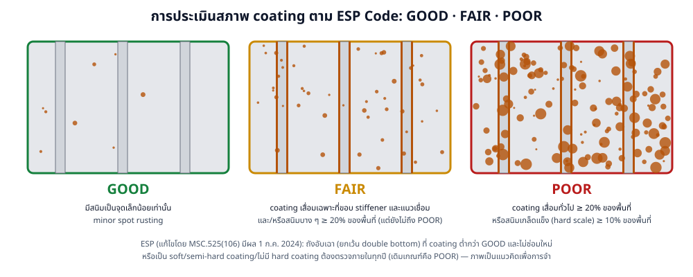
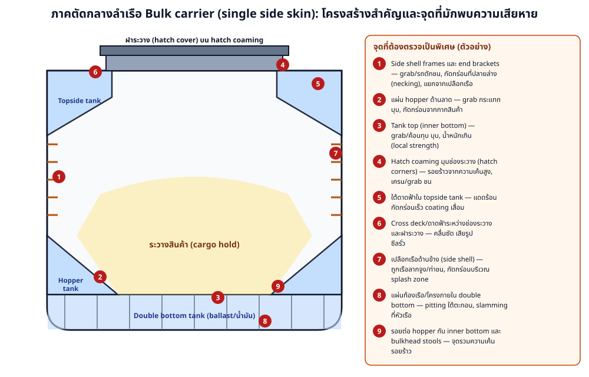
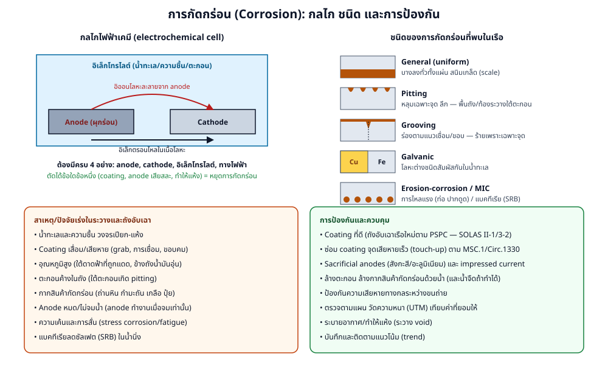
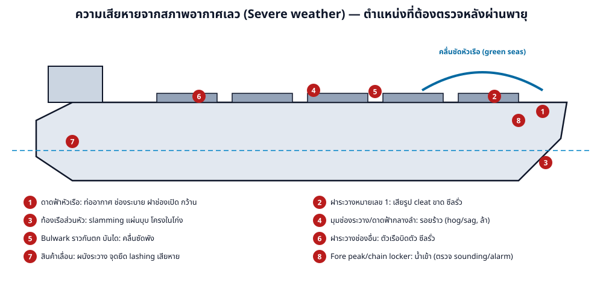
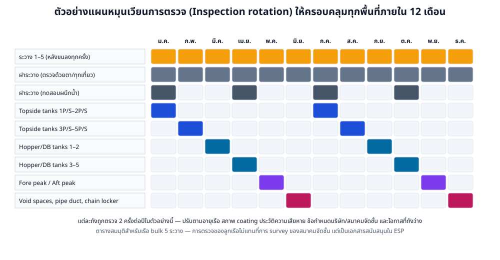
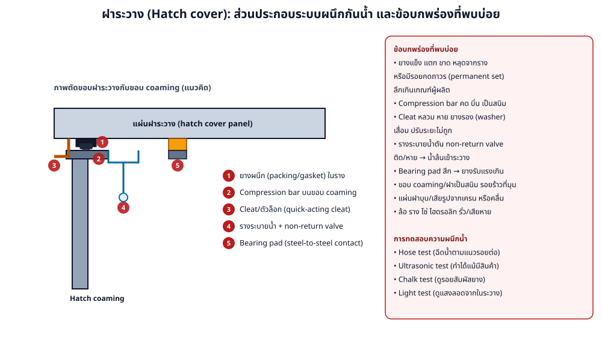
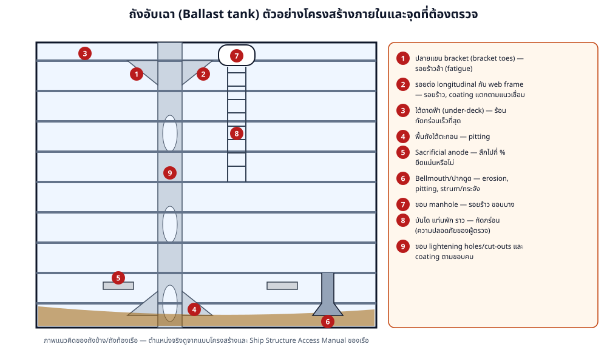

# 2.2 Inspect and Report Defects and Damage to Cargo Spaces, Hatch Covers and Ballast Tanks — การตรวจและรายงานข้อบกพร่องและความเสียหายของระวางสินค้า ฝาระวาง และถังอับเฉา

> สมุดบันทึกการฝึก OOW · TIRAPHONG NANTAPAN
> Function 2: **Cargo handling and stowage at the operational level**
> สมรรถนะตาม STCW A-II/1: *Inspect and report defects and damage to cargo spaces, hatch covers and ballast tanks*
> - Knowledge and ability to explain where to look for damage and defects most commonly encountered due to: .1 loading and unloading operations .2 corrosion .3 severe weather conditions
> - Ability to state which parts of the ship shall be inspected each time in order to cover all parts within a given period of time
> - Identify those elements of the ship structure which are critical to the safety of the ship
> - State the causes of corrosion in cargo spaces and ballast tanks and how corrosion can be identified and prevented
> - Knowledge of procedures on how the inspections shall be carried out
> - Ability to explain how to ensure reliable detection of defects and damages
> - Understanding of the purpose of the "enhanced survey programme"
>
> เกณฑ์ประเมิน: *The inspections are carried out in accordance with laid-down procedures, and defects and damage are detected and properly reported · Where no defects or damage are detected, the evidence from testing and examination clearly indicates competence in adhering to procedures and ability to distinguish between normal and defective or damaged parts of the ship*
>
> อ้างอิงหลัก: STCW Code A-II/1; IMO Model Course 7.03; SOLAS **XI-1/2** และ **2011 ESP Code** (IMO Res. A.1049(27) as amended รวมถึง MSC.525(106) มีผล 1 ก.ค. 2024 — International Code on the Enhanced Programme of Inspections during Surveys of Bulk Carriers and Oil Tankers); SOLAS II-1/3-2 และ **PSPC** (MSC.215(82)) สำหรับ coating ถังอับเฉา; MSC.1/Circ.1330 (maintenance and repair of protective coatings); SOLAS II-1/3-6 และ MSC.133(76) (means of access, Ship Structure Access Manual); SOLAS II-1/3-10 (Goal-based standards — Ship Construction File); SOLAS XII (bulk carriers — XII/12 water level detectors); International Convention on Load Lines (hatchways ต้อง weathertight); IACS Unified Requirements ชุด Z10 (hull surveys — Z10.3 สำหรับ chemical tankers), S21 (hatch covers) และ S27 (strength of fittings on exposed foredeck); IACS Recommendation 14 (Hatch cover securing and tightness); IACS Recommendation 87 (Guidelines for coating maintenance & repairs for ballast tanks and combined cargo/ballast tanks on oil tankers); IACS Recommendation 96 (Double hull oil tankers — guidelines for surveys, assessment and repair of hull structures); IACS Recommendation 76 (*Bulk Carriers: Guidelines for Surveys, Assessment and Repair of Hull Structure*); TSCF *Guidelines for the Inspection and Maintenance of Double Hull Tanker Structures*; D.J. Eyres *Ship Construction*; SMS/PMS ของบริษัท

---

## 0. ทำไมลูกเรือต้องตรวจโครงสร้างเอง

สมาคมจัดชั้น (class) ตรวจเรือเป็นช่วง ๆ (annual, intermediate, renewal) แต่ระหว่างนั้นเรือเจอทั้งการขนถ่ายที่รุนแรง การกัดกร่อน และคลื่นลมทุกวัน **คนที่เห็นความเสียหายก่อนใครคือลูกเรือ** — และเห็นได้ก็ต่อเมื่อเข้าไปดูอย่างเป็นระบบ

ประวัติศาสตร์สอนเรื่องนี้ไว้ชัด ช่วงปลายทศวรรษ 1980 ถึงต้น 1990 มีเรือ bulk carrier สูญหายจำนวนมาก หลายลำจมอย่างรวดเร็วโดยไม่ทันส่งสัญญาณ สาเหตุที่ตรวจพบรวมถึงโครงสร้างระวางหัวเรือที่ผุกร่อน/เสียหายจนน้ำเข้า ฝาระวางพังเมื่อเจอคลื่นซัด และความเสียหายสะสมจากการขนถ่าย — เรือ *MV Derbyshire* (จมในพายุไต้ฝุ่นนอกชายฝั่งญี่ปุ่นปี 1980 ผู้อยู่บนเรือเสียชีวิตทั้งหมด) เป็นกรณีที่ถูกศึกษามากที่สุด ผลการสอบสวนอย่างเป็นทางการภายหลังชี้ไปที่ความเสียหายบริเวณดาดฟ้าหัวเรือและฝาระวางจากคลื่นซัด เหตุการณ์ในยุคนั้นนำไปสู่ **SOLAS บทที่ XII** (ข้อกำหนดพิเศษสำหรับ bulk carrier) และ **Enhanced Survey Programme (ESP)**

**เป้าหมายของ OOW ตาม STCW**: รู้ว่าความเสียหายมักเกิดที่ไหน ตรวจตามขั้นตอนได้ครบ แยก "สภาพปกติ" ออกจาก "ข้อบกพร่อง" ได้ และรายงานอย่างถูกต้อง — **รายงานว่า "ไม่พบความเสียหาย" ก็ต้องมีหลักฐานว่าตรวจจริง** (เกณฑ์ STCW ข้อสอง)

---

## 1. ศัพท์โครงสร้างและศัพท์การตรวจที่ต้องรู้

### 1.1 ส่วนประกอบโครงสร้าง (ทบทวนรายละเอียดใน 3.2.2)

| ส่วน | คำอธิบายย่อ |
|---|---|
| **Shell plating** | เปลือกเรือ — bottom, bilge, side shell |
| **Frames / longitudinals** | โครงตามขวาง/ตามยาวที่เสริมแผ่นเหล็ก (stiffeners) |
| **Web frames, girders, floors** | โครงลึกที่รับแรงหลัก — floors อยู่ใน double bottom |
| **Brackets** | แผ่นเหล็กสามเหลี่ยมเชื่อมต่อโครงที่ปลาย — **ปลาย bracket (bracket toe) เป็นจุดรวมความเค้น** |
| **Inner bottom / tank top** | พื้นระวาง (หลังคาของ double bottom) |
| **Hopper tank / topside tank** | ถังลาดล่างและบนข้างระวางของ bulk carrier (มักเป็นถังอับเฉา) |
| **Transverse bulkhead** | ผนังกั้นระวางตามขวาง — ใน bulk carrier มักเป็นแบบ **ลูกฟูก (corrugated)** มี **stool** บน/ล่าง |
| **Hatch coaming / hatch corner** | ขอบช่องระวางที่ยกสูง / มุมช่องเปิดบนดาดฟ้า — จุดความเค้นสูง |
| **Cross deck (cross deck strip)** | แผ่นดาดฟ้าระหว่างช่องระวาง |
| **Double hull / double side** | เรือ tanker และ bulk carrier สมัยใหม่มีผนังสองชั้น พื้นที่ระหว่างเป็นถังอับเฉา |

### 1.2 ศัพท์การตรวจและสภาพ (ตาม ESP Code)

| ศัพท์ | ความหมาย |
|---|---|
| **Close-up survey** | การตรวจที่รายละเอียดของโครงสร้างอยู่ในระยะเอื้อมมือของผู้ตรวจ (within reach of hand) |
| **Overall survey** | การตรวจภาพรวมของพื้นที่เพื่อดูสภาพทั่วไปและหาจุดที่ต้องตรวจใกล้ |
| **Substantial corrosion** | การกัดกร่อนที่ประเมินแล้วบางลงเกิน **75% ของค่าที่ยอมให้สึกได้ (allowable margins)** แต่ยังอยู่ในเกณฑ์ |
| **Excessive corrosion** | บางลงเกินค่าที่ยอมให้ — ต้องซ่อม/เปลี่ยน |
| **Suspect areas** | บริเวณที่มี substantial corrosion หรือที่ผู้ตรวจเห็นว่ามีแนวโน้มกัดกร่อนเร็ว |
| **Critical structural areas** | บริเวณที่จากการคำนวณหรือประวัติเรือลำนี้/เรือพี่น้อง/เรือแบบเดียวกัน พบว่าไวต่อรอยร้าว การโก่ง หรือการกัดกร่อนที่จะกระทบความสมบูรณ์ของโครงสร้าง |
| **Coating condition — GOOD / FAIR / POOR** | ดูภาพที่ 2.2-1: GOOD = มีสนิมเป็นจุดเล็กน้อย, FAIR = coating เสื่อมเฉพาะที่ขอบ stiffener/แนวเชื่อม และ/หรือสนิมบาง ๆ ตั้งแต่ 20% ของพื้นที่ แต่ยังไม่ถึง POOR, POOR = coating เสื่อมทั่วไปตั้งแต่ 20% ของพื้นที่ หรือสนิมเกล็ดแข็ง (hard scale) ตั้งแต่ 10% ของพื้นที่ |
| **Defects** | crack (รอยร้าว), buckling (โก่ง), deformation/indentation (เสียรูป/บุบ), fracture (ขาด), detachment (หลุดจากกัน), pitting, grooving, wastage (บางลง) |

*ภาพที่ 2.2-1 การประเมินสภาพ coating ตาม ESP Code (ภาพแนวคิดเพื่อการจำ)*

> **จดเพิ่ม — นิยามเชิงตัวเลขของ IACS Rec. 87**: แนวทางซ่อมบำรุง coating ของ IACS (สำหรับถังอับเฉาเรือ tanker) ให้เกณฑ์ที่วัดง่ายกว่า โดยสรุป GOOD = สนิมเป็นจุดน้อยกว่าราว 3% ของพื้นที่โดยไม่เห็น coating เสีย, FAIR = coating เสีย/สนิมทะลุน้อยกว่า 20%, POOR = เกิน 20% หรือ hard scale เกิน 10% หรือเสื่อมกระจุกที่ขอบ/แนวเชื่อม — เวลารายงานให้ระบุว่าใช้เกณฑ์ใด (ESP Code หรือของ class/บริษัท) และใส่ % พื้นที่โดยประมาณเสมอ

---

## 2. ตรวจที่ไหน: ความเสียหายและข้อบกพร่องที่พบบ่อย

### 2.1 ความเสียหายจากการขนถ่ายสินค้า (Loading and unloading operations)

*ภาพที่ 2.2-2 ภาคตัดกลางลำ bulk carrier แบบ single side skin โครงสร้างสำคัญและจุดที่มักพบความเสียหาย*

**เรือ bulk carrier** (ความเสียหายจากการขนถ่ายรุนแรงที่สุด)
- **Grab** (ตะขอตักสินค้า) กระแทก/ขูด — **tank top** บุบ, **แผ่น hopper** บุบ, **side shell frames** และ **end brackets** คด/ขาด, **ขั้นบันไดและราว** ในระวางพัง, **hatch coaming** และ **ฝาระวาง** ถูกชน
- **รถตัก (bulldozer/front-end loader)** ที่ใช้เกลี่ยสินค้าตอนท้าย — ชนโครงและ frame ด้านข้าง ขูด coating
- **ค้อนไฮดรอลิก (hydraulic hammers)/การทุบสินค้าที่จับตัวแข็ง** — ทำให้แผ่นเหล็กบุบ coating แตก
- **บรรทุกด้วยอัตราสูงหรือเทสินค้าจากที่สูง** — แรงกระแทก tank top; น้ำหนักเกิน **local strength** ทำให้ tank top โก่ง
- **ลำดับการขนถ่ายผิด/ballast ไม่ทัน** — SF/BM เกิน → รอยร้าวหรือการโก่งที่ดาดฟ้า/ท้องเรือ
- **กากสินค้ากัดกร่อน** (ถ่านหินที่มีกำมะถัน เกลือ ปุ๋ย กำมะถัน) ทิ้งไว้ → เร่งการกัดกร่อน (ข้อ 2.2)

**เรือ container** — cell guides คด (ตู้ถูกหย่อนเบี้ยว), จุดยึด lashing บนฝาระวาง/ดาดฟ้าฉีก, ฝาระวาง (pontoon) ถูกตู้หรือ spreader กระแทก, tank top doubler/socket ของ stacking cone เสียหาย

**เรือสินค้าทั่วไป/MPP** — tween deck panels เสียหายจากรถยก/ของหนัก, จุดยึดที่ถูกใช้เกิน MSL ฉีก, ฝาระวางชนเครน

**เรือ tanker** — ความดันในถังเกิน/ต่ำเกิน (P/V valve, ระบบระบายไอผิดพลาด) ทำให้โครงสร้างโก่ง, sloshing ในถังที่บรรจุไม่เต็ม, การล้างถังด้วยน้ำร้อน/สารเคมีทำ coating เสียหาย, ขดท่อทำความร้อน (heating coils) รั่ว

**เรือ ro-ro** — ทางลาด (ramp) ประตู ซีลประตูกันน้ำ ดาดฟ้ารับรถหนักเกิน

> **หลักปฏิบัติ**: เมื่อเห็นความเสียหายจากคนงานท่า **บันทึก ถ่ายภาพ (มีวัตถุบอกขนาดและตำแหน่ง frame) และให้หัวหน้าคนงาน/ตัวแทนท่าลงนาม stevedore damage report ทันที** ก่อนเรือออก — หลังเรือออกแล้วเรียกร้องได้ยากมาก และถ้าเป็นความเสียหายที่กระทบความแข็งแรง/ผนึกน้ำ ต้องแจ้งนายเรือเพื่อพิจารณาแจ้ง class ก่อนออกเรือ

### 2.2 การกัดกร่อน (Corrosion) — สาเหตุ การระบุ และการป้องกัน

*ภาพที่ 2.2-3 กลไกการกัดกร่อนแบบไฟฟ้าเคมี ชนิดของการกัดกร่อน สาเหตุ และการป้องกัน*

**กลไก** — การกัดกร่อนของเหล็กในเรือเป็นปฏิกิริยา **ไฟฟ้าเคมี (electrochemical)** ต้องมีครบ 4 องค์ประกอบ: **anode** (บริเวณที่เหล็กละลายเป็นอิออน — ผุกร่อน), **cathode**, **อิเล็กโทรไลต์** (น้ำทะเล ความชื้น ตะกอนเปียก) และ **ทางไฟฟ้า** (เนื้อเหล็กเอง) — ถ้าตัดได้ข้อใดข้อหนึ่ง การกัดกร่อนหยุด นี่คือหลักของการป้องกันทุกวิธี

**สาเหตุและปัจจัยเร่งในระวางและถังอับเฉา**
- **น้ำทะเลและความชื้น** — ถังอับเฉาเปียก-แห้งสลับกัน (ballast/deballast) ออกซิเจนเข้าได้เต็มที่ → กัดกร่อนเร็วกว่าการจมน้ำตลอด
- **อุณหภูมิ** — ใต้ดาดฟ้าในถัง topside/wing tank ที่โดนแดดร้อน, ถังอับเฉาที่อยู่ข้างถังน้ำมันอุ่น (heated fuel tanks) — อัตราการกัดกร่อนเพิ่มตามอุณหภูมิ
- **Coating เสื่อม/เสียหาย** — อายุ การกระแทก (grab) การเชื่อมซ่อมที่ไม่ได้ทาใหม่ **ขอบคม (edges) และแนวเชื่อม** ที่ coating บางตั้งแต่สร้าง
- **ตะกอน (sediments)** ในถังอับเฉา — ใต้ตะกอนเกิด **pitting** และแบคทีเรีย
- **แบคทีเรียลดซัลเฟต (SRB — microbiologically influenced corrosion, MIC)** ในน้ำนิ่ง/ตะกอน
- **กากสินค้ากัดกร่อน** — ถ่านหินที่มีกำมะถันผสมความชื้นเป็นกรด, เกลือ, ปุ๋ย, กำมะถัน
- **Anode หมด** หรือไม่จมน้ำ (sacrificial anode ทำงานเฉพาะเมื่อจมในอิเล็กโทรไลต์ — ถังที่ว่างเปล่า anode ไม่ช่วย)
- **ความเค้นและการสั่น** — stress corrosion และ corrosion fatigue ที่จุดรวมความเค้น
- **Galvanic corrosion** — โลหะต่างชนิด (ทองแดง/ทองเหลือง/สเตนเลส) สัมผัสเหล็กในน้ำทะเล เหล็กจะเป็น anode
- **Erosion-corrosion** — น้ำไหลแรงที่ปากดูด (bellmouth) ท่อ ข้องอ

**ชนิดของการกัดกร่อนที่ต้องจำ**
- **General (uniform) corrosion** — บางลงทั่วแผ่น มีสนิมเกล็ด (scale) — อันตรายเมื่อสะสมจนความหนาต่ำกว่าเกณฑ์
- **Pitting** — หลุมเฉพาะจุด ลึก พบมากที่ **พื้นถัง/tank top ใต้ตะกอนหรือน้ำค้าง** — อาจทะลุได้ทั้งที่แผ่นรอบ ๆ ยังหนา
- **Grooving** — ร่องตามแนวเชื่อมหรือรอยต่อ (เช่นที่โคนของ longitudinal/frame) — ร้ายเพราะเฉพาะจุดและอยู่ที่รอยต่อรับแรง ทำให้โครงหลุดจากแผ่น (detachment)
- **"Necking"** ของ side shell frames ที่ปลายล่างใน bulk carrier — frame บางลงเป็นคอดที่บริเวณกากสินค้าและน้ำค้าง
- **Galvanic, erosion-corrosion, MIC** — ตามที่กล่าวข้างต้น

**การระบุ (identification)**
- **ดูด้วยตา**: สีของสนิม (สนิมแดง/น้ำตาล = active, สนิมเกล็ดหนาดำ/น้ำตาลเข้ม = scale ที่สะสม), coating พอง (blistering) ลอก แตก, คราบสนิมไหลเป็นทาง (rust streaks) จากขอบ/แนวเชื่อม
- **เคาะด้วยค้อน (hammer test)** — สนิมเกล็ดหลุดเป็นแผ่น เสียงทึบผิดปกติ (ไม่ทุบ coating ดีให้เสีย)
- **วัดความลึกหลุม (pit depth gauge)** และ **วัดความหนาด้วยอัลตราโซนิก (UTM — ultrasonic thickness measurement)** โดยบริษัทที่ได้รับการรับรอง (สำหรับ survey) หรือเครื่องของเรือ (สำหรับการตรวจติดตาม)
- **เปรียบเทียบกับรายงานและภาพถ่ายครั้งก่อน** — ดูแนวโน้ม
- **สัญญาณทางอ้อม** — anode สึกเร็วผิดปกติ, ตะกอนสนิมมากในถัง, ระดับน้ำในถังเปลี่ยนเอง (รั่ว)

**การป้องกันและควบคุม**
- **Coating ที่ดี** — ถังอับเฉาเฉพาะ (dedicated seawater ballast tanks) ของเรือใหม่ต้องเป็นไปตาม **PSPC** (SOLAS II-1/3-2) ซึ่งออกแบบให้ coating มีอายุใช้งานเป้าหมาย 15 ปีในสภาพ "GOOD"
- **ซ่อม coating จุดที่เสียหายโดยเร็ว** (touch-up/spot repair) ตามระบบ coating ของเรือและแนวทาง **MSC.1/Circ.1330** — เตรียมผิว (ขัดสนิม ทำความสะอาด แห้ง) สำคัญกว่าตัวสี
- **Cathodic protection** — sacrificial anodes (สังกะสี/อะลูมิเนียม) ในถังอับเฉา (ข้อจำกัด: ทำงานเมื่อจมน้ำ) และ impressed current (ICCP) สำหรับเปลือกเรือภายนอก
- **ล้างตะกอนในถัง** (ตาม Sediment Management ของ BWM plan) และ **ล้างกากสินค้ากัดกร่อน** ออกจากระวางให้เร็ว (น้ำทะเล แล้วน้ำจืดถ้าทำได้)
- **ป้องกันความเสียหายทางกล** ระหว่างขนถ่าย (กำกับคนงาน ใช้ไม้รอง)
- **ระบายอากาศ/ทำให้แห้ง** ระวางเปล่าและ void spaces
- **ตรวจตามแผน วัดความหนา และบันทึกแนวโน้ม** — ซ่อม/เปลี่ยนเหล็กก่อนถึง excessive corrosion

### 2.3 ความเสียหายจากสภาพอากาศเลว (Severe weather conditions)

*ภาพที่ 2.2-4 ตำแหน่งที่ต้องตรวจหลังเรือผ่านคลื่นลมแรง*

- **ดาดฟ้าหัวเรือและอุปกรณ์** — คลื่นซัด (green seas) ทำให้ **ท่ออากาศ (air pipes) หัวระบายอากาศ ฝาช่องเปิด** หัก/รั่ว → น้ำเข้า fore peak/ช่องหัวเรือ (IACS กำหนดความแข็งแรงของอุปกรณ์บนดาดฟ้าหัวเรือสำหรับ bulk carrier หลังกรณีศึกษาในอดีต — UR S27)
- **ฝาระวาง โดยเฉพาะช่องหน้า (No.1)** — แผ่นฝาเสียรูป cleat ขาด ซีลเสียหาย น้ำเข้าระวาง
- **ท้องเรือส่วนหัว** — **slamming** ทำให้แผ่นท้องบุบ โครงภายใน (floors, girders) โก่ง; ส่วนหัว **panting** (แผ่นด้านข้างหัวเรือขยับเข้าออก)
- **ดาดฟ้ากลางลำและมุมช่องระวาง** — hogging/sagging ในคลื่นใหญ่ → รอยร้าวที่ hatch corners, ขอบ coaming, sheer strake; **ความล้า (fatigue)** สะสมจากรอบคลื่นจำนวนมาก
- **Bulwark ราวกันตก บันได** — ถูกคลื่นซัดพัง
- **การบิดตัว (racking/torsion)** ทำให้ฝาระวางเลื่อนสัมพันธ์กับ coaming ซีลสึก
- **สินค้าเลื่อน** — ผนังระวาง ผนังกั้น โครงภายในเสียหาย จุดยึด lashing ฉีก
- **Sloshing** — ถังที่บรรจุไม่เต็มในคลื่นใหญ่ โครงภายในถังเสียหาย
- **Fore peak, chain locker, bosun store** — น้ำเข้า ตรวจด้วย sounding และ water ingress alarm (SOLAS XII/12 สำหรับ bulk carrier — ข้อบังคับกำหนดเครื่องตรวจจับระดับน้ำในทุกระวาง ในถังอับเฉาหน้าผนังกันชน และใน dry/void space ที่ยื่นไปหน้าระวางแรก **ยกเว้น chain locker** ซึ่งต้องพึ่ง sounding/การตรวจด้วยตา)

> **หลังผ่านพายุ** — เมื่อปลอดภัยให้ออกไปตรวจ ให้ตรวจดาดฟ้าหัวเรือ ฝาระวาง ท่ออากาศ ช่องเปิด วัด sounding ถังและท้องระวาง (bilges) ทั้งหมด ตรวจ lashing สินค้า และบันทึก/รายงานความเสียหาย (heavy weather damage report) นายเรืออาจทำ **note of protest** ที่ท่าถัดไป

---

## 3. โครงสร้างที่สำคัญต่อความปลอดภัยของเรือ (Critical structural elements)

**หลักคิด** — โครงสร้างสำคัญคือส่วนที่ถ้าล้มเหลว เรือจะเสียความแข็งแรงตามยาว เสียการผนึกน้ำ หรือเกิดน้ำท่วมลุกลาม และ **จุดที่ความเค้นรวมตัว (stress concentration)** เช่น ช่องเปิด ปลาย bracket มุม รอยต่อที่ความแข็งเปลี่ยนกะทันหัน (discontinuities)

**ตัวอย่างตามชนิดเรือ**

| ชนิดเรือ | โครงสร้างสำคัญ/จุดเสี่ยง |
|---|---|
| **Bulk carrier** | **Side shell frames และ end brackets ในระวาง (โดยเฉพาะระวางหน้า No.1)** — ถ้า frame หลุด/เปลือกรั่ว น้ำท่วมระวางและอาจลามไปผนังกั้นถัดไป; **transverse corrugated bulkheads และ stools** (โดยเฉพาะผนังระหว่างระวาง 1–2); **hatch coamings, hatch corners, ฝาระวาง**; **cross deck strips**; tank top และ hopper; รอยต่อ hopper–inner bottom; ดาดฟ้าหลักและท้องเรือช่วงกลางลำ (0.4 L) |
| **Oil tanker (double hull)** | รอยต่อ **longitudinals กับ transverse web frames/ผนังกั้น** (รอยร้าวที่ cut-outs, bracket toes), **knuckles** (รอยต่อ hopper ใน double hull), stringers ของผนังกั้น, ดาดฟ้าและ longitudinals ใต้ดาดฟ้าในถังสินค้า (กัดกร่อนจากไอกรดและความร้อน), พื้นถังสินค้า (pitting) |
| **Container ship** | **Hatch corners** (ช่องเปิดกว้าง ความเค้นบิดสูง), **torsion box**/sheer strake, coaming, lashing bridges, cell guides |
| **ทุกชนิด** | เปลือกเรือ ผนังกั้นน้ำ (watertight bulkheads) ประตูกันน้ำ ฝาระวางและช่องเปิดบนดาดฟ้า (weathertight integrity ตาม Load Line) ท่ออากาศ/sounding pipes ที่ผ่านพื้นที่สินค้า หางเสือ/ท้ายเรือ |

**พื้นที่ที่มักเสื่อมเร็ว** (ควรตรวจถี่กว่า)
- ใต้ดาดฟ้าใน topside tank/wing tank (ร้อน)
- ถังอับเฉาข้างถังน้ำมันอุ่น
- บริเวณ splash zone ด้านในถัง (ระดับน้ำขึ้นลงตาม ballast)
- พื้นถังและพื้นระวาง (ตะกอน น้ำค้าง)
- ปลายล่างของ side shell frames ในระวาง bulk carrier
- รอยเชื่อมซ่อมเก่า และจุดที่เคยพบความเสียหายในเรือพี่น้อง (sister ships)

---

## 4. ตรวจส่วนใดเมื่อไร เพื่อให้ครอบคลุมทุกส่วนภายในเวลาที่กำหนด (Inspection coverage)

STCW ต้องการให้ OOW **วางแผนได้ว่าแต่ละครั้งจะตรวจส่วนไหน เพื่อให้ครบทุกส่วนภายในรอบเวลาหนึ่ง** — เพราะเราเข้าไปตรวจทุกถังทุกระวางพร้อมกันไม่ได้ (ถังต้องว่าง ปลอดภัย ระบายอากาศแล้ว มีเวลาและคนพอ)

**หลักการวางแผน**
1. **ทำรายการพื้นที่ทั้งหมด** — ระวางแต่ละระวาง ฝาระวางแต่ละช่อง ถังอับเฉาทุกถัง (double bottom, hopper, topside, wing, fore/aft peak) void spaces, duct keel/pipe tunnel, chain locker, cofferdams
2. **กำหนดความถี่ตามความเสี่ยง** — อายุเรือ สภาพ coating (POOR ถี่กว่า) ประวัติความเสียหาย ชนิดสินค้า ข้อกำหนดบริษัท/class/flag
3. **ผูกกับโอกาสในการทำงาน**:
   - **ระวาง** — ตรวจ **ทุกครั้งหลังขนลงเสร็จ** (ก่อนทำความสะอาดเพื่อดูความเสียหายจากคนงาน และหลังทำความสะอาดเพื่อดูโครงสร้าง) และก่อนบรรทุก (ความพร้อมรับสินค้า)
   - **ฝาระวาง** — ตรวจด้วยตา **ทุกครั้งที่เปิด-ปิด/ทุกเที่ยว** และทดสอบความผนึกน้ำตามรอบ (เช่นทุกไตรมาส/ก่อนบรรทุกสินค้าที่ไวต่อน้ำ)
   - **ถังอับเฉา** — ตรวจเมื่อถังว่างตามรอบหมุนเวียน (เช่นช่วงเรือบรรทุกเต็ม — ถังอับเฉาว่าง)
4. **หมุนเวียน (rotation)** — แบ่งถังเป็นกลุ่ม ตรวจกลุ่มละเดือน ให้ทุกถังถูกตรวจอย่างน้อยตามความถี่ที่กำหนด (เช่น 1–2 ครั้งต่อปี)
5. **บันทึกใน PMS (planned maintenance system)** และติดตามว่าไม่มีพื้นที่ "ตกหล่น"

*ภาพที่ 2.2-5 ตัวอย่างแผนหมุนเวียนการตรวจสำหรับเรือ bulk 5 ระวาง (ตารางสมมุติ)*

**ในแต่ละครั้ง ต้องตรวจส่วนไหนของพื้นที่นั้น** — ไม่ใช่แค่ "เข้าไปดู" แต่ต้องครอบคลุม
- ทุกผนัง (ทั้งสองด้าน/ทุกด้าน) และใต้ดาดฟ้า (under-deck) พื้น
- โครงทุกชนิดในพื้นที่ — frames/longitudinals, web frames, brackets (โดยเฉพาะปลาย), stringers
- รอยต่อและจุดรวมความเค้นตามรายการ critical areas ของเรือ
- อุปกรณ์ในพื้นที่ — anodes, ท่อ (ballast, bilge, air/sounding pipes), bellmouths, strum boxes, ข้อต่อ, บันได แท่นพัก ราว, manholes, ระบบตรวจจับน้ำ/ไฟ
- ใช้ **แบบ (drawings)** และ **checklist** ของพื้นที่นั้นกำกับ เพื่อไม่ให้ข้ามจุด

---

## 5. ขั้นตอนการตรวจ (Inspection procedures)

### 5.1 การเตรียม

1. **วางแผน** — พื้นที่ เวลา ทีม (อย่างน้อย 2 คน) เป้าหมาย (ตรวจทั่วไป/ติดตามข้อบกพร่องเดิม) อ่าน **รายงานครั้งก่อน** ภาพถ่าย และรายการ critical areas
2. **ความปลอดภัยการเข้าพื้นที่อับอากาศ** (ดู 2.1 ข้อ 14.1 และ 3.8) — permit, แยกระบบ (ปิดวาล์ว ballast/ปั๊ม ล็อกป้าย), **ระบายอากาศ**, **วัดบรรยากาศ** (O₂ ≥ 20.9%, CO₂ < 0.5%, ไวไฟ < 1% LFL, ก๊าซพิษ < 50% OEL ตาม MSC.581(110)) ที่หลายระดับ, ผู้เฝ้าทางเข้า, การสื่อสาร, อุปกรณ์กู้ภัยพร้อม, แจ้งสะพานเดินเรือ/ห้องเครื่อง
3. **การเข้าถึง (access)** — ตาม **Ship Structure Access Manual** (SOLAS II-1/3-6) — ใช้บันได แท่นพัก ทางเดินถาวรที่ออกแบบไว้; การตรวจที่สูง (เช่นใต้ดาดฟ้าในระวางใหญ่) อาจต้องใช้นั่งร้าน รถกระเช้า หรือ **rafting** (ลอยแพในถังที่เติมน้ำบางส่วน — มีเงื่อนไขความปลอดภัยเข้มงวด เช่นสภาพทะเลสงบ ระดับน้ำคงที่) — **ห้ามปีนโครงสร้างที่ไม่ได้ออกแบบให้ปีน**
4. **ทำความสะอาด** — ตะกอน กากสินค้า โคลน ทำให้มองไม่เห็นรอยร้าว/pitting; ล้างก่อนตรวจถ้าทำได้
5. **อุปกรณ์** — ไฟฉายสว่างพอ (และไฟสำรอง), ค้อนเคาะ, ไม้บรรทัด/ตลับเมตร, pit gauge, ชอล์ก/ปากกาเขียนเหล็ก, กล้องถ่ายภาพ (ป้องกันการระเบิดถ้าจำเป็น), แบบโครงสร้างและ checklist, วิทยุ, เครื่องวัดก๊าซส่วนบุคคล, PPE ครบ

### 5.2 การตรวจ

- **ระบบเสมอ** — เดินตามลำดับที่กำหนด (เช่นจากบนลงล่าง จากหน้าไปหลัง หรือ frame by frame) ไม่กระโดดไปมา
- **Overall ก่อน แล้ว close-up** ที่ critical/suspect areas
- **ดูให้ใกล้และส่องไฟเฉียง** — รอยร้าวเล็ก ๆ มักเห็นเป็น **เส้นสนิมหรือ coating แตกเป็นแนว** โดยเฉพาะที่ปลาย bracket ขอบ cut-out แนวเชื่อม
- **ประเมิน coating** ตามเกณฑ์ GOOD/FAIR/POOR ของแต่ละพื้นที่
- **ระบุตำแหน่งให้ชัด** — ชื่อพื้นที่ + frame number + ด้าน (P/S) + ระดับ (เช่น "3S topside tank, Fr. 145, longitudinal No.4 จากดาดฟ้า, bracket toe ด้านท้าย")
- **วัดและบันทึก** — ความยาวรอยร้าว ขนาด/ความลึกของรอยบุบ ความลึกหลุม pitting พื้นที่ที่ coating เสีย (%) ความสึกของ anode (%)
- **ถ่ายภาพ** — ภาพภาพรวมให้รู้ตำแหน่ง + ภาพใกล้มีไม้บรรทัด/วัตถุบอกขนาด + เขียนเครื่องหมายบนเหล็กชี้ตำแหน่ง
- **ทำเครื่องหมาย** ที่ข้อบกพร่อง (ชอล์ก/สี) เพื่อให้ผู้ตรวจถัดไปหรือช่างหาเจอ
- **ทดสอบที่ทำได้บนเรือ** — เคาะค้อน, ทดสอบระบบ bilge/ballast (ดูดได้หรือไม่), ทดสอบวาล์วกันย้อน, ทดสอบระบบตรวจจับน้ำ (water ingress alarms), ทดสอบฝาระวาง (ข้อ 6)

### 5.3 หลังการตรวจ — การรายงาน

**แบบรายงานการตรวจ (ตัวอย่างหัวข้อ)**

| หัวข้อ | ตัวอย่างเนื้อหา |
|---|---|
| พื้นที่/วันที่/ผู้ตรวจ | No.3 Topside Tank (S) · 12 ต.ค. 2026 · 3/O, Bosun |
| สภาพการเข้าถึง/ความปลอดภัย | Permit No., ผลวัดก๊าซ, ทางเข้า ladders ปกติ |
| ความสะอาด/ตะกอน | ตะกอนเล็กน้อยที่ bellmouth (ประมาณ 2 cm) |
| Coating (GOOD/FAIR/POOR) | FAIR — เสื่อมตามขอบ longitudinals ใต้ดาดฟ้า ประมาณ 25% |
| การกัดกร่อน | สนิมบางใต้ดาดฟ้า, ไม่พบ pitting ลึก |
| ข้อบกพร่องโครงสร้าง | รอยร้าวยาว ~80 mm ที่ bracket toe Fr.145 long. No.4 (ภาพ 3–5) |
| Anodes | สึกประมาณ 60% ยึดแน่นทุกตัว |
| ท่อ/อุปกรณ์ | Air pipe ในถังสภาพดี, sounding pipe striker plate ปกติ |
| ข้อเสนอแนะ | แจ้ง CO/นายเรือ → บริษัท/class พิจารณา, ติดตามความยาวรอยร้าว, touch-up coating |
| สถานะ "ไม่พบข้อบกพร่อง" | ระบุว่าตรวจครบตาม checklist พร้อมภาพประกอบบางจุดเป็นหลักฐาน |

**สายการรายงาน**
- ผู้ตรวจ → **ต้นเรือ** → **นายเรือ** → **บริษัท (superintendent/technical)** → บริษัท/นายเรือแจ้ง **สมาคมจัดชั้น (class)** และ/หรือ **รัฐเจ้าของธง** เมื่อความเสียหายกระทบ class/ความพร้อมเดินทะเล
- **ความเสียหายร้ายแรง** (น้ำรั่ว รอยร้าวที่เปลือกเรือ/ดาดฟ้าหลัก โครงหลุด ฝาระวางไม่ผนึกน้ำ) → **แจ้งนายเรือทันที** — อาจต้องมี class survey ก่อนออกเรือ และพิจารณาจำกัดการบรรทุก/เส้นทาง
- บันทึกใน **PMS** และ **deck log**, เก็บรายงานเข้า **supporting documents** สำหรับการ survey ตาม ESP
- ความเสียหายจากคนงานท่า → stevedore damage report; จากสภาพอากาศ → heavy weather damage report/note of protest

---

## 6. การหาข้อบกพร่องให้ได้อย่างเชื่อถือได้ (Reliable detection)

ข้อบกพร่องที่ "หลุดรอด" มักเกิดจากสาเหตุเดิม ๆ — มืด สกปรก รีบ เข้าไม่ถึง ไม่รู้ว่าจะดูตรงไหน และไม่มีบันทึกเดิมเทียบ การตรวจที่เชื่อถือได้จึงต้อง

1. **แสงสว่างเพียงพอ** — ไฟส่องสว่างดี ใช้ไฟฉายส่องเฉียงหาเส้นรอยร้าว/รอยบุบ
2. **พื้นผิวสะอาด** — ล้างตะกอน/กากสินค้า; สนิมเกล็ดหนาอาจต้องเคาะออกบางจุดเพื่อดูเนื้อเหล็ก
3. **เข้าถึงได้ถึงระยะเอื้อมมือ (close-up) ที่จุดสำคัญ** — ใช้ access ที่ปลอดภัย
4. **เวลาเพียงพอ** — ไม่ตรวจแบบรีบตอนเรือจะออก
5. **รู้ว่าจะดูตรงไหน** — รายการ critical areas, ประวัติเรือลำนี้และ **เรือพี่น้อง**, จุดที่ class/บริษัทแจ้งเตือน
6. **ระบบและ checklist** พร้อมแบบโครงสร้าง — ป้องกันการข้ามจุด
7. **ผู้ตรวจที่ผ่านการฝึกและมีประสบการณ์** — ทำงานเป็นคู่ คนที่สองช่วยดูและด้านความปลอดภัย
8. **เปรียบเทียบกับครั้งก่อน** — ภาพถ่ายตำแหน่งเดิม ช่วยเห็นการเปลี่ยนแปลง (รอยร้าวยาวขึ้น สนิมลาม)
9. **ใช้การทดสอบเสริม** — UTM, pit gauge, การทดสอบความผนึกน้ำของฝาระวาง (hose/ultrasonic), การเฝ้าดูระดับน้ำในถัง (ถังที่ระดับเปลี่ยนเองอาจรั่วถึงกัน), NDT โดยผู้เชี่ยวชาญ (dye penetrant, magnetic particle) เมื่อสงสัยรอยร้าว
10. **แยก "ปกติ" กับ "ผิดปกติ" ได้** — ตัวอย่าง:
    - สนิมผิวบาง ๆ บนเหล็กที่ coating เสื่อม = การกัดกร่อนปกติที่ต้องติดตาม vs **สนิมเป็นเส้นตรงตามปลาย bracket/แนวเชื่อม** = อาจเป็นรอยร้าวใต้ coating → ต้องตรวจละเอียด
    - คราบน้ำเป็นแนวใต้ฝาระวาง = ซีลรั่ว vs คราบน้ำเหงื่อ (sweat) ที่กระจายทั่วไป
    - แผ่นเหล็ก "เป็นคลื่น" ตั้งแต่สร้าง (เล็กน้อย สม่ำเสมอ) vs **รอยบุบ/โก่งที่มีขอบชัด** หลังขนถ่าย
    - coating พองเป็นตุ่มเล็กกระจาย vs coating ลอกเป็นแผ่นใหญ่พร้อมสนิมเกล็ด

---

## 7. ฝาระวาง (Hatch covers) — การตรวจและบำรุงรักษา

ฝาระวางเป็นทั้ง **ส่วนรักษาการผนึกน้ำของเรือ** (Load Line Convention ต้องการให้ช่องระวางปิดด้วยฝาที่ weathertight) และ **ด่านแรกที่ป้องกันสินค้าจากน้ำ** — การรั่วของฝาระวางเป็นสาเหตุหลักของการเรียกร้องค่าเสียหายสินค้าเปียกน้ำ และฝาระวางที่พังในคลื่นลมแรงเคยทำให้เรือจม

### 7.1 ชนิดของฝาระวาง

- **Folding type** (พับด้วยไฮดรอลิกหรือรอก/โซ่) — พบมากในเรือ bulk/สินค้าทั่วไป
- **Side-rolling** — แผ่นเลื่อนไปด้านข้างบนราง (bulk carrier ขนาดใหญ่)
- **Lift-away / pontoon** — ยกออกด้วยเครน (เรือ container)
- **Piggy-back, stacking, roll-stowing** และฝาระวาง tween deck

### 7.2 ส่วนประกอบระบบผนึกน้ำ

*ภาพที่ 2.2-6 ส่วนประกอบระบบผนึกน้ำของฝาระวาง ข้อบกพร่องที่พบบ่อย และวิธีทดสอบ*

- **ยางผนึก (packing/gasket)** ในรางรอบขอบแผ่นฝาและที่รอยต่อระหว่างแผ่น (cross joints)
- **Compression bar** — แถบเหล็กบนขอบ coaming/ขอบแผ่นฝาที่กดยาง
- **Cleats/cross-joint wedges** — ตัวล็อกกดฝาให้ยางได้แรงกดพอ (บางแบบอัตโนมัติ)
- **Bearing pads (steel-to-steel contact)** — รับน้ำหนักฝาและจำกัดการกดยางไม่ให้เกิน
- **รางระบายน้ำ (drain channels) และ non-return drain valves** — ระบายน้ำที่ผ่านยางชั้นแรกออกนอก coaming
- **Locators/stoppers**, ล้อ ราง โซ่ ไฮดรอลิก, ที่ล็อกตอนเปิด

### 7.3 ข้อบกพร่องที่พบบ่อยและการตรวจ

- **ยางแข็ง แตก ขาด หลุด** หรือ **มีรอยกดถาวร (permanent set)** ลึกเกินเกณฑ์ผู้ผลิต → เปลี่ยนเป็นช่วง ๆ (ใช้ยางแบบที่ผู้ผลิตกำหนด ต่อด้วยวิธีที่ถูกต้อง)
- **Compression bar** คด บิ่น เป็นสนิม หรือมีสีทาทับ (สีไม่ควรทาบน compression bar ที่สัมผัสยาง — ตามคำแนะนำผู้ผลิต)
- **Cleats** หลวม หาย ยางรองเสื่อม ปรับระยะไม่ถูก
- **รางระบายน้ำตัน/non-return valve ติด** → น้ำล้นเข้าระวาง
- **Bearing pads สึก** → ฝาจมลงมาก ยางรับแรงเกิน เสียรูปเร็ว
- **ขอบ coaming และขอบแผ่นฝาเป็นสนิม/รอยร้าวที่มุม**, แผ่นฝาบุบ/เสียรูปจากเครน grab หรือคลื่น
- **กลไก** — ไฮดรอลิกรั่ว (มลพิษ + สินค้าเปื้อน), ล้อ/รางสึก, โซ่ยืด

### 7.4 การทดสอบความผนึกน้ำ (Weathertightness tests)

| วิธี | หลักการ | ข้อดี/ข้อจำกัด |
|---|---|---|
| **Hose test** | ฉีดน้ำแรงดันตามแนวรอยต่อ/ขอบ จากระยะใกล้ (ตามที่ class/คู่มือกำหนด — แนวทางของ IACS ที่ใช้กันทั่วไป: แรงดันที่หัวฉีดไม่น้อยกว่าประมาณ 2 bar หัวฉีดเส้นผ่านศูนย์กลางภายในอย่างน้อย 12 mm ห่างรอยต่อไม่เกิน 1.5 m เลื่อนช้า ๆ ตามแนว) ให้คนอยู่ในระวางดูน้ำรั่ว | ทำง่าย; ทำไม่ได้เมื่อมีสินค้าที่ไวต่อน้ำ/อากาศเย็นจัด, คนในระวางต้องปลอดภัย |
| **Ultrasonic test** | วางเครื่องส่งคลื่นอัลตราโซนิกในระวาง ใช้เครื่องรับเดินตามรอยต่อภายนอก วัดคลื่นที่ลอดออกมา | **ทำได้แม้มีสินค้าในระวาง** บอกตำแหน่งรั่วแม่น — เป็นที่ยอมรับของ class และ P&I |
| **Chalk test** | ทาชอล์กที่ compression bar ปิดฝาแล้วเปิด ดูรอยชอล์กบนยางว่าสัมผัสต่อเนื่องหรือไม่ | ตรวจการสัมผัส **ไม่ใช่** ทดสอบการรั่วโดยตรง |
| **Light test** | คนอยู่ในระวางมืด ดูแสงลอดตามรอยต่อ (หรือส่องไฟจากใน) | หยาบ ใช้ตรวจเบื้องต้น |

ก่อนบรรทุกสินค้าที่ไวต่อน้ำ (เช่นเมล็ดพืช เหล็กม้วน) หลายบริษัทกำหนดให้ทดสอบและบันทึกพร้อมใบรับรอง (บางครั้ง surveyor ของผู้ส่งสินค้าตรวจร่วม)

---

## 8. ถังอับเฉา (Ballast tanks) — สิ่งที่ต้องตรวจ

*ภาพที่ 2.2-7 ตัวอย่างโครงสร้างภายในถังอับเฉาและจุดที่ต้องตรวจ*

- **Coating** ทั่วไป ขอบ stiffeners แนวเชื่อม ใต้ดาดฟ้า บริเวณระดับน้ำ (splash zone) พื้นถัง — ประเมิน GOOD/FAIR/POOR
- **การกัดกร่อน** — pitting พื้นถัง (ใต้ตะกอน), grooving ที่รอยต่อ, ความบางของ longitudinals ใต้ดาดฟ้า
- **รอยร้าว** — **ปลาย bracket**, รอยต่อ longitudinal กับ web frame/ผนังกั้น, ขอบ cut-outs/lightening holes, ขอบ manhole
- **การเสียรูป** — โครงโก่งจาก slamming/sloshing/แรงดันเกิน
- **Anodes** — สึกไปกี่ % ยึดแน่นหรือไม่ (anode หลุดตกเป็นอันตรายและเป็นประกายไฟในถังของเรือบรรทุกน้ำมันได้ — ข้อกำหนดเฉพาะสำหรับ anode ในถังที่อาจมีไอระเหย: กฎ class โดยทั่วไปห้าม anode แมกนีเซียม และจำกัดตำแหน่ง/น้ำหนักของ anode อะลูมิเนียมเพื่อจำกัดพลังงานหากตกลงมา — ตรวจกับกฎของ class ของเรือ)
- **ตะกอน** — ปริมาณและตำแหน่ง (บันทึกตาม sediment management)
- **ท่อและอุปกรณ์** — ท่อ ballast/air/sounding ผ่านถัง (บาง รั่ว), **striker plate** ใต้ sounding pipe, bellmouth, วาล์ว
- **บันได แท่นพัก ราว** — กัดกร่อนจนไม่ปลอดภัยต่อผู้ตรวจ (รายงานเป็นเรื่องความปลอดภัยด้วย)
- **การรั่วระหว่างถัง** — ระดับน้ำในถังเปลี่ยนเองเมื่อไม่ได้ใช้ปั๊ม, น้ำมันในถังอับเฉา (รั่วจากถังน้ำมันข้างเคียง — ปัญหามลพิษขณะปล่อย ballast)

---

## 9. ระวางสินค้า (Cargo spaces) — สิ่งที่ต้องตรวจ

**Bulk carrier** (ภาพที่ 2.2-2)
- Side shell frames, end brackets — คด แยก ขาด necking ที่ปลายล่าง
- Hopper plating, tank top — บุบ coating เสียหาย pitting
- Transverse bulkheads (corrugations) และ stools — บางลงที่ส่วนล่าง รอยร้าวที่รอยต่อกับ stool
- Hatch coamings และ corners — รอยร้าว
- Underside ของ cross deck และ topside tank sloping plate
- บันได ทางเข้าระวาง ราว — ความปลอดภัย
- **Bilge wells, strum boxes, non-return valves** — สะอาด ทดสอบดูด (bilge system ใช้ได้จริง), ป้องกันน้ำย้อนเข้าระวาง
- **Water ingress detectors** (SOLAS XII/12) — ทดสอบตามรอบ
- ระบบตรวจจับควัน/ดับเพลิงในระวาง, ช่องระบายอากาศ, ไฟส่องสว่าง
- ความสะอาดสำหรับสินค้าถัดไป (กากสินค้าเก่า สนิมหลุด สีลอก — ผู้ตรวจของผู้เช่าเรืออาจปฏิเสธระวาง)

**Container ship** — cell guides (ตรง ไม่คด ยึดแน่น), sockets/fittings บน tank top และฝาระวาง, lashing bridges (โครงสร้างและราวกันตก), bilge wells, ระบบตรวจจับควัน

**General cargo/MPP** — tween deck panels และ supports, จุดยึด (D-rings/lashing eyes), ไม้กั้น/บุผนัง (cargo battens), ท่อระบายน้ำ

**Tanker** — โครงในถังสินค้า (ดูข้อ 3), heating coils, ท่อสินค้าในถัง, เครื่องวัดระดับ, coating ถังสินค้า (เรือ chemical/product), ระบบ inert gas/ventilation ที่เกี่ยวข้อง

---

## 10. Enhanced Survey Programme (ESP) — วัตถุประสงค์และสิ่งที่ลูกเรือเกี่ยวข้อง

### 10.1 ESP คืออะไร ทำไมต้องมี

- **ความเป็นมา**: หลังการสูญเสียเรือ bulk carrier และอุบัติเหตุเรือ tanker ที่เกี่ยวกับโครงสร้างเสื่อมสภาพ (การกัดกร่อน ความล้า ความเสียหายสะสม) ในทศวรรษ 1980–1990 IMO จึงกำหนดให้การ survey โครงสร้างของเรือกลุ่มเสี่ยง **เข้มข้นขึ้นตามอายุเรือ**
- **กฎหมาย**: **SOLAS XI-1/2** บังคับให้ **bulk carriers และ oil tankers** (ตามนิยามใน SOLAS/ESP Code ซึ่งรวม combination carriers; ส่วน chemical tankers ใช้โปรแกรม survey แบบ enhanced ผ่านกฎของ class ตาม IACS UR Z10.3) ได้รับการ survey ตาม **ESP Code (2011 ESP Code — A.1049(27) as amended, บังคับตั้งแต่ 1 ม.ค. 2014** แทนแนวทางเดิม A.744(18)) ควบคู่กับข้อกำหนดของ IACS (UR Z10 series)
- **วัตถุประสงค์** — **ตรวจพบการกัดกร่อน ความเสียหาย และรอยร้าวของโครงสร้างตั้งแต่เนิ่น ๆ ก่อนที่จะกระทบความปลอดภัย** ด้วยการ survey ที่ **ละเอียดขึ้น (close-up) วัดความหนามากขึ้น และขยายขอบเขตตามอายุเรือและสภาพ coating** พร้อมเอกสารการวางแผนและประวัติที่ต่อเนื่อง

### 10.2 องค์ประกอบสำคัญของ ESP

- **ชนิดการ survey** — Annual, Intermediate, Renewal (Special — ทุก 5 ปี) — ขอบเขต **overall survey, close-up survey และ thickness measurement** เพิ่มขึ้นตามอายุเรือ (เช่น renewal ครั้งที่ 3 ขึ้นไปตรวจมากกว่าครั้งแรกมาก)
- **Survey planning** — เจ้าของเรือและ class เตรียม **survey programme** ล่วงหน้า (พื้นที่ วิธีเข้าถึง ความสะอาด แสงสว่าง การวัดความหนา) — ความร่วมมือของลูกเรือเรื่องการเตรียมถังสำคัญมาก
- **ถังอับเฉาที่ coating สภาพ POOR** (หรือ soft/semi-hard coating หรือไม่มี coating) → ต้องตรวจภายในทุกปีในการ annual survey — **ปรับใหม่**: ตาม MSC.525(106) (มีผล 1 ก.ค. 2024) ทั้ง bulk carrier และ oil tanker เกณฑ์เข้มขึ้นเป็น **coating ต่ำกว่า GOOD (คือ FAIR หรือ POOR) และไม่ได้ทำใหม่** สำหรับถังอับเฉาที่ไม่ใช่ double bottom → ตรวจทุกปี (ถัง double bottom ที่ coating เสื่อม surveyor อาจให้ตรวจทุกปี) และสำหรับ bulk carrier แบบ double-side skin อายุเกิน 20 ปี ยาว 150 m ขึ้นไป ต้องตรวจสภาพการป้องกันการกัดกร่อนใน void spaces ข้างระวางด้วย (ถ้า POOR ตรวจทุกปี) — แปลว่ารายงาน FAIR ของลูกเรือมีผลต่อขอบเขต survey โดยตรง
- **Survey Report File** ที่ต้องเก็บบนเรือ — รายงานการ survey โครงสร้าง, **Executive Hull Summary/Condition Evaluation Report**, รายงานการวัดความหนา
- **Supporting documents** บนเรือ — survey programme, แบบโครงสร้างหลัก, ประวัติการซ่อม, ประวัติสินค้าและ ballast, **รายงานการตรวจของลูกเรือ (owner's inspection reports)** เกี่ยวกับสภาพโครงสร้าง coating ความเสียหาย — **นี่คือจุดที่งานของ OOW เชื่อมกับ ESP โดยตรง**: รายงานที่ดี ละเอียด มีภาพ ช่วยให้ surveyor มุ่งไปที่จุดเสี่ยงได้ตรง
- **Goal-based standards** — เรือ bulk carrier/oil tanker ใหม่ที่สร้างตาม GBS (SOLAS II-1/3-10) ต้องมี **Ship Construction File (SCF)** บนเรือ ซึ่งเป็นข้อมูลอ้างอิงสำคัญในการตรวจและซ่อมตลอดอายุเรือ

### 10.3 ลูกเรือทำอะไรเพื่อ ESP

- ตรวจตามแผนและรายงานให้ครบ มีภาพ ตำแหน่ง frame ชัดเจน
- เก็บ Survey Report File และ supporting documents ให้เป็นปัจจุบัน
- เตรียมพื้นที่ให้ survey — ทำความสะอาด ระบายอากาศ วัดก๊าซ แสงสว่าง ทางเข้า
- ติดตามข้อบกพร่องที่ class สั่งให้เฝ้าดู (เช่นวัดความยาวรอยร้าวทุกเดือน)
- ดูแล coating และ anodes ตาม PMS

---

## 11. ตัวอย่างจำลอง

### 11.1 ตรวจถัง topside tank ระหว่างเดินทางบรรทุกเต็ม

> เรือสมมุติ MV Andaman Star (bulk carrier 5 ระวาง อายุ 14 ปี) ระหว่างเดินทางบรรทุกถ่านหิน ถัง ballast ว่าง ตามแผนหมุนเวียนเดือนตุลาคมให้ตรวจ topside tanks 3P/S–5P/S
> - **0800** toolbox meeting: 3/O (ผู้ตรวจ) Bosun (ผู้ตรวจคู่) AB (ผู้เฝ้าทางเข้า) — ทบทวน permit วิธีสื่อสาร (วิทยุช่อง 3 รายงานทุก 15 นาที) แผนกู้ภัย รายงานเดิม (พบ coating FAIR ใต้ดาดฟ้าใน 3S)
> - **0815** เปิด manhole ระบายอากาศด้วยพัดลมตั้งแต่ 0600 — วัด O₂ 20.9%, LEL 0%, CO 0 ppm, H₂S 0 ppm ที่ระดับบน กลาง ล่าง → ออก permit
> - **0830–1000** ตรวจ 3S ตามลำดับจากหัวไปท้าย: coating FAIR (ประมาณ 25% เสื่อมตามขอบ longitudinals ใต้ดาดฟ้า) — **พบเส้นสนิมตรงที่ปลาย bracket Fr.145** เคาะ coating ออกพบรอยร้าวยาวประมาณ 80 mm — วัด ถ่ายภาพ (ภาพรวม + ภาพใกล้มีไม้บรรทัด) ทำเครื่องหมายด้วยสีที่ปลายรอยร้าว; anodes สึกประมาณ 60%; ตะกอนเล็กน้อยที่ bellmouth
> - **1015** ออกจากถัง ปิด permit แจ้งต้นเรือทันทีเรื่องรอยร้าว ต้นเรือรายงานนายเรือ → นายเรือแจ้งบริษัทพร้อมรายงานและภาพ บริษัทประสาน class (class ให้คำแนะนำเฝ้าติดตามและซ่อมที่ท่าถัดไป)
> - **ส่วนที่ไม่พบข้อบกพร่อง** (ถัง 4S, 5S) — บันทึกว่าตรวจครบตาม checklist พร้อมภาพหลักฐานจุดสำคัญ เช่น bracket toes ทุก web frame ที่ระบุใน critical areas

### 11.2 ความเสียหายจาก grab ระหว่างขนลง

> ที่ท่าขนลงถ่านหิน เวลา 2140 OOW เดินตรวจระวาง 4 ระหว่างพักกะ พบแผ่น hopper ด้านซ้ายบุบลึกประมาณ 30 mm ยาว 0.6 m ที่ Fr.112–113 และ side shell frame Fr.114 คด
> - หยุดการใช้ grab ในบริเวณนั้น แจ้งหัวหน้าคนงาน ถ่ายภาพ วัดขนาด
> - ทำ **stevedore damage report** ระบุเวลา ตำแหน่ง ความเสียหาย หมายเลขเครน/grab ให้หัวหน้าคนงานลงนาม (ถ้าปฏิเสธ บันทึกว่าปฏิเสธและส่งหนังสือแจ้งไปยังท่า/ตัวแทนเรือ)
> - แจ้งต้นเรือ/นายเรือ — frame คดในระวางหน้าของ bulk carrier เป็นโครงสร้างสำคัญ นายเรือแจ้งบริษัทและ class เพื่อประเมินก่อนออกเรือ
> - บันทึกใน deck log

### 11.3 ฝาระวางรั่วหลังผ่านคลื่นลมแรง

> หลังผ่านมรสุมสองวัน วัด sounding ท้องระวาง 1 พบน้ำ 15 cm (ปกติแห้ง) → แจ้งต้นเรือ สูบน้ำออก ตรวจสภาพสินค้าบนผิวที่มองเห็น ตรวจฝาระวาง 1 พบ cleat 2 ตัวหลวม ยางที่ cross joint มีรอยขาด รางระบายน้ำด้านหน้าตันด้วยสนิม
> - แก้ไขเบื้องต้นตามที่ทำได้ในทะเลอย่างปลอดภัย (ขัน cleat, ทำความสะอาดราง)
> - ทำ ultrasonic test ที่ท่าถัดไปเพื่อหาจุดรั่วทั้งหมด เปลี่ยนยางช่วงที่เสีย
> - รายงาน heavy weather damage, นายเรือพิจารณา note of protest, แจ้งบริษัท (อาจมีการเรียกร้องสินค้าเปียก)

---

## 12. คำถามสอบปากเปล่า / สัมภาษณ์

**ถาม:** ความเสียหายจากการขนถ่ายสินค้าในเรือ bulk carrier มักพบที่ไหน
**แนวตอบ:** Tank top และแผ่น hopper (grab/ค้อน บุบ), side shell frames และ end brackets (grab/รถตักชน คด ขาด), hatch coaming และฝาระวาง (grab/เครนชน), บันไดและราวในระวาง; รวมทั้ง local strength เกิน และ SF/BM เกินจากลำดับขนถ่ายผิด

**ถาม:** สาเหตุการกัดกร่อนในถังอับเฉามีอะไรบ้าง
**แนวตอบ:** น้ำทะเลและวงจรเปียก-แห้ง, coating เสื่อม/เสียหาย (ขอบ แนวเชื่อม), อุณหภูมิสูง (ใต้ดาดฟ้า ข้างถังน้ำมันอุ่น), ตะกอน (pitting, SRB), anode หมด/ไม่จมน้ำ, ความเค้น/การสั่น, galvanic, erosion ที่ปากดูด

**ถาม:** ระบุการกัดกร่อนได้อย่างไร
**แนวตอบ:** ดูด้วยตา (สนิม coating พอง ลอก คราบสนิมเป็นทาง), เคาะค้อน, วัด pit depth, วัดความหนาด้วย UTM, เปรียบเทียบรายงาน/ภาพเดิม, สังเกต anode สึกเร็ว ตะกอนสนิม ระดับน้ำเปลี่ยน

**ถาม:** ป้องกันการกัดกร่อนอย่างไร
**แนวตอบ:** Coating ที่ดี (PSPC สำหรับถังอับเฉาเรือใหม่) และซ่อมจุดเสียหายเร็ว (MSC.1/Circ.1330), cathodic protection (anodes/ICCP), ล้างตะกอนและกากสินค้ากัดกร่อน, ป้องกันความเสียหายทางกล, ทำให้แห้ง/ระบายอากาศ, ตรวจและวัดความหนาตามแผน

**ถาม:** Pitting กับ grooving ต่างกันอย่างไร
**แนวตอบ:** Pitting คือหลุมเฉพาะจุดที่ลึก มักพบที่พื้นถัง/ระวางใต้ตะกอนหรือน้ำค้าง; grooving คือร่องตามแนวเชื่อม/รอยต่อ อันตรายเพราะทำให้โครงหลุดจากแผ่น

**ถาม:** ความเสียหายจากสภาพอากาศเลวพบที่ไหน
**แนวตอบ:** อุปกรณ์บนดาดฟ้าหัวเรือ (ท่ออากาศ ช่องระบาย ฝาช่องเปิด), ฝาระวางช่องหน้า (cleat ซีล เสียรูป), ท้องเรือส่วนหัว (slamming), มุมช่องระวาง/ดาดฟ้ากลางลำ (hog/sag ความล้า), bulwark ราว บันได, ซีลฝาระวางจากการบิดตัว, ความเสียหายจากสินค้าเลื่อน, น้ำเข้า fore peak/chain locker

**ถาม:** โครงสร้างใดสำคัญต่อความปลอดภัยของ bulk carrier
**แนวตอบ:** Side shell frames และ brackets ในระวาง (โดยเฉพาะระวาง 1), transverse corrugated bulkheads และ stools, hatch coamings/corners และฝาระวาง, cross deck, tank top/hopper, ดาดฟ้าและท้องเรือช่วงกลางลำ — และจุดรวมความเค้นต่าง ๆ

**ถาม:** วางแผนให้ตรวจครบทุกส่วนภายในเวลาที่กำหนดอย่างไร
**แนวตอบ:** ทำรายการพื้นที่ทั้งหมด กำหนดความถี่ตามความเสี่ยง (อายุ coating ประวัติ) ผูกกับโอกาส (ระวางหลังขนลงทุกครั้ง ฝาระวางทุกเที่ยว ถังอับเฉาเมื่อว่าง) หมุนเวียนเป็นกลุ่มรายเดือน บันทึกใน PMS ไม่ให้ตกหล่น และในแต่ละพื้นที่ตรวจครบทุกผนัง โครง รอยต่อ อุปกรณ์ตาม checklist

**ถาม:** ขั้นตอนการตรวจถังอับเฉาโดยย่อ
**แนวตอบ:** วางแผน อ่านรายงานเดิม → permit เข้าพื้นที่อับอากาศ แยกระบบ ระบายอากาศ วัดก๊าซ คนเฝ้า สื่อสาร อุปกรณ์กู้ภัย → ตรวจเป็นระบบ overall แล้ว close-up → ประเมิน coating วัด ถ่ายภาพ ระบุตำแหน่ง frame ทำเครื่องหมาย → รายงานต้นเรือ/นายเรือ/บริษัท บันทึก PMS

**ถาม:** ทำอย่างไรให้ตรวจพบข้อบกพร่องได้เชื่อถือได้
**แนวตอบ:** แสงพอ (ส่องเฉียง), พื้นผิวสะอาด, เข้าถึงระยะเอื้อมมือที่จุดสำคัญ, เวลาพอ, รู้ critical areas และประวัติเรือพี่น้อง, ใช้ checklist และแบบ, ผู้ตรวจที่ฝึกแล้วทำงานเป็นคู่, เปรียบเทียบภาพเดิม, ใช้การทดสอบเสริม (UTM, hose/ultrasonic test, NDT)

**ถาม:** รอยร้าวใต้ coating สังเกตอย่างไร
**แนวตอบ:** มักเห็นเป็นเส้นสนิมหรือ coating แตกเป็นแนวตรงที่ปลาย bracket ขอบ cut-out หรือแนวเชื่อม — ต้องตรวจละเอียด (เคาะ coating ออกเบา ๆ ส่องไฟเฉียง/NDT)

**ถาม:** สภาพ coating GOOD, FAIR, POOR ตาม ESP คืออะไร
**แนวตอบ:** GOOD — สนิมเป็นจุดเล็กน้อย; FAIR — เสื่อมเฉพาะขอบ stiffener/แนวเชื่อม และ/หรือสนิมบางตั้งแต่ 20% ของพื้นที่แต่ยังไม่ถึง POOR; POOR — เสื่อมทั่วไปตั้งแต่ 20% หรือ hard scale ตั้งแต่ 10% ของพื้นที่

**ถาม:** Substantial corrosion คืออะไร
**แนวตอบ:** การกัดกร่อนที่ประเมินแล้วว่าบางลงเกิน 75% ของค่าที่ยอมให้สึก แต่ยังอยู่ในเกณฑ์ — ต้องวัดความหนาเพิ่มเติมและติดตาม

**ถาม:** ส่วนประกอบระบบผนึกน้ำของฝาระวางมีอะไรบ้าง และทดสอบอย่างไร
**แนวตอบ:** ยางผนึก, compression bar, cleats/wedges, bearing pads, รางระบายน้ำและ non-return valves — ทดสอบด้วย hose test, ultrasonic test (ทำได้แม้มีสินค้า), chalk test (ดูการสัมผัส), light test

**ถาม:** Enhanced Survey Programme มีวัตถุประสงค์อะไร
**แนวตอบ:** ตรวจพบการกัดกร่อน รอยร้าว และความเสียหายของโครงสร้างเรือ bulk carrier และ oil tanker ตั้งแต่เนิ่น ๆ ด้วยการ survey ที่เข้มข้นขึ้นตามอายุเรือ (close-up survey, thickness measurement, survey planning, เอกสารประวัติบนเรือ) — บังคับตาม SOLAS XI-1/2 และ 2011 ESP Code

**ถาม:** ลูกเรือเกี่ยวข้องกับ ESP อย่างไร
**แนวตอบ:** รายงานการตรวจของลูกเรือเป็น supporting documents ที่ surveyor ใช้, ต้องเก็บ Survey Report File, เตรียมพื้นที่ (สะอาด ปลอดภัย แสงสว่าง ทางเข้า), ติดตามข้อบกพร่องที่ class สั่ง, ดูแล coating/anodes

**ถาม:** พบความเสียหายจากคนงานท่าต้องทำอะไร
**แนวตอบ:** หยุดงานบริเวณนั้น ถ่ายภาพ วัด ทำ stevedore damage report ให้หัวหน้าคนงานลงนามทันที แจ้งต้นเรือ/นายเรือ ถ้ากระทบโครงสร้างสำคัญ/การผนึกน้ำ นายเรือแจ้งบริษัทและ class ก่อนออกเรือ บันทึก log

**ถาม:** ทำไมรายงาน "ไม่พบความเสียหาย" ก็ต้องมีหลักฐาน
**แนวตอบ:** เกณฑ์ STCW ต้องการหลักฐานว่าตรวจตามขั้นตอนจริงและแยกสภาพปกติกับผิดปกติได้ — ระบุ checklist ที่ตรวจครบ ภาพจุดสำคัญ และสภาพที่พบ

**ถาม:** ทำไม anodes ในถังอับเฉาไม่ป้องกันใต้ดาดฟ้า
**แนวตอบ:** Sacrificial anode ทำงานผ่านอิเล็กโทรไลต์ — ป้องกันเฉพาะส่วนที่จมน้ำขณะถังมีน้ำ ใต้ดาดฟ้าและเมื่อถังว่างต้องพึ่ง coating

**ถาม:** ปัจจุบันถังอับเฉาแบบใดต้องถูกตรวจภายในทุกปีในการ annual survey ตาม ESP
**แนวตอบ:** ตั้งแต่ 1 ก.ค. 2024 (MSC.525(106)) ถังอับเฉาที่ไม่ใช่ double bottom ที่ hard coating ต่ำกว่า GOOD และไม่ได้ทำใหม่ หรือใช้ soft/semi-hard coating หรือไม่มี hard coating ตั้งแต่สร้าง — เดิมเกณฑ์คือ POOR; ถัง double bottom ที่ coating เสื่อมอาจถูกตรวจทุกปีตามดุลยพินิจของ surveyor

**ถาม:** Critical structural areas กับ suspect areas ต่างกันอย่างไร
**แนวตอบ:** Critical structural areas — จุดที่จากการคำนวณหรือประวัติของเรือลำนี้/เรือพี่น้องพบว่าไวต่อรอยร้าว การโก่ง หรือการกัดกร่อน; suspect areas — จุดที่พบ substantial corrosion หรือที่ surveyor เห็นว่ามีแนวโน้มกัดกร่อนเร็ว — ทั้งสองต้องได้รับ close-up survey

**ถาม:** Hose test ฝาระวางทำอย่างไรให้ได้ผลจริง
**แนวตอบ:** ใช้น้ำแรงดันที่หัวฉีดราว 2 bar ขึ้นไป หัวฉีดอย่างน้อย 12 mm ห่างรอยต่อไม่เกิน 1.5 m เลื่อนช้า ๆ ตามรอยต่อทุกด้าน มีคนในระวางดูจุดรั่ว ระบบระบายน้ำต้องไม่ตัน — ห้ามทำเมื่อมีสินค้าที่เสียหายจากน้ำ (ใช้ ultrasonic test แทน)

**ถาม:** SOLAS XII/12 กำหนดให้มีเครื่องตรวจจับระดับน้ำที่ใดบ้างใน bulk carrier
**แนวตอบ:** ทุกระวางสินค้า, ถังอับเฉาที่อยู่หน้าผนังกันชน และ dry/void space ที่ยื่นไปหน้าระวางแรก (ยกเว้น chain locker) — มีสัญญาณเตือนที่สะพานเดินเรือ ต้องทดสอบตามรอบและบันทึก

**ถาม:** บริเวณใดในถังอับเฉาและระวางมักเสื่อมเร็วที่สุด
**แนวตอบ:** ใต้ดาดฟ้าใน topside/wing tank (ร้อน), ถังที่อยู่ข้างถังน้ำมันอุ่น, splash zone, พื้นถัง/พื้นระวางใต้ตะกอน, ปลายล่างของ side shell frames ใน bulk carrier, ขอบคมและแนวเชื่อม, และจุดซ่อมเก่า

**ถาม:** ทำไมรายงานสภาพ coating ระดับ FAIR ของลูกเรือจึงสำคัญต่อ survey
**แนวตอบ:** เพราะตาม ESP ที่แก้ไขแล้ว coating ต่ำกว่า GOOD ในถังอับเฉา (ไม่ใช่ double bottom) ที่ไม่ได้ซ่อมจะทำให้ต้องตรวจถังนั้นทุกปี — รายงานที่แม่นยำพร้อม % พื้นที่และภาพถ่ายช่วยให้บริษัทวางแผนซ่อมก่อน survey

---

*ก่อนหน้า ← [2.1 การขนถ่าย จัดวาง และยึดสินค้า](2.1-cargo-handling-stowage-securing.md) · ถัดไป → [3.1 การป้องกันมลพิษ](../03-ship-operation/3.1-pollution-prevention.md)*
