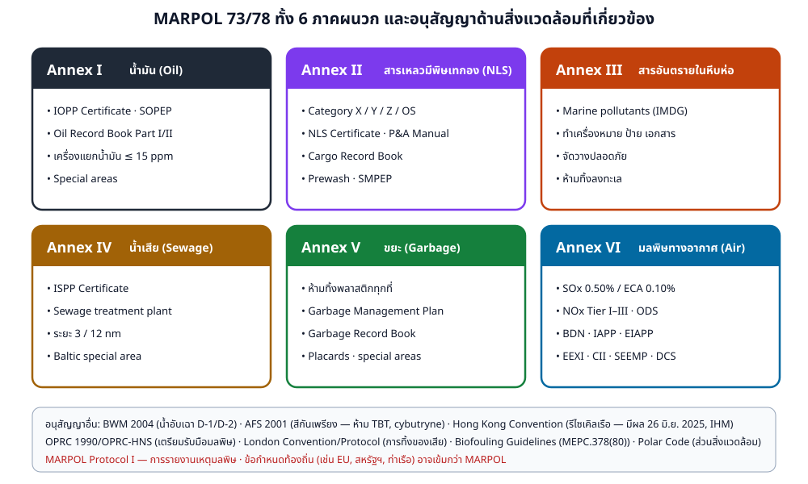
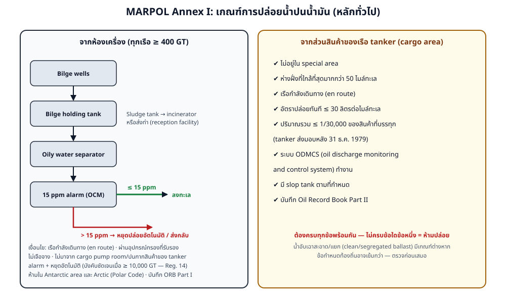
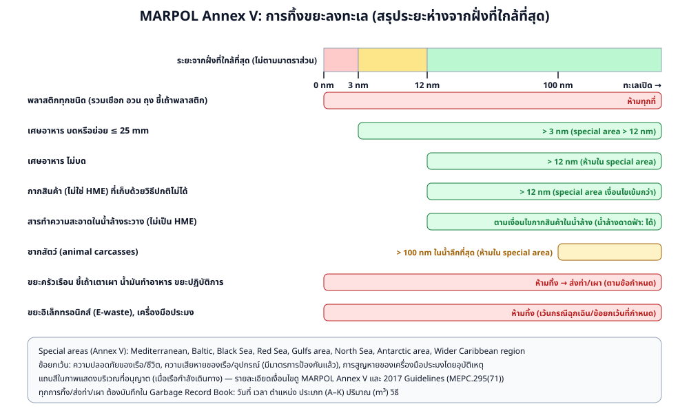
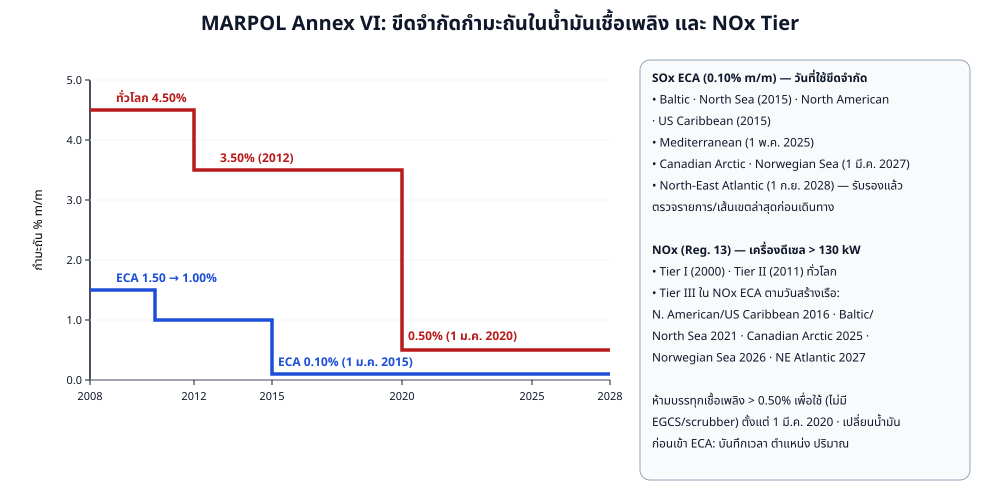
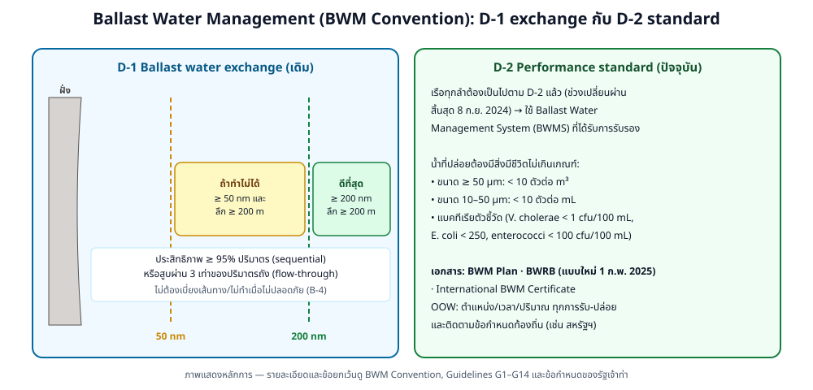
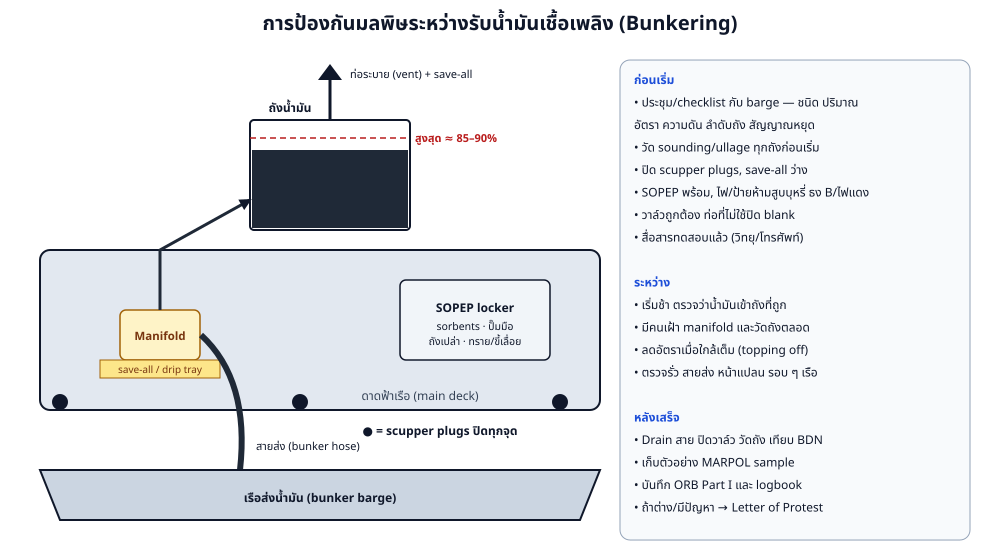
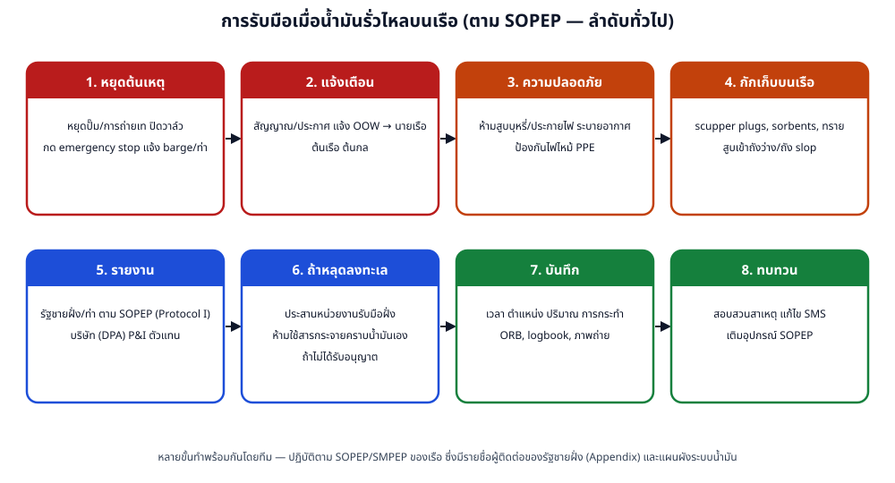

# 3.1 Ensure Compliance with Pollution-Prevention Requirements — การป้องกันมลพิษทางทะเล

> สมุดบันทึกการฝึก OOW · TIRAPHONG NANTAPAN
> Function 3: **Controlling the operation of the ship and care for persons on board at the operational level**
> สมรรถนะตาม STCW A-II/1: *Ensure compliance with pollution-prevention requirements* — Prevention of pollution of the marine environment and anti-pollution procedures:
> - Knowledge of the precautions to be taken to prevent pollution of the marine environment
> - Anti-pollution procedures and all associated equipment
> - Importance of proactive measures to protect the marine environment
>
> เกณฑ์ประเมิน: *Procedures for monitoring shipboard operations and ensuring compliance with MARPOL requirements are fully observed · Actions to ensure that a positive environmental reputation is maintained*
>
> อ้างอิงหลัก: **MARPOL 73/78** (Consolidated edition ล่าสุดและการแก้ไขที่มีผลแล้ว) Annex I–VI และ Protocol I; **BWM Convention 2004**; **AFS Convention 2001**; **Hong Kong International Convention for the Safe and Environmentally Sound Recycling of Ships** (มีผล 26 มิ.ย. 2025); **OPRC 1990** และ OPRC-HNS Protocol; **Polar Code** (ภาคสิ่งแวดล้อม); MEPC.295(71) (2017 Guidelines for Annex V); MEPC.378(80) (2023 Biofouling Guidelines); IMO Res. A.851(20) (ship reporting — รูปแบบรายงานเหตุมลพิษ); ISM Code; ICS *Bridge Procedures Guide*; IMO Model Course 7.03 และ IMO Model Course 1.38 (Marine Environmental Awareness); การแก้ไขล่าสุดที่ใช้ตรวจบทนี้: MEPC.392(82) (ECA Canadian Arctic/Norwegian Sea), MEPC.407(84) (North-East Atlantic ECA), MEPC.400(83) (CII reduction factors 2027–2030), MEPC.369(80) (แบบ Ballast Water Record Book ใหม่), MEPC.331(76) (AFS — cybutryne), MEPC.360(79) (GRB สำหรับเรือ ≥ 100 GT)

---

## 0. ทำไมเรื่องนี้จึงเป็น "หน้าที่ของ OOW"

ในยามจริง OOW คือคนที่ **อนุมัติหรือหยุด** การกระทำหลายอย่างที่ก่อมลพิษได้ — การปล่อยน้ำจากเครื่องแยกน้ำมัน การทิ้งเศษอาหาร การถ่ายน้ำอับเฉา การรับน้ำมันเชื้อเพลิง การเปลี่ยนน้ำมันก่อนเข้า ECA และเป็นคนแรกที่ **เห็นคราบน้ำมันข้างเรือ** หรือรู้ว่าเรือกำลังเข้าเขตพิเศษ ความผิดพลาดเล็ก ๆ เช่นลืมดูตำแหน่งเรือก่อนอนุญาตให้ทิ้งเศษอาหาร หรือลงบันทึกไม่ตรงกับความจริง อาจนำไปสู่การกักเรือ ค่าปรับมหาศาล และ **โทษทางอาญาต่อตัวบุคคล** ในบางประเทศ

STCW ใช้คำว่า **"proactive"** และ **"positive environmental reputation"** — ไม่ใช่แค่ "ไม่ทำผิดกฎ" แต่ต้องคิดล่วงหน้า ป้องกันก่อนเกิด รายงานตรงไปตรงมา และทำให้เรือ/บริษัทเป็นที่ไว้วางใจของรัฐเจ้าท่า ผู้เช่าเรือ และสังคม

*ภาพที่ 3.1-1 ภาพรวม MARPOL ทั้ง 6 ภาคผนวกและอนุสัญญาด้านสิ่งแวดล้อมที่เกี่ยวข้อง*

---

## 1. MARPOL 73/78 — ภาพรวม

- **International Convention for the Prevention of Pollution from Ships** — อนุสัญญาปี 1973 แก้ไขด้วย Protocol 1978 (จึงเรียก MARPOL 73/78) และ Protocol 1997 (เพิ่ม Annex VI)
- **บทความ (Articles)** — ข้อสำคัญที่ OOW ควรรู้: Article 4 (การละเมิดและการลงโทษ — ทั้งรัฐเจ้าของธงและรัฐที่เกิดเหตุ), Article 5 (ใบรับรอง และการตรวจเรือเมื่ออยู่ในท่าของรัฐภาคีอื่น — ฐานทางกฎหมายของ PSC), Article 6 (การตรวจพบการละเมิดและการบังคับใช้ — รัฐเจ้าท่าตรวจหาหลักฐานการปล่อยที่ผิดกฎได้), **Article 8 และ Protocol I (การรายงานเหตุที่เกี่ยวกับสารเป็นพิษ)**
- **ภาคผนวก 6 ภาค**: I น้ำมัน · II สารเหลวมีพิษเทกอง · III สารอันตรายในหีบห่อ · IV น้ำเสีย · V ขยะ · VI มลพิษทางอากาศ (Annex I, II บังคับ; III–VI เป็นทางเลือกของรัฐภาคี แต่ปัจจุบันรัฐเดินเรือส่วนใหญ่รับครบ)
- **Special areas / ECAs / PSSA** — พื้นที่ที่มีข้อกำหนดเข้มกว่าเพราะลักษณะทางสมุทรศาสตร์ นิเวศ หรือการจราจร
- **ใบรับรอง** — IOPP (I), NLS (II), ISPP (IV), IAPP/EIAPP/IEE (VI) และเอกสาร/บันทึกที่ต้องมีบนเรือ (Oil Record Book, Garbage Record Book, Cargo Record Book ฯลฯ) — รัฐเจ้าท่า (PSC) ตรวจได้
- **ข้อยกเว้นทั่วไป** — การปล่อยเพื่อ **ความปลอดภัยของเรือหรือช่วยชีวิตในทะเล** หรือจากความเสียหายของเรือ/อุปกรณ์ (ที่ได้ใช้ความระมัดระวังตามสมควรแล้ว และไม่ได้เกิดจากเจตนาหรือความประมาทเลินเล่อ) — ต้องบันทึกและรายงาน

---

## 2. Annex I — การป้องกันมลพิษจากน้ำมัน

### 2.1 นิยามและเอกสารสำคัญ

- **น้ำมัน (oil)** — ปิโตรเลียมทุกรูปแบบ: น้ำมันดิบ น้ำมันเชื้อเพลิง กากน้ำมัน (sludge) น้ำมันที่เปื้อนปน (oily mixture) และผลิตภัณฑ์กลั่น (ยกเว้นปิโตรเคมีที่อยู่ใน Annex II)
- **IOPP Certificate** (International Oil Pollution Prevention) — เรือ tanker ≥ 150 GT และเรืออื่น ≥ 400 GT
- **Oil Record Book (ORB)**
  - **Part I — Machinery space operations** (ทุกเรือที่กำหนด): การถ่ายน้ำท้องเรือ (bilge) ผ่าน OWS, การกำจัด sludge, การรับน้ำมันเชื้อเพลิง (bunkering), การถ่าย/ล้างถังน้ำมันเชื้อเพลิง, การปล่อยโดยอุบัติเหตุหรือผิดปกติ, ความขัดข้องของ OWS/อุปกรณ์ — ลงรหัสตามแนวทาง (code A–I) ลงนามโดยเจ้าหน้าที่ที่รับผิดชอบ และนายเรือลงนามทุกหน้า
  - **Part II — Cargo/ballast operations** (tanker ≥ 150 GT)
  - เก็บไว้บนเรือ **อย่างน้อย 3 ปี** หลังลงรายการสุดท้าย; รัฐเจ้าท่าขอสำเนาที่รับรองได้
- **SOPEP (Shipboard Oil Pollution Emergency Plan)** — tanker ≥ 150 GT และเรืออื่น ≥ 400 GT; เรือ NLS ใช้ **SMPEP** (รวมน้ำมันและ NLS) — มีขั้นตอนรายงาน รายชื่อผู้ติดต่อของรัฐชายฝั่ง การควบคุมการรั่วไหล การประสานกับฝั่ง
- **อุปกรณ์**: **15 ppm oil filtering equipment (OWS)** พร้อม **oil content meter/alarm และอุปกรณ์หยุดอัตโนมัติ** (Reg. 14: เรือ 400 – < 10,000 GT ต้องมีอุปกรณ์กรองที่ปล่อยได้ไม่เกิน 15 ppm; เรือ ≥ 10,000 GT ต้องมีทั้ง alarm และระบบหยุดการปล่อยอัตโนมัติเมื่อเกิน 15 ppm — อุปกรณ์ที่ติดตั้งตั้งแต่ 1 ม.ค. 2005 ต้องผ่านมาตรฐาน MEPC.107(49) และในทางปฏิบัติเรือส่วนใหญ่มีทั้งสองอย่าง), **sludge tank**, **standard discharge connection** สำหรับส่งของเสียให้ฝั่ง, เตาเผา (incinerator) ถ้ามี, **ODMCS** (oil discharge monitoring and control system) สำหรับ tanker

### 2.2 เกณฑ์การปล่อย

*ภาพที่ 3.1-2 เกณฑ์การปล่อยน้ำปนน้ำมันจากห้องเครื่องและจากส่วนสินค้าของเรือ tanker (หลักทั่วไป)*

**จากห้องเครื่อง (เรือ ≥ 400 GT)** — ปล่อยได้เมื่อ **ครบทุกข้อ**: เรือกำลังเดินทาง (en route), ผ่าน oil filtering equipment ที่ได้รับการรับรอง, **ปริมาณน้ำมันในน้ำที่ปล่อยไม่เกิน 15 ppm** โดยไม่เจือจาง, มี alarm และหยุดอัตโนมัติเมื่อเกิน 15 ppm, ไม่ใช่น้ำที่มาจาก cargo pump room ของ tanker หรือปนกับกากสินค้า — **ห้ามปล่อยในพื้นที่ Antarctic** และข้อกำหนดของ Polar Code ในอาร์กติก

จดไว้กันสับสน: เกณฑ์ 15 ppm ของห้องเครื่อง **ใช้ได้ทั้งนอกและใน special area** (Reg. 15.2 และ 15.3) ยกเว้น Antarctic — ต่างจากน้ำจากส่วนสินค้าของ tanker ที่ห้ามปล่อยใน special area เด็ดขาด; เรือ **< 400 GT** ให้เก็บไว้ส่งท่า หรือปล่อยด้วยเงื่อนไขเดียวกัน (เดินทาง ผ่านอุปกรณ์ที่อนุมัติ ไม่เกิน 15 ppm) ตามที่ Administration กำหนด (Reg. 15.6)

**จากส่วนสินค้าของ tanker** — ครบทุกข้อ: ไม่อยู่ใน special area, ห่างฝั่งที่ใกล้ที่สุด **มากกว่า 50 ไมล์ทะเล**, เรือกำลังเดินทาง, อัตราปล่อยทันที **ไม่เกิน 30 ลิตรต่อไมล์ทะเล**, ปริมาณรวม **ไม่เกิน 1/30,000** ของสินค้าที่บรรทุกเที่ยวก่อน (tanker ส่งมอบหลัง 31 ธ.ค. 1979; เรือเก่ากว่านั้น 1/15,000), ODMCS และ slop tank ทำงาน

**Special areas ของ Annex I**: Mediterranean Sea, Baltic Sea, Black Sea, Red Sea, Gulfs area, Gulf of Aden, Antarctic area, North West European waters, Oman area of the Arabian Sea, Southern South African waters

**ห้ามเด็ดขาด**: การปล่อยโดยเลี่ยงอุปกรณ์ (เช่นต่อท่อลัด — ที่วงการเรียกว่า **"magic pipe"**), การเจือจางเพื่อให้ผ่าน 15 ppm, การปลอมบันทึก — หลายประเทศดำเนินคดีอาญากับนายเรือ ต้นกล และเจ้าหน้าที่ที่เกี่ยวข้อง และกฎหมายบางประเทศให้รางวัลแก่ผู้แจ้งเบาะแส

### 2.3 ข้อกำหนดอื่นที่ควรรู้

- **การป้องกันถังน้ำมันเชื้อเพลิง (Reg. 12A)** — เรือใหม่ที่มีน้ำมันเชื้อเพลิงรวม ≥ 600 m³ ถังต้องอยู่ห่างจากเปลือกเรือ
- **Heavy fuel oil ในขั้วโลก** — ห้ามใช้/บรรทุก HFO เป็นเชื้อเพลิงในพื้นที่ Antarctic (Reg. 43 — ครอบคลุมทั้งการบรรทุกเป็นสินค้า ใช้เป็นน้ำอับเฉา และใช้/บรรทุกเป็นเชื้อเพลิง) และมีข้อห้ามในน่านน้ำอาร์กติกตั้งแต่ 1 ก.ค. 2024 (Reg. 43A โดยมีข้อยกเว้นชั่วคราวบางกรณีถึงปี 2029 — เช่นเรือที่ถังน้ำมันได้รับการป้องกันตามมาตรฐาน Reg. 12A และเรือธงของรัฐชายฝั่งอาร์กติกที่รัฐนั้นให้ waiver ใช้ได้ไม่เกิน 1 ก.ค. 2029)
- **การถ่ายน้ำมันระหว่างเรือ (STS transfer)** — tanker ที่ทำ STS ต้องมี STS operations plan (Annex I บทที่ 8) และถ้าทำในทะเลอาณาเขตหรือ EEZ ของรัฐภาคี ต้องแจ้งรัฐชายฝั่งล่วงหน้า **ไม่น้อยกว่า 48 ชั่วโมง** (Reg. 42); การทำ STS บันทึกใน ORB Part II

---

## 3. Annex II — สารเหลวมีพิษเทกอง (Noxious Liquid Substances, NLS)

- จัดหมวดตามอันตรายต่อทรัพยากรทะเล/สุขภาพ: **X** (อันตรายมาก — ห้ามปล่อยลงทะเล), **Y** (อันตราย — จำกัดคุณภาพและปริมาณ), **Z** (อันตรายน้อย — ข้อจำกัดน้อยกว่า), **OS — Other Substances** (นอกขอบเขต Annex II)
- เรือต้องมี **NLS Certificate** (หรือ Certificate of Fitness ตาม IBC), **P&A Manual**, **Cargo Record Book**, **SMPEP**
- การปล่อยน้ำล้างถังที่มีกาก X/Y/Z (เมื่ออนุญาต) ต้อง: เรือเดินทางด้วยความเร็วอย่างน้อย 7 นอต (เรือขับเคลื่อนด้วยตัวเอง), ปล่อยใต้ระดับน้ำผ่านช่องที่กำหนด, ห่างฝั่ง **อย่างน้อย 12 ไมล์ทะเล** ในน้ำลึก **อย่างน้อย 25 m** และอัตราตามที่ P&A Manual กำหนด
- **Prewash** ก่อนออกจากท่าขนลง — บังคับสำหรับสาร Category X, สาร Y ที่มีความหนืดสูงหรือแข็งตัว และ (ตามการแก้ไขล่าสุด) สาร "persistent floating products" บางชนิดในพื้นที่ที่กำหนด — น้ำล้างส่งให้สถานีรับของท่า
- OOW บนเรือ chemical tanker: ตรวจตำแหน่ง/ความเร็ว/ความลึกก่อนอนุญาตปล่อย และลงบันทึกให้ตรงกับ Cargo Record Book

---

## 4. Annex III — สารอันตรายในหีบห่อ (Harmful substances in packaged form)

- สารอันตรายต่อสิ่งแวดล้อม = **marine pollutants** ตาม IMDG Code (ดู 2.1)
- ข้อกำหนด: **บรรจุภัณฑ์** เพียงพอ, **ทำเครื่องหมายและป้าย** (marine pollutant mark), **เอกสาร** ระบุชื่อทางเทคนิคและคำว่า "MARINE POLLUTANT", **จัดวางและยึด** ให้ลดความเสี่ยงต่อสิ่งแวดล้อม (ป้องกันตกน้ำ), ข้อจำกัดปริมาณ
- **ห้ามทิ้งลงทะเล** เว้นแต่เพื่อความปลอดภัยของเรือหรือชีวิต
- **การสูญหายลงทะเล** (เช่นตู้ตกน้ำ) → **รายงานตาม Protocol I** และ SOLAS (2.1 ข้อ 7.4) — การแก้ไข SOLAS V/31 และ V/32 (MSC.550(108)) ซึ่งมีผล 1 ม.ค. 2026 กำหนดให้นายเรือรายงานตู้สินค้าที่สูญหายและตู้ที่พบลอยน้ำอย่างเป็นระบบ (ตำแหน่ง จำนวน ข้อมูลสินค้าอันตราย) ไปยังเรือใกล้เคียง รัฐชายฝั่งที่ใกล้ที่สุด และรัฐเจ้าของธง

---

## 5. Annex IV — น้ำเสีย (Sewage)

- ใช้กับเรือเดินทางระหว่างประเทศ **≥ 400 GT** หรือ **< 400 GT ที่รับรองให้บรรทุกคนเกิน 15 คน** — ใบรับรอง **ISPP**
- อุปกรณ์: **sewage treatment plant** ที่ได้รับการรับรอง หรือ **ระบบบดและฆ่าเชื้อ (comminuting and disinfecting system)** หรือ **holding tank**; มี standard discharge connection
- **เกณฑ์การปล่อย** (นอก special area)
  - น้ำเสียที่ **บดและฆ่าเชื้อแล้ว** — ห่างฝั่ง **มากกว่า 3 ไมล์ทะเล**
  - น้ำเสียที่ **ไม่ได้บด/ฆ่าเชื้อ** — ห่างฝั่ง **มากกว่า 12 ไมล์ทะเล** และปล่อยในอัตราปานกลางขณะเรือเดินทางด้วยความเร็วอย่างน้อย **4 นอต** (จาก holding tank ตามอัตราที่ได้รับอนุมัติ)
  - **sewage treatment plant ที่รับรองแล้ว** — ปล่อยได้ทุกที่ โดยน้ำที่ปล่อยต้องไม่มีของแข็งลอยให้เห็นหรือทำให้น้ำเปลี่ยนสี
- **Special area: Baltic Sea** — ข้อกำหนดเข้มสำหรับ **เรือโดยสาร** (ต้องมีระบบบำบัดที่ลดไนโตรเจน/ฟอสฟอรัส หรือส่งท่า) — มีผลเป็นขั้น: เรือโดยสารใหม่ 1 มิ.ย. 2019, เรือโดยสารที่มีอยู่ 1 มิ.ย. 2021 และเรือที่วิ่งตรงไปท่าทางตะวันออกของลองจิจูด 28°10'E โดยไม่แวะท่าอื่นในพื้นที่ 1 มิ.ย. 2023 (Reg. 11.3)
- อัตราการปล่อยจาก holding tank ต้องไม่เกินอัตราสูงสุดที่ Administration อนุมัติตามแนวทาง MEPC.157(55) ซึ่งคิดจากความเร็วและกินน้ำของเรือ — OOW จึงต้องรักษาความเร็ว ≥ 4 นอตตลอดช่วงปล่อย
- ข้อกำหนดท้องถิ่น (เช่นบางรัฐ/ท่าเรือห้ามปล่อยในเขตท่าเลย) — ตรวจก่อนเข้า

---

## 6. Annex V — ขยะ (Garbage)

### 6.1 หลักการ

**ห้ามทิ้งขยะทุกชนิดลงทะเล** เว้นแต่ที่ Annex V อนุญาตไว้โดยชัดแจ้ง — และ **พลาสติกทุกชนิดห้ามทิ้งทุกที่** (รวมเชือกสังเคราะห์ อวนประมง ถุงขยะพลาสติก ขี้เถ้าจากการเผาพลาสติก)

*ภาพที่ 3.1-3 สรุปการทิ้งขยะตาม Annex V (เมื่อเรือกำลังเดินทาง) — รายละเอียดดู MARPOL Annex V และ MEPC.295(71)*

| ชนิด | นอก special area | ใน special area |
|---|---|---|
| พลาสติก | **ห้าม** | **ห้าม** |
| เศษอาหาร บด/ย่อย ≤ 25 mm | > 3 nm, en route | > 12 nm, en route |
| เศษอาหารไม่บด | > 12 nm, en route | **ห้าม** |
| กากสินค้า (ไม่ใช่ HME) ที่ขจัดด้วยวิธีปกติไม่ได้ | > 12 nm, en route | ตามเงื่อนไขเข้มงวด (ท่าต้นทาง-ปลายทางในพื้นที่ ฯลฯ) |
| สารทำความสะอาดในน้ำล้าง (ไม่เป็นอันตรายต่อทะเล) | อนุญาตตามเงื่อนไข | อนุญาตตามเงื่อนไข |
| ซากสัตว์ | > 100 nm ในน้ำลึกที่สุด (ตัวเลขตามแนวทาง MEPC.295(71) — ตัวบท Reg. 4 ให้ห่างฝั่งมากที่สุดเท่าที่ทำได้) | **ห้าม** |
| ขยะอื่นทั้งหมด (ขยะครัวเรือน น้ำมันทำอาหาร ขี้เถ้าเตาเผา ขยะปฏิบัติการ E-waste เครื่องมือประมง) | **ห้าม** | **ห้าม** |

**Special areas ของ Annex V**: Mediterranean Sea, Baltic Sea, Black Sea, Red Sea, Gulfs area, North Sea, Antarctic area, Wider Caribbean region

- ถ้าขยะที่อนุญาตปนกับขยะที่ห้าม → ใช้เกณฑ์ที่เข้มกว่า
- **HME (Harmful to the Marine Environment)** — กากสินค้าที่ผู้ส่งต้องแจ้งว่าเป็น HME หรือไม่ (ตามเกณฑ์การจำแนก) — กาก HME ห้ามทิ้ง ต้องส่งท่า
- แท่นขุดเจาะและเรือที่อยู่ภายใน 500 m ของแท่น — ห้ามทิ้งทุกชนิด (ยกเว้นเศษอาหารบดตามเงื่อนไขเมื่ออยู่ห่างฝั่ง > 12 nm)

### 6.2 เอกสารและการจัดการบนเรือ

- **Placards** — แจ้งข้อกำหนดการทิ้งขยะแก่ลูกเรือและผู้โดยสาร (เรือยาว ≥ 12 m) เป็นภาษาของลูกเรือและภาษาอังกฤษ/ฝรั่งเศส/สเปน (สำหรับเรือเดินทางระหว่างประเทศ)
- **Garbage Management Plan** — เรือ ≥ 100 GT หรือรับรองคน ≥ 15 คน — มีผู้รับผิดชอบ ขั้นตอนเก็บ แยก จัดการ กำจัด
- **Garbage Record Book** — เรือ **≥ 100 GT** (การแก้ไขมีผล 1 พ.ค. 2024 ขยายจากเดิม ≥ 400 GT) และเรือที่รับรองคน ≥ 15 คน เดินทางระหว่างประเทศ — Part I (ขยะทั่วไป) และ Part II (กากสินค้า)
  - **ประเภทขยะ**: A พลาสติก · B เศษอาหาร · C ขยะครัวเรือน · D น้ำมันทำอาหาร · E ขี้เถ้าเตาเผา · F ขยะจากการปฏิบัติงาน · G ซากสัตว์ · H เครื่องมือประมง · I ขยะอิเล็กทรอนิกส์ (E-waste) · J กากสินค้า (ไม่ใช่ HME) · K กากสินค้า (HME)
  - บันทึกทุกครั้งที่ทิ้งลงทะเล ส่งให้ท่า (reception facility) หรือเผา: **วันที่ เวลา ตำแหน่ง (ละติจูด/ลองจิจูด) ประเภท ปริมาณโดยประมาณ (m³) วิธี** ลงนามโดยเจ้าหน้าที่ที่รับผิดชอบ และนายเรือลงนามทุกหน้า — เก็บ **อย่างน้อย 2 ปี**
  - ใบรับจากท่า (garbage receipt) เก็บไว้กับ GRB
- **การแยกขยะ** — ถังสีตามระบบของเรือ (พลาสติก เศษอาหาร ขยะทั่วไป กระป๋อง/แก้ว น้ำมันทำอาหาร ขยะอันตราย/E-waste) — ลดปริมาณ (บดอัด) ลดบรรจุภัณฑ์จากเสบียง
- **เตาเผาขยะ (incinerator)** — ตาม Annex VI ห้ามเผาบางชนิด (เช่น PVC เว้นแต่เตาที่รับรอง, กากสินค้าตาม Annex I/II/III, ขยะที่มีโลหะหนักเกินเกณฑ์) และห้ามเผาในท่า/ปากแม่น้ำในบางพื้นที่
- **Port reception facilities** — แจ้งท่าล่วงหน้า (advance notification form) ถ้ามีข้อกำหนด, รับใบรับ, รายงานความไม่เพียงพอของสถานีรับ (inadequacy report) ผ่านรัฐเจ้าของธง

> **ตัวอย่างการบันทึก GRB (จำลอง)** — 11 ธ.ค. 2026 เวลา 1430 LT ตำแหน่ง 05°12.4'N 104°38.9'E ประเภท B (เศษอาหารบด) 0.15 m³ ทิ้งลงทะเล (ห่างฝั่ง/เกาะที่ใกล้ที่สุดประมาณ 60 nm, นอก special area, เรือเดินทาง 13.5 นอต) — ลงนาม 3/O
> ก่อนอนุญาตให้ทิ้ง OOW **ตรวจตำแหน่งบน ECDIS ระยะจากฝั่งที่ใกล้ที่สุด (รวมเกาะ) และตรวจว่าไม่อยู่ใน special area/เขตที่รัฐชายฝั่งห้าม** ทุกครั้ง

---

## 7. Annex VI — มลพิษทางอากาศและประสิทธิภาพพลังงาน

### 7.1 ข้อกำหนดหลัก

*ภาพที่ 3.1-4 ขีดจำกัดกำมะถันในน้ำมันเชื้อเพลิงทั่วโลกและใน ECA และข้อกำหนด NOx Tier*

| เรื่อง | ข้อกำหนด (ย่อ) |
|---|---|
| **สารทำลายโอโซน (ODS) — Reg. 12** | ห้ามปล่อยโดยเจตนา ห้ามติดตั้งระบบใหม่ที่มี ODS; มี ODS Record Book (ถ้ามีระบบที่บรรจุ ODS ที่ชาร์จซ้ำได้) |
| **NOx — Reg. 13** | เครื่องยนต์ดีเซลกำลัง > 130 kW: **Tier I** (เรือสร้าง 2000–2010), **Tier II** (ตั้งแต่ 1 ม.ค. 2011) ทั่วโลก, **Tier III** ใน **NOx ECA** (North American และ US Caribbean สำหรับเรือสร้างตั้งแต่ 1 ม.ค. 2016; Baltic และ North Sea สำหรับเรือสร้างตั้งแต่ 1 ม.ค. 2021; **Canadian Arctic** สำหรับเรือสร้างตั้งแต่ 1 ม.ค. 2025 และ **Norwegian Sea** สำหรับเรือสร้างตั้งแต่ 1 มี.ค. 2026 — MEPC.392(82); **North-East Atlantic** สำหรับเรือสัญญาสร้างตั้งแต่ 1 ม.ค. 2027 — MEPC.407(84)) — Tier III ไม่ย้อนหลังกับเรือเก่า เรือที่สร้างก่อนวันดังกล่าวใช้ Tier II ใน ECA ได้ — ใบรับรอง EIAPP และ Technical File ของเครื่อง |
| **SOx และฝุ่น — Reg. 14** | กำมะถันในน้ำมันเชื้อเพลิง **ไม่เกิน 0.50% m/m ทั่วโลก (ตั้งแต่ 1 ม.ค. 2020)** และ **ไม่เกิน 0.10% m/m ใน SOx ECA** (Baltic, North Sea, North American, US Caribbean และ **Mediterranean ตั้งแต่ 1 พ.ค. 2025**; **Canadian Arctic และ Norwegian Sea** — การแก้ไขมีผล 1 มี.ค. 2026 แต่ขีดจำกัด 0.10% ใช้ตั้งแต่ **1 มี.ค. 2027**; **North-East Atlantic** — รับรองที่ MEPC 84 (พ.ค. 2026) มีผล 1 ก.ย. 2027 ขีดจำกัดใช้ตั้งแต่ **1 ก.ย. 2028**) — หรือใช้ระบบทำความสะอาดไอเสีย (EGCS/scrubber) ที่ได้รับการรับรองเป็นทางเลือก; **ห้ามบรรทุกเชื้อเพลิงที่เกิน 0.50% เพื่อใช้** ถ้าไม่มี scrubber (ตั้งแต่ 1 มี.ค. 2020) |
| **VOC — Reg. 15** | tanker บรรทุกน้ำมันดิบต้องมี VOC Management Plan; บางท่ามีระบบเก็บไอ |
| **Shipboard incineration — Reg. 16** | เตาเผาที่ได้รับการรับรอง ห้ามเผาวัสดุบางชนิด |
| **คุณภาพน้ำมันเชื้อเพลิง — Reg. 18** | **Bunker Delivery Note (BDN)** เก็บบนเรือ **3 ปี** และ **ตัวอย่างน้ำมัน (MARPOL delivered sample)** เก็บไว้จนใช้น้ำมันนั้นหมดแต่ไม่น้อยกว่า **12 เดือน**; มีจุดเก็บตัวอย่าง in-use และ on board ตามที่กำหนด |
| **ประสิทธิภาพพลังงาน — Chapter 4** | **EEDI** (เรือใหม่), **EEXI** (เรือที่มีอยู่ ตั้งแต่ 2023), **SEEMP** (Part I แผนประสิทธิภาพ, Part II การเก็บข้อมูลการใช้น้ำมัน, Part III แผนลดความเข้มข้นคาร์บอน), **CII** (Carbon Intensity Indicator — จัดอันดับ A–E ทุกปีสำหรับเรือ ≥ 5,000 GT ตามประเภทที่กำหนด ตั้งแต่ 2023; ค่าลดที่ต้องได้เทียบปีฐาน 2019 คือ 5% (2023) เพิ่มปีละ 2% ถึง 11% (2026) แล้ว 13.625% (2027), 16.25% (2028), 18.875% (2029), 21.5% (2030) ตาม MEPC.400(83); เรือที่ได้ D สามปีติดกันหรือ E หนึ่งปีต้องทำแผนแก้ไข (corrective action plan) ใน SEEMP Part III), **IMO DCS** (รายงานการใช้น้ำมันประจำปี เรือ ≥ 5,000 GT) |
| **ใบรับรอง** | IAPP, IEE (energy efficiency), EIAPP สำหรับเครื่องยนต์ |

- **ทิศทางในอนาคต**: IMO รับรอง **2023 IMO Strategy on Reduction of GHG Emissions from Ships** (เป้าหมาย net-zero ประมาณปี 2050) และกำลังพัฒนามาตรการระยะกลาง (เช่น IMO Net-Zero Framework — มาตรฐานความเข้มข้นก๊าซเรือนกระจกของเชื้อเพลิงและกลไกราคา) — OOW ควรติดตามสถานะการรับรองและวันมีผลบังคับล่าสุดจาก IMO/บริษัท; ระดับภูมิภาคเช่น EU ETS และ FuelEU Maritime มีผลกับเรือที่เข้าท่า EU แล้ว
  - **สถานะ IMO Net-Zero Framework ที่ผมจดไว้ (ต.ค. 2026)**: MEPC 83 (เม.ย. 2025) อนุมัติร่างบทใหม่ (Chapter 5) ของ Annex VI → การประชุมสมัยพิเศษ (MEPC/ES.2, ต.ค. 2025) ลงมติ **เลื่อนการพิจารณาออกไปหนึ่งปี** → MEPC 84 (เม.ย.–พ.ค. 2026) ยังไม่ได้ข้อยุติ และนัดพิจารณาต่อช่วงปลายปี 2026 — **ยังไม่ได้รับรองและยังไม่มีผลบังคับ**; ถ้ารับรองได้ วันมีผลเร็วที่สุดจะเป็นปี 2028 ขึ้นไป — ตรวจสถานะล่าสุดกับ IMO/บริษัทก่อนตอบสอบ
- **ECA เพิ่มเติม** — IMO ได้รับรองการกำหนด ECA ใหม่เพิ่มเติมเป็นระยะ ต้องตรวจรายการ ECA และวันมีผลล่าสุดก่อนวางแผนเดินทาง (บริษัท/ECDIS/ALRS Vol 8 ช่วยได้)

| ECA (Annex VI) | ควบคุม | ขีดจำกัด SOx 0.10% ใช้ตั้งแต่ | NOx Tier III ใช้กับเรือที่สร้างตั้งแต่ |
|---|---|---|---|
| Baltic Sea | SOx, NOx | 1 ม.ค. 2015 (เดิม 1.00% ตั้งแต่ 2010) | 1 ม.ค. 2021 |
| North Sea (รวม English Channel) | SOx, NOx | 1 ม.ค. 2015 | 1 ม.ค. 2021 |
| North American | SOx, NOx, PM | 1 ม.ค. 2015 | 1 ม.ค. 2016 |
| US Caribbean | SOx, NOx, PM | 1 ม.ค. 2015 | 1 ม.ค. 2016 |
| Mediterranean Sea | SOx, PM | 1 พ.ค. 2025 | — (ไม่เป็น NOx ECA) |
| Canadian Arctic | SOx, NOx, PM | 1 มี.ค. 2027 | 1 ม.ค. 2025 |
| Norwegian Sea (EEZ นอร์เวย์เหนือ 62°N) | SOx, NOx, PM | 1 มี.ค. 2027 | 1 มี.ค. 2026 (สัญญาสร้าง) / keel 1 ก.ย. 2026 / ส่งมอบ 1 มี.ค. 2030 |
| North-East Atlantic (กรีนแลนด์ ไอซ์แลนด์ แฟโร ไอร์แลนด์ สหราชอาณาจักร ฝรั่งเศส สเปน โปรตุเกส) | SOx, NOx, PM | 1 ก.ย. 2028 | สัญญาสร้าง 1 ม.ค. 2027 / keel 1 ก.ค. 2027 / ส่งมอบ 1 ม.ค. 2031 |

*ที่มา: MARPOL Annex VI Reg. 13 และ 14, MEPC.392(82), MEPC.407(84) — เส้นเขตจริงดูพิกัดใน Appendix VII ของ Annex VI และบนแผนที่/ECDIS*

### 7.2 สิ่งที่ OOW ทำเกี่ยวกับ Annex VI

- **การเปลี่ยนน้ำมัน (fuel changeover) ก่อนเข้า ECA** — ตามขั้นตอนที่เขียนไว้ของเรือ: ต้นกลแจ้งเวลาเริ่ม/เสร็จ, ต้องเสร็จ (ใช้น้ำมัน ≤ 0.10% เต็มระบบ) **ก่อนเข้าเขต** — OOW บันทึกใน logbook: **วันที่ เวลา ตำแหน่งเรือ** เมื่อเริ่มและเสร็จการเปลี่ยน และ **ปริมาณน้ำมันกำมะถันต่ำในแต่ละถัง** (บันทึกตามที่ Administration กำหนด) ทั้งตอนเข้าและออกจาก ECA
- วางแผนเดินทางให้รู้จุดเข้า/ออก ECA (เส้นเขตบน ECDIS/แผนที่)
- ถ้าน้ำมันที่ได้รับไม่เป็นไปตามเกณฑ์/หาไม่ได้ → แจ้งนายเรือ ทำ **Fuel Oil Non-Availability Report (FONAR)** ตามขั้นตอนต่อรัฐเจ้าของธงและท่าปลายทาง
- สังเกตควันดำผิดปกติจากปล่อง (อาจถูกร้องเรียนในท่า) แจ้งห้องเครื่อง
- ไม่เผาขยะในท่าหรือพื้นที่ที่ห้าม

> **ตัวอย่างจำลอง: วางแผนจุดเริ่มเปลี่ยนน้ำมันก่อนเข้า Mediterranean ECA** — MV Andaman Pearl มาจากมหาสมุทรแอตแลนติกมุ่งเข้าช่องแคบยิบรอลตาร์ (เส้นเขตด้านตะวันตกของ Mediterranean คือเส้นเมริเดียน 005°36'W) เดินทาง 15 นอต ต้นกลแจ้งว่าการเปลี่ยนจาก VLSFO (0.48%) เป็น MGO (0.08%) ให้ทั้งระบบต่ำกว่า 0.10% ต้องใช้ประมาณ 3 ชั่วโมง (คำนวณจากปริมาตรถัง settling/service และอัตราการใช้ตามขั้นตอน changeover ของเรือ) ผมเผื่ออีก 1 ชั่วโมง → เริ่มเปลี่ยนก่อนถึงเส้นเขตอย่างน้อย 4 × 15 = **60 nm**
> - วางจุด "Start F.O. changeover" และเส้นเขต ECA บน ECDIS/แผนที่ (เพิ่มเป็น event ใน passage plan)
> - เวลาเริ่ม/เสร็จ ตำแหน่ง และปริมาณ MGO ในแต่ละถัง ลงทั้ง deck log และบันทึกของห้องเครื่อง (ตามแบบที่ Administration กำหนด) — ตัวเลขต้องตรงกัน
> - ถ้าต้นกลแจ้งว่าเปลี่ยนไม่เสร็จก่อนถึงเส้นเขต → แจ้งนายเรือทันที (อาจลดความเร็วเพื่อให้เปลี่ยนเสร็จก่อนเข้าเขต) — ไม่ใช่เรื่องที่จะ "ปล่อยไปก่อน"
> - ข้อสังเกต: ตัวอย่างนี้ใช้ได้ก่อนปี 2028 — ตั้งแต่ 1 ก.ย. 2028 เรือจะเข้า North-East Atlantic ECA ตั้งแต่เขต EEZ ของโปรตุเกส/สเปน จึงต้องเปลี่ยนน้ำมันเร็วกว่านั้นมาก — วางแผนจากเส้นเขต ECA ที่ใกล้ที่สุดตามเส้นทางจริงเสมอ

---

## 8. น้ำอับเฉา (Ballast Water Management Convention)

*ภาพที่ 3.1-5 มาตรฐาน D-1 (การแลกเปลี่ยนน้ำอับเฉา) และ D-2 (มาตรฐานสมรรถนะ)*

- **ปัญหา**: น้ำอับเฉาพาสิ่งมีชีวิตต่างถิ่น (invasive aquatic species) และเชื้อโรคข้ามทวีป — ทำลายระบบนิเวศและเศรษฐกิจท้องถิ่น
- **BWM Convention** มีผลบังคับ 8 ก.ย. 2017
- **D-1 (Ballast water exchange)** — แลกเปลี่ยนในทะเลลึก: ห่างฝั่งที่ใกล้ที่สุด **≥ 200 nm** และลึก **≥ 200 m** (ถ้าทำไม่ได้ ≥ 50 nm และลึก ≥ 200 m) ประสิทธิภาพ ≥ 95% โดยปริมาตร (แบบ sequential) หรือสูบผ่าน 3 เท่าของปริมาตรถัง (flow-through) — ไม่ต้องเบี่ยงเส้นทางหรือทำเมื่อไม่ปลอดภัย (คำนึงถึงเสถียรภาพ ความแข็งแรง ระหว่างแลกเปลี่ยน)
- **D-2 (Performance standard)** — น้ำที่ปล่อยต้องมีสิ่งมีชีวิตไม่เกินเกณฑ์ (≥ 50 µm น้อยกว่า 10 ตัวต่อ m³; 10–50 µm น้อยกว่า 10 ตัวต่อ mL; แบคทีเรียตัวชี้วัด: Vibrio cholerae ชนิดก่อโรค < 1 cfu ต่อ 100 mL, E. coli < 250 cfu ต่อ 100 mL, intestinal Enterococci < 100 cfu ต่อ 100 mL) — ใช้ **Ballast Water Management System (BWMS)** ที่ได้รับการรับรอง; **เรือทุกลำต้องเป็นไปตาม D-2 แล้ว** (ช่วงเปลี่ยนผ่านสิ้นสุด 8 ก.ย. 2024)
- **เอกสาร**: **Ballast Water Management Plan**, **Ballast Water Record Book** (บันทึกการรับ หมุนเวียน บำบัด ปล่อย ทุกครั้ง — ตำแหน่ง วันที่ เวลา ปริมาณ ถัง ความเค็ม ฯลฯ — เก็บอย่างน้อย 2 ปีบนเรือ แล้วบริษัทเก็บต่ออีกอย่างน้อย 3 ปี), **International Ballast Water Management Certificate**
  - **แบบ BWRB ใหม่ตั้งแต่ 1 ก.พ. 2025** (MEPC.369(80)) — ลงบันทึกด้วยรหัสการปฏิบัติการตัวอักษร A–H และหมายเลขรายการคล้าย ORB รวมการบันทึกเมื่อ BWMS ขัดข้อง/ใช้ contingency measures และการล้างถัง/จัดการตะกอน — ดูแนวทาง BWM.2/Circ.80/Rev.1; การใช้ **electronic record book** ทำได้ตามการแก้ไขที่มีผล 1 ต.ค. 2025 ถ้า Administration อนุมัติ (ตรวจกับฉบับปัจจุบัน)
- **ตะกอน (sediments)** — ต้องจัดการตาม BWM Plan (ส่งท่าหรือทิ้งในทะเลลึกตามเงื่อนไข) — เกี่ยวข้องกับการตรวจถังใน 2.2
- **OOW**: ประสานการรับ-ปล่อยน้ำอับเฉากับขั้นตอนขนถ่าย บันทึกตำแหน่ง/เวลา ตรวจสภาพการทำงานของ BWMS (alarm) แจ้งต้นเรือเมื่อระบบขัดข้อง (มีขั้นตอน contingency) และปฏิบัติตามข้อกำหนดท้องถิ่นที่อาจเข้มกว่า (บางรัฐห้ามปล่อยในท่าเลย หรือกำหนดรายงานล่วงหน้า)

---

## 9. อนุสัญญาและแนวทางอื่นที่เกี่ยวข้อง

- **AFS Convention (Anti-Fouling Systems)** — ห้ามสีกันเพรียงที่มี **organotin (TBT)** และ **cybutryne** (ห้ามตั้งแต่ 1 ม.ค. 2023 สำหรับการทาใหม่) — เรือ ≥ 400 GT มีใบรับรอง IAFS
  - เรือที่มีสี cybutryne อยู่แล้วต้องลอกออกหรือทาชั้นเคลือบกันการชะ (sealer coat) **ในการทาสีกันเพรียงครั้งถัดไป แต่ไม่เกิน 60 เดือนหลังทาครั้งล่าสุด** (MEPC.331(76)); เรือยาว ≥ 24 m แต่ < 400 GT ที่เดินทางระหว่างประเทศต้องมี **Declaration on Anti-fouling System** แทนใบรับรอง
- **Biofouling** — **2023 Biofouling Guidelines (MEPC.378(80))** — แผนและบันทึกการจัดการสิ่งมีชีวิตเกาะตัวเรือ (Biofouling Management Plan/Record Book) ลดการพาสิ่งมีชีวิตต่างถิ่นและช่วยลดการใช้เชื้อเพลิง; บางรัฐ (เช่นนิวซีแลนด์ ออสเตรเลีย) มีข้อกำหนดบังคับ
- **Hong Kong Convention (Ship Recycling)** — **มีผลบังคับ 26 มิ.ย. 2025** — เรือ ≥ 500 GT ต้องมี **Inventory of Hazardous Materials (IHM)** และใบรับรองที่เกี่ยวข้อง; สหภาพยุโรปมี EU Ship Recycling Regulation ที่กำหนด IHM สำหรับเรือที่เข้าท่า EU อยู่แล้ว
  - เรือใหม่ต้องมี IHM ตั้งแต่สร้าง เรือที่มีอยู่ต้องจัดทำภายใน 5 ปีหลังอนุสัญญามีผล (ภายใน 26 มิ.ย. 2030) หรือก่อนส่งไปรีไซเคิลถ้าเร็วกว่า — ใบรับรองคือ **International Certificate on Inventory of Hazardous Materials**; IHM Part I ต้องปรับปรุงทุกครั้งที่เปลี่ยนอุปกรณ์/วัสดุบนเรือ (ฝ่ายช่างและต้นเรือดูแล)
- **OPRC 1990 / OPRC-HNS 2000** — ความพร้อมรับมือและความร่วมมือระหว่างประเทศ เป็นที่มาของ SOPEP/SMPEP และการรายงาน
- **London Convention 1972 / Protocol 1996** — ควบคุมการทิ้งของเสียลงทะเล (dumping) — เรือพาณิชย์ทั่วไปไม่ "ทิ้ง" ของเสียแบบนี้
- **Polar Code (Part II-A)** — ข้อกำหนดด้านสิ่งแวดล้อมในน่านน้ำขั้วโลก (เช่นห้ามปล่อยน้ำมันและสารปนน้ำมันในอาร์กติก ข้อจำกัดเรื่องเศษอาหาร น้ำเสีย) — ตัวอย่างที่ควรจำ: เศษอาหารทิ้งได้เฉพาะที่บดแล้ว (≤ 25 mm) ห่างแผ่นดิน ice shelf และ fast ice ที่ใกล้ที่สุด **ไม่น้อยกว่า 12 nm** อยู่ให้ห่างจากบริเวณที่น้ำแข็งหนาแน่นเกิน 1/10 เท่าที่ทำได้ และ **ห้ามทิ้งลงบนน้ำแข็ง**; สาร NLS ห้ามปล่อยในอาร์กติก; มี Polar Ship Certificate และ Polar Water Operational Manual (PWOM)
- **เสียงใต้น้ำและการชนวาฬ** — แนวทาง IMO การลดเสียงใต้น้ำจากเรือ (ฉบับปรับปรุง 2023) และคำแนะนำหลีกเลี่ยงการชนสัตว์ทะเลเลี้ยงลูกด้วยนม เส้นทาง/ความเร็วตามที่รัฐชายฝั่งกำหนด (เช่นลดความเร็วในบางพื้นที่/ฤดู)
- **PSSA (Particularly Sensitive Sea Areas)** — พื้นที่อ่อนไหวที่ IMO รับรอง (เช่น Great Barrier Reef) พร้อมมาตรการเฉพาะ (ATBA, ระบบรายงาน, นำร่องบังคับ)

---

## 10. การป้องกันมลพิษในงานประจำ (Precautions)

### 10.1 การรับน้ำมันเชื้อเพลิง (Bunkering)

*ภาพที่ 3.1-6 การจัดเตรียมป้องกันมลพิษระหว่างรับน้ำมันเชื้อเพลิงและ checklist*

การรั่วไหลจากการเติมน้ำมันเป็นเหตุมลพิษที่พบบ่อยที่สุดอย่างหนึ่ง — ล้นจากท่อระบาย (vent) เพราะเติมเกิน รั่วที่สายส่ง/หน้าแปลน หรือเปิดวาล์วผิดถัง
- **ก่อนเริ่ม**: แผนการรับ (ถัง ปริมาณ ลำดับ ระดับสูงสุดของแต่ละถัง — โดยทั่วไปไม่เกินประมาณ 85–90%), ประชุมและ checklist กับเรือส่งน้ำมัน (ชนิด ปริมาณ อัตรา ความดัน สัญญาณหยุด การสื่อสาร), วัดถังทุกถังก่อนเริ่ม, **ปิด scupper plugs ทุกจุด** และ save-all (drip trays) ว่างพร้อม, **อุปกรณ์ SOPEP พร้อมใกล้จุดรับ**, ชักธง B/ไฟแดงตามข้อกำหนดท่า ห้ามสูบบุหรี่ ห้ามงานร้อน, วาล์วถูกต้องและท่อที่ไม่ใช้ปิด blank, ทดสอบการสื่อสาร
- **ระหว่างรับ**: เริ่มด้วยอัตราช้า ตรวจว่าน้ำมันเข้าถังที่ถูก ไม่รั่ว, มีคนเฝ้า manifold และวัดถังตลอด, ลดอัตราเมื่อใกล้เต็ม (topping off) แจ้งเรือส่งล่วงหน้า, เฝ้ารอบเรือดูคราบน้ำมัน
- **หลังเสร็จ**: ไล่น้ำมันในสาย ปิดวาล์ว วัดถัง คำนวณปริมาณเทียบ BDN, เก็บตัวอย่าง MARPOL, บันทึก ORB Part I และ logbook, ถ้าปริมาณ/คุณภาพผิด → Letter of Protest
- **OOW** มักเป็นผู้ประสานบนดาดฟ้า (ร่วมกับฝ่ายช่างกล) — ต้องรู้สัญญาณหยุดฉุกเฉินและขั้นตอน SOPEP

### 10.2 การป้องกันอื่นที่ต้องเป็นนิสัย

- **Scupper plugs** ปิดในท่าเมื่อมีการถ่ายน้ำมัน/เคมี และเมื่อทำงานที่อาจรั่ว (เช่นซ่อมไฮดรอลิกบนดาดฟ้า)
- ตรวจ **ไฮดรอลิก** ของเครน ฝาระวาง กว้าน — รั่วลงทะเลเป็นมลพิษ (เรือหลายลำใช้น้ำมันไฮดรอลิกชนิดเป็นมิตรกับสิ่งแวดล้อม — EAL ในส่วนที่สัมผัสน้ำทะเล)
- **ห้ามล้างดาดฟ้าด้วยสารเคมีให้ไหลลงทะเล** โดยไม่ตรวจว่าเป็นไปตาม Annex V
- **ขยะ** — แยกตั้งแต่ต้นทาง ไม่ให้ปลิวลงทะเล (ถุงขยะบนดาดฟ้าในลมแรง)
- **Overboard valves** ของระบบที่ไม่ใช้ — ปิดและล็อก/ซีลตามขั้นตอน (เช่น overboard ของ OWS ในบางพื้นที่/ในท่า)
- **ตรวจผิวน้ำรอบเรือเป็นระยะ** — ในท่าและระหว่างขนถ่าย พบคราบให้รีบหาสาเหตุ (อาจมาจากเรือเราหรือเรืออื่น — บันทึกและรายงาน)

### 10.3 การรับมือเมื่อเกิดการรั่วไหล (Anti-pollution procedures)

*ภาพที่ 3.1-7 ขั้นตอนทั่วไปเมื่อเกิดน้ำมันรั่วไหลบนเรือตาม SOPEP*

1. **หยุดต้นเหตุ** — หยุดปั๊ม/การถ่ายเท ปิดวาล์ว กด emergency stop แจ้งเรือส่ง/ท่า
2. **แจ้งเตือน** — สัญญาณตามที่เรือกำหนด แจ้งนายเรือ ต้นเรือ ต้นกล
3. **ความปลอดภัย** — ไอน้ำมันไวไฟ: ห้ามประกายไฟ/สูบบุหรี่ ระบายอากาศ PPE เตรียมดับเพลิง
4. **กักเก็บบนเรือ** — scupper plugs, วัสดุดูดซับ (sorbents), ทราย/ขี้เลื่อย, กั้นด้วยวัสดุ, สูบน้ำมันที่รั่วเข้าถังว่าง/ถัง slop; ลดระดับในถังที่รั่วโดยโอนไปถังอื่น
5. **รายงาน** — ตาม SOPEP: รัฐชายฝั่ง/ท่าที่ใกล้ที่สุด (รูปแบบตาม A.851(20) และ Protocol I — รายงานโดยไม่ชักช้า), บริษัท (DPA), ตัวแทนเรือ, P&I ตามขั้นตอน
6. **ถ้าน้ำมันลงทะเล** — ประสานกับหน่วยงานรับมือ **ห้ามใช้สารกระจายคราบน้ำมัน (dispersants) เองโดยไม่ได้รับอนุญาตจากรัฐชายฝั่ง**
7. **บันทึก** — เวลา ตำแหน่ง ปริมาณประมาณ สาเหตุ การกระทำ ภาพถ่าย ใน ORB และ logbook
8. **ทบทวน** — สอบสวนสาเหตุ แก้ขั้นตอน เติมอุปกรณ์ SOPEP; ฝึกซ้อม SOPEP ตามแผนของเรือ

**การรายงานตาม Protocol I** — ต้องรายงานเมื่อมีการปล่อยหรือน่าจะมีการปล่อย น้ำมันหรือ NLS เกินเกณฑ์ที่อนุญาต (รวมกรณีที่ปล่อยเพื่อความปลอดภัยหรือจากความเสียหาย), สารอันตรายในหีบห่อ (รวมตู้หรือหีบห่อที่ตกน้ำ), และเหตุที่เรือเสียหาย/บกพร่องที่อาจนำไปสู่การรั่วไหล — รายงานไปยังรัฐชายฝั่งที่ใกล้ที่สุดโดยวิธีที่เร็วที่สุด

---

## 11. มาตรการเชิงรุกและชื่อเสียงด้านสิ่งแวดล้อม (Proactive measures)

- **ทำมากกว่ากฎขั้นต่ำ** — นโยบายสิ่งแวดล้อมของบริษัท (เช่นระบบ ISO 14001), เป้าหมายลดขยะ/พลาสติก (เลิกใช้ขวดพลาสติกโดยใช้เครื่องกรองน้ำดื่ม), ลดการใช้เชื้อเพลิง (ความเร็วประหยัด weather routing just-in-time arrival ทำความสะอาดท้องเรือ/ใบจักร) ซึ่งลดทั้งต้นทุนและมลพิษ
- **วัฒนธรรมรายงาน** — รายงาน near miss และข้อผิดพลาดตามจริง (no blame แต่มีความรับผิดชอบ), ไม่ปิดบังเหตุเล็ก — การรายงานตรงไปตรงมาทำให้รัฐเจ้าท่าและผู้เช่าเรือไว้ใจ
- **การฝึกและความตระหนัก** — ลูกเรือทุกคนรู้ว่าทำไมต้องแยกขยะ ทำไมห้ามทิ้งพลาสติก อ่าน placards เข้าใจ
- **การตรวจภายนอก** — Port State Control, การตรวจของผู้เช่าเรือ/vetting (เช่นระบบ SIRE 2.0 ของ OCIMF สำหรับ tanker), โปรแกรมเรือสีเขียวของท่าเรือ (เช่น Environmental Ship Index) — ผลการตรวจดีทำให้บริษัทได้งาน
- **บันทึกถูกต้องตรงความจริง** — ORB, GRB, BWRB, logbook ต้องตรงกันและตรงกับข้อมูลอุปกรณ์ (เช่นข้อมูลจาก OCM, GNSS); ความไม่สอดคล้องเป็นสิ่งแรกที่ผู้ตรวจมองหา
- **เคารพพื้นที่อ่อนไหว** — ลดความเร็วในเขตวาฬ หลีกเลี่ยง ATBA ลดไฟส่องสว่างที่ไม่จำเป็นใกล้แหล่งเพาะพันธุ์ ตามคำแนะนำของรัฐชายฝั่ง
- **ความเสี่ยงต่อชื่อเสียง** — เหตุมลพิษหนึ่งครั้งถูกเผยแพร่ทั่วโลกในไม่กี่ชั่วโมง กระทบบริษัท ลูกค้า และอาชีพของคนเรือ

---

## 12. สรุปหน้าที่ของ OOW (เช็กลิสต์ส่วนตัว)

| สถานการณ์ | สิ่งที่ OOW ทำ |
|---|---|
| ห้องเครื่องขออนุญาตสูบน้ำท้องเรือผ่าน OWS | ตรวจตำแหน่ง: ไม่อยู่ในพื้นที่ห้าม (Antarctic, ข้อกำหนดท้องถิ่น), เรือกำลังเดินทาง; รับทราบเวลาเริ่ม-หยุดและตำแหน่ง ให้สอดคล้องกับ ORB Part I |
| ขอทิ้งเศษอาหาร | ตรวจระยะจากฝั่ง/เกาะที่ใกล้ที่สุด special area ความเร็ว ชนิด (บดหรือไม่) → อนุญาต/ไม่อนุญาต → บันทึก GRB |
| เข้า ECA | ยืนยันกับห้องเครื่องว่าเปลี่ยนน้ำมันเสร็จก่อนเข้าเขต บันทึกเวลา ตำแหน่ง ปริมาณ |
| รับ/ปล่อยน้ำอับเฉา | ประสาน BWMS บันทึก BWRB (ตำแหน่ง เวลา ปริมาณ) ตรวจข้อกำหนดท้องถิ่น |
| ยามในท่า | scupper plugs, ตรวจผิวน้ำ, ขยะไม่ปลิว, ห้ามเผาขยะ, ควันปล่อง |
| พบคราบน้ำมัน | หาสาเหตุ หยุดต้นเหตุ แจ้งนายเรือ ตาม SOPEP บันทึก |
| ตู้สินค้าตกน้ำ | แจ้งนายเรือ บันทึกตำแหน่ง/เวลา รายงานตาม SOLAS V/31 และ MARPOL Protocol I (ถ้าเป็น marine pollutant/DG) |

---

## 13. ตัวอย่างจำลอง: คราบน้ำมันข้างเรือระหว่างรับน้ำมันเชื้อเพลิง

> MV Andaman Pearl ทอดสมอรับน้ำมันเชื้อเพลิงจากเรือส่ง (สมมุติ) เวลา 2215 อัตรา 250 m³/h เติมถัง 3P
> - **2240** AB ที่เฝ้าดาดฟ้าแจ้งว่ามีน้ำมันซึมจากท่อระบาย (vent) ถัง 3P ลงบนดาดฟ้า → **OOW สั่งหยุดรับทันทีทางวิทยุช่องที่ตกลงกันไว้ และกดสัญญาณหยุด** ต้นกลปิดวาล์วถัง 3P เปิดถัง 3S
> - **2241** แจ้งนายเรือ ต้นเรือ ต้นกล — เรียกทีมตาม SOPEP นำ sorbents ซับน้ำมันบนดาดฟ้า ตรวจว่า scupper plugs ปิดครบ (ปิดอยู่ น้ำมันไม่ลงทะเล) ห้ามสูบบุหรี่/ประกายไฟในบริเวณ
> - **2250** ตรวจผิวน้ำรอบเรือด้วยไฟฉาย — ไม่พบคราบ; ประมาณน้ำมันที่ล้น ≈ 20 ลิตร ทั้งหมดอยู่บนดาดฟ้า
> - **2310** สาเหตุเบื้องต้น: การวัดถัง 3P ก่อนเริ่มผิดพลาด (อ่านตารางผิด trim correction) → ต้นกลทำแผนใหม่ ทุกถังวัดซ้ำ เริ่มรับต่อด้วยอัตราช้า
> - **บันทึก** ORB Part I (การล้นโดยอุบัติเหตุ — บนดาดฟ้า ไม่ลงทะเล) logbook เวลาทุกขั้นตอน รายงานบริษัทตาม SMS (near miss/incident) — นายเรือพิจารณาการรายงานต่อท่าตามข้อกำหนดท้องถิ่น
> - **บทเรียน**: ตรวจการวัดถังโดยคนที่สอง, เผื่อระดับสูงสุด, เฝ้า vent ตลอด, การปิด scupper plugs ช่วยไม่ให้เป็นมลพิษทางทะเล

---

## 14. คำถามสอบปากเปล่า / สัมภาษณ์

**ถาม:** MARPOL มีกี่ภาคผนวก แต่ละภาคเกี่ยวกับอะไร
**แนวตอบ:** 6 ภาค — I น้ำมัน, II สารเหลวมีพิษเทกอง, III สารอันตรายในหีบห่อ, IV น้ำเสีย, V ขยะ, VI มลพิษทางอากาศ

**ถาม:** เกณฑ์การปล่อยน้ำปนน้ำมันจากห้องเครื่อง
**แนวตอบ:** เรือ ≥ 400 GT: เรือกำลังเดินทาง ผ่านอุปกรณ์กรองที่รับรอง น้ำมันในน้ำไม่เกิน 15 ppm โดยไม่เจือจาง มี alarm และหยุดอัตโนมัติ ไม่มาจาก cargo pump room — ห้ามใน Antarctic บันทึก ORB Part I

**ถาม:** เกณฑ์การปล่อยจากส่วนสินค้าของ tanker
**แนวตอบ:** นอก special area, ห่างฝั่ง > 50 nm, กำลังเดินทาง, อัตราทันที ≤ 30 ลิตร/nm, รวม ≤ 1/30,000 ของสินค้า (เรือส่งมอบหลังปี 1979), ODMCS และ slop tank ทำงาน

**ถาม:** Special areas ของ Annex I มีอะไรบ้าง
**แนวตอบ:** Mediterranean, Baltic, Black Sea, Red Sea, Gulfs area, Gulf of Aden, Antarctic, North West European waters, Oman area of the Arabian Sea, Southern South African waters

**ถาม:** ORB เก็บนานเท่าไร ใครลงนาม
**แนวตอบ:** อย่างน้อย 3 ปีหลังรายการสุดท้าย — เจ้าหน้าที่ที่รับผิดชอบลงนามแต่ละรายการ นายเรือลงนามทุกหน้า

**ถาม:** SOPEP คืออะไร ต้องมีในเรือใดบ้าง
**แนวตอบ:** แผนฉุกเฉินมลพิษน้ำมันบนเรือ (tanker ≥ 150 GT, เรืออื่น ≥ 400 GT) มีขั้นตอนรายงาน รายชื่อผู้ติดต่อรัฐชายฝั่ง ขั้นตอนควบคุมการรั่วไหล การประสานกับฝั่ง — เรือ NLS ใช้ SMPEP

**ถาม:** การทิ้งเศษอาหารตาม Annex V
**แนวตอบ:** นอก special area: บดแล้ว > 3 nm, ไม่บด > 12 nm; ใน special area: บดแล้ว > 12 nm เท่านั้น — เรือต้องกำลังเดินทาง และบันทึก GRB

**ถาม:** ขยะประเภทใดห้ามทิ้งทุกที่
**แนวตอบ:** พลาสติกทุกชนิด รวมเชือกสังเคราะห์ อวน และขี้เถ้าจากพลาสติก; รวมทั้งขยะครัวเรือน น้ำมันทำอาหาร ขี้เถ้าเตาเผา ขยะปฏิบัติการ E-waste ที่ห้ามทิ้ง

**ถาม:** GRB บันทึกอะไร และขยะแบ่งกี่ประเภท
**แนวตอบ:** วันที่ เวลา ตำแหน่ง ประเภท ปริมาณ (m³) วิธี (ทิ้งทะเล/ส่งท่า/เผา) ลงนาม — ประเภท A–K: A พลาสติก, B เศษอาหาร, C ขยะครัวเรือน, D น้ำมันทำอาหาร, E ขี้เถ้าเตาเผา, F ขยะปฏิบัติการ, G ซากสัตว์, H เครื่องมือประมง, I E-waste, J กากสินค้าไม่ใช่ HME, K กากสินค้า HME — เก็บ 2 ปี

**ถาม:** Special areas ของ Annex V
**แนวตอบ:** Mediterranean, Baltic, Black Sea, Red Sea, Gulfs area, North Sea, Antarctic area, Wider Caribbean region

**ถาม:** เกณฑ์การปล่อยน้ำเสียตาม Annex IV
**แนวตอบ:** บดและฆ่าเชื้อแล้ว > 3 nm; ไม่บด > 12 nm อัตราปานกลาง เรือเดินทาง ≥ 4 นอต; sewage treatment plant ที่รับรองปล่อยได้ทุกที่ถ้าไม่มีของแข็งลอยหรือน้ำเปลี่ยนสี — Baltic เข้มสำหรับเรือโดยสาร

**ถาม:** ขีดจำกัดกำมะถันในน้ำมันเชื้อเพลิงปัจจุบัน
**แนวตอบ:** ทั่วโลก 0.50% m/m (ตั้งแต่ 2020), ใน ECA 0.10% m/m — ECA: Baltic, North Sea, North American, US Caribbean, Mediterranean (ตั้งแต่ 1 พ.ค. 2025) — หรือใช้ scrubber ที่รับรอง

**ถาม:** ก่อนเข้า ECA ต้องทำและบันทึกอะไร
**แนวตอบ:** เปลี่ยนน้ำมันตามขั้นตอนให้เสร็จก่อนเข้าเขต บันทึกวันที่ เวลา ตำแหน่ง เมื่อเริ่มและเสร็จ และปริมาณน้ำมันกำมะถันต่ำในแต่ละถัง ทั้งเข้าและออก

**ถาม:** NOx Tier III ใช้ที่ไหน
**แนวตอบ:** ใน NOx ECA — North American และ US Caribbean (เรือสร้างตั้งแต่ 2016), Baltic และ North Sea (เรือสร้างตั้งแต่ 2021) — เครื่องดีเซล > 130 kW

**ถาม:** BDN และตัวอย่างน้ำมันเก็บนานเท่าไร
**แนวตอบ:** BDN 3 ปี; ตัวอย่าง MARPOL เก็บจนใช้น้ำมันนั้นหมดแต่ไม่น้อยกว่า 12 เดือน

**ถาม:** CII และ EEXI คืออะไร
**แนวตอบ:** EEXI — ดัชนีประสิทธิภาพพลังงานตามการออกแบบของเรือที่มีอยู่ (บังคับ 2023); CII — ตัวชี้วัดความเข้มข้นคาร์บอนจากการปฏิบัติงานจริง จัดอันดับ A–E ทุกปีสำหรับเรือ ≥ 5,000 GT ตามประเภท ใช้ร่วมกับ SEEMP Part III

**ถาม:** D-1 กับ D-2 ของ BWM ต่างกันอย่างไร
**แนวตอบ:** D-1 แลกเปลี่ยนน้ำอับเฉาในทะเลลึก (≥ 200 nm ลึก ≥ 200 m หรือ ≥ 50 nm ลึก ≥ 200 m, 95% ปริมาตร หรือสูบผ่าน 3 เท่า); D-2 มาตรฐานจำนวนสิ่งมีชีวิตในน้ำที่ปล่อย ใช้ BWMS ที่รับรอง — เรือทุกลำต้องเป็นไปตาม D-2 แล้ว

**ถาม:** AFS Convention ห้ามอะไร
**แนวตอบ:** สีกันเพรียงที่มี organotin (TBT) และ cybutryne (ตั้งแต่ 2023)

**ถาม:** Hong Kong Convention เกี่ยวกับอะไร มีผลเมื่อไร
**แนวตอบ:** การรีไซเคิลเรืออย่างปลอดภัยและเป็นมิตรต่อสิ่งแวดล้อม มีผล 26 มิ.ย. 2025 — เรือ ≥ 500 GT ต้องมี Inventory of Hazardous Materials

**ถาม:** ขั้นตอนเมื่อน้ำมันล้นระหว่างรับน้ำมันเชื้อเพลิง
**แนวตอบ:** หยุดรับทันที ปิดวาล์ว แจ้งเตือนนายเรือ/ต้นกล ความปลอดภัยเรื่องไฟ กักเก็บด้วย scupper plugs และ sorbents ตรวจผิวน้ำ รายงานตาม SOPEP/ท่า/บริษัท บันทึก ORB และ logbook สอบสวนสาเหตุ

**ถาม:** ทำไมห้ามใช้ dispersant เอง
**แนวตอบ:** สารกระจายคราบอาจเป็นอันตรายต่อระบบนิเวศมากกว่า และการใช้ต้องได้รับอนุญาตจากรัฐชายฝั่งตามแผนรับมือของรัฐ

**ถาม:** ECA ที่ IMO รับรองเพิ่มหลังปี 2020 มีอะไรบ้าง และขีดจำกัด 0.10% เริ่มใช้เมื่อไร
**แนวตอบ:** Mediterranean (SOx/PM) ใช้ตั้งแต่ 1 พ.ค. 2025; Canadian Arctic และ Norwegian Sea (SOx/NOx/PM — MEPC.392(82)) การแก้ไขมีผล 1 มี.ค. 2026 ขีดจำกัด SOx ใช้ 1 มี.ค. 2027; North-East Atlantic (MEPC.407(84)) มีผล 1 ก.ย. 2027 ขีดจำกัด SOx ใช้ 1 ก.ย. 2028 — ตรวจรายการล่าสุดก่อนวางแผนเดินทางเสมอ

**ถาม:** IMO Net-Zero Framework มีผลบังคับแล้วหรือยัง
**แนวตอบ:** ยัง (ณ ต.ค. 2026) — MEPC 83 อนุมัติร่างในปี 2025 แต่การประชุมสมัยพิเศษเดือน ต.ค. 2025 ลงมติเลื่อนออกไปหนึ่งปี และ MEPC 84 ยังไม่ได้ข้อยุติ; ที่บังคับใช้อยู่ตอนนี้คือ EEXI, CII/SEEMP Part III และ DCS (และ EU ETS/FuelEU Maritime สำหรับเรือที่เข้าท่า EU)

**ถาม:** ค่า CII ที่ต้องลดในปี 2027–2030 และถ้าเรือได้อันดับ E ต้องทำอะไร
**แนวตอบ:** เทียบปีฐาน 2019: 13.625% (2027), 16.25% (2028), 18.875% (2029), 21.5% (2030) ตาม MEPC.400(83) — เรือที่ได้ E หนึ่งปีหรือ D สามปีติดกันต้องทำแผนแก้ไข (corrective action plan) ใน SEEMP Part III ให้ Administration/RO อนุมัติ

**ถาม:** ในพื้นที่พิเศษของ Annex I ปล่อยน้ำท้องเรือผ่าน OWS ได้หรือไม่
**แนวตอบ:** ได้สำหรับเรือ ≥ 400 GT ถ้าครบเงื่อนไข 15 ppm (เดินทาง ผ่านอุปกรณ์ที่รับรอง ไม่เจือจาง ไม่มาจาก cargo pump room) — ยกเว้นพื้นที่ Antarctic ที่ห้ามทุกกรณี และอาร์กติกตาม Polar Code; ส่วนน้ำจากส่วนสินค้าของ tanker ห้ามปล่อยใน special area

**ถาม:** Ballast Water Record Book แบบใหม่ที่ใช้ตั้งแต่ 1 ก.พ. 2025 ต่างจากเดิมอย่างไร
**แนวตอบ:** ใช้รหัสการปฏิบัติการตัวอักษร A–H และหมายเลขรายการคล้าย ORB มีหัวข้อบันทึกกรณี BWMS ขัดข้อง/contingency และการล้างถัง/จัดการตะกอน (MEPC.369(80)) — เก็บบนเรือ 2 ปี บริษัทเก็บต่ออีก 3 ปี

**ถาม:** tanker จะทำ STS transfer ในเขตของรัฐชายฝั่งต้องทำอะไรล่วงหน้า
**แนวตอบ:** มี STS operations plan ที่อนุมัติ และแจ้งรัฐชายฝั่งล่วงหน้าไม่น้อยกว่า 48 ชั่วโมง (Annex I Reg. 41–42) — บันทึกใน ORB Part II

**ถาม:** "Magic pipe" คืออะไร
**แนวตอบ:** การต่อท่อลัดเพื่อปล่อยน้ำปนน้ำมัน/กากน้ำมันลงทะเลโดยไม่ผ่าน OWS และปลอมบันทึก — เป็นความผิดร้ายแรง หลายประเทศดำเนินคดีอาญากับลูกเรือและบริษัท

**ถาม:** มาตรการเชิงรุกเพื่อรักษาชื่อเสียงด้านสิ่งแวดล้อมมีอะไรบ้าง
**แนวตอบ:** ทำเกินขั้นต่ำ (ลดขยะ ลดเชื้อเพลิง), วัฒนธรรมรายงาน near miss, ฝึกลูกเรือ, บันทึกตรงความจริงและสอดคล้องกัน, เตรียมพร้อมการตรวจ PSC/vetting, เคารพพื้นที่อ่อนไหว (ลดความเร็วเขตวาฬ หลีกเลี่ยง ATBA)

---

*ก่อนหน้า ← [2.2 การตรวจระวาง ฝาระวาง และถังอับเฉา](../02-cargo/2.2-inspection-cargo-spaces-hatch-covers-ballast-tanks.md) · ถัดไป → [3.2.1 เสถียรภาพของเรือ](3.2.1-ship-stability.md)*
