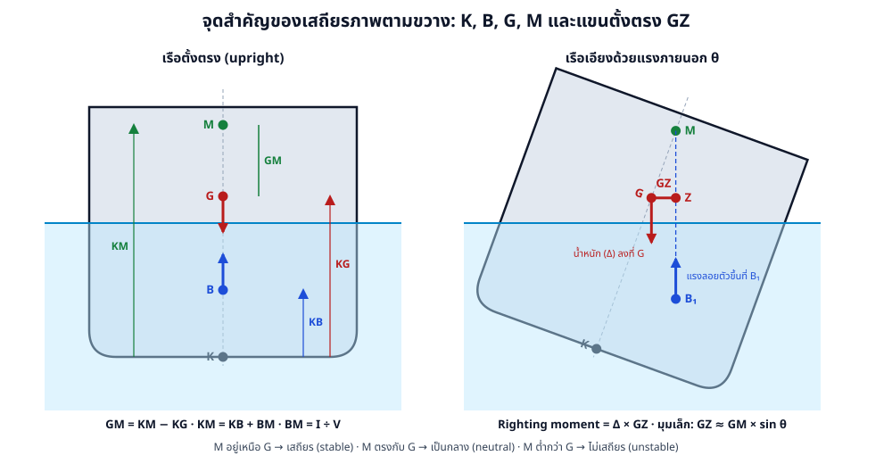
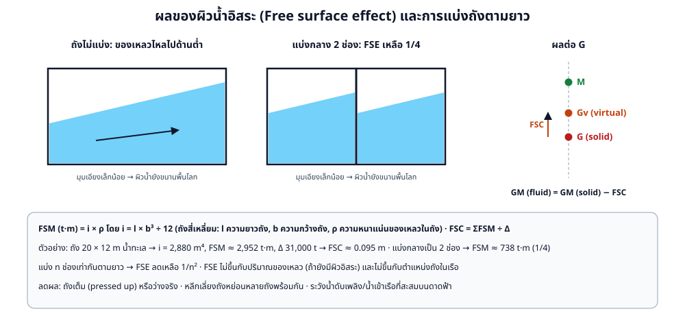
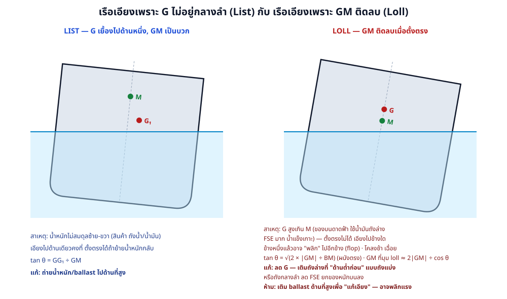
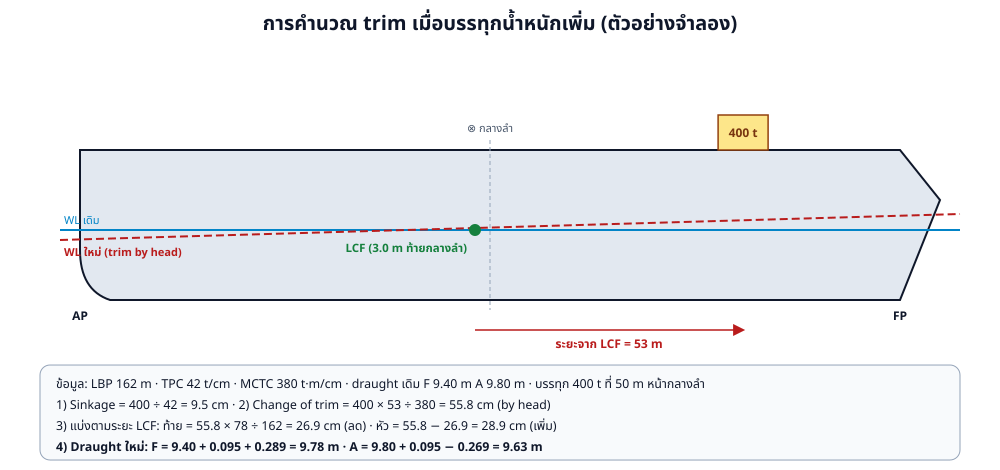
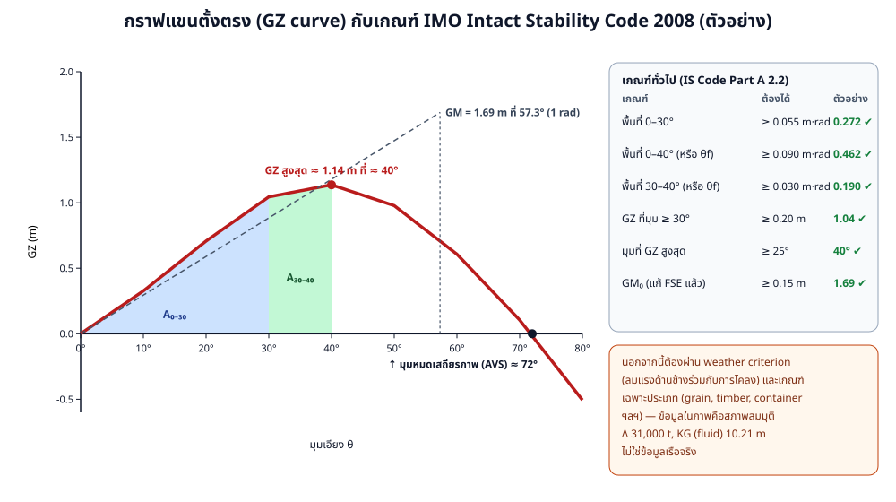
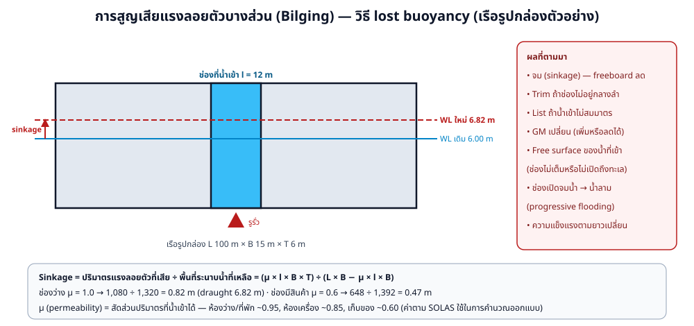
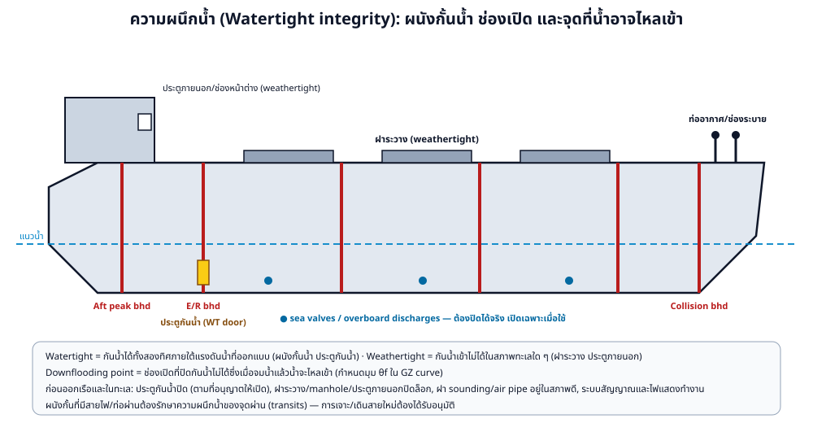
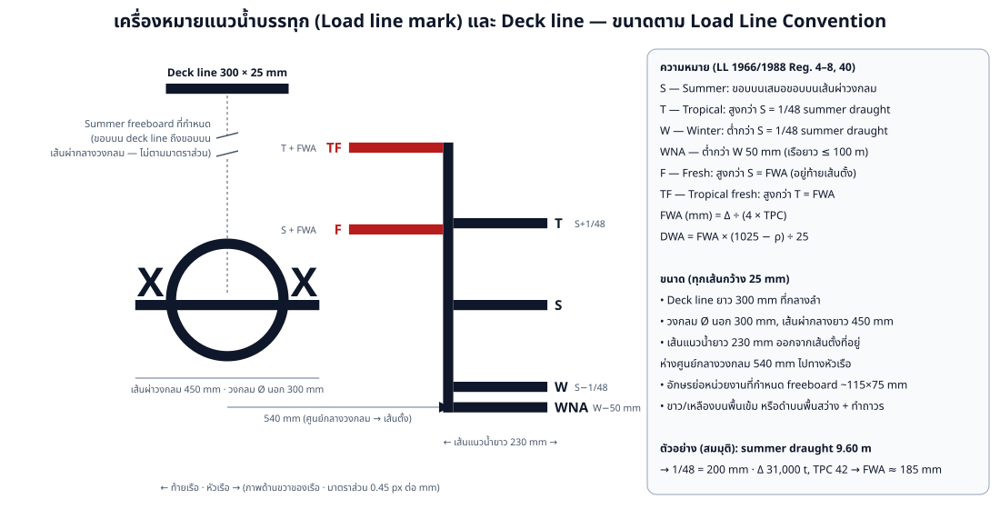

# 3.2.1 Maintain Seaworthiness of the Ship — เสถียรภาพของเรือ (Ship Stability)

> สมุดบันทึกการฝึก OOW · TIRAPHONG NANTAPAN
> Function 3: **Controlling the operation of the ship and care for persons on board at the operational level**
> สมรรถนะตาม STCW A-II/1: *Maintain seaworthiness of the ship* — Ship stability:
> - Working knowledge and application of stability, trim and stress tables, diagrams and stress-calculating equipment
> - Understanding of fundamental actions to be taken in the event of partial loss of intact buoyancy
> - Understanding of the fundamentals of watertight integrity
>
> เกณฑ์ประเมิน: *The stability conditions comply with the IMO intact stability criteria under all conditions of loading · Actions to ensure and maintain the watertight integrity of the ship are in accordance with accepted practice*
>
> อ้างอิงหลัก: STCW Code A-II/1; IMO Model Course 7.03; **IMO International Code on Intact Stability, 2008 (2008 IS Code — MSC.267(85) as amended)**; MSC.1/Circ.1627 (Interim Guidelines on the second generation intact stability criteria); SOLAS II-1 (Part B-1 subdivision and damage stability, II-1/5-1 stability information, II-1/19 damage control information, II-1/13-1 และ 24 openings in watertight bulkheads in cargo ships); **International Convention on Load Lines 1966** (และ Protocol 1988); International Grain Code; Timber Deck Cargo Code 2011; MSC/Circ.1229 (Guidelines for the approval of stability instruments) และ MSC.1/Circ.1461 (Guidelines for verification of damage stability requirements for tankers — ทำผ่าน stability instrument เป็นหลัก); D.R. Derrett & C.B. Barrass *Ship Stability for Masters and Mates*; Stability booklet และ loading manual ของเรือ

---

## 0. ทำไมเสถียรภาพคือหัวใจของ "ความพร้อมเดินทะเล"

เรือที่ลอยตรงในท่าไม่ได้แปลว่าปลอดภัย — เรือต้อง **กลับตั้งตรงได้เองเมื่อถูกลม คลื่น หรือแรงภายนอกทำให้เอียง** และต้องมีเสถียรภาพเพียงพอ **ตลอดการเดินทาง** (น้ำมันและน้ำถูกใช้ไป ถังหย่อน น้ำแข็งเกาะ สินค้าบนดาดฟ้าดูดน้ำ) อุบัติเหตุเรือล่มส่วนใหญ่ไม่ได้เกิดจากความไม่รู้สูตร แต่เกิดจาก **การไม่ตรวจ ไม่ตั้งคำถาม และไม่เข้าใจสัญญาณเตือน** เช่นเรือโคลงช้าผิดปกติ เรือเอียงค้างโดยไม่รู้สาเหตุ หรือมีน้ำสะสมบนดาดฟ้าแล้วไม่มีใครสนใจ

OOW ไม่ได้คำนวณสภาพบรรทุกทั้งหมด (งานของต้นเรือ) แต่ต้อง **อ่านและใช้ข้อมูลเสถียรภาพ ตาราง และเครื่องคำนวณได้**, ตรวจว่าสภาพเรือเป็นไปตามเกณฑ์ IMO, รู้ว่า **ทำอะไรก่อนเมื่อเรือเสียแรงลอยตัวบางส่วน (น้ำเข้า)** และ **รักษาความผนึกน้ำ** ทุกวัน

---

## 1. พื้นฐาน: จุดสำคัญและคำศัพท์

*ภาพที่ 3.2.1-1 จุด K, B, G, M และแขนตั้งตรง GZ เมื่อเรือตั้งตรงและเมื่อเอียง*

| สัญลักษณ์/คำ | ความหมาย |
|---|---|
| **Δ (displacement)** | น้ำหนักเรือทั้งหมด = น้ำหนักน้ำที่เรือแทนที่ (Archimedes) |
| **K (keel)** | จุดอ้างอิงที่กระดูกงู ใช้วัดความสูง (KB, KG, KM) |
| **G (centre of gravity)** | จุดที่น้ำหนักทั้งหมดกระทำลงในแนวดิ่ง — **เปลี่ยนเมื่อน้ำหนักบนเรือเปลี่ยน/ย้าย** |
| **B (centre of buoyancy)** | จุดศูนย์กลางของปริมาตรใต้น้ำ — แรงลอยตัวกระทำขึ้นในแนวดิ่ง — **เปลี่ยนเมื่อเรือเอียงหรือกินน้ำเปลี่ยน** |
| **M (transverse metacentre)** | จุดตัดของแนวแรงลอยตัวเมื่อเรือเอียงมุมเล็กกับแนวกลางลำ — ใช้ได้สำหรับมุมเล็ก (ประมาณไม่เกิน 10–15°) |
| **KB, BM, KM** | KM = KB + BM; **BM = I ÷ V** (I = moment of inertia ของระนาบน้ำ, V = ปริมาตรแทนที่) — KM อ่านจาก hydrostatic tables ตาม draught |
| **KG** | หาจากการคำนวณโมเมนต์ (ข้อ 2) |
| **GM (metacentric height)** | **GM = KM − KG** — ตัวชี้วัดเสถียรภาพเริ่มต้น (initial stability) |
| **GZ (righting lever)** | ระยะแนวราบระหว่างแนวน้ำหนัก (ผ่าน G) กับแนวแรงลอยตัว (ผ่าน B₁) เมื่อเรือเอียง |
| **Righting moment** | **Δ × GZ** — โมเมนต์ที่ทำให้เรือกลับตั้งตรง; มุมเล็ก **GZ ≈ GM × sin θ** |
| **KN (cross curves)** | ระยะจาก K ถึงแนวแรงลอยตัวเมื่อเอียง (อ่านจาก cross curves/KN tables) → **GZ = KN − KG × sin θ** |
| **TPC, MCTC, LCF, LCB, LCG** | ใช้ในการคำนวณ draught และ trim (ข้อ 4) |

**สภาวะสมดุล**
- **Stable** — M อยู่เหนือ G (GM บวก) → เกิด righting moment
- **Neutral** — M ตรงกับ G (GM = 0) → เรืออยู่นิ่งที่มุมใดก็ได้ ไม่มีแรงคืนตัว
- **Unstable** — M อยู่ต่ำกว่า G (GM ลบ) → เรือเอียงต่อไปจนถึงมุมที่ B เลื่อนพอให้ GZ = 0 (**angle of loll**) หรือล่ม

**GM มากเกินไปหรือน้อยเกินไป**
- **GM น้อย (tender)** — โคลงช้า มุมโคลงมาก คืนตัวช้า เสี่ยงล่มจากลม/สินค้าเลื่อน/น้ำเข้า
- **GM มาก (stiff)** — โคลงเร็วและแรง แรงเร่งสูง สินค้าและ lashing รับแรงมาก คนบาดเจ็บ โครงสร้างล้า
- **ประมาณ GM จากคาบการโคลง (rolling period)**: **T ≈ C × B ÷ √GM** (C ≈ 0.7–0.8 ขึ้นกับเรือ — ดูค่าที่ stability booklet ให้) — ตัวอย่าง Andaman Pearl B 27.3 m GM 1.69 m → T ≈ 0.8 × 27.3 ÷ 1.30 ≈ **16.8 วินาที**; ถ้าวัดได้นานขึ้นมากระหว่างทางโดยไม่มีเหตุ แปลว่า GM ลดลง — เตือนให้ตรวจถังหย่อน น้ำบนดาดฟ้า น้ำแข็ง สินค้าเลื่อน
  - สูตรใน IS Code 2008 (weather criterion) เขียนเป็น **T = 2 × C × B ÷ √GM** โดย **C = 0.373 + 0.023 (B/d) − 0.043 (L_WL/100)** — ลองแทนค่า Andaman Pearl (B 27.3 m, d 9.6 m, L_WL ≈ 165 m สมมุติ): C ≈ 0.368 → 2C ≈ 0.74 → T ≈ 0.74 × 27.3 ÷ 1.30 ≈ **15.4 วินาที** ต่างจาก 16.8 วินาทีข้างบนเพราะค่าคงที่ต่างกัน — สรุปว่าสูตรนี้ใช้ดู **แนวโน้ม** (เทียบกับค่าที่เรือเคยวัดได้ในสภาพคล้ายกัน) ไม่ใช่ใช้แทนการคำนวณ
  - กลับสูตร: GM ≈ (C × B ÷ T)² — ถ้าวัดคาบได้ 19 วินาที (C 0.8) → GM ≈ (0.8 × 27.3 ÷ 19)² ≈ **1.32 m** ลดลงจาก 1.69 m — ต้องหาสาเหตุ

---

## 2. การหา KG และผลของผิวน้ำอิสระ

### 2.1 ตารางโมเมนต์ (Loading table)

KG = ผลรวมโมเมนต์แนวตั้ง (น้ำหนัก × Kg ของแต่ละรายการ) ÷ ผลรวมน้ำหนัก

**ตัวอย่างจำลอง — MV Andaman Pearl สภาพออกจากแหลมฉบัง (ค่าสมมุติ)**

| รายการ | น้ำหนัก (t) | Kg (m) | โมเมนต์ (t·m) |
|---|---:|---:|---:|
| Lightship | 8,600 | 10.20 | 87,720 |
| ตู้ในระวาง | 10,600 | 7.20 | 76,320 |
| ตู้บนดาดฟ้า | 6,800 | 20.50 | 139,400 |
| Fuel oil (ถัง double bottom) | 1,500 | 1.60 | 2,400 |
| Diesel oil | 150 | 2.00 | 300 |
| Fresh water | 250 | 5.00 | 1,250 |
| Ballast water | 2,800 | 1.20 | 3,360 |
| Stores/crew/constant | 300 | 12.00 | 3,600 |
| **รวม** | **31,000** | | **314,350** |

- **KG (solid)** = 314,350 ÷ 31,000 = **10.14 m**
- KM จาก hydrostatic tables ที่ draught 9.6 m (สมมุติ) = **11.90 m** → **GM (solid) = 1.76 m**
- ผลรวม free surface moments ของถังที่ไม่เต็ม (จากตารางถัง) ΣFSM = 2,200 t·m → **FSC = 2,200 ÷ 31,000 = 0.07 m**
- **GM (fluid) = 1.76 − 0.07 = 1.69 m** — ค่านี้คือค่าที่ใช้เทียบเกณฑ์

### 2.2 ผลของผิวน้ำอิสระ (Free surface effect)

*ภาพที่ 3.2.1-2 Free surface effect การยกตัวเสมือนของ G และผลของการแบ่งถังตามยาว*

- เมื่อเรือเอียง ของเหลวในถังที่ไม่เต็มไหลไปด้านต่ำ ทำให้จุดศูนย์ถ่วงของของเหลวเลื่อนไปทางที่เรือเอียง — ผลเหมือน **G ของเรือยกขึ้น (virtual rise of G)** → GM ลดลง
- **FSM (t·m) = i × ρ** โดย i ของถังสี่เหลี่ยม = **l × b³ ÷ 12** และ **FSC = ΣFSM ÷ Δ**
- **ตัวอย่าง**: ถัง 20 × 12 m น้ำทะเล → i = 20 × 12³ ÷ 12 = 2,880 m⁴ → FSM ≈ 2,952 t·m → FSC ≈ 0.095 m (สำหรับ Δ 31,000 t)
- **ความกว้างถังมีผลยกกำลังสาม** — แบ่งถังด้วยผนังตามยาวเป็น n ช่องเท่ากัน FSE เหลือ **1/n²** (แบ่ง 2 ช่อง → 1/4 = 738 t·m)
- FSE **ไม่ขึ้นกับปริมาณของเหลว** (ตราบที่ยังมีผิวอิสระ) และ **ไม่ขึ้นกับตำแหน่งถังในเรือ** (ถังล่างหรือบนก็ให้ FSE เท่ากัน)
- **การลดผล**: เติมถังให้เต็ม (pressed up) หรือว่างจริง, หลีกเลี่ยงถังหย่อนหลายถังพร้อมกัน, ใช้ถังแคบ/แบ่งช่อง, ระวังน้ำที่สะสมจากการดับเพลิง/น้ำเข้า/น้ำบนดาดฟ้า (FSE ขนาดใหญ่มากเพราะกว้างเต็มลำ)
- ในการ **เปลี่ยนถัง ballast/น้ำมันระหว่างทาง** OOW ควรรู้ว่ามีถังหย่อนอะไรบ้าง และสอดคล้องกับการคำนวณของต้นเรือ

---

## 3. การย้าย เพิ่ม และลดน้ำหนัก — มุมเอียง (List)

- **ย้ายน้ำหนัก w ไประยะ d**: G เคลื่อนขนานกับทิศการย้าย **GG₁ = w × d ÷ Δ**
- **เพิ่มน้ำหนัก**: G เคลื่อนเข้าหาตำแหน่งน้ำหนักที่เพิ่ม; **ลดน้ำหนัก**: G เคลื่อนออกจากตำแหน่งน้ำหนักที่เอาออก — คำนวณด้วยตารางโมเมนต์ทั้งแนวตั้ง (KG) และแนวขวาง (TCG)
- **มุมเอียงจากน้ำหนักไม่สมดุล (list)**: **tan θ = GG₁(ตามขวาง) ÷ GM**
- **ตัวอย่าง — แก้มุมเอียง**: ระหว่างขนถ่าย เรือเอียงซ้าย 2° (GM fluid 1.69 m, Δ 31,000 t) → GG₁ = tan 2° × 1.69 ≈ 0.059 m → โมเมนต์ที่ต้องแก้ ≈ 0.059 × 31,000 ≈ 1,830 t·m → ถ่ายน้ำอับเฉาจากถังซ้ายไปถังขวาที่ห่างกัน 22 m ≈ **83 ตัน**
- **Suspended weight** — ของที่แขวนอยู่ (เช่นของบนปั้นจั่น) กระทำที่จุดแขวน (ดู heavy lift ใน 2.1)
- **การใช้น้ำมัน/น้ำจากถังล่างระหว่างทาง** → G สูงขึ้นทีละน้อย (เอาน้ำหนักต่ำออก) + FSE → GM ช่วงท้ายการเดินทางต่ำสุด — **ต้องตรวจสภาพ "arrival" ด้วยเสมอ**

### 3.1 List กับ Loll — ต้องแยกให้ออก (คำถามสอบยอดนิยม)

*ภาพที่ 3.2.1-3 เรือเอียงเพราะน้ำหนักไม่สมดุล (list) เทียบกับเรือเอียงเพราะ GM ติดลบ (loll)*

| | List | Loll |
|---|---|---|
| สาเหตุ | G เยื้องจากแนวกลางลำ (น้ำหนักซ้าย-ขวาไม่เท่ากัน) | G สูงกว่า M เมื่อตั้งตรง (GM ติดลบ) |
| อาการ | เอียงไปด้านเดียวคงที่ | ตั้งตรงไม่ได้ เอียงข้างใดข้างหนึ่ง อาจ "พลิก" (flop) ไปอีกข้างเมื่อถูกลม/คลื่น โคลงช้าเฉื่อยรอบมุมเอียง |
| GM ที่มุมเอียง | บวก | ที่มุม loll เรืออยู่ในสมดุลชั่วคราว (เสถียรภาพน้อยมาก) |
| คำนวณ | tan θ = GG₁ ÷ GM | tan θ = √(2 × \|GM\| ÷ BM) (ใช้ขนาดของ GM ที่ติดลบ, สูตรเรือผนังตรง — BM คือ BM ตอนตั้งตรง) — เช่น GM −0.10 m, BM 6.0 m → tan θ = √(0.2 ÷ 6) = 0.183 → θ ≈ 10.3°; GM ที่มุม loll ≈ 2 × \|GM\| ÷ cos θ = 0.2 ÷ 0.984 ≈ 0.20 m (บวกแต่เล็กมาก) |
| แก้ไข | ย้ายน้ำหนักไปด้านที่สูง | **ลด G**: เติมถังล่างที่แบ่งช่อง **เริ่มจากด้านที่ต่ำก่อน** (หรือถังกลางลำ) ลด FSE ลดน้ำหนักบนที่สูง — **ห้ามเติม ballast ด้านที่สูงเพื่อ "แก้เอียง"** เพราะอาจทำให้เรือพลิกไปอีกข้างอย่างรุนแรง |

**วิธีแยกในทางปฏิบัติ**: ตรวจตารางโมเมนต์/loading computer ว่ามีน้ำหนักไม่สมดุลหรือไม่, ดูว่าช่วงเวลาที่ผ่านมามีอะไรที่ทำให้ G สูงขึ้น (ใช้น้ำมันถังล่าง ถังหย่อน น้ำแข็ง น้ำบนดาดฟ้า), สังเกตอาการโคลง (เรือ loll โคลงช้า "ค้าง" ที่มุมเอียง และอาจพลิกข้าง)

---

## 4. Trim และ draught

*ภาพที่ 3.2.1-4 ตัวอย่างการคำนวณ trim เมื่อบรรทุกน้ำหนักเพิ่ม*

- **Trim** = draught ท้าย − draught หัว (trim by stern เมื่อท้ายลึกกว่า)
- **LCF (longitudinal centre of flotation)** — จุดศูนย์กลางพื้นที่ระนาบน้ำ เรือ "หมุน" รอบจุดนี้เมื่อ trim เปลี่ยน
- **MCTC (moment to change trim 1 cm)** — โมเมนต์ที่ทำให้ trim เปลี่ยน 1 cm
- **ขั้นตอนเมื่อบรรทุก/ขนน้ำหนัก w**:
  1. **Sinkage/rise** (เปลี่ยนเท่ากันทั้งลำ) = w ÷ TPC (cm)
  2. **Change of trim** = w × ระยะจาก LCF ÷ MCTC (cm)
  3. **แบ่ง change of trim**: ท้าย = change of trim × (ระยะ LCF ถึง AP ÷ LBP), หัว = ส่วนที่เหลือ
  4. draught ใหม่ = draught เดิม ± sinkage ± การเปลี่ยนแปลงที่หัว/ท้าย
- **ตัวอย่าง**: LBP 162 m, TPC 42, MCTC 380, LCF 3.0 m ท้ายกลางลำ, draught เดิม F 9.40 / A 9.80 m, บรรทุก 400 t ที่ 50 m หน้ากลางลำ → sinkage 9.5 cm, change of trim 55.8 cm (by head), ท้ายลด 26.9 cm หัวเพิ่ม 28.9 cm → **F 9.78 m / A 9.63 m**
- **True mean draught** — ค่ากลางที่แก้ผลของ LCF ไม่อยู่กลางลำ และการอ่าน draught mark ที่ไม่ได้อยู่ที่ perpendicular (ใช้ใน draught survey)
  - สูตร: **draught ที่ LCF = draught ท้าย + (draught หัว − draught ท้าย) × (ระยะ LCF ถึง AP ÷ LBP)**
  - ตรวจตัวอย่างข้างบน: ก่อนบรรทุก 9.80 + (9.40 − 9.80) × 78/162 = **9.607 m**; หลังบรรทุก 9.627 + (9.785 − 9.627) × 78/162 = **9.703 m** → ต่างกัน 9.6 cm เท่ากับ sinkage 9.5 cm (ปัดเศษ) — แปลว่าคำนวณถูก เพราะการเปลี่ยน trim หมุนรอบ LCF จึงไม่เปลี่ยนกินน้ำที่ LCF (จดไว้ใช้ตรวจคำตอบตัวเอง)
- **Hog/sag จาก draught**: ถ้า draught กลางลำ (เฉลี่ย P/S) **น้อยกว่า** ค่าเฉลี่ยหัว-ท้าย → hogging; **มากกว่า** → sagging — ตรวจระหว่างขนถ่ายเทียบกับ loading computer

---

## 5. เสถียรภาพที่มุมเอียงมาก — GZ curve

*ภาพที่ 3.2.1-5 GZ curve ตัวอย่างและการตรวจเกณฑ์ IMO (สภาพสมมุติ)*

**การสร้าง GZ curve**: อ่าน KN จาก cross curves ที่ displacement ของเรือ แล้ว **GZ = KN − KG(fluid) × sin θ** ที่แต่ละมุม

**ตัวอย่าง (ค่าสมมุติ KG fluid 10.21 m)**

| θ | 0° | 10° | 20° | 30° | 40° | 50° | 60° | 70° | 80° |
|---|---|---|---|---|---|---|---|---|---|
| KN (m) | 0 | 2.10 | 4.20 | 6.15 | 7.70 | 8.80 | 9.45 | 9.70 | 9.55 |
| KG sin θ | 0 | 1.77 | 3.49 | 5.11 | 6.56 | 7.82 | 8.84 | 9.59 | 10.06 |
| **GZ (m)** | 0 | **0.33** | **0.71** | **1.04** | **1.14** | **0.98** | **0.61** | **0.11** | **−0.51** |

**สิ่งที่อ่านได้จาก GZ curve**
- **ความชันที่จุดเริ่มต้น** — ลากเส้นสัมผัสจากจุดเริ่มต้นไปที่มุม 57.3° (1 rad) จะได้ความสูงเท่ากับ GM (ใช้ตรวจความถูกต้องของกราฟ)
- **GZ สูงสุดและมุมที่เกิด** — ตัวอย่าง ≈ 1.14 m ที่ ≈ 40°
- **Range of stability / angle of vanishing stability** — มุมที่ GZ กลับเป็นศูนย์ ≈ 72°
- **พื้นที่ใต้กราฟ (dynamic stability)** — พลังงานที่เรือต้านการเอียงได้ (m·rad × Δ)
- **มุมที่ขอบดาดฟ้าจมน้ำ (deck edge immersion)** — มักใกล้มุมที่ความชันของกราฟเริ่มลด (จุดเปลี่ยนเว้า — point of contraflexure)
- **Angle of flooding (θf)** — มุมที่ช่องเปิดที่ปิดกันน้ำไม่ได้จมน้ำ (downflooding) — การคิดพื้นที่ใต้กราฟจะตัดที่มุมนี้ถ้าน้อยกว่า 40°

### 5.1 เกณฑ์เสถียรภาพสภาพสมบูรณ์ของ IMO (2008 IS Code, Part A)

**เกณฑ์ทั่วไป (2.2) — เรือสินค้าและเรือโดยสาร**
1. พื้นที่ใต้ GZ curve **0–30° ≥ 0.055 m·rad**
2. พื้นที่ **0–40° (หรือ 0–θf ถ้าน้อยกว่า) ≥ 0.09 m·rad**
3. พื้นที่ **30–40° (หรือ 30–θf) ≥ 0.03 m·rad**
4. **GZ ≥ 0.20 m ที่มุมเอียงตั้งแต่ 30° ขึ้นไป**
5. **GZ สูงสุดควรเกิดที่มุมเกิน 30° แต่ไม่น้อยกว่า 25°**
6. **GM เริ่มต้น (หลังแก้ free surface) ≥ 0.15 m**

ตัวอย่างข้างต้น: 0.272 / 0.462 / 0.190 m·rad, GZ(30°) 1.04 m, GZ สูงสุดที่ 40°, GM 1.69 m — **ผ่านทุกข้อ**

**การหาพื้นที่ใต้กราฟด้วยกฎของซิมป์สัน (Simpson's rules) — วิธีที่ใช้ในเอกสารเสถียรภาพ**
- ค่าข้างบน (0.272 / 0.462 / 0.190) คิดแบบเส้นตรงต่อจุดทุก 10° (trapezoidal) — ถ้าใช้ Simpson จะได้ค่าใกล้เคียงแต่ละเอียดกว่า เพราะกราฟจริงโค้ง
- แปลงช่วงมุมเป็นเรเดียนก่อนเสมอ: h = 10° = 0.1745 rad
- **0–40° (Simpson's first rule, 4 ช่วง)**: A = h/3 × (y₀ + 4y₁ + 2y₂ + 4y₃ + y₄) = 0.0582 × (0 + 4×0.327 + 2×0.708 + 4×1.045 + 1.137) = 0.0582 × 8.04 ≈ **0.468 m·rad**
- **0–30° (Simpson's second rule, 3 ช่วง)**: A = 3h/8 × (y₀ + 3y₁ + 3y₂ + y₃) = 0.0654 × (0 + 0.981 + 2.124 + 1.045) ≈ **0.272 m·rad**
- **30–40°** = 0.468 − 0.272 ≈ **0.196 m·rad**
- ผลต่างจากวิธีเส้นตรงเล็กน้อย และ **ผ่านเกณฑ์ทั้งสองวิธี** — ในงานจริงใช้ค่าจาก loading computer หรือ stability booklet ที่อนุมัติ; จดไว้: ลืมแปลงเป็นเรเดียนคือข้อผิดพลาดที่พบบ่อยที่สุดในห้องสอบ (ถ้าใช้องศาจะได้ตัวเลขใหญ่กว่า 57.3 เท่า)

**เกณฑ์ลมแรงและการโคลง (Severe wind and rolling criterion — weather criterion, 2.3)** — เรือต้องทนลมแรงด้านข้างคงที่ร่วมกับลมกระโชกขณะโคลง: มุมเอียงจากลมคงที่ (θ₀) **ไม่เกิน 16° หรือ 80% ของมุมที่ขอบดาดฟ้าจมน้ำ (ค่าที่น้อยกว่า)** และพื้นที่ "b" (พลังงานคืนตัว) ต้อง **ไม่น้อยกว่า** พื้นที่ "a" (พลังงานจากลมกระโชกเมื่อเรือโคลงไปทางลม) — คำนวณโดย stability booklet/loading computer
- ลำดับความคิดของเกณฑ์ (สรุปด้วยคำของผม): (1) ลมคงที่ทำให้เกิดแขนเอียง **lw1** ซึ่งแปรตามแรงดันลม (IS Code ใช้ 504 N/m²) × พื้นที่รับลมด้านข้าง × ความสูงของจุดศูนย์กลางแรงลมเหนือจุดศูนย์กลางแรงต้านใต้น้ำ ÷ Δ → เรือเอียงค้างที่ θ₀; (2) จากนั้นคลื่นทำให้เรือโคลงจาก θ₀ ไปทางต้นลมอีกเป็นมุม **θ₁** (คำนวณจากรูปทรงเรือ bilge keel และคาบโคลง) คือไปถึงมุม θ₀ − θ₁; (3) ลมกระโชกเพิ่มแขนเอียงเป็น **lw2 = 1.5 × lw1**; (4) พื้นที่ a = พลังงานส่วนที่แขนเอียง lw2 มากกว่า GZ ตั้งแต่มุม θ₀ − θ₁ ถึงจุดตัดแรกของ lw2 กับ GZ, พื้นที่ b = พลังงานคืนตัวที่เหลือจากจุดตัดถึงมุม θ₂ (ค่าน้อยสุดของ 50°, θf หรือมุมที่ lw2 ตัด GZ ครั้งที่สอง) — ต้องได้ b ≥ a
- ความหมายทางปฏิบัติ: เรือที่ **พื้นที่รับลมสูงมาก** (ตู้สินค้าหลายชั้น รถ ไม้บนดาดฟ้า) มักติดเกณฑ์นี้ก่อนเกณฑ์ทั่วไป — loading computer ของเรือคอนเทนเนอร์จึงคิดพื้นที่รับลมตามจำนวนชั้นตู้จริง

**เกณฑ์เฉพาะ** — เรือบรรทุกเมล็ดพืช (Grain Code: มุมเอียงจากการเลื่อน ≤ 12° หรือมุมที่ขอบดาดฟ้าจมน้ำถ้าน้อยกว่า (เรือสร้างตั้งแต่ 1 ม.ค. 1994), residual area ระหว่างเส้น heeling arm กับ GZ จนถึงมุมที่ห่างกันมากที่สุด 40° หรือ θf (ค่าน้อยสุด) ≥ 0.075 m·rad, GM เริ่มต้นหลังแก้ FSE ≥ 0.30 m — ดู 2.1), เรือบรรทุกไม้บนดาดฟ้า, เรือ container (เกณฑ์ทางเลือกใน IS Code Part B), เรือโดยสาร (มุมเอียงจากผู้โดยสารรวมกันข้างเดียวและจากการเลี้ยว), เรือประมง ฯลฯ — และ **Second generation intact stability criteria** (MSC.1/Circ.1627) ซึ่งเป็นแนวทางชั่วคราวเกี่ยวกับ parametric rolling, pure loss of stability, surf-riding/broaching, dead ship condition, excessive acceleration

### 5.2 ข้อมูลเสถียรภาพบนเรือ

- **Stability booklet (Trim and stability booklet)** — ได้รับอนุมัติ มีข้อมูล lightship, hydrostatic tables, cross curves (KN), tank tables (ปริมาตร Kg FSM), สภาพบรรทุกตัวอย่าง (loading conditions), เกณฑ์, ขีดจำกัด (เช่น KG สูงสุดที่ยอมให้ — **maximum permissible KG / minimum GM curves**) — SOLAS II-1/5-1 กำหนดให้นายเรือได้รับข้อมูลเพียงพอ
- **Loading instrument / stability computer** — ต้องเป็นแบบที่ได้รับการอนุมัติ (MSC/Circ.1229; tanker ต้องมีความสามารถคำนวณเสถียรภาพสภาพสมบูรณ์และเสียหายตาม MSC.1/Circ.1461) — **ทดสอบความถูกต้องตามรอบ** ด้วย test conditions ที่อนุมัติ (เช่นทุกครั้งที่ annual survey และตามที่บริษัทกำหนด)
- **Lightship และ constant** — เมื่อมีการดัดแปลงเรือ lightship เปลี่ยน; "constant" (น้ำหนักที่ไม่รู้ที่มา เช่นตะกอน อะไหล่) ประเมินจาก draught survey
- **Inclining experiment** — การทดลองหา lightship KG โดยย้ายน้ำหนักทดสอบและวัดมุมเอียง (ทำเมื่อเรือสร้างเสร็จหรือดัดแปลงใหญ่)

---

## 6. ตารางความเค้น แผนภาพ และเครื่องคำนวณความเค้น (Stress tables, diagrams and stress-calculating equipment)

- **ความแข็งแรงตามยาว** — น้ำหนักกับแรงลอยตัวกระจายตามยาวไม่เท่ากัน ทำให้เกิด **shear force (SF)** และ **bending moment (BM)** (แนวคิดและภาพใน 2.1 ภาพที่ 2.1-1)
- **Loading manual** — ระบุ **ค่าที่ยอมให้ (permissible SF/BM)** ที่ตำแหน่งตรวจ (frame stations) แยก **ในท่า (harbour)** และ **ในทะเล (seagoing)** สภาพบรรทุกตัวอย่าง และข้อจำกัดอื่น (เช่น local strength, ระวางว่างสลับ — alternate hold loading, ลำดับการขนถ่าย)
- **Loading instrument** แสดงผลเป็น **% ของค่าที่ยอมให้** ในแต่ละจุดตรวจ — ต้องไม่เกิน 100% ทั้งในท่าและในทะเล และตรวจ **ทุกขั้นตอนการขนถ่าย/ถ่าย ballast** ไม่ใช่แค่สภาพสุดท้าย (โดยเฉพาะ bulk carrier ตาม SOLAS XII/11 และ BLU Code)
- **แผนภาพ/ตารางแบบเก่า** — บางเรือมี stress diagram ที่ใช้ "deadweight moment" อ่านค่าเทียบเส้นขีดจำกัด — หลักการเดียวกัน
- **สิ่งที่ OOW ทำ**: รู้ว่าแผนขนถ่ายระบุ % stress แต่ละขั้น, ตรวจ draught จริงเทียบที่คาด (ถ้าต่าง → น้ำหนักจริงต่างจากแผน → stress ต่างด้วย), ตรวจ hog/sag จาก draught, แจ้งต้นเรือทันทีถ้าการขนถ่ายผิดลำดับหรือ ballast ไม่ทัน
- **ในทะเล** — คลื่นที่มีความยาวใกล้เคียงความยาวเรือเพิ่ม BM อย่างมาก (ยอดคลื่นกลางลำ = hogging, ท้องคลื่นกลางลำ = sagging) — การลดความเร็ว/เปลี่ยนเข็มในคลื่นใหญ่ช่วยลด slamming และ stress

> **ตัวอย่างจำลอง: อ่านผล loading instrument ระหว่างขนสินค้าลง — MV Andaman Star (bulk carrier)**
>
> | ขั้นตอน (ตามแผน) | SF สูงสุด (% harbour) | BM สูงสุด (% harbour) | จุดที่สูงสุด | หมายเหตุ |
> |---|---:|---:|---|---|
> | 3: ขน No.3 hold ลง 8,000 t | 71% | 84% (hogging) | Fr. 152 | ปกติ |
> | 4: ขน No.5 hold ลง 6,000 t | 88% | 97% (hogging) | Fr. 140 | ใกล้ขีดจำกัด — ต้องรับ ballast ให้ทันตามแผน |
> | 4 (จริง): ballast No.3 WBT ยังเข้าไม่ทัน | 93% | **106%** (hogging) | Fr. 140 | **เกิน — แจ้งต้นเรือ หยุดขนที่ No.5 ชั่วคราว** |
>
> OOW เห็นว่า draught กลางลำน้อยกว่าค่าเฉลี่ยหัว-ท้ายมากกว่าที่คาด (hog เพิ่ม) จึงตรวจ sounding ถัง ballast พบว่ารับน้ำได้น้อยกว่าแผนเพราะปั๊มทำงานตัวเดียว → แจ้งต้นเรือ ต้นเรือขอให้หยุดขนชั่วคราวจนรับ ballast ได้ตามแผน แล้วคำนวณใหม่ให้ BM กลับมาต่ำกว่า 100% (ค่าในตารางเป็นตัวเลขสมมุติเพื่อฝึกอ่าน — เรือจริงใช้ค่าจาก loading manual และ loading instrument ที่อนุมัติ)

---

## 7. ผลของสภาพต่าง ๆ ต่อเสถียรภาพ (ที่ OOW ต้องเฝ้าระวัง)

| สภาพ | ผล | การป้องกัน/แก้ไข |
|---|---|---|
| **ใช้น้ำมัน/น้ำจากถังล่าง** | G สูงขึ้น + FSE | วางแผนลำดับใช้ถัง ตรวจสภาพ arrival |
| **น้ำแข็งเกาะ (icing)** | น้ำหนักสูงบนเรือ G สูงขึ้น พื้นที่รับลมเพิ่ม | หลีกเลี่ยงพื้นที่/เปลี่ยนเข็มความเร็ว กะเทาะน้ำแข็ง |
| **น้ำขังบนดาดฟ้า/ในพื้นที่ปิด** | น้ำหนักสูง + FSE ขนาดใหญ่ | ระบายน้ำ (freeing ports สะอาด) ปิดช่องเปิด |
| **น้ำดับเพลิง** | น้ำหนักสูง + FSE มาก → อาจล่มขณะดับเพลิง (ดู 3.3) | ระบายน้ำ ใช้น้ำเท่าที่จำเป็น เฝ้ามุมเอียง |
| **สินค้าบนดาดฟ้าดูดน้ำ (ไม้)** | น้ำหนักเพิ่มบนที่สูง | คิดเผื่อในการคำนวณ (Timber Code) |
| **สินค้าเลื่อน/เหลว** | list ถาวร FSE | ยึดสินค้า IMSBC/Grain Code (2.1) |
| **ของแขวน** | G ไปอยู่ที่จุดแขวน | คำนวณ heavy lift (2.1) |
| **เข้าอู่แห้ง (dry-docking)** | ช่วงที่ท้ายแตะ block ก่อน แรงยก P ที่ท้าย ทำให้ GM ลดเสมือน (≈ P × KM ÷ Δ) ช่วง "critical period" | ลด trim ก่อนเข้า กด/ลดถังให้ FSE น้อย GM พอ (งานต้นเรือ) |
| **น้ำเข้าเรือ (flooding)** | ข้อ 8 | ข้อ 8 |

---

## 8. การสูญเสียแรงลอยตัวสภาพสมบูรณ์บางส่วน (Partial loss of intact buoyancy)

### 8.1 เกิดอะไรขึ้นเมื่อช่องหนึ่งมีน้ำเข้า

*ภาพที่ 3.2.1-6 การสูญเสียแรงลอยตัวบางส่วน (bilging) ตัวอย่างเรือรูปกล่องและผลที่ตามมา*

เมื่อเปลือกเรือรั่วและช่องหนึ่งเปิดถึงทะเล ช่องนั้น "หยุดลอย" — เรือต้องจมลงจนได้แรงลอยตัวคืนจากส่วนที่ยังสมบูรณ์ (**lost buoyancy method**); หรือมองอีกแบบคือน้ำที่เข้าเป็นน้ำหนักที่เพิ่ม (**added weight method**) — ทั้งสองวิธีให้ draught สุดท้ายเท่ากัน แต่ GM ที่คำนวณได้มีความหมายต่างกัน (เพราะ Δ ที่ใช้ต่างกัน)

- **Permeability (μ)** — สัดส่วนปริมาตรของช่องที่น้ำเข้าได้จริง (ช่องว่าง/ที่พักประมาณ 0.95, ห้องเครื่องประมาณ 0.85, ช่องเก็บของประมาณ 0.60 — ค่าที่ SOLAS ใช้ในการคำนวณออกแบบ; ระวางสินค้าจริงขึ้นกับชนิดสินค้า)
- **Sinkage** = ปริมาตรแรงลอยตัวที่เสีย ÷ พื้นที่ระนาบน้ำที่เหลือ
- **ตัวอย่าง**: เรือรูปกล่อง 100 × 15 m กินน้ำ 6 m ช่องกลางลำยาว 12 m รั่ว — ช่องว่าง (μ = 1.0) จม 1,080 ÷ 1,320 = **0.82 m**; ถ้ามีสินค้า (μ = 0.6) จม 648 ÷ 1,392 = **0.47 m**
- **ต่อตัวอย่าง — GM เปลี่ยนเท่าไร** (สมมุติ KG 5.20 m, วิธี lost buoyancy: Δ และ KG ไม่เปลี่ยน)
  - ก่อนรั่ว: KB = 3.00 m, BM = B² ÷ (12 d) = 225 ÷ 72 = 3.125 m → KM = 6.125 m → **GM = 0.925 m**
  - ช่องว่างรั่ว (μ = 1.0): d ใหม่ 6.818 m → KB = 3.409 m; I ของระนาบน้ำที่เหลือ = (100 − 12) × 15³ ÷ 12 = 24,750 m⁴, V = 9,000 m³ → BM = 2.750 m → KM = 6.159 m → **GM = 0.959 m** (เพิ่มเล็กน้อย)
  - ช่องมีสินค้า (μ = 0.6): d ใหม่ 6.466 m → KB = 3.233 m; I = 28,125 − 0.6 × (12 × 15³ ÷ 12 = 3,375) = 26,100 m⁴ → BM = 2.900 m → KM = 6.133 m → **GM ≈ 0.933 m**
  - บทเรียน: ช่องกลางลำเต็มความกว้างที่เปิดถึงทะเล KB ที่สูงขึ้นชดเชย BM ที่ลดลงได้ GM จึงไม่ลดในกรณีนี้ — แต่ถ้าน้ำเข้า **ถังข้าง** (ไม่สมมาตร) จะเกิด list และถ้าช่องที่น้ำเข้า **ไม่เปิดถึงทะเล/ไม่เต็ม** จะมี free surface ขนาดใหญ่ที่ทำให้ GM ลดลงมาก — ห้ามสรุปว่า "น้ำเข้าแล้ว GM เพิ่ม" เสมอไป
- **ผลที่ตามมา**: freeboard ลด, **trim** (ถ้าช่องไม่อยู่ที่ LCF), **list** (ถ้าน้ำเข้าไม่สมมาตร เช่นถังข้าง), **GM เปลี่ยน** (อาจเพิ่มหรือลด — ช่องที่ถูกน้ำท่วมแต่ไม่เต็มทำให้เกิด free surface ขนาดใหญ่), **progressive flooding** เมื่อช่องเปิด/ท่อ/ประตูจมน้ำ, **ความแข็งแรงตามยาวเปลี่ยน**, สินค้าที่ดูดน้ำ (เมล็ดพืช) ขยายตัวดันโครงสร้าง
- **SOLAS damage stability** — เรือสินค้าสมัยใหม่ออกแบบด้วยวิธี **probabilistic** (Attained subdivision index A ≥ Required index R — SOLAS II-1 Part B-1) ไม่ได้หมายความว่าทนทุกกรณีน้ำเข้า; เรือ tanker/bulk/เรือโดยสารมีเกณฑ์เฉพาะเพิ่ม (เช่น MARPOL Annex I, ICLL, SOLAS XII สำหรับ bulk carrier ที่บรรทุกสินค้าหนัก)
- **Damage control plan และ booklet (SOLAS II-1/19)** — แผนผังติดถาวรบนสะพานเดินเรือ: ขอบเขตช่องผนึกน้ำ ช่องเปิดและวิธีปิด ตำแหน่งควบคุม ระบบ cross-flooding และคู่มือ (ดู 1.5)

### 8.2 การกระทำพื้นฐานเมื่อเรือเสียแรงลอยตัวบางส่วน (Fundamental actions)

1. **แจ้งเหตุ/เรียกนายเรือ ส่งสัญญาณเตือน** (general alarm ตามสถานการณ์) — ห้องเครื่องพร้อม
2. **ระบุว่าน้ำเข้าช่องไหน เร็วแค่ไหน** — water ingress alarms (bulk carrier — SOLAS XII/12), bilge alarms, **วัด sounding ทุกถังและท้องเรือ (bilges) เป็นระยะ** เทียบกับค่าก่อนเกิดเหตุ, ตรวจ draught/trim/list ที่เปลี่ยน, รายงานจากทีมตรวจความเสียหาย
3. **จำกัดการไหลของน้ำ** — ปิดประตูกันน้ำ (WT doors), ช่องเปิด, วาล์ว, ท่อระบายอากาศที่อาจจมน้ำ — รักษา **ขอบเขตผนึกน้ำ** ของช่องข้างเคียง
4. **สูบน้ำออก** — ระบบ bilge/ballast, emergency bilge suction, ปั๊มเคลื่อนที่ — ประเมินว่าปั๊มทันน้ำเข้าหรือไม่
5. **อุดรอยรั่ว/ค้ำยัน** ถ้าเข้าถึงได้อย่างปลอดภัย (shoring, patching — damage control kit)
6. **ประเมินเสถียรภาพและความแข็งแรง** — loading computer (โมดูล damage stability ถ้ามี), damage stability booklet/ข้อมูลใน damage control booklet, **ติดต่อบริษัทและบริการช่วยเหลือฉุกเฉินจากฝั่ง (shore-based emergency response service ของ class/บริษัท)** — ส่งข้อมูล draught sounding สภาพบรรทุก
7. **ลด free surface และแก้ list/trim อย่างมีเหตุผล** — รู้สาเหตุของการเอียงก่อน (น้ำท่วมไม่สมมาตร? loll?) — การถ่ายน้ำหนักผิดทางอาจทำให้แย่ลง; การถ่ายน้ำเพื่อแก้เอียงจากน้ำท่วมด้านเดียวต้องคิดเสถียรภาพรวม (cross-flooding ถ้ามีระบบ)
8. **ลดภาระ** — ลดความเร็ว/เปลี่ยนเข็มเพื่อลดน้ำเข้าและแรงคลื่น (หันด้านที่เสียหายไว้ใต้ลม), พิจารณาลด G (ย้ายน้ำหนักบนลง)
9. **สื่อสาร** — แจ้งบริษัท (DPA), รัฐชายฝั่ง/MRCC (urgency หรือ distress ตามความรุนแรง — 1.6), เรือใกล้เคียง
10. **เตรียมพร้อมทางเลือกสุดท้าย** — เกยตื้นโดยเจตนา (beaching) ในที่เหมาะสม, เตรียม LSA และ abandon ship
11. **บันทึก** ทุกเวลาและการกระทำ

---

## 9. ความผนึกน้ำ (Watertight integrity) — พื้นฐาน

*ภาพที่ 3.2.1-7 ผนังกั้นน้ำ ประตูกันน้ำ ช่องเปิด weathertight และจุดที่น้ำอาจไหลเข้า*

### 9.1 นิยามและโครงสร้าง

- **Watertight** — กันน้ำผ่านได้ **ทั้งสองทิศทาง** ภายใต้แรงดันน้ำที่ออกแบบ (ผนังกั้นน้ำ ประตูกันน้ำ ดาดฟ้ากันน้ำ)
- **Weathertight** — **กันน้ำไม่ให้เข้าเรือ** ในทุกสภาพทะเล (ฝาระวาง ประตูภายนอก ช่องระบายอากาศ หน้าต่าง/side scuttles พร้อม deadlights)
- **ผนังกั้นน้ำ (watertight bulkheads)** — **collision bulkhead** (ผนังกั้นหน้า — ไม่มีประตู มีข้อจำกัดเรื่องช่องผ่านท่อ), **aft peak bulkhead**, ผนังหัว-ท้ายห้องเครื่อง และผนังกั้นระวาง — แบ่งเรือเป็นช่องเพื่อจำกัดน้ำท่วม
- **Double bottom** — ป้องกันน้ำเข้าเมื่อท้องเรือเสียหาย (เกยตื้น)
- **Load Line Convention** — **เงื่อนไขการกำหนด freeboard (conditions of assignment)**: ฝาระวางและช่องเปิดบนดาดฟ้าต้องแข็งแรงและปิดกันน้ำ ความสูงของขอบ (coamings/sills) ตามตำแหน่ง ท่ออากาศมีอุปกรณ์ปิดอัตโนมัติ ช่องระบายน้ำ (freeing ports) ราวกันตก ทางเดินสำหรับคน — **ตรวจทุกปี (annual load line survey)** ว่าอุปกรณ์เหล่านี้ยังอยู่ในสภาพที่ใช้ได้

*ภาพที่ 3.2.1-8 เครื่องหมายแนวน้ำบรรทุกและ deck line*

- ภาพนี้วาดตามขนาดจริงใน Load Line Convention (วงกลม Ø นอก 300 mm, ทุกเส้นกว้าง 25 mm, เส้นตั้งห่างศูนย์กลางวงกลม 540 mm) — รายละเอียดขนาดดู 3.2.2 ข้อ 2.1; ตัวเลขระยะระหว่างเส้นในภาพคิดจาก summer draught 9.60 m (1/48 = 200 mm) และ FWA = 31,000 ÷ (4 × 42) ≈ 185 mm
- **DWA (dock water allowance)** — เมื่อบรรทุกในน้ำกร่อย ρ = 1.010: DWA = 185 × (1025 − 1010) ÷ 25 ≈ **111 mm** → ให้จมเหนือเส้นของโซนได้ไม่เกิน 111 mm ขณะอยู่ในท่า เพราะเมื่อออกสู่ทะเลเรือจะลอยขึ้นเท่านั้น (ตัวอย่างจำลอง)

### 9.2 อุปกรณ์ปิดและการดูแล

- **ประตูกันน้ำ (WT doors)** — แบบบานพับ (hinged) และแบบเลื่อน (sliding, power-operated) — เรือสินค้า: ประตูในผนังกั้นน้ำต้อง **ปิดในทะเล** เว้นแต่ที่อนุญาตให้เปิดชั่วคราวตามข้อกำหนด มีไฟแสดงสถานะบนสะพานเดินเรือ (สำหรับประตูที่กำหนด) และป้ายเตือน (SOLAS II-1/13-1, 24) — ทดสอบและบันทึกตามรอบ; ห้ามผูก/ค้ำประตูให้เปิด
- **ฝาระวาง** — ดู 2.2
- **ประตูภายนอก (weathertight doors)** — dogs/cleats ครบ ยางไม่เสื่อม บานพับ ระบบล็อก ปิดล็อกเมื่อไม่ใช้งาน โดยเฉพาะในคลื่นลม
- **ท่ออากาศ (air pipes)** — หัวปิดอัตโนมัติแบบลูกลอย (ball/float) ต้องไม่ติด ไม่ผุ ตะแกรงไม่ตัน; **sounding pipes** ปิดฝาเมื่อไม่ใช้
- **ช่องระบายอากาศ (ventilators)** — ฝาปิด/แผ่นปิดใช้งานได้
- **Manholes** ของถังและ void spaces — ปะเก็นและน็อตครบ ปิดหลังตรวจ (ตรวจซ้ำก่อนเติมถัง)
- **Side scuttles และ deadlights** — ปิด deadlights ในคลื่นลมแรงตามข้อกำหนด
- **Sea valves, overboard discharges, storm valves (non-return)** — ใช้งานได้ ปิดได้จริง
- **จุดผ่านผนังกั้นน้ำ (penetrations/transits)** ของสายไฟและท่อ — ต้องรักษาความผนึก (เช่นระบบ MCT) การเจาะใหม่หรือเดินสายใหม่ต้องได้รับอนุมัติและทดสอบ
- **เรือ ro-ro** — ประตูหัว/ท้าย ramp (bow/stern doors) มีไฟแสดงสถานะ CCTV ระบบตรวจรั่ว — ต้องปิดและยืนยันก่อนออกเรือ

### 9.3 แนวปฏิบัติของ OOW

- **ก่อนออกเรือ** — ตรวจตาม checklist ของเรือ: WT doors ปิด, ฝาระวาง/manholes/ประตูภายนอก/ช่องเปิดปิดล็อก, ไฟแสดงสถานะ (indicator panel) ทั้งหมดถูกต้อง, ระบบ bilge/water ingress alarm ทำงาน — บันทึกใน log
- **ในทะเล** — ตรวจรอบ (rounds) ว่าประตูกันน้ำและประตูภายนอกปิด, ก่อนเข้าคลื่นลมแรงปิด deadlights ยึดของ ปิดช่องเปิดเพิ่ม, หลังผ่านคลื่นลมตรวจ sounding และความเสียหาย (2.2)
- **รายงานและบันทึก** อุปกรณ์ปิดที่ชำรุดทันที — เป็นข้อบกพร่องที่ PSC ตรวจเข้มและอาจกักเรือ
- **บทเรียนประวัติศาสตร์**: เรือ ro-ro โดยสาร *Herald of Free Enterprise* (6 มี.ค. 1987) ล่มไม่กี่นาทีหลังออกจากท่า Zeebrugge เพราะออกเรือโดยประตูหัวเรือยังเปิด น้ำทะลักเข้าดาดฟ้ารถ — มีผู้เสียชีวิต 193 คน และเป็นหนึ่งในเหตุผลที่นำไปสู่ **ISM Code**; เรือ *Estonia* (1994) ล่มในทะเลบอลติกหลังฝาหัวเรือ (bow visor) หลุดในคลื่นลมแรง มีผู้เสียชีวิตกว่า 850 คน — ทั้งสองกรณีแสดงว่า **ช่องเปิดเพียงช่องเดียว** ทำให้เรือทั้งลำสูญเสียได้

---

## 10. ตัวอย่างจำลอง: เรือเอียงค้างระหว่างเดินทาง

> 0300 ระหว่างเดินทางในทะเลจีนใต้ คลื่นลมปานกลาง Andaman Pearl เอียงค้างไปทางขวา 3° (ตอนออกจากท่าตั้งตรง) และโคลงช้ากว่าปกติ
> - OOW **ไม่รีบถ่าย ballast** — โทรแจ้งต้นเรือ/นายเรือ และรวบรวมข้อมูล:
>   1. ตรวจ sounding ถังที่มีการใช้/โอนระหว่างทาง — พบว่าห้องเครื่องโอนน้ำมันจากถังข้างซ้ายไปใช้มาตลอดคืน (ถังซ้ายลด ~120 t) → **น้ำหนักไม่สมดุลซ้าย-ขวา** = สาเหตุของ list
>   2. ตรวจ bilge/water ingress alarms และ sounding void spaces — ปกติ (ไม่มีน้ำเข้า)
>   3. ตรวจ loading computer ด้วยค่าปัจจุบัน — GM (fluid) ≈ 1.6 m ยังเป็นบวกมาก (ไม่ใช่ loll); คาบการโคลงที่ยาวขึ้นเล็กน้อยสอดคล้องกับ FSE จากถังที่ใช้
> - ต้นเรือประสานห้องเครื่องให้ใช้/โอนน้ำมันจากถังขวาสลับ และถ่าย ballast เล็กน้อยตามคำนวณ → เรือกลับตั้งตรง
> - **บทเรียน**: ถ้าเป็น loll การ "แก้เอียง" ด้วยการเติมด้านสูงจะอันตราย — ต้องรู้สาเหตุก่อนเสมอ

---

## 11. คำถามสอบปากเปล่า / สัมภาษณ์

**ถาม:** GM คืออะไร หาได้อย่างไร
**แนวตอบ:** ระยะระหว่าง G กับ M (metacentric height) — GM = KM − KG; KM อ่านจาก hydrostatic tables ตาม draught, KG จากตารางโมเมนต์ แล้วหัก FSC ได้ GM (fluid)

**ถาม:** GZ คืออะไร หาจาก KN อย่างไร
**แนวตอบ:** แขนตั้งตรง — ระยะแนวราบระหว่างแนวน้ำหนักผ่าน G กับแนวแรงลอยตัวผ่าน B₁; GZ = KN − KG sin θ; มุมเล็ก GZ ≈ GM sin θ; righting moment = Δ × GZ

**ถาม:** เรือ stiff กับ tender ต่างกันอย่างไร
**แนวตอบ:** Stiff — GM มาก โคลงเร็วแรง แรงเร่งสูง สินค้าเสียหาย; Tender — GM น้อย โคลงช้า มุมโคลงมาก คืนตัวช้า เสี่ยงล่ม

**ถาม:** ประมาณ GM จากคาบการโคลงอย่างไร
**แนวตอบ:** T ≈ C × B ÷ √GM → GM ≈ (C × B ÷ T)² โดย C ประมาณ 0.7–0.8 (ตาม stability booklet) — คาบยาวขึ้นแปลว่า GM ลดลง

**ถาม:** Free surface effect คืออะไร ลดได้อย่างไร
**แนวตอบ:** ของเหลวในถังไม่เต็มไหลไปด้านที่เอียง ทำให้ G ยกขึ้นเสมือน GM ลด — FSM = l b³ ρ ÷ 12, FSC = ΣFSM ÷ Δ — ลดโดยเติมเต็มหรือว่าง หลีกเลี่ยงถังหย่อนหลายถัง แบ่งถังตามยาว (1/n²)

**ถาม:** ทำไมถังกว้างมี FSE มาก
**แนวตอบ:** เพราะ FSM แปรผันตามความกว้างยกกำลังสาม (b³)

**ถาม:** List กับ loll ต่างกันอย่างไร แก้อย่างไร
**แนวตอบ:** List — G เยื้องข้าง GM บวก เอียงด้านเดียวคงที่ แก้โดยย้ายน้ำหนักไปด้านสูง; Loll — GM ติดลบเมื่อตั้งตรง เอียงข้างใดข้างหนึ่งและอาจพลิก โคลงช้า แก้โดยลด G (เติมถังล่างแบ่งช่องเริ่มด้านต่ำ ลด FSE ลดน้ำหนักบน) ห้ามเติมด้านสูง

**ถาม:** เกณฑ์เสถียรภาพทั่วไปของ IS Code 2008 มีอะไรบ้าง
**แนวตอบ:** พื้นที่ 0–30° ≥ 0.055 m·rad, 0–40° (หรือ θf) ≥ 0.09, 30–40° ≥ 0.03, GZ ≥ 0.20 m ที่ ≥ 30°, GZ สูงสุดที่มุม ≥ 25° (ควรเกิน 30°), GM₀ ≥ 0.15 m — และ weather criterion

**ถาม:** Weather criterion ตรวจอะไร
**แนวตอบ:** ความสามารถทนลมแรงด้านข้างคงที่ร่วมกับลมกระโชกขณะโคลง — มุมเอียงจากลมคงที่ไม่เกิน 16° หรือ 80% ของมุมขอบดาดฟ้าจมน้ำ และพื้นที่ b ≥ พื้นที่ a

**ถาม:** จาก GZ curve อ่านอะไรได้บ้าง
**แนวตอบ:** GM (ความชันเริ่มต้น — เส้นสัมผัสที่ 57.3°), GZ สูงสุดและมุมที่เกิด, range of stability/angle of vanishing stability, มุมขอบดาดฟ้าจมน้ำโดยประมาณ, พื้นที่ใต้กราฟ (dynamic stability), angle of flooding

**ถาม:** คำนวณ trim เมื่อเพิ่มน้ำหนักอย่างไร
**แนวตอบ:** Sinkage = w ÷ TPC; change of trim = w × ระยะจาก LCF ÷ MCTC; แบ่งไปท้าย = COT × (LCF ถึง AP ÷ LBP) หัว = ส่วนที่เหลือ; รวมกับ sinkage เป็น draught ใหม่

**ถาม:** ตรวจ hogging/sagging จาก draught อย่างไร
**แนวตอบ:** เทียบ draught กลางลำ (เฉลี่ย P/S) กับค่าเฉลี่ยหัว-ท้าย — กลางลำน้อยกว่า = hogging, มากกว่า = sagging

**ถาม:** Loading instrument ใช้อย่างไร ตรวจความถูกต้องอย่างไร
**แนวตอบ:** ใส่น้ำหนักทุกรายการ ได้ draught, GM, GZ, เกณฑ์, SF/BM เป็น % ของค่าที่ยอมให้ (ท่าและทะเล) ทุกขั้นตอน — ต้องเป็นแบบที่อนุมัติและทดสอบด้วย test conditions ตามรอบ

**ถาม:** เมื่อช่องหนึ่งมีน้ำเข้า เรือเป็นอย่างไร
**แนวตอบ:** จมลง (sinkage = ปริมาตรแรงลอยตัวที่เสีย ÷ พื้นที่ระนาบน้ำที่เหลือ), trim/list เปลี่ยน, GM เปลี่ยน, free surface ของน้ำที่เข้า, อาจเกิด progressive flooding, ความแข็งแรงเปลี่ยน

**ถาม:** Permeability คืออะไร
**แนวตอบ:** สัดส่วนปริมาตรของช่องที่น้ำเข้าได้ — เช่นช่องว่าง ~0.95, ห้องเครื่อง ~0.85, เก็บของ ~0.60

**ถาม:** การกระทำพื้นฐานเมื่อเรือเสียแรงลอยตัวบางส่วน
**แนวตอบ:** แจ้งเหตุ เรียกนายเรือ, ระบุช่องที่น้ำเข้า (sounding, alarms), ปิดประตูกันน้ำและช่องเปิดจำกัดน้ำ, สูบน้ำ, อุด/ค้ำ, ประเมินเสถียรภาพ/ความแข็งแรง (loading computer, damage booklet, ERS ของ class/บริษัท), ลด FSE แก้ list/trim อย่างมีเหตุผล, ลดความเร็ว/เปลี่ยนเข็ม, สื่อสาร MRCC/บริษัท, เตรียม beaching/สละเรือ, บันทึก

**ถาม:** Watertight กับ weathertight ต่างกันอย่างไร
**แนวตอบ:** Watertight — กันน้ำได้ทั้งสองทิศภายใต้แรงดันที่ออกแบบ (ผนังกั้นน้ำ ประตูกันน้ำ); weathertight — กันน้ำเข้าเรือในทุกสภาพทะเล (ฝาระวาง ประตูภายนอก)

**ถาม:** Collision bulkhead คืออะไร
**แนวตอบ:** ผนังกั้นน้ำหน้าสุด ป้องกันน้ำท่วมลามเมื่อหัวเรือเสียหายจากการโดนกัน — ไม่มีประตู จำกัดช่องผ่านท่อ

**ถาม:** ความหมายของเครื่องหมาย load line
**แนวตอบ:** S summer (ระดับเส้นผ่ากลางวงกลม), W = S − 1/48 summer draught, T = S + 1/48, F = S + FWA, TF = T + FWA, WNA = W − 50 mm (เรือ ≤ 100 m) — FWA (mm) = Δ ÷ (4 TPC); เส้น F และ TF อยู่ท้ายเส้นตั้ง ส่วน S T W WNA อยู่หน้าเส้นตั้ง

**ถาม:** ก่อนออกเรือตรวจความผนึกน้ำอะไรบ้าง
**แนวตอบ:** ประตูกันน้ำปิด ไฟแสดงถูกต้อง, ฝาระวาง manholes ประตูภายนอก ช่องเปิดปิดล็อก, ท่ออากาศ/sounding pipes อยู่ในสภาพดี, ro-ro: ประตูหัว/ท้าย ramp ปิดยืนยัน, alarms ทำงาน — บันทึก

**ถาม:** คำนวณพื้นที่ใต้ GZ curve 0–40° ด้วย Simpson's first rule อย่างไร
**แนวตอบ:** ใช้ GZ ทุก 10° (5 ค่า) h = 10° แปลงเป็นเรเดียน 0.1745 → A = h/3 × (y₀ + 4y₁ + 2y₂ + 4y₃ + y₄) — ตัวอย่างในบทได้ประมาณ 0.468 m·rad ≥ 0.09 ผ่าน; ช่วง 3 ช่วงใช้ second rule 3h/8 × (y₀ + 3y₁ + 3y₂ + y₃)

**ถาม:** เรือ loll ด้วย GM −0.10 m BM 6.0 m จะเอียงกี่องศา และ GM ที่มุมนั้นเท่าไร
**แนวตอบ:** tan θ = √(2 × 0.10 ÷ 6.0) = 0.183 → θ ≈ 10.3°; GM ที่มุม loll ≈ 2 × 0.10 ÷ cos θ ≈ 0.20 m — เสถียรภาพน้อยมาก แก้โดยลด G (เติมถังล่างด้านต่ำก่อน) ไม่ใช่เติมด้านสูง

**ถาม:** True mean draught คืออะไร ใช้ตรวจการคำนวณ trim อย่างไร
**แนวตอบ:** กินน้ำที่ตำแหน่ง LCF = draught ท้าย + (หัว − ท้าย) × (LCF ถึง AP ÷ LBP) — การเปลี่ยน trim หมุนรอบ LCF จึงไม่เปลี่ยนค่านี้ ส่วนที่เปลี่ยนต้องเท่ากับ sinkage พอดี ใช้ตรวจคำตอบได้

**ถาม:** Weather criterion ใช้ลมและการโคลงอย่างไร
**แนวตอบ:** ลมคงที่ให้แขนเอียง lw1 (แรงดันลม 504 N/m² ตาม IS Code) เรือเอียงค้างที่ θ₀ ≤ 16° หรือ 80% ของมุมขอบดาดฟ้าจมน้ำ; คลื่นทำให้โคลงไปทางต้นลมอีก θ₁ แล้วลมกระโชก lw2 = 1.5 lw1 — พื้นที่ b (พลังงานคืนตัวถึง θ₂ = ค่าน้อยสุดของ 50°, θf, มุมตัดที่สอง) ต้องไม่น้อยกว่าพื้นที่ a

**ถาม:** DWA คืออะไร คำนวณอย่างไร
**แนวตอบ:** Dock water allowance — ระยะที่ให้เรือจมเกินเส้นแนวน้ำของโซนได้เมื่อบรรทุกในน้ำกร่อย = FWA × (1025 − ρ) ÷ 25 (mm) เช่น FWA 185 mm ρ 1.010 → 111 mm

**ถาม:** loading instrument แสดง BM 106% ระหว่างขนถ่ายในท่า OOW ทำอะไร
**แนวตอบ:** แจ้งต้นเรือทันที เสนอหยุดการขนถ่ายที่ทำให้ค่าเพิ่ม ตรวจ draught และ sounding ถัง ballast เทียบแผน (สาเหตุบ่อยคือ ballast ไม่ทัน) แล้วคำนวณใหม่ให้ต่ำกว่า 100% ก่อนทำงานต่อ — ห้ามเกินค่าที่ยอมให้ทั้งในท่าและในทะเล

**ถาม:** ทำไมน้ำดับเพลิงอาจทำให้เรือล่ม
**แนวตอบ:** น้ำจำนวนมากสะสมบนดาดฟ้าหรือพื้นที่สูง เพิ่มน้ำหนักบนที่สูงและเกิด free surface ขนาดใหญ่ GM ลดจนอาจติดลบ — ต้องระบายน้ำและเฝ้ามุมเอียง

---

*ก่อนหน้า ← [3.1 การป้องกันมลพิษ](3.1-pollution-prevention.md) · ถัดไป → [3.2.2 โครงสร้างเรือ](3.2.2-ship-construction.md)*
