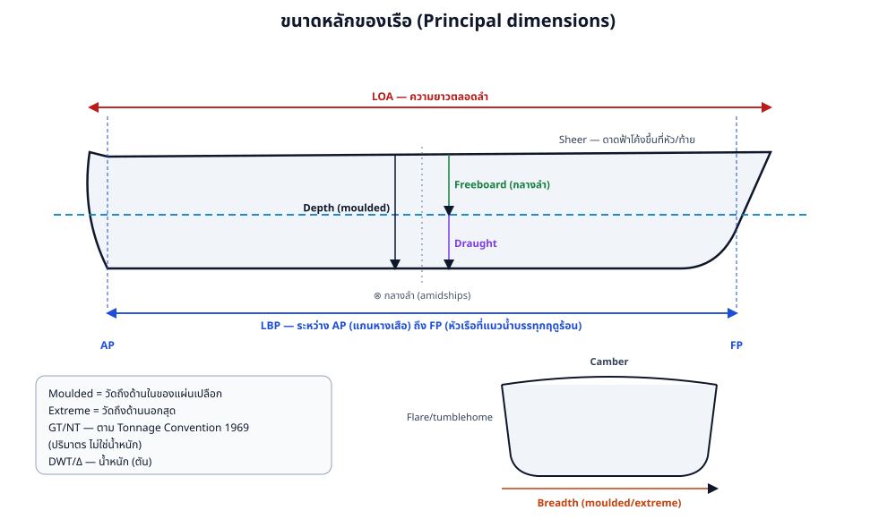
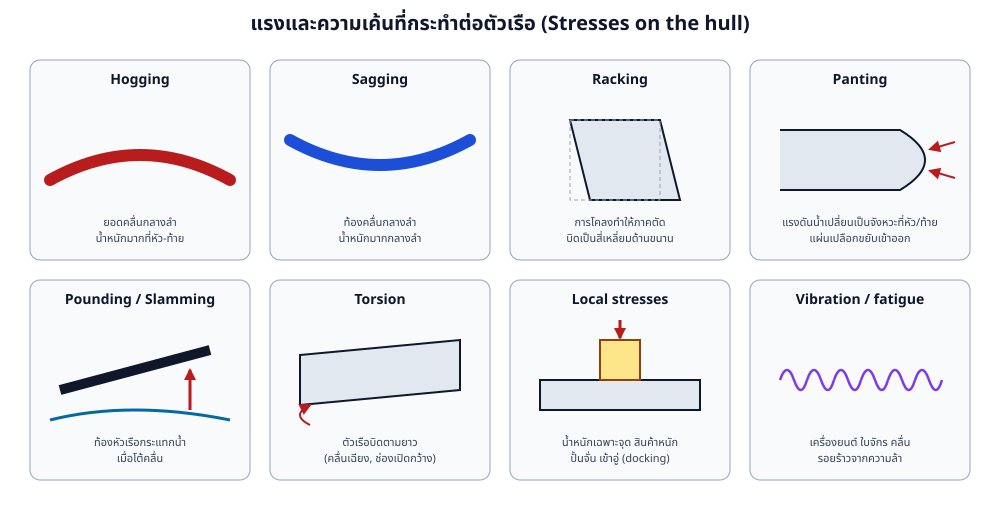
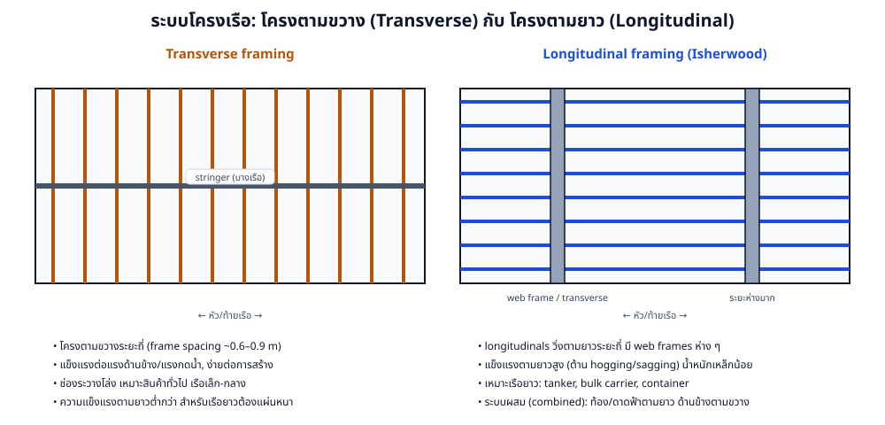
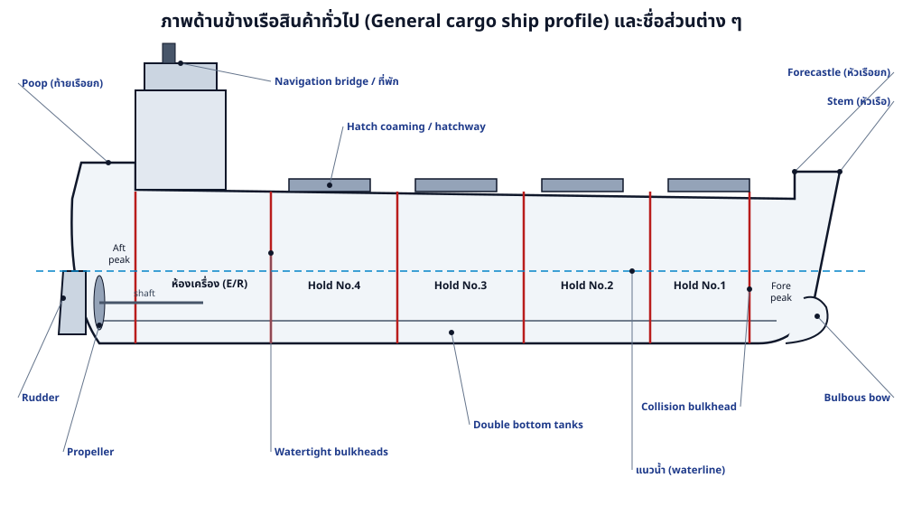
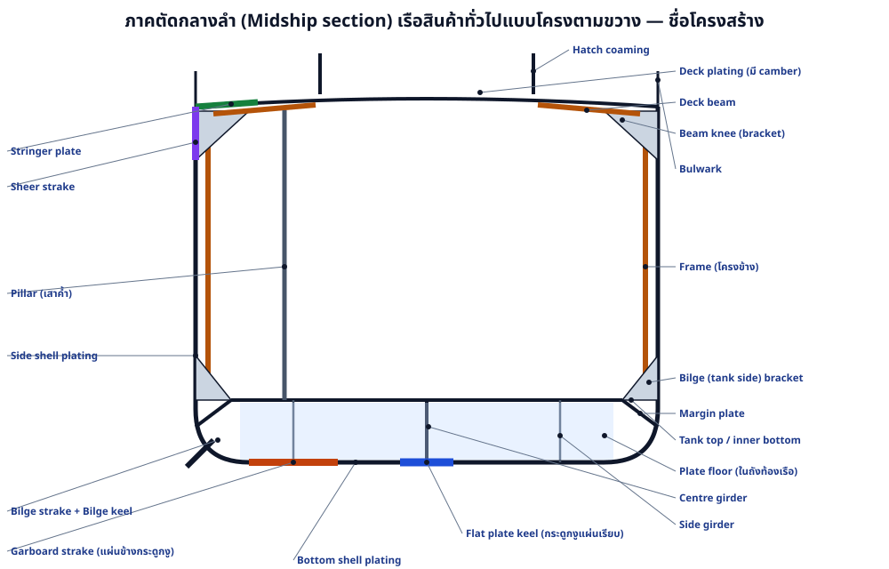
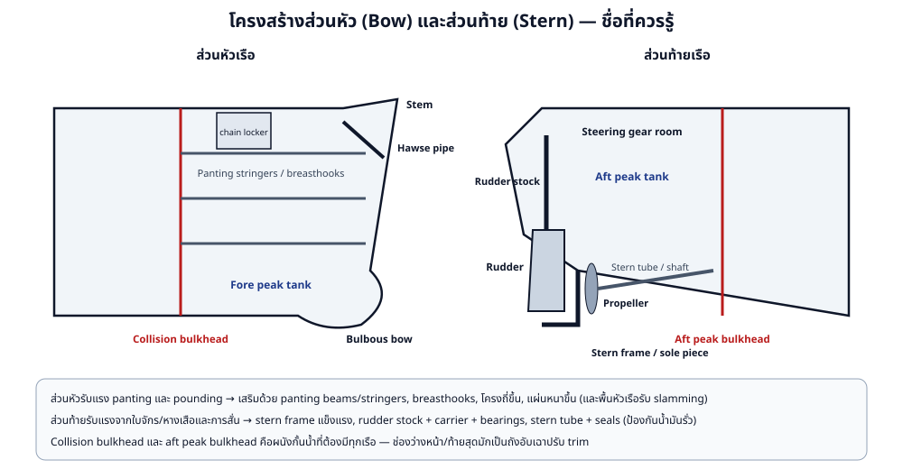
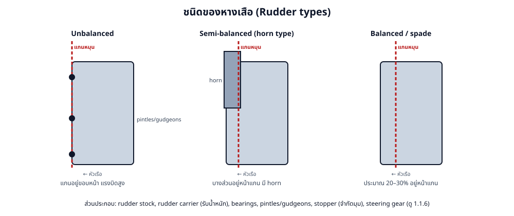

# 3.2.2 Ship Construction — โครงสร้างเรือ

> สมุดบันทึกการฝึก OOW · TIRAPHONG NANTAPAN
> Function 3: **Controlling the operation of the ship and care for persons on board at the operational level**
> สมรรถนะตาม STCW A-II/1: *Maintain seaworthiness of the ship* — Ship construction: *General knowledge of the principal structural members of a ship and the proper names for the various parts*
> เกณฑ์ประเมิน: *Actions to ensure and maintain the watertight integrity of the ship are in accordance with accepted practice* (ร่วมกับ 3.2.1)
>
> อ้างอิงหลัก: IMO Model Course 7.03; SOLAS บทที่ II-1 (โครงสร้าง การแบ่งช่อง เสถียรภาพ เครื่องจักร), II-1/3-10 (Goal-based ship construction standards), II-1/3-6 (means of access), XII (bulk carriers); International Convention on Load Lines 1966/1988; International Convention on Tonnage Measurement of Ships 1969; IACS Unified Requirements และ **Common Structural Rules (CSR) for Bulk Carriers and Oil Tankers**; กฎของสมาคมจัดชั้น; D.J. Eyres & G.J. Bruce *Ship Construction*; *Reed's Ship Construction for Marine Students*; *Admiralty Manual of Seamanship*

---

## 0. ทำไม OOW ต้องรู้ชื่อโครงสร้าง

STCW ใช้คำว่า **"proper names"** — เพราะเมื่อเกิดเหตุ (น้ำเข้า รอยร้าว ไฟไหม้) หรือเมื่อรายงานความเสียหาย (2.2) ต้องบอกได้ชัดว่า **อะไร อยู่ตรงไหน** เช่น "รอยร้าวที่ปลาย bilge bracket ด้านขวา frame 112 ใน No.3 hold" — ไม่ใช่ "เหล็กข้างล่างแตก" การใช้ชื่อถูกต้องทำให้นายเรือ บริษัท และ class เข้าใจตรงกันทันที และทำให้เราเข้าใจว่าทำไมบางจุดจึงสำคัญต่อความปลอดภัย

---

## 1. ชนิดของเรือพาณิชย์ (ภาพรวม)

| ชนิด | ลักษณะเด่นทางโครงสร้าง |
|---|---|
| **General cargo / Multi-purpose (MPP)** | ระวางมี tween deck ปั้นจั่น/เดอร์ริกของเรือ โครงตามขวางหรือผสม |
| **Bulk carrier** | ระวางใหญ่ มี hopper tank และ topside tank (มักเป็นถังอับเฉา) โครงตามยาวที่ดาดฟ้าและท้อง side shell frames ตามขวางในระวาง (single side skin) หรือ double side skin; ผนังกั้นระวางแบบลูกฟูก |
| **Oil/chemical tanker** | double hull (ท้องและข้างสองชั้น) โครงตามยาว ถังสินค้าหลายถัง ผนังกั้นตามยาว cofferdams pump room |
| **Gas carrier** | ถังบรรจุก๊าซแยกจากตัวเรือ (independent Type A/B/C) หรือแบบ membrane — hold space/interbarrier space |
| **Container ship** | ช่องระวางกว้างมาก (open ship) มี cell guides, **torsion box**, ดาดฟ้าแคบ — ความแข็งแรงบิดสำคัญ |
| **Ro-ro / car carrier (PCTC)** | ดาดฟ้ารถหลายชั้นโล่งยาว ประตูหัว/ท้าย ramp freeboard สูง |
| **Passenger ship / Ro-pax** | การแบ่งช่องผนึกน้ำและป้องกันไฟเข้มงวด main vertical zones |
| **Reefer** | ระวางหุ้มฉนวน ระบบทำความเย็น |
| **Offshore/special** | OSV, AHTS, เรือขุด ฯลฯ |

---

## 2. ขนาดหลักและคำศัพท์รูปเรือ

*ภาพที่ 3.2.2-1 ขนาดหลักของเรือ*

| คำ | ความหมาย |
|---|---|
| **LOA (length overall)** | ความยาวตลอดลำจากจุดหน้าสุดถึงหลังสุด — ใช้กับท่า อู่ ล็อก |
| **LBP (length between perpendiculars)** | ระหว่าง **AP** (aft perpendicular — มักเป็นแกนหางเสือ) และ **FP** (forward perpendicular — ที่หัวเรือตัดแนวน้ำบรรทุกฤดูร้อน) — ใช้ในการคำนวณ |
| **Breadth (moulded / extreme)** | ความกว้าง — moulded วัดถึงด้านในแผ่นเปลือก, extreme วัดถึงด้านนอกสุด |
| **Depth (moulded)** | ความสูงจากด้านบนของกระดูกงู (moulded base line) ถึงด้านบนของคานดาดฟ้า freeboard deck ที่ข้างเรือ วัดที่กลางลำ (ส่วนใหญ่คือดาดฟ้าบนสุดที่ต่อเนื่องตลอดลำ) |
| **Amidships (กลางลำ ⊗)** | กึ่งกลางของ LBP (หรือของความยาว L ตามอนุสัญญา) — จุดวัด depth, freeboard และตำแหน่ง load line mark |
| **Length (L) ตาม Load Line/SOLAS** | 96% ของความยาวทั้งหมดบนแนวน้ำที่ 85% ของ least moulded depth หรือความยาวจากด้านหน้า stem ถึงแกนหางเสือบนแนวน้ำนั้น — ใช้ค่าที่มากกว่า (ไม่เท่ากับ LBP เสมอไป — ดูในใบรับรอง Load Line) |
| **Draught** | ความลึกจากผิวน้ำถึงท้องเรือ — อ่านจาก draught marks หัว กลาง ท้าย |
| **Freeboard** | ระยะจากผิวน้ำถึงดาดฟ้า freeboard deck ที่ด้านข้างกลางลำ (ตาม Load Line) — freeboard ที่กำหนด (assigned) วัดในแนวดิ่งที่กลางลำจากขอบบนของ deck line ลงมาถึงขอบบนของเส้น load line ที่เกี่ยวข้อง |
| **Sheer** | ความโค้งขึ้นของดาดฟ้าตามยาวไปทางหัว/ท้าย |
| **Camber (round of beam)** | ความโค้งของดาดฟ้าตามขวาง (กลางสูงกว่าขอบ — ช่วยระบายน้ำ) |
| **Flare / Tumblehome** | ด้านข้างบานออก (flare — หัวเรือ) / หุบเข้า (tumblehome) เหนือแนวน้ำ |
| **Rise of floor (deadrise)** | ความลาดขึ้นของท้องเรือจากกระดูกงูไปทางข้าง |
| **Rake** | ความเอียงของหัวเรือ/ท้ายเรือ/เสา |
| **Block coefficient (Cb)** | อัตราส่วนปริมาตรใต้น้ำต่อกล่อง L × B × T — เรือป้อม Cb สูง (tanker ~0.8+), เรือเพรียว Cb ต่ำ (container ~0.6–0.7) |
| **Gross tonnage (GT) / Net tonnage (NT)** | ค่าตามอนุสัญญาวัดขนาดเรือ 1969 — วัดจาก **ปริมาตร** (ไม่มีหน่วย) ใช้กำหนดการบังคับใช้กฎหลายฉบับ ค่าธรรมเนียม — **GT = K₁ × V** โดย V = ปริมาตรปิดทั้งหมด (m³) และ K₁ = 0.2 + 0.02 log₁₀V; เช่น V = 30,000 m³ → K₁ ≈ 0.2895 → GT ≈ 8,690 (ตัวอย่างคำนวณ); NT คิดจากปริมาตรระวางสินค้า กินน้ำ/depth และจำนวนผู้โดยสาร |
| **Deadweight (DWT) / Displacement** | **น้ำหนัก** (ตัน) — ดู 2.1 และ 3.2.1 |

### 2.1 เครื่องหมาย Load line และ deck line — ขนาดที่ต้องรู้ (Load Line Convention 1966/1988, Reg. 4–8)

ดูภาพที่ 3.2.1-8 ในบท [3.2.1](3.2.1-ship-stability.md) ซึ่งวาดตามขนาดจริง — จดตารางนี้ไว้เพราะผู้ตรวจ (PSC/class) ชอบถามและชอบวัดจริงข้างเรือ

| ส่วน | ขนาด/ตำแหน่ง |
|---|---|
| **Deck line** | เส้นแนวนอนยาว **300 mm** กว้าง **25 mm** ที่กลางลำทั้งสองข้าง ขอบบนปกติผ่านจุดที่ผิวบนของ freeboard deck ต่อออกไปตัดผิวนอกของเปลือกเรือ |
| **Load line mark (Plimsoll ring)** | วงกลม **Ø นอก 300 mm** เส้นกว้าง **25 mm** ตัดด้วยเส้นนอนยาว **450 mm** กว้าง 25 mm ซึ่ง **ขอบบนผ่านศูนย์กลางวงกลม**; ศูนย์กลางวงกลมอยู่กลางลำ ต่ำกว่าขอบบนของ deck line เท่ากับ summer freeboard ที่กำหนด |
| **เส้นแนวน้ำบรรทุก (S, T, W, WNA, F, TF)** | เส้นนอนยาว **230 mm** กว้าง **25 mm** ตั้งฉากกับเส้นตั้งกว้าง 25 mm ซึ่งอยู่ห่างศูนย์กลางวงกลม **540 mm ไปทางหัวเรือ**; S T W WNA ยื่นไปทางหัวเรือ ส่วน **F และ TF ยื่นไปทางท้ายเรือ**; ระดับที่ใช้คือ **ขอบบน** ของแต่ละเส้น |
| **อักษรย่อหน่วยงานที่กำหนด freeboard** | สูงประมาณ **115 mm** กว้าง **75 mm** วางสองข้างวงกลมเหนือเส้นผ่ากลาง (เช่นอักษรย่อของ class/Administration) |
| **สีและความถาวร** | ขาวหรือเหลืองบนพื้นเข้ม หรือดำบนพื้นสว่าง และต้องทำเครื่องหมายถาวร (เช่นเชื่อมหรือตอก) ตามที่ Administration พอใจ |
| **เรือบรรทุกไม้บนดาดฟ้า** | มีชุดเส้น timber load lines (LS, LT, LW, LF, LTF, LWNA) แยกอีกชุดทางท้ายวงกลม |

- ในการตรวจ **annual load line survey** ผู้ตรวจดูว่าเครื่องหมายยังตรงตำแหน่งตามใบรับรอง อ่านได้ชัด และเงื่อนไขการกำหนด freeboard (ฝาระวาง ประตู ช่องระบายน้ำ ราว ฯลฯ — 3.2.1 ข้อ 9) ยังอยู่ในสภาพดี

---

## 3. แรงและความเค้นที่ตัวเรือต้องรับ

*ภาพที่ 3.2.2-2 แรงและความเค้นที่กระทำต่อตัวเรือ*

- **Longitudinal bending — hogging และ sagging** — จากการกระจายน้ำหนัก/แรงลอยตัวและคลื่น → ดาดฟ้าและท้องเรือ (ส่วนที่อยู่ไกลแกนกลาง — **hull girder flanges**) รับแรงดึง/อัดมากที่สุด จึงหนาและแข็งแรงที่สุดช่วงกลางลำ (0.4 L)
- **Shear** — สูงสุดประมาณ 1/4 ความยาวจากปลาย รับด้วยแผ่นด้านข้างและผนังกั้นตามยาว
- **Racking** — การโคลงทำให้ภาคตัดตามขวางบิด → ต้านด้วยผนังกั้นตามขวาง brackets ที่มุม (beam knees, bilge brackets)
- **Torsion** — การบิดตามยาว (คลื่นเฉียง การบรรทุกไม่สมมาตร) → สำคัญมากในเรือช่องเปิดกว้าง (container — มี torsion box ที่ขอบดาดฟ้า)
- **Panting** — แรงดันน้ำที่เปลี่ยนเป็นจังหวะที่หัว/ท้ายเรือ → panting beams, panting stringers, breasthooks, โครงถี่
- **Pounding/slamming** — ท้องหัวเรือกระแทกคลื่น → เสริมแผ่นท้องและโครงส่วนหน้า (ประมาณ 0.25 L จากหัว)
- **Local stresses** — น้ำหนักเฉพาะจุด (สินค้าหนัก เครน เสา) การเข้าอู่ (keel blocks) การกระแทกจากท่า/tug
- **Vibration และความล้า (fatigue)** — จากเครื่องยนต์ ใบจักร และคลื่น → รอยร้าวที่จุดรวมความเค้น (2.2)

---

## 4. ระบบโครงเรือ (Framing systems)

*ภาพที่ 3.2.2-3 โครงตามขวางและโครงตามยาว*

- **Transverse framing** — โครงตามขวาง (frames, floors, beams) ระยะถี่ ประมาณ 0.6–0.9 m รองรับแผ่นเปลือก — ดีต่อแรงด้านข้าง/racking สร้างง่าย ระวางโล่ง เหมาะเรือสินค้าทั่วไปขนาดเล็ก-กลาง แต่ความแข็งแรงตามยาวต้องอาศัยแผ่นหนา
- **Longitudinal framing (Isherwood system)** — **longitudinals** วิ่งตามยาวระยะถี่บนท้อง ข้าง ดาดฟ้า รองรับด้วย **web frames/transverses** ที่ห่างกันมาก — ความแข็งแรงตามยาวสูงด้วยเหล็กน้อย เหมาะเรือยาว (tanker, bulk carrier, container)
- **Combined system** — ท้องและดาดฟ้าตามยาว ด้านข้างตามขวาง (เช่น bulk carrier single side skin ที่ side shell frames ในระวางเป็นตามขวาง)

---

## 5. ส่วนประกอบโครงสร้างหลักและชื่อที่ถูกต้อง

### 5.1 ภาพด้านข้าง

*ภาพที่ 3.2.2-4 ภาพด้านข้างเรือสินค้าทั่วไปและชื่อส่วนต่าง ๆ*

- **Forecastle (fo'c'sle)** — ส่วนยกที่หัวเรือ ป้องกันน้ำทะเลซัดและเป็นที่ติดตั้งกว้านสมอ/ผูกเรือ
- **Poop** — ส่วนยกที่ท้ายเรือ; **Bridge/superstructure** — โครงสร้างเหนือดาดฟ้าที่กว้างเต็มลำ; **Deckhouse** — โครงสร้างที่ไม่กว้างเต็มลำ
- **Fore peak / aft peak tanks** — ถังหน้าสุด/ท้ายสุด (มักเป็นถังอับเฉาปรับ trim)
- **Collision bulkhead** — ผนังกั้นน้ำหน้าสุด (ตำแหน่งตามกฎ), **aft peak bulkhead**, ผนังห้องเครื่อง, ผนังกั้นระวาง
- **Double bottom** — ท้องสองชั้น เป็นถังอับเฉา/น้ำมัน/น้ำจืด
- **Engine room, shaft tunnel (ถ้าห้องเครื่องไม่อยู่ท้ายสุด), cofferdam** (ช่องว่างคั่นระหว่างถังของเหลวต่างชนิด)
- **Hatchways และ hatch coamings** — ช่องระวางพร้อมขอบยก
- **Stem, bulbous bow, stern frame, rudder, propeller**

### 5.2 ภาคตัดกลางลำ — ชื่อโครงสร้างจากล่างขึ้นบน

*ภาพที่ 3.2.2-5 ภาคตัดกลางลำเรือสินค้าทั่วไปแบบโครงตามขวางและชื่อโครงสร้าง*

| ส่วน | คำอธิบาย |
|---|---|
| **Keel (flat plate keel)** | แผ่นกระดูกงูกลางท้องเรือ หนาที่สุดในท้อง เป็น "กระดูกสันหลัง" ตามยาว (เรือบางแบบมี **duct keel** — ช่องทางเดินท่อกลางท้อง) |
| **Garboard strake** | แผ่นแถวแรกถัดจากกระดูกงู |
| **Bottom shell plating** | แผ่นเปลือกท้องเรือ |
| **Bilge strake** | แผ่นที่โค้งบริเวณมุมท้อง (bilge) |
| **Bilge keel** | ครีบยาวที่ bilge ภายนอก ลดการโคลง (เชื่อมแบบให้หลุดได้โดยไม่ฉีกเปลือก) |
| **Side shell plating** | แผ่นเปลือกด้านข้าง |
| **Sheer strake** | แผ่นแถวบนสุดของเปลือกด้านข้าง (หนาเพราะรับแรง hull girder มาก) |
| **Gunwale** | รอยต่อระหว่าง sheer strake กับ stringer plate (แบบเหลี่ยมหรือโค้ง — rounded gunwale ลดความเค้น) |
| **Stringer plate** | แผ่นดาดฟ้าแถวนอกสุดติดด้านข้าง (หนา) |
| **Deck plating** | แผ่นดาดฟ้า (มี camber) |
| **Bulwark** และ **freeing ports** | ราวกำแพงกันคลื่นเหนือดาดฟ้า และช่องระบายน้ำที่ bulwark (สำคัญต่อเสถียรภาพ — ห้ามปิดตาย) |
| **Centre girder** | คานตั้งกลางลำใน double bottom (มักกันน้ำ) |
| **Side girders** | คานตามยาวข้าง ๆ ใน double bottom |
| **Floors** | แผ่นโครงตามขวางใน double bottom — **plate floors** (มีรูเบาและรูทางผ่าน), **bracket floors**, **watertight floors** (แบ่งถัง) |
| **Tank top / inner bottom** | พื้นระวาง (หลังคาของ double bottom) |
| **Margin plate** | แผ่นขอบด้านข้างของ tank top ที่ต่อกับ bilge |
| **Frames** | โครงข้าง (ตามขวาง) ; **web frames** โครงลึกเป็นระยะ |
| **Tank side (bilge) bracket** | bracket เชื่อม frame กับ margin plate/tank top |
| **Deck beams** และ **beam knees (brackets)** | คานรับดาดฟ้าตามขวาง และ bracket เชื่อมกับ frame |
| **Deck girders, deck longitudinals** | คานตามยาวใต้ดาดฟ้า |
| **Pillars (stanchions)** | เสาค้ำถ่ายน้ำหนักดาดฟ้าลงด้านล่าง |
| **Hatch coaming, hatch end beams, cross deck** | ขอบช่องระวางและส่วนดาดฟ้าระหว่างช่องระวาง |
| **Tripping brackets** | bracket เล็กกันโครงลึกบิดล้ม |
| **Longitudinals** (ในเรือโครงตามยาว) | bottom/side/deck longitudinals ต่อผ่านหรือเชื่อมกับ web frames |

**แผ่นเปลือกเรือ (shell plating)**
- แผ่นต่อกันตามยาวเป็น **strakes** (แถว) — แถวเรียกตามตัวอักษรจากกระดูกงูขึ้นไป (A strake = garboard ...) ใน **shell expansion plan**
- รอยต่อตามยาว = **seams**, รอยต่อตามขวาง = **butts**
- เรือสมัยใหม่เชื่อม (welded) — **butt weld** สำหรับต่อแผ่น, **fillet weld** สำหรับต่อโครงกับแผ่น

### 5.3 ผนังกั้น (Bulkheads)

- **Transverse watertight bulkheads** — แบ่งช่องผนึกน้ำ เพิ่มความแข็งแรงตามขวาง (ต้าน racking) และกั้นไฟ
- **Longitudinal bulkheads** — ใน tanker/บางเรือ ลด free surface เพิ่มความแข็งแรงตามยาว
- **Corrugated bulkheads** — แผ่นพับเป็นลูกฟูกแทนการใช้ stiffeners (ทำความสะอาดง่าย — bulk carrier/tanker) มี **stools** บน/ล่าง
- **Plane (stiffened) bulkheads** — แผ่นเรียบเสริม stiffeners
- **Wash bulkheads** — ผนังมีรู ลดการกระฉอก (sloshing) ในถังใหญ่ ไม่กันน้ำ
- **Fire divisions (A/B/C class)** — ผนังกันไฟตาม SOLAS II-2 (ดู 3.3)

### 5.4 ส่วนหัวและส่วนท้าย

*ภาพที่ 3.2.2-6 โครงสร้างส่วนหัวและส่วนท้ายเรือ*

**ส่วนหัว** — **stem** (หัวเรือ — แบบ plate stem/bar stem), **bulbous bow** (ลดแรงต้านคลื่นที่ความเร็วออกแบบ), **fore peak tank**, **collision bulkhead**, **panting arrangements** (panting beams, panting stringers, **breasthooks** — แผ่นสามเหลี่ยมยึดด้านในหัวเรือ), **chain locker**, **hawse pipe**, ฐานกว้าน, **bosun store**

**ส่วนท้าย** — **stern frame** (ตัวหล่อ/เชื่อมที่รับหางเสือและใบจักร — sternpost, sole piece), **rudder** และ **rudder stock**, **rudder carrier** (รับน้ำหนักหางเสือ), **steering gear room**, **aft peak tank**, **stern tube** และซีล (ป้องกันน้ำเข้าและน้ำมันรั่ว), **propeller** (ใบจักร), **shaft** และ **shaft bearings**, **transom** (ท้ายตัด)

### 5.5 หางเสือ

*ภาพที่ 3.2.2-7 ชนิดของหางเสือ*

- **Unbalanced** — แกนอยู่ที่ขอบหน้า แรงบิดสูง (เรือเก่า/เล็ก) ยึดด้วย pintles/gudgeons หลายจุด
- **Semi-balanced (horn type)** — ส่วนบนติดกับ horn ส่วนล่างบางส่วนอยู่หน้าแกน — พบมากในเรือสินค้า
- **Balanced / spade** — ส่วนหนึ่ง (ประมาณ 20–30%) ของพื้นที่อยู่หน้าแกน ลดแรงบิดที่ต้องใช้ — spade rudder ยึดที่แกนด้านบนเท่านั้น
- หางเสือพิเศษ: flap (Becker), Schilling, twin rudders — วงเลี้ยวเล็ก (1.9)
- **ส่วนประกอบที่ควรเรียกชื่อได้**: rudder stock (แกน), rudder carrier (แบริ่งรับน้ำหนักหางเสือที่ห้อง steering gear), pintles/gudgeons (บานพับกับเรือนรับ), sole piece (ฐานล่างของ stern frame), **rudder stopper** (จำกัดมุมหางเสือ — มุมใช้งานสูงสุดปกติ 35° ต่อข้าง) และ **jumping stopper** (กันหางเสือยกตัวขึ้น)
- SOLAS II-1/29 กำหนดให้ steering gear หลักหมุนหางเสือจาก 35° ข้างหนึ่งไป 30° อีกข้างได้ภายใน **28 วินาที** ที่กินน้ำลึกที่สุดและความเร็วเดินหน้าสูงสุด — ทดสอบก่อนออกเรือตาม SOLAS V/26 (ดู 1.1.6)

---

## 6. วัสดุ การเชื่อม และการป้องกัน

- **เหล็กต่อเรือ (shipbuilding steel)** — mild steel เกรด A, B, D, E (ความเหนียวที่อุณหภูมิต่ำเพิ่มขึ้นตามเกรด) และ **higher tensile steel** (เช่น AH32, AH36, DH36, EH40) ใช้ในบริเวณรับแรงสูง (ดาดฟ้า ท้อง sheer strake hatch coaming) — การซ่อมต้องใช้เหล็กเกรดเดียวกันตามที่ class อนุมัติ
- **อะลูมิเนียม** — โครงสร้างส่วนบนบางเรือ (เบา) ต้องระวัง galvanic corrosion ที่รอยต่อกับเหล็ก และไฟไหม้ (จุดหลอมเหลวต่ำ)
- **การเชื่อม** — ต้องทำโดยช่างที่มีคุณสมบัติตามขั้นตอนที่อนุมัติ; **งานร้อน (hot work) บนเรือต้องมี permit** (ไฟไหม้ ก๊าซ) — ดู 3.3
- **การป้องกันการกัดกร่อน** — coating, anodes, ICCP (ดู 2.2)

---

## 7. สมาคมจัดชั้นและการตรวจเรือ

- **Classification societies** (เช่นสมาชิก IACS) — ออกกฎการสร้างและตรวจโครงสร้าง/เครื่องจักร (class rules, **CSR** สำหรับ bulk carrier และ oil tanker) และมักได้รับมอบอำนาจจากรัฐเจ้าของธงให้ตรวจและออกใบรับรองตามอนุสัญญา (Recognized Organization — RO)
- **รอบการตรวจ (โดยทั่วไป)**: **Annual survey** ทุกปี, **Intermediate survey** (ระหว่างปีที่ 2–3), **Special/Renewal survey** ทุก 5 ปี, **Bottom/dry-docking survey** สองครั้งในรอบ 5 ปี (ช่วงห่างไม่เกินที่กำหนด — บางกรณีใช้ in-water survey แทนได้), **tailshaft survey**, และ **ESP** สำหรับ bulk/tanker (2.2)
  - ช่วงเวลาที่จำง่ายตามระบบ HSSC: annual ภายใน **± 3 เดือน** ของวันครบรอบ (anniversary date), intermediate แทน annual ครั้งที่ 2 หรือ 3, renewal ไม่เกิน 5 ปี, ตรวจท้องเรือภายนอก **2 ครั้งในรอบ 5 ปี โดยห่างกันไม่เกิน 36 เดือน** — รายละเอียดตามกฎของ class และ flag (ตรวจกับฉบับปัจจุบัน)
- **Goal-based standards (SOLAS II-1/3-10)** — เรือ bulk carrier และ oil tanker ใหม่ (ยาว ≥ 150 m, สัญญาสร้างตั้งแต่ 1 ก.ค. 2016 หรือ keel ตั้งแต่ 1 ก.ค. 2017 หรือส่งมอบตั้งแต่ 1 ก.ค. 2020) ต้องสร้างตามมาตรฐานเชิงเป้าหมาย (ซึ่ง IACS CSR ผ่านการตรวจสอบแล้ว) และมี **Ship Construction File (SCF)** บนเรือ/ฝั่ง
- **Condition of class / recommendation** — ข้อบกพร่องที่ class สั่งแก้ภายในเวลา — OOW ควรรู้ว่ามีรายการอะไรค้างที่เกี่ยวกับงานของตน

---

## 8. แบบและเอกสารโครงสร้างบนเรือ

- **General arrangement (GA) plan** — แผนผังรวมของเรือ
- **Midship section / structural plans** — ขนาดและวัสดุโครงสร้าง
- **Shell expansion plan** — แผ่นเปลือกแต่ละแผ่น strakes ความหนา
- **Capacity plan** — ปริมาตรระวาง/ถัง ตำแหน่ง Kg
- **Docking plan** — ตำแหน่งวาง keel blocks ช่องเปิดใต้น้ำ
- **Damage control plan, fire control plan, Ship Structure Access Manual** — ใช้ในเหตุฉุกเฉินและการตรวจ

---

## 9. ตัวอย่างการใช้ชื่อโครงสร้างในการรายงาน (จำลอง)

> "No.2 hold port side — **side shell frame** หมายเลข 98 คดเข้าด้านใน ประมาณ 40 mm ที่ระดับ 1.5 m เหนือ **hopper sloping plate**, **lower bracket** ของ frame 99 มีรอยร้าวยาว 60 mm ที่ปลาย bracket (toe) ด้านติด **side shell plating** — สาเหตุน่าจะเกิดจาก grab ระหว่างขนลงที่ท่า … เวลา … ถ่ายภาพไว้ 6 ภาพ ได้ทำ stevedore damage report แล้ว"
>
> รายงานแบบนี้ทำให้ผู้รับทราบรู้ตำแหน่งได้ทันทีโดยไม่ต้องเดินไปดูก่อน

---

## 10. คำถามสอบปากเปล่า / สัมภาษณ์

**ถาม:** LOA กับ LBP ต่างกันอย่างไร
**แนวตอบ:** LOA ความยาวตลอดลำจากหน้าสุดถึงหลังสุด; LBP ระยะระหว่าง AP (มักเป็นแกนหางเสือ) กับ FP (หัวเรือที่แนวน้ำบรรทุกฤดูร้อน) — ใช้ในการคำนวณ

**ถาม:** Sheer กับ camber คืออะไร
**แนวตอบ:** Sheer — ความโค้งขึ้นของดาดฟ้าตามยาวไปหัว/ท้าย; camber — ความโค้งของดาดฟ้าตามขวาง กลางสูงกว่าขอบ ช่วยระบายน้ำ

**ถาม:** GT กับ DWT ต่างกันอย่างไร
**แนวตอบ:** GT วัดจากปริมาตรตามอนุสัญญาวัดขนาดเรือ 1969 (ไม่มีหน่วย); DWT คือน้ำหนักที่บรรทุกได้ (ตัน)

**ถาม:** แรงที่กระทำต่อตัวเรือมีอะไรบ้าง
**แนวตอบ:** Hogging/sagging, shear, racking, torsion, panting, pounding/slamming, local stresses, vibration/fatigue

**ถาม:** โครงตามขวางกับโครงตามยาวต่างกันอย่างไร ใช้กับเรือแบบใด
**แนวตอบ:** ตามขวาง — frames/floors/beams ถี่ ดีต่อแรงด้านข้าง เหมาะเรือสินค้าทั่วไปขนาดเล็ก-กลาง; ตามยาว (Isherwood) — longitudinals ถี่ web frames ห่าง แข็งแรงตามยาวสูง เหมาะเรือยาว tanker bulk container; ผสม — ท้อง/ดาดฟ้าตามยาว ข้างตามขวาง

**ถาม:** เรียกชื่อส่วนประกอบใน double bottom
**แนวตอบ:** Flat plate keel, centre girder, side girders, floors (plate/bracket/watertight), tank top (inner bottom), margin plate, bottom shell, bilge

**ถาม:** Sheer strake และ stringer plate อยู่ที่ไหน ทำไมหนา
**แนวตอบ:** Sheer strake แผ่นแถวบนสุดของเปลือกข้าง, stringer plate แผ่นดาดฟ้าแถวนอกสุด — อยู่ไกลแกนกลางของ hull girder รับแรงดึง/อัดจากการโก่งตัวมากที่สุด

**ถาม:** Bilge keel มีหน้าที่อะไร
**แนวตอบ:** ลดการโคลง — ติดที่ bilge ด้านนอกตามยาว ออกแบบให้หลุดได้โดยไม่ฉีกเปลือกเรือถ้ากระแทก

**ถาม:** Panting คืออะไร เสริมโครงสร้างอย่างไร
**แนวตอบ:** แผ่นเปลือกหัว/ท้ายขยับเข้าออกจากแรงดันน้ำที่เปลี่ยนเป็นจังหวะ — เสริมด้วย panting beams, panting stringers, breasthooks และโครงถี่ขึ้น

**ถาม:** Collision bulkhead คืออะไร
**แนวตอบ:** ผนังกั้นน้ำหน้าสุดในตำแหน่งที่กฎกำหนด ป้องกันน้ำท่วมลามเมื่อหัวเรือเสียหาย ไม่มีประตู

**ถาม:** Cofferdam คืออะไร
**แนวตอบ:** ช่องว่างแคบคั่นระหว่างถังที่บรรจุของเหลวต่างชนิด (เช่นน้ำมันกับน้ำจืด) หรือระหว่างถังสินค้ากับห้องเครื่อง เพื่อป้องกันการรั่วปนและเป็นแนวป้องกันไฟ

**ถาม:** ชนิดของหางเสือ
**แนวตอบ:** Unbalanced, semi-balanced (horn), balanced/spade — และหางเสือพิเศษ เช่น flap, Schilling

**ถาม:** Torsion box อยู่ในเรือแบบใด
**แนวตอบ:** เรือ container — โครงสร้างกล่องที่ขอบดาดฟ้าด้านบนช่วยต้านการบิดเพราะช่องเปิดดาดฟ้ากว้างมาก

**ถาม:** Seams กับ butts ต่างกันอย่างไร
**แนวตอบ:** Seams — รอยต่อตามยาวระหว่างแผ่น (ระหว่าง strakes); butts — รอยต่อตามขวาง (ปลายแผ่นต่อปลายแผ่น)

**ถาม:** ขนาดของ load line mark และ deck line ตาม Load Line Convention
**แนวตอบ:** Deck line ยาว 300 mm กว้าง 25 mm; วงกลม Ø นอก 300 mm กว้าง 25 mm เส้นผ่ากลางยาว 450 mm ขอบบนผ่านศูนย์กลาง; เส้นแนวน้ำยาว 230 mm กว้าง 25 mm จากเส้นตั้งที่อยู่ห่างศูนย์กลางวงกลม 540 mm ไปทางหัว (F/TF ยื่นไปทางท้าย); อักษรย่อ ~115 × 75 mm — ทุกระดับวัดที่ขอบบนของเส้น

**ถาม:** Moulded depth วัดจากไหนถึงไหน
**แนวตอบ:** จากด้านบนของกระดูกงู (moulded base line) ถึงด้านบนของคานดาดฟ้า freeboard deck ที่ข้างเรือ ที่กลางลำ

**ถาม:** GT คำนวณจากอะไร
**แนวตอบ:** GT = K₁ × V โดย V คือปริมาตรปิดทั้งหมด (m³) และ K₁ = 0.2 + 0.02 log₁₀V ตามอนุสัญญาวัดขนาดเรือ 1969 — เป็นค่าปริมาตร ไม่ใช่น้ำหนัก

**ถาม:** Goal-based standards ใช้กับเรือแบบไหน
**แนวตอบ:** bulk carrier และ oil tanker ยาว ≥ 150 m ที่สัญญาสร้างตั้งแต่ 1 ก.ค. 2016 (SOLAS II-1/3-10) — ต้องมี Ship Construction File บนเรือและที่ฝั่ง

**ถาม:** รอบการตรวจของ class มีอะไรบ้าง
**แนวตอบ:** Annual, intermediate, special/renewal ทุก 5 ปี, bottom/dry-docking สองครั้งใน 5 ปี, tailshaft และ ESP สำหรับ bulk/tanker

---

*ก่อนหน้า ← [3.2.1 เสถียรภาพของเรือ](3.2.1-ship-stability.md) · ถัดไป → [3.3 การป้องกันและดับเพลิง](3.3-fire-prevention-and-fire-fighting.md)*
