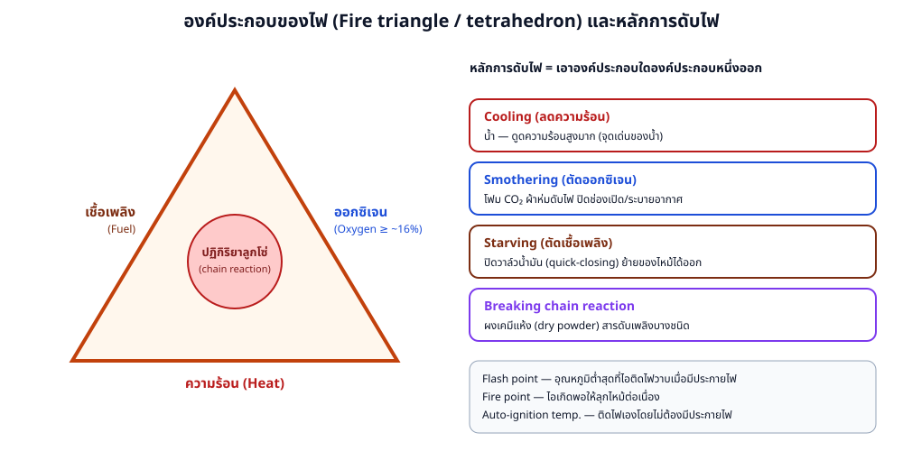
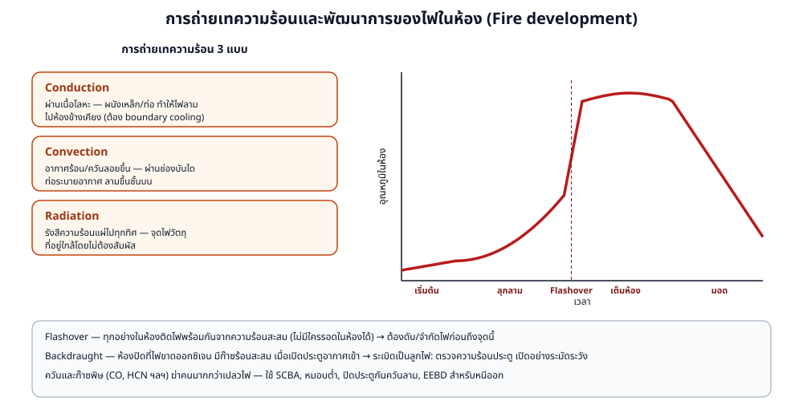
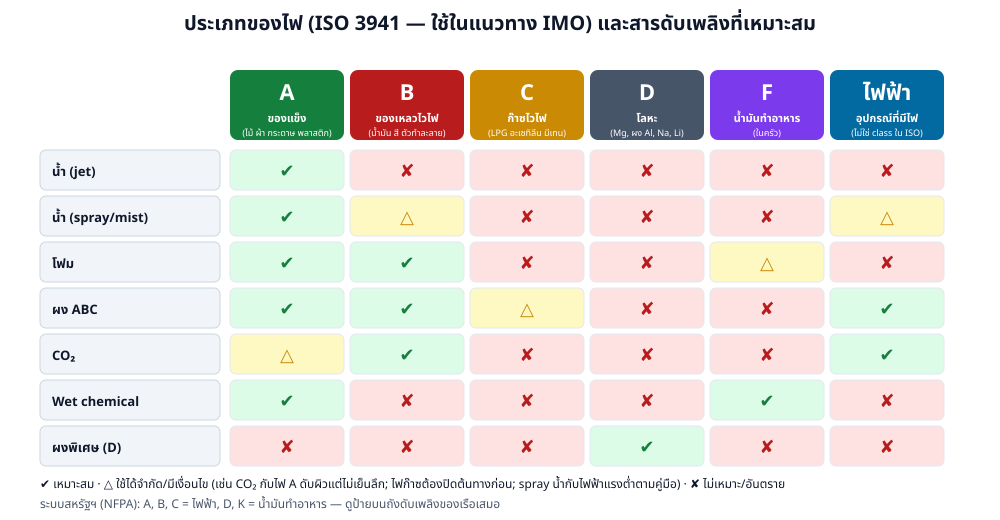
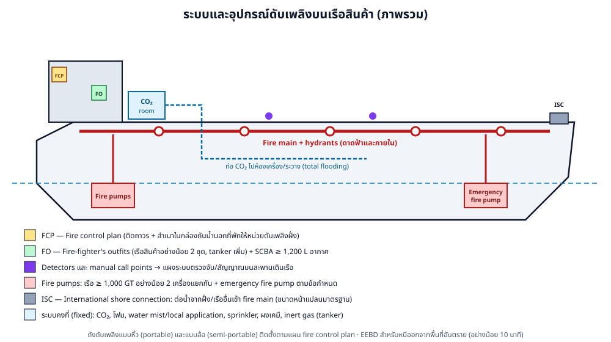
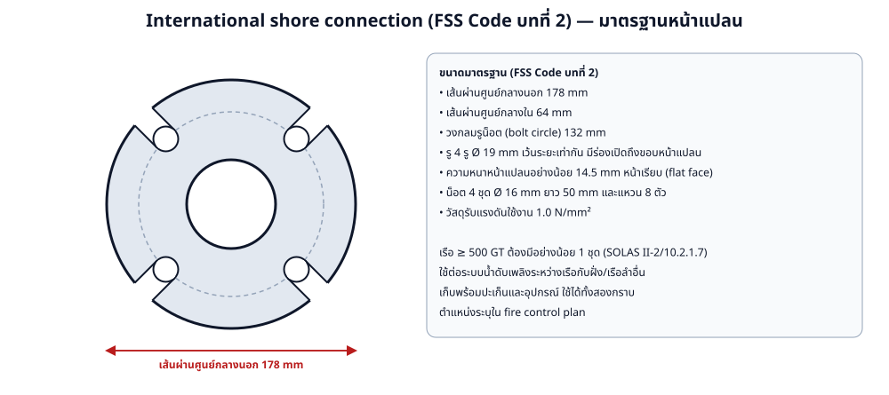
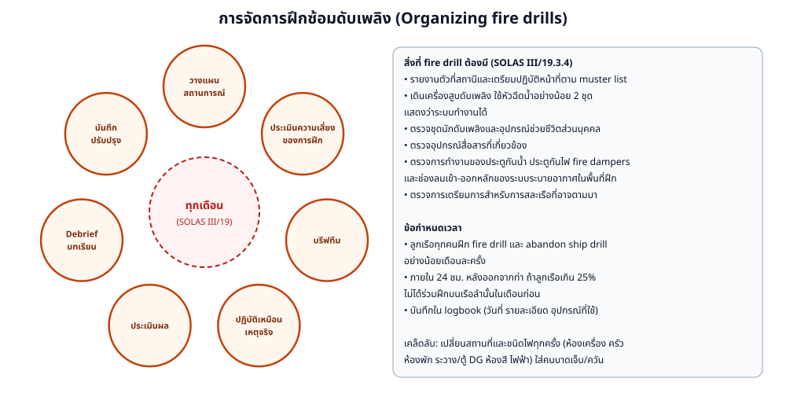
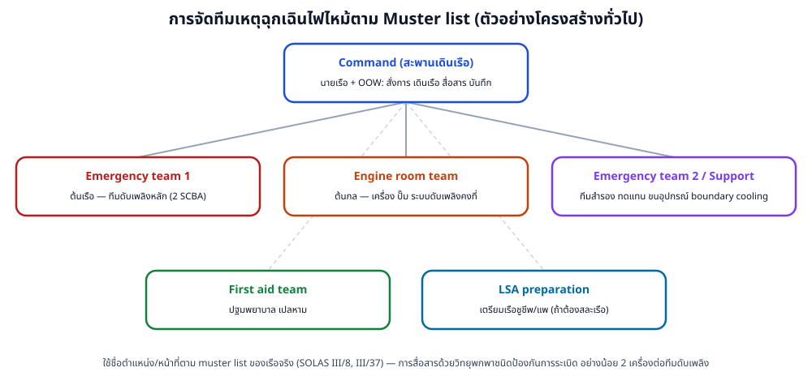
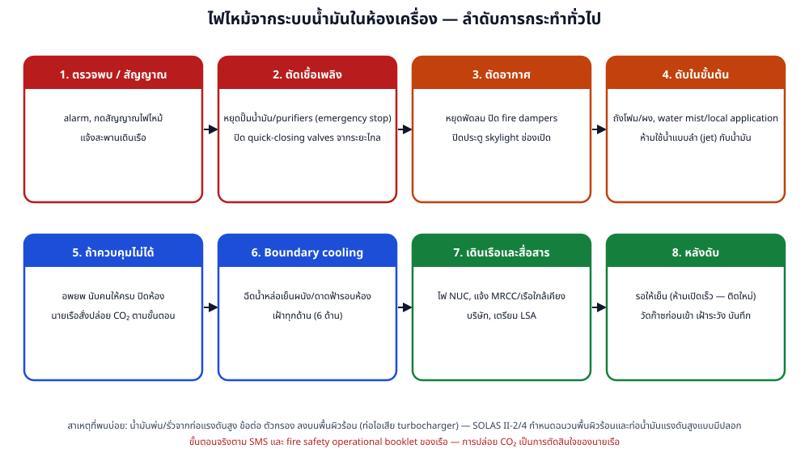

# 3.3 Prevent, Control and Fight Fires on Board — การป้องกัน ควบคุม และดับเพลิงบนเรือ

> สมุดบันทึกการฝึก OOW · TIRAPHONG NANTAPAN
> Function 3: **Controlling the operation of the ship and care for persons on board at the operational level**
> สมรรถนะตาม STCW A-II/1: *Prevent, control and fight fires on board* — Fire prevention and fire-fighting appliances:
> - Ability to organize fire drills
> - Knowledge of classes and chemistry of fire
> - Knowledge of fire-fighting systems
> - Knowledge of action to be taken in the event of fire, including fires involving oil systems
>
> เกณฑ์ประเมิน: *The type and scale of the problem is promptly identified and initial actions conform with the emergency procedures and contingency plans for the ship · Evacuation, emergency shutdown and isolation procedures are appropriate to the nature of the emergency and are implemented promptly · The order of priority, and the levels and time-scales of making reports and informing personnel on board, are relevant to the nature of the emergency and reflect the urgency of the problem*
>
> อ้างอิงหลัก: **SOLAS บทที่ II-2** (Construction — fire protection, fire detection and fire extinguishing) และ III/19 (drills); **FSS Code** (International Code for Fire Safety Systems); **FTP Code** (Fire Test Procedures); IMO Res. **A.951(23)** (portable fire extinguishers); A.952(23) (graphical symbols for fire control plans); MSC.1/Circ.1432 (maintenance and inspection of fire protection systems and appliances, as amended by MSC.1/Circ.1516); MSC.1/Circ.1318/Rev.1 (maintenance and inspection of fixed CO₂ systems); STCW A-VI/1-2 (Fire prevention and fire fighting) และ A-VI/3 (Advanced fire fighting); IMO Model Course 1.20 และ 2.03; ISO 3941 (classification of fires); ICS *Bridge Procedures Guide*; Fire safety operational booklet และ training manual ของเรือ

---

## 0. ไฟบนเรือต่างจากไฟบนบกอย่างไร

บนบก ถ้าไฟไหม้เราหนีออกและรอหน่วยดับเพลิง แต่ **บนเรือกลางทะเล ลูกเรือคือหน่วยดับเพลิงเพียงหน่วยเดียว** และ "ทางหนี" คือเรือชูชีพ — ซึ่งเป็นทางเลือกสุดท้าย เรือเต็มไปด้วยเชื้อเพลิง (น้ำมัน สินค้า สี ของในที่พัก) พื้นที่ปิด ทางเดินแคบ และเหล็กที่นำความร้อนได้ดี ไฟเล็ก ๆ ที่ไม่ได้รับการจัดการในไม่กี่นาทีแรกอาจกลายเป็นการสูญเสียเรือทั้งลำ

STCW เน้นสามเรื่องสำหรับ OOW: **ระบุชนิดและขนาดของปัญหาให้เร็ว ทำการเบื้องต้นตามแผน**, **อพยพ ตัดระบบ (emergency shutdown) และแยกพื้นที่ (isolation) ให้ถูกและเร็ว**, และ **รายงานตามลำดับความสำคัญและเวลาที่เหมาะสม** — นอกจากนี้ต้อง **จัดการฝึกซ้อมดับเพลิงได้**

---

## 1. เคมีของไฟ (Chemistry of fire)

*ภาพที่ 3.3-1 องค์ประกอบของไฟและหลักการดับไฟ*

### 1.1 องค์ประกอบของไฟ

- **Fire triangle**: **เชื้อเพลิง + ความร้อน + ออกซิเจน** — ขาดข้อใดข้อหนึ่งไฟดับ
- **Fire tetrahedron**: เพิ่ม **ปฏิกิริยาลูกโซ่ (chain reaction)** ของอนุมูลอิสระในเปลว — เป็นเหตุผลที่สารบางชนิด (ผงเคมีแห้ง) ดับไฟได้เร็วโดยไม่ได้ทำให้เย็นหรือตัดออกซิเจนมาก
- ไฟส่วนใหญ่ต้องการออกซิเจนในอากาศมากกว่าประมาณ 15–16% — อากาศปกติมี 20.9%
- **สิ่งที่ไหม้จริงคือ "ไอ"** — ของแข็งต้องถูกความร้อนจนสลายตัวให้ไอ (pyrolysis) ของเหลวต้องระเหยเป็นไอ

### 1.2 คำศัพท์สำคัญ

| คำ | ความหมาย |
|---|---|
| **Flash point** | อุณหภูมิต่ำสุดที่ของเหลวให้ไอพอจะติดไฟวาบเมื่อมีประกายไฟ (แต่ไม่ลุกต่อเนื่อง) — น้ำมันเชื้อเพลิงเรือตาม SOLAS ทั่วไปต้องมี flash point ไม่ต่ำกว่า 60°C |
| **Fire point** | อุณหภูมิที่ไอเกิดพอให้ลุกไหม้ต่อเนื่อง (สูงกว่า flash point เล็กน้อย) |
| **Auto-ignition temperature** | อุณหภูมิที่สารติดไฟเองโดยไม่ต้องมีประกายไฟ — เช่นน้ำมันพ่นโดนท่อไอเสียร้อน |
| **Flammable (explosive) limits — LFL/UFL** | ช่วงความเข้มข้นของไอในอากาศที่ติดไฟได้ — ต่ำกว่า LFL "จางเกิน", สูงกว่า UFL "เข้มเกิน" (แต่ถ้าอากาศเข้ามาเจือจางจะเข้าสู่ช่วงติดไฟได้) |
| **Spontaneous combustion** | การลุกไหม้เองจากความร้อนที่เกิดจากปฏิกิริยาภายใน (ผ้าชุบน้ำมัน/สี ถ่านหิน สินค้าบางชนิด) |
| **Pyrolysis** | การสลายตัวด้วยความร้อนให้ก๊าซติดไฟ |

### 1.3 การถ่ายเทความร้อนและพัฒนาการของไฟ

*ภาพที่ 3.3-2 การถ่ายเทความร้อนสามแบบและพัฒนาการของไฟในห้อง*

- **Conduction** — ผ่านเนื้อโลหะ: ผนังเหล็กร้อนจนจุดไฟของในห้องข้างเคียง → ต้อง **boundary cooling** (ฉีดน้ำหล่อเย็นผนังทุกด้าน — บน ล่าง ซ้าย ขวา หน้า หลัง)
- **Convection** — อากาศร้อน/ควันลอยขึ้น ผ่านบันได ท่อลม ช่องสายไฟ → ไฟลามขึ้นชั้นบน
- **Radiation** — รังสีความร้อนแผ่ไปทุกทิศ จุดไฟวัตถุใกล้เคียง และทำให้เข้าใกล้ไฟไม่ได้
- **ระยะของไฟในห้อง**: เริ่มต้น (incipient) → ลุกลาม (growth) → **flashover** (ทุกอย่างในห้องติดไฟพร้อมกัน) → เต็มห้อง (fully developed) → มอด (decay)
- **Backdraught** — ห้องปิดที่ไฟขาดออกซิเจน มีก๊าซร้อนติดไฟสะสม เมื่อเปิดประตูอากาศเข้า → ระเบิดเป็นลูกไฟ: สัญญาณเตือนคือควันดำข้นที่ "หายใจ" เข้าออกตามขอบประตู ประตูร้อน หน้าต่างมีคราบควันดำ
- **ควันและก๊าซพิษ** (CO, HCN, HCl จากพลาสติก) — สาเหตุการเสียชีวิตส่วนใหญ่ในไฟไหม้ ไม่ใช่เปลวไฟ

### 1.4 หลักการดับไฟ

- **Cooling** — ลดความร้อนต่ำกว่า fire point (น้ำดูดความร้อนได้สูงมากเมื่อกลายเป็นไอ)
- **Smothering** — ตัดออกซิเจน (โฟม CO₂ ผ้าห่มดับไฟ ปิดห้อง/ระบบระบายอากาศ)
- **Starving** — ตัดเชื้อเพลิง (ปิดวาล์วน้ำมัน/ก๊าซ ย้ายของติดไฟออก)
- **Breaking the chain reaction** — ผงเคมีแห้ง

---

## 2. ประเภทของไฟ (Classes of fire)

*ภาพที่ 3.3-3 ประเภทของไฟและความเหมาะสมของสารดับเพลิง*

ตาม **ISO 3941** (ใช้ในแนวทาง IMO เรื่องถังดับเพลิงแบบหิ้ว — A.951(23))

| Class | เชื้อเพลิง | ตัวอย่างบนเรือ | สารดับที่เหมาะ |
|---|---|---|---|
| **A** | ของแข็งอินทรีย์ที่เกิดถ่านแดง | ที่นอน ผ้า กระดาษ ไม้ พลาสติก ขยะ เชือก | **น้ำ** (ดีที่สุด — เย็นลึก), โฟม, ผง ABC |
| **B** | ของเหลวไวไฟ/ของแข็งที่หลอมเหลวได้ | น้ำมันเชื้อเพลิง น้ำมันหล่อลื่น สี ทินเนอร์ | **โฟม**, ผงเคมี, CO₂ (ที่ปิด), water mist/spray — **ห้ามฉีดน้ำเป็นลำใส่** |
| **C** | ก๊าซไวไฟ | LPG ในครัว อะเซทิลีน (เชื่อม) มีเทน | **ปิดต้นทางก๊าซก่อน**; ผงเคมีใช้ควบคุม; ฉีดน้ำหล่อเย็นถังก๊าซ — ห้ามดับเปลวก๊าซถ้ายังปิดต้นทางไม่ได้ (ก๊าซจะสะสมแล้วระเบิด) |
| **D** | โลหะ | แมกนีเซียม อะลูมิเนียม (ผง/เศษ) โซเดียม ลิเธียม (โลหะ) | **ผงพิเศษสำหรับโลหะ**, ทรายแห้ง — **ห้ามใช้น้ำ** (ระเบิด/แตกกระจาย) |
| **F** | น้ำมันทำอาหาร | หม้อทอดในครัว | **Wet chemical**, ผ้าห่มดับไฟ, ระบบดับเพลิงหม้อทอด — **ห้ามใช้น้ำเด็ดขาด** (น้ำมันระเบิดกระจาย) |
| (ไฟฟ้า) | อุปกรณ์ที่มีไฟฟ้า | ตู้ไฟ มอเตอร์ สายไฟ | **ตัดไฟก่อน**, CO₂, ผงเคมี — ห้ามใช้น้ำ/โฟมกับอุปกรณ์ที่ยังมีไฟ |

- **ระบบของสหรัฐฯ (NFPA)** ใช้ A, B, **C = ไฟฟ้า**, D, **K = น้ำมันทำอาหาร** — เรืออาจมีถังดับเพลิงที่ติดป้ายทั้งสองระบบ ต้องอ่านป้ายบนถังของเรือ
- **ไฟจากแบตเตอรี่ลิเธียม** (อุปกรณ์ส่วนตัว รถไฟฟ้า สินค้า class 9) — เกิด **thermal runaway** ปล่อยก๊าซพิษ/ไวไฟ ติดซ้ำได้ — ใช้น้ำปริมาณมากหล่อเย็นต่อเนื่อง แยกออก/จุ่มน้ำถ้าเป็นอุปกรณ์เล็ก

---

## 3. การป้องกันไฟ (Fire prevention)

**การป้องกันดีกว่าการดับเสมอ** — ไฟบนเรือส่วนใหญ่เกิดจากสาเหตุที่ป้องกันได้

| พื้นที่/สาเหตุ | มาตรการป้องกัน |
|---|---|
| **ห้องเครื่อง — น้ำมันรั่วลงพื้นผิวร้อน** (สาเหตุอันดับต้น) | ฉนวนพื้นผิวร้อน (> 220°C ตาม SOLAS II-2/4), ท่อน้ำมันแรงดันสูงแบบมีปลอก (jacketed) พร้อมระบบเตือนรั่ว, แผ่นกันกระเด็น (spray shields) ที่ข้อต่อ, ซ่อมรั่วทันที, ทำความสะอาดคราบน้ำมัน/ท้องเรือ, ห้ามวางผ้าชุบน้ำมัน |
| **งานร้อน (hot work)** — เชื่อม ตัด เจียร | **Hot work permit**, ย้ายวัสดุติดไฟ, ตรวจก๊าซ, ผู้เฝ้าไฟ (fire watch) ระหว่างและหลังงาน, ถังดับเพลิงพร้อม, ตรวจด้านหลังผนัง/ใต้พื้น |
| **ครัว** | ทำความสะอาดคราบไขมันในฮูด/ท่อดูด, ไม่ทิ้งหม้อทอดขณะใช้, ปิดอุปกรณ์หลังเลิกงาน |
| **ที่พักอาศัย** | ห้ามสูบบุหรี่บนเตียง/นอกพื้นที่กำหนด, ไม่ใช้อุปกรณ์ไฟฟ้าส่วนตัวที่ไม่ได้รับอนุญาต (ฮีตเตอร์ ปลั๊กพ่วงคุณภาพต่ำ), ชาร์จแบตเตอรี่อย่างปลอดภัย, เครื่องอบผ้า — ทำความสะอาดที่กรองขุย (lint) |
| **ไฟฟ้า** | ตรวจตู้ไฟ สายไฟ การต่อ ไม่ใช้ฟิวส์ผิดขนาด, ระวังความร้อนจากหลอดไฟใกล้วัสดุติดไฟ |
| **ห้องสี/สารเคมี (paint locker)** | ระบายอากาศ ระบบดับเพลิงคงที่ ปิดฝาภาชนะ |
| **สินค้า** | ตามข้อ 2.1 — DG, ถ่านหิน (ร้อนเอง), เมล็ดพืช, ฝ้าย, สินค้าสำแดงเท็จ |
| **การรับน้ำมันเชื้อเพลิง** | ตามข้อ 3.1 — ห้ามสูบบุหรี่ ห้ามงานร้อน |
| **การจัดการทั่วไป (housekeeping)** | ขยะไม่สะสม ผ้าชุบน้ำมัน/สีเก็บในภาชนะโลหะมีฝา ทางหนีไฟโล่ง ประตูกันไฟไม่ถูกค้ำเปิด |

**OOW กับการป้องกันไฟ** — เดินตรวจ (fire rounds) ตามที่กำหนด โดยเฉพาะยามกลางคืนและในท่า, ตรวจแผงระบบตรวจจับไฟบนสะพานเดินเรือ (fault/disabled zones — ต้องรู้ว่าโซนใดถูกปิดเพราะอะไร), ควบคุม hot work permit ตามระบบของเรือ, รายงานสิ่งผิดปกติ (กลิ่นไหม้ ควัน ความร้อน)

### 3.1 การป้องกันไฟเชิงโครงสร้าง (Structural fire protection — SOLAS II-2)

- **Fire divisions**: **A-class** (เหล็ก ป้องกันควันและเปลวไฟ 60 นาที พร้อมฉนวนตามระดับ A-60/A-30/A-15/A-0), **B-class** (30 นาที), **C-class** (วัสดุไม่ติดไฟ)
  - ตัวเลขหลังตัวอักษร = นาทีที่ด้านที่ไม่โดนไฟยังเย็นพอ คือ อุณหภูมิเฉลี่ยเพิ่มไม่เกิน 140°C และจุดใดไม่เพิ่มเกิน 180°C จากเดิม ในการทดสอบไฟมาตรฐานตาม FTP Code — เช่น A-60 = เหล็กกันไฟ 60 นาที และฉนวนกันความร้อนได้ 60 นาที; A-0 = เหล็กกันไฟได้แต่ไม่มีฉนวน; B-15/B-0 ใช้หลักเดียวกันในเวลา 30 นาที — แยกพื้นที่เสี่ยงสูง (ห้องเครื่อง ครัว) ออกจากที่พักและทางหนีไฟ
- **ประตูกันไฟ (fire doors)** — ปิดเองได้ (self-closing) ห้ามค้ำ/ผูกเปิด; ระบบปลดล็อกที่ควบคุมจากระยะไกล (เรือโดยสาร)
- **Fire dampers** ในท่อระบายอากาศ, การหยุดพัดลมจากนอกห้อง
- **ทางหนีไฟ (means of escape)** — อย่างน้อยสองทางจากแต่ละพื้นที่หลัก, ป้าย/ไฟส่องทาง
- **EEBD (emergency escape breathing devices)** — ใช้หนีออกจากบรรยากาศอันตรายได้อย่างน้อย 10 นาที **ไม่ใช่ใช้ดับเพลิง** (FSS Code บทที่ 3) — เรือสินค้ามีในที่พักอย่างน้อย 2 ชุด ในห้องเครื่องตามตำแหน่งที่กำหนด และมีสำรองตามกฎ (SOLAS II-2/13.3.4, 13.4.3)
- **วัสดุ** — ไม่ติดไฟ/ลามไฟช้า ในที่พักและทางเดิน

---

## 4. ระบบตรวจจับและสัญญาณเตือน (Detection and alarm)

- **Detectors**: ควัน (smoke — optical/ionization), ความร้อน (heat — อุณหภูมิคงที่หรืออัตราการเพิ่ม), เปลวไฟ (flame — IR/UV ในห้องเครื่อง), **sample extraction smoke detection** (ดูดอากาศจากระวางสินค้ามาตรวจที่สะพานเดินเรือ)
- **Manual call points** — ตามทางเดิน ทางออก
- **Fixed fire detection and fire alarm system** (FSS Code บทที่ 9) — แผงหลักบนสะพานเดินเรือหรือสถานีควบคุม แสดงโซน — **OOW ต้องรู้วิธีอ่าน รับทราบ (acknowledge) และเรียกดูโซน** และขั้นตอนเมื่อสัญญาณดัง: ส่งคนไปตรวจทันที อย่าคิดเอาเองว่าเป็นสัญญาณผิด (false alarm)
- **General emergency alarm** และ **fire alarm signal** ตาม muster list ของเรือ; ประกาศเสียงตามสาย (PA) บอกตำแหน่ง
- **Fire control plan (SOLAS II-2/15.2.4)** — ติดถาวรในที่พักและบนสะพานเดินเรือ แสดงสถานีควบคุม fire divisions ระบบตรวจจับ อุปกรณ์ดับเพลิง ทางเข้า ระบบระบายอากาศ ฯลฯ ด้วยสัญลักษณ์ IMO (A.952(23)) — **สำเนาเก็บในกล่องกันน้ำที่มีเครื่องหมายเด่นชัดนอกที่พัก (deckhouse)** เพื่อหน่วยดับเพลิงฝั่ง
  - วิธีอ่านแบบเร็วที่ผมฝึกไว้: (1) หาตำแหน่งตัวเองและทางหนีไฟ/จุดรวมพล (2) ขอบเขต fire divisions ตามสีและเส้น (A/B class, main vertical zones ในเรือโดยสาร) (3) สัญลักษณ์อุปกรณ์ — ถังดับเพลิงตามชนิด หัวจ่ายน้ำ (hydrant) ชุดนักดับเพลิง EEBD จุดกดสัญญาณ (manual call point) อุปกรณ์ตรวจจับ (4) จุดควบคุมจากระยะไกล — ปุ่มหยุดพัดลม/ปั๊มน้ำมัน quick-closing valves fire dampers สถานีปล่อย CO₂ (5) ตำแหน่ง international shore connection — รายละเอียดรูปสัญลักษณ์ดูตาราง A.952(23) ของเรือ (แผนต้องปรับทุกครั้งที่มีการเปลี่ยนแปลง)

---

## 5. ระบบและอุปกรณ์ดับเพลิง (Fire-fighting systems and appliances)

*ภาพที่ 3.3-4 ภาพรวมระบบและอุปกรณ์ดับเพลิงบนเรือสินค้า*

### 5.1 ระบบน้ำดับเพลิง (Fire main)

- **Fire pumps** — เรือสินค้า ≥ 1,000 GT ต้องมีอย่างน้อย **2 เครื่องที่ขับเคลื่อนแยกกัน**; ถ้าไฟไหม้ในห้องเดียวอาจทำให้ปั๊มทั้งหมดใช้ไม่ได้ ต้องมี **emergency fire pump** อยู่นอกห้องนั้นพร้อมแหล่งพลังงานแยก
  - ขนาด: ปั๊มหลักแต่ละเครื่องไม่น้อยกว่า 80% ของความจุรวมที่ต้องการหารด้วยจำนวนปั๊มขั้นต่ำ และไม่น้อยกว่า 25 m³/h (SOLAS II-2/10.2.2.4); emergency fire pump ของเรือสินค้าไม่น้อยกว่า 40% ของความจุรวมของปั๊มหลัก และไม่น้อยกว่า 25 m³/h (FSS Code บทที่ 12) — ต้องจ่ายน้ำได้สองลำพร้อมแรงดันที่กำหนด
- **แรงดันที่หัวจ่าย (hydrant)** ขณะใช้หัวฉีดตามที่กำหนด — เรือสินค้า ≥ 6,000 GT ไม่น้อยกว่า **0.27 N/mm²**, < 6,000 GT ไม่น้อยกว่า **0.25 N/mm²** (เรือโดยสารสูงกว่า)
- **Isolating valves** — แยกส่วนท่อในห้องเครื่องออกจากส่วนอื่น เพื่อให้ emergency fire pump จ่ายน้ำไปส่วนอื่นได้เมื่อท่อในห้องเครื่องเสียหาย
- **Hydrants, hoses, nozzles** — ตำแหน่งให้น้ำอย่างน้อยสองลำ (จากหัวจ่ายต่างกัน) ถึงทุกจุด; ความยาวสายตามกฎ (เช่นในห้องเครื่องไม่เกิน 15 m, ที่อื่นและดาดฟ้าโล่งไม่เกิน 20 m — เรือกว้างเกิน 30 m ใช้ได้ถึง 25 m บนดาดฟ้าโล่ง); เรือสินค้ามีสายอย่างน้อยหนึ่งเส้นต่อความยาวเรือทุก 30 m และสำรองหนึ่งเส้น (ไม่น้อยกว่า 5 เส้น); **หัวฉีดแบบสองทาง (jet/spray) พร้อมปิดได้** ขนาดมาตรฐาน 12, 16, 19 mm
- **International shore connection** — หน้าแปลนมาตรฐานสำหรับรับน้ำจากฝั่ง/เรืออื่น (ภาพที่ 3.3-5) — เรือ ≥ 500 GT ต้องมีอย่างน้อย 1 ชุด และต่อได้ทั้งสองกราบ (SOLAS II-2/10.2.1.7); ขนาดตาม FSS Code บทที่ 2: Ø นอก 178 mm, Ø ใน 64 mm, วงรูน็อต 132 mm, รู 4 รู Ø 19 mm มีร่องเปิดถึงขอบ, หนา ≥ 14.5 mm, น็อต Ø 16 × 50 mm 4 ชุดพร้อมแหวน 8 ตัว, ใช้งานที่ 1.0 N/mm²
- **ข้อควรระวัง**: ในอากาศเย็นจัดระบายน้ำในท่อบนดาดฟ้ากันแข็ง; อย่าปล่อยท่อ fire main มีอากาศค้าง (water hammer)

*ภาพที่ 3.3-5 International shore connection ตามมาตรฐาน FSS Code*

### 5.2 ถังดับเพลิงแบบหิ้วและแบบล้อ

- **ชนิด**: น้ำ (water) · โฟม (foam) · ผงเคมีแห้ง (dry powder — ABC หรือ BC) · CO₂ · wet chemical (ครัว)
- **ขนาด (ตามแนวทาง IMO A.951(23) และ FSS Code)**: แบบหิ้วน้ำหนักรวมไม่เกินประมาณ 23 kg; ถังของเหลวทั่วไป 9 ลิตร; ผงเคมี/CO₂ อย่างน้อย 5 kg — แบบล้อ (semi-portable) เช่นโฟม 45 ลิตร หรือ 135 ลิตร ในห้องเครื่อง
- **ตำแหน่ง** — ตาม fire control plan ใกล้ทางเข้าพื้นที่; **ถัง CO₂ ห้ามติดในที่พักอาศัย** (เสี่ยงขาดอากาศในห้องเล็ก)
- **การใช้งาน (PASS)**: **P**ull — ดึงสลัก · **A**im — เล็งที่ฐานไฟ · **S**queeze — บีบด้าม · **S**weep — ส่ายไปมา — เข้าหาไฟจากด้านเหนือลม ไม่หันหลังให้ไฟ มีทางถอย
- **การตรวจและบำรุงรักษา** — ตรวจตามรอบ (สลักและซีล แรงดัน น้ำหนัก CO₂ วันที่) ทดสอบแรงดันตามกำหนด; ถังที่ใช้แล้วต้องเติมทันที; มีอุปกรณ์เติม/ถังสำรองตามกฎ
  - สารเติมสำรอง (spare charges): 100% สำหรับถัง 10 ใบแรก และ 50% สำหรับที่เหลือที่เติมบนเรือได้ (ไม่ต้องเกิน 60 ชุด) — ถังที่เติมบนเรือไม่ได้ให้มีถังสำรองแทน (SOLAS II-2/10.3.3); แนวทางตรวจตาม A.951(23) — ตรวจประจำปีโดยผู้ที่มีความสามารถ, ทดลองฉีดจริงอย่างน้อยชนิดละหนึ่งใบต่อปีผลิตทุก 5 ปี (ทำพร้อม fire drill ได้) และทดสอบแรงดัน (hydrostatic) ไม่เกินทุก 10 ปี (ตรวจกับฉบับปัจจุบันและข้อกำหนดของ flag)

### 5.3 ระบบดับเพลิงคงที่ (Fixed fire-extinguishing systems)

| ระบบ | ใช้ที่ | หลักการและข้อควรระวัง |
|---|---|---|
| **CO₂ total flooding** | ห้องเครื่อง ห้องปั๊ม ระวางสินค้า ห้องสี | ตัดออกซิเจน — **อันตรายถึงชีวิต**: ต้องอพยพคนออกทั้งหมด **นับคนครบ** ปิดช่องเปิด/ประตู/fire dampers หยุดพัดลมและปั๊มน้ำมันก่อนปล่อย; ระบบมีการควบคุมสองขั้น (เปิดวาล์วท่อ + ปล่อยจากถัง) และ **สัญญาณเตือนก่อนปล่อย** ในพื้นที่; ห้องเครื่องต้องปล่อยก๊าซส่วนใหญ่ (85%) ภายใน 2 นาที — **นายเรือเป็นผู้สั่งปล่อย** (ตาม SMS); หลังปล่อยห้ามเปิดห้องเร็ว (ไฟติดซ้ำ) — ตัวเลขตาม FSS Code บทที่ 5: ปริมาณ CO₂ สำหรับห้องเครื่องคิดเป็นปริมาตรก๊าซอิสระ ≥ 40% ของปริมาตรรวมห้อง (หรือ 35% ถ้ารวม casing — ใช้ค่าที่มากกว่า); **ห้องเครื่องปล่อย 85% ภายใน 2 นาที**; ระวางสินค้าใช้ ≥ 30% ของปริมาตรระวางที่ใหญ่ที่สุด และสำหรับระวางตู้สินค้า/สินค้าทั่วไป ปล่อย 2/3 ภายใน 10 นาที; สัญญาณเตือนก่อนปล่อยต้องดังนานพอให้อพยพ และไม่น้อยกว่า 20 วินาที |
| **High-expansion foam** | ห้องเครื่อง (บางเรือ) | ฟองปริมาณมากเติมเต็มห้อง ตัดออกซิเจนและหล่อเย็น |
| **Low-expansion deck foam** | ดาดฟ้าสินค้าเรือ tanker | ปกคลุมผิวน้ำมันที่ลุกไหม้ |
| **Fixed pressure water-spraying / water mist** | ห้องเครื่อง พื้นที่ ro-ro (drencher) | หล่อเย็นและแทนที่ออกซิเจนด้วยไอน้ำ |
| **Fixed local application system** | ห้องเครื่อง category A ขนาดใหญ่ (เกิน 500 m³) ของเรือ ≥ 2,000 GT — บริเวณเสี่ยง เช่นเครื่องยนต์ส่วนบน purifiers หม้อน้ำ เตาเผา (SOLAS II-2/10.5.6) | ปล่อย water mist เฉพาะจุดได้โดยไม่ต้องอพยพทั้งห้อง ใช้ได้เร็วในขั้นต้น |
| **Sprinkler** | ที่พัก (เรือโดยสาร/บางเรือ) | หัวแตกตามอุณหภูมิ ฉีดน้ำอัตโนมัติ |
| **Dry chemical powder** | ดาดฟ้าเรือ gas carrier | ดับไฟก๊าซ |
| **Inert gas** | ถังสินค้าเรือ tanker | **ป้องกัน** ไม่ให้บรรยากาศในถังติดไฟ — ก๊าซที่ส่งเข้าถังมี O₂ ไม่เกิน 5% และรักษาในถังไม่เกิน 8% โดยปริมาตร; บังคับกับ tanker ใหม่ ≥ 8,000 DWT ที่สร้างตั้งแต่ 1 ม.ค. 2016 (เดิม ≥ 20,000 DWT) |
| **ระบบในครัว** | ฮูด/ท่อดูดควัน หม้อทอด | ระบบเฉพาะ (wet chemical/CO₂) และการตัดพัดลม |

**เรือคอนเทนเนอร์** — เรือสร้างใหม่ตามข้อกำหนดที่มีผลตั้งแต่ปี 2016 ต้องมี **water mist lance** (เจาะผนังตู้ฉีดน้ำเข้าไป) และ **mobile water monitors** สำหรับเรือที่บรรทุกตู้บนดาดฟ้าหลายชั้นตามที่กำหนด (SOLAS II-2/10.7.3: เรือที่สร้างตั้งแต่ 1 ม.ค. 2016 ที่ออกแบบให้บรรทุกตู้บนดาดฟ้าโล่งต้องมี water mist lance อย่างน้อย 1 ชุด; ถ้าบรรทุกตู้ 5 ชั้นขึ้นไปบนดาดฟ้า ต้องมี mobile water monitors อย่างน้อย 2 ตัว (เรือกว้าง < 30 m) หรือ 4 ตัว (กว้าง ≥ 30 m)) — การดับไฟในกองตู้ยากมาก เน้น **หล่อเย็นตู้ข้างเคียงและฝาระวาง** ป้องกันการลุกลาม (IMO ยังคงพัฒนาข้อกำหนดเพิ่มเติมสำหรับไฟบนเรือคอนเทนเนอร์)

### 5.4 อุปกรณ์สำหรับนักดับเพลิง

- **Fire-fighter's outfit** — เรือสินค้าอย่างน้อย **2 ชุด** (tanker เพิ่มอีก 2): ชุดป้องกันความร้อน รองเท้าบูท ถุงมือ หมวก **SCBA** (อากาศในถังอย่างน้อย **1,200 ลิตร** — ใช้ได้ประมาณ 30 นาที ขึ้นกับการหายใจ) พร้อมถังสำรอง, **lifeline** ทนไฟพร้อมตะขอ, ไฟฉายปลอดภัย (อย่างน้อย 3 ชั่วโมง), ขวานด้ามหุ้มฉนวน
  - รายละเอียดที่ถูกถามบ่อย (FSS Code บทที่ 3 และ SOLAS II-2/10.10): lifeline ทนไฟยาว **อย่างน้อย 30 m**; ถังสำรอง **2 ชุดต่อ SCBA หนึ่งชุด** (เรือสินค้าที่มีเครื่องอัดอากาศที่เหมาะสมบนเรือ ลดเหลือ 1 ชุดได้); SCBA ต้องมี **สัญญาณเตือนเสียง** ก่อนอากาศในถังลดเหลือ **200 ลิตร**
  - **ตัวอย่างจำลอง — ประมาณเวลาใช้ SCBA**: ถัง 6.8 L อัด 300 bar → อากาศอิสระ ≈ 6.8 × 300 = 2,040 L; ถ้าเตือนที่ ~55 bar และหายใจขณะทำงาน 50 L/min → เวลาทำงานก่อนเตือน ≈ (300 − 55) × 6.8 ÷ 50 ≈ **33 นาที**; ถ้างานหนักหายใจ 80 L/min เหลือ ≈ **21 นาที** — ถังมาตรฐานขั้นต่ำ 1,200 L ที่ 40 L/min ได้ ≈ 30 นาที เท่านั้น ผู้ควบคุมทางเข้าจึงต้องจดแรงดันและเวลาเข้า แล้วกำหนดเวลาถอยกลับ (turn-around) เผื่อทางออก ไม่ใช่รอให้ whistle ดัง
- **วิทยุสื่อสารแบบพกพาสองทาง** — อย่างน้อย **2 เครื่องต่อทีมดับเพลิง** ชนิดป้องกันการระเบิดหรือ intrinsically safe (SOLAS II-2/10.10.4)
- **EEBD** — สำหรับหนีออก (ไม่ใช่ดับเพลิง)
- **การตรวจ SCBA** — แรงดันถัง สัญญาณเตือนแรงดันต่ำ (whistle) หน้ากากรั่ว — ทุกครั้งที่ฝึกและตามรอบ; เครื่องอัดอากาศ (ถ้ามี) ตรวจคุณภาพอากาศ
- **การบำรุงรักษาและตรวจระบบทั้งหมด** — ตาม MSC.1/Circ.1432 (as amended): รายสัปดาห์ รายเดือน รายไตรมาส รายปี และเกินกว่านั้น — บันทึกใน PMS

---

## 6. การจัดการฝึกซ้อมดับเพลิง (Organizing fire drills)

*ภาพที่ 3.3-6 วงจรการจัดการฝึกซ้อมดับเพลิงและสิ่งที่ SOLAS กำหนด*

### 6.1 ข้อกำหนด

- ลูกเรือทุกคนต้องร่วม **fire drill และ abandon ship drill อย่างน้อยเดือนละครั้ง**; ถ้าลูกเรือเกิน 25% ไม่ได้ร่วมฝึกบนเรือลำนั้นในเดือนก่อน ต้องฝึก **ภายใน 24 ชั่วโมงหลังออกจากท่า** (SOLAS III/19)
- Fire drill ต้องรวม (III/19.3.4): รายงานตัวที่สถานีและเตรียมหน้าที่ตาม muster list · **เดินเครื่องสูบดับเพลิงและใช้หัวฉีดอย่างน้อย 2 ชุด** แสดงว่าระบบทำงาน · ตรวจชุดนักดับเพลิงและอุปกรณ์ช่วยชีวิตส่วนบุคคล · ตรวจอุปกรณ์สื่อสาร · ตรวจการทำงานของประตูกันน้ำ ประตูกันไฟ fire dampers และช่องลมหลักในพื้นที่ฝึก · ตรวจการเตรียมการสำหรับการสละเรือที่อาจตามมา
- **การฝึกอบรมบนเรือ (on-board training)** — การใช้อุปกรณ์ดับเพลิงของเรือ ระบบคงที่ ฯลฯ; **training manual** และ **fire safety operational booklet** ต้องมีในห้องอาหาร/ห้องพักผ่อนหรือที่พักแต่ละห้อง (II-2/15, 16)
- **บันทึก** ใน official logbook/logbook: วันที่ ชนิดการฝึก รายละเอียด อุปกรณ์ที่ใช้ ข้อสังเกต; ถ้าไม่ได้ฝึกตามกำหนดต้องบันทึกเหตุผล

### 6.2 การจัดการฝึกให้ได้ผล ("Ability to organize fire drills")

1. **วางแผนสถานการณ์ที่สมจริงและหลากหลาย** — เปลี่ยนสถานที่และชนิดไฟทุกครั้ง: น้ำมันรั่วในห้องเครื่อง ไฟครัว ไฟห้องพักตอนกลางคืน ห้องสี ตู้ไฟ ห้องซักรีด ระวางสินค้า/ตู้ DG ไฟระหว่างอยู่ในท่า (ประสานหน่วยดับเพลิงฝั่ง) — ใส่องค์ประกอบ: คนหาย/บาดเจ็บ (หุ่น) ควันจำลอง ทางเดินถูกปิด วิทยุขัดข้อง
2. **ประเมินความเสี่ยงของการฝึกเอง** — ห้ามใช้ไฟจริงในที่ไม่ปลอดภัย, ระวังการลื่นล้มจากน้ำ, SCBA ใช้ถูกวิธี, สภาพอากาศ/การจราจร (OOW ยังต้องเดินเรือปลอดภัย)
3. **บรีฟ** — วัตถุประสงค์ สถานการณ์ (บางส่วนอาจไม่บอกล่วงหน้าเพื่อทดสอบการตอบสนอง) บทบาท ความปลอดภัย
4. **ปฏิบัติเหมือนจริง** — ส่งสัญญาณ ประกาศ ทีมแต่งชุด SCBA เข้าพื้นที่แบบมี lifeline, boundary cooling, ตัดไฟ/พัดลม, นับคน, สื่อสารกับสะพานเดินเรือ, เตรียม LSA
5. **ประเมินผล** — เวลาตอบสนอง (สัญญาณถึงน้ำออกหัวฉีด) ความถูกต้องของขั้นตอน การสื่อสาร การใช้ SCBA (ตรวจแรงดันก่อนเข้า รายงานแรงดัน) การนับคน
6. **Debrief** — ทุกคนร่วมพูดสิ่งที่ดี/ต้องปรับ — ไม่ใช่เวลาตำหนิ
7. **บันทึกและปรับปรุง** — แก้ข้อบกพร่องของอุปกรณ์ ปรับ muster list/ขั้นตอน วางแผนการฝึกครั้งต่อไปจากจุดอ่อนที่พบ

---

## 7. องค์กรและการกระทำเมื่อเกิดไฟไหม้

*ภาพที่ 3.3-7 การจัดทีมเหตุฉุกเฉินไฟไหม้ตาม muster list (ตัวอย่างโครงสร้างทั่วไป)*

### 7.1 ผู้พบเหตุ (ทุกคน)

**แจ้งเตือนก่อนเสมอ** แล้วจึงพยายามดับถ้าปลอดภัย — หลักจำง่าย เช่น **"FIRE": Find — Inform — Restrict — Extinguish**
1. **แจ้งเตือน** — ตะโกน กดสัญญาณ (manual call point) โทรหาสะพานเดินเรือ บอก **ตำแหน่ง ชนิดไฟ ขนาด คนติดอยู่หรือไม่**
2. **ช่วยคนที่อยู่ในอันตรายทันที** ถ้าทำได้โดยไม่เสี่ยงชีวิตตัวเอง
3. **จำกัดไฟ** — ปิดประตู (ลดออกซิเจนและควันลาม) ปิดอุปกรณ์/ไฟฟ้าถ้าทำได้
4. **ดับขั้นต้น** ด้วยถังดับเพลิงที่เหมาะกับชนิดไฟ ถ้าไฟเล็กและมีทางถอย — ถ้าไม่ได้ผลภายในเวลาสั้น ๆ **ถอยออก ปิดประตู รอทีม**

### 7.2 การกระทำของ OOW บนสะพานเดินเรือ

| ลำดับ (ส่วนมากทำพร้อมกัน) | รายละเอียด |
|---|---|
| **ส่งสัญญาณ/ประกาศ** | สัญญาณไฟไหม้/general alarm ตาม muster list, ประกาศ PA: **"Fire, fire, fire — ตำแหน่ง … — ทีมดับเพลิงไปยังสถานี"** (ตำแหน่งต้องชัด) |
| **แจ้งนายเรือ** | ทันที — นายเรือรับการสั่งการ |
| **แจ้งห้องเครื่อง** | เตรียมเดินเครื่องสูบดับเพลิง ความพร้อมเครื่องจักร |
| **ระบายอากาศและประตู** | หยุดพัดลมที่เกี่ยวข้องจากสะพานเดินเรือ/สถานีควบคุม ปิด fire doors/dampers |
| **เดินเรือ** | รักษาความปลอดภัยในการเดินเรือ — ลดความเร็ว และเปลี่ยนเข็มตามที่นายเรือสั่ง เพื่อให้ **พื้นที่ไฟไหม้อยู่ใต้ลม** ของที่พักและส่วนอื่นของเรือ และ **ลดลมสัมพัทธ์ที่พัดเข้าไฟ** (เช่น ไฟส่วนหัวเรือ — ให้ลมมาทางท้ายและใช้ความเร็วใกล้ความเร็วลม; ไฟส่วนท้าย/ที่พักท้าย — หันหัวรับลม), ระวังการจราจรและน้ำตื้น, ไฟ/ทุ่นสัญญาณ NUC ถ้าเรือไม่สามารถบังคับได้ |
| **นับคน** | ที่จุดรวมพล — ใครหาย ใครอยู่ในพื้นที่ไฟ |
| **สื่อสารภายนอก** | ตามคำสั่งนายเรือ — แจ้ง MRCC/รัฐชายฝั่ง (urgency หรือ distress ตามความรุนแรง — 1.6) เรือใกล้เคียง บริษัท (DPA) |
| **บันทึก** | เวลาทุกเหตุการณ์ (VDR บันทึกอยู่แล้ว — กด save ตามขั้นตอน) ตำแหน่งเรือ |
| **เตรียมพร้อม** | LSA, ข้อมูลเสถียรภาพ (น้ำดับเพลิงสะสม!), แผนผัง fire control plan ให้ทีม |

**ลำดับความสำคัญและระดับการรายงาน (เกณฑ์ STCW)** — รายงานภายในเรือก่อน (สัญญาณ + นายเรือ + ทีม) **ทันที**; รายงานภายนอกตามความรุนแรงและความเสี่ยง — ถ้ามีโอกาสต้องการความช่วยเหลือ แจ้งก่อนดีกว่าช้า; รายงานบริษัทตาม SMS; ข้อมูลที่รายงานต้องสั้น ชัด ครบ (ตำแหน่งเรือ ลักษณะไฟ ผู้บาดเจ็บ ความต้องการ)

### 7.3 ทีมดับเพลิง (หลักปฏิบัติ)

- **อย่างน้อยสองคนเข้าพื้นที่พร้อมกันเสมอ** สวม SCBA ตรวจแรงดันก่อนเข้า แจ้งเวลาเข้า มีผู้ควบคุมทางเข้า (entry control) บันทึกเวลา/แรงดัน และ lifeline
- **ทีมสำรองแต่งชุดพร้อม** ที่ทางเข้า (back-up team)
- **ประตู** — ตรวจความร้อนด้วยหลังมือ (ไม่ใช้ฝ่ามือ) ก่อนเปิด ยืนข้างประตู ต่ำ เปิดช้า ๆ ระวัง backdraught ฉีดน้ำแบบ spray ป้องกัน
- **Boundary cooling** ทุกด้านของพื้นที่ไฟไหม้ (บน ล่าง ข้าง) และเฝ้าระวังการลาม
- **การใช้น้ำ** — ใช้แบบ spray/fog เพื่อหล่อเย็นและป้องกันตัว ใช้ jet เพื่อเข้าถึงไกล/ทำลายโครงของที่ไหม้ — **ระวังน้ำสะสมกระทบเสถียรภาพ** (3.2.1) ระบายน้ำออกตลอด
- **การสื่อสาร** — ทีมรายงานสะพานเดินเรือเป็นระยะ: ตำแหน่ง สภาพไฟ แรงดันอากาศ ความต้องการ

---

## 8. ไฟไหม้ที่เกี่ยวกับระบบน้ำมัน (Fires involving oil systems)

*ภาพที่ 3.3-8 ลำดับการกระทำทั่วไปเมื่อเกิดไฟไหม้จากระบบน้ำมันในห้องเครื่อง*

**ลักษณะ** — น้ำมันเชื้อเพลิง/หล่อลื่น/ไฮดรอลิกที่พ่นเป็นละอองจากท่อแรงดันสูง ข้อต่อ ไส้กรอง ลงบนพื้นผิวร้อน (ท่อไอเสีย turbocharger) → ติดไฟทันทีและลุกลามเร็วมาก ควันดำหนา ความร้อนสูง

**การกระทำ (ลำดับทั่วไป — ปฏิบัติตาม SMS ของเรือ)**
1. **แจ้งเตือน/สัญญาณ** และแจ้งสะพานเดินเรือ
2. **ตัดเชื้อเพลิง** — หยุดปั๊มน้ำมัน purifiers ด้วย **emergency stops**, ปิด **quick-closing valves** ของถังน้ำมันจากระยะไกล (นอกห้องเครื่อง) — นี่คือขั้นสำคัญที่สุด ไฟน้ำมันที่ยังมีน้ำมันไหลเข้าจะไม่มีวันดับ
3. **ตัดอากาศ** — หยุดพัดลม ปิด fire dampers skylights ประตู
4. **ดับขั้นต้น** — ถังโฟม/ผงเคมี, **fixed local application (water mist)**, โฟมแบบล้อ — **ห้ามฉีดน้ำเป็นลำใส่น้ำมันที่ลุกไหม้** (น้ำจมใต้น้ำมัน กลายเป็นไอ ทำให้น้ำมันกระจายและลามไฟ); น้ำแบบละออง (mist/fog) ใช้หล่อเย็นได้
5. **ถ้าควบคุมไม่ได้** — **อพยพ นับคน ปิดห้องทั้งหมด** แล้ว **นายเรือตัดสินใจปล่อย CO₂/ระบบ total flooding** ตามขั้นตอน (เครื่องจักรหยุด เรืออาจไม่มีกำลังขับเคลื่อน — แผนเดินเรือ/ทอดสมอ/ลอยลำ)
6. **Boundary cooling** ห้องข้างเคียงทุกด้าน เฝ้าอุณหภูมิ
7. **รอให้เย็นก่อนเปิดห้อง** (อาจหลายชั่วโมง) — เปิดเร็วเกินอากาศเข้า ไฟติดซ้ำ (re-ignition); ก่อนเข้าต้องระบายอากาศและวัดก๊าซ (O₂, CO, ไอไวไฟ) — ทีมเข้าด้วย SCBA

**ไฟน้ำมันกรณีอื่น**
- **ไฟน้ำมันทำอาหาร (ครัว)** — ปิดแหล่งความร้อน ใช้ผ้าห่มดับไฟ/wet chemical/ระบบหม้อทอด **ห้ามใช้น้ำ**; ปิดพัดลมฮูด (ไฟเข้าท่อดูดควันลามได้)
- **น้ำมันรั่วลุกไหม้บนดาดฟ้า (ระหว่างรับน้ำมัน)** — หยุดการถ่ายเท ปิดวาล์ว ใช้โฟม/ผงเคมี กั้นไม่ให้ลามลงทะเล (3.1)
- **ไฟสินค้าน้ำมันบนเรือ tanker** — ระบบโฟมดาดฟ้า ระบบ inert gas, หล่อเย็นถัง, ปิดช่องระบาย, ตามแผนฉุกเฉินของ tanker/ISGOTT
- **Scavenge fire / ไฟในท่อไอเสีย** — ห้องเครื่องจัดการตามคู่มือเครื่อง (ลดรอบ/หยุดเครื่อง ระบบดับในเครื่อง)

---

## 9. ไฟในพื้นที่เฉพาะ (สรุป)

| พื้นที่ | ข้อพิจารณาหลัก |
|---|---|
| **ห้องพัก/ที่พักอาศัย** | ค้นหาคน (ควันหนา ตอนกลางคืน), ปิดประตูกันควัน, ใช้น้ำ (class A), ระวัง backdraught, ระบบระบายอากาศที่พักหยุด |
| **ครัว** | ตัดไฟ/ก๊าซ ระบบฮูด/หม้อทอด ห้ามน้ำกับน้ำมัน |
| **ห้องเครื่อง** | ข้อ 8 — ตัดเชื้อเพลิงและอากาศ ระบบคงที่ |
| **ตู้ไฟ/ห้องควบคุมไฟฟ้า** | ตัดไฟ (ประสานห้องเครื่อง — ระวังไฟดับทั้งเรือ) ใช้ CO₂/ผง |
| **ระวางสินค้า** | ปิดระวางและระบบระบาย ใช้ CO₂ ตามขั้นตอน (ไฟสินค้าอาจคุกรุ่นนาน — ปิดไว้จนถึงท่า), ตรวจ EmS สำหรับ DG (2.1), boundary cooling ฝาระวาง/ดาดฟ้า |
| **ตู้สินค้าบนดาดฟ้า** | water lance/monitors หล่อเย็นตู้ข้างเคียง ระวัง DG ระเบิด ควันพิษ — อยู่เหนือลม |
| **ดาดฟ้ารถ (ro-ro)** | ระบบ drencher ระบายควัน รถไฟฟ้า (หล่อเย็นต่อเนื่อง) |
| **ห้องสี/สารเคมี** | ระบบคงที่ ห้ามเปิดประตูเข้าไปถ้าไฟใหญ่ |
| **ในท่า** | แจ้งหน่วยดับเพลิงฝั่ง/ท่าทันที ให้ fire control plan ฉบับนอกที่พัก, international shore connection, ลูกเรือนำทาง — หน่วยฝั่งไม่รู้จักเรือ |

---

## 10. หลังไฟสงบ

- **เฝ้าระวังการติดซ้ำ (re-ignition watch)** — วัดอุณหภูมิผนัง ตรวจซอกมุม ฉนวน สายไฟ
- **ระบายควันและวัดก๊าซ** ก่อนให้คนเข้าโดยไม่มี SCBA
- **ระบายน้ำดับเพลิง** ประเมินเสถียรภาพ
- **ตรวจความเสียหาย** โครงสร้าง ระบบ (สายไฟ ท่อ) ความผนึกน้ำ
- **เติม/เปลี่ยนอุปกรณ์** ที่ใช้ (ถังดับเพลิง ถังอากาศ SCBA) ทันที
- **รายงาน** บริษัท รัฐเจ้าของธง class (ตามระดับความเสียหาย) ประกันภัย; สอบสวนหาสาเหตุ; บันทึกครบถ้วน
- **ดูแลคน** — ปฐมพยาบาล (แผลไหม้ ควัน — 3.5) และสภาพจิตใจหลังเหตุการณ์

---

## 11. ตัวอย่างจำลอง: ไฟไหม้ห้องพักตอนกลางคืน (การกระทำของ OOW)

> 0215 ระหว่างเดินทาง แผงตรวจจับไฟบนสะพานเดินเรือดัง โซน "Accommodation deck C — port" OOW (3/O) รับทราบสัญญาณ
> - **0215:20** ส่ง AB ยามไปตรวจทันทีพร้อมวิทยุ — ไม่คิดเอาเองว่าเป็น false alarm
> - **0216:30** AB รายงาน: "ควันออกจากห้อง C-12 ประตูร้อน ไม่แน่ใจว่ามีคนข้างในหรือไม่" → OOW **กดสัญญาณไฟไหม้ ประกาศ PA**: "Fire, fire, fire. Fire in cabin C-12, deck C port side. All crew muster at stations." แจ้งนายเรือและห้องเครื่อง หยุดพัดลมระบายอากาศที่พักจากแผงบนสะพาน
> - **0218** นายเรือขึ้นสะพาน รับการสั่งการ OOW ทำหน้าที่สื่อสารและบันทึก: ทีม 1 (ต้นเรือ) แต่งชุด SCBA; ห้องเครื่องเดินเครื่องสูบดับเพลิง แรงดัน fire main ปกติ; ตรวจนับคน — **3/E ไม่อยู่ที่จุดรวมพล** (ห้อง C-12 เป็นห้องของ 3/E) → แจ้งทีม 1 ให้ค้นหาคนเป็นอันดับแรก
> - **0222** ทีม 1 เข้าห้อง (เปิดประตูตามวิธีที่ปลอดภัย) พบ 3/E หมดสติ นำออก ส่งทีมปฐมพยาบาล (ให้ออกซิเจน — 3.5) ทีม 1 ดับไฟด้วยน้ำแบบ spray (ที่นอนไหม้จากที่ชาร์จแบตเตอรี่) ทีม 2 ทำ boundary cooling ห้องข้างเคียงและห้องชั้นบน
> - **0235** ไฟสงบ เฝ้าระวังการติดซ้ำ ระบายควัน วัดก๊าซ; นายเรือขอคำปรึกษาทางการแพทย์ทางวิทยุ (TMAS) สำหรับ 3/E แจ้งบริษัท
> - **บันทึก** เวลาทุกขั้นตอน ตำแหน่งเรือ การกระทำ ใน logbook; บันทึก VDR ตามขั้นตอน; ภายหลังสอบสวนและเพิ่มเรื่องการชาร์จอุปกรณ์ในที่พักใน toolbox talk

---

## 12. คำถามสอบปากเปล่า / สัมภาษณ์

**ถาม:** องค์ประกอบของไฟมีอะไร และหลักการดับไฟ
**แนวตอบ:** เชื้อเพลิง ความร้อน ออกซิเจน และปฏิกิริยาลูกโซ่ — ดับโดย cooling (ลดความร้อน), smothering (ตัดออกซิเจน), starving (ตัดเชื้อเพลิง), breaking chain reaction (ผงเคมี)

**ถาม:** Flash point, fire point, auto-ignition temperature ต่างกันอย่างไร
**แนวตอบ:** Flash point — ไอติดไฟวาบเมื่อมีประกายไฟแต่ไม่ต่อเนื่อง; fire point — ลุกต่อเนื่อง; auto-ignition — ติดไฟเองโดยไม่ต้องมีประกายไฟ

**ถาม:** ประเภทไฟตาม ISO และสารดับที่เหมาะ
**แนวตอบ:** A ของแข็ง (น้ำ), B ของเหลวไวไฟ (โฟม ผง CO₂), C ก๊าซ (ปิดต้นทาง ผง), D โลหะ (ผงพิเศษ ทรายแห้ง), F น้ำมันทำอาหาร (wet chemical ผ้าห่มดับไฟ), ไฟฟ้า (ตัดไฟ CO₂ ผง)

**ถาม:** ทำไมห้ามฉีดน้ำเป็นลำใส่ไฟน้ำมัน
**แนวตอบ:** น้ำจมใต้น้ำมันแล้วกลายเป็นไอทันที ดันน้ำมันที่ลุกไหม้กระจายออก ไฟลามเร็ว — ใช้โฟม ผง หรือน้ำแบบละอองหล่อเย็น

**ถาม:** การถ่ายเทความร้อนมีกี่แบบ เกี่ยวกับการดับเพลิงอย่างไร
**แนวตอบ:** Conduction (ผ่านเหล็ก → boundary cooling), convection (ควันร้อนขึ้นบน → ปิดช่องเปิด ตัดพัดลม), radiation (แผ่รังสี → ป้องกันตัว หล่อเย็นวัตถุใกล้ไฟ)

**ถาม:** Flashover กับ backdraught คืออะไร
**แนวตอบ:** Flashover — ทุกอย่างในห้องติดไฟพร้อมกันจากความร้อนสะสม; backdraught — ห้องที่ไฟขาดออกซิเจนมีก๊าซร้อนสะสม เมื่ออากาศเข้า (เปิดประตู) เกิดลูกไฟระเบิด — ตรวจความร้อนประตู เปิดอย่างระวัง

**ถาม:** ระบบน้ำดับเพลิงบนเรือสินค้ามีอะไรบ้าง
**แนวตอบ:** Fire pumps อย่างน้อย 2 เครื่อง (≥ 1,000 GT) + emergency fire pump ตามกำหนด, fire main + isolating valves, hydrants, hoses, nozzles jet/spray, international shore connection — แรงดันที่หัวจ่าย ≥ 0.27 N/mm² (≥ 6,000 GT)

**ถาม:** International shore connection มีขนาดอย่างไร
**แนวตอบ:** หน้าแปลนนอก 178 mm ใน 64 mm วงรูน็อต 132 mm รู 4 รูขนาด 19 mm หนาอย่างน้อย 14.5 mm น็อต M16 × 50 mm 4 ชุด แรงดันใช้งาน 1.0 N/mm²

**ถาม:** ขั้นตอนก่อนปล่อย CO₂ เข้าห้องเครื่อง
**แนวตอบ:** อพยพและนับคนให้ครบ ปิดประตู ช่องเปิด fire dampers หยุดพัดลมและปั๊มน้ำมัน (quick-closing valves) — นายเรือสั่งปล่อย มีสัญญาณเตือนก่อนปล่อย ระบบสองขั้น หลังปล่อยห้ามเปิดห้องเร็ว boundary cooling

**ถาม:** ชุดนักดับเพลิงประกอบด้วยอะไร
**แนวตอบ:** ชุดป้องกัน รองเท้า ถุงมือ หมวก SCBA (อากาศ ≥ 1,200 ลิตร) พร้อมถังสำรอง lifeline ทนไฟ ไฟฉายปลอดภัย ขวาน — เรือสินค้าอย่างน้อย 2 ชุด tanker เพิ่ม 2 ชุด; วิทยุป้องกันการระเบิดอย่างน้อย 2 เครื่องต่อทีม

**ถาม:** EEBD ใช้ทำอะไร
**แนวตอบ:** อุปกรณ์ช่วยหายใจสำหรับหนีออกจากพื้นที่อันตราย (อย่างน้อย 10 นาที) — ไม่ใช่สำหรับดับเพลิงหรือกู้ภัย

**ถาม:** Fire drill ต้องประกอบด้วยอะไรตาม SOLAS
**แนวตอบ:** รายงานตัวที่สถานี เดินเครื่องสูบดับเพลิงใช้หัวฉีดอย่างน้อย 2 ชุด ตรวจชุดนักดับเพลิงและอุปกรณ์ส่วนบุคคล ตรวจอุปกรณ์สื่อสาร ตรวจประตูกันน้ำ ประตูกันไฟ fire dampers ช่องลม และตรวจการเตรียมการสละเรือ — ทุกเดือน บันทึก log

**ถาม:** จะจัดการฝึกซ้อมดับเพลิงให้ได้ผลอย่างไร
**แนวตอบ:** วางแผนสถานการณ์สมจริงและหลากหลาย ประเมินความเสี่ยงของการฝึก บรีฟ ปฏิบัติเหมือนจริง (คนบาดเจ็บ ควัน) ประเมินผล debrief บันทึก และปรับปรุง

**ถาม:** OOW ทำอะไรเมื่อสัญญาณตรวจจับไฟดัง
**แนวตอบ:** รับทราบ ส่งคนตรวจทันทีพร้อมวิทยุ ถ้ายืนยันไฟ → สัญญาณไฟไหม้ ประกาศตำแหน่ง แจ้งนายเรือ ห้องเครื่อง หยุดพัดลม/ปิดประตูกันไฟ ดูแลการเดินเรือ (ลดความเร็ว จัดลมให้ไฟอยู่ใต้ลม) นับคน สื่อสารภายนอกตามคำสั่ง บันทึก

**ถาม:** ไฟน้ำมันในห้องเครื่องทำอะไรเป็นอันดับแรก
**แนวตอบ:** แจ้งเตือน และตัดเชื้อเพลิง — หยุดปั๊ม ปิด quick-closing valves — ตามด้วยตัดอากาศ ดับขั้นต้น (โฟม ผง water mist) ถ้าไม่ได้ อพยพ นับคน ปิดห้อง นายเรือสั่งปล่อย CO₂

**ถาม:** ทำไมน้ำดับเพลิงเป็นอันตรายต่อเสถียรภาพ
**แนวตอบ:** น้ำสะสมในที่สูงเพิ่มน้ำหนักบนและเกิด free surface ขนาดใหญ่ GM ลด อาจล่ม — ต้องระบายน้ำและเฝ้ามุมเอียง

**ถาม:** ไฟไหม้ขณะอยู่ในท่าทำอย่างไรเพิ่มเติม
**แนวตอบ:** แจ้งหน่วยดับเพลิงฝั่ง/ท่าทันที ให้ fire control plan ฉบับที่เก็บนอกที่พัก เตรียม international shore connection ลูกเรือนำทาง และแจ้งข้อมูลสินค้า DG

**ถาม:** ระบบ CO₂ ห้องเครื่องต้องปล่อยได้เร็วแค่ไหน และปริมาณคิดอย่างไร
**แนวตอบ:** ปล่อย 85% ของปริมาณภายใน 2 นาที (FSS Code บทที่ 5); ปริมาณก๊าซอิสระ ≥ 40% ของปริมาตรห้องเครื่องที่ใหญ่ที่สุด (ไม่รวม casing ส่วนบน) หรือ 35% รวม casing ใช้ค่าที่มากกว่า — ระวางตู้/สินค้าทั่วไป 30% ของระวางที่ใหญ่ที่สุด ปล่อย 2/3 ภายใน 10 นาที; มีสัญญาณเตือนก่อนปล่อยไม่น้อยกว่า 20 วินาที

**ถาม:** SCBA ถัง 6.8 L 300 bar ใช้ได้นานเท่าไร
**แนวตอบ:** อากาศอิสระประมาณ 2,040 L — ถ้าหายใจ 50 L/min และเตือนที่ประมาณ 55 bar ได้ราว 33 นาทีก่อนเตือน งานหนักอาจเหลือ 20 นาที — ผู้ควบคุมทางเข้าจดแรงดัน/เวลา กำหนดเวลาถอยกลับ; FSS กำหนดขั้นต่ำ 1,200 L และมีสัญญาณเตือนก่อนเหลือ 200 L

**ถาม:** ความจุของ fire pump และ emergency fire pump บนเรือสินค้า
**แนวตอบ:** ปั๊มหลักแต่ละเครื่อง ≥ 80% ของความจุรวมที่ต้องการหารด้วยจำนวนปั๊ม และ ≥ 25 m³/h; emergency fire pump ≥ 40% ของความจุรวมและ ≥ 25 m³/h อยู่นอกห้องที่มีปั๊มหลักและมีแหล่งพลังงานแยก

**ถาม:** A-60 กับ B-15 หมายถึงอะไร
**แนวตอบ:** A-class เป็นเหล็กกันควันและเปลวไฟได้ 60 นาที ตัวเลขคือเวลาที่ฉนวนกันไม่ให้ด้านที่ไม่โดนไฟร้อนเกิน (เฉลี่ย +140°C จุดใด +180°C) — A-60 = 60 นาที; B-class กันเปลวไฟ 30 นาที B-15 คือฉนวนได้ 15 นาที; C-class วัสดุไม่ติดไฟ

**ถาม:** เรือคอนเทนเนอร์ที่สร้างตั้งแต่ปี 2016 ต้องมีอุปกรณ์ดับเพลิงอะไรเพิ่ม
**แนวตอบ:** water mist lance อย่างน้อย 1 ชุด และถ้าบรรทุกตู้ 5 ชั้นขึ้นไปบนดาดฟ้า ต้องมี mobile water monitors 2 ตัว (กว้าง < 30 m) หรือ 4 ตัว (กว้าง ≥ 30 m) — SOLAS II-2/10.7.3

**ถาม:** ไฟจากแบตเตอรี่ลิเธียมมีลักษณะอย่างไร
**แนวตอบ:** Thermal runaway ร้อนจัด ปล่อยก๊าซพิษ/ไวไฟ ติดซ้ำได้ — ใช้น้ำปริมาณมากหล่อเย็นต่อเนื่อง แยกออก อุปกรณ์เล็กจุ่มน้ำ

---

*ก่อนหน้า ← [3.2.2 โครงสร้างเรือ](3.2.2-ship-construction.md) · ถัดไป → [3.4 อุปกรณ์ช่วยชีวิต](3.4-life-saving-appliances.md)*
