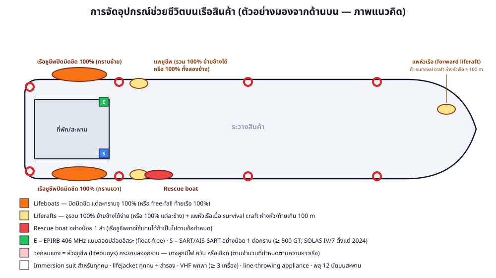
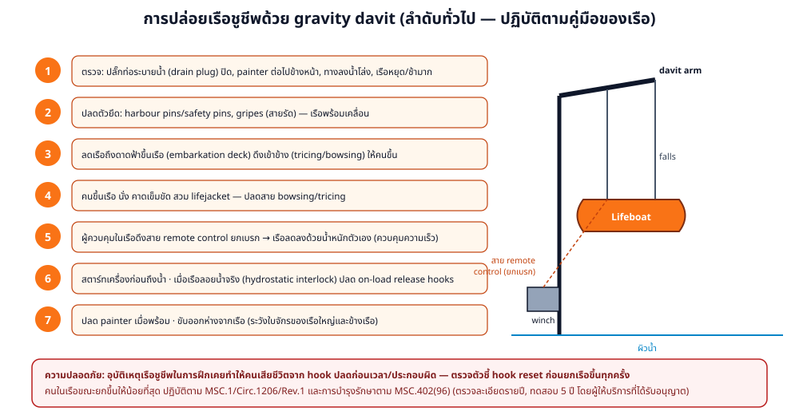
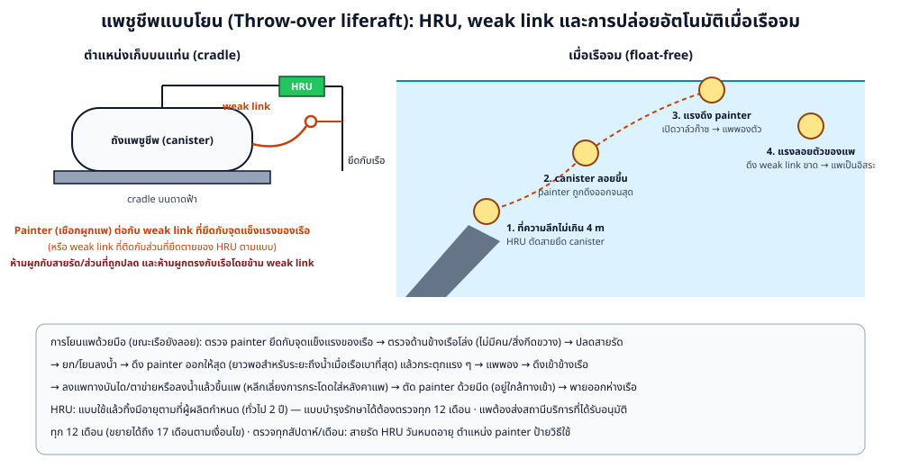
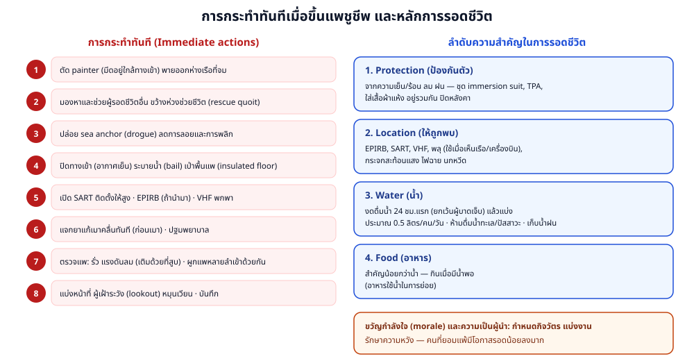
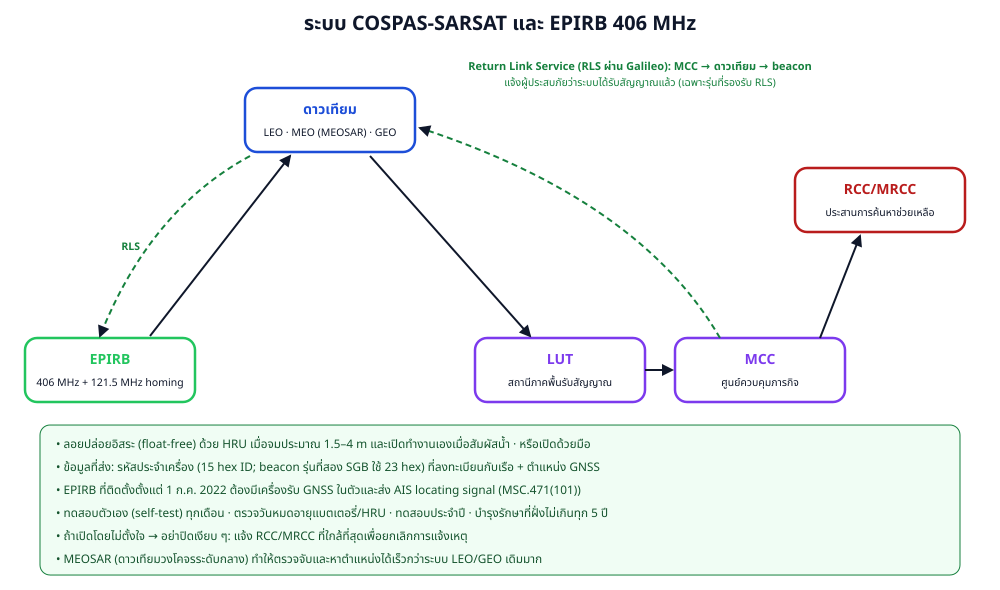
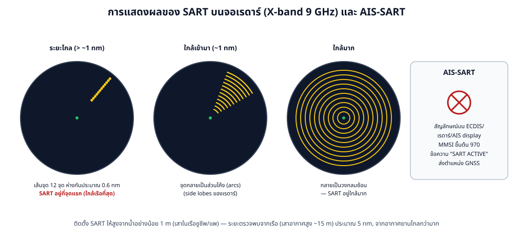
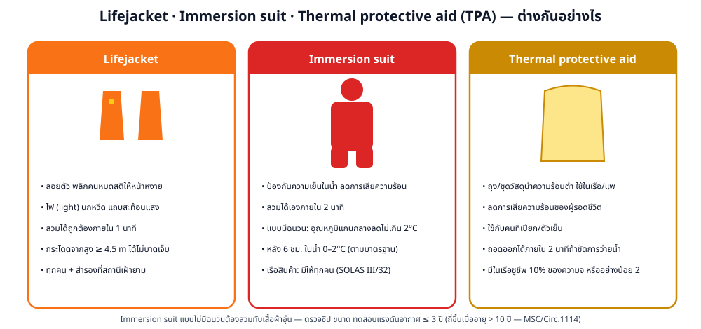
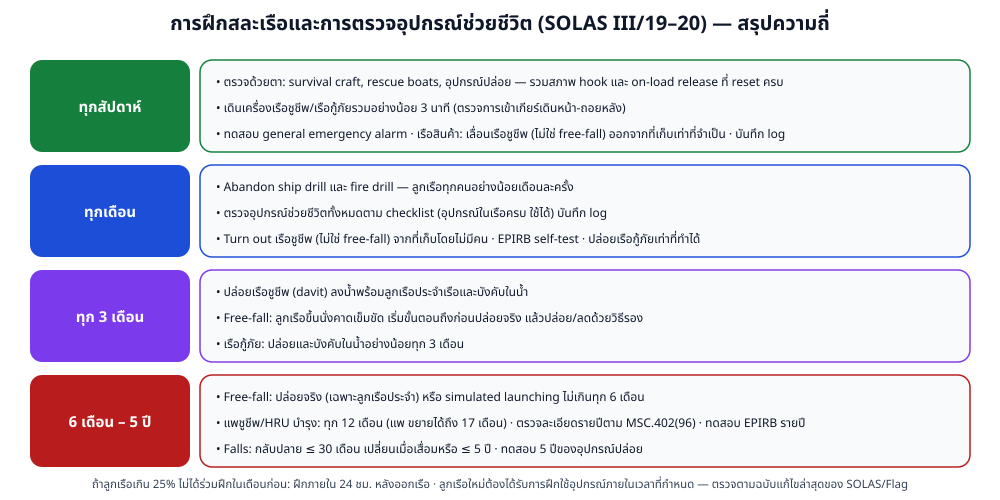

# 3.4 Operate Life-Saving Appliances — อุปกรณ์ช่วยชีวิตและการสละเรือ

> สมุดบันทึกการฝึก OOW · TIRAPHONG NANTAPAN
> Function 3: **Controlling the operation of the ship and care for persons on board at the operational level**
> สมรรถนะตาม STCW A-II/1: *Operate life-saving appliances* — Life-saving: *Ability to organize abandon ship drills and knowledge of the operation of survival craft and rescue boats, their launching appliances and arrangements, and their equipment, including radio life-saving appliances, satellite EPIRBs, SARTs, immersion suits and thermal protective aids*
> เกณฑ์ประเมิน: *Actions in responding to abandon ship and survival situations are appropriate to the prevailing circumstances and conditions and comply with accepted safety practices and standards*
>
> อ้างอิงหลัก: **SOLAS บทที่ III** (Life-saving appliances and arrangements — III/7, 8, 19, 20, 31, 32, 35, 36, 37) และบทที่ IV (Radiocommunications — EPIRB, SART/search and rescue locating devices); **LSA Code** (International Life-Saving Appliance Code); IMO Res. **MSC.402(96)** (maintenance, thorough examination, operational testing, overhaul and repair of lifeboats and rescue boats, launching appliances and release gear); **MSC.1/Circ.1206/Rev.1** (measures to prevent accidents with lifeboats); MSC.320(89) (การแก้ไข LSA Code ข้อ 4.4.7.6 — ข้อกำหนดใหม่ของ on-load release mechanism) และ MSC.1/Circ.1392 (Guidelines for evaluation and replacement of lifeboat release and retrieval systems); MSC.535(107) (ventilation ของเรือชูชีพปิดมิดชิด — มีผล 1 ม.ค. 2026 ใช้กับเรือชูชีพที่ติดตั้งตั้งแต่ 1 ม.ค. 2029), MSC.554(108) (การแก้ไข LSA Code — lifejacket, hook, ความเร็วลดเรือ — ใช้กับอุปกรณ์ที่ติดตั้งตั้งแต่ 1 ม.ค. 2026) และ MSC.559(108) (แก้ MSC.402(96)); MSC.496(105) (บทที่ IV ฉบับปรับปรุง GMDSS — มีผล 1 ม.ค. 2024, ย้ายข้อกำหนด VHF พกพาและ SART จาก III/6.2 ไป IV/7); MSC.471(101) (performance standards ของ float-free EPIRB 406 MHz ที่ติดตั้งตั้งแต่ 1 ก.ค. 2022); MSC/Circ.1047 และ MSC/Circ.1114 (การตรวจ immersion suit); SOLAS III/6 (distress signals), III/13 (stowage of survival craft), III/18 (line-throwing appliances); IAMSAR Manual Vol III; STCW A-VI/1-1 (Personal survival techniques) และ A-VI/2-1 (Proficiency in survival craft and rescue boats); IMO Model Course 1.19 และ 1.23; COSPAS-SARSAT documentation; Training manual และ maintenance instructions ของเรือ

---

## 0. ทำไม OOW ต้องเชี่ยวชาญเรื่องนี้

การสละเรือ (abandon ship) เป็นการตัดสินใจของนายเรือ แต่ **ความพร้อม** ของอุปกรณ์ช่วยชีวิตเกิดจากงานประจำวันของเจ้าหน้าที่ — OOW มักได้รับมอบหมายให้ดูแลเรือชูชีพ แพชูชีพ หรืออุปกรณ์วิทยุช่วยชีวิต ทำการตรวจประจำสัปดาห์/เดือน และ **จัดการฝึกสละเรือ** และเมื่อเหตุจริงเกิดในยามของเรา OOW คือผู้ส่ง distress alert คนแรก

สิ่งที่น่าเศร้าในประวัติศาสตร์คือ **คนเรือจำนวนไม่น้อยเสียชีวิตจากอุปกรณ์ช่วยชีวิตเองระหว่างการฝึก** (โดยเฉพาะเรือชูชีพตกเพราะ hook ปลดก่อนเวลา) — ความรู้ที่ถูกต้องจึงช่วยทั้งในเหตุจริงและทำให้การฝึกปลอดภัย

---

## 1. อุปกรณ์ช่วยชีวิตที่ต้องมีบนเรือสินค้า (ภาพรวม)

*ภาพที่ 3.4-1 ตัวอย่างการจัดอุปกรณ์ช่วยชีวิตบนเรือสินค้า (ภาพแนวคิด)*

| อุปกรณ์ | ข้อกำหนดหลัก (เรือสินค้า — SOLAS III/31, 32 และ IV) |
|---|---|
| **Survival craft** | **ทางเลือก 1**: เรือชูชีพปิดมิดชิด (totally enclosed) **แต่ละกราบจุ 100%** ของคนบนเรือ + แพชูชีพจุรวม 100% ที่ย้ายข้างได้ง่ายบนดาดฟ้าโล่งระดับเดียว (ถ้าย้ายไม่ได้ ต้อง 100% แต่ละกราบ) · **ทางเลือก 2**: **เรือชูชีพ free-fall ท้ายเรือจุ 100%** + แพชูชีพจุ 100% **ในแต่ละกราบ** โดยแพอย่างน้อยกราบหนึ่งต้องมีอุปกรณ์ปล่อย (davit-launched) · เรือที่ survival craft อยู่ห่างหัว/ท้ายเกิน 100 m ต้องมี **แพเพิ่มทางหัวเรือ** (เก็บไว้หน้าสุด/ท้ายสุดเท่าที่ทำได้) · เรือสินค้ายาวน้อยกว่า 85 m ที่ไม่ใช่ tanker อาจใช้ทางเลือกแพชูชีพแทนเรือชูชีพตามเงื่อนไขของ III/31 · เรือบรรทุกน้ำมัน/สารเคมี/ก๊าซ ใช้เรือชูชีพแบบ fire-protected หรือมีระบบอากาศในตัวตามชนิดสินค้า (III/31 และ LSA Code 4.8, 4.9) |
| **Rescue boat** | อย่างน้อย 1 ลำ (เรือชูชีพที่เป็นไปตามข้อกำหนด rescue boat ใช้แทนได้) |
| **Lifejackets** | ทุกคน + สำรองสำหรับผู้เฝ้ายามและที่สถานี survival craft ที่อยู่ไกล — มีไฟ นกหวีด แถบสะท้อนแสง |
| **Immersion suits** | **ทุกคนบนเรือสินค้า** (ขนาดเหมาะสม) + สำรองตามจุดที่กำหนด |
| **Thermal protective aids (TPA)** | ในเรือชูชีพ 10% ของความจุหรืออย่างน้อย 2 ชิ้น และสำหรับคนที่ไม่มี immersion suit |
| **Lifebuoys** | จำนวนตามความยาวเรือ (SOLAS III/32.1: ต่ำกว่า 100 m = 8; 100 ถึงต่ำกว่า 150 m = 10; 150 ถึงต่ำกว่า 200 m = 12; 200 m ขึ้นไป = 14) อย่างน้อยครึ่งหนึ่งมีไฟติดอัตโนมัติ (self-igniting lights), **อย่างน้อย 2 ลูกมีไฟและควันอัตโนมัติ ปล่อยได้เร็วจากสะพานเดินเรือ** (สำหรับคนตกน้ำ — 1.5), อย่างน้อย 1 ลูกต่อกราบมีเชือกลอยน้ำ (buoyant lifeline) ยาวไม่น้อยกว่าสองเท่าของความสูงที่เก็บเหนือน้ำเมื่อเรือเบาที่สุดหรือ 30 m แล้วแต่ค่าใดมากกว่า — ลูกที่มีเชือกไม่ติดไฟ (III/7.1, LSA Code 2.1) |
| **Distress signals** | **พลุร่มชูชีพ (rocket parachute flares) อย่างน้อย 12 นัดบนหรือใกล้สะพานเดินเรือ** |
| **Line-throwing appliance** | SOLAS III/18 + LSA Code 7.1: ลูกยิง (projectile) อย่างน้อย 4 ลูก และเชือกอย่างน้อย 4 เส้น (แรงดึงขาดแต่ละเส้นไม่น้อยกว่า 2 kN) ยิงเชือกได้ไกลอย่างน้อย 230 m ในอากาศสงบ |
| **Radio life-saving appliances** | **VHF พกพาสองทาง** — เรือ ≥ 500 GT อย่างน้อย 3 เครื่อง (300–500 GT อย่างน้อย 2), **SART/AIS-SART** (search and rescue locating device) — ≥ 500 GT อย่างน้อย 1 เครื่องต่อกราบ (300–500 GT อย่างน้อย 1), **EPIRB 406 MHz แบบ float-free** (IV/7) — หมายเหตุ: เดิมข้อกำหนด VHF พกพาและ SART อยู่ใน III/6.2 ตั้งแต่ 1 ม.ค. 2024 ย้ายไปรวมใน **SOLAS IV/7** (MSC.496(105)) จำนวนเครื่องยังเท่าเดิม |
| **General emergency alarm, PA** | ใช้เรียกรวมพล |
| **Muster list, emergency instructions, training manual, maintenance instructions** | SOLAS III/8, 35, 36, 37 |

### 1.1 ตัวเลขเวลาที่ต้องจำ (SOLAS III/13, III/31 และ LSA Code)

| เรื่อง | ข้อกำหนด |
|---|---|
| เตรียม survival craft ก่อนลงเรือและปล่อย | คนประจำเรือ 2 คนทำได้ภายใน **ไม่เกิน 5 นาที** (III/13) |
| คนขึ้นเรือชูชีพของเรือสินค้าครบจำนวน | ภายใน **3 นาที** นับจากสั่งให้ขึ้นเรือ (LSA Code 4.4.3) |
| ปล่อย survival craft ทั้งหมดที่ต้องมี (เรือสินค้า) | พร้อมคนและอุปกรณ์ครบ ภายใน **10 นาที** นับจากสัญญาณสละเรือ (III/31) — เรือโดยสารใช้ 30 นาที (III/21) |
| สภาพเรือที่ต้องปล่อยได้ | trim ถึง 10° และ list ถึง 20° ไปกราบใดก็ได้ (LSA Code 6.1.1) |
| ความเร็วลดเรือ (davit/falls) | ไม่น้อยกว่า S = 0.4 + 0.02H m/s (H = ความสูงจาก davit head ถึงน้ำเมื่อเรือเบาที่สุด) — อุปกรณ์ที่ติดตั้งตั้งแต่ 1 ม.ค. 2026 ใช้ค่าที่น้อยกว่าระหว่างสูตรกับ 1.0 m/s และความเร็วสูงสุด 1.3 m/s (LSA 6.1.2.8 และ 6.1.2.10 แก้โดย MSC.554(108)) |

> **ตัวอย่างจำลอง — ความเร็วลดเรือชูชีพ MV Andaman Star**: davit head สูงจากน้ำ 22 m เมื่อเรือเบา → S ขั้นต่ำ = 0.4 + 0.02 × 22 = **0.84 m/s** → ลดถึงน้ำใช้เวลาราว 22 / 0.84 ≈ **26 วินาที** (ประมาณการ) · ถ้า H = 35 m สูตรได้ 1.10 m/s แต่สำหรับอุปกรณ์ใหม่ใช้ค่าขั้นต่ำ 1.0 m/s (ค่าที่น้อยกว่า) — จดไว้ว่าเบรกที่ลดเร็วหรือช้าผิดปกติคือสิ่งที่ต้องรายงาน

### 1.2 สัญญาณพลุและเครื่องยิงเชือก (LSA Code บทที่ III และ VII)

| อุปกรณ์ | สมรรถนะขั้นต่ำ (โดยสรุป) | ใช้อย่างไร |
|---|---|---|
| **Rocket parachute flare** | ขึ้นสูงไม่น้อยกว่า 300 m, แสงแดงสว่างไม่น้อยกว่า 30,000 cd, ลุกไหม้ไม่น้อยกว่า 40 วินาที, ร่มลงช้าไม่เกิน 5 m/s | ยิงเมื่อเห็นเรือ/อากาศยาน (หรือได้ยินเสียง) ถือแน่นชี้ขึ้นฟ้าตามคำแนะนำบนตัวพลุ ห้ามชี้ไปทางคน/อากาศยาน |
| **Hand flare** | แสงแดงไม่น้อยกว่า 15,000 cd, ลุกไหม้ไม่น้อยกว่า 1 นาที, ยังลุกหลังจุ่มน้ำลึก 100 mm นาน 10 วินาที | ใช้นำทางผู้ช่วยเหลือเข้าหาเมื่ออยู่ใกล้ ถือไว้ใต้ลมนอกแพ |
| **Buoyant smoke signal** | ควันสีที่มองเห็นชัด (มักสีส้ม) ไม่น้อยกว่า 3 นาที ลอยน้ำได้ ไม่ระเบิด | ใช้กลางวัน ทิ้งด้านใต้ลมของแพ |
| **Line-throwing appliance** | 4 projectiles + 4 lines (≥ 2 kN) ระยะไม่น้อยกว่า 230 m | ใช้ส่งเชือกระหว่างเรือ/เรือกับฝั่ง ต้องมีคำแนะนำการใช้ |

- พลุทุกชนิดมี **วันหมดอายุ** (ผู้ผลิตกำหนด โดยทั่วไปประมาณ 3 ปี) — ของหมดอายุต้องเปลี่ยนและกำจัดตามวิธีที่ปลอดภัย (ส่งคืนผู้ขาย/สถานีรับทิ้งที่ท่า) ห้ามยิงทิ้งในทะเลเพราะอาจถูกเข้าใจว่าเป็น distress (SOLAS V/35)
- เรือสินค้าต้องมี rocket parachute flare **อย่างน้อย 12 นัด** บนหรือใกล้สะพานเดินเรือ (III/6.3); ในเรือชูชีพและแพ SOLAS A pack มี rocket 4 / hand flare 6 / smoke 2

---

## 2. เรือชูชีพ (Lifeboats)

### 2.1 ชนิด

- **Totally enclosed lifeboat** — หลังคาปิดมิดชิด ตั้งตรงได้เอง (self-righting) — มาตรฐานของเรือสินค้า
- **Free-fall lifeboat** — ติดตั้งบนรางลาดที่ท้ายเรือ ปล่อยไถลตกลงน้ำทั้งที่มีคนนั่งคาดเข็มขัด — ปล่อยได้เร็วแม้เรือเอียง/โคลง ไม่ต้องใช้ falls
- **Fire-protected lifeboat** (tanker/chemical/gas) — มีระบบฉีดน้ำรอบลำ (sprinkler) และระบบอากาศหายใจในตัว — แล่นผ่านน้ำมันที่ลุกไหม้ได้ระยะหนึ่ง (LSA Code 4.9: ทนไฟน้ำมันที่ล้อมรอบต่อเนื่องได้ไม่น้อยกว่า **8 นาที**; LSA 4.8: ระบบอากาศในตัว (self-contained air support) ให้อากาศหายใจได้และเครื่องยนต์เดินได้ไม่น้อยกว่า **10 นาที** โดยความดันภายในไม่ต่ำกว่าภายนอก)
- **Partially enclosed** — เรือโดยสาร

**สมรรถนะที่ควรรู้ของเรือชูชีพ (LSA Code 4.4)** — เมื่อบรรทุกเต็มต้องแล่นได้ไม่น้อยกว่า **6 นอต** ในน้ำสงบ และลากแพชูชีพ 25 คนที่บรรทุกเต็มได้ไม่น้อยกว่า **2 นอต**, มีเชื้อเพลิงพอแล่นที่ 6 นอตได้ไม่น้อยกว่า **24 ชั่วโมง**, เครื่องยนต์ต้องสตาร์ทได้แม้อากาศเย็นจัดตามเกณฑ์ทดสอบของ LSA Code, เรือชูชีพปิดมิดชิดต้อง **ตั้งตรงได้เอง (self-righting)** เมื่อคนคาดเข็มขัดอยู่ครบ; การคำนวณความจุใช้มวลเฉลี่ยต่อคนตามที่ LSA Code กำหนด (เรือชูชีพที่ติดตั้งรุ่นใหม่ใช้ 82.5 kg ต่อคน — ตรวจกับฉบับปัจจุบัน)

### 2.2 อุปกรณ์ปล่อย (Launching appliances)

- **Gravity davits** — เรือเลื่อนออกนอกกราบด้วยน้ำหนักตัวเองเมื่อยกเบรกของกว้าน (winch) — ไม่ต้องใช้กำลังไฟฟ้า; ปล่อยได้แม้เรือเอียง 20° และ trim 10° (ตามข้อกำหนดการออกแบบ)
- **Falls** (ลวดสลิง) — กลับปลาย (end-for-end) ไม่เกินทุก 30 เดือน และเปลี่ยนเมื่อเสื่อมหรือไม่เกินทุก 5 ปี (แล้วแต่ข้อใดถึงก่อน)
- **Release gear** — **on-load release** (ปลดได้แม้ยังรับน้ำหนัก ต้องมีระบบป้องกันการปลดโดยไม่ตั้งใจ — hydrostatic interlock ป้องกันการปลดก่อนเรือลอยน้ำ เว้นแต่ใช้การ override โดยเจตนา) และ off-load release; ระบบปลดตาม MSC.320(89) ใช้กับเรือทุกลำหลังช่วงเปลี่ยนผ่าน — SOLAS III/1.5 (แก้ไขโดย MSC.317(89)) ให้ประเมินระบบปลดของเรือที่มีอยู่ตาม MSC.1/Circ.1392 และเปลี่ยนตัวที่ไม่ผ่าน **ไม่ช้ากว่าการเข้าอู่แห้งตามกำหนดครั้งแรกหลัง 1 ก.ค. 2014 แต่ไม่เกิน 1 ก.ค. 2019**; สำหรับอุปกรณ์ที่ติดตั้งตั้งแต่ 1 ม.ค. 2026 MSC.554(108) เพิ่มข้อกำหนดว่า hook ต้องรับน้ำหนักไม่ได้จนกว่าจะ reset สมบูรณ์ ตัวชี้ต้องไม่แสดงว่า reset ถ้ายังไม่สมบูรณ์ และติดป้ายเตือนอันตรายที่ hook
- **Remote control wire** — ผู้ควบคุมในเรือชูชีพยกเบรกเพื่อลดเรือได้จากภายใน
- **Free-fall** — release hook ควบคุมด้วยปั๊มไฮดรอลิกมือภายในเรือ และ **วิธีลดเรือรอง (secondary means)** ด้วย davit/crane สำหรับการฝึกและการกู้กลับ

### 2.3 การปล่อยเรือชูชีพด้วย davit

*ภาพที่ 3.4-2 ลำดับทั่วไปของการปล่อยเรือชูชีพด้วย gravity davit*

1. **ตรวจก่อนปล่อย** — ปลั๊กระบายน้ำ (drain plug) ปิด, painter ต่อไปข้างหน้าของเรือ (ให้เรือชูชีพถูกดึงไปตามเรือใหญ่ไม่ให้ไถลไปท้าย), ทางลงน้ำโล่ง, เรือใหญ่หยุดหรือช้ามาก, สร้างที่กำบังลม (lee) ด้านที่ปล่อยตามที่นายเรือสั่ง
2. **ปลดตัวยึด** — harbour pins/safety pins, gripes (สายรัด)
3. **ลดเรือถึงดาดฟ้าขึ้นเรือ (embarkation deck)** ดึงเข้าข้างด้วย tricing pendants/bowsing tackles
4. **คนขึ้นเรือ** สวม lifejacket นั่งและคาดเข็มขัด ปลด tricing/bowsing (ลำดับทั่วไป: ใส่ bowsing tackles ยึดเรือเข้าข้างแล้วปลด tricing pendants ก่อน เมื่อคนขึ้นครบจึงผ่อน bowsing tackles ออกช้า ๆ ให้เรือแกว่งออกแล้วปลด — ทำตามคู่มือ davit ของเรือ)
5. **ผู้ควบคุมในเรือ** ดึงสาย remote control ยกเบรก → เรือลดลงด้วยน้ำหนักตัวเอง (ควบคุมความเร็ว)
6. **สตาร์ทเครื่องก่อนถึงน้ำ** — เมื่อเรือลอยน้ำ (hydrostatic interlock ปลดล็อก) **ปลด on-load release hooks** พร้อมกันทั้งหัว-ท้าย
7. **ปลด painter** เมื่อพร้อม ขับออกห่างจากข้างเรือและใบจักรของเรือใหญ่

**ความปลอดภัยในการฝึก** (MSC.1/Circ.1206/Rev.1 และคู่มือผู้ผลิต)
- ตรวจ **hook ถูก reset อย่างถูกต้อง** (ตัวชี้/เครื่องหมาย) ก่อนยกเรือขึ้นทุกครั้ง
- ให้คนในเรือขณะยกขึ้น/ลงน้อยที่สุดตามขั้นตอน; ใช้ fall preventer devices ตามนโยบายบริษัทเมื่อกำหนด
- ห้ามคนอยู่ใต้เรือชูชีพที่แขวน, ระวังมือ/นิ้วที่ falls และ blocks
- การบำรุงรักษาและทดสอบตาม **MSC.402(96)**: ตรวจรายสัปดาห์/รายเดือนโดยลูกเรือ, **ตรวจละเอียดรายปี (annual thorough examination)** และ **ทดสอบรอบ 5 ปี** (รวมการทดสอบเบรกกว้านและ release gear ภายใต้น้ำหนัก) โดย **ผู้ให้บริการที่ได้รับอนุญาต**

### 2.4 การปล่อยเรือชูชีพแบบ free-fall

1. ตรวจรางปล่อยโล่ง ทิศทางลงน้ำปลอดภัย
2. คนขึ้นเรือ นั่งในที่ คาดเข็มขัดแบบ harness ปรับหมอนรองศีรษะ ปิดประตู
3. ปลดตัวยึดสำหรับการเดินทาง (lashings/pins) ตามคู่มือ
4. ผู้ควบคุมตรวจความพร้อม — **สตาร์ทเครื่อง** — ปั๊มไฮดรอลิกปลดตะขอ → เรือไถลตกลงน้ำ
5. ขับออกห่างจากเรือทันที
- การฝึก: ทุก 3 เดือน ลูกเรือขึ้นนั่งคาดเข็มขัดและทำขั้นตอนถึงก่อนการปลดจริง แล้วปล่อยแบบ free-fall (เฉพาะลูกเรือประจำ) หรือลดด้วยวิธีรอง แล้วบังคับเรือในน้ำ; ไม่เกินทุก 6 เดือนต้องปล่อยแบบ free-fall จริง (เฉพาะลูกเรือประจำ) หรือทำ **simulated launching** ตามแนวทาง IMO

### 2.5 อุปกรณ์ในเรือชูชีพ (ตัวอย่างสำคัญตาม LSA Code)

| หมวด | อุปกรณ์ |
|---|---|
| **การลอยและการเดินเรือ** | พาย/อุปกรณ์ขับเคลื่อน, เข็มทิศ, sea anchor, painters, ขอเรือ (boat hook), ที่ตักน้ำ/ถัง, ปั๊มมือ, ไฟฉายกันน้ำ, ไฟค้นหา (searchlight), radar reflector, เครื่องมือเครื่องยนต์, ถังดับเพลิง |
| **สัญญาณ** | **พลุร่มชูชีพ 4 นัด**, **พลุมือ 6 นัด**, **ควันลอยน้ำ 2 ลูก**, กระจกสะท้อนแสงกลางวัน, นกหวีด, **ตารางสัญญาณช่วยชีวิต (life-saving signals)** |
| **การดำรงชีพ** | **น้ำดื่ม 3 ลิตรต่อคน**, ที่ตักน้ำ แก้วน้ำ, **อาหาร (ration) อย่างน้อย 10,000 kJ ต่อคน**, ยาแก้เมาคลื่น (สำหรับ 48 ชม. ต่อคน) และถุงอาเจียน, อุปกรณ์ปฐมพยาบาล, **TPA**, อุปกรณ์ตกปลา, มีดพับ, ที่เปิดกระป๋อง, ห่วงช่วยชีวิตลอยน้ำ 2 อัน พร้อมเชือก, คู่มือการรอดชีวิต |
| **วิทยุ (นำไปจากเรือ)** | SART/AIS-SART, VHF พกพา (ตามแผนว่าใครนำไป) |

(รายการเต็มและจำนวนดู LSA Code 4.4.8 และ checklist ประจำเดือนของเรือ — อุปกรณ์หมดอายุ เช่นพลุ น้ำ อาหาร ยา ต้องเปลี่ยนตามกำหนด)

รายละเอียดที่มักถูกถามเพิ่ม: น้ำ 3 ลิตรต่อคนนั้นทดแทนบางส่วนได้ด้วยเครื่องกลั่นน้ำทะเล (desalting apparatus/reverse osmosis แบบมือหมุน) ที่ผลิตน้ำเท่ากันได้ใน 2 วัน · painter ของเรือชูชีพยาวไม่น้อยกว่าสองเท่าของระยะจากที่เก็บถึงน้ำเมื่อเรือเบาที่สุดหรือ 15 m แล้วแต่ค่าใดมากกว่า · ห่วงช่วยชีวิตลอยน้ำ (buoyant rescue quoit) 2 อัน ผูกเชือกลอยน้ำยาวไม่น้อยกว่า 30 m · radar reflector ไม่ต้องมีถ้ามี SART เก็บไว้ในเรือ

### 2.6 ข้อกำหนดใหม่ด้านอุปกรณ์ช่วยชีวิต (2024–2029) — จดไว้กันลืม

| มีผล | เรื่อง | สาระสำคัญ |
|---|---|---|
| 1 ม.ค. 2020 | MSC.402(96) + SOLAS III/3, III/20 (MSC.404(96)) | การบำรุงรักษา ตรวจละเอียดรายปี ทดสอบ overhaul และซ่อม เรือชูชีพ เรือกู้ภัย อุปกรณ์ปล่อยและ release gear โดยผู้ให้บริการที่ได้รับอนุญาต |
| 1 ก.ค. 2022 (การติดตั้ง) | MSC.471(101) | EPIRB 406 MHz ที่ติดตั้งใหม่ต้องมี GNSS ในตัว, AIS locating signal และ 121.5 MHz homing |
| 1 ม.ค. 2024 | MSC.496(105) — SOLAS IV ฉบับใหม่ (GMDSS modernization) | ข้อกำหนด VHF พกพาและ SART ย้ายจาก III/6.2 ไป IV/7 · VHF-EPIRB ใช้แทน satellite EPIRB ในเขต A1 ไม่ได้อีก; พร้อมกันมีการแก้ III/LSA เล็กน้อย (เช่น เรือกู้ภัยมวลไม่เกิน 700 kg ไม่ต้องมีพลังงานกลสะสมสำหรับการปล่อย และไม่ต้องทดสอบปล่อย free-fall ขณะเรือแล่น 5 นอต — ตรวจรายละเอียดกับฉบับปัจจุบัน) |
| 1 ม.ค. 2026 | MSC.554(108) (อุปกรณ์ที่ติดตั้งตั้งแต่ 1 ม.ค. 2026) | lifejacket ต้องพลิกคนหมดสติจากคว่ำเป็นหงายให้จมูกและปากพ้นน้ำภายในเวลาที่เทียบกับเสื้อชูชีพอ้างอิง · hook ป้องกันการปลดโดยไม่ตั้งใจระหว่างยกเรือขึ้น · ความเร็วลดเรือขั้นต่ำ/สูงสุด (ข้อ 1.1) |
| 1 ม.ค. 2026 | MSC.535(107) → ใช้กับ **เรือชูชีพปิดมิดชิดที่ติดตั้งตั้งแต่ 1 ม.ค. 2029** | ต้องมีการระบายอากาศอย่างน้อย **5 m³/h ต่อคน** ตามจำนวนคนที่เรือรับได้ นาน **ไม่น้อยกว่า 24 ชั่วโมง** ควบคุมได้จากภายใน ไม่เกิดการแบ่งชั้นหรือช่องอากาศอับ ช่องลมปิดได้จากภายในและปิดไว้ระหว่างเก็บ/ปล่อย; ถ้าใช้พลังงานห้ามใช้แบตเตอรี่วิทยุ |
| 1 ม.ค. 2026 | MSC.559(108) (แก้ MSC.402(96)) | เพิ่มการตรวจระบบระบายอากาศของเรือชูชีพในการตรวจละเอียดรายปี |

เหตุผลของเรื่อง ventilation คือในเรือชูชีพปิดมิดชิดที่คนนั่งเต็ม CO₂ และความร้อนสะสมเร็วมาก โดยเฉพาะในเขตร้อน — ผู้รอดชีวิตต้องเปิดช่องลมเป็นระยะแม้ในเรือรุ่นเก่า

---

## 3. แพชูชีพ (Liferafts)

*ภาพที่ 3.4-3 แพชูชีพแบบโยน การติดตั้ง HRU และ weak link และการปล่อยอัตโนมัติเมื่อเรือจม*

### 3.1 ชนิดและการติดตั้ง

- **Throw-over (โยน)** — ถังแพบนแท่น (cradle) ยึดด้วยสายรัดผ่าน **HRU (hydrostatic release unit)**
- **Davit-launched** — ใช้ปั้นจั่นเฉพาะ คนขึ้นแพบนดาดฟ้าแล้วหย่อนลง (เรือโดยสาร/เรือที่ freeboard สูง)
- **Painter** — เชือกผูกแพ ยาวไม่น้อยกว่า **10 m บวกระยะจากที่เก็บถึงน้ำเมื่อเรือเบาที่สุด หรือ 15 m แล้วแต่ค่าใดมากกว่า** (LSA Code 4.1) ต่อกับ **weak link** ซึ่งยึดกับจุดแข็งแรงของเรือ — **ไม่ผูก painter กับ HRU โดยตรง** (หมายถึงห้ามผูกกับสายรัดหรือส่วนของ HRU ที่ถูกตัด/ปลดออก; HRU บางรุ่นมี weak link ติดมากับส่วนที่ยึดตายกับดาดฟ้า ให้ผูกตามป้ายและคู่มือของรุ่นนั้น) และห้ามผูก painter ตรงกับเรือโดยข้าม weak link เพราะแพจะถูกดึงจมไปกับเรือ
- **การทำงานเมื่อเรือจม (float-free)**: ที่ความลึกไม่เกิน 4 m HRU ตัดสายรัด → ถังลอยขึ้น → painter ถูกดึงออกจนสุดและเปิดวาล์วก๊าซ → แพพอง → แรงลอยตัวของแพดึง weak link ขาด → แพเป็นอิสระจากเรือที่จม
- **ชุดอุปกรณ์**: **SOLAS A pack** (การเดินทางระหว่างประเทศ — อุปกรณ์ครบ น้ำ **1.5 ลิตรต่อคน** อาหาร 10,000 kJ ต่อคน พลุ rocket 4 / hand flare 6 / smoke 2, TPA 10% ของความจุหรืออย่างน้อย 2) และ **SOLAS B pack** (การเดินทางระยะสั้นตามที่กำหนด — จำนวนน้อยกว่า) · แพชูชีพต้องจุได้ไม่น้อยกว่า 6 คน
- **การบำรุงรักษา** — ส่ง **สถานีบริการที่ได้รับอนุมัติทุก 12 เดือน** (ขยายได้ถึง 17 เดือนตามเงื่อนไขของ Administration); HRU แบบใช้แล้วทิ้งเปลี่ยนตามวันหมดอายุ (โดยทั่วไป 2 ปี) แบบบำรุงรักษาได้ส่งตรวจทุก 12 เดือน; ตรวจประจำ: สายรัดไม่พันกัน HRU วันหมดอายุ painter ต่อถูกต้อง ป้ายวิธีใช้ ถังไม่เสียหาย

### 3.2 การปล่อยแพแบบโยนด้วยมือ (เมื่อเรือยังลอย)

1. ตรวจว่า **painter ยึดกับจุดแข็งแรงของเรือ**
2. ตรวจด้านข้างเรือที่จะโยน — **ไม่มีคน/สิ่งกีดขวางในน้ำ** อยู่ด้านใต้ลม (ถ้าเลือกได้)
3. ปลดสายรัด (ปลดที่ slip hook/HRU ตามแบบ)
4. **โยนหรือกลิ้งถังลงน้ำ** (สองคน)
5. **ดึง painter ออกให้สุดแล้วกระตุกแรง** → แพพอง (ใช้เวลาไม่กี่สิบวินาที)
6. ดึงแพเข้าข้างเรือ ลงแพทาง **บันไดลง (embarkation ladder)/ตาข่าย** หรือลงน้ำแล้วขึ้นทางทางขึ้นแพ — **หลีกเลี่ยงการกระโดดลงบนหลังคาแพ** (บาดเจ็บ/แพเสียหาย) เว้นแต่ระยะต่ำตามที่แพออกแบบให้กระโดดได้
7. เมื่อทุกคนขึ้นแล้ว **ตัด painter** ด้วยมีด (อยู่ใกล้ทางเข้า) แล้วพายออกห่างจากเรือ

### 3.3 แพที่พองกลับหัว (capsized liferaft)

- ลงน้ำ ไปด้านที่มีถังก๊าซ (ป้ายบอก "righting here") จับสาย righting strap ปีนขึ้นบนถังก๊าซ หันหน้าเข้าลม ดึงสายและเอนตัวไปข้างหลัง → แพพลิกกลับ (ระวังแพตกทับ — ว่ายออกจากใต้แพ)

---

## 4. การกระทำทันทีเมื่อขึ้นแพชูชีพและการรอดชีวิต

*ภาพที่ 3.4-4 การกระทำทันทีเมื่อขึ้นแพชูชีพและลำดับความสำคัญในการรอดชีวิต*

**Immediate actions** — ตัด painter และออกห่างเรือ · มองหาผู้รอดชีวิตอื่น (ขว้างห่วงช่วยชีวิต) · ปล่อย **sea anchor/drogue** (ลดการลอยไปไกลจากตำแหน่งเกิดเหตุและลดการพลิก) · ปิดทางเข้าในอากาศเย็น · ระบายน้ำออก (bail) · เป่าพื้นแพชั้นฉนวน · **เปิด SART และติดตั้งให้สูง**, EPIRB (ถ้านำมา) · **แจกยาแก้เมาคลื่นทันที** · ปฐมพยาบาล · ตรวจแพ (รั่ว แรงดัน — เติมด้วยที่สูบ) · ผูกแพหลายลำเข้าด้วยกัน (เป้าใหญ่ขึ้น หาง่ายขึ้น) · แบ่งหน้าที่ ผู้เฝ้าระวังหมุนเวียน · อ่านคู่มือการรอดชีวิตในแพ

**ลำดับความสำคัญในการรอดชีวิต**
1. **Protection** — จากความเย็น (hypothermia — สาเหตุการเสียชีวิตหลัก), ความร้อน/แดด, ลม คลื่น — immersion suit, TPA, เสื้อผ้าแห้ง อยู่ชิดกัน
2. **Location** — ทำให้ถูกพบ: EPIRB, SART, VHF, **พลุใช้เมื่อเห็นเรือหรือเครื่องบินเท่านั้น** (ไม่เปลือง), กระจกสะท้อนแสงกลางวัน, ไฟฉาย นกหวีด
3. **Water** — งดดื่มใน 24 ชม.แรกยกเว้นผู้บาดเจ็บ/ป่วย (ร่างกายเก็บน้ำไว้) จากนั้นแบ่งประมาณ 0.5 ลิตรต่อคนต่อวัน — **ห้ามดื่มน้ำทะเลหรือปัสสาวะ** — เก็บน้ำฝน
4. **Food** — สำคัญรองลงมา (การย่อยอาหารใช้น้ำ) — กินเมื่อมีน้ำเพียงพอ

**ในน้ำ (ถ้าต้องลงน้ำ)**: สวม lifejacket/immersion suit อย่างถูกต้อง กระโดดจากที่ต่ำที่สุด (เท้าลง ไขว้แขนกด lifejacket ปิดจมูกปาก มองข้างล่างว่าโล่ง) ว่ายออกจากเรือ ใช้ท่า **HELP** (Heat Escape Lessening Posture — กอดเข่า) เมื่ออยู่คนเดียว หรือ **huddle** (กอดกันเป็นกลุ่ม) ลดการเสียความร้อน; อย่าว่ายน้ำโดยไม่จำเป็น (เสียความร้อนเร็ว)

**การถูกช่วยเหลือ** — จากเรือ: ทำตามคำแนะนำของเรือกู้ภัย (lee side, ตาข่าย, ยกในท่านอนถ้าทำได้); จากเฮลิคอปเตอร์: ให้สายยก (strop/hi-line) แตะน้ำ/ทะเลก่อนจับ (คลายไฟฟ้าสถิต) ห้ามผูกสายยึดกับแพ ทำตามสัญญาณ winchman (1.6)

---

## 5. เรือกู้ภัย (Rescue boats)

- ใช้ช่วยคนตกน้ำ (1.5, 1.9) และรวบรวม/ลากแพชูชีพ — แบบแข็ง แบบพองลม หรือผสม; **fast rescue boat** สำหรับเรือโดยสาร ro-ro
- ปล่อยได้ขณะเรือแล่นช้า (ตามข้อกำหนดการออกแบบ — อุปกรณ์ปล่อยเรือกู้ภัยต้องปล่อยได้ขณะเรือใหญ่มีความเร็วถึง 5 นอตในน้ำสงบ) ด้วย davit แบบจุดยกเดียวและ off-load/on-load hook, painter ยาวพอ
- สมรรถนะ (LSA Code 5.1): ยาว 3.8–8.5 m, จุคนนั่งได้อย่างน้อย 5 คนและคนนอนเปล 1 คน, แล่นได้อย่างน้อย **6 นอต นาน 4 ชั่วโมง** และลากแพชูชีพลำใหญ่ที่สุดของเรือที่บรรทุกเต็มได้อย่างน้อย 2 นอต
- อุปกรณ์ในเรือกู้ภัย: พาย, ที่ตักน้ำ, เข็มทิศ, sea anchor, painter, เชือกลอยน้ำ 50 m, ไฟฉายกันน้ำ, นกหวีด, ชุดปฐมพยาบาล, ห่วงช่วยชีวิตพร้อมเชือก, ไฟค้นหา, radar reflector, TPA, ถังดับเพลิง ฯลฯ (LSA Code 5.1.2)
- ลูกเรือประจำเรือกู้ภัยต้องผ่าน **STCW A-VI/2-1** (survival craft and rescue boats) — และ fast rescue boat ต้องผ่าน A-VI/2-2
- ฝึกปล่อยและบังคับในน้ำ **ทุกเดือนเท่าที่ทำได้ อย่างน้อยทุก 3 เดือน**

---

## 6. อุปกรณ์วิทยุช่วยชีวิต (Radio life-saving appliances)

### 6.1 EPIRB (Emergency Position-Indicating Radio Beacon)

*ภาพที่ 3.4-5 ระบบ COSPAS-SARSAT และ EPIRB 406 MHz*

- ส่งสัญญาณ **406 MHz** ผ่านดาวเทียม **COSPAS-SARSAT** (LEO, GEO และ **MEOSAR** — ระบบดาวเทียมวงโคจรระดับกลางที่ตรวจจับและหาตำแหน่งได้เร็ว) → สถานีภาคพื้น (LUT) → ศูนย์ควบคุม (MCC) → **RCC/MRCC** ที่รับผิดชอบ
- ส่ง **รหัสเฉพาะเครื่อง (beacon ID)** ที่ **ลงทะเบียน** ไว้กับเรือ (ข้อมูลเรือ ผู้ติดต่อ) และ **ตำแหน่ง GNSS** (รุ่นที่มีเครื่องรับในตัว) + สัญญาณนำทาง (homing) 121.5 MHz และบางรุ่นมี **AIS** ในตัว; **Return Link Service** (ผ่าน Galileo) แจ้งกลับว่าระบบได้รับสัญญาณแล้วในรุ่นที่รองรับ
- **ติดตั้งแบบ float-free** (บนสะพานเดินเรือ/ปีกสะพาน) ด้วย HRU — ลอยขึ้นและเปิดเองเมื่อเรือจม; เปิดด้วยมือได้; **ต้องนำไปด้วยถ้าสละเรือและยังไม่ได้เปิด** (ตามแผนว่าใครรับผิดชอบ)
- **การดูแล**: self-test ตามคู่มือ (โดยทั่วไปทุกเดือน) ตรวจวันหมดอายุแบตเตอรี่และ HRU ตรวจการติดตั้ง/สายคล้อง, **ทดสอบประจำปี** (annual test — SOLAS IV/15.9: เรือสินค้าทำภายใน 3 เดือนก่อนวันหมดอายุ หรือ 3 เดือนก่อน/หลังวันครบรอบของ Cargo Ship Safety Radio Certificate บนเรือหรือที่สถานีทดสอบที่ได้รับอนุมัติ ตรวจความถี่ การเข้ารหัส และการลงทะเบียน) และ **บำรุงรักษาที่ฝั่ง (shore-based maintenance) ไม่เกินทุก 5 ปี**, ข้อมูลการลงทะเบียนเป็นปัจจุบัน (เปลี่ยนชื่อ/เจ้าของเรือต้องแก้ทะเบียน)
- **มาตรฐานเครื่องรุ่นใหม่** — EPIRB ที่ติดตั้งตั้งแต่ 1 ก.ค. 2022 ต้องเป็นไปตาม **MSC.471(101)**: มีเครื่องรับ GNSS ในตัว (อัปเดตตำแหน่งเป็นระยะ), ส่ง **AIS locating signal** ให้เรือใกล้เคียงเห็นบนจอ AIS, 121.5 MHz homing และปุ่มเปิดใช้งานด้วยมือที่ป้องกันการกดพลาด; beacon รุ่นที่สอง (second-generation beacon — SGB) ใช้รหัส 23 hex แทน 15 hex ของรุ่นแรก
- **เปิดโดยไม่ตั้งใจ** → แจ้ง RCC/MRCC ที่ใกล้ที่สุดทันทีว่าเป็นสัญญาณผิดพลาด (ให้ beacon ID ตำแหน่ง เวลา) — อย่าปิดเงียบ ๆ เพราะ SAR อาจเริ่มดำเนินการแล้ว

### 6.2 SART และ AIS-SART (Search and rescue locating devices)

*ภาพที่ 3.4-6 การแสดงผลของ SART บนจอเรดาร์ X-band และสัญลักษณ์ AIS-SART*

- **Radar SART** — ทำงานกับเรดาร์ **X-band (9 GHz)**: เมื่อถูกคลื่นเรดาร์ส่องถึง จะตอบสัญญาณ ทำให้จอเรดาร์แสดง **เส้นจุด 12 จุด** ออกไปตามแนวแบริ่งจาก SART (SART อยู่ที่จุดที่ใกล้เรือที่สุด) → เมื่อใกล้ประมาณ 1 nm จุดกลายเป็น **ส่วนโค้ง** → ใกล้มากเป็น **วงกลมซ้อน** — ใช้ช่วยหาตำแหน่งสุดท้าย (ดู 1.3-A)
- ระยะตรวจพบ — จากเรือ (เสาอากาศเรดาร์สูงประมาณ 15 m) ประมาณ 5 nm เมื่อ SART สูงจากน้ำอย่างน้อย 1 m; จากอากาศยานไกลกว่ามาก
- **AIS-SART** — ส่งข้อความ AIS พร้อมตำแหน่ง GNSS แสดงบน AIS/ECDIS/เรดาร์เป็นสัญลักษณ์วงกลมกากบาท ข้อความ "SART ACTIVE" และ MMSI ขึ้นต้นด้วย **970** (ตอนทดสอบจะขึ้น "SART TEST") — ข้อดีคือแสดงตำแหน่งจริงได้ไกลตามระยะ VHF/AIS แต่ต้องรอ GNSS fix ส่วน radar SART ใช้ได้ทันทีกับเรดาร์ X-band ทุกเครื่อง เรือจึงเลือกได้ตามที่ Administration ยอมรับ
- **การใช้งานในแพ/เรือ**: เปิดสวิตช์ ติดตั้ง **ให้สูงที่สุด** (เสาที่จัดให้) ไม่ให้หลังคาแพบัง; แบตเตอรี่ทำงานในโหมดรอ (stand-by) อย่างน้อย 96 ชั่วโมง และตอบสัญญาณได้อย่างน้อย 8 ชั่วโมง
- **การดูแล** — ทดสอบตามคู่มือ (ระวังไม่ให้ส่งสัญญาณจริงนาน), ตรวจวันหมดอายุแบตเตอรี่, ติดตั้งในที่หยิบได้เร็ว (ปีกสะพาน/สะพาน) — กำหนดใน muster list ว่าใครนำไปเรือ/แพลำใด

### 6.3 VHF พกพาสองทาง (Two-way VHF radiotelephone apparatus)

- ใช้สื่อสารระหว่าง survival craft, กับเรือกู้ภัย/อากาศยาน (ช่อง 16 และช่อง SAR on-scene เช่นช่อง 06) — กันน้ำ แบตเตอรี่ปิดผนึก (primary battery) สำหรับเหตุฉุกเฉินเก็บไว้ไม่ใช้ในงานประจำ (มาตรฐาน MSC.149(77): แบตเตอรี่ใช้งานได้อย่างน้อย 8 ชั่วโมงตามรอบการใช้ที่กำหนด — ตรวจวันหมดอายุของ primary battery)
- ตรวจและทดสอบตามรอบ (ห้ามทดสอบบนช่อง 16 นาน)

---

## 7. Lifejackets, immersion suits และ TPA

*ภาพที่ 3.4-7 ความแตกต่างของ lifejacket, immersion suit และ thermal protective aid*

- **Lifejacket** — พยุงตัว **พลิกคนหมดสติให้หน้าหงายพ้นน้ำ**, มีไฟ (light) นกหวีด แถบสะท้อนแสง, สวมได้ถูกต้องภายในเวลาสั้น (มาตรฐานกำหนดให้คนส่วนใหญ่ที่ไม่คุ้นเคยสวมได้ภายใน 1 นาที), กระโดดลงน้ำจากความสูงอย่างน้อย **4.5 m** ได้โดยไม่บาดเจ็บและเสื้อไม่หลุด/เสียหาย, ไฟของ lifejacket สว่างไม่น้อยกว่า 0.75 cd นานไม่น้อยกว่า 8 ชั่วโมง — **แบบพองลม (inflatable)** ต้องมีสองช่องอากาศ; lifejacket ที่ติดตั้งตั้งแต่ 1 ม.ค. 2026 ต้องผ่านการทดสอบพลิกคนจากคว่ำเป็นหงายที่เข้มขึ้น (MSC.554(108)); การดูแล: ตรวจด้วยตาตามรอบ แบบพองลมส่งบำรุงตามกำหนด
- **Immersion suit** — ป้องกันการเสียความร้อนในน้ำเย็น: **สวมเองได้ภายใน 2 นาที** (รวมเสื้อผ้า/lifejacket ถ้าจำเป็น), แบบมีฉนวนต้องจำกัดการลดอุณหภูมิแกนกลางของร่างกาย **ไม่เกิน 2°C หลังอยู่ในน้ำ 0–2°C นาน 6 ชั่วโมง** (ตามมาตรฐาน — แบบไม่มีฉนวนสวมทับเสื้อผ้าอุ่น), กระโดดจากความสูงตามมาตรฐานได้, ปีนบันไดลงเรือ/ใช้มือได้ — **เรือสินค้ามีให้ทุกคน**; ตรวจ: ขนาด ซิป (หล่อลื่นตามผู้ผลิต) รอยขาด ไฟ/นกหวีด ตรวจประจำเดือนตาม MSC/Circ.1047 และ **ทดสอบแรงดันอากาศ (air pressure test) ของตะเข็บและซิปทุกชุดในรอบไม่เกิน 3 ปี และถี่ขึ้นสำหรับชุดที่อายุเกิน 10 ปี** ตาม MSC/Circ.1114 (หลายรัฐเจ้าของธงกำหนดทุกปีหรือทุก 2 ปีสำหรับชุดเก่า — ดูข้อกำหนดของธง); ข้อยกเว้น: เรือสินค้าที่ไม่ใช่ bulk carrier และแล่นในเขตอากาศอบอุ่นตลอด Administration อาจยกเว้น immersion suit ได้ (III/32.3)
- **Thermal protective aid (TPA)** — ถุง/ชุดวัสดุนำความร้อนต่ำ ห่อตัวผู้รอดชีวิตที่เปียก/ตัวเย็นในเรือ/แพ — ถอดออกได้ภายใน 2 นาทีถ้าขัดการว่ายน้ำ, ใช้งานได้ในอากาศ −30°C ถึง +20°C (LSA Code 2.5) — ตาราง §1 เขียนว่า "สำหรับคนที่ไม่มี immersion suit" นั้นเป็นแนวคิดของข้อกำหนดเดิม (ก่อนปี 2006 เรือสินค้ามี immersion suit เฉพาะบางคน) ปัจจุบัน TPA หลักที่ต้องมีคือในอุปกรณ์ของเรือชูชีพ/แพ (10% หรืออย่างน้อย 2)
- **Hypothermia** — อาการ: สั่น พูดไม่ชัด สับสน ง่วง หมดสติ — ดูแลตาม 3.5 (อุ่นอย่างค่อยเป็นค่อยไป ยกในท่านอน)

---

## 8. Muster list, สัญญาณ และการกระทำเมื่อสละเรือ

### 8.1 Muster list (SOLAS III/8, 37)

- ติดในที่เห็นชัดทั่วเรือ (สะพานเดินเรือ ห้องเครื่อง ที่พัก) — ระบุ **สัญญาณ general emergency alarm** และการกระทำเมื่อได้ยิน, **วิธีสั่งสละเรือ**, หน้าที่ของแต่ละคน (ปิดประตูกันน้ำ/ไฟ ช่องเปิด, อุปกรณ์ในเรือชูชีพ, ปล่อยเรือ, เตรียม LSA, รวบรวมผู้โดยสาร, อุปกรณ์สื่อสาร, ทีมดับเพลิง), **ผู้แทนตำแหน่งสำคัญ** (substitutes) เมื่อคนหลักบาดเจ็บ, เจ้าหน้าที่ผู้รับผิดชอบดูแลอุปกรณ์ LSA/ดับเพลิง
- **General emergency alarm**: **สัญญาณสั้น 7 ครั้งหรือมากกว่า ตามด้วยสัญญาณยาว 1 ครั้ง** ด้วยหวูดเรือและระบบสัญญาณไฟฟ้า → ทุกคนไปจุดรวมพล (muster station) พร้อม lifejacket/immersion suit และเสื้อผ้าอุ่น — **คำสั่งสละเรือเป็นคำสั่งด้วยวาจาของนายเรือ** (ไม่มีสัญญาณเสียงมาตรฐานแยก)
- **Emergency instructions** ในห้องพักแต่ละห้อง และป้าย/สัญลักษณ์ IMO ที่ตำแหน่งอุปกรณ์

### 8.2 การกระทำของ OOW เมื่อมีแนวโน้มต้องสละเรือ (ตามคำสั่งนายเรือ)

1. **ส่ง distress alert** (DSC/Inmarsat-Iridium ตามระบบ GMDSS ของเรือ) และ **distress call/message ทาง VHF ช่อง 16/MF** — ตำแหน่งล่าสุด ลักษณะเหตุ จำนวนคน ความช่วยเหลือที่ต้องการ (1.6, 1.7)
2. **General emergency alarm** และประกาศ PA
3. **บันทึกตำแหน่งเรือ** และอัปเดตบ่อย ๆ, **กด save VDR** ตามขั้นตอน
4. **การเดินเรือ** — ลดความเร็ว/หยุดเรือ จัดเข็มให้ด้านที่ปล่อย survival craft อยู่ใต้ลม (lee) ตามที่นายเรือสั่ง
5. ตรวจว่า **EPIRB, SART, VHF พกพา** ถูกนำไปตามที่กำหนด
6. นำเอกสาร/สิ่งของตามที่กำหนด (logbook, เอกสารสำคัญตามนโยบาย) — **ไม่ใช่ลำดับแรก** ชีวิตมาก่อน
7. ตรวจนับคนที่จุดรวมพล รายงานนายเรือ
8. ปล่อย survival craft **เมื่อนายเรือสั่งเท่านั้น** — หลักการทั่วไป: **อยู่กับเรือให้นานที่สุดเท่าที่ปลอดภัย** (เรือเป็นเป้าที่ใหญ่และปลอดภัยกว่าแพ) แต่ต้องไม่รอจนสาย (เรือเอียงมากจนปล่อยเรือชูชีพกราบหนึ่งไม่ได้)
9. หลังลงเรือ/แพ — อยู่รวมกัน ห่างจากเรือที่จมในระยะปลอดภัย (ระวังแรงดูด สิ่งของ น้ำมัน ไฟ) แต่ใกล้ตำแหน่งที่แจ้งไว้ (ใช้ sea anchor)

---

## 9. การจัดการฝึกสละเรือ (Organizing abandon ship drills)

*ภาพที่ 3.4-8 สรุปความถี่ของการฝึกและการตรวจอุปกรณ์ช่วยชีวิต*

### 9.1 สิ่งที่ abandon ship drill ต้องมี (SOLAS III/19.3.3)

1. **เรียกรวมพล** ด้วยสัญญาณ general emergency alarm แล้วประกาศว่าเป็นการฝึก ทาง PA หรือระบบสื่อสารอื่น
2. **รายงานตัวที่จุดรวมพล** และเตรียมหน้าที่ตาม muster list
3. **ตรวจการแต่งกาย** เหมาะสม
4. **ตรวจการสวม lifejacket** ถูกต้อง (และ immersion suit ตามแผนการฝึก)
5. **ลดเรือชูชีพอย่างน้อยหนึ่งลำ** หลังเตรียมการที่จำเป็น
6. **สตาร์ทและเดินเครื่องเรือชูชีพ**
7. **ใช้งาน davits ของแพชูชีพ** (ถ้ามี)
8. (เรือโดยสาร) การค้นหาและช่วยผู้โดยสารที่ติดอยู่ในห้องจำลอง
9. **สอนการใช้อุปกรณ์วิทยุช่วยชีวิต**

- **ความถี่** (III/19.3.2): ลูกเรือทุกคนต้องร่วม abandon ship drill และ fire drill **อย่างน้อยเดือนละ 1 ครั้ง**; ถ้าลูกเรือ **มากกว่า 25%** ไม่ได้ร่วมฝึกบนเรือลำนั้นในเดือนก่อน ต้องฝึกภายใน **24 ชั่วโมงหลังออกจากท่า**
- เรือชูชีพ (davit) ต้อง **ปล่อยลงน้ำพร้อมลูกเรือประจำและบังคับในน้ำอย่างน้อยทุก 3 เดือน** (สลับลำกันในการฝึกแต่ละครั้งเท่าที่ทำได้); free-fall ตามข้อ 2.4; เรือกู้ภัยตามข้อ 5
- **ไฟฉุกเฉิน** สำหรับการรวมพลและสละเรือต้องทดสอบในทุก abandon ship drill
- ลูกเรือใหม่: ต้องได้รับ **familiarization** (หน้าที่ฉุกเฉิน อุปกรณ์) ก่อนออกเรือ/ภายในเวลาที่กำหนด และ **on-board training** การใช้อุปกรณ์ช่วยชีวิตรวมถึงอุปกรณ์ในเรือชูชีพภายในสองสัปดาห์ (ตามข้อกำหนด SOLAS III/19.4)
- **การสอนรายบุคคล** แบ่งสอนอุปกรณ์ทีละส่วนได้ แต่ต้องครอบคลุมอุปกรณ์ช่วยชีวิตทั้งหมดภายในทุกรอบ 2 เดือน; เรือที่มี **แพแบบ davit-launched** ต้องฝึกการใช้ไม่เกินทุก 4 เดือน (รวมการพองและลดแพฝึกเมื่อทำได้) (III/19.4)
- **บันทึก** ใน logbook

### 9.2 ทำให้การฝึกได้ผลและปลอดภัย

- **สลับเรือชูชีพ/กราบ/สถานการณ์** — ตอนกลางคืน (SOLAS ให้ฝึก "เหมือนเหตุจริงเท่าที่ทำได้" แต่ไม่ได้กำหนดความถี่การฝึกกลางคืนไว้ตายตัว — บางรัฐเจ้าของธง/SMS กำหนดเอง) เรือเอียง ไฟดับ คนบาดเจ็บ คนหาย (ฝึกการนับคนจริงจัง)
- **บรีฟความเสี่ยง** ก่อนปล่อยเรือชูชีพ — hook, falls, สภาพอากาศ, คนในเรือ, PPE, การสื่อสาร
- **ประเมิน** — เวลาเรียกรวมพลถึงนับคนครบ ความถูกต้องของการสวมอุปกรณ์ ความเข้าใจหน้าที่ การใช้ VHF/SART
- **Debrief และแก้ไข** — อุปกรณ์ชำรุด อุปกรณ์หมดอายุ ขั้นตอนที่สับสน muster list ที่ไม่เป็นปัจจุบัน

### 9.3 การตรวจและบำรุงรักษา (SOLAS III/20, 36 และ MSC.402(96))

| ความถี่ | รายการ |
|---|---|
| **ทุกสัปดาห์** | ตรวจด้วยตา survival craft เรือกู้ภัย อุปกรณ์ปล่อย ว่าพร้อมใช้ — **รวมสภาพ hook การยึดกับเรือ และ on-load release ที่ reset ครบถ้วน** · **เดินเครื่องเรือชูชีพ/เรือกู้ภัยรวมไม่น้อยกว่า 3 นาที** (เดินหน้า-ถอยหลังเท่าที่ทำได้ — แสดงว่าเกียร์เข้าได้ดี) · เรือสินค้า: **เลื่อนเรือชูชีพ (ยกเว้น free-fall) ออกจากที่เก็บโดยไม่มีคน** เท่าที่จำเป็นเพื่อแสดงว่าอุปกรณ์ปล่อยทำงาน ถ้าอากาศอำนวย · ทดสอบ general emergency alarm · **บันทึกใน logbook** (III/20.6) |
| **ทุกเดือน** | **Turn out เรือชูชีพทุกลำ (ยกเว้น free-fall) ออกจากที่เก็บโดยไม่มีคน** ถ้าอากาศอำนวย (III/20.7.1) · ตรวจอุปกรณ์ช่วยชีวิตทั้งหมด รวมอุปกรณ์ในเรือชูชีพ ตาม **checklist** (III/36.1) ว่าครบและใช้ได้ — **บันทึกใน logbook** (III/20.7.2) · ทดสอบ EPIRB/SART ตามคู่มือ · ตรวจ immersion suit ตาม MSC/Circ.1047 |
| **ทุก 12 เดือน** | แพชูชีพ (ขยายได้ถึง 17 เดือน) และ HRU แบบบำรุงได้ส่งสถานีบริการ · lifejacket พองลมส่งบำรุง · **annual thorough examination** ของเรือชูชีพ เรือกู้ภัย อุปกรณ์ปล่อยและ release gear (ผู้ให้บริการที่ได้รับอนุญาต) · ทดสอบ EPIRB ประจำปี |
| **30 เดือน / 5 ปี** | Falls กลับปลาย ≤ 30 เดือน เปลี่ยน ≤ 5 ปี · **five-yearly** ทดสอบรับน้ำหนักของ winch brake และ release gear · EPIRB shore-based maintenance ≤ 5 ปี · immersion suit air pressure test ≤ 3 ปี (ถี่ขึ้นเมื่ออายุ > 10 ปี) |

- **Instructions for on-board maintenance** (SOLAS III/36) และ **training manual** (III/35) ต้องมีบนเรือ — ใช้ร่วมกับ PMS

---

## 10. ตัวอย่างจำลอง: การฝึกสละเรือที่ OOW รับผิดชอบจัด

> MV Andaman Pearl ทอดสมอรอเข้าท่า ทะเลสงบ ลมเบา นายเรือมอบหมายให้ 3/O จัด abandon ship drill ร่วมกับ fire drill ประจำเดือน
> - **วางแผน**: สถานการณ์ — ไฟไหม้ห้องเครื่องควบคุมไม่ได้ นายเรือสั่งเตรียมสละเรือ; ปล่อยเรือชูชีพกราบขวาลงน้ำพร้อมลูกเรือประจำและบังคับในน้ำ (ครบรอบ 3 เดือนของลำนี้); ฝึกการใช้ SART และ VHF พกพา; ฝึกสวม immersion suit สำหรับลูกเรือที่เพิ่งขึ้นเรือ 2 คน
> - **ความเสี่ยงของการฝึก**: ตรวจ hook และตัวชี้ reset ก่อน, ตรวจ falls/เบรก, กำหนดคนในเรือขณะลด/ยกตามขั้นตอนบริษัท, หมวกและ lifejacket, วิทยุช่องฝึก, เรือไม่มีความเร็ว ไม่มีเรืออื่นใกล้ — แจ้ง VTS ว่ามีการฝึกปล่อยเรือ
> - **ดำเนินการ**: 1400 สัญญาณ general emergency alarm + ประกาศ "This is a drill" → นับคนครบใน 6 นาที → ตรวจการสวม lifejacket (พบ 1 คนรัดสายไม่ถูก แก้ไข) → เตรียมและลดเรือชูชีพ สตาร์ทเครื่อง ปลด hook เมื่อลอยน้ำ ขับวน 10 นาที → สาธิตการเปิด SART ให้ดูบนเรดาร์ (ทดสอบตามคู่มือในเวลาสั้น) และการใช้ VHF ช่องที่กำหนด → ยกเรือกลับ (ตรวจ hook reset ก่อนยก)
> - **Debrief**: จุดดี — นับคนเร็ว; ปรับปรุง — คนประจำเรือชูชีพหาสาย painter ช้า (ทำป้ายสี), ไฟฉายในเรือชูชีพ 1 อันแบตเตอรี่อ่อน (เปลี่ยน) → **บันทึกใน logbook** พร้อมรายการที่ต้องแก้

---

## 11. คำถามสอบปากเปล่า / สัมภาษณ์

**ถาม:** เรือสินค้าต้องมี survival craft อย่างไร
**แนวตอบ:** เรือชูชีพปิดมิดชิดแต่ละกราบ 100% + แพชูชีพรวม 100% ที่ย้ายข้างได้ (หรือ 100% แต่ละกราบ) หรือเรือชูชีพ free-fall ท้ายเรือ 100% + แพ 100% แต่ละกราบ — และแพเพิ่มที่หัวเรือถ้า survival craft อยู่ห่างหัว/ท้ายเกิน 100 m; rescue boat อย่างน้อย 1 ลำ

**ถาม:** HRU และ weak link ทำงานอย่างไร
**แนวตอบ:** เมื่อเรือจมถึงประมาณ 4 m HRU ตัดสายรัด ถังแพลอยขึ้น painter ถูกดึงจนเปิดวาล์วก๊าซ แพพอง แรงลอยตัวดึง weak link ขาด แพเป็นอิสระ — painter ต้องต่อกับ weak link ที่ยึดกับเรือ

**ถาม:** ปล่อยแพแบบโยนอย่างไร
**แนวตอบ:** ตรวจ painter ยึดเรือ ตรวจด้านล่างโล่ง ปลดสายรัด โยนลงน้ำ ดึง painter จนสุดแล้วกระตุก แพพอง ดึงเข้าข้าง ลงทางบันได/ตาข่าย ตัด painter พายออก

**ถาม:** การกระทำทันทีเมื่อขึ้นแพชูชีพ
**แนวตอบ:** ตัด painter ออกห่างเรือ ช่วยผู้รอดชีวิต ปล่อย sea anchor ปิดทางเข้า ระบายน้ำ เป่าพื้น เปิด SART/EPIRB แจกยาแก้เมาคลื่น ปฐมพยาบาล ตรวจแพ ผูกแพรวมกัน แบ่งหน้าที่/ผู้เฝ้าระวัง

**ถาม:** ลำดับความสำคัญในการรอดชีวิต
**แนวตอบ:** Protection, Location, Water, Food — งดน้ำ 24 ชม.แรก (ยกเว้นผู้บาดเจ็บ) แล้ว ~0.5 ลิตร/คน/วัน ห้ามดื่มน้ำทะเล

**ถาม:** ปล่อยเรือชูชีพด้วย gravity davit อย่างไร
**แนวตอบ:** ตรวจ drain plug ปิด painter ต่อ ทางโล่ง → ปลด pins/gripes → ลดถึงดาดฟ้าขึ้นเรือ ดึงเข้าข้าง → คนขึ้นคาดเข็มขัด ปลด tricing → ยกเบรกด้วย remote wire เรือลดลงเอง → สตาร์ทเครื่อง ปลด on-load hooks เมื่อลอยน้ำ → ปลด painter ขับออก

**ถาม:** อุบัติเหตุเรือชูชีพระหว่างฝึกป้องกันอย่างไร
**แนวตอบ:** ตรวจ hook reset ก่อนยก ปฏิบัติตามคู่มือ คนในเรือน้อยที่สุดขณะยก ห้ามอยู่ใต้เรือ บำรุงรักษาและทดสอบตาม MSC.402(96) (รายสัปดาห์ รายเดือน ตรวจละเอียดรายปี ทดสอบ 5 ปี) และ MSC.1/Circ.1206/Rev.1

**ถาม:** อุปกรณ์ในเรือชูชีพมีอะไรบ้าง (ยกตัวอย่าง)
**แนวตอบ:** น้ำ 3 ลิตร/คน อาหาร 10,000 kJ/คน พลุร่มชูชีพ 4 พลุมือ 6 ควันลอยน้ำ 2 กระจกสะท้อนแสง นกหวีด เข็มทิศ sea anchor ปั๊มมือ ไฟฉาย ไฟค้นหา ชุดปฐมพยาบาล ยาแก้เมาคลื่น TPA radar reflector ถังดับเพลิง ตารางสัญญาณช่วยชีวิต คู่มือการรอดชีวิต

**ถาม:** EPIRB ทำงานอย่างไร ดูแลอย่างไร
**แนวตอบ:** ส่ง 406 MHz ผ่าน COSPAS-SARSAT (LEO/GEO/MEO) → LUT → MCC → RCC พร้อม ID ที่ลงทะเบียนและตำแหน่ง GNSS + 121.5 MHz homing — float-free ด้วย HRU — self-test ทุกเดือน ตรวจวันหมดอายุแบตเตอรี่/HRU ทดสอบประจำปี บำรุงฝั่ง ≤ 5 ปี — เปิดผิดพลาดแจ้ง RCC

**ถาม:** SART แสดงบนเรดาร์อย่างไร
**แนวตอบ:** X-band 9 GHz — ไกล: เส้นจุด 12 จุด (SART อยู่ที่จุดใกล้เรือที่สุด), ใกล้ ~1 nm: ส่วนโค้ง, ใกล้มาก: วงกลมซ้อน — AIS-SART แสดงสัญลักษณ์วงกลมกากบาท MMSI 970

**ถาม:** ทำไมต้องติดตั้ง SART ให้สูง
**แนวตอบ:** เพิ่มระยะที่เรดาร์ตรวจพบ (เส้นขอบฟ้าเรดาร์) — อย่างน้อย 1 m จากน้ำ เรือที่เสาอากาศสูง ~15 m ตรวจพบได้ประมาณ 5 nm

**ถาม:** Immersion suit กับ TPA ต่างกันอย่างไร
**แนวตอบ:** Immersion suit — ชุดป้องกันความเย็นในน้ำ สวมเองภายใน 2 นาที แบบมีฉนวนจำกัดอุณหภูมิแกนกลางลดไม่เกิน 2°C ใน 6 ชม. ที่น้ำ 0–2°C — มีทุกคนบนเรือสินค้า; TPA — ถุงวัสดุนำความร้อนต่ำใช้ในเรือ/แพ ห่อผู้รอดชีวิต ถอดได้ใน 2 นาที — 10% ของความจุเรือชูชีพหรืออย่างน้อย 2

**ถาม:** General emergency alarm คืออะไร คำสั่งสละเรือให้อย่างไร
**แนวตอบ:** สัญญาณสั้น 7 ครั้งขึ้นไปตามด้วยยาว 1 ครั้ง (หวูดและระบบสัญญาณ) — ไปจุดรวมพล; คำสั่งสละเรือเป็นคำสั่งวาจาของนายเรือ

**ถาม:** Abandon ship drill ต้องมีอะไรบ้าง
**แนวตอบ:** สัญญาณและประกาศ รายงานตัว ตรวจการแต่งกายและ lifejacket ลดเรือชูชีพอย่างน้อย 1 ลำ สตาร์ทเครื่อง ใช้ davit ของแพ (ถ้ามี) สอนการใช้อุปกรณ์วิทยุช่วยชีวิต ทดสอบไฟฉุกเฉิน — บันทึก log

**ถาม:** ความถี่การปล่อยเรือชูชีพลงน้ำ
**แนวตอบ:** Davit-launched: ปล่อยพร้อมลูกเรือประจำและบังคับในน้ำอย่างน้อยทุก 3 เดือน; free-fall: ทุก 3 เดือนทำขั้นตอนถึงก่อนปล่อยแล้วปล่อย/ลดด้วยวิธีรอง และไม่เกิน 6 เดือนปล่อยจริงหรือ simulated launching; rescue boat ทุกเดือนเท่าที่ทำได้ อย่างน้อยทุก 3 เดือน

**ถาม:** การตรวจประจำสัปดาห์และเดือนตาม SOLAS III/20
**แนวตอบ:** สัปดาห์: ตรวจด้วยตา survival craft/rescue boat/อุปกรณ์ปล่อย เดินเครื่อง ≥ 3 นาที ทดสอบ general alarm; เดือน: ตรวจอุปกรณ์ทั้งหมดตาม checklist บันทึก log

**ถาม:** Falls ต้องกลับปลายและเปลี่ยนเมื่อไร
**แนวตอบ:** กลับปลายไม่เกินทุก 30 เดือน เปลี่ยนเมื่อเสื่อมหรือไม่เกินทุก 5 ปี (แล้วแต่ข้อใดถึงก่อน)

**ถาม:** แพชูชีพต้องส่งบำรุงเมื่อไร
**แนวตอบ:** ทุก 12 เดือนที่สถานีบริการที่ได้รับอนุมัติ (ขยายได้ถึง 17 เดือนตามเงื่อนไข)

**ถาม:** แพพลิกคว่ำทำอย่างไร
**แนวตอบ:** ไปด้านที่มีถังก๊าซ (righting here) ปีนบนถัง จับ righting strap หันเข้าลม เอนตัวไปหลังดึงแพพลิกกลับ แล้วว่ายออกจากใต้แพ

**ถาม:** OOW ทำอะไรเมื่อนายเรือสั่งเตรียมสละเรือ
**แนวตอบ:** ส่ง distress alert/call พร้อมตำแหน่ง, general alarm, บันทึกตำแหน่ง/VDR, จัดเข็มให้ด้านที่ปล่อยอยู่ใต้ลม, ตรวจว่า EPIRB/SART/VHF ถูกนำไป, นับคน, ปล่อยเมื่อนายเรือสั่ง

**ถาม:** เรือสินค้าต้องปล่อย survival craft ได้ภายในเวลาเท่าไร และคนต้องขึ้นเรือชูชีพได้ภายในกี่นาที
**แนวตอบ:** survival craft ทั้งหมดที่ต้องมีต้องปล่อยพร้อมคนและอุปกรณ์ครบภายใน 10 นาทีหลังสัญญาณสละเรือ (III/31) — คนขึ้นเรือชูชีพของเรือสินค้าครบภายใน 3 นาที (LSA 4.4.3) — การเตรียมโดยคน 2 คนไม่เกิน 5 นาที (III/13); ปล่อยได้ที่ trim 10° list 20°

**ถาม:** ความเร็วลดเรือชูชีพขั้นต่ำคำนวณอย่างไร
**แนวตอบ:** S = 0.4 + 0.02H m/s (H = ความสูง davit head ถึงน้ำเมื่อเรือเบาที่สุด) — อุปกรณ์ที่ติดตั้งตั้งแต่ 1 ม.ค. 2026 ใช้ค่าที่น้อยกว่าระหว่างสูตรกับ 1.0 m/s และความเร็วสูงสุด 1.3 m/s (MSC.554(108)) เช่น H = 22 m → 0.84 m/s

**ถาม:** ข้อกำหนดใหม่เรื่องการระบายอากาศของเรือชูชีพปิดมิดชิดคืออะไร
**แนวตอบ:** MSC.535(107) แก้ LSA Code 4.6 มีผล 1 ม.ค. 2026 ใช้กับเรือชูชีพปิดมิดชิดที่ติดตั้งตั้งแต่ 1 ม.ค. 2029 — ระบายอากาศได้อย่างน้อย 5 m³/h ต่อคนนานไม่น้อยกว่า 24 ชม. ควบคุมจากภายใน ช่องลมปิดได้ และ MSC.559(108) เพิ่มการตรวจระบบนี้ในการตรวจละเอียดรายปี

**ถาม:** Immersion suit ต้องทดสอบแรงดันอากาศบ่อยแค่ไหน
**แนวตอบ:** ตาม MSC/Circ.1114 ทุกชุดไม่เกินทุก 3 ปี และถี่ขึ้นเมื่ออายุเกิน 10 ปี (ตามที่ธงกำหนด) — ตรวจประจำเดือนตาม MSC/Circ.1047

**ถาม:** Rocket parachute flare, hand flare และ smoke signal ต่างกันอย่างไร
**แนวตอบ:** Rocket — ขึ้นสูง ≥ 300 m แสงแดง ≥ 30,000 cd นาน ≥ 40 วินาที ใช้ระยะไกล; hand flare — ≥ 15,000 cd นาน ≥ 1 นาที ใช้นำทางเมื่อผู้ช่วยอยู่ใกล้; smoke — ควันสีชัด ≥ 3 นาที ใช้กลางวัน — เรือสินค้ามี rocket ≥ 12 นัดบนสะพาน, เรือชูชีพ/แพ A pack มี 4/6/2

**ถาม:** Line-throwing appliance ต้องมีอะไร
**แนวตอบ:** projectile อย่างน้อย 4 ลูก เชือกอย่างน้อย 4 เส้น (≥ 2 kN) ยิงได้ไกลอย่างน้อย 230 m ในอากาศสงบ พร้อมคำแนะนำการใช้ (III/18, LSA 7.1)

**ถาม:** ข้อกำหนด VHF พกพาและ SART อยู่ในบทใดของ SOLAS ปัจจุบัน
**แนวตอบ:** ตั้งแต่ 1 ม.ค. 2024 (MSC.496(105)) ย้ายจาก III/6.2 ไปอยู่ใน IV/7 — จำนวนยังเหมือนเดิม: VHF ≥ 3 เครื่อง (≥ 500 GT) และ SART/AIS-SART ≥ 1 เครื่องต่อกราบ

**ถาม:** EPIRB รุ่นที่ติดตั้งใหม่ต่างจากรุ่นเก่าอย่างไร
**แนวตอบ:** ที่ติดตั้งตั้งแต่ 1 ก.ค. 2022 ต้องเป็นไปตาม MSC.471(101) — มี GNSS ในตัว ส่ง AIS locating signal และ 121.5 MHz homing; ทดสอบรายปีตาม IV/15.9 และบำรุงที่ฝั่งไม่เกิน 5 ปี

**ถาม:** Painter ของแพชูชีพยาวเท่าไร ผูกกับอะไร
**แนวตอบ:** ไม่น้อยกว่า 10 m บวกระยะจากที่เก็บถึงน้ำเมื่อเรือเบาที่สุด หรือ 15 m แล้วแต่ค่าใดมากกว่า — ผูกกับ weak link ที่ยึดกับเรือ ไม่ผูกกับสายรัด/ส่วนที่ปลดของ HRU และไม่ผูกตรงกับเรือโดยข้าม weak link

---

*ก่อนหน้า ← [3.3 การป้องกันและดับเพลิง](3.3-fire-prevention-and-fire-fighting.md) · ถัดไป → [3.5 การปฐมพยาบาลทางการแพทย์](3.5-medical-first-aid.md)*
