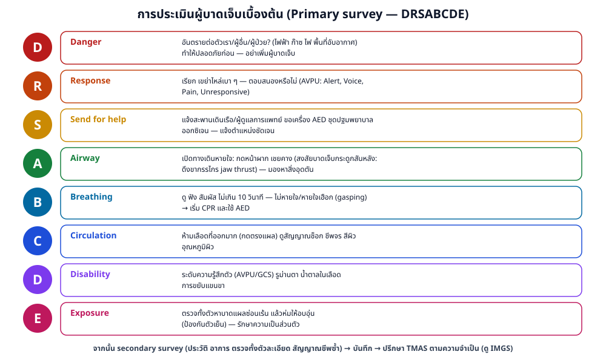
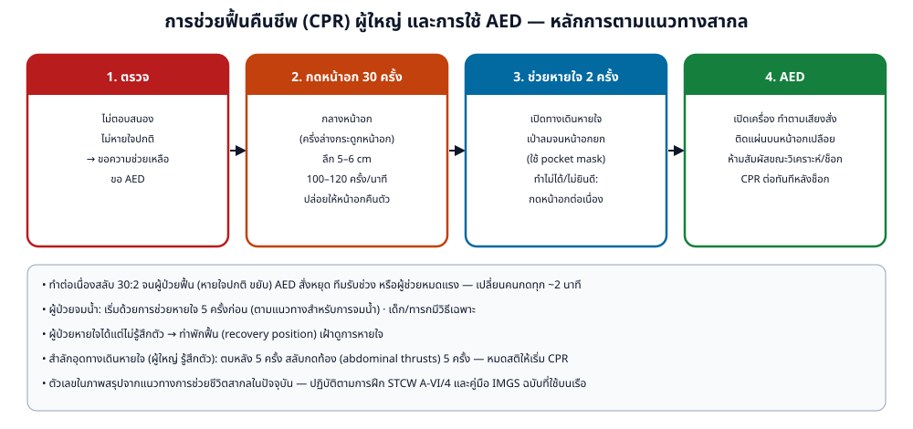
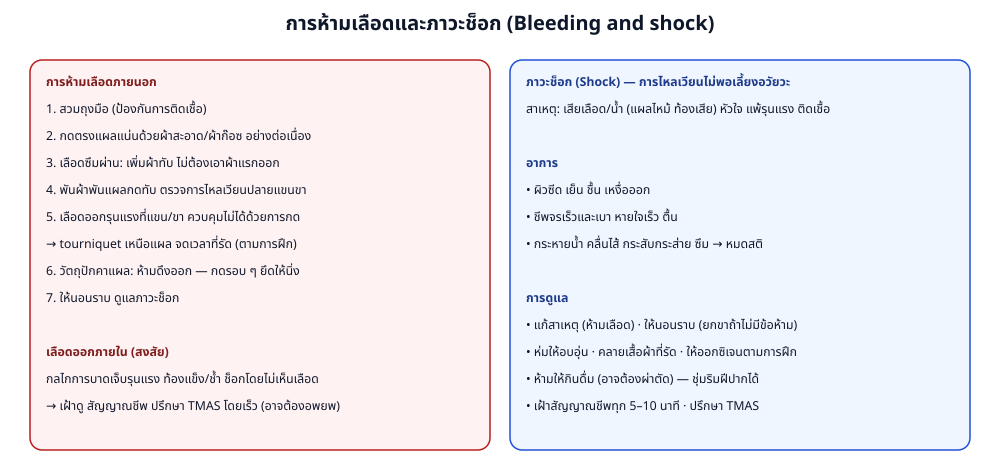
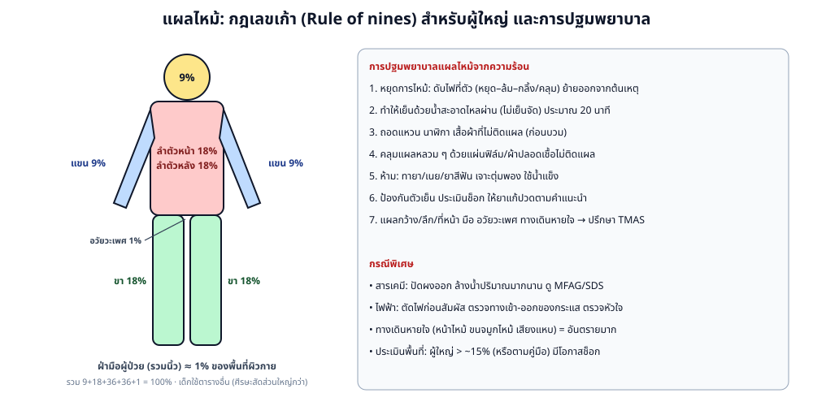
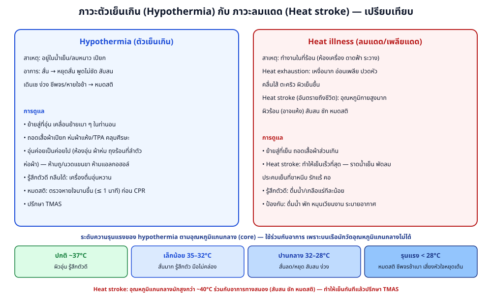
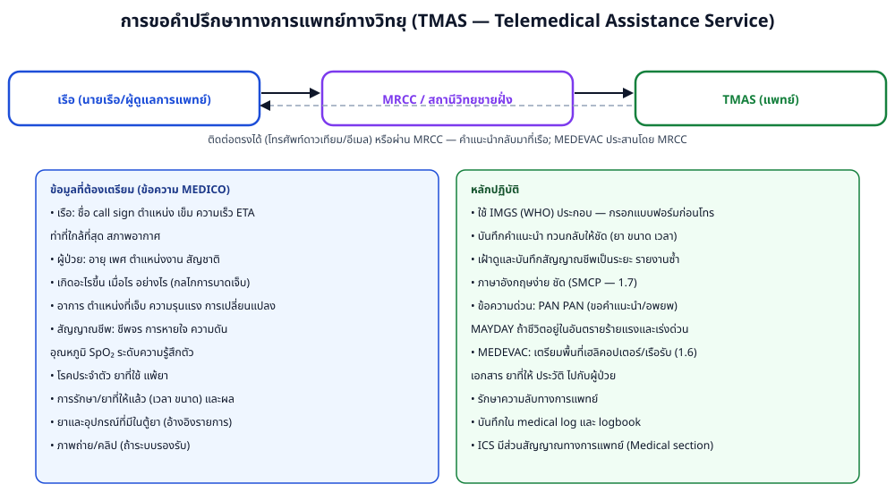

# 3.5 Apply Medical First Aid on Board Ship — การปฐมพยาบาลทางการแพทย์บนเรือ

> สมุดบันทึกการฝึก OOW · TIRAPHONG NANTAPAN
> Function 3: **Controlling the operation of the ship and care for persons on board at the operational level**
> สมรรถนะตาม STCW A-II/1: *Apply medical first aid on board ship* — Medical aid: *Practical application of medical guides and advice by radio, including the ability to take effective action based on such knowledge in the case of accidents or illnesses that are likely to occur on board ship*
> เกณฑ์ประเมิน: *Identification of probable cause, nature and extent of injuries or conditions is prompt and treatment minimizes immediate threat to life*
>
> อ้างอิงหลัก: STCW A-VI/4-1 (Medical first aid) และ A-VI/4-2 (Medical care); **WHO International Medical Guide for Ships (IMGS)**, 3rd edition และ Quantification Addendum; **IMO/WHO/ILO Medical First Aid Guide for Use in Accidents Involving Dangerous Goods (MFAG)** — ใน IMDG Code Supplement; **ILO Maritime Labour Convention 2006** Regulation 4.1 (Medical care on board ship and ashore); WHO **International Health Regulations (2005)**; IAMSAR Manual Vol III (medical assistance, MEDEVAC); IMO SMCP; International Code of Signals (Medical section); IMO Model Course 1.14 และ 1.15; ข้อกำหนดตู้ยาและอุปกรณ์การแพทย์ของรัฐเจ้าของธง; แนวทางการช่วยชีวิตสากลฉบับปัจจุบัน (European Resuscitation Council และ American Heart Association — ปรับปรุงรอบล่าสุดปี 2025 โดยค่าหลักของ CPR ผู้ใหญ่ไม่เปลี่ยน); International Code of Signals — สัญญาณ W และกลุ่ม M (Medical section)

> **หมายเหตุของผู้เขียน**: บทนี้เป็นบันทึกเพื่อการเรียนในกรอบสมรรถนะ STCW — การปฏิบัติจริงต้องเป็นไปตามการฝึก STCW A-VI/4 ที่ได้รับ คู่มือการแพทย์ที่ใช้บนเรือ และคำแนะนำของแพทย์ทางวิทยุ (TMAS) เสมอ

---

## 0. ทำไม OOW ต้องปฐมพยาบาลได้

กลางทะเลไม่มีรถพยาบาล โรงพยาบาลที่ใกล้ที่สุดอาจห่างหลายวัน และการอพยพทางอากาศทำได้เฉพาะในระยะและสภาพอากาศที่เหมาะสม **คนแรกที่ต้องช่วยชีวิตคือลูกเรือด้วยกัน** — STCW จึงให้ OOW ทุกคนผ่านการฝึก medical first aid (A-VI/4-1) และให้นายเรือ/ผู้รับผิดชอบการแพทย์ผ่าน medical care (A-VI/4-2)

เกณฑ์ STCW เน้นสองเรื่อง: **ระบุสาเหตุ ลักษณะ และความรุนแรงของการบาดเจ็บ/อาการได้เร็ว** และ **ให้การดูแลที่ลดภัยคุกคามต่อชีวิตทันที** — นั่นคือ "รู้ว่าอะไรฆ่าคนได้เร็วที่สุด และจัดการสิ่งนั้นก่อน"

---

## 1. ระบบการแพทย์บนเรือ

- **MLC 2006 Reg. 4.1** — คนเรือต้องได้รับการดูแลทางการแพทย์เทียบเท่าบนบกเท่าที่ทำได้: เรือมี **ตู้ยาและอุปกรณ์การแพทย์** ตามข้อกำหนดรัฐเจ้าของธง **คู่มือการแพทย์** (เช่น IMGS) **ช่องทางรับคำแนะนำทางการแพทย์ทางวิทยุตลอด 24 ชั่วโมง** และเรือที่มีคน ≥ 100 คนเดินทางระหว่างประเทศเกิน 3 วันต้องมีแพทย์; เรือที่ไม่มีแพทย์ต้องมีผู้รับผิดชอบการดูแลทางการแพทย์ที่ผ่านการฝึก
- **ผู้รับผิดชอบ** — โดยทั่วไปนายเรือหรือเจ้าหน้าที่ที่ได้รับมอบหมาย (มักเป็นต้นเรือหรือ 2/O) ที่ผ่าน A-VI/4-2; OOW และทุกคนช่วยปฐมพยาบาลตามการฝึก
- **IMGS (International Medical Guide for Ships)** — คู่มือหลักของ WHO: การตรวจผู้ป่วย อาการและการรักษา การใช้ยาในตู้ยา การขอคำปรึกษาทางวิทยุ แบบฟอร์ม
- **MFAG** — สำหรับการได้รับสารเคมีจากสินค้าอันตราย (ดูตาม UN number/EmS → ตาราง MFAG) — MFAG ตีพิมพ์อยู่ใน Supplement ของ IMDG Code และเป็นส่วนเสริมด้านสารเคมีของ IMGS; การเปิดหาตารางให้ใช้ดัชนีของ MFAG/IMDG ฉบับเดียวกับที่ใช้บนเรือ (โครงสร้างและเลขตารางต่างกันในแต่ละฉบับ — ตรวจกับฉบับปัจจุบัน) และอ่านร่วมกับ SDS ของสินค้า
- **ตู้ยา (medicine chest)** — รายการตามข้อกำหนดรัฐเจ้าของธง ตรวจวันหมดอายุ บันทึกการใช้ ยาควบคุม (controlled drugs) เก็บในตู้ล็อกและบันทึกเฉพาะ — ตรวจโดยผู้มีอำนาจตามรอบ (MLC Standard A4.1 กำหนดให้ตู้ยา อุปกรณ์ และคู่มือการแพทย์อยู่ภายใต้การตรวจเป็นประจำของ competent authority และ Guideline B4.1.1 แนะนำรอบการตรวจไม่เกิน 12 เดือน — ตรวจฉลาก วันหมดอายุ และสภาพการเก็บ)
- **อุปกรณ์** — ชุดปฐมพยาบาลตามจุดต่าง ๆ, เปลหาม (เช่นแบบ Neil Robertson สำหรับยกผ่านช่องแคบ/แนวตั้ง), ชุดออกซิเจน/resuscitator, **AED** (หลายบริษัทมีบนเรือ), เฝือก, ปลอกคอ (cervical collar)
- **บันทึก** — medical log (ประวัติการรักษา ยาที่ให้), logbook (เหตุการณ์), แบบรายงานอุบัติเหตุตาม SMS/รัฐเจ้าของธง — **รักษาความลับ** ข้อมูลสุขภาพ; MLC Standard A4.1 ยังกำหนดให้มี **แบบรายงานทางการแพทย์มาตรฐาน (standard medical report form)** สำหรับส่งต่อข้อมูลระหว่างเรือกับแพทย์บนฝั่ง และให้คนประจำเรือที่ต้องรักษาเร่งด่วนได้ไปพบแพทย์/ทันตแพทย์บนฝั่งเมื่อเรืออยู่ในท่า (ไม่มีค่าใช้จ่ายสำหรับคนประจำเรือตามหลัก MLC)

---

## 2. การประเมินผู้บาดเจ็บ (Assessment)

*ภาพที่ 3.5-1 การประเมินผู้บาดเจ็บเบื้องต้นแบบ DRSABCDE*

### 2.1 Primary survey — สิ่งที่ฆ่าคนได้เร็วที่สุดก่อน

- **D — Danger**: ความปลอดภัยของผู้ช่วยก่อน — ไฟฟ้า ก๊าซ (พื้นที่อับอากาศ — **ห้ามลงไปช่วยโดยไม่มี SCBA**) ไฟ ของตก เครื่องจักรหมุน
- **R — Response**: ปลุกเรียก — **AVPU**: Alert / ตอบสนองต่อ Voice / ตอบสนองต่อ Pain / Unresponsive
- **S — Send for help**: แจ้งสะพานเดินเรือ (ตำแหน่ง ลักษณะเหตุ จำนวนผู้บาดเจ็บ) ขอชุดปฐมพยาบาล AED ออกซิเจน เปล
- **A — Airway**: เปิดทางเดินหายใจ (กดหน้าผาก-เชยคาง; ถ้าสงสัยบาดเจ็บคอใช้ jaw thrust)
- **B — Breathing**: ดู ฟัง สัมผัส ไม่เกิน 10 วินาที — ไม่หายใจหรือหายใจเฮือก → **CPR + AED** (ข้อ 3)
- **C — Circulation**: **ห้ามเลือดที่ออกมาก** สัญญาณช็อก
- **D — Disability**: ระดับความรู้สึกตัว (AVPU/GCS) รูม่านตา น้ำตาลในเลือด (ถ้ามีเครื่อง)
- **E — Exposure**: ตรวจทั้งตัวหาบาดแผลซ่อนเร้น แล้วห่มให้อบอุ่น

### 2.2 Secondary survey

- **ประวัติ** — เกิดอะไรขึ้น (กลไกการบาดเจ็บ: ตกจากที่สูงเท่าไร ถูกอะไรกระแทก) อาการ เมื่อไร โรคประจำตัว ยา แพ้ยา อาหารมื้อล่าสุด (เช่น **SAMPLE**: Signs/Symptoms, Allergies, Medications, Past history, Last meal, Events)
- **ตรวจตั้งแต่หัวจรดเท้า** อย่างเป็นระบบ
- **สัญญาณชีพ (vital signs)** — ชีพจร การหายใจ ความดันโลหิต อุณหภูมิ SpO₂ ระดับความรู้สึกตัว — **บันทึกพร้อมเวลา และวัดซ้ำเป็นระยะ** (ข้อมูลสำคัญสำหรับแพทย์ทางวิทยุ)

---

## 3. การช่วยฟื้นคืนชีพ (CPR) และการเปิดทางเดินหายใจ

*ภาพที่ 3.5-2 ขั้นตอน CPR ผู้ใหญ่และการใช้ AED (สรุปหลักการ)*

- **ไม่ตอบสนอง + ไม่หายใจปกติ** → ขอความช่วยเหลือ/AED → **กดหน้าอก 30 ครั้ง** (กลางหน้าอก ลึก 5–6 cm อัตรา 100–120 ครั้ง/นาที ปล่อยให้คืนตัวเต็มที่) → **ช่วยหายใจ 2 ครั้ง** (ถ้าได้รับการฝึกและยินดี — ใช้ pocket mask) → ทำต่อเนื่อง **30:2**
- **AED** — เปิดเครื่องและทำตามเสียงสั่ง ติดแผ่นบนหน้าอกเปลือยที่แห้ง (เช็ดน้ำ — บนเรือผู้ป่วยมักเปียก) ห้ามสัมผัสผู้ป่วยขณะเครื่องวิเคราะห์/ช็อก กดหน้าอกต่อทันทีหลังช็อก
- **จมน้ำ** — ตามแนวทางสำหรับผู้จมน้ำ เริ่มด้วยการช่วยหายใจ 5 ครั้งก่อนกดหน้าอก (เพราะสาเหตุคือขาดออกซิเจน)
- **ท่าพักฟื้น (recovery position)** — หายใจได้แต่ไม่รู้สึกตัว ไม่มีข้อห้าม (บาดเจ็บกระดูกสันหลัง) — ทางเดินหายใจเปิด สิ่งคัดหลั่งไหลออก เฝ้าดูการหายใจตลอด
- **สำลัก (choking)** — รู้สึกตัว ไอไม่ออก: ตบหลัง 5 ครั้ง สลับกดท้อง 5 ครั้ง; หมดสติ: เริ่ม CPR
- **ออกซิเจน** — ใช้ตามการฝึกและคำแนะนำ (ระวังไฟ — ออกซิเจนช่วยการเผาไหม้)
- **CPR บนเรือ — ข้อสังเกตเชิงปฏิบัติ** (จดไว้จากการฝึก): ทำบนพื้นแข็ง (ดาดฟ้า/ไม้กระดานรองหลัง) ไม่ใช่บนเตียงนุ่ม · สลับคนกดทุกประมาณ 2 นาทีเพราะคุณภาพการกดลดเร็ว · ถ้าไม่ได้ฝึกการช่วยหายใจให้กดหน้าอกอย่างเดียวต่อเนื่อง (compression-only) · เรือโคลงให้คนช่วยยึดตัวผู้กดและผู้ป่วย · ผู้ป่วยตัวเย็นจากน้ำเย็นให้ตรวจชีพจร/การหายใจนานขึ้น (ไม่เกิน 1 นาที) และอย่าตัดสินว่าเสียชีวิตเร็วเกินไป ("no one is dead until warm and dead") — ทำตามคำแนะนำ TMAS
- **ตัวเลขหลักของ CPR ผู้ใหญ่ตามแนวทางสากล (ERC/AHA 2025)**: กด 100–120 ครั้ง/นาที ลึก 5–6 cm ปล่อยให้หน้าอกคืนตัวเต็มที่ ขัดจังหวะให้น้อยที่สุด อัตรา 30:2 — ค่าเหล่านี้ไม่เปลี่ยนจากรอบ 2020; สำหรับการสำลักในผู้ใหญ่ที่รู้สึกตัว แนวทางรอบ 2025 ทั้งสองฝั่งใช้การตบหลัง 5 ครั้งสลับกดท้อง 5 ครั้งเช่นเดียวกับที่จดไว้ข้างบน

---

## 4. การบาดเจ็บที่พบบ่อยบนเรือ

### 4.1 เลือดออกและภาวะช็อก

*ภาพที่ 3.5-3 การห้ามเลือดและการดูแลภาวะช็อก*

- **ห้ามเลือด**: สวมถุงมือ → **กดตรงแผลแน่นต่อเนื่อง** → ซึมผ่านให้เพิ่มผ้า → พันกดทับ → เลือดออกรุนแรงที่แขนขาที่กดไม่หยุด → **tourniquet** เหนือแผล จดเวลา (ตามการฝึก) — วัตถุปักคาแผลห้ามดึงออก
- **ช็อก** — ผิวซีดเย็นชื้น ชีพจรเร็วเบา หายใจเร็ว กระหายน้ำ กระสับกระส่าย → หมดสติ — แก้สาเหตุ ให้นอนราบ ห่มอุ่น ห้ามกินดื่ม เฝ้าสัญญาณชีพ ปรึกษา TMAS
- **เลือดออกภายใน** — กลไกการบาดเจ็บรุนแรง ท้องแข็ง ช็อกโดยไม่เห็นเลือด → ปรึกษาด่วน อาจต้องอพยพ

### 4.2 แผลไหม้ (Burns)

*ภาพที่ 3.5-4 กฎเลขเก้าสำหรับประเมินพื้นที่แผลไหม้ในผู้ใหญ่และการปฐมพยาบาล*

- **ความร้อน**: หยุดการไหม้ → **ทำให้เย็นด้วยน้ำสะอาดไหลผ่านประมาณ 20 นาที** → ถอดแหวน/นาฬิกาก่อนบวม → คลุมหลวม ๆ ด้วยฟิล์ม/ผ้าปลอดเชื้อไม่ติดแผล → ห้ามทาสิ่งอื่น ห้ามเจาะตุ่มพอง ห้ามใช้น้ำแข็ง → ป้องกันตัวเย็นและช็อก
- **ประเมินพื้นที่** — **กฎเลขเก้า** (ศีรษะ 9%, แขนข้างละ 9%, ลำตัวหน้า 18%, หลัง 18%, ขาข้างละ 18%, อวัยวะเพศ 1%) หรือฝ่ามือผู้ป่วยรวมนิ้วประมาณ 1%
- **สารเคมี** — ปัดผงแห้งออก ล้างด้วยน้ำปริมาณมากนาน ถอดเสื้อผ้าที่เปื้อน — **ดู MFAG/SDS**; ตาโดนสารเคมี ล้างตาต่อเนื่องอย่างน้อย 15–20 นาที (ที่ล้างตาฉุกเฉิน)
- **ไฟฟ้า** — **ตัดไฟก่อนแตะผู้ป่วย** แผลทางเข้า-ออกของกระแส อาจมีความเสียหายภายในและหัวใจเต้นผิดจังหวะ — เฝ้าดูและปรึกษาเสมอ
- **ทางเดินหายใจไหม้** (ไฟไหม้ในที่ปิด หน้าไหม้ ขนจมูกไหม้ เสียงแหบ เขม่าในปาก) — อันตรายมาก ทางเดินหายใจบวมได้ → ปรึกษาด่วน ให้ออกซิเจน
- **ความลึกของแผลไหม้** — ตื้น (superficial: แดง เจ็บ ไม่พอง เช่นแดดเผา) · ลึกบางส่วน (partial thickness: พอง แดงชื้น เจ็บมาก) · ลึกตลอดชั้นผิว (full thickness: ขาวซีด/น้ำตาลเหมือนหนัง แห้ง อาจไม่เจ็บเพราะปลายประสาทถูกทำลาย) — การคำนวณพื้นที่ด้วยกฎเลขเก้า **ไม่นับแผลตื้นแบบแดดเผา**
- **เมื่อไรต้องปรึกษา TMAS ทันที** — แผลลึกบางส่วนขึ้นไปพื้นที่เกินราว 10–15% ในผู้ใหญ่ (เสี่ยงช็อกจากการเสียน้ำ), แผลลึกตลอดชั้น, แผลที่หน้า มือ เท้า อวัยวะเพศ ข้อต่อ หรือรอบแขนขา/ลำตัว, ทางเดินหายใจไหม้, ไฟฟ้า, สารเคมี

> **ตัวอย่างจำลอง — ประเมินพื้นที่แผลไหม้ด้วยกฎเลขเก้า**: ช่างน้ำมัน (oiler) บน MV Andaman Pearl ถูกไอน้ำร้อนลวกที่แขนขวาทั้งแขน ด้านหน้าของหน้าอกและท้องครึ่งบน และใบหน้าครึ่งหน้า → แขนขวา 9% + ลำตัวด้านหน้าครึ่งหนึ่ง 9% + ศีรษะครึ่งหนึ่ง 4.5% = **ประมาณ 22.5%** (เฉพาะส่วนที่พอง/ลึก) → เกิน 15% และมีแผลที่ใบหน้า → ทำให้เย็นด้วยน้ำไหลผ่าน ~20 นาที (ระวังตัวเย็น เพราะพื้นที่กว้าง) คลุมแผล เฝ้าทางเดินหายใจ บันทึกเวลา และติดต่อ TMAS ทันที — แพทย์มักแนะนำการให้สารน้ำและพิจารณา MEDEVAC

### 4.3 กระดูกหัก ข้อเคลื่อน และการบาดเจ็บกระดูกสันหลัง

- อาการ: ปวด บวม ผิดรูป ขยับไม่ได้ เสียงกระดูกเสียดสี — **ยึดตรึง (immobilize)** ในท่าที่พบ ด้วยเฝือก/ผ้าคล้องแขน ตรวจการไหลเวียน ความรู้สึก การขยับของปลายแขนขาก่อนและหลังเข้าเฝือก
- **กระดูกหักแบบเปิด** — คลุมแผล ห้ามเลือด ห้ามดันกระดูกกลับ
- **สงสัยบาดเจ็บกระดูกสันหลัง** (ตกจากที่สูง ถูกกระแทกแรง ปวดคอ/หลัง ชาแขนขา) — **เคลื่อนย้ายน้อยที่สุด** ประคองศีรษะ-คอให้อยู่แนวเดียวกับลำตัว ปลอกคอ ใช้เปลแข็ง พลิกตัวแบบ log roll หลายคน
- **บาดเจ็บศีรษะ** — เฝ้าระดับความรู้สึกตัว (AVPU/GCS) รูม่านตา อาเจียน ปวดหัวรุนแรงขึ้น ของเหลวไหลจากหู/จมูก → ปรึกษา TMAS

### 4.4 การบาดเจ็บอื่น

- **ตา** — ฝุ่น/สะเก็ดโลหะ (งานเจียร): ห้ามขยี้ ล้างน้ำ — วัตถุปักตาห้ามเอาออก ปิดทั้งสองตา (ลดการกลอกตา)
- **แผลถูกบีบอัด (crush) / นิ้วขาด** — ห้ามเลือด เก็บส่วนที่ขาดในถุงสะอาด วางบนน้ำเย็น/น้ำแข็ง (ไม่สัมผัสน้ำแข็งโดยตรง) ส่งพร้อมผู้ป่วย
- **ความเจ็บป่วยจากก๊าซ** — **H₂S** (กลิ่นไข่เน่าแล้วจมูกชินจนไม่ได้กลิ่น), **CO** (ไม่มีกลิ่น ปวดหัว สับสน), ขาดออกซิเจนในพื้นที่อับอากาศ, phosphine (รมยา) → นำออกสู่อากาศบริสุทธิ์ **โดยผู้ช่วยต้องป้องกันตัว (SCBA)** ให้ออกซิเจน CPR ถ้าจำเป็น ดู MFAG
- **ไฟฟ้าช็อต** — ตัดไฟ ใช้วัตถุไม่นำไฟฟ้าแยกผู้ป่วยถ้าตัดไฟไม่ได้ (ไฟฟ้าแรงต่ำ) ประเมิน CPR

---

## 5. ความเจ็บป่วยที่พบบ่อย

| ภาวะ | สัญญาณสำคัญ | การดูแลเบื้องต้น |
|---|---|---|
| **หัวใจขาดเลือด (heart attack)** | เจ็บแน่นหน้าอกร้าวไปแขน/กราม เหงื่อแตก หอบ | นั่งพัก ให้ออกซิเจนตามการฝึก ยาตามคำแนะนำ TMAS (เช่นแอสไพรินถ้าไม่มีข้อห้าม) เตรียม AED/CPR |
| **หลอดเลือดสมอง (stroke)** | **FAST**: หน้าเบี้ยว (Face) แขนอ่อนแรง (Arm) พูดไม่ชัด (Speech) → เวลา (Time) | บันทึกเวลาเริ่มอาการ ปรึกษาด่วน (อาจต้องอพยพ) |
| **ชัก (seizure)** | เกร็ง กระตุก หมดสติ | ป้องกันการบาดเจ็บ ห้ามใส่อะไรในปาก จับเวลา หลังชักจัดท่าพักฟื้น |
| **เบาหวาน (น้ำตาลต่ำ)** | เหงื่อ สั่น สับสน ก้าวร้าว | รู้สึกตัวและกลืนได้: ให้น้ำตาล/น้ำหวาน |
| **แพ้รุนแรง (anaphylaxis)** | ผื่น บวมหน้า/ลำคอ หายใจลำบาก ช็อก | ยาฉีดอะดรีนาลีนตามที่มีและได้รับการฝึก/คำแนะนำ ปรึกษาด่วน |
| **ปวดท้องเฉียบพลัน** (ไส้ติ่งอักเสบ ฯลฯ) | ปวดท้องเฉพาะที่ ไข้ อาเจียน ท้องแข็ง | งดอาหาร ปรึกษา TMAS (อาจต้องอพยพ) |
| **ภาวะตัวเย็นเกิน / ลมแดด** | ภาพที่ 3.5-5 | ภาพที่ 3.5-5 |
| **โรคติดต่อ** | ไข้ ผื่น ท้องเสียหลายคน ไอ | แยกผู้ป่วย สุขอนามัย อุปกรณ์ป้องกัน รายงาน (ข้อ 7) |
| **สุขภาพจิต** | ซึมเศร้า วิตก พฤติกรรมเปลี่ยน คิดทำร้ายตัวเอง | พูดคุย ไม่ปล่อยให้อยู่คนเดียวถ้าเสี่ยง แจ้งนายเรือ ขอคำปรึกษา (บริษัทมีบริการช่วยเหลือคนเรือ) |

*ภาพที่ 3.5-5 ภาวะตัวเย็นเกินเทียบกับภาวะลมแดด*

**ระดับความรุนแรงของภาวะตัวเย็นเกิน (hypothermia)** — แบ่งตามอุณหภูมิแกนกลางของร่างกาย (core temperature) ซึ่งบนเรือมักวัดได้ไม่แม่น (ปรอทวัดไข้ทั่วไปอ่านค่าต่ำได้ไม่พอ) จึงต้องดูอาการประกอบ:

| ระดับ | อุณหภูมิแกนกลาง (โดยประมาณ) | อาการเด่น | ข้อควรระวัง |
|---|---|---|---|
| เล็กน้อย (mild) | 35–32°C | สั่นมาก รู้สึกตัว มือไม่คล่อง พูดได้ | อุ่นด้วยผ้าแห้ง เครื่องดื่มอุ่นหวานถ้ากลืนได้ |
| ปานกลาง (moderate) | 32–28°C | สั่นลดลงหรือหยุด สับสน ง่วง พูดไม่ชัด | เคลื่อนย้ายเบา ๆ ในท่านอน ห้ามให้เดิน — เสี่ยงหัวใจเต้นผิดจังหวะ |
| รุนแรง (severe) | ต่ำกว่า 28°C | หมดสติ ชีพจร/การหายใจช้าและเบามาก | เสี่ยงหัวใจหยุดเต้น — ตรวจสัญญาณชีพนานขึ้นก่อนตัดสินใจ CPR และขอคำแนะนำด่วน |

- **Heat stroke** — อุณหภูมิแกนกลางมักสูงกว่าประมาณ 40°C ร่วมกับอาการทางสมอง (สับสน ชัก หมดสติ) — ต่างจาก heat exhaustion ตรงที่สมองได้รับผลกระทบ ต้องทำให้เย็นทันทีก่อนขั้นตอนอื่น

---

## 6. การขอคำปรึกษาทางการแพทย์ทางวิทยุ (Medical advice by radio)

*ภาพที่ 3.5-6 การขอคำปรึกษาจาก TMAS ข้อมูลที่ต้องเตรียมและหลักปฏิบัติ*

- **TMAS (Telemedical Assistance Service)** — บริการแพทย์ให้คำปรึกษาทางไกลแก่เรือ ติดต่อตรงหรือผ่าน **MRCC/สถานีวิทยุชายฝั่ง** (IAMSAR Vol III) — ตัวอย่างผู้ให้บริการที่รู้จักกันดี เช่น CIRM ของอิตาลี และ TMAS ของรัฐชายฝั่งหลายประเทศ; บริษัทเดินเรือหลายแห่งมีสัญญาบริการแพทย์ทางไกลของตนเอง
- **เตรียมข้อมูลก่อนติดต่อ** (ใช้แบบฟอร์มใน IMGS): ข้อมูลเรือและตำแหน่ง/ETA ท่าที่ใกล้ที่สุด, ข้อมูลผู้ป่วย, สิ่งที่เกิดขึ้น, อาการ, **สัญญาณชีพพร้อมเวลา**, ประวัติ ยา แพ้ยา, การรักษาที่ให้แล้ว, ยาที่มีในตู้ยา, ภาพถ่าย (ถ้ารองรับ)
- **การสื่อสาร** — ภาษาอังกฤษชัด ใช้ SMCP; ข้อความความเร่งด่วน **PAN PAN** สำหรับขอคำแนะนำ/อพยพ; **MAYDAY** เมื่อชีวิตอยู่ในอันตรายร้ายแรงและเร่งด่วน (ตามที่นายเรือตัดสิน — 1.6); ICS มีส่วน **Medical section** สำหรับกรณีภาษาไม่ตรงกัน
- **สัญญาณทางการแพทย์ใน International Code of Signals** (จดไว้สำหรับสอบ — ตรวจความหมายเต็มกับเล่ม ICS บนเรือ): สัญญาณตัวเดียว **W** = ต้องการความช่วยเหลือทางการแพทย์; กลุ่มสามตัวอักษรขึ้นต้นด้วย **M** เป็น Medical section เช่น **MAA** = ขอคำแนะนำทางการแพทย์ด่วน, **MAB** = ขอให้นัดพบ (rendezvous) ที่ตำแหน่งที่ระบุ, **MAC** = ขอให้จัดการรับผู้ป่วยเข้าโรงพยาบาล, **MAD** = เรืออยู่ห่างท่าที่ใกล้ที่สุด ... ชั่วโมง — ส่วนที่เหลือของ Medical section ใช้รหัสบอกอาการ ส่วนของร่างกาย และการรักษา เพื่อสื่อสารกับแพทย์ที่ไม่ใช้ภาษาเดียวกัน
- **ระหว่างรักษา** — บันทึกคำแนะนำ ทวนกลับ (ชื่อยา ขนาด ทาง เวลา) เฝ้าดูและรายงานซ้ำตามที่แพทย์ขอ
- **MEDEVAC** — แพทย์และ MRCC ร่วมตัดสินใจ: เปลี่ยนเส้นทางไปท่าใกล้ (deviation) นัดพบเรือ หรือเฮลิคอปเตอร์ — OOW เตรียมพื้นที่ยก/ลงจอด ติดต่อกับอากาศยาน เข็ม/ความเร็วตามที่ร้องขอ (1.6) ส่งผู้ป่วยพร้อม **เอกสาร ประวัติการรักษา ยาที่ให้ บัตรประจำตัว** และของใช้ส่วนตัวที่จำเป็น

---

## 7. โรคติดต่อ สุขอนามัย และการรายงาน

- **การป้องกัน** — สุขอนามัยอาหารและน้ำดื่ม (ถังน้ำ คลอรีน) ความสะอาดห้องครัว การกำจัดขยะ ยุง/แมลงในพื้นที่เสี่ยง วัคซีนตามข้อกำหนด
- **เมื่อสงสัยโรคติดต่อ** — **แยกผู้ป่วย** อุปกรณ์ป้องกันส่วนบุคคล (หน้ากาก ถุงมือ) ทำความสะอาด/ฆ่าเชื้อ บันทึกผู้สัมผัส ปรึกษา TMAS
- **IHR 2005** — เรือต้องรายงานสถานะสุขภาพก่อนเข้าท่า (**Maritime Declaration of Health** ตามที่ท่ากำหนด) และรายงานผู้ป่วย/การเสียชีวิตที่อาจเป็นโรคติดต่อต่อเจ้าหน้าที่สาธารณสุขท่า; ใบรับรอง **Ship Sanitation Control (Exemption) Certificate** (IHR Annex 3 — อายุไม่เกิน 6 เดือน ขยายได้ 1 เดือนถ้าตรวจหรือดำเนินการที่ท่าไม่ได้) — แบบ Maritime Declaration of Health อยู่ใน IHR Annex 8
- **การเสียชีวิตบนเรือ** — ปฏิบัติตามขั้นตอนบริษัท/รัฐเจ้าของธง: แพทย์ยืนยันทางวิทยุ บันทึกละเอียด เก็บรักษาร่าง แจ้งบริษัท รัฐเจ้าของธง ท่าถัดไป ดูแลทรัพย์สิน — และดูแลจิตใจลูกเรือ

---

## 8. ตัวอย่างจำลอง: ลูกเรือตกจากบันไดในระวาง

> 1030 ระหว่างเตรียมระวาง AB ตกจากบันไดในระวาง 3 ประมาณ 3 m ผู้เห็นเหตุแจ้งสะพานเดินเรือทางวิทยุ
> - **OOW (สะพาน)**: แจ้งนายเรือและผู้รับผิดชอบการแพทย์ (C/O) ส่งทีมพร้อมชุดปฐมพยาบาล เปลแบบยกแนวตั้ง (Neil Robertson) ออกซิเจน — **ย้ำว่าก่อนลงระวางให้ตรวจบรรยากาศ** (ระวางเพิ่งปิดมาหลายวัน) → ผลวัดปกติ
> - **ทีม (primary survey)**: D — ปลอดภัย; R — ผู้ป่วยรู้สึกตัว ตอบสนองต่อเสียง (V) สับสนเล็กน้อย; A — โล่ง; B — หายใจ 22 ครั้ง/นาที; C — แผลที่หน้าผากเลือดออก กดห้ามเลือด ชีพจร 104 ผิวซีด; D — AVPU = V ปวดคอ ชาที่มือขวา; E — ข้อมือซ้ายบวมผิดรูป
> - **การดูแล**: สงสัยบาดเจ็บกระดูกสันหลังคอ → ประคองศีรษะ ใส่ปลอกคอ log roll ขึ้นเปลแข็ง ยกออกจากระวางอย่างระมัดระวัง; เฝือกข้อมือ; ห่มอุ่น; ให้ออกซิเจน; วัดสัญญาณชีพทุก 10 นาที
> - **1100** นายเรือติดต่อ TMAS ผ่าน MRCC ส่งข้อมูลตามแบบฟอร์ม IMGS — แพทย์แนะนำเฝ้าระดับความรู้สึกตัว ห้ามให้กินดื่ม และแนะนำ **MEDEVAC** เนื่องจากบาดเจ็บศีรษะร่วมกับอาการทางระบบประสาท → MRCC ประสานเฮลิคอปเตอร์ เรือเปลี่ยนเข็มเข้าหาฝั่ง เตรียมพื้นที่ winching (1.6)
> - **บันทึก**: เวลา สัญญาณชีพ การรักษา คำแนะนำ ใน medical log และ logbook; รายงานอุบัติเหตุตาม SMS; สอบสวนสาเหตุ (บันได แสงสว่าง การใช้สายกันตก)

---

## 9. คำถามสอบปากเปล่า / สัมภาษณ์

**ถาม:** STCW กำหนดอะไรเกี่ยวกับการปฐมพยาบาลของ OOW
**แนวตอบ:** ใช้คู่มือการแพทย์และคำแนะนำทางวิทยุได้จริง ทำการได้อย่างมีประสิทธิภาพเมื่อเกิดอุบัติเหตุ/เจ็บป่วยที่มักเกิดบนเรือ — ระบุสาเหตุ ลักษณะ ความรุนแรงได้เร็ว และลดภัยต่อชีวิตทันที

**ถาม:** คู่มือการแพทย์บนเรือมีอะไรบ้าง
**แนวตอบ:** IMGS ของ WHO (คู่มือหลัก), MFAG สำหรับสารเคมี/สินค้าอันตราย, รายการตู้ยาตามรัฐเจ้าของธง, แบบฟอร์มรายงาน

**ถาม:** DRSABCDE คืออะไร
**แนวตอบ:** Danger, Response, Send for help, Airway, Breathing, Circulation, Disability, Exposure — ลำดับการประเมินเพื่อจัดการสิ่งที่คุกคามชีวิตก่อน

**ถาม:** CPR ผู้ใหญ่ทำอย่างไร
**แนวตอบ:** ไม่ตอบสนองไม่หายใจปกติ → ขอความช่วยเหลือ/AED → กดหน้าอก 30 ครั้ง ลึก 5–6 cm 100–120 ครั้ง/นาที → ช่วยหายใจ 2 ครั้ง → 30:2 ต่อเนื่อง ใช้ AED ตามเสียงสั่ง

**ถาม:** ห้ามเลือดอย่างไร
**แนวตอบ:** สวมถุงมือ กดตรงแผลแน่นต่อเนื่อง เพิ่มผ้าถ้าซึม พันกดทับ — เลือดออกรุนแรงที่แขนขาที่กดไม่หยุดใช้ tourniquet จดเวลา — วัตถุปักห้ามดึง

**ถาม:** อาการและการดูแลภาวะช็อก
**แนวตอบ:** ผิวซีดเย็นชื้น ชีพจรเร็วเบา หายใจเร็ว กระหายน้ำ ซึม — แก้สาเหตุ นอนราบ ห่มอุ่น ห้ามกินดื่ม เฝ้าสัญญาณชีพ ปรึกษา TMAS

**ถาม:** ปฐมพยาบาลแผลไหม้
**แนวตอบ:** หยุดการไหม้ ทำให้เย็นด้วยน้ำไหลผ่าน ~20 นาที ถอดเครื่องประดับ คลุมหลวม ๆ ด้วยฟิล์ม/ผ้าปลอดเชื้อ ห้ามทายา/เจาะตุ่ม/น้ำแข็ง ป้องกันตัวเย็นและช็อก — ประเมินพื้นที่ด้วยกฎเลขเก้า

**ถาม:** กฎเลขเก้าคืออะไร
**แนวตอบ:** ประเมินพื้นที่แผลไหม้ผู้ใหญ่: ศีรษะ 9%, แขนข้างละ 9%, ลำตัวหน้า 18%, หลัง 18%, ขาข้างละ 18%, อวัยวะเพศ 1% — ฝ่ามือผู้ป่วย ≈ 1%

**ถาม:** สงสัยบาดเจ็บกระดูกสันหลังทำอย่างไร
**แนวตอบ:** เคลื่อนย้ายน้อยที่สุด ประคองศีรษะ-คอแนวเดียวกับลำตัว ปลอกคอ เปลแข็ง log roll หลายคน ปรึกษา TMAS

**ถาม:** ลูกเรือหมดสติในพื้นที่อับอากาศทำอย่างไร
**แนวตอบ:** ห้ามลงไปช่วยโดยไม่มี SCBA — ส่งสัญญาณขอความช่วยเหลือ ทีมกู้ภัยตามแผนสวม SCBA นำออกด้วยเปล/อุปกรณ์ยก ให้ออกซิเจน CPR ถ้าจำเป็น ปรึกษา TMAS

**ถาม:** การดูแลผู้ป่วยภาวะตัวเย็นเกิน
**แนวตอบ:** เคลื่อนย้ายเบา ๆ ท่านอน ถอดเสื้อผ้าเปียก ห่มแห้ง/TPA อุ่นค่อยเป็นค่อยไปที่ลำตัว ห้ามถูนวดแขนขา ห้ามแอลกอฮอล์ รู้สึกตัวดีให้เครื่องดื่มอุ่นหวาน หมดสติตรวจการหายใจนานขึ้นก่อน CPR

**ถาม:** Heat stroke ต่างจาก heat exhaustion อย่างไร
**แนวตอบ:** Heat exhaustion — เหงื่อมาก อ่อนเพลีย ผิวเย็นชื้น พักในที่เย็นดื่มน้ำ; heat stroke — อุณหภูมิกายสูงมาก ผิวร้อน สับสน ชัก หมดสติ อันตรายถึงชีวิต ต้องทำให้เย็นเร็วที่สุดและปรึกษาด่วน

**ถาม:** ขอคำปรึกษาทางการแพทย์ทางวิทยุต้องเตรียมอะไร
**แนวตอบ:** ข้อมูลเรือ ตำแหน่ง ETA ท่าใกล้สุด, ข้อมูลผู้ป่วย, เหตุการณ์ อาการ, สัญญาณชีพพร้อมเวลา, ประวัติ ยา แพ้ยา, การรักษาที่ให้แล้ว, ยาในตู้ยา — ใช้แบบฟอร์ม IMGS ติดต่อ TMAS ตรงหรือผ่าน MRCC

**ถาม:** อาการ stroke ตรวจอย่างไร
**แนวตอบ:** FAST — Face (หน้าเบี้ยว), Arm (แขนอ่อนแรง), Speech (พูดไม่ชัด), Time (บันทึกเวลาเริ่มอาการ ขอคำปรึกษาด่วน)

**ถาม:** MLC 2006 กำหนดเรื่องการแพทย์บนเรืออย่างไร
**แนวตอบ:** Reg. 4.1 — การดูแลเทียบเท่าบนบกเท่าที่ทำได้ ตู้ยาและอุปกรณ์ คู่มือการแพทย์ การปรึกษาทางวิทยุ 24 ชม. แพทย์บนเรือที่มีคน ≥ 100 คน เดินทางระหว่างประเทศเกิน 3 วัน มิฉะนั้นมีผู้รับผิดชอบที่ผ่านการฝึก

**ถาม:** สงสัยโรคติดต่อบนเรือทำอย่างไร
**แนวตอบ:** แยกผู้ป่วย ใช้อุปกรณ์ป้องกัน ทำความสะอาด บันทึกผู้สัมผัส ปรึกษา TMAS รายงานต่อเจ้าหน้าที่สาธารณสุขท่าตาม IHR (Maritime Declaration of Health)

**ถาม:** สัญญาณ ICS ที่เกี่ยวกับการแพทย์มีอะไรบ้าง
**แนวตอบ:** W = ต้องการความช่วยเหลือทางการแพทย์; Medical section ขึ้นต้นด้วย M เช่น MAA ขอคำแนะนำทางการแพทย์ด่วน, MAB ขอนัดพบที่ตำแหน่ง, MAC ขอให้จัดการรับเข้าโรงพยาบาล, MAD บอกระยะเวลาถึงท่าที่ใกล้ที่สุด — ใช้เมื่อภาษาไม่ตรงกัน

**ถาม:** Hypothermia แบ่งระดับอย่างไร
**แนวตอบ:** ตามอุณหภูมิแกนกลาง: เล็กน้อย 35–32°C (สั่นมาก รู้สึกตัว), ปานกลาง 32–28°C (สั่นลด/หยุด สับสน ง่วง), รุนแรง < 28°C (หมดสติ เสี่ยงหัวใจหยุดเต้น) — เคลื่อนย้ายในท่านอนอย่างนุ่มนวล อุ่นช้า ๆ ที่ลำตัว ตรวจสัญญาณชีพนานขึ้นก่อน CPR

**ถาม:** ผู้บาดเจ็บถูกไอน้ำลวกแขนขวาทั้งแขน ลำตัวด้านหน้าครึ่งหนึ่ง และหน้าครึ่งหนึ่ง พื้นที่เท่าไร
**แนวตอบ:** 9 + 9 + 4.5 ≈ 22.5% (ตัวอย่างจำลอง) — เกิน 15% และมีแผลที่หน้า ถือว่ารุนแรง: ทำให้เย็น คลุมแผล ป้องกันตัวเย็น เฝ้าทางเดินหายใจ ติดต่อ TMAS ทันที

**ถาม:** ตู้ยาบนเรือต้องตรวจบ่อยแค่ไหน ใครตรวจ
**แนวตอบ:** MLC A4.1 ให้ competent authority ตรวจเป็นประจำ และ Guideline B4.1.1 แนะนำไม่เกินทุก 12 เดือน — บนเรือผู้รับผิดชอบการแพทย์ตรวจวันหมดอายุ ฉลาก การเก็บ และบันทึกยาควบคุมตามระบบของบริษัท

**ถาม:** STCW A-VI/4-1 กับ A-VI/4-2 ต่างกันอย่างไร
**แนวตอบ:** A-VI/4-1 Medical first aid — สำหรับผู้ที่ได้รับมอบหมายให้ปฐมพยาบาลบนเรือ (เจ้าหน้าที่ระดับปฏิบัติการรวม OOW); A-VI/4-2 Medical care — สำหรับผู้ที่ได้รับมอบหมายให้รับผิดชอบการดูแลทางการแพทย์บนเรือ (มักเป็นนายเรือหรือเจ้าหน้าที่ที่กำหนด)

**ถาม:** Ship Sanitation Control Certificate มีอายุเท่าไร
**แนวตอบ:** ตาม IHR 2005 ไม่เกิน 6 เดือน ขยายได้ 1 เดือนถ้าตรวจที่ท่าไม่ได้ — เรือยังต้องส่ง Maritime Declaration of Health ตามที่ท่ากำหนด

---

*ก่อนหน้า ← [3.4 อุปกรณ์ช่วยชีวิต](3.4-life-saving-appliances.md) · ถัดไป → [3.6 ข้อกำหนดทางกฎหมาย](3.6-legislative-requirements.md)*
