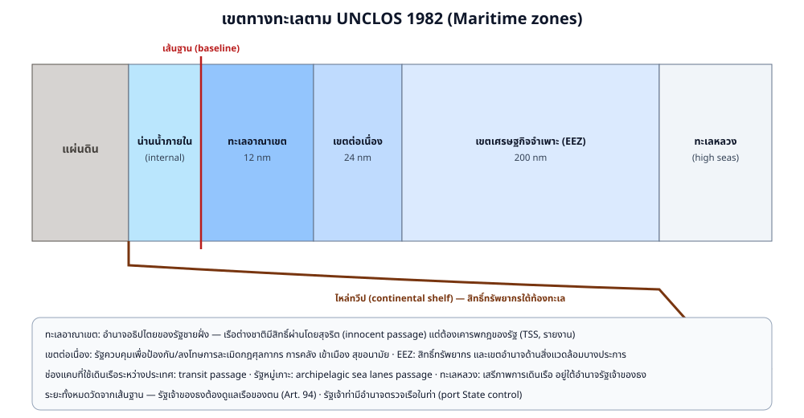
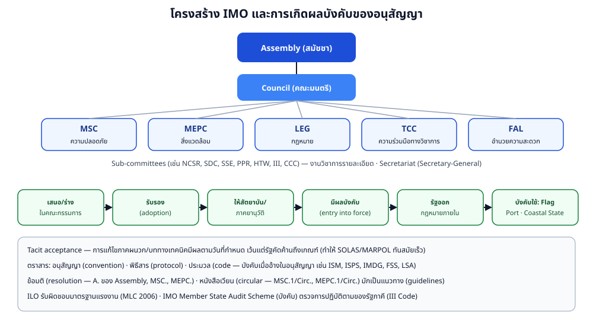
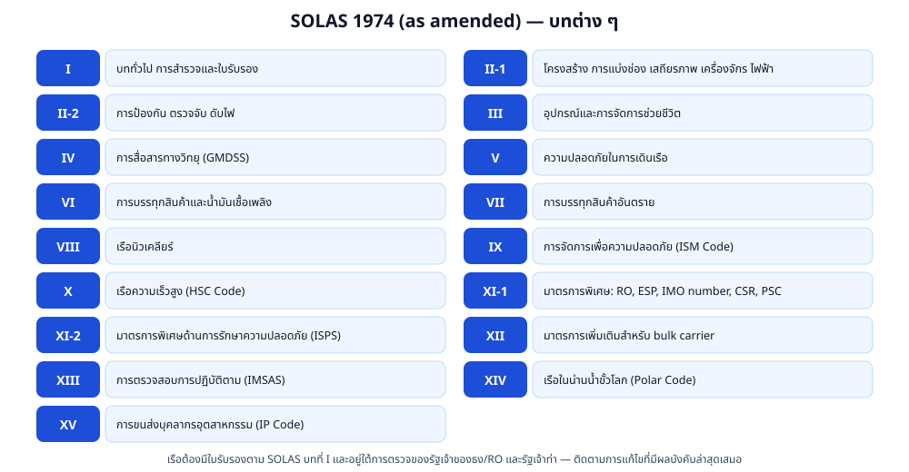
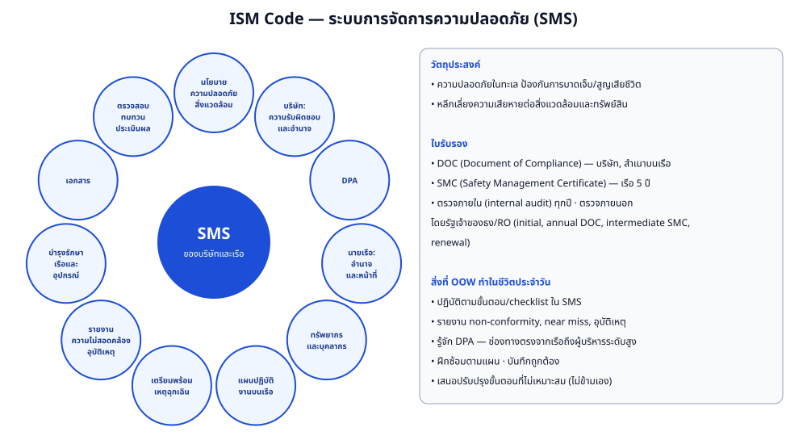
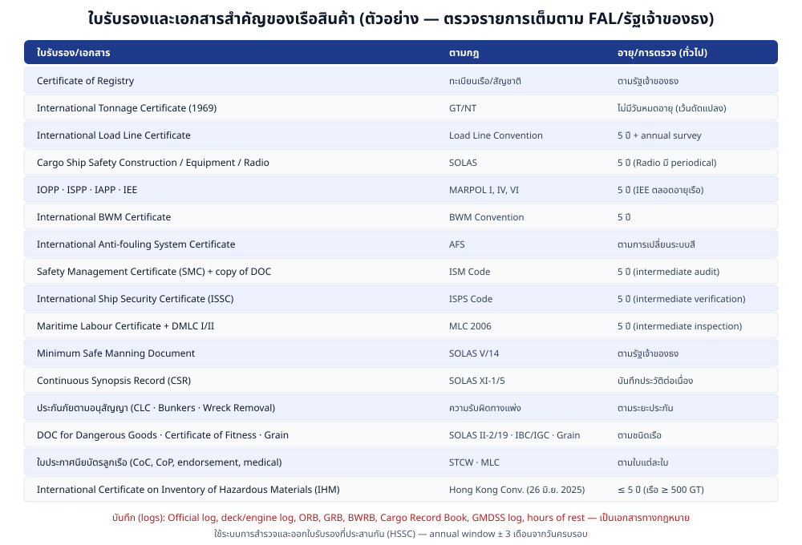
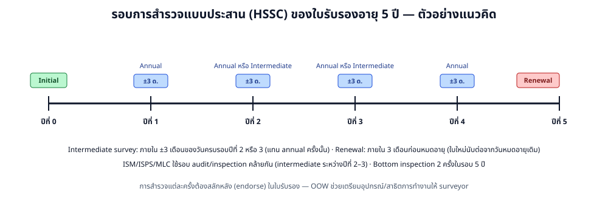
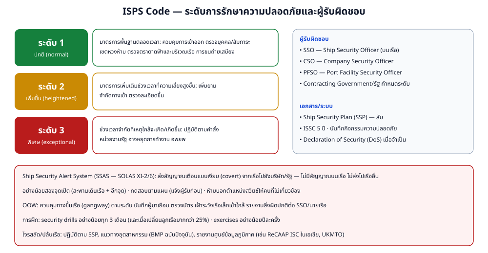
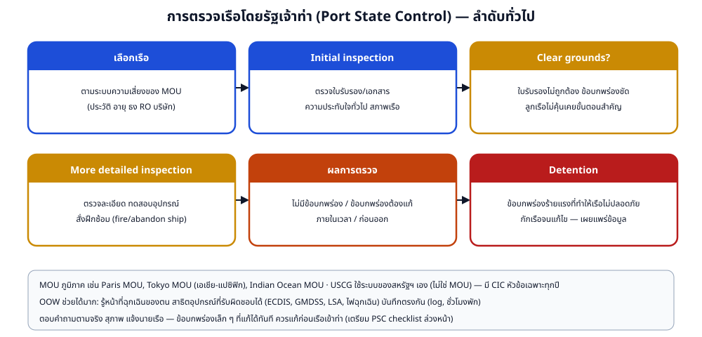

# 3.6 Monitor Compliance with Legislative Requirements — ข้อกำหนดทางกฎหมายที่ OOW ต้องรู้

> สมุดบันทึกการฝึก OOW · TIRAPHONG NANTAPAN
> Function 3: **Controlling the operation of the ship and care for persons on board at the operational level**
> สมรรถนะตาม STCW A-II/1: *Monitor compliance with legislative requirements* — *Basic working knowledge of the relevant IMO conventions concerning safety of life at sea, security and protection of the marine environment*
> เกณฑ์ประเมิน: *Legislative requirements relating to safety of life at sea, security and protection of the marine environment are correctly identified*
>
> อ้างอิงหลัก: **UNCLOS 1982**; อนุสัญญา IMO — **SOLAS 1974**, **MARPOL 73/78**, **STCW 1978**, **COLREG 1972**, **Load Lines 1966/1988**, **Tonnage 1969**, **SAR 1979**, **FAL 1965**, BWM 2004, AFS 2001, Hong Kong Convention 2009, CLC/Fund, Bunkers 2001, Nairobi WRC 2007, SUA, Salvage 1989, LLMC, CSC; Codes — **ISM**, **ISPS**, IMDG, IMSBC, LSA, FSS, Polar Code, RO Code, III Code; **ILO MLC 2006**; Port State Control MOUs (Paris, Tokyo, Indian Ocean ฯลฯ); IMO *Survey Guidelines under the Harmonized System of Survey and Certification (HSSC)* และ *Procedures for Port State Control* (ข้อมติ Assembly ฉบับล่าสุดที่ใช้บังคับ — ฉบับปี 2023 คือ A.1186(33) และ A.1185(33) ซึ่งมีร่างแก้ไขเสนอต่อ Assembly สมัยที่ 34 — ตรวจฉบับปัจจุบัน); IMO Res. MSC.560(108) (แก้ STCW Code Table A-VI/1-4 เรื่อง violence and harassment — มีผล 1 ม.ค. 2026); MSC.550(108) (SOLAS V/31–32 การรายงานตู้สินค้าสูญหาย — มีผล 1 ม.ค. 2026); กฎหมายของรัฐเจ้าของธงและรัฐชายฝั่ง

---

## 0. ทำไม OOW ต้องรู้กฎหมาย

เกณฑ์ STCW ข้อนี้สั้นแต่สำคัญ: **"ระบุข้อกำหนดทางกฎหมายได้ถูกต้อง"** — เมื่อเจอสถานการณ์ใด ต้องรู้ว่ากฎข้อไหนใช้บังคับ เช่น ทิ้งเศษอาหารได้ไหม (MARPOL V), ต้องปิดประตูกันน้ำไหม (SOLAS II-1), ใครขึ้นเรือได้บ้างในท่า (ISPS), ชั่วโมงพักของเราเพียงพอไหม (STCW/MLC), เรือต้องรายงานเข้าเขต VTS ไหม (SOLAS V + กฎท้องถิ่น) — OOW ไม่ต้องเป็นนักกฎหมาย แต่ต้องรู้ "แผนที่" ของกฎหมายทางทะเล และรู้ว่าจะค้นต่อที่ไหน

**บันทึกของเรือเป็นเอกสารทางกฎหมาย** — logbook, ORB, GRB, บันทึกชั่วโมงพัก ฯลฯ ถูกใช้เป็นหลักฐานในศาลและการตรวจ — ต้องถูกต้อง ตรงความจริง ลงนามโดยผู้รับผิดชอบ และ **ไม่ลบ ไม่ฉีก** (แก้ไขโดยขีดฆ่าหนึ่งเส้นให้อ่านได้ ลงชื่อกำกับ)

---

## 1. กรอบกฎหมายทะเลระหว่างประเทศ

### 1.1 UNCLOS 1982 และเขตทางทะเล

*ภาพที่ 3.6-1 เขตทางทะเลตาม UNCLOS 1982*

- **น่านน้ำภายใน (internal waters)** — ด้านแผ่นดินของเส้นฐาน (ท่า แม่น้ำ อ่าวปิด) — อธิปไตยเต็มที่ของรัฐ
- **ทะเลอาณาเขต (territorial sea) ไม่เกิน 12 nm** — อธิปไตยของรัฐชายฝั่ง เรือต่างชาติมี **สิทธิผ่านโดยสุจริต (innocent passage)** — ต่อเนื่องและรวดเร็ว ไม่เป็นภัยต่อความสงบ ความเรียบร้อย ความมั่นคงของรัฐ (เช่นห้ามทำมลพิษโดยเจตนาและร้ายแรง ห้ามประมง ห้ามสำรวจ) และต้องปฏิบัติตามกฎของรัฐ (TSS เส้นทาง ระบบรายงาน)
- **เขตต่อเนื่อง (contiguous zone) ไม่เกิน 24 nm** — รัฐควบคุมเพื่อป้องกัน/ลงโทษการละเมิดกฎหมายศุลกากร การคลัง การเข้าเมือง สุขอนามัย
- **เขตเศรษฐกิจจำเพาะ (EEZ) ไม่เกิน 200 nm** — สิทธิอธิปไตยด้านทรัพยากร และเขตอำนาจบางประการ (สิ่งแวดล้อม การวิจัย สิ่งก่อสร้าง) — เรือต่างชาติมีเสรีภาพการเดินเรือ
- **ไหล่ทวีป (continental shelf)** — สิทธิในทรัพยากรใต้ท้องทะเล (Article 76–77): อย่างน้อย 200 nm จากเส้นฐาน หรือตามส่วนต่อทางธรรมชาติของแผ่นดิน (natural prolongation) ได้ไม่เกิน 350 nm หรือไม่เกิน 100 nm จากแนวความลึก 2,500 m — สิทธินี้เป็นของพื้นท้องทะเลและใต้ดิน ไม่ใช่น่านน้ำเหนือขึ้นไป
- **น่านน้ำหมู่เกาะ (archipelagic waters)** — ด้านในของเส้นฐานหมู่เกาะ (archipelagic baselines) ของรัฐหมู่เกาะ เช่น อินโดนีเซีย ฟิลิปปินส์ — รัฐมีอธิปไตย แต่เรือต่างชาติมี innocent passage และ archipelagic sea lanes passage ตามเส้นทางที่กำหนด
- **ทะเลหลวง (high seas)** — เสรีภาพการเดินเรือ เรืออยู่ใต้อำนาจ **รัฐเจ้าของธง** (ยกเว้นบางกรณี เช่น โจรสลัด)
- **Transit passage** ผ่านช่องแคบที่ใช้เดินเรือระหว่างประเทศ (เช่นช่องแคบมะละกา–สิงคโปร์ ร่วมกับระบบ TSS/STRAITREP) และ **archipelagic sea lanes passage** ในรัฐหมู่เกาะ
- **หน้าที่ของรัฐเจ้าของธง (Article 94)** — ดูแลเรือด้านการบริหาร เทคนิค สังคม (การสร้าง อุปกรณ์ คนประจำเรือ สภาพการทำงาน การฝึก การสื่อสาร การป้องกันการโดนกัน) — ผ่านอนุสัญญา IMO/ILO
- **หน้าที่ช่วยชีวิต (Article 98)** — นายเรือต้องช่วยเหลือบุคคลที่ประสบภัยในทะเล (สอดคล้อง SOLAS V/33)

### 1.2 IMO และวิธีที่อนุสัญญามีผลบังคับ

*ภาพที่ 3.6-2 โครงสร้าง IMO และขั้นตอนการมีผลบังคับของอนุสัญญา*

- **IMO** — (อนุสัญญาก่อตั้งลงนามปี 1948 มีผลปี 1958 ในชื่อ IMCO เปลี่ยนชื่อเป็น IMO ปี 1982 สำนักงานใหญ่ที่ลอนดอน) ทบวงการชำนัญพิเศษของสหประชาชาติด้านความปลอดภัย การรักษาความปลอดภัย และการป้องกันมลพิษจากเรือ: Assembly, Council, คณะกรรมการ **MSC** (ความปลอดภัย), **MEPC** (สิ่งแวดล้อม), **LEG**, **TCC**, **FAL** และอนุกรรมการ (NCSR — การเดินเรือ การสื่อสาร SAR; SDC; SSE; PPR; HTW — มนุษย์ การฝึก การเข้ายาม; III; CCC)
- **ประเภทตราสาร** — อนุสัญญา (convention) → พิธีสาร (protocol) → ประมวล (code — บังคับเมื่ออนุสัญญาอ้างถึง เช่น ISM, ISPS, IMDG, LSA, FSS, IMSBC, Polar) → ข้อมติ (resolution) → หนังสือเวียน (circular — ส่วนมากเป็นแนวทาง)
- **Tacit acceptance** — การแก้ไขภาคผนวก/บททางเทคนิคมีผลอัตโนมัติตามวันที่กำหนด เว้นแต่มีรัฐคัดค้านตามเกณฑ์ — จึงมีการแก้ไขที่มีผลบังคับทุกปี (มักวันที่ 1 มกราคม) ต้องติดตาม
- **ผู้บังคับใช้** — **Flag State** (ออกกฎหมายภายใน ใบรับรอง การสำรวจ มอบอำนาจให้ RO), **Port State** (PSC — ข้อ 6), **Coastal State** (ในน่านน้ำของตน)
- **ILO** — มาตรฐานแรงงานทางทะเล (MLC 2006); **IMSAS** — การตรวจประเมินรัฐภาคีโดย IMO (บังคับ ตาม III Code)

---

## 2. อนุสัญญาสำคัญ — สรุปที่ OOW ต้องรู้

### 2.1 SOLAS 1974 (ความปลอดภัยของชีวิตในทะเล)

*ภาพที่ 3.6-3 บทต่าง ๆ ของ SOLAS*

| บท | เนื้อหา | ที่เกี่ยวกับ OOW (อ้างอิงบทในสมุดนี้) |
|---|---|---|
| I | บททั่วไป การสำรวจ ใบรับรอง | ใบรับรองเรือ (ข้อ 4) |
| II-1 | โครงสร้าง การแบ่งช่อง เสถียรภาพ เครื่องจักร ไฟฟ้า | 3.2.1, 3.2.2 — ประตูกันน้ำ damage control, steering gear |
| II-2 | ไฟ | 3.3 — ระบบดับเพลิง fire control plan การฝึก |
| III | อุปกรณ์ช่วยชีวิต | 3.4 — muster list การฝึก การตรวจ |
| IV | วิทยุ (GMDSS) | 1.6, 1.7 — การเฝ้าฟัง distress อุปกรณ์ (บท IV ฉบับใหม่ GMDSS modernization มีผล 1 ม.ค. 2024 — MSC.496(105) ข้อกำหนด VHF พกพาและ SART ย้ายมาอยู่ IV/7) |
| **V** | **ความปลอดภัยในการเดินเรือ** — ใช้กับเรือทุกลำ ทุกการเดินทาง | 1.x ทั้งหมด — V/7 SAR, V/10–12 routeing reporting VTS, V/14 manning, V/15 bridge design, V/18–19 อุปกรณ์ (ECDIS AIS BNWAS VDR ฯลฯ), V/22 visibility, V/24–26 steering, V/27 แผนที่/เอกสารทันสมัย, V/31–32 danger messages (รวมการรายงานตู้สูญหาย/ตู้ลอยน้ำ — MSC.550(108) มีผล 1 ม.ค. 2026), V/33 หน้าที่ช่วยเหลือผู้ประสบภัย, V/34 การวางแผนการเดินทาง, V/35 ห้ามใช้สัญญาณ distress ผิด |
| VI, VII | สินค้า สินค้าอันตราย | 2.1 |
| VIII | เรือพลังงานนิวเคลียร์ (nuclear ships) | — (รู้ไว้ว่ามี) |
| IX | ISM Code | ข้อ 3 |
| X | มาตรการความปลอดภัยสำหรับเรือความเร็วสูง (HSC Code) | — |
| XI-1 | RO, ESP, IMO number, CSR, PSC ด้านการปฏิบัติงาน | 2.2, ข้อ 6 |
| XI-2 | ISPS Code | ข้อ 5 |
| XII | bulk carriers | 2.1, 2.2 |
| XIII | การตรวจสอบการปฏิบัติตาม — IMSAS / III Code (มีผล 1 ม.ค. 2016) | ข้อ 1.2 |
| XIV | Polar Code | 1.1.0 |
| XV | มาตรการความปลอดภัยสำหรับเรือที่ขนส่งบุคลากรอุตสาหกรรม (IP Code — มีผล 1 ก.ค. 2024) | — |

### 2.2 MARPOL 73/78 และอนุสัญญาสิ่งแวดล้อม

- **MARPOL Annex I–VI** (3.1) · **BWM** (น้ำอับเฉา) · **AFS** (สีกันเพรียง) · **Hong Kong Convention** (รีไซเคิลเรือ — มีผล 26 มิ.ย. 2025) · **OPRC** · **London Convention/Protocol**

### 2.3 STCW 1978 (as amended) — มาตรฐานการฝึก การออกใบประกาศนียบัตร และการเข้ายาม

- **โครงสร้าง**: Articles + Annex (Regulations บทที่ I–VIII) + **STCW Code Part A (บังคับ)** และ **Part B (แนวทาง)**
- **สิ่งที่ OOW ต้องรู้**: ใบประกาศนียบัตรความรู้ความสามารถ (**CoC**) และการรับรอง (**endorsement** — รวมกรณีรัฐเจ้าของธงต่างจากรัฐที่ออก CoC ต้องมี endorsement ยอมรับ), ใบประกาศนียบัตรความชำนาญ (**CoP** — เช่น basic training, PSCRB, advanced fire fighting, medical first aid, ship security), **การฟื้นฟู (revalidation) ทุก 5 ปี** ตามเงื่อนไข (sea service หรือหลักสูตร), **ใบรับรองแพทย์** (อายุไม่เกิน 2 ปีโดยทั่วไป; ผู้อายุต่ำกว่า 18 ปีไม่เกิน 1 ปี; ผลตรวจตาบอดสีไม่เกิน 6 ปี — STCW I/9), **familiarization** ก่อนปฏิบัติหน้าที่, **ชั่วโมงพัก (Reg. VIII/1 และ A-VIII/1)**: พักอย่างน้อย 10 ชั่วโมงในทุก 24 ชั่วโมง และ 77 ชั่วโมงในทุก 7 วัน แบ่งได้ไม่เกิน 2 ช่วง ช่วงหนึ่งอย่างน้อย 6 ชั่วโมง ช่วงห่างระหว่างช่วงพักไม่เกิน 14 ชั่วโมง (1.2.1-B), **ขีดจำกัดแอลกอฮอล์** (BAC ไม่เกิน 0.05% หรือลมหายใจ 0.25 mg/l), **หลักการเข้ายาม (Chapter VIII)**
- **การแก้ไข** — STCW ได้รับการแก้ไขครั้งใหญ่ปี 2010 (Manila amendments); การแก้ไขในประมวล STCW เรื่อง **การป้องกันการล่วงละเมิดทางเพศ การกลั่นแกล้ง และการคุกคาม** — **MSC.560(108)** (รับรอง 23 พ.ค. 2024) แทนที่ Table A-VI/1-4 (PSSR ใน basic training) เพิ่มสมรรถนะการป้องกันและตอบสนองต่อความรุนแรงและการคุกคาม รวมถึงการล่วงละเมิดทางเพศ การกลั่นแกล้ง และการทำร้ายทางเพศ มีผล **1 ม.ค. 2026** (ส่วนการเพิ่มเรื่องนี้ในสมรรถนะ leadership ของระดับเจ้าหน้าที่ยังเป็นข้อเสนอในการทบทวน STCW — ตรวจความคืบหน้า; การเปลี่ยนผ่านสำหรับผู้ถือ CoP เดิมแต่ละธงกำหนดต่างกัน); IMO อยู่ระหว่าง **ทบทวน STCW ทั้งฉบับ (comprehensive review)** — ติดตามความเปลี่ยนแปลงที่จะมีผลในอนาคต

### 2.4 COLREG 1972

- กฎการป้องกันเรือโดนกัน 41 ข้อ + 4 ภาคผนวก — 1.2.1-A — บังคับในทะเลหลวงและน่านน้ำที่เดินเรือได้ทุกแห่งที่ต่อกับทะเลหลวง (รัฐอาจมีกฎพิเศษในท่า/แม่น้ำตาม Rule 1(b))

### 2.5 Load Line 1966/1988 และ Tonnage 1969

- Load Line — freeboard เครื่องหมาย เงื่อนไขการกำหนด (ความผนึกน้ำ) โซนและฤดู (3.2.1) — **ห้ามบรรทุกจนเครื่องหมายที่ใช้บังคับจมน้ำ**
- Tonnage — GT/NT ใช้กำหนดว่ากฎใดใช้กับเรือ (เช่น ≥ 500 GT) และค่าธรรมเนียม

### 2.6 อนุสัญญาด้านความรับผิดและการช่วยเหลือ

| อนุสัญญา | สาระ |
|---|---|
| **SAR 1979** | ระบบค้นหาและช่วยเหลือระหว่างประเทศ เขต SRR และ RCC (1.6) |
| **FAL 1965** | อำนวยความสะดวกการเข้าออกท่า เอกสารมาตรฐาน (FAL forms) — **Maritime Single Window บังคับตั้งแต่ 1 ม.ค. 2024** |
| **Salvage 1989** | การกู้ภัยทางทะเล รางวัล และการคุ้มครองสิ่งแวดล้อม (special compensation) |
| **CLC 1992 / Fund 1992** | ความรับผิดและกองทุนชดใช้ความเสียหายจากมลพิษน้ำมันจาก tanker — ต้องมีใบรับรองประกันภัยบนเรือ |
| **Bunkers 2001** | ความรับผิดจากมลพิษน้ำมันเชื้อเพลิง (เรือ > 1,000 GT มีใบรับรองประกันภัย) |
| **Nairobi WRC 2007** | การเคลื่อนย้ายซากเรือ (ใบรับรองประกันภัยสำหรับเรือ ≥ 300 GT) |
| **LLMC 1976/1996** | การจำกัดความรับผิดของเจ้าของเรือ |
| **SUA 1988/2005** | การกระทำผิดกฎหมายต่อความปลอดภัยในการเดินเรือ |
| **CSC 1972** | ความปลอดภัยของตู้สินค้า (safety approval plate) |
| **Athens Convention** | ความรับผิดต่อผู้โดยสาร |
| **Intervention 1969** | สิทธิรัฐชายฝั่งในการแทรกแซงเมื่อมีภัยมลพิษร้ายแรง |

### 2.7 ILO Maritime Labour Convention 2006 (MLC)

- "Bill of rights" ของคนเรือ — 5 Title: (1) ข้อกำหนดขั้นต่ำในการทำงานบนเรือ (อายุขั้นต่ำ ใบรับรองแพทย์ การฝึก การจัดหางาน) (2) เงื่อนไขการจ้าง (**Seafarers' Employment Agreement — SEA**, ค่าจ้าง **ชั่วโมงทำงาน/พัก** วันลา **การส่งตัวกลับ (repatriation)** การชดเชยเมื่อเรืออับปาง อัตรากำลัง) (3) ที่พัก สันทนาการ อาหาร (4) การดูแลสุขภาพ การแพทย์ ความปลอดภัย สวัสดิการ การประกันสังคม ความรับผิดของเจ้าของเรือ (หลักประกันทางการเงิน) (5) การปฏิบัติตามและบังคับใช้ (Flag/Port State, **ขั้นตอนการร้องเรียนบนเรือ — on-board complaint procedures**)
- ใบรับรอง **Maritime Labour Certificate** + **DMLC Part I/II** (เรือ ≥ 500 GT เดินทางระหว่างประเทศ) — อายุไม่เกิน 5 ปี มี **intermediate inspection** ระหว่างวันครบรอบปีที่ 2 และ 3; ใบชั่วคราว (interim) ไม่เกิน 6 เดือน (Standard A5.1.3)
- **ชั่วโมงทำงาน/พักตาม MLC**: ทำงานไม่เกิน 14 ชั่วโมงใน 24 ชั่วโมง และ 72 ชั่วโมงใน 7 วัน **หรือ** พักไม่น้อยกว่า 10 ชั่วโมงใน 24 ชั่วโมง และ 77 ชั่วโมงใน 7 วัน — สอดคล้องกับ STCW
- การแก้ไขล่าสุดเพิ่มเรื่องต่าง ๆ เช่น การเข้าถึงการสื่อสาร/อินเทอร์เน็ต PPE ที่เหมาะกับผู้หญิง การส่งตัวกลับ — ติดตามฉบับที่มีผล

| การแก้ไข MLC | มีผล | สาระหลัก (โดยสรุป) |
|---|---|---|
| 2014 | 18 ม.ค. 2017 | หลักประกันทางการเงินกรณีทอดทิ้งคนประจำเรือ (abandonment) และค่าชดเชยการเสียชีวิต/ทุพพลภาพ — ต้องมีหลักฐานบนเรือ |
| 2016 | 8 ม.ค. 2019 | แนวทางเรื่องการคุกคามและการกลั่นแกล้ง (harassment and bullying) ในการประเมินความเสี่ยงด้านสุขภาพและความปลอดภัย |
| 2018 | 26 ธ.ค. 2020 | ค่าจ้างยังต้องจ่ายต่อเมื่อคนประจำเรือถูกจับเป็นตัวประกันจากโจรสลัด/ปล้นเรือ |
| 2022 | 23 ธ.ค. 2024 | การเข้าถึงการสื่อสาร/อินเทอร์เน็ตบนเรือ PPE ที่เหมาะกับขนาดตัวรวมผู้หญิง น้ำดื่มและอาหาร การจัดหางาน การส่งตัวกลับ |
| 2025 (ILC รับรอง 6 มิ.ย. 2025) | คาดว่า 23 ธ.ค. 2027 | ให้รัฐรับรองคนประจำเรือเป็น **key workers** การขึ้นฝั่ง (shore leave) การส่งตัวกลับ และเพิ่มเรื่องการป้องกันการคุกคาม การกลั่นแกล้ง และการล่วงละเมิดทางเพศ — ตรวจข้อความทางการก่อนอ้างอิง |

---

## 3. ISM Code — การจัดการเพื่อความปลอดภัย

*ภาพที่ 3.6-4 องค์ประกอบของระบบการจัดการความปลอดภัยตาม ISM Code*

- **วัตถุประสงค์**: ความปลอดภัยในทะเล ป้องกันการบาดเจ็บ/สูญเสียชีวิต หลีกเลี่ยงความเสียหายต่อสิ่งแวดล้อมและทรัพย์สิน
- **องค์ประกอบของ SMS**: นโยบายความปลอดภัยและสิ่งแวดล้อม · ความรับผิดชอบและอำนาจของบริษัท · **DPA (Designated Person Ashore)** — เชื่อมเรือกับผู้บริหารระดับสูงสุด · ความรับผิดชอบและ **อำนาจเหนือสุด (overriding authority)** ของนายเรือ · ทรัพยากรและบุคลากร (familiarization การฝึก) · แผนการปฏิบัติงานบนเรือ (ขั้นตอน checklist) · การเตรียมพร้อมเหตุฉุกเฉิน (การฝึก) · **การรายงานและวิเคราะห์ความไม่สอดคล้อง อุบัติเหตุ และเหตุอันตราย** · การบำรุงรักษาเรือและอุปกรณ์ (รวมอุปกรณ์สำคัญ — critical equipment) · เอกสาร · การตรวจสอบ ทบทวน ประเมินผล
- **ใบรับรอง**: **DOC** (บริษัท — สำเนาบนเรือ) และ **SMC** (เรือ — 5 ปี มี intermediate audit); **ตรวจภายใน (internal audit)** อย่างน้อยปีละครั้ง; ตรวจภายนอกโดยรัฐเจ้าของธง/RO — DOC อายุไม่เกิน 5 ปี ตรวจรับรองรายปีภายใน 3 เดือนก่อน/หลังวันครบรอบ; SMC ตรวจ intermediate ระหว่างวันครบรอบปีที่ 2 และ 3; ใบชั่วคราว: Interim DOC ไม่เกิน 12 เดือน, Interim SMC ไม่เกิน 6 เดือน (ISM Code ข้อ 13–14)
- **ประวัติ** — ISM Code เกิดหลังโศกนาฏกรรมเช่น *Herald of Free Enterprise* (1987) ที่ชี้ปัญหาการจัดการของบริษัท (3.2.1)
- **OOW ในระบบ ISM**: ปฏิบัติตามขั้นตอน รายงานความไม่สอดคล้องและ near miss (ไม่ปิดบัง) เสนอปรับปรุงขั้นตอน รู้ช่องทางติดต่อ DPA ฝึกซ้อมตามแผน บันทึกถูกต้อง

---

## 4. ใบรับรอง เอกสาร และการสำรวจของเรือ

*ภาพที่ 3.6-5 ใบรับรองและเอกสารสำคัญของเรือสินค้า (ตัวอย่าง)*

*ภาพที่ 3.6-6 รอบการสำรวจแบบประสาน (HSSC) ของใบรับรองอายุ 5 ปี*

- **ระบบการสำรวจและออกใบรับรองแบบประสาน (HSSC)** — ใบรับรองส่วนใหญ่อายุ 5 ปี: **initial survey** → **annual surveys** (ภายใน ±3 เดือนจากวันครบรอบ) → **intermediate survey** (แทน annual ครั้งที่ 2 หรือ 3) → **renewal survey** (ภายใน 3 เดือนก่อนหมดอายุ) — แต่ละครั้งต้อง **สลักหลัง (endorse)** ในใบรับรอง; ใบรับรองวิทยุมี periodical survey; การตรวจท้องเรือ 2 ครั้งในรอบ 5 ปี (ช่วงห่างระหว่างสองครั้งไม่เกิน 36 เดือน — ครั้งหนึ่งมักทำพร้อม renewal)
- **รายละเอียดเพิ่มเติมที่ควรรู้** — Cargo Ship Safety Equipment Certificate มี periodical survey ที่วันครบรอบปีที่ 2 หรือ 3 แทน annual; ถ้าเรืออยู่ระหว่างเดินทางเมื่อใบรับรองหมดอายุ Administration อาจขยายได้ไม่เกิน 3 เดือนเพื่อให้ไปถึงท่าที่จะสำรวจ (และไม่เกิน 1 เดือนสำหรับเรือเดินทางระยะสั้น) — SOLAS I/14; ใบรับรองจะหมดความสมบูรณ์ทันทีถ้าไม่ได้ทำ annual/intermediate ภายในช่วงเวลา หรือเปลี่ยนธง (ต้องทำความเข้าใจว่า "หมดอายุ" กับ "ไม่สมบูรณ์" ต่างกัน)
- **ใบรับรองหายไปหรือหมดอายุ** = เรืออาจถูกกักโดย PSC — OOW ที่ได้รับมอบหมายดูแลแฟ้มใบรับรอง (มัก 2/O หรือ 3/O ตามเรือ) ต้องติดตามวันหมดอายุและวันครบรอบ
- **ใบประกาศนียบัตรลูกเรือ** — ต้นฉบับพร้อมบนเรือ (หรือตามที่รัฐเจ้าของธงอนุญาต) — PSC ตรวจตรงกับ Minimum Safe Manning Document
- **บันทึกที่ต้องมี** — Official logbook (ตามรัฐเจ้าของธง), deck/engine logbook, ORB, GRB, BWRB, Cargo Record Book, GMDSS radio log, บันทึกชั่วโมงพัก, บันทึกการฝึก การตรวจ LSA/FFA ฯลฯ

---

## 5. ISPS Code — การรักษาความปลอดภัยของเรือ (Security)

*ภาพที่ 3.6-7 ระดับการรักษาความปลอดภัยตาม ISPS Code ผู้รับผิดชอบ และ SSAS*

- **SOLAS XI-2 + ISPS Code** (Part A บังคับ, Part B แนวทาง) — ใช้กับเรือโดยสาร เรือสินค้า ≥ 500 GT เดินทางระหว่างประเทศ และท่าเรือที่ให้บริการเรือเหล่านั้น
- **ระดับ 1/2/3** กำหนดโดยรัฐ (Contracting Government) — เรือต้องปฏิบัติตามระดับที่สูงกว่าระหว่างของเรือกับของท่า
- **ผู้รับผิดชอบ**: **SSO** (บนเรือ — มักต้นเรือหรือนายเรือ), **CSO** (บริษัท), **PFSO** (ท่า)
- **เอกสาร**: **Ship Security Plan (SSP)** — ข้อมูลลับ อนุมัติโดยรัฐเจ้าของธง, **ISSC** 5 ปี (intermediate verification ระหว่างวันครบรอบปีที่ 2 และ 3; Interim ISSC ไม่เกิน 6 เดือน), บันทึกกิจกรรมความปลอดภัย, **Declaration of Security (DoS)** เมื่อเรือ/ท่าร้องขอตามเงื่อนไข, **Continuous Synopsis Record (CSR)**
- **SSAS** — สัญญาณเตือนเงียบไปยังบริษัท/รัฐ ไม่มีเสียงบนเรือ ไม่ส่งไปเรืออื่น จุดเปิดอย่างน้อย 2 จุด
- **การฝึก** — **security drills อย่างน้อยทุก 3 เดือน** (และภายในหนึ่งสัปดาห์เมื่อเปลี่ยนลูกเรือเกิน 25% ที่ยังไม่เคยฝึกบนเรือ), **exercises** อย่างน้อยปีละครั้ง (ห่างไม่เกิน 18 เดือน); ลูกเรือที่มีหน้าที่ด้าน security ต้องมี CoP ตาม STCW A-VI/6
- **หน้าที่ของ OOW** — ควบคุมการเข้าออกเรือตามระดับ (ตรวจบัตร บันทึกผู้มาเยือน ตรวจสัมภาระ/เสบียงตาม SSP), เฝ้าระวังเรือเล็กที่เข้าใกล้ ผู้แอบขึ้นเรือ (stowaways) การลักลอบ (ยาเสพติด — ตรวจตัวเรือ/ใต้น้ำตามแนวทาง), รายงานสิ่งผิดปกติต่อ SSO/นายเรือ
- **โจรสลัดและการปล้นเรือ** — ปฏิบัติตาม SSP และแนวทางอุตสาหกรรม (Best Management Practices ฉบับปัจจุบัน), เตรียม citadel/มาตรการป้องกันตามที่บริษัทกำหนด, รายงานศูนย์ข้อมูล (เช่น **ReCAAP ISC** สำหรับเอเชีย, **UKMTO** สำหรับมหาสมุทรอินเดียตะวันตก/ทะเลแดง) และ MRCC

---

## 6. การตรวจเรือโดยรัฐเจ้าท่า (Port State Control)

*ภาพที่ 3.6-8 ลำดับทั่วไปของการตรวจโดยรัฐเจ้าท่า*

- **อำนาจ** — SOLAS I/19, MARPOL Art. 5, Load Lines, STCW Art. X/Reg. I/4, MLC, ฯลฯ — รัฐเจ้าท่าตรวจเรือต่างชาติในท่าเพื่อยืนยันว่าเป็นไปตามอนุสัญญา (**"no more favourable treatment"** — เรือของรัฐที่ไม่ได้เป็นภาคีก็ถูกตรวจตามมาตรฐานเดียวกัน)
- **MOU ภูมิภาค** — Paris MOU (ยุโรป), **Tokyo MOU (เอเชีย-แปซิฟิก)**, Indian Ocean MOU, Black Sea, Mediterranean, Caribbean, Abuja, Riyadh, Viña del Mar MOU และ USCG (สหรัฐฯ) — ใช้ระบบความเสี่ยงเลือกเรือ และมี **Concentrated Inspection Campaigns** หัวข้อเฉพาะทุกปี (USCG ไม่ใช่ MOU แต่ใช้ระบบเล็งเป้าของตนเอง)
- **New Inspection Regime (NIR)** — Paris MOU ใช้ตั้งแต่ 1 ม.ค. 2011 และ Tokyo MOU ตั้งแต่ 1 ม.ค. 2014: เรือแต่ละลำมี **Ship Risk Profile** (High/Standard/Low risk) จากชนิดและอายุเรือ ผลงานของธงและ RO ผลงานของบริษัท (company performance) และประวัติข้อบกพร่อง/การกัก — กำหนดช่วงเวลาที่เรือจะถึงรอบถูกตรวจ เช่น Tokyo MOU: High risk 2–4 เดือน, Standard 5–8 เดือน, Low risk 9–18 เดือนนับจากการตรวจครั้งก่อน (Paris MOU ใช้ช่วงยาวกว่า) — เรือที่ถูกกักซ้ำหลายครั้งอาจถูก **ห้ามเข้าท่า (refusal of access/banning)** ในภูมิภาคนั้น
- **แนวทางของ IMO** — *Procedures for Port State Control, 2023* (A.1185(33)) เป็นแนวปฏิบัติร่วมของเจ้าหน้าที่ PSC (เช่นตัวอย่าง clear grounds และข้อบกพร่องที่เป็นเหตุกักเรือ)
- **ลำดับ** — initial inspection (เอกสาร ใบรับรอง สภาพทั่วไป) → ถ้ามี **clear grounds** → more detailed inspection (ทดสอบอุปกรณ์ สั่งฝึกซ้อม ทดสอบความรู้ลูกเรือ) → ข้อบกพร่อง (แก้ก่อนออก/ภายในเวลา) → **กักเรือ (detention)** ถ้าข้อบกพร่องร้ายแรงจนเรือไม่ปลอดภัย/เป็นภัยต่อสิ่งแวดล้อม
- **การปฏิบัติตามการปฏิบัติงาน (operational control)** — SOLAS XI-1/4: PSC ตรวจได้ว่าลูกเรือ **ปฏิบัติงานสำคัญได้จริง** (เช่นการฝึกดับเพลิง/สละเรือ การใช้ ECDIS ความคุ้นเคยกับ GMDSS) — นี่คือจุดที่ OOW ทำให้เรือผ่านหรือไม่ผ่าน
- **การเตรียมตัวของ OOW** — รู้หน้าที่ฉุกเฉินของตนตาม muster list, สาธิตอุปกรณ์ที่รับผิดชอบได้ (ECDIS, GMDSS, LSA, ไฟฉุกเฉิน, ระบบเตือน), บันทึกต่าง ๆ ถูกต้องและสอดคล้องกัน (logbook, ชั่วโมงพัก, ORB/GRB), แผนที่/เอกสารทันสมัย, พูดตามจริง สุภาพ แจ้งนายเรือ

---

## 7. กฎหมายภายในและข้อกำหนดท้องถิ่น

- **รัฐเจ้าของธง** — กฎหมายภายในที่อนุวัติอนุสัญญา (เช่นของประเทศไทย ได้แก่ กฎหมายว่าด้วยการเดินเรือในน่านน้ำไทย (พ.ร.บ.การเดินเรือในน่านน้ำไทย พ.ศ. 2456 และฉบับแก้ไข) และกฎหมายอื่นที่เกี่ยวข้องกับเรือไทย เช่น พ.ร.บ.แรงงานทางทะเล พ.ศ. 2558 ซึ่งรองรับ MLC 2006 — ไทยให้สัตยาบัน MLC เมื่อ 7 มิ.ย. 2016 มีผลต่อไทย 7 มิ.ย. 2017) ประกาศ/หนังสือเวียนของหน่วยงานเจ้าท่า (เช่น Marine Department), ข้อกำหนดเพิ่มเติมต่ออนุสัญญา (เช่นจำนวนคนประจำเรือ เอกสาร)
- **รัฐชายฝั่ง/ท่าเรือ** — กฎท่า (port regulations), VTS, นำร่องบังคับ, ขีดจำกัดความเร็ว, ข้อกำหนดสิ่งแวดล้อมที่เข้มกว่า MARPOL (เช่นเขตห้ามปล่อยน้ำเสีย/น้ำล้าง ข้อกำหนดของสหรัฐฯ (USCG/EPA) และ EU (เช่นการรายงานการปล่อยคาร์บอน ระบบซื้อขายสิทธิ์))
- **ที่มาของข้อมูล** — Admiralty List of Radio Signals, Sailing Directions, Guide to Port Entry/ข้อมูลท่า, ตัวแทนเรือ (agent), หนังสือเวียนของบริษัท — **วางแผนการเดินทางต้องรวมข้อกำหนดเหล่านี้** (1.1.0)

---

## 8. การ "ระบุกฎหมายที่ใช้บังคับได้ถูกต้อง" — ตารางฝึกคิด

| สถานการณ์ | กฎหมาย/ข้อกำหนดที่ใช้ |
|---|---|
| ทิ้งเศษอาหารในอ่าวไทยห่างฝั่ง 15 nm | MARPOL Annex V (ไม่ใช่ special area — บดแล้ว > 3 nm / ไม่บด > 12 nm), กฎท้องถิ่น — บันทึก GRB |
| เรือเข้า Mediterranean | MARPOL Annex VI — SOx ECA 0.10% (ตั้งแต่ 1 พ.ค. 2025) + special area ของ Annex I และ V |
| ลูกเรือทำงานต่อเนื่องเพราะขนถ่ายสินค้า | STCW VIII/1 + MLC (ชั่วโมงพัก) — บันทึกและรายงาน ข้อยกเว้นเฉพาะเหตุฉุกเฉิน/การฝึก |
| ผู้มาติดต่อขอขึ้นเรือโดยไม่มีบัตร | ISPS/SSP — ปฏิเสธ/ตรวจสอบกับ SSO ตามระดับ |
| พบผู้ประสบภัยในทะเล | SOLAS V/33, UNCLOS Art. 98, SAR Convention — ต้องช่วยเหลือ (นายเรือแจ้งเหตุผลถ้าไม่สามารถ) |
| ตู้สินค้าตกน้ำ | SOLAS V/31 (รายงาน — 2026), MARPOL Protocol I (ถ้าเป็น marine pollutant/DG) |
| พบคราบน้ำมันจากเรือเรา | MARPOL Annex I + Protocol I, SOPEP, กฎรัฐชายฝั่ง |
| ประตูกันน้ำเปิดค้างในทะเล | SOLAS II-1 (13-1, 24), SMS |
| ECDIS ขัดข้องระหว่างทาง | SOLAS V/19 (ข้อกำหนดอุปกรณ์), แผนสำรองใน SMS, แจ้งบริษัท/Flag ตามขั้นตอน |
| ลูกเรือใหม่ขึ้นเรือ | STCW I/14 และ A-I/14 (familiarization), SOLAS III/19 (การฝึกภายใน 2 สัปดาห์), ISM 6.3 |
| ลูกเรือร้องเรียนว่าถูกคุกคาม/กลั่นแกล้ง | MLC Reg 5.1.5 (on-board complaint procedures) และ Reg 4.3, STCW Table A-VI/1-4 (MSC.560(108) — 2026), นโยบายบริษัทใน SMS |
| ทิ้งถุงพลาสติก/เชือกสังเคราะห์ลงทะเล | MARPOL Annex V — ห้ามทิ้งพลาสติกทุกชนิดลงทะเลทุกพื้นที่ บันทึก GRB เมื่อส่งขึ้นฝั่ง |
| เรือจะเข้าท่าในเขต Tokyo MOU ครบช่วงเวลาตรวจ | PSC ตาม NIR (Ship Risk Profile) — เตรียมเอกสาร ใบรับรอง การฝึก และความพร้อมของอุปกรณ์ |
| ใบรับรองจะหมดอายุระหว่างเดินทาง | SOLAS I/14 — ขอขยายจาก Administration ได้ไม่เกิน 3 เดือนเพื่อไปถึงท่าที่จะสำรวจ (แจ้งบริษัท/RO ล่วงหน้า) |

---

## 9. คำถามสอบปากเปล่า / สัมภาษณ์

**ถาม:** ทะเลอาณาเขต เขตต่อเนื่อง และ EEZ กว้างเท่าไร
**แนวตอบ:** ทะเลอาณาเขตไม่เกิน 12 nm, เขตต่อเนื่องไม่เกิน 24 nm, EEZ ไม่เกิน 200 nm — วัดจากเส้นฐาน

**ถาม:** Innocent passage คืออะไร
**แนวตอบ:** สิทธิของเรือต่างชาติผ่านทะเลอาณาเขตอย่างต่อเนื่องรวดเร็ว ไม่เป็นภัยต่อความสงบ ความเรียบร้อย ความมั่นคงของรัฐชายฝั่ง และต้องปฏิบัติตามกฎของรัฐ

**ถาม:** IMO มีคณะกรรมการหลักอะไรบ้าง
**แนวตอบ:** MSC (ความปลอดภัย), MEPC (สิ่งแวดล้อม), LEG (กฎหมาย), TCC (ความร่วมมือทางวิชาการ), FAL (อำนวยความสะดวก) ภายใต้ Assembly และ Council

**ถาม:** Tacit acceptance คืออะไร
**แนวตอบ:** วิธีการให้การแก้ไขอนุสัญญามีผลอัตโนมัติตามวันที่กำหนด เว้นแต่รัฐคัดค้านถึงเกณฑ์ — ทำให้ SOLAS/MARPOL ปรับปรุงได้เร็ว

**ถาม:** SOLAS มีกี่บท บทที่ V เกี่ยวกับอะไร
**แนวตอบ:** บท I–XV (II แยก II-1, II-2; XI แยก XI-1, XI-2) — บท V ความปลอดภัยในการเดินเรือ ใช้กับเรือทุกลำ (อุปกรณ์เดินเรือ การวางแผนเดินทาง VTS การรายงาน การช่วยเหลือผู้ประสบภัย ฯลฯ)

**ถาม:** ใบรับรองสำคัญของเรือสินค้ามีอะไรบ้าง
**แนวตอบ:** Registry, Tonnage, Load Line, Safety Construction/Equipment/Radio, IOPP, ISPP, IAPP, IEE, BWM, AFS, SMC (+ DOC copy), ISSC, MLC + DMLC, Safe Manning, CSR, ประกันภัย (CLC/Bunkers/WRC), DOC for DG ตามชนิดเรือ

**ถาม:** Annual survey ทำได้ช่วงไหน
**แนวตอบ:** ภายใน ±3 เดือนจากวันครบรอบของใบรับรอง — intermediate แทน annual ครั้งที่ 2 หรือ 3 — renewal ภายใน 3 เดือนก่อนหมดอายุ

**ถาม:** ISM Code มีองค์ประกอบอะไรบ้าง DPA คือใคร
**แนวตอบ:** นโยบาย ความรับผิดชอบบริษัท DPA อำนาจนายเรือ ทรัพยากร แผนปฏิบัติงาน เตรียมพร้อมฉุกเฉิน รายงานความไม่สอดคล้อง/อุบัติเหตุ บำรุงรักษา เอกสาร ตรวจสอบทบทวน — DPA คือบุคคลบนฝั่งที่เชื่อมเรือกับผู้บริหารสูงสุดของบริษัท ดูแลความปลอดภัยและการป้องกันมลพิษ

**ถาม:** DOC กับ SMC ต่างกันอย่างไร
**แนวตอบ:** DOC ออกให้บริษัท (สำเนาเก็บบนเรือ) รับรองว่า SMS ของบริษัทเป็นไปตาม ISM; SMC ออกให้เรือ อายุ 5 ปี รับรองว่าเรือดำเนินการตาม SMS

**ถาม:** ระดับ ISPS มีกี่ระดับ ใครกำหนด
**แนวตอบ:** 3 ระดับ — 1 ปกติ, 2 เพิ่มขึ้น, 3 พิเศษ — กำหนดโดยรัฐ (Contracting Government) เรือใช้ระดับที่สูงกว่าระหว่างของเรือกับท่า

**ถาม:** SSAS คืออะไร
**แนวตอบ:** ระบบส่งสัญญาณเตือนภัยด้านความมั่นคงแบบเงียบจากเรือไปยังบริษัท/รัฐ ไม่มีเสียงบนเรือ ไม่ส่งไปเรืออื่น มีจุดเปิดอย่างน้อย 2 จุด (หนึ่งบนสะพานเดินเรือ)

**ถาม:** Security drill ต้องทำบ่อยแค่ไหน
**แนวตอบ:** อย่างน้อยทุก 3 เดือน และภายในหนึ่งสัปดาห์ถ้าเปลี่ยนลูกเรือเกิน 25% ที่ยังไม่เคยฝึกบนเรือ — exercises อย่างน้อยปีละครั้ง ห่างไม่เกิน 18 เดือน

**ถาม:** PSC คืออะไร ตรวจอย่างไร
**แนวตอบ:** การตรวจเรือต่างชาติโดยรัฐเจ้าท่า — initial inspection (เอกสาร สภาพทั่วไป) → clear grounds → more detailed inspection (ทดสอบอุปกรณ์ ฝึกซ้อม) → ข้อบกพร่อง/กักเรือ — ตาม MOU ภูมิภาค เช่น Tokyo MOU, Paris MOU

**ถาม:** ชั่วโมงพักตาม STCW
**แนวตอบ:** อย่างน้อย 10 ชม. ในทุก 24 ชม. และ 77 ชม. ในทุก 7 วัน แบ่งได้ไม่เกิน 2 ช่วง ช่วงหนึ่ง ≥ 6 ชม. ห่างกันไม่เกิน 14 ชม. — บันทึกไว้

**ถาม:** MLC 2006 มีกี่ Title อะไรบ้าง
**แนวตอบ:** 5 — ข้อกำหนดขั้นต่ำ, เงื่อนไขการจ้าง, ที่พัก/อาหาร/สันทนาการ, สุขภาพ/ความปลอดภัย/สวัสดิการ/ประกันสังคม, การปฏิบัติตามและบังคับใช้

**ถาม:** หน้าที่ช่วยเหลือผู้ประสบภัยมาจากกฎหมายใด
**แนวตอบ:** SOLAS V/33, UNCLOS Article 98, SAR Convention — นายเรือต้องไปช่วยเหลือโดยเร็ว ถ้าไม่สามารถต้องบันทึกเหตุผลและแจ้ง

**ถาม:** การแก้ไขบันทึกใน logbook ที่ถูกต้องทำอย่างไร
**แนวตอบ:** ขีดฆ่าหนึ่งเส้นให้อ่านข้อความเดิมได้ เขียนข้อความใหม่ ลงชื่อ/วันที่กำกับ — ห้ามลบ ห้ามใช้น้ำยาลบ ห้ามฉีกหน้า

**ถาม:** อนุสัญญาที่กำหนดให้เรือมีใบรับรองประกันภัยความรับผิดมีอะไรบ้าง
**แนวตอบ:** CLC 1992 (tanker), Bunkers 2001 (เรือ > 1,000 GT), Nairobi WRC 2007 (≥ 300 GT) — และ MLC (หลักประกันทางการเงินสำหรับการส่งตัวกลับและการชดเชย)

**ถาม:** ไหล่ทวีปตาม UNCLOS กว้างเท่าไร รัฐชายฝั่งมีสิทธิอะไร
**แนวตอบ:** อย่างน้อย 200 nm จากเส้นฐาน หรือตามส่วนต่อทางธรรมชาติได้ไม่เกิน 350 nm หรือ 100 nm จากแนวความลึก 2,500 m — สิทธิอธิปไตยในการสำรวจและใช้ทรัพยากรของพื้นท้องทะเลและใต้ดิน ไม่ใช่น่านน้ำเหนือขึ้นไป

**ถาม:** SOLAS บทที่ VIII, X, XIII และ XV ว่าด้วยอะไร
**แนวตอบ:** VIII เรือนิวเคลียร์, X เรือความเร็วสูง (HSC Code), XIII การตรวจสอบการปฏิบัติตามของรัฐภาคี (IMSAS, มีผล 2016), XV เรือที่ขนส่งบุคลากรอุตสาหกรรม (IP Code, มีผล 1 ก.ค. 2024)

**ถาม:** การแก้ไข STCW เรื่องการคุกคามและการกลั่นแกล้งคืออะไร มีผลเมื่อไร
**แนวตอบ:** MSC.560(108) แทนที่ Table A-VI/1-4 (PSSR ใน basic training) เพิ่มสมรรถนะการป้องกันและตอบสนองต่อความรุนแรงและการคุกคาม รวมการล่วงละเมิดทางเพศ การกลั่นแกล้ง และการทำร้ายทางเพศ — มีผล 1 ม.ค. 2026

**ถาม:** Maritime Labour Certificate มีอายุและการตรวจอย่างไร
**แนวตอบ:** ไม่เกิน 5 ปี มี intermediate inspection ระหว่างวันครบรอบปีที่ 2 และ 3, ใบชั่วคราวไม่เกิน 6 เดือน — ใช้กับเรือ ≥ 500 GT เดินทางระหว่างประเทศ พร้อม DMLC Part I (รัฐเจ้าของธง) และ Part II (เจ้าของเรือ)

**ถาม:** การแก้ไข MLC ล่าสุดมีอะไรบ้าง
**แนวตอบ:** ฉบับ 2022 มีผล 23 ธ.ค. 2024 (อินเทอร์เน็ต/การสื่อสาร PPE ที่เหมาะกับผู้หญิง อาหารน้ำดื่ม การส่งตัวกลับ) และฉบับ 2025 ที่ ILC รับรอง 6 มิ.ย. 2025 คาดว่ามีผล 23 ธ.ค. 2027 (คนประจำเรือเป็น key workers การขึ้นฝั่ง การส่งตัวกลับ และการคุกคาม/กลั่นแกล้ง)

**ถาม:** New Inspection Regime ของ PSC คืออะไร
**แนวตอบ:** ระบบเลือกเรือตามความเสี่ยงของ Paris MOU (2011) และ Tokyo MOU (2014) — จัด Ship Risk Profile เป็น High/Standard/Low จากชนิดและอายุเรือ ผลงานธง RO บริษัท และประวัติการตรวจ เพื่อกำหนดช่วงเวลาที่เรือถึงรอบตรวจ (Tokyo MOU: 2–4 / 5–8 / 9–18 เดือน)

**ถาม:** ถ้าใบรับรองตามอนุสัญญาจะหมดอายุระหว่างเดินทางทำอย่างไร
**แนวตอบ:** SOLAS I/14 ให้ Administration ขยายได้ไม่เกิน 3 เดือนเพื่อให้เรือไปถึงท่าที่จะสำรวจ (เรือเดินทางระยะสั้นไม่เกิน 1 เดือน) — ต้องแจ้งบริษัท/RO และได้รับการขยายก่อนหมดอายุ

**ถาม:** DOC และ SMC มีการตรวจรับรองเป็นระยะอย่างไร
**แนวตอบ:** DOC ตรวจรายปีภายใน 3 เดือนก่อน/หลังวันครบรอบ; SMC ตรวจ intermediate ระหว่างวันครบรอบปีที่ 2 และ 3 — ทั้งคู่อายุไม่เกิน 5 ปี; Interim DOC ≤ 12 เดือน, Interim SMC ≤ 6 เดือน

---

*ก่อนหน้า ← [3.5 การปฐมพยาบาลทางการแพทย์](3.5-medical-first-aid.md) · ถัดไป → [3.7 ภาวะผู้นำและการทำงานเป็นทีม](3.7-leadership-and-teamwork.md)*
