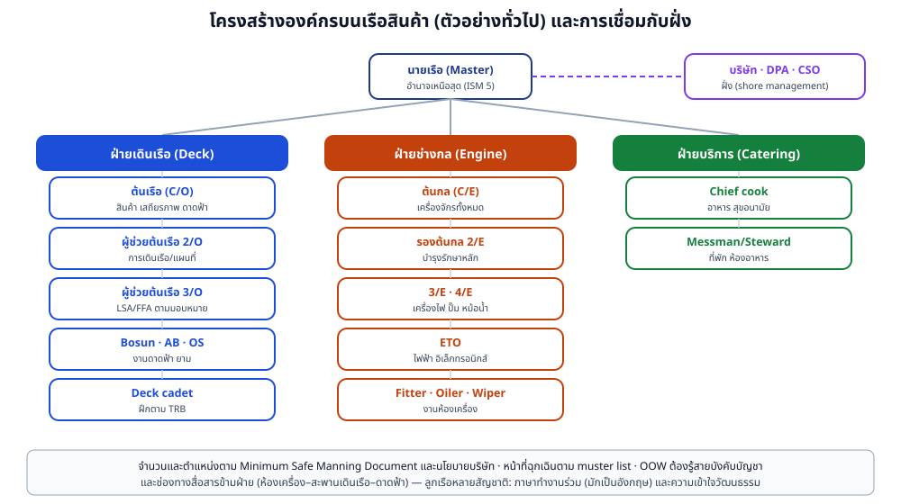
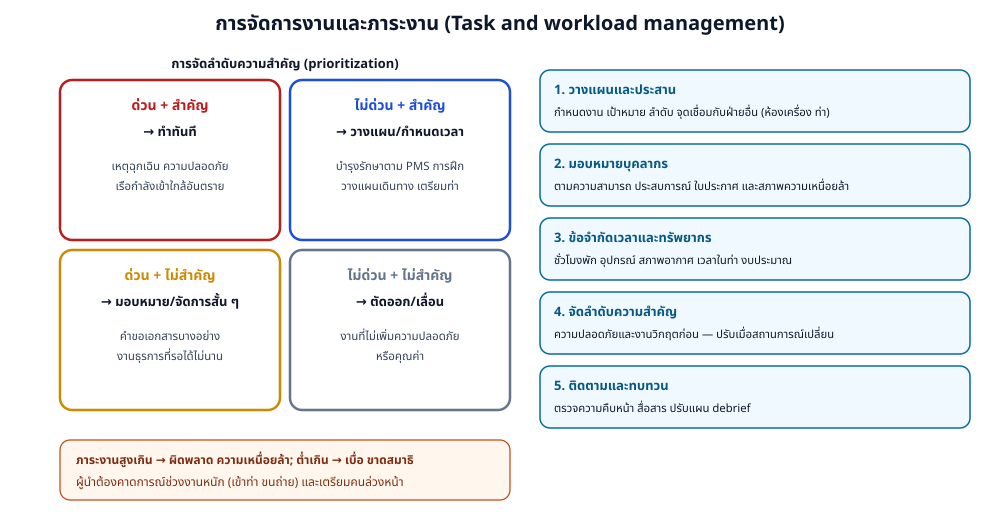
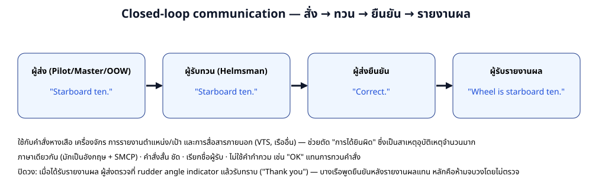
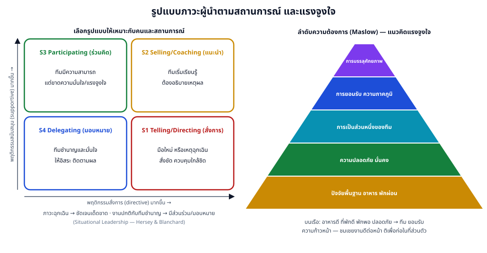
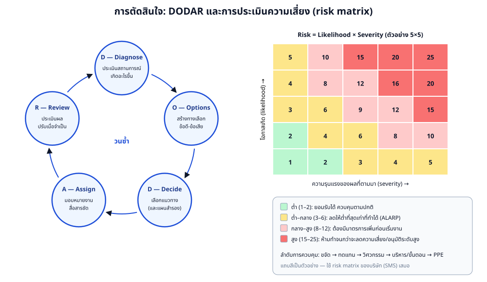

# 3.7 Application of Leadership and Teamworking Skills — ภาวะผู้นำและการทำงานเป็นทีม

> สมุดบันทึกการฝึก OOW · TIRAPHONG NANTAPAN
> Function 3: **Controlling the operation of the ship and care for persons on board at the operational level**
> สมรรถนะตาม STCW A-II/1: *Application of leadership and teamworking skills*
> - Working knowledge of shipboard personnel management and training
> - A knowledge of related international maritime conventions and recommendations, and national legislation
> - Ability to apply task and workload management, including: planning and co-ordination · personnel assignment · time and resource constraints · prioritization
> - Knowledge and ability to apply effective resource management: allocation, assignment, and prioritization of resources · effective communication on board and ashore · decisions reflect consideration of team experiences · assertiveness and leadership, including motivation · obtaining and maintaining situational awareness
> - Knowledge and ability to apply decision-making techniques: situation and risk assessment · identify and consider generated options · selecting course of action · evaluation of outcome effectiveness
>
> เกณฑ์ประเมิน: *The crew are allocated duties and informed of expected standards of work and behaviour in a manner appropriate to the individuals concerned · Training objectives and activities are based on assessment of current competence and capabilities and operational requirements · Operations are demonstrated to be in accordance with applicable rules · Operations are planned and resources are allocated as needed in correct priority to perform necessary tasks · Communication is clearly and unambiguously given and received · Effective leadership behaviours are demonstrated · Necessary team member(s) share accurate understanding of current and predicted vessel state and operational status and external environment · Decisions are most effective for the situation*
>
> อ้างอิงหลัก: STCW Code A-II/1, A-VIII/1 (fitness for duty), B-VIII/1; STCW Code ตาราง A-VI/1-4 ที่แก้โดย **IMO Res. MSC.560(108)** (การป้องกันและรับมือความรุนแรงและการคุกคาม รวมถึงการคุกคามทางเพศ การกลั่นแกล้ง และการล่วงละเมิดทางเพศ — รับรอง 23 พ.ค. 2024 มีผล 1 ม.ค. 2026); **IMO Model Course 1.39 (Leadership and Teamwork)**; ILO MLC 2006 (รวมการแก้ไขปี 2022 มีผล 23 ธ.ค. 2024 และการแก้ไขปี 2025 เรื่องความรุนแรงและการคุกคาม ซึ่ง ILO ระบุว่าจะมีผล 23 ธ.ค. 2027); ISM Code (Section 6 Resources and personnel); SOLAS V/14 และ IMO Res. A.1047(27) (Principles of minimum safe manning); IMO MSC.1/Circ.1598 (Guidelines on fatigue — ใช้แทน MSC/Circ.1014); ICS/ITF *Guidance on Eliminating Shipboard Harassment and Bullying*; ICS *Bridge Procedures Guide*; The Nautical Institute *Leadership and Teamwork* resources; บท 1.2.2 (BRM) ของสมุดนี้

---

## 0. OOW คือผู้นำแล้ว

ทันทีที่ได้ CoC และขึ้นเป็น OOW เราจะเป็น **หัวหน้า** — ของยามบนสะพาน (AB/lookout) ของทีมหัว/ท้ายเรือตอนผูกเรือ ของทีมดับเพลิงหรือเรือชูชีพที่ได้รับมอบหมาย และของ cadet ที่ฝึกกับเรา หลายคนอาวุโสกว่าเราและมีประสบการณ์ทะเลมากกว่า — ภาวะผู้นำของ OOW จึงไม่ใช่การ "สั่ง" แต่คือ **การทำให้ทีมทำงานได้ปลอดภัย มีประสิทธิภาพ และเคารพกัน** ภายใต้กฎและแผนของเรือ

เกณฑ์ STCW ข้อนี้ยาวที่สุดข้อหนึ่ง แต่สรุปได้ว่า: **มอบหมายงานให้เหมาะกับคนและบอกมาตรฐานที่คาดหวัง · ฝึกตามความสามารถที่มีอยู่จริง · ทำตามกฎ · วางแผนและจัดลำดับทรัพยากร · สื่อสารชัด · แสดงพฤติกรรมผู้นำ · ให้ทีมเข้าใจสถานการณ์ตรงกัน · ตัดสินใจได้เหมาะสม**

---

## 1. การจัดการบุคลากรและการฝึกอบรมบนเรือ

### 1.1 องค์กรบนเรือ

*ภาพที่ 3.7-1 โครงสร้างองค์กรบนเรือสินค้า (ตัวอย่างทั่วไป) และการเชื่อมกับฝั่ง*

- **สายบังคับบัญชา** — นายเรือมีอำนาจเหนือสุด (overriding authority — ISM Code 5); ฝ่ายเดินเรือ ฝ่ายช่างกล ฝ่ายบริการ; ฝั่ง: บริษัท DPA CSO superintendent
- **หน้าที่และความรับผิดชอบ** — กำหนดใน SMS (job descriptions) muster list ตารางยาม และคำสั่งประจำ (standing orders)
- **ลูกเรือหลายชาติหลายวัฒนธรรม** — ภาษาทำงานร่วม (working language — มักเป็นอังกฤษ ตามที่บันทึกใน log), ความเข้าใจความแตกต่าง (ระยะห่างทางอำนาจ การแสดงความเห็น ศาสนา อาหาร วันสำคัญ), หลีกเลี่ยงการเหมารวม, สื่อสารด้วยประโยคง่ายและตรวจความเข้าใจ

### 1.2 การมอบหมายงานและการบอกมาตรฐานที่คาดหวัง

- มอบหมายงานตาม **ความสามารถ ประสบการณ์ ใบประกาศ** และ **สภาพร่างกาย/ความเหนื่อยล้า** — ไม่ให้คนที่ไม่ได้รับการฝึกทำงานเสี่ยงสูงคนเดียว (งานบนที่สูง พื้นที่อับอากาศ งานร้อน)
- บอกให้ชัด: **ทำอะไร ทำไม เมื่อไร มาตรฐานที่ต้องการ ความเสี่ยงและมาตรการ PPE ใครเป็นหัวหน้างาน รายงานใคร**
- **มาตรฐานพฤติกรรม** — นโยบายบริษัท (code of conduct, drug & alcohol policy, การใช้โทรศัพท์ขณะเข้ายาม, ความเคารพ ไม่ล่วงละเมิด ไม่กลั่นแกล้ง) — บอกตั้งแต่ familiarization และเป็นตัวอย่างเอง
- **ปรับวิธีให้เหมาะกับคน** (เกณฑ์ STCW: "in a manner appropriate to the individuals concerned") — คนใหม่ต้องการคำแนะนำทีละขั้น คนชำนาญต้องการเป้าหมายและอิสระ

### 1.3 การฝึกอบรมบนเรือ

- **Familiarization** — ก่อนปฏิบัติหน้าที่ (STCW I/14, A-VI/1 safety familiarization, ISM 6.3) — อุปกรณ์ ขั้นตอน หน้าที่ฉุกเฉิน
- **วิเคราะห์ความต้องการฝึก (training needs)** จาก **ความสามารถจริงในปัจจุบัน** (สังเกตการทำงาน การฝึกซ้อม ผลการตรวจ) และ **ความต้องการของงาน** (สินค้าใหม่ ท่าใหม่ อุปกรณ์ใหม่) — ตามเกณฑ์ STCW
- **วิธี** — สาธิตแล้วให้ทำ (demonstrate–practise), coaching ระหว่างงาน, การฝึกซ้อม (drills), CBT/วิดีโอ, toolbox talks
- **ประเมินและบันทึก** — ใครทำได้ ใครต้องฝึกเพิ่ม บันทึกใน training records
- **การเป็นพี่เลี้ยง cadet** — วางแผนงานตาม **Training Record Book (TRB)**, ให้ลงมือทำภายใต้การดูแล, ให้ feedback, ลงนามเมื่อมีความสามารถจริง (ไม่ใช่ลงนามเพื่อให้ครบ) — คนที่สอน cadet วันนี้คือคนที่สร้างนายเรือในอนาคต

### 1.4 สวัสดิการ ความเหนื่อยล้า และพฤติกรรมในที่ทำงาน

- **ความเหนื่อยล้า (fatigue)** — สาเหตุ: นอนไม่พอ ชั่วโมงทำงานยาว การเข้าท่าบ่อย เสียง สั่น ความเครียด — ผลคล้ายเมาแอลกอฮอล์ — **ชั่วโมงพักตาม STCW/MLC** (3.6) ต้องเป็นจริงไม่ใช่แค่บนกระดาษ; แนวทาง IMO MSC.1/Circ.1598
- **แอลกอฮอล์และยาเสพติด** — ขีดจำกัด STCW (BAC 0.05% หรือ 0.25 mg/l ในลมหายใจ — A-VIII/1) และนโยบายบริษัท (หลายบริษัทห้ามเด็ดขาด/สุ่มตรวจ)
- **การล่วงละเมิด การกลั่นแกล้ง การคุกคาม (harassment and bullying)** — ทำลายความปลอดภัยและสุขภาพจิต — STCW Code ได้เพิ่มเนื้อหานี้ในการฝึกพื้นฐาน **PSSR (ตาราง A-VI/1-4 แก้โดย MSC.560(108) มีผล 1 ม.ค. 2026)** ซึ่งคนประจำเรือทุกคนต้องผ่าน — ส่วนการเพิ่มเรื่องนี้เข้าไปในตารางสมรรถนะภาวะผู้นำของเจ้าหน้าที่ (เช่น A-II/1, A-II/2) ยังอยู่ในขั้นข้อเสนอ/การทบทวน STCW ทั้งฉบับ ไม่ใช่ข้อบังคับที่มีผลแล้ว (ตรวจกับฉบับปัจจุบัน) — แต่ในฐานะหัวหน้าทีมตามสมรรถนะ "leadership and teamworking" ผู้นำต้องไม่ทำเอง ไม่นิ่งเฉย รับเรื่อง ปกป้องผู้รายงาน และส่งต่อตามขั้นตอนบริษัท/MLC complaint procedures; MLC ก็มีการแก้ไขปี 2025 ในเรื่องเดียวกัน (ดูข้อ 1.5)
- **สุขภาพจิตและการแยกตัว** — สังเกตการเปลี่ยนแปลงของเพื่อนร่วมงาน พูดคุย ส่งต่อความช่วยเหลือ (บริษัท/องค์กรช่วยเหลือคนเรือ)
- **สันทนาการและการสื่อสารกับครอบครัว** — ช่วยรักษาขวัญกำลังใจ (MLC)

### 1.5 การแก้ไขล่าสุดเรื่องความรุนแรง การคุกคาม และการกลั่นแกล้ง (จดไว้กันสับสน)

ตอนเตรียมสอบผมเจอหลายแหล่งเขียนปนกันว่า "STCW 2026" แก้อะไรบ้าง เลยแยกตามตราสารให้ชัด:

| ตราสาร | สาระโดยสรุป | สถานะ |
|---|---|---|
| **STCW Code ตาราง A-VI/1-4 (PSSR)** — IMO Res. **MSC.560(108)** | แทนที่ตาราง PSSR ทั้งตาราง เพิ่มสมรรถนะใหม่ว่าด้วย **การมีส่วนป้องกันและรับมือความรุนแรงและการคุกคาม รวมถึงการคุกคามทางเพศ การกลั่นแกล้ง และการล่วงละเมิดทางเพศ** — เป็นส่วนของ Basic training จึงใช้กับคนประจำเรือ **ทุกคน** ไม่ใช่เฉพาะเจ้าหน้าที่ | รับรอง 23 พ.ค. 2024 (MSC 108) **มีผล 1 ม.ค. 2026** — หลักสูตรที่เริ่มตั้งแต่วันนั้นต้องเป็นตามตารางใหม่ ส่วนผู้ที่ได้ใบ PSSR ก่อนหน้านั้นจะต้องเรียนเพิ่มหรือไม่ แต่ละ Flag กำหนดต่างกัน ต้องตรวจ circular ของ Flag |
| ตารางสมรรถนะภาวะผู้นำของเจ้าหน้าที่ (A-II/1, A-II/2 ฯลฯ) | มีการเสนอให้เติมเรื่องนี้ในสมรรถนะด้านภาวะผู้นำ | **ยังไม่มีผลบังคับ** — อยู่ในกระบวนการทบทวน STCW ทั้งฉบับ (ตรวจกับฉบับปัจจุบัน) |
| **MLC 2006 การแก้ไขปี 2025** | รับรองโดยที่ประชุมใหญ่ ILO สมัยที่ 113 (6 มิ.ย. 2025): ห้ามความรุนแรง การคุกคาม การคุกคามทางเพศ การกลั่นแกล้ง และการล่วงละเมิดทางเพศอย่างชัดเจนใน Reg 4.3 (รัฐต้องออกกฎหมาย เจ้าของเรือต้องมีนโยบายป้องกันและช่องทางรายงาน), หน่วยงานจัดหาคนประจำเรือ (Reg 1.4) ต้องมีมาตรการป้องกัน, ขั้นตอนร้องเรียนบนเรือ (Reg 5.1.5) ต้องรักษาความลับและคุ้มครองผู้ร้องจากการตอบโต้ — นอกจากนี้ยังมีเรื่องสิทธิขึ้นฝั่ง (Reg 2.4) การยอมรับคนประจำเรือเป็น key workers และการส่งตัวกลับ (Reg 2.5) | ILO ระบุว่าจะ **มีผล 23 ธ.ค. 2027** (ตาม Article XV — ตรวจสถานะกับ ILO/Flag) |
| MLC 2006 การแก้ไขปี 2022 | เช่น PPE ต้องมีขนาดเหมาะกับคนประจำเรือ (โดยเฉพาะคนประจำเรือหญิงที่เพิ่มขึ้น) และการเข้าถึงอินเทอร์เน็ต (Reg 3.1) | **มีผล 23 ธ.ค. 2024** |
| ICS/ITF *Guidance on Eliminating Shipboard Harassment and Bullying* | แนวทางของอุตสาหกรรม — นโยบายบริษัท วิธีรับเรื่อง ตัวอย่างพฤติกรรม | แนวทาง (ไม่ใช่ข้อบังคับ) |

ข้อสรุปของผม: ในการสอบ ถ้าถูกถามว่า "STCW แก้อะไรเรื่องการคุกคาม" คำตอบที่ปลอดภัยคือ **MSC.560(108) แก้ตาราง PSSR (A-VI/1-4) มีผล 1 ม.ค. 2026 ใช้กับทุกคน** แล้วค่อยเสริมว่า MLC ก็แก้ในปี 2025 และ OOW ในฐานะหัวหน้าทีมมีบทบาทตามข้อ 1.4

### 1.6 ความเหนื่อยล้าตาม MSC.1/Circ.1598 (Guidelines on fatigue)

- เป็นแนวทางของ IMO ที่ MSC 100 อนุมัติ (หนังสือเวียนลงวันที่ ม.ค. 2019) ใช้แทน MSC/Circ.1014 (2001) — ไม่ใช่ข้อบังคับ แต่ IMO ขอให้บริษัทนำไปใส่ใน SMS ตาม ISM Code
- จัดเป็น **โมดูล** ตามผู้ใช้: (1) ความเหนื่อยล้าโดยทั่วไป — ทุกคนควรอ่านก่อน (2) บริษัท (3) คนประจำเรือ (4) การสร้างความตระหนักและการฝึก (5) การออกแบบเรือ (6) Administration และ port State — พร้อมภาคผนวกเรื่องเครื่องมือติดตามความเหนื่อยล้าและการรายงานเหตุ
- สาเหตุที่ควรจำเป็นกลุ่ม: ปัจจัยของตัวบุคคล (การนอน สุขภาพ ความเครียด) · ปัจจัยการบริหาร (ตารางงาน อัตรากำลัง การเข้าท่าบ่อย งานเอกสาร) · ปัจจัยของเรือ (เสียง สั่น การเคลื่อนไหวของเรือ ที่พัก) · ปัจจัยสิ่งแวดล้อม (อากาศ อุณหภูมิ)
- **สิ่งที่ OOW ในฐานะหัวหน้าทำได้จริง**: วางแผนงานให้ชั่วโมงพักเป็นจริง (ไม่ใช่แค่บนกระดาษ) หมุนเวียนงานหนัก ให้คนพักก่อนช่วงงานหนัก (เข้าท่า ขนถ่าย) สังเกตสัญญาณเหนื่อยในทีม และสร้างบรรยากาศที่ลูกเรือกล้าบอกว่า "ผมไม่พร้อมเข้ายาม" — ความเหนื่อยล้าไม่ใช่เรื่องความอดทน แต่เป็นความเสี่ยงที่ต้องจัดการ

---

## 2. อนุสัญญา ข้อแนะนำ และกฎหมายที่เกี่ยวข้อง (ทบทวน)

| เรื่อง | กฎ/แนวทาง |
|---|---|
| ความสามารถ ใบประกาศ familiarization ชั่วโมงพัก แอลกอฮอล์ | **STCW** (I/14, VIII/1, A-VIII/1) |
| สัญญาจ้าง ค่าจ้าง ชั่วโมงทำงาน/พัก ที่พัก อาหาร สุขภาพ การร้องเรียน | **MLC 2006** |
| ทรัพยากรและบุคลากร การฝึก การสื่อสาร (ภาษาทำงาน) | **ISM Code** 6 |
| อัตรากำลังขั้นต่ำ | **SOLAS V/14** + Minimum Safe Manning Document (หลักการตาม IMO Res. A.1047(27)) |
| ความเหนื่อยล้า | IMO MSC.1/Circ.1598 |
| การคุกคาม/กลั่นแกล้ง | STCW Code ตาราง A-VI/1-4 (MSC.560(108) มีผล 1 ม.ค. 2026), MLC 2006 Reg 4.3 และ 5.1.5 (การแก้ไขปี 2025 — ILO ระบุว่ามีผล 23 ธ.ค. 2027), ICS/ITF Guidance, นโยบายบริษัท |
| กฎหมายภายใน | กฎหมายแรงงาน/การเดินเรือของรัฐเจ้าของธง |

---

## 3. การจัดการงานและภาระงาน (Task and workload management)

*ภาพที่ 3.7-2 การจัดลำดับความสำคัญและขั้นตอนการจัดการภาระงาน*

1. **วางแผนและประสาน (planning and co-ordination)** — กำหนดงาน เป้าหมาย ลำดับ ผู้เกี่ยวข้อง (ห้องเครื่อง ท่า ตัวแทนเรือ) ใช้ PMS แผนงานประจำวัน การประชุมเช้า (toolbox meeting)
2. **มอบหมายบุคลากร (personnel assignment)** — คนที่เหมาะสมกับงาน — ไม่ใช่ "คนที่ว่าง" เสมอไป
3. **ข้อจำกัดเวลาและทรัพยากร (time and resource constraints)** — เวลาในท่าสั้น ชั่วโมงพัก อุปกรณ์ สภาพอากาศ อะไหล่ — ต้องยอมรับว่าบางงานต้องเลื่อน
4. **จัดลำดับความสำคัญ (prioritization)** — **ความปลอดภัยและงานวิกฤตก่อน** (ตารางด่วน/สำคัญ) และปรับเมื่อสถานการณ์เปลี่ยน
5. **ติดตามและทบทวน** — ความคืบหน้า ปัญหา การสื่อสาร debrief

**ภาระงานกับประสิทธิภาพ** — ภาระงานสูงเกิน (เข้าท่าพร้อมขนถ่าย ฝึก PSC) ทำให้ผิดพลาดง่าย; ภาระงานต่ำเกิน (ยามกลางคืนกลางมหาสมุทร) ทำให้เบื่อ หลับใน — ผู้นำต้องคาดการณ์ช่วงงานหนักและเตรียมคน (เช่นให้พักก่อนเข้าท่า) และหากิจกรรมที่รักษาความตื่นตัวในช่วงงานเบา

---

## 4. การจัดการทรัพยากรอย่างมีประสิทธิภาพ (Effective resource management)

ทักษะเหล่านี้คือหัวใจของ BRM (1.2.2) และใช้ได้กับทุกทีม — สะพานเดินเรือ ห้องเครื่อง (ERM) ดาดฟ้า ทีมฉุกเฉิน

### 4.1 จัดสรร มอบหมาย และจัดลำดับทรัพยากร

- ทรัพยากร = **คน** (ความรู้ ทักษะ เวลา ความสดชื่น) + **อุปกรณ์** + **ข้อมูล** + **เวลา**
- เพิ่มทรัพยากรเมื่อสถานการณ์ยากขึ้น — เช่นเรียกนายเรือ เพิ่ม lookout เปลี่ยนเป็นถือท้ายด้วยมือ ใช้เรดาร์สองเครื่อง (bridge team escalation ใน 1.2.1-B)
- **ไม่ให้งานเดียวกันพึ่งคนคนเดียว (single-person error)** — cross-check

### 4.2 การสื่อสารบนเรือและกับฝั่ง

*ภาพที่ 3.7-3 การสื่อสารแบบวงปิด (closed-loop) — ทวนคำสั่งและยืนยัน (จากบท 1.2.2)*

- **Closed-loop** — ผู้ส่งพูดชัด ผู้รับทวน ผู้ส่งยืนยัน
- **Briefing และ debriefing** — ก่อนงาน: เป้าหมาย แผน บทบาท ความเสี่ยง สัญญาณหยุด; หลังงาน: อะไรดี อะไรต้องปรับ
- **ใช้ภาษาง่าย มาตรฐาน (SMCP)** เลี่ยงศัพท์แสลง/คำย่อที่ไม่เป็นสากล — ตรวจความเข้าใจด้วยคำถามปลายเปิด ("คุณจะทำอะไรเป็นขั้นแรก?") แทน "เข้าใจไหม?"
- **กับฝั่ง** — บริษัท ตัวแทน ท่า VTS — ข้อเท็จจริงชัด เวลา ตำแหน่ง ความต้องการ บันทึกไว้
- **การรับ feedback** — ชมต่อหน้า ติเพื่อก่อในที่ส่วนตัว เน้นพฤติกรรมไม่ใช่ตัวบุคคล

### 4.3 การตัดสินใจที่คำนึงถึงประสบการณ์ของทีม

- ขอความเห็นจากผู้มีประสบการณ์ (bosun ที่ทำงานผูกเรือมา 20 ปี, AB ที่เคยมาท่านี้) — ผู้นำที่ดีใช้ความรู้ของทั้งทีม
- แต่ **ความรับผิดชอบสุดท้ายอยู่ที่ผู้นำ** — รับฟังแล้วตัดสินใจ อธิบายเหตุผลเมื่อทำได้

### 4.4 ความกล้าแสดงออก ภาวะผู้นำ และแรงจูงใจ

*ภาพที่ 3.7-4 ภาวะผู้นำตามสถานการณ์และลำดับความต้องการ (แรงจูงใจ)*

- **Assertiveness (ความกล้าแสดงออกอย่างเหมาะสม)** — พูดสิ่งที่ต้องพูดอย่างชัด สุภาพ มีข้อเท็จจริง — ไม่เงียบ (passive) ไม่ก้าวร้าว (aggressive) — สำคัญมากเมื่อเห็นความเสี่ยง แม้ผู้ที่ทำผิดจะอาวุโสกว่า (เช่นนำร่อง/นายเรือ) — ใช้ขั้นตอนท้วงติงแบบไล่ระดับ (1.2.2): เรียกชื่อ → บอกความกังวล → บอกปัญหา → เสนอทางแก้ → ขอความเห็นตอบ
- **Authority gradient** — ระยะห่างทางอำนาจที่ชันเกินทำให้ลูกน้องไม่กล้าพูด ราบเกินทำให้ขาดการตัดสินใจ — ผู้นำต้องสร้างบรรยากาศที่ทีม "กล้าพูด" (ดูภาพใน 1.2.2)
- **รูปแบบภาวะผู้นำ** — สั่งการ (directing) แนะนำ (coaching) มีส่วนร่วม (participating) มอบหมาย (delegating) — **เลือกตามความพร้อมของคนและสถานการณ์**: เหตุฉุกเฉินต้องชัดเจนเด็ดขาด, งานปกติกับทีมชำนาญให้มีส่วนร่วม/มอบหมาย
  - ทั้งสี่แบบมาจากแนวคิด **Situational Leadership ของ Hersey และ Blanchard** — ในภาพ 3.7-4 แกนนอนคือปริมาณ "การสั่งการ/กำกับงาน" (directive) แกนตั้งคือปริมาณ "การสนับสนุน/ให้กำลังใจ" (supportive): S1 สั่งมาก-สนับสนุนน้อย, S2 สั่งมาก-สนับสนุนมาก, S3 สั่งน้อย-สนับสนุนมาก, S4 สั่งน้อย-สนับสนุนน้อย — ผู้นำขยับจาก S1 ไป S4 เมื่อลูกทีมเก่งและมั่นใจขึ้น
  - แบบอื่นที่ผู้สอบบางคนถาม: **autocratic** (ตัดสินใจคนเดียว — เหมาะกับเหตุฉุกเฉินที่เวลาน้อย), **democratic/participative** (ฟังทีมแล้วตัดสินใจ — เหมาะกับการวางแผนงาน), **laissez-faire** (ปล่อยให้ทีมทำเอง — ใช้ได้เฉพาะทีมที่ชำนาญมากและงานความเสี่ยงต่ำ ถ้าใช้ผิดที่คือการละทิ้งหน้าที่)
- **แรงจูงใจ** — ปัจจัยพื้นฐาน (อาหาร พัก ความปลอดภัย) ต้องมาก่อน แล้วจึงความเป็นทีม การยอมรับ การเติบโต (Maslow); ปัจจัยที่ทำให้ไม่พอใจ (ค่าจ้าง สภาพที่พัก) กับปัจจัยจูงใจ (ความสำเร็จ การยอมรับ ความรับผิดชอบ) (Herzberg) — ผู้นำบนเรือควบคุมได้มากในเรื่องการยอมรับ การมอบความรับผิดชอบ ความยุติธรรม และการเป็นตัวอย่าง
- **พฤติกรรมผู้นำที่ดี** — เป็นตัวอย่าง (PPE กฎ ความตรงต่อเวลา) ซื่อสัตย์ ยุติธรรม สงบในภาวะกดดัน ฟัง ยอมรับความผิดพลาดของตัวเอง ปกป้องทีม ให้เครดิตทีม

### 4.5 การได้มาและรักษาความตระหนักรู้สถานการณ์ (Situational awareness)

- **สามระดับ** (Endsley): รับรู้ (perception) → เข้าใจ (comprehension) → คาดการณ์ (projection) (ภาพใน 1.2.2)
- **"Shared mental model"** — ทีมเข้าใจตรงกันว่าเรืออยู่ในสถานะใด กำลังจะเกิดอะไร (เกณฑ์ STCW: *share accurate understanding of current and predicted vessel state*) — ทำได้ด้วย briefing การรายงานเป็นระยะ การพูดออกมาดัง ๆ (thinking aloud) และการ cross-check
- **สัญญาณว่ากำลังเสีย SA** — สับสน ข้อมูลขัดแย้ง ไม่มีใครดูเรือ (fixation) ทำงานเกินขีด ข้ามขั้นตอน ไม่บรรลุเป้า (เช่นไม่ถึง waypoint ตามเวลา) ความรู้สึก "มีอะไรไม่ถูก" — **หยุด ถอย รวบรวมข้อมูล ขอความช่วยเหลือ**

---

## 5. เทคนิคการตัดสินใจ (Decision-making techniques)

*ภาพที่ 3.7-5 กระบวนการตัดสินใจแบบ DODAR และ risk matrix*

### 5.1 ขั้นตอน (ตาม STCW และแบบ DODAR)

1. **ประเมินสถานการณ์และความเสี่ยง (Diagnose / situation and risk assessment)** — เกิดอะไรขึ้น ข้อมูลอะไรเชื่อถือได้ เวลามีเท่าไร อันตรายคืออะไร
2. **สร้างและพิจารณาทางเลือก (Options)** — อย่างน้อยสองทาง ข้อดี-ข้อเสีย ความเสี่ยงของแต่ละทาง ถามทีม
3. **เลือกแนวทาง (Decide)** — เลือกทางที่ปลอดภัยที่สุดที่บรรลุเป้า มีแผนสำรอง (เงื่อนไขที่จะเปลี่ยนแผน)
4. **มอบหมายและดำเนินการ (Assign)** — ใครทำอะไร สื่อสารให้ทุกคนเข้าใจ
5. **ประเมินผล (Review / evaluation of outcome effectiveness)** — ได้ผลตามที่คาดไหม สถานการณ์เปลี่ยนไหม → วนกลับไปประเมินใหม่

- เมื่อเวลาน้อยมาก (เช่นเรือใกล้โดนกัน) การตัดสินใจอาศัย **การฝึกและขั้นตอนที่ซ้อมไว้** (recognition-primed) — นี่คือเหตุผลที่ต้องฝึกซ้อมสม่ำเสมอ
- **OODA loop** (Observe–Orient–Decide–Act) เป็นอีกแบบที่ใช้แนวคิดเดียวกัน

### 5.2 การประเมินความเสี่ยง (Risk assessment)

- **Risk = โอกาสเกิด × ความรุนแรง** — ใช้ risk matrix ของบริษัท (เช่น 5×5)
  - แถบสีในภาพ 3.7-5 เป็นตัวอย่าง: 1–2 ต่ำ (ยอมรับได้) · 3–6 ต่ำ–กลาง (ลดให้ต่ำที่สุดเท่าที่ทำได้ — ALARP) · 8–12 กลาง–สูง (ต้องมีมาตรการเพิ่มก่อนเริ่ม) · 15–25 สูง (ห้ามทำจนกว่าจะลดได้) — ตัวเลขแบ่งแถบของแต่ละบริษัทต่างกัน ต้องใช้ของ SMS เรือตัวเอง
  - ตัวอย่างจำลองการใช้ matrix กับงานบนที่สูง ดูบท 3.8 ข้อ 5.2
- ขั้นตอน: ระบุอันตราย (hazards) → ใครได้รับผลกระทบอย่างไร → ประเมินความเสี่ยง → **มาตรการควบคุม** ตามลำดับ (hierarchy of controls): **ขจัด → ทดแทน → วิศวกรรม → บริหาร/ขั้นตอน/permit → PPE** → ความเสี่ยงที่เหลือ (residual risk) ยอมรับได้หรือไม่ (ALARP) → ทบทวนเมื่อสถานการณ์เปลี่ยน
- เครื่องมือบนเรือ: risk assessment form, **permit to work** (hot work, enclosed space, work at height, electrical isolation), toolbox talk, **stop work authority** — ทุกคนมีสิทธิ์และหน้าที่หยุดงานที่ไม่ปลอดภัย

### 5.3 กับดักทางความคิด (เพื่อระวัง)

- **Confirmation bias** — เห็นแต่ข้อมูลที่ยืนยันสิ่งที่คิดไว้แล้ว
- **Plan continuation bias ("get-there-itis")** — ยึดแผนเดิมทั้งที่สถานการณ์เปลี่ยน (เช่นรีบเข้าท่าทั้งที่ทัศนวิสัยแย่ลง)
- **Normalization of deviance** — ทำผิดขั้นตอนบ่อยจนกลายเป็น "ปกติ"
- **Overconfidence / complacency** — "ทำมาเป็นร้อยครั้งแล้ว"
- **ความกดดันทางการค้า** — ความปลอดภัยต้องมาก่อน (และนายเรือมีอำนาจเหนือสุดตาม ISM)
- การป้องกัน: ใช้ checklist, ขอความเห็นที่สอง, ตั้งเงื่อนไขยกเลิก (abort criteria) ล่วงหน้า, พักเมื่อเหนื่อย

---

## 6. การจัดการความขัดแย้ง

- เกิดได้จากความเหนื่อย ความแตกต่างวัฒนธรรม การแบ่งงานไม่เป็นธรรม พื้นที่จำกัดและอยู่ด้วยกันนาน
- แนวทาง: แยกคนออกจากปัญหา ฟังทั้งสองฝ่าย มุ่งที่ข้อเท็จจริงและเป้าหมายร่วม (ความปลอดภัย งานสำเร็จ) หาทางออกที่ยอมรับได้ บันทึกถ้าจำเป็น ส่งต่อผู้บังคับบัญชาเมื่อเกินอำนาจ — ใช้ขั้นตอนร้องเรียนของ MLC เมื่อเกี่ยวกับสิทธิ

---

## 7. ตัวอย่างจำลอง

### 7.1 วางแผนงานดาดฟ้าในท่าที่มีเวลาจำกัด

> MV Andaman Pearl จะอยู่ท่า 14 ชั่วโมง ต้นเรือมอบหมาย 3/O (OOW) ดูแลงานดาดฟ้า: (1) เปลี่ยนเชือกผูกเรือที่ชำรุด 1 เส้น (2) ตรวจรายเดือน LSA (3) รับเสบียง (4) ทาสีฝาระวาง (5) ยามสินค้าตามตาราง
> - **ประเมินทรัพยากร**: bosun + AB 3 คน + OS 1 + cadet 1; AB 2 คนเพิ่งลงยามกลางคืน (ต้องพักตามชั่วโมงพัก); ฝนตกช่วงบ่าย
> - **จัดลำดับ**: ความปลอดภัยและข้อบังคับก่อน → เชือกชำรุด (ความปลอดภัยการผูกเรือ) และตรวจ LSA (ข้อบังคับ ใกล้ครบกำหนด) → รับเสบียง (มีเวลานัดกับรถส่ง) → ทาสี **เลื่อน** (ไม่สำคัญเร่งด่วน + ฝนตก)
> - **มอบหมาย**: bosun + AB ที่พักครบ เปลี่ยนเชือก (งานเสี่ยง — 3/O ทำ toolbox talk เรื่อง snap-back); OS + cadet ช่วย 3/O ตรวจ LSA (cadet ได้ฝึกตาม TRB); รับเสบียงช่วงพักขนถ่าย ใช้ทุกคนที่ว่าง 30 นาที
> - **สื่อสาร**: แจ้งต้นเรือแผนและเหตุผลที่เลื่อนงานทาสี, แจ้งห้องเครื่องว่าจะใช้กว้านท้ายช่วงไหน, ประกาศเวลารับเสบียง
> - **ทบทวน**: บ่ายพบว่าเชือกใหม่มาไม่ครบ → ปรับแผน ใช้เชือกสำรองชั่วคราว รายงานต้นเรือ บันทึก

### 7.2 การตัดสินใจด้วย DODAR — พายุกำลังเข้า

> ระหว่างเดินทาง NAVTEX/weather routing แจ้งพายุโซนร้อนจะเคลื่อนผ่านเส้นทางในอีก 36 ชั่วโมง OOW (2/O) ช่วยนายเรือประเมิน
> - **D**: ตำแหน่ง/ทิศทาง/ความเร็วพายุ ระยะ CPA ที่คาด เรือกับพายุอยู่ด้านไหน (1.1.7) สภาพสินค้า (ตู้บนดาดฟ้า 6 ชั้น — เสี่ยง parametric rolling)
> - **O**: (1) คงเส้นทางและความเร็ว (2) เพิ่มความเร็วผ่านก่อน (3) เปลี่ยนเส้นทางอ้อม/รอ (4) หลบเข้าที่กำบัง
> - **D**: นายเรือเลือก (3) อ้อมลงใต้ ยอมเสียเวลา 10 ชั่วโมง — เงื่อนไขทบทวน: ถ้าพยากรณ์ใหม่เปลี่ยนเส้นทางพายุ
> - **A**: 2/O วางแผนเส้นทางใหม่และตรวจอันตราย; ต้นเรือตรวจ lashing และเสถียรภาพ; ต้นกลเตรียมเครื่อง; 3/O ตรวจการยึดของบนดาดฟ้า ปิดช่องเปิด; แจ้งบริษัทและผู้เช่าเรือ
> - **R**: ทุก 6 ชั่วโมงทบทวนพยากรณ์และตำแหน่งพายุ บันทึกการตัดสินใจและเหตุผลใน logbook

---

## 8. คำถามสอบปากเปล่า / สัมภาษณ์

**ถาม:** การจัดการภาระงาน (task and workload management) มีองค์ประกอบอะไร
**แนวตอบ:** วางแผนและประสาน, มอบหมายบุคลากร, ข้อจำกัดเวลาและทรัพยากร, จัดลำดับความสำคัญ — และติดตามทบทวน

**ถาม:** จัดลำดับความสำคัญของงานอย่างไร
**แนวตอบ:** ความปลอดภัยและงานวิกฤตก่อน — ใช้แนวคิดด่วน/สำคัญ: ด่วนและสำคัญทำทันที, สำคัญไม่ด่วนวางแผน, ด่วนไม่สำคัญมอบหมาย, ไม่ด่วนไม่สำคัญตัดออก — ปรับเมื่อสถานการณ์เปลี่ยน

**ถาม:** การจัดการทรัพยากรอย่างมีประสิทธิภาพประกอบด้วยอะไร
**แนวตอบ:** จัดสรร มอบหมาย จัดลำดับทรัพยากร; สื่อสารบนเรือและกับฝั่ง; ตัดสินใจโดยคำนึงถึงประสบการณ์ทีม; ความกล้าแสดงออกและภาวะผู้นำรวมถึงแรงจูงใจ; ได้มาและรักษา situational awareness

**ถาม:** Closed-loop communication คืออะไร
**แนวตอบ:** ผู้ส่งสื่อสารชัด ผู้รับทวนกลับ ผู้ส่งยืนยันว่าถูก — ป้องกันการเข้าใจผิด

**ถาม:** Assertiveness ต่างจาก aggressiveness อย่างไร
**แนวตอบ:** Assertiveness คือพูดสิ่งที่ต้องพูดอย่างชัด สุภาพ มีข้อเท็จจริง เคารพผู้อื่น; aggressiveness คือก้าวร้าว ไม่เคารพ — ส่วน passive คือเงียบไม่พูดทั้งที่เห็นความเสี่ยง

**ถาม:** ถ้าเห็นนำร่องสั่งเข็มที่ทำให้เรือเข้าใกล้ที่ตื้น OOW ทำอย่างไร
**แนวตอบ:** ท้วงทันทีอย่างสุภาพและชัด (ระบุข้อมูล: ระยะ ความลึก) เสนอทางแก้ ถ้าไม่ได้รับการตอบสนองแจ้งนายเรือทันที — OOW ยังรับผิดชอบความปลอดภัยของเรือแม้มีนำร่อง (1.2.1-B)

**ถาม:** รูปแบบภาวะผู้นำมีอะไรบ้าง ใช้เมื่อไร
**แนวตอบ:** สั่งการ (มือใหม่/เหตุฉุกเฉิน), แนะนำ (กำลังเรียนรู้), มีส่วนร่วม (มีความสามารถแต่ขาดความมั่นใจ), มอบหมาย (ชำนาญและมั่นใจ) — เลือกตามคนและสถานการณ์

**ถาม:** สร้างแรงจูงใจให้ทีมบนเรืออย่างไร
**แนวตอบ:** ดูแลปัจจัยพื้นฐาน (พัก อาหาร ความปลอดภัย) ยุติธรรม เป็นตัวอย่าง ให้การยอมรับชมเชย ให้ความรับผิดชอบและโอกาสเรียนรู้ สื่อสารเหตุผลของงาน

**ถาม:** Situational awareness มีกี่ระดับ ทีมรักษา SA ร่วมกันอย่างไร
**แนวตอบ:** รับรู้ เข้าใจ คาดการณ์ — ทีมรักษาด้วย briefing รายงานเป็นระยะ พูดคิดออกมาดัง ๆ cross-check และระวังสัญญาณการเสีย SA

**ถาม:** ขั้นตอนการตัดสินใจตาม STCW
**แนวตอบ:** ประเมินสถานการณ์และความเสี่ยง → ระบุและพิจารณาทางเลือก → เลือกแนวทาง → ประเมินประสิทธิผลของผล — เช่นแบบ DODAR (Diagnose, Options, Decide, Assign, Review)

**ถาม:** Hierarchy of controls คืออะไร
**แนวตอบ:** ลำดับมาตรการลดความเสี่ยงจากได้ผลมากไปน้อย: ขจัด → ทดแทน → วิศวกรรม → บริหาร/ขั้นตอน → PPE

**ถาม:** วางแผนการฝึกลูกเรืออย่างไรตามเกณฑ์ STCW
**แนวตอบ:** ประเมินความสามารถปัจจุบันและความต้องการของงาน → ตั้งวัตถุประสงค์ → เลือกวิธี (สาธิต ฝึกปฏิบัติ drill) → ประเมินผล → บันทึก

**ถาม:** ความเหนื่อยล้าส่งผลอย่างไร ป้องกันอย่างไร
**แนวตอบ:** สมาธิ ความจำ การตัดสินใจแย่ลงคล้ายเมาแอลกอฮอล์ — ป้องกันโดยชั่วโมงพักตาม STCW/MLC วางแผนงานช่วงหนัก หมุนเวียนงาน สภาพการนอนที่ดี รายงานเมื่อเหนื่อยเกิน (MSC.1/Circ.1598)

**ถาม:** ถ้าลูกเรือรายงานว่าถูกกลั่นแกล้ง OOW ทำอย่างไร
**แนวตอบ:** รับฟังอย่างจริงจังและเก็บเป็นความลับ ปกป้องผู้รายงาน บันทึกข้อเท็จจริง รายงานนายเรือ/ตามขั้นตอนบริษัทและ MLC complaint procedure — ไม่นิ่งเฉย และไม่ตัดสินเองโดยไม่มีข้อมูล

**ถาม:** Plan continuation bias คืออะไร
**แนวตอบ:** แนวโน้มที่จะยึดแผนเดิมทั้งที่สถานการณ์เปลี่ยนจนแผนไม่ปลอดภัยแล้ว — ป้องกันด้วยการตั้งเงื่อนไขยกเลิกล่วงหน้าและทบทวนเป็นระยะ

**ถาม:** การแก้ไข STCW เรื่องการคุกคามและการกลั่นแกล้งที่มีผลปี 2026 แก้ตรงไหน ใช้กับใคร
**แนวตอบ:** IMO Res. MSC.560(108) แทนที่ตาราง A-VI/1-4 (PSSR) ใน Basic training เพิ่มสมรรถนะการป้องกันและรับมือความรุนแรงและการคุกคาม รวมถึงการคุกคามทางเพศ การกลั่นแกล้ง และการล่วงละเมิดทางเพศ — มีผล 1 ม.ค. 2026 ใช้กับคนประจำเรือทุกคนที่ต้องผ่าน Basic training ส่วนการเพิ่มในตารางภาวะผู้นำของเจ้าหน้าที่ยังเป็นข้อเสนอ; MLC ก็แก้ในปี 2025 (Reg 4.3, 5.1.5 ฯลฯ) ซึ่ง ILO ระบุว่าจะมีผล 23 ธ.ค. 2027

**ถาม:** MSC.1/Circ.1598 คืออะไร มีประโยชน์กับ OOW อย่างไร
**แนวตอบ:** IMO Guidelines on fatigue (2019 แทน MSC/Circ.1014) แบ่งเป็นโมดูลสำหรับทุกคน บริษัท คนประจำเรือ การฝึก การออกแบบเรือ และ Administration/port State — OOW ใช้เพื่อรู้สาเหตุและสัญญาณความเหนื่อยล้า วางแผนงานและชั่วโมงพักของทีม และรายงานเมื่อตนเองหรือลูกทีมไม่พร้อม

**ถาม:** ในเหตุไฟไหม้ ผู้นำควรใช้ภาวะผู้นำแบบไหน และหลังเหตุการณ์ควรเปลี่ยนเป็นแบบไหน
**แนวตอบ:** ระหว่างเหตุใช้แบบสั่งการ/autocratic — คำสั่งสั้น ชัด closed-loop เพราะเวลาไม่มี; หลังเหตุใช้แบบมีส่วนร่วม — debrief ฟังทุกคนว่าอะไรได้ผล อะไรต้องปรับ แล้วนำไปปรับแผนและการฝึก (Situational Leadership: เลือกแบบตามสถานการณ์และความพร้อมของทีม)

---

*ก่อนหน้า ← [3.6 ข้อกำหนดทางกฎหมาย](3.6-legislative-requirements.md) · ถัดไป → [3.8 ความปลอดภัยของบุคคลและเรือ](3.8-safety-of-personnel-and-ship.md)*
