# 3.8 Contribute to the Safety of Personnel and Ship — ความปลอดภัยของบุคคลและเรือ

> สมุดบันทึกการฝึก OOW · TIRAPHONG NANTAPAN
> Function 3: **Controlling the operation of the ship and care for persons on board at the operational level**
> สมรรถนะตาม STCW A-II/1: *Contribute to the safety of personnel and ship*
> - Knowledge of personal survival techniques
> - Knowledge of fire prevention and ability to fight and extinguish fires
> - Knowledge of elementary first aid
> - Knowledge of personal safety and social responsibilities
>
> วิธีแสดงสมรรถนะ: *Assessment of evidence obtained from approved training and experience as set out in section A-VI/1, paragraph 2*
>
> เกณฑ์ประเมิน: *Appropriate safety and protection equipment is correctly used · Procedures and safe working practices designed to safeguard personnel and the ship are observed at all times · Procedures designed to safeguard the environment are observed at all times · Initial and follow-up action on becoming aware of an emergency conform with established emergency response procedures*
>
> อ้างอิงหลัก: STCW Code **A-VI/1** (Basic training: A-VI/1-1 Personal survival techniques, A-VI/1-2 Fire prevention and fire fighting, A-VI/1-3 Elementary first aid, A-VI/1-4 Personal safety and social responsibilities — ตาราง A-VI/1-4 แก้โดย IMO Res. MSC.560(108) มีผล 1 ม.ค. 2026), A-VI/6 (security awareness), A-VIII/1 (fitness for duty และค่าแอลกอฮอล์); SOLAS II-1/3-8 (mooring), II-1/3-9 (means of embarkation and disembarkation), II-1/3-13 (lifting appliances), III/8, III/19, III/35, III/37, V/23 (pilot transfer arrangements), XI-1/7 (atmosphere testing instrument); **IMO Res. MSC.581(110)** (Revised recommendations for entering enclosed spaces aboard ships — รับรอง 27 มิ.ย. 2025 ใช้แทน A.1050(27) ซึ่งสมัชชา IMO สมัยที่ 34 ยกเลิกเมื่อ ธ.ค. 2025); IMO Res. A.1045(27) (pilot transfer arrangements) และ **MSC.572(110)/MSC.576(110)** (แก้ SOLAS V/23 และมาตรฐานสมรรถนะใหม่ มีผล 1 ม.ค. 2028); MSC.1/Circ.1331 และ **MSC.1/Circ.1331/Rev.1** (gangways and accommodation ladders — ฉบับปรับปรุงที่ MSC 110 อนุมัติ); MSC.1/Circ.1619 และ 1620 (mooring arrangements/inspection) คู่กับการแก้ไข SOLAS II-1/3-8 โดย MSC.474(102); MSC/Circ.1114 (การทดสอบรอยต่อ/ซิปของ immersion suit); MSC.337(91) (Code on noise levels on board ships); ISM Code (Sections 7, 8, 9); ILO **MLC 2006** (Reg 4.3 Health and safety protection and accident prevention, Reg 5.1.5 On-board complaint procedures); UK MCA **Code of Safe Working Practices for Merchant Seafarers (COSWP)** ฉบับปรับปรุงล่าสุด; ICS *Bridge Procedures Guide*; IMPA guidance on pilot ladders; IMO Model Course 1.19, 1.20, 1.13, 1.21 (PSSR); SMS ของบริษัท

---

## 0. ทำไมหัวข้อสุดท้ายถึงสำคัญกับทุกคน

หัวข้อนี้ต่างจากหัวข้ออื่นตรงที่มันไม่ได้เป็นของ "เจ้าหน้าที่" เท่านั้น — STCW A-VI/1 บังคับให้ **ทุกคนที่มีหน้าที่ด้านความปลอดภัยหรือการป้องกันมลภาวะบนเรือ** ต้องผ่าน Basic training ทั้ง 4 วิชา ก่อนได้รับมอบหมายหน้าที่ ได้แก่

| วิชา (STCW) | Model Course | ทบทวน (refresher) | บทที่เกี่ยวข้องในสมุดนี้ |
|---|---|---|---|
| Personal survival techniques — PST (A-VI/1-1) | 1.19 | ต้องแสดงหลักฐานรักษามาตรฐานทุก 5 ปี | ข้อ 2 ของบทนี้ + 3.4 |
| Fire prevention and fire fighting — FPFF (A-VI/1-2) | 1.20 | ทุก 5 ปี | ข้อ 3 ของบทนี้ + 3.3 |
| Elementary first aid — EFA (A-VI/1-3) | 1.13 | — | ข้อ 4 ของบทนี้ + 3.5 |
| Personal safety and social responsibilities — PSSR (A-VI/1-4) | 1.21 | — (แต่ตารางแก้ใหม่โดย MSC.560(108) มีผล 1 ม.ค. 2026 — ดูข้อ 7.3) | ข้อ 5–7 ของบทนี้ |

ในระดับ OOW สมรรถนะ "Contribute to the safety of personnel and ship" จึงไม่ได้ถามแค่ว่า "เรารอดเองได้ไหม" แต่ถามว่า **เราทำงานอย่างปลอดภัยเป็นนิสัย ดูแลทีมให้ทำอย่างเดียวกัน และเมื่อเกิดเหตุก็ลงมือได้ถูกขั้นตอนตั้งแต่วินาทีแรก** — เกณฑ์ประเมินทั้ง 4 ข้อ (ใช้ PPE ถูกต้อง · ปฏิบัติตามขั้นตอนความปลอดภัยตลอดเวลา · ปฏิบัติตามขั้นตอนปกป้องสิ่งแวดล้อมตลอดเวลา · การปฏิบัติเริ่มแรกและต่อเนื่องเมื่อรู้ว่ามีเหตุฉุกเฉินเป็นไปตามแผน) คือสิ่งที่ผู้ตรวจและนายเรือ "เห็น" ได้จากพฤติกรรมของเราทุกวัน ไม่ใช่จากกระดาษ

> **บันทึกส่วนตัว:** สิ่งที่ครูฝึกย้ำตอนเรียน Basic training คือ "อุบัติเหตุส่วนใหญ่บนเรือไม่ได้เกิดตอนพายุ แต่เกิดตอนงานธรรมดาที่ทำจนชิน" — ผูกเรือ เปิดฝาระวาง ลงถัง ยกของ เดินบนดาดฟ้าเปียก บทนี้จึงเน้นงานประจำวันมากกว่าเหตุการณ์ใหญ่

---

## 1. เหตุฉุกเฉินและการเตรียมพร้อม (Emergency preparedness)

### 1.1 ประเภทเหตุฉุกเฉินบนเรือ

PSSR กำหนดให้รู้จัก "ประเภทของเหตุฉุกเฉิน" และสิ่งที่ต้องทำ ผมจัดเป็นตารางสำหรับ OOW พร้อมบทที่มีรายละเอียด

| เหตุฉุกเฉิน | สิ่งแรกที่ OOW ทำ (บนสะพานเดินเรือ) | ดูรายละเอียด |
|---|---|---|
| ไฟไหม้ (fire) | สัญญาณเตือนไฟไหม้ แจ้งนายเรือ ปรับเข็ม/ความเร็วให้ลมพัดไฟออกจากที่พัก หยุดพัดลม/ปิดช่องเปิด ประกาศตำแหน่ง | 3.3 |
| เรือชน (collision) | General alarm, หยุดเครื่องตามความเหมาะสม, ปิดประตูกันน้ำ, ตำแหน่งเรือ, ตรวจความเสียหาย/น้ำเข้า, ติดต่ออีกลำ, เตรียม distress | 1.5 |
| เกยตื้น (grounding) | หยุดเครื่อง, ปิดประตูกันน้ำ, general alarm, วัดน้ำรอบลำ/ถัง, ตำแหน่ง, ตรวจมลพิษ | 1.5 |
| น้ำเข้าเรือ (flooding) | ปิดประตูกันน้ำ ระบุช่องที่น้ำเข้า สูบน้ำ ประเมินเสถียรภาพ | 1.5, 3.2.1 |
| คนตกน้ำ (MOB) | ห่วงชูชีพ + MOB button, ร้อง "Man overboard" ตามด้วยด้าน, หักเลี้ยว, คนชี้ตัวคน, สัญญาณ | 1.5, 1.6, 1.9 |
| ละทิ้งเรือ (abandon ship) | ตามคำสั่งนายเรือเท่านั้น: distress, EPIRB/SART, เอกสาร, นับคน | 3.4 |
| ผู้บาดเจ็บ/ป่วยหนัก | ทีมปฐมพยาบาล, ขอคำแนะนำทางวิทยุ (TMAS), พิจารณาเปลี่ยนเส้นทาง | 3.5 |
| อุบัติเหตุในพื้นที่อับอากาศ | สัญญาณเตือน ทีมกู้ภัยพร้อม SCBA — **ห้ามลงไปช่วยโดยไม่มีอุปกรณ์** | ข้อ 5.6 บทนี้ |
| มลพิษ (oil spill) | หยุดการถ่ายเท แจ้งตาม SOPEP/SMPEP | 3.1 |
| ภัยคุกคามความปลอดภัย (piracy/stowaway) | ตามแผน SSP, BMP, แจ้ง CSO/หน่วยงาน | 3.6 |
| เครื่องจักรใหญ่/ระบบบังคับเลี้ยวขัดข้อง | NUC signals, แจ้งเรือใกล้เคียง/VTS, เตรียมสมอ, emergency steering | 1.5 |
| สินค้าเคลื่อนตัว/สภาพอากาศเลวร้าย | ลดความเร็ว เปลี่ยนเข็มลดการโคลง ตรวจ lashing ห้ามคนออกดาดฟ้า | 2.1, 1.5, 1.1.7 |

### 1.2 แผนฉุกเฉินและเอกสารที่ทุกคนต้องรู้จัก

- **Muster list และ emergency instructions** (SOLAS III/8 และ III/37) — ติดไว้ทั่วเรือ (สะพานเดินเรือ ห้องเครื่อง ที่พัก) บอกสัญญาณเตือน หน้าที่ของแต่ละคน จุดรวมพล ผู้แทนเมื่อคนหลักบาดเจ็บ และใครรับผิดชอบดูแลอุปกรณ์ — ต้องจัดทำก่อนเรือออกเดินทาง และแก้ไขทันทีเมื่อลูกเรือเปลี่ยน
- **Emergency instructions ในห้องพัก** — ภาษาที่ลูกเรือเข้าใจ มีภาพประกอบ ทางหนี และหน้าที่ของตนเอง
- **Fire control plan / damage control plan** — อยู่ที่สะพานเดินเรือและในกล่องกันน้ำนอกที่พักให้หน่วยดับเพลิงฝั่งใช้ (ข้อกำหนดกล่องกันน้ำนอกที่พักเป็นของ fire control plan ตาม SOLAS II-2/15.2.4; ส่วน damage control plan ตาม II-1/19 ต้องติดถาวรหรือพร้อมใช้บนสะพานเดินเรือ และมีสมุดฉบับย่อให้เจ้าหน้าที่)
- **Contingency plans ตาม ISM Code ข้อ 8** — บริษัทต้องระบุสถานการณ์ฉุกเฉินที่เป็นไปได้ วางขั้นตอนตอบสนอง และจัดการฝึกซ้อม
- **SOPEP/SMPEP, SSP, Training manual (SOLAS III/35), Fire safety operational booklet**

### 1.3 สัญญาณและการฝึกซ้อม

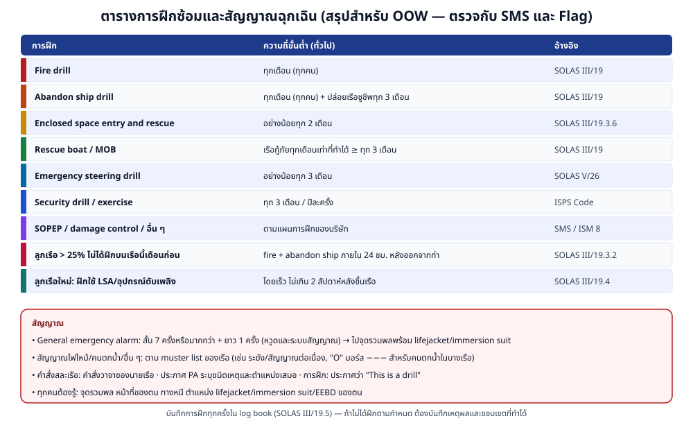

*ภาพที่ 3.8-1 ตารางความถี่การฝึกและสัญญาณฉุกเฉินทั่วไป — ค่าที่แสดงเป็นขั้นต่ำตามอนุสัญญา SMS ของบริษัทหรือ Flag อาจกำหนดถี่กว่า (รวมกรณีลูกเรือเกิน 25% และการฝึกลูกเรือใหม่ภายใน 2 สัปดาห์)*

จุดที่มักถูกถามในการสอบ (SOLAS III/19):

1. **ลูกเรือทุกคน** ต้องเข้าร่วม abandon ship drill และ fire drill อย่างน้อย **เดือนละ 1 ครั้ง**
2. ถ้าลูกเรือ **มากกว่า 25%** ไม่ได้เข้าร่วมฝึกบนเรือลำนั้นในเดือนก่อนหน้า ต้องฝึกภายใน **24 ชั่วโมงหลังออกจากท่า**
3. ลูกเรือใหม่ต้องได้รับ **การฝึกเรื่องการใช้อุปกรณ์ช่วยชีวิตบนเรือ (รวมอุปกรณ์ในเรือชูชีพ/แพ) และอุปกรณ์ดับเพลิงของเรือ** โดยเร็วที่สุด และไม่ช้ากว่า **2 สัปดาห์** หลังขึ้นเรือ (III/19.4.1) — และต้องได้รับคำแนะนำเรื่องหน้าที่ฉุกเฉิน (familiarization) **ก่อน** เริ่มปฏิบัติงาน
4. **Enclosed space entry and rescue drill** อย่างน้อย **ทุก 2 เดือน** (III/19.3.6)
5. เรือชูชีพแต่ละลำปล่อยลงน้ำพร้อมคนประจำและบังคับในน้ำอย่างน้อย **ทุก 3 เดือน** — ส่วน rescue boat (ที่ไม่ใช่เรือชูชีพ) ปล่อยลงน้ำทุกเดือนถ้าสมเหตุสมผลและทำได้ แต่ไม่น้อยกว่าทุก 3 เดือน
6. **Emergency steering drill** อย่างน้อย **ทุก 3 เดือน** (SOLAS V/26)
7. บันทึกการฝึกทุกครั้งใน log book (หรือบันทึกที่ Administration กำหนด) — ถ้าไม่ได้ฝึกตามกำหนด ต้องบันทึกเหตุผล

**General emergency alarm** — สั้น 7 ครั้งหรือมากกว่า ตามด้วยยาว 1 ครั้ง ด้วยหวูดเรือและระบบสัญญาณ — ทุกคนไปจุดรวมพลพร้อม lifejacket/immersion suit ตาม muster list ส่วนสัญญาณอื่น (ไฟไหม้ คนตกน้ำ ละทิ้งเรือ) **ให้ยึดตาม muster list ของเรือลำนั้น** เพราะแต่ละเรือ/บริษัทอาจต่างกัน — ข้อนี้ผู้สอบชอบถามว่า "สัญญาณละทิ้งเรือคืออะไร" คำตอบที่ปลอดภัยคือ "นายเรือสั่งด้วยวาจา/ประกาศ หลังจาก general alarm และตามที่ระบุใน muster list ของเรือ"

### 1.4 การปฏิบัติเริ่มแรกและต่อเนื่อง (Initial and follow-up action)

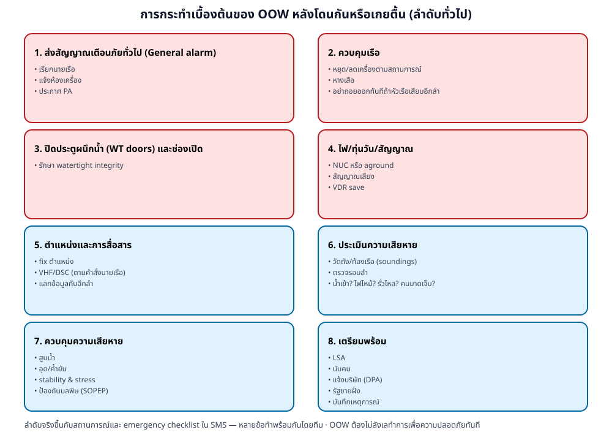

*ภาพที่ 3.8-2 ลำดับความคิดเมื่อพบเหตุฉุกเฉิน (ใช้ร่วมกับบท 1.5)*

เกณฑ์ STCW ข้อสุดท้ายเขียนว่า *"Initial and follow-up action on becoming aware of an emergency conform with established emergency response procedures"* — คำสำคัญคือ **becoming aware** (ทันทีที่รู้) และ **established procedures** (ตามแผนที่มีอยู่ ไม่ใช่คิดเอง) สิ่งที่ผมยึดเป็นลำดับในหัวคือ

1. **ปลุก/แจ้ง (raise the alarm)** — ร้อง กดสัญญาณ แจ้งสะพานเดินเรือ ไม่ว่าเหตุจะดูเล็กแค่ไหน
2. **ปกป้องชีวิต** — ตนเองต้องไม่กลายเป็นผู้ประสบภัยรายที่สอง
3. **จำกัดเหตุ (contain)** — ปิดประตู หยุดการถ่ายเท ตัดไฟ เท่าที่ทำได้อย่างปลอดภัย
4. **รายงานนายเรือ** และทำตามคำสั่ง/แผน
5. **ต่อเนื่อง (follow-up)** — นับคน สื่อสาร บันทึกเวลาและการกระทำ แจ้งหน่วยงานภายนอกถ้าจำเป็น ประเมินซ้ำ

---

## 2. เทคนิคการเอาชีวิตรอดส่วนบุคคล (Personal survival techniques)

บท 3.4 อธิบายอุปกรณ์ช่วยชีวิตในมุมของเจ้าหน้าที่ผู้ดูแลและสั่งการ ส่วนนี้เป็นมุมของ "ตัวเราเองที่อยู่ในน้ำหรือในแพ" ตาม A-VI/1-1 ซึ่ง OOW ต้องอธิบายและสาธิตให้ลูกเรือใหม่ดูได้

### 2.1 อันตรายต่อผู้รอดชีวิต (Hazards to survivors)

| อันตราย | ลักษณะ | วิธีลด |
|---|---|---|
| **Cold shock** (ช็อกจากน้ำเย็น) | 1–3 นาทีแรกหลังตกน้ำเย็น หายใจหอบโดยควบคุมไม่ได้ สำลักน้ำ หัวใจเต้นเร็ว | ลงน้ำอย่างควบคุมถ้าทำได้ ปิดปาก/จมูก ใส่ชุดกันน้ำ (immersion suit) ตั้งสติ รอให้หายใจเป็นปกติก่อนเคลื่อนไหว |
| **Swim failure** | 10–30 นาที กล้ามเนื้อแขนขาเย็นจนว่ายไม่ได้ | ใส่ lifejacket — ไม่ต้องพึ่งการว่าย ลดการเคลื่อนไหว |
| **Hypothermia** (อุณหภูมิกายต่ำ) | หลังประมาณ 30 นาทีขึ้นไป ขึ้นกับอุณหภูมิน้ำ เสื้อผ้า รูปร่าง | สวมเสื้อผ้าหลายชั้น HELP/huddle ขึ้นแพให้เร็วที่สุด ใช้ TPA |
| **Circum-rescue collapse** | หมดสติ/หัวใจหยุดระหว่างหรือหลังถูกช่วยขึ้น เพราะความดันเลือดตก | ยกผู้ประสบภัยในท่านอนราบถ้าทำได้ เคลื่อนย้ายอย่างนุ่มนวล |
| **Drowning** | สำลักน้ำ คลื่นซัดหน้า | lifejacket ที่มี spray hood ปิดหน้า หันหลังให้คลื่น |
| **Dehydration / starvation** | น้ำจืดหมด | ปันส่วนน้ำ ห้ามดื่มน้ำทะเลหรือปัสสาวะ |
| **Seasickness** | อาเจียน เสียน้ำ หมดกำลังใจ | กินยาแก้เมาเรือทันทีเมื่อขึ้นแพ |
| **Sunburn / heat** (เขตร้อน) | แดดเผา เสียน้ำ | อยู่ใต้หลังคาแพ ชุบเสื้อผ้าด้วยน้ำทะเลให้เย็น ลดการเคลื่อนไหวกลางวัน |

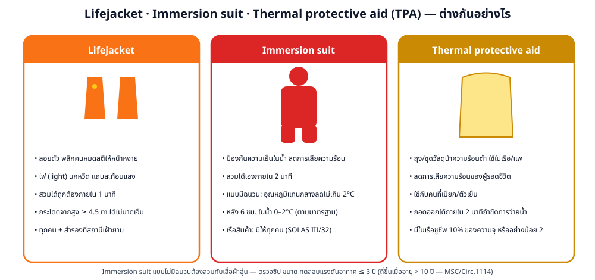

*ภาพที่ 3.8-3 Immersion suit, lifejacket และ thermal protective aid (TPA) — อ้างอิงร่วมกับบท 3.4*

### 2.2 ก่อนละทิ้งเรือ — สิ่งที่ทำได้ในเวลาไม่กี่นาที

ละทิ้งเรือ **ตามคำสั่งนายเรือเท่านั้น** ("เรือคือแพชูชีพที่ดีที่สุด" ตราบที่ยังลอยและปลอดภัยกว่า) ระหว่างรอคำสั่ง ถ้ามีเวลา:

- สวมเสื้อผ้าหลายชั้น (ขนสัตว์/ผ้าที่ยังอุ่นเมื่อเปียก) หมวก ถุงมือ รองเท้า แล้วสวม **immersion suit** และ/หรือ **lifejacket** ให้ถูกต้อง (ผูก/รัดสายครบ ปรับให้แน่น)
- **ดื่มน้ำจืดให้มาก** ก่อนลงแพ และกินยาแก้เมาเรือถ้ามี
- นำของเพิ่มตามหน้าที่ใน muster list: EPIRB, SART, VHF แบบมือถือ, ผ้าห่ม, น้ำ, อาหาร, ยาประจำตัว
- ลงจากเรือแบบ "แห้ง" ถ้าทำได้ (ลงเรือชูชีพ/แพจากบนเรือ) — ดีกว่ากระโดดลงน้ำเสมอ

### 2.3 การกระโดดลงน้ำ (Jumping into the water)

ถ้าจำเป็นต้องกระโดด:

1. ตรวจด้านล่างว่าไม่มีคน ซากลอย หรือแพอยู่ตรงจุดตก — ปกติลงแพ/เรือชูชีพด้าน **ใต้ลม (lee)** เพราะคลื่นลมสงบกว่า แต่ถ้ามี **น้ำมันหรือไฟลอยบนน้ำ** ให้ลงด้าน **ต้นลม (windward)** เพราะทั้งน้ำมันและตัวเรือจะลอยไปทางใต้ลม ออกห่างจากเรา
2. ใช้มือหนึ่ง **ปิดปากและจมูก** อีกมือจับปก lifejacket กดลงไว้ (ป้องกันปกกระแทกคาง/คอ)
3. ตัวตรง มองไปข้างหน้า (ไม่มองลงล่าง) **ไขว้ขา** และกระโดด **เท้าลงก่อน**
4. ใช้ความสูงต่ำที่สุดที่ทำได้ — LSA Code ทดสอบ lifejacket และ immersion suit ให้กระโดดจากความสูง **อย่างน้อย 4.5 m** ได้โดยไม่บาดเจ็บหรือหลุด ถ้าสูงกว่านั้นควรใช้บันได เชือก หรือ embarkation ladder ลงให้ใกล้น้ำที่สุดก่อน
5. หลังลงน้ำ ว่ายออกห่างจากตัวเรือ (กันการดูดลงหรือของตกใส่) แล้วมุ่งไปยังแพ/เรือชูชีพ

> **จดไว้กันลืม — ดูแล immersion suit ของตัวเอง:** ชุดที่ใช้ไม่ได้ตอนต้องการคือชุดที่ไม่มีใครตรวจ — ตรวจด้วยสายตาประจำเดือนตาม SOLAS III/20.7 (ซิปลื่น ไม่ขาด ไฟและนกหวีดครบ ขนาดตรงกับตัว) และตาม **MSC/Circ.1114** (Guidelines for periodic testing of immersion suit and anti-exposure suit seams and closures) ชุดทุกตัวต้องผ่าน **air pressure test** ที่รอยต่อและซิปเป็นระยะไม่เกิน **3 ปี** และถี่ขึ้นเมื่ออายุเกิน **10 ปี** (รอบที่แน่นอนให้ดูข้อกำหนดของ Flag) — รายละเอียดอยู่ในบท 3.4

### 2.4 การเอาชีวิตรอดในน้ำ

- **HELP (Heat Escape Lessening Posture)** — คนเดียว: งอเข่าขึ้นชิดอก แขนกอดรอบ lifejacket ลดพื้นที่ผิวที่เสียความร้อน (ขาหนีบ รักแร้ อก)
- **Huddle** — หลายคน: หันหน้าเข้าหากัน แขนคล้องกัน เด็ก/ผู้บาดเจ็บอยู่ตรงกลาง ช่วยอบอุ่นและเห็นง่ายจากอากาศ
- **Chain/caterpillar swim** — เคลื่อนที่เป็นแถว คนหลังเกี่ยวขาคนหน้า เพื่อว่ายไปหาแพเป็นกลุ่ม
- ลดการว่ายโดยไม่จำเป็น — การว่ายทำให้น้ำเย็นไหลผ่านผิวหนังและเสียความร้อนเร็วขึ้น
- ใช้นกหวีดและไฟบน lifejacket ส่งสัญญาณ

### 2.5 การพลิกแพและขึ้นแพ (Righting and boarding a liferaft)

- แพพลิกคว่ำ: ว่ายไปด้านที่มี **ขวด CO₂** ถ้าทำได้ให้ด้านนั้นอยู่ **ใต้ลม** (เราอยู่ใต้ลม หันหน้าเข้าหาลม ลมจะช่วยดันแพที่ยกขึ้นให้พลิกมาหาเรา) ปีนขึ้นยืนบนขวด จับ **righting strap** แล้วเอนตัวไปด้านหลัง — แพจะพลิกกลับมาทับด้านที่เราอยู่ ตั้งสติ ดันตัวออกมาตามแนว strap/ขอบแพ
- ขึ้นแพทางทางเข้า (boarding ladder/ramp) คนที่แข็งแรงขึ้นก่อนเพื่อช่วยดึงคนอื่น ดึงโดยจับที่ไหล่/lifejacket แล้วโยกแล้วดึงขึ้นพร้อมกัน
- อย่ากระโดดลงบนหลังคาแพโดยตรง (เว้นแต่จำเป็นและแพออกแบบให้รับได้) — เสี่ยงทำแพและคนข้างในบาดเจ็บ — LSA Code ทดสอบให้แพรับการกระโดดลงซ้ำจากความสูง 4.5 m ได้โดยแพไม่เสียหาย แต่คนที่อยู่ข้างในไม่ได้ถูกออกแบบมาให้รับแรงนั้น

### 2.6 อยู่ในแพ — การปฏิบัติทันทีและต่อเนื่อง

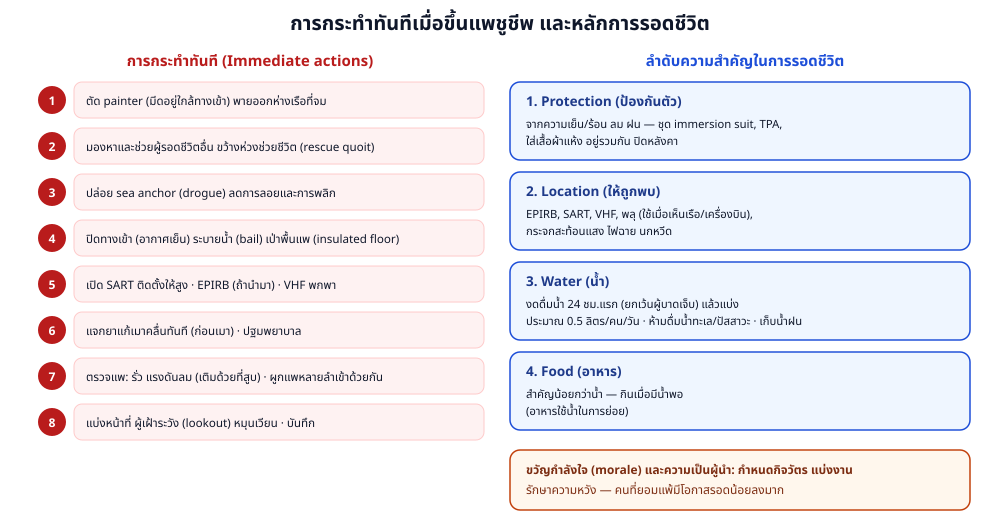

*ภาพที่ 3.8-4 การปฏิบัติทันทีและต่อเนื่องเมื่ออยู่ในแพชูชีพ (อ้างอิงร่วมกับบท 3.4)*

**ทันที (immediate actions)** — ที่ครูฝึกหลายแห่งสอนให้จำว่า **Cut · Stream · Close · Maintain**

1. **Cut** — ตัดเชือก painter (มีดอยู่ใกล้ทางเข้า) เมื่อคนขึ้นครบ/เรือกำลังจม ออกห่างจากเรือ
2. **Stream** — ปล่อย **sea anchor (drogue)** ลดการลอยตามลม ทำให้แพนิ่งและอยู่ใกล้ตำแหน่งที่ส่งสัญญาณ
3. **Close** — ปิดทางเข้า (ในอากาศหนาว) และให้แพอุ่น
4. **Maintain** — ตรวจรอยรั่ว สูบลมพื้นแพ (double floor) ตรวจแรงดันท่อลม กำจัดน้ำในแพ

**ต่อเนื่อง** — กินยาแก้เมาเรือ ปฐมพยาบาล ค้นหาผู้รอดชีวิตอื่น ผูกแพเข้าด้วยกัน เปิด EPIRB/SART จัดยามเฝ้า (lookout) เป็นกะ แจกหน้าที่ ปันส่วนน้ำ (24 ชั่วโมงแรกไม่ให้น้ำ เว้นผู้บาดเจ็บ/ป่วย เพราะร่างกายยังมีน้ำสำรอง หลังจากนั้นประมาณ 0.5 ลิตรต่อคนต่อวัน — แพที่มี SOLAS A pack มีน้ำจืด 1.5 ลิตรต่อคนตามความจุแพ ส่วนเรือชูชีพ 3 ลิตรต่อคน ดูบท 3.4) เก็บน้ำฝน ใช้พลุ/ควันเฉพาะเมื่อเห็นเรือหรืออากาศยาน รักษาขวัญกำลังใจ — การมี "ผู้นำ" ในแพที่ชัดเจนและงานให้ทุกคนทำมีผลกับการรอดชีวิตจริง

### 2.7 การถูกช่วยเหลือ

- **เฮลิคอปเตอร์** — ทำตามสัญญาณมือของ winchman, ห้ามจับสลิง/hook ก่อนที่มันแตะน้ำหรือดาดฟ้า (ไฟฟ้าสถิตจากเฮลิคอปเตอร์), สวม rescue strop ใต้รักแร้ แขนลงข้างตัว ห้ามยกแขนขึ้น, ห้ามผูกสลิงกับแพ
- **เรือช่วยเหลือ** — เรือจะเข้ามาด้านต้นลมเพื่อทำเป็นที่บังลม (lee) ขึ้นทางตาข่าย (scrambling net) หรือบันได คนอ่อนแรงใช้ rescue basket/sling; ระวังการยกในแนวดิ่งสำหรับผู้แช่น้ำนาน (circum-rescue collapse)

---

## 3. การป้องกันอัคคีภัยในชีวิตประจำวัน (Fire prevention)

ความรู้เรื่องสามเหลี่ยม/สี่เหลี่ยมไฟ ประเภทไฟ ระบบดับเพลิงอยู่ในบท 3.3 ส่วนนี้เน้นสิ่งที่ "ทุกคน" ทำได้เพื่อไม่ให้ไฟเกิดตั้งแต่แรก — ตาม A-VI/1-2 และเกณฑ์ "ปฏิบัติตามขั้นตอนความปลอดภัยตลอดเวลา"

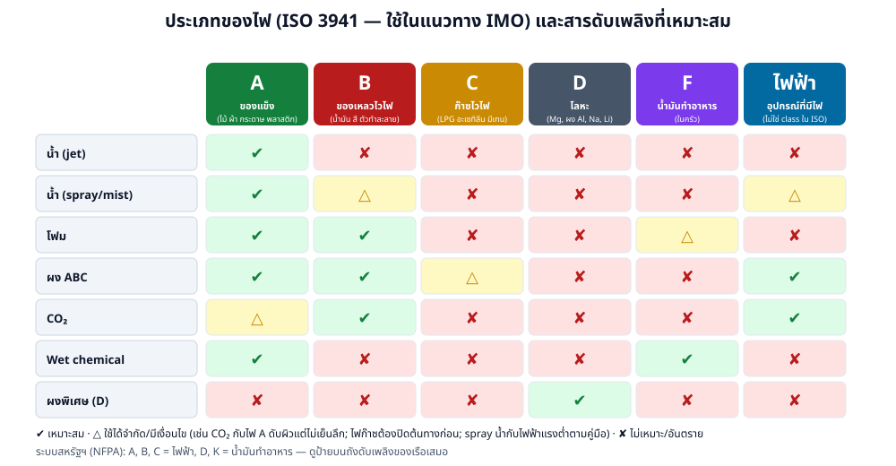

*ภาพที่ 3.8-5 ประเภทของไฟและสารดับเพลิงที่เหมาะสม (ทบทวนจากบท 3.3)*

| แหล่งเสี่ยง | ตัวอย่างจริงที่พบบ่อย | สิ่งที่ทุกคนทำ |
|---|---|---|
| การสูบบุหรี่ | บุหรี่ในห้องพัก/ดาดฟ้าระหว่างขนถ่ายสินค้าอันตราย | สูบเฉพาะพื้นที่ที่กำหนด ดับให้สนิทในที่เขี่ยที่ไม่ติดไฟ ห้ามสูบบนเตียง |
| ผ้าเปื้อนน้ำมัน (oily rags) | ทิ้งไว้ในห้องเครื่อง/ห้องเก็บของ เกิด **การลุกไหม้เอง (spontaneous combustion)** | เก็บในถังโลหะมีฝาปิด กำจัดเป็นประจำ |
| ไฟฟ้า | ปลั๊กพ่วง เครื่องทำความร้อนส่วนตัว สายไฟชำรุด ชาร์จแบตเตอรี่ลิเธียม (โทรศัพท์ ไฟฉาย สกู๊ตเตอร์ไฟฟ้า) | ใช้อุปกรณ์ที่ได้รับอนุญาต ไม่ชาร์จทิ้งไว้บนเตียง/ใต้หมอน แจ้งซ่อมสายไฟชำรุด |
| ครัว (galley) | น้ำมันทอด ไขมันในท่อดูดควัน (ducting) | ไม่ทิ้งเตาโดยไม่มีคนดู ทำความสะอาด hood/duct ตามกำหนด รู้วิธีใช้ fire blanket/wet chemical |
| ห้องซักรีด (laundry) | ขุยผ้าในเครื่องอบผ้า | ทำความสะอาดที่กรองขุยหลังใช้ทุกครั้ง |
| งานร้อน (hot work) | สะเก็ดเชื่อมตกลงช่องที่มองไม่เห็น | permit, ย้ายวัสดุไวไฟ, fire watch ระหว่างและหลังงาน |
| ห้องเครื่อง | น้ำมันรั่วถูกท่อไอเสียร้อน | รายงานรอยรั่วทันที ฉนวนกันความร้อนต้องอยู่ครบ |
| สินค้า | สินค้าที่ร้อนเองได้ (self-heating) เช่น ถ่านหิน เศษเหล็กบางประเภท | ตรวจวัดอุณหภูมิ/ก๊าซตามคำแนะนำ IMSBC |

พฤติกรรมพื้นฐานที่ผู้ตรวจ PSC สังเกตได้ทันที: **ประตูกันไฟ (fire doors) ถูกขัดเปิดค้างไว้** · ถังดับเพลิงถูกย้ายหรือถูกกีดขวาง · ทางหนีไฟมีของวาง · ไฟฉุกเฉินเสีย · ป้ายหนีไฟหลุด — ทั้งหมดนี้คือ "การป้องกันอัคคีภัย" ที่ OOW แก้ได้ระหว่างเดินตรวจ (safety round)

**เมื่อพบไฟ** — ร้องเตือน กดสัญญาณ แจ้งสะพานเดินเรือ (ตำแหน่ง ชนิดไฟ คนติดอยู่หรือไม่) พยายามดับด้วยอุปกรณ์ที่เหมาะสม **ถ้าทำได้อย่างปลอดภัยและมีทางหนีอยู่ด้านหลัง** ถ้าดับไม่ได้ให้ถอยออก ปิดประตูเพื่อจำกัดไฟ แล้วไปจุดรวมพล

---

## 4. การปฐมพยาบาลเบื้องต้น (Elementary first aid)

รายละเอียดการประเมินผู้บาดเจ็บ CPR การห้ามเลือด แผลไหม้ อยู่ในบท 3.5 สำหรับ A-VI/1-3 สิ่งที่ต้องทำได้คือ "ดำเนินการทันทีเมื่อพบอุบัติเหตุหรือเจ็บป่วย" ซึ่งลำดับคิดคือ

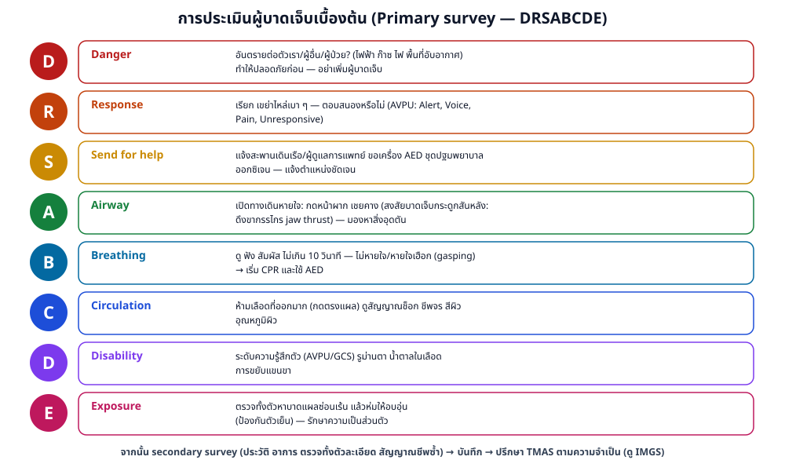

*ภาพที่ 3.8-6 การประเมินเบื้องต้น DRSABCDE (ทบทวนจากบท 3.5)*

1. **Danger** — ประเมินอันตรายต่อตัวเองก่อน: พื้นที่อับอากาศ ไฟฟ้า สารเคมี ของตก — **ถ้าผู้บาดเจ็บอยู่ในพื้นที่อับอากาศ ห้ามลงไป** ให้เตือนและเรียกทีมกู้ภัย
2. **Response** — เรียก/แตะไหล่
3. **Send for help** — เรียกคนช่วย แจ้งสะพานเดินเรือ ขอ AED/ชุดปฐมพยาบาล
4. **Airway, Breathing, Circulation** — ทางเดินหายใจ การหายใจ ห้ามเลือดที่รุนแรง
5. **Disability, Exposure** — ระดับความรู้สึกตัว ตรวจทั่วตัว ป้องกันความเย็น
6. บันทึกเวลาและสิ่งที่ทำ ส่งต่อผู้รับผิดชอบด้านการแพทย์ (Medical first aid / Medical care officer)

กรณีเฉพาะที่ควรจำให้ขึ้นใจ:

- **ไฟฟ้าดูด (electric shock)** — ตัดไฟก่อนแตะตัว ถ้าตัดไม่ได้ใช้วัสดุแห้งไม่นำไฟฟ้าดันผู้บาดเจ็บออก
- **สารเคมีเข้าตา/ผิวหนัง** — ล้างด้วยน้ำสะอาดจำนวนมากอย่างน้อย 15–20 นาที (ตาม SDS/MFAG) ถอดเสื้อผ้าที่เปื้อน
- **ตกจากที่สูง/สงสัยบาดเจ็บกระดูกสันหลัง** — ไม่เคลื่อนย้ายถ้าไม่จำเป็น ประคองศีรษะคอให้อยู่ในแนวตรง
- **ผู้ได้รับก๊าซพิษ/ขาดออกซิเจน** — นำออกสู่อากาศบริสุทธิ์ (โดยทีมที่มี SCBA) ให้ออกซิเจน เตรียม CPR
- **ผู้แช่น้ำเย็นนาน** — ยกในท่านอน ห่อด้วยผ้าห่ม/TPA อุ่นช้า ๆ ไม่ถูนวดแขนขา ไม่ให้แอลกอฮอล์

---

## 5. ความปลอดภัยส่วนบุคคลและการทำงานอย่างปลอดภัย (Personal safety and safe working practices)

### 5.1 กรอบที่ใช้บนเรือ — SMS, COSWP, MLC

- **ISM Code** บังคับให้บริษัทมี SMS ที่มี "safe practices in ship operation and a safe working environment" ประเมินความเสี่ยงที่ระบุได้ และกำหนดมาตรการป้องกัน (ISM 1.2.2) — ขั้นตอนบนเรือ (เช่น permit, LOTO, enclosed space) จึงมาจาก SMS ไม่ใช่ความชอบของแต่ละคน
- **MLC 2006 Reg 4.3** — สิทธิของคนประจำเรือที่จะทำงานในสภาพแวดล้อมที่ปลอดภัยและถูกสุขอนามัย Flag ต้องมีนโยบายและกฎหมายด้านอาชีวอนามัย บริษัทต้องประเมินความเสี่ยง ฝึกอบรม จัด PPE รายงานและสอบสวนอุบัติเหตุ และเรือที่มีคนประจำเรือ **ตั้งแต่ 5 คนขึ้นไป** ต้องมี **คณะกรรมการความปลอดภัย (ship's safety committee)** (Standard A4.3.2(d))
- **COSWP (Code of Safe Working Practices for Merchant Seafarers)** — ของ UK MCA เป็นข้อบังคับสำหรับเรือธง UK แต่ใช้เป็นมาตรฐานอ้างอิงทั่วโลก ครอบคลุมตั้งแต่การประเมินความเสี่ยง PPE พื้นที่อับอากาศ งานที่สูง งานผูกเรือ จนถึงงานครัว — ถ้าสอบสัมภาษณ์กับบริษัทยุโรป ชื่อนี้ถูกถามบ่อย

### 5.2 การประเมินความเสี่ยง (Risk assessment)

ทุกงานที่ไม่ใช่งานประจำง่าย ๆ ต้องผ่านการประเมินความเสี่ยงก่อน — บางงานบริษัทมี generic risk assessment แล้ว แต่ต้องทบทวนให้เข้ากับ **สภาพวันนั้นจริง** (อากาศ คนที่มี เวลา อุปกรณ์) ขั้นตอนหลัก:

1. **ระบุอันตราย (hazard)** — สิ่งที่อาจก่อให้เกิดอันตราย เช่น ทำงานที่สูง 6 m ไอระเหยสี ลมแรง
2. **ระบุผู้ที่อาจได้รับอันตรายและอย่างไร**
3. **ประเมินความเสี่ยง (risk)** = โอกาสเกิด (likelihood) × ความรุนแรง (severity)
4. **กำหนดมาตรการควบคุม** ตามลำดับ hierarchy of controls: ขจัด → ทดแทน → วิศวกรรม → บริหาร/ขั้นตอน → PPE (ดูบท 3.7)
5. **ประเมินความเสี่ยงที่เหลือ (residual risk)** ว่ายอมรับได้หรือไม่
6. **สื่อสาร** ใน toolbox talk และ **ทบทวน** เมื่อสภาพเปลี่ยน

> **ตัวอย่างจำลอง — ประเมินงานทาสีเสากระโดง (mast) ที่สูง 8 m ขณะเรือทอดสมอ**
> ใช้ matrix 5×5 (ระดับ 1–5 ทั้งสองแกน): ตกจากที่สูง — โอกาส 3 × รุนแรง 5 = **15 (สูง)** → ห้ามทำโดยไม่มีมาตรการ
> มาตรการ: ทำเฉพาะเวลากลางวัน ลมไม่เกินที่ SMS กำหนด สายกันตกแบบ full body harness ยึดจุดแข็งแรงตลอดเวลา (สองตะขอ) bosun's chair ตรวจก่อนใช้ คนเฝ้าที่ดาดฟ้า ปิดเรดาร์และล็อกป้าย (ป้องกันคลื่นไมโครเวฟและเสาอากาศหมุน) แจ้งสะพานเดินเรือ ห้ามคนเดินใต้พื้นที่ทำงาน
> หลังมาตรการ: โอกาส 1 × รุนแรง 5 = **5 (ต่ำ–กลาง)** → ยอมรับได้ภายใต้ permit to work aloft

### 5.3 อุปกรณ์ป้องกันส่วนบุคคล (Personal protective equipment — PPE)

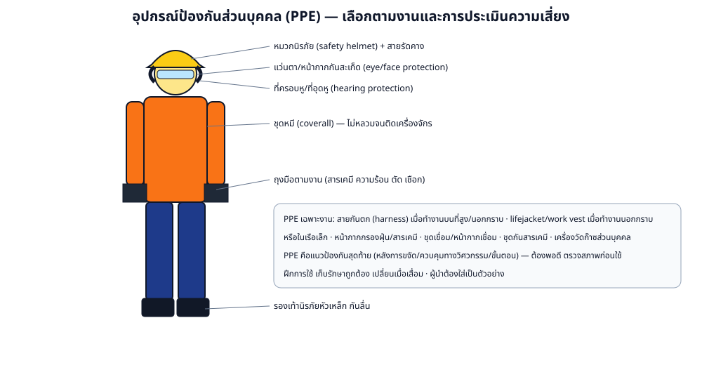

*ภาพที่ 3.8-7 PPE พื้นฐานและ PPE เฉพาะงาน — PPE เป็นแนวป้องกันสุดท้าย ไม่ใช่มาตรการแรก*

เกณฑ์ STCW ข้อแรกคือ **"Appropriate safety and protection equipment is correctly used"** คำว่า "appropriate" และ "correctly" สำคัญพอกัน:

- **เลือกให้ตรงอันตราย** — ถุงมือผ้ากันสารเคมีไม่ได้, แว่นตาธรรมดากันสะเก็ดเจียรไม่ได้, หน้ากากกันฝุ่นไม่ช่วยในบรรยากาศขาดออกซิเจน (ต้องใช้อุปกรณ์ช่วยหายใจแบบมีอากาศในตัว — SCBA/EEBD ตามงาน)
- **ขนาดพอดี** — หมวกหลวมหลุดตอนก้ม ถุงมือใหญ่ติดเครื่องจักร MLC มีการแก้ไขให้คำนึงถึง PPE ที่มีขนาดเหมาะสมกับคนประจำเรือทุกคน รวมถึงผู้หญิง (การแก้ไขปี 2022 มีผล 23 ธ.ค. 2024)
- **ตรวจก่อนใช้** — harness มีรอยตัด/ด้ายขาด? lanyard เคยรับแรงกระชากหรือยัง (ถ้าเคย ต้องเลิกใช้) วันหมดอายุของหมวก/สายรัด
- **ใช้ให้ถูกวิธี** — สายรัดคางหมวก, ear plugs ใส่ให้ลึกพอ, harness ปรับสายขาให้แน่น
- **ดูแลและเก็บรักษา** — ล้าง ตาก เก็บห่างแดด/สารเคมี
- **ผู้นำต้องใส่เป็นตัวอย่าง** — ถ้า OOW เดินลงดาดฟ้าตอนขนสินค้าโดยไม่สวมหมวก ลูกเรือก็จะทำตาม

PPE เฉพาะงานที่ควรรู้: สายกันตก (full body harness) · lifejacket/work vest เมื่อทำงานนอกกราบ/บนดาดฟ้าที่เปิดโล่งในสภาพอากาศเลว · ชุดกันสารเคมี · หน้ากากเชื่อม · ที่ครอบหูในพื้นที่เสียงดัง (Code on noise levels MSC.337(91) กำหนดให้มีป้ายเตือนในพื้นที่เสียงดังและให้ใช้อุปกรณ์ป้องกันการได้ยิน) · ชุดทำงานในห้องเย็น · เครื่องวัดก๊าซส่วนบุคคล

### 5.4 ระบบใบอนุญาตทำงาน (Permit to work)

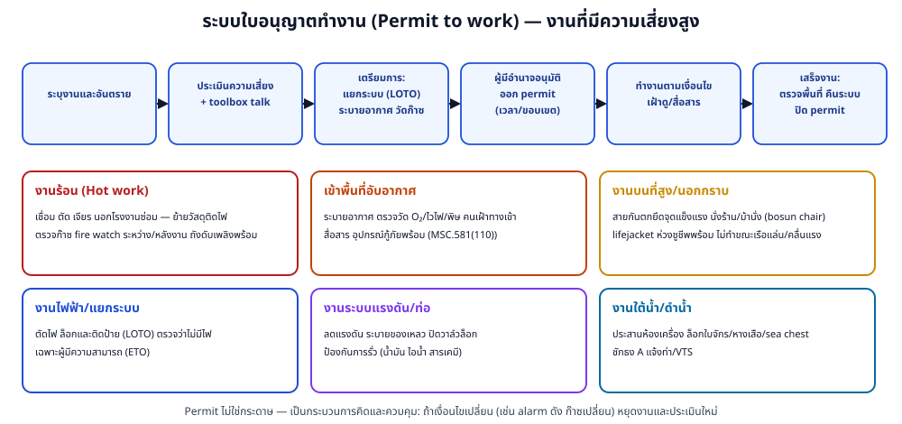

*ภาพที่ 3.8-8 ขั้นตอนของระบบใบอนุญาตทำงานและงานที่ต้องมี permit*

Permit to work คือ **เอกสารควบคุมงานที่มีความเสี่ยงสูง** ซึ่งบังคับให้ผู้ที่เกี่ยวข้องคิด เตรียม และตรวจสอบก่อนเริ่มงาน งานที่ปกติต้องมี permit ตาม SMS: งานร้อนนอกโรงงานซ่อม · เข้าพื้นที่อับอากาศ · งานบนที่สูง/นอกกราบ · งานไฟฟ้า/ระบบที่ต้องแยก · งานระบบท่อแรงดัน · งานใต้น้ำ/ดำน้ำ · การปิดระบบดับเพลิงหรือระบบความปลอดภัยชั่วคราว

หลักที่ OOW ต้องเข้าใจ:

- permit ระบุ **งานอะไร ที่ไหน ใคร เมื่อไร (เวลาเริ่ม–หมดอายุ)** มาตรการที่ต้องทำก่อน และผู้อนุมัติ
- **ไม่ทำงานเกินขอบเขต/เวลาใน permit** — ถ้าต้องขยายต้องประเมินใหม่
- งานที่ขัดกัน (เช่น งานร้อนใกล้ถังที่กำลังระบายก๊าซ หรือเทน้ำมันขณะมีงานเชื่อมบนดาดฟ้า) ต้องไม่อนุมัติพร้อมกัน — OOW บนสะพาน/ในยามท่าเรือต้องรู้ว่ามี permit อะไรเปิดอยู่บ้าง
- **ถ้าเงื่อนไขเปลี่ยน** (alarm ดัง ลมเปลี่ยน ก๊าซเพิ่ม) permit ถือว่าถูกระงับ ทุกคนออกจากงานและประเมินใหม่
- ปิด permit เมื่อเสร็จงาน — ตรวจพื้นที่ คืนระบบ แจ้งผู้เกี่ยวข้อง

**Toolbox talk** — การประชุมสั้นก่อนเริ่มงานที่จุดทำงาน ทบทวนงาน อันตราย มาตรการ หน้าที่ของแต่ละคน การสื่อสาร และ "ถ้ามีอะไรผิดปกติ ใครก็หยุดงานได้" (stop work authority)

### 5.5 การแยกพลังงาน (Lockout / Tagout — LOTO)

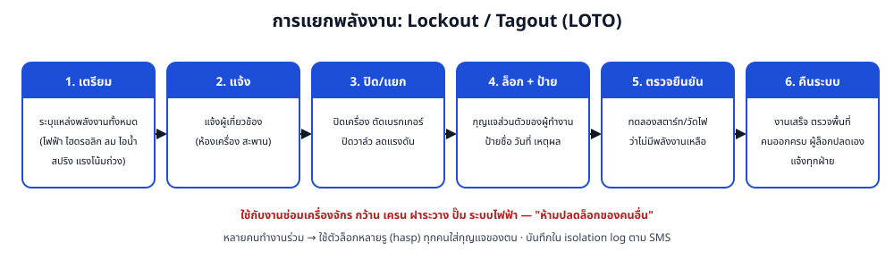

*ภาพที่ 3.8-9 หกขั้นตอนของ LOTO — ใช้กับงานซ่อมเครื่องจักร กว้าน เครน ฝาระวาง ปั๊ม และระบบไฟฟ้า*

อุบัติเหตุจำนวนมากบนเรือเกิดจาก **เครื่องจักรถูกเปิดขณะมีคนทำงานอยู่** — เช่น คนในห้องเครื่องเปิดปั๊มที่คนบนดาดฟ้ากำลังถอดวาล์ว หรือฝาระวางไฮดรอลิกเคลื่อนเพราะยังมีแรงดันค้าง LOTO แก้ปัญหานี้ด้วย **กุญแจส่วนตัวของผู้ทำงานแต่ละคน** — ตราบที่กุญแจของเรายังล็อกอยู่ ไม่มีใครเปิดระบบได้ และ **ไม่มีใครปลดล็อกของคนอื่น**

พลังงานที่ต้องคิดให้ครบ: ไฟฟ้า · ไฮดรอลิก · ลมอัด · ไอน้ำ · ความร้อน · สารเคมี · **พลังงานสะสม** (สปริง ตัวเก็บประจุ แรงดันค้างในท่อ) · **แรงโน้มถ่วง** (บูมเครน ฝาระวางที่ยกค้าง สมอ) — แค่ตัดไฟอย่างเดียวไม่พอสำหรับฝาระวางที่ยกค้างไว้

### 5.6 การเข้าพื้นที่อับอากาศ (Enclosed space entry)

หัวข้อนี้เป็นสาเหตุการเสียชีวิตที่ซ้ำซากที่สุดในอุตสาหกรรมเดินเรือ — สถิติที่สมาคม P&I และ MAIB รายงานซ้ำหลายครั้งคือ **ผู้เสียชีวิตจำนวนมากเป็น "ผู้ช่วย" ที่ลงไปช่วยเพื่อนโดยไม่มีอุปกรณ์**

**นิยาม (ตามคำแนะนำของ IMO)** — พื้นที่ที่ **อาจมีบรรยากาศอันตรายหรือขาดออกซิเจน** และมีลักษณะใดลักษณะหนึ่ง: ช่องเข้าออกจำกัด · การระบายอากาศไม่เพียงพอ · ไม่ได้ออกแบบให้คนทำงานต่อเนื่อง (MSC.581(110) ข้อ 2.1 ยกตัวอย่างระวางสินค้า ท้องเรือ ถังอับเฉาและถังอื่น ๆ ห้องสูบ ห้องโซ่สมอ และ crankcase ของเครื่องยนต์) — ตัวอย่างบนเรือ: ระวางสินค้า ถังอับเฉา (ballast tanks) double bottom ถังน้ำมัน cofferdam void space ห้องโซ่สมอ (chain locker) duct keel ห้อง/ถังระบบบำบัดน้ำเสีย (sewage) ห้อง CO₂ ทางลงระวาง (access trunk) ที่ติดกับระวาง ถังกวาดน้ำทิ้ง ห้องเก็บสีที่ระบายอากาศไม่ดี — และ **พื้นที่ที่เชื่อมหรือติดกับพื้นที่ข้างต้น** ต้องถือว่าอันตรายจนกว่าจะพิสูจน์ได้ว่าปลอดภัย

**อันตรายหลัก**

| อันตราย | สาเหตุบนเรือ | ทำไมอันตราย |
|---|---|---|
| ขาดออกซิเจน | สนิมเหล็ก (ถังปิดนาน) สินค้าดูดออกซิเจน (ถ่านหิน ไม้ซุง เศษเหล็ก เมล็ดพืช ผลไม้/ผัก) ก๊าซเฉื่อย/ไนโตรเจน CO₂ ที่รั่วจากระบบดับเพลิง | ไม่มีกลิ่น ไม่มีสี — ที่ O₂ ต่ำมาก หมดสติได้ในไม่กี่ลมหายใจ |
| คาร์บอนไดออกไซด์ (CO₂) | ระบบดับเพลิง CO₂ สินค้าหมักบ่ม การรมยา | หนักกว่าอากาศ สะสมด้านล่าง เป็นพิษเองแม้ O₂ ยังพอ — **MSC.581(110) จึงกำหนดให้วัด CO₂ ด้วย** |
| ก๊าซพิษ | H₂S (ถังน้ำเสีย/ท้องเรือ สินค้าบางชนิด), CO (เครื่องยนต์ การเผาไหม้), phosphine (การรมยาเมล็ดพืช) | บางชนิดทำให้ประสาทรับกลิ่นล้า (H₂S) จึงเชื่อจมูกไม่ได้ |
| ก๊าซไวไฟ | ไอน้ำมัน มีเทน (ถ่านหิน น้ำเสีย) | ไฟไหม้/ระเบิดเมื่อมีประกายไฟ |
| อันตรายทางกายภาพ | ลื่น ตกบันได มืด ความร้อน ช่องเข้าแคบ ของเหลว/สินค้าทะลักเข้ามา | ทำให้การกู้ภัยยาก |

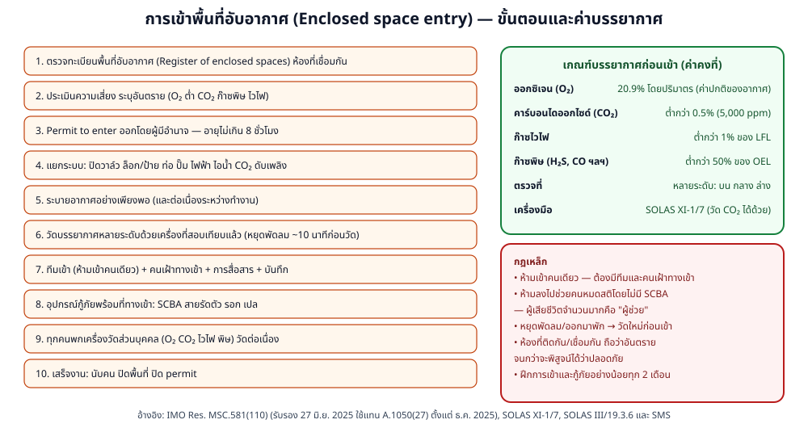

*ภาพที่ 3.8-10 ขั้นตอนการเข้าพื้นที่อับอากาศ เกณฑ์บรรยากาศ และกฎเหล็ก ตาม MSC.581(110)*

**สิ่งที่เปลี่ยนใน MSC.581(110)** (รับรองที่ MSC 110 เมื่อ 27 มิ.ย. 2025 — สมัชชา IMO สมัยที่ 34 (24 พ.ย.–3 ธ.ค. 2025) ยกเลิก A.1050(27) จึงถือว่าใช้แทนตั้งแต่ ธ.ค. 2025; ตัวข้อมติเป็น **คำแนะนำ (recommendations)** แต่ Flag/PSC และ SMS นำมาใช้เป็นมาตรฐาน และ SOLAS III/19.3.6 กับ XI-1/7 ที่บังคับใช้ก็โยงถึงเรื่องเดียวกัน) ที่ควรรู้ทันเวลาสอบ/สัมภาษณ์:

1. **ทะเบียนพื้นที่อับอากาศ (Register of enclosed spaces)** — แต่ละเรือต้องมีรายการพื้นที่อับอากาศของเรือตัวเอง พร้อมอันตราย ทางเข้า พื้นที่ที่เชื่อมต่อ วิธีระบายอากาศ และทบทวนเป็นระยะ (เก็บทั้งบนเรือและบนฝั่ง ปรับให้ทันสมัยโดยเฉพาะหลังบรรทุกสินค้าที่อาจเปลี่ยนบรรยากาศ — เช่นผลของระบบบำบัดน้ำอับเฉาต่อบรรยากาศในถัง) และใช้ทะเบียนนี้เป็นฐานของการประเมินความเสี่ยงและการวางแผนฝึกกู้ภัย
2. **เกณฑ์บรรยากาศ** — อ่านค่าคงที่ (steady readings): **O₂ 20.9% โดยปริมาตร (ค่าปกติของอากาศ — ถ้าต่ำกว่านี้ต้องหาสาเหตุ ห้ามเข้า; สูงผิดปกติก็เป็นอันตรายด้านไฟ) · CO₂ ต่ำกว่า 0.5% (5,000 ppm) · ก๊าซไวไฟต่ำกว่า 1% ของ LFL · ก๊าซพิษต่ำกว่า 50% ของ OEL**
3. **เครื่องวัดต้องวัด CO₂ ได้** นอกจาก O₂/ไวไฟ/พิษ และ **ทุกคนที่เข้าต้องพกเครื่องวัดส่วนบุคคล** ที่เฝ้าระวังต่อเนื่อง — เครื่องวัด 4 ก๊าซทั่วไป (O₂/LEL/CO/H₂S) **ไม่วัด CO₂** ต้องตรวจว่าเครื่องบนเรือเราเป็นแบบไหน
4. **ห้ามเข้าคนเดียว (no single-person entry)** — ต้องเป็นทีม มีคนเฝ้าทางเข้าที่ไม่มีหน้าที่อื่น
5. **Permit มีอายุไม่เกิน 8 ชั่วโมง** และถ้าหยุดระบายอากาศหรือทีมออกมาพัก ต้องวัดบรรยากาศใหม่ ยืนยันว่าผ่าน และบันทึก ก่อนกลับเข้าไป — แบบฟอร์มตัวอย่างใน MSC.581(110) ยังระบุว่า permit **เป็นโมฆะ** ถ้าการระบายอากาศหยุด หรือทุกคนออกมาแล้วทิ้งพื้นที่ไว้โดยไม่มีคนเฝ้า

ส่วนที่ไม่เปลี่ยน: SOLAS **XI-1/7** บังคับให้มีเครื่องวัดบรรยากาศแบบพกพาที่เหมาะสม และ SOLAS **III/19.3.6** ให้ฝึกการเข้าพื้นที่อับอากาศและกู้ภัย **อย่างน้อยทุก 2 เดือน**

**วิธีวัดให้ถูก** — หมายเหตุในแบบฟอร์ม permit ของ MSC.581(110) แนะนำให้ **หยุดพัดลมประมาณ 10 นาทีก่อนวัดครั้งแรก** เพื่อให้ได้ค่าที่แทนสภาพจริง (ไม่ใช่ค่าของลมที่เพิ่งเป่าเข้าไป) แล้วบันทึกผล — วัดจากภายนอกก่อนด้วยสายเก็บตัวอย่าง (sampling hose) ที่หลายระดับและผ่านช่องเปิดให้มากที่สุดเท่าที่ทำได้: บน กลาง ล่าง และมุมอับ เพราะก๊าซแต่ละชนิดหนัก/เบาต่างกัน (CO₂ H₂S ไอน้ำมันหนักกว่าอากาศ มีเทนเบากว่า) รอให้ค่าคงที่ เครื่องต้องสอบเทียบ (calibration) และทดสอบ bump test ตามคู่มือ ถ้าค่าตกระหว่างทำงาน **ทุกคนออกทันที**

**การกู้ภัย** — แผนกู้ภัยต้องพร้อม **ก่อน** เข้า: SCBA ชุดที่สอง สายรัดตัวและเชือก รอก/ขาตั้ง (tripod) เปลที่ใช้ในช่องแคบได้ วิทยุ ไฟฉายกันระเบิด — ทีมกู้ภัยคือคนที่ฝึกและมีอุปกรณ์ ไม่ใช่ใครก็ตามที่อยู่ใกล้ที่สุด

### 5.7 งานบนที่สูงและงานนอกกราบ (Working aloft and outboard)

- ต้องมี permit, harness ยึดจุดแข็งแรงตลอดเวลา (ใช้ lanyard สองเส้นเมื่อต้องย้ายจุด) อุปกรณ์ตรวจก่อนใช้
- งานนอกกราบ: สวม lifejacket/work vest มีห่วงชูชีพพร้อมเชือกเตรียมไว้ใกล้ ๆ มีคนเฝ้า — **ไม่ทำขณะเรือแล่น** เว้นแต่จำเป็นและนายเรืออนุญาต
- ใกล้เสาอากาศ/เรดาร์/หวูดเรือ: แจ้งสะพานเดินเรือ ปิดและล็อกป้าย ห้ามส่งวิทยุ ห้ามใช้หวูด
- เครื่องมือผูกเชือกกันตก ห้ามคนอยู่ใต้พื้นที่ทำงาน

### 5.8 งานผูกเรือ (Mooring operations)

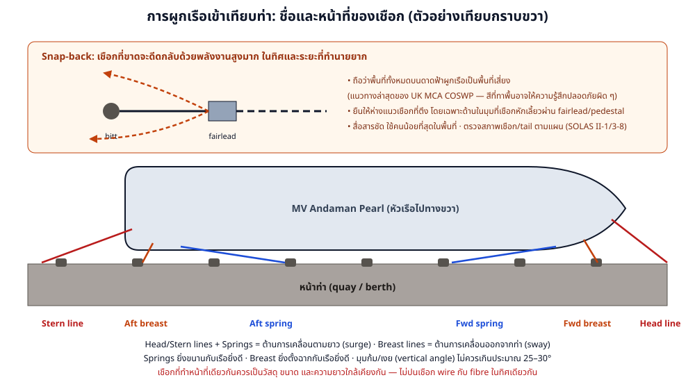

*ภาพที่ 3.8-11 ชื่อเชือกผูกเรือและอันตรายจากเชือกดีดกลับ (ดูบท 1.9)*

- เชือกที่ขาดภายใต้แรงตึงดีดกลับ (**snap-back**) ด้วยพลังงานสูงมาก ปัจจุบันแนวปฏิบัติ (เช่น COSWP ฉบับปรับปรุง) เตือนว่า **การทาสีพื้นเป็นโซน snap-back อาจให้ความรู้สึกปลอดภัยที่ผิด** เพราะเชือกที่ผ่าน fairlead/roller หลายตัวดีดได้ในทิศที่ไม่คาด — ให้ถือว่า **พื้นที่ผูกเรือทั้งหมดเป็นพื้นที่อันตราย** ยืนให้ห่างจากแนวเชือกที่ตึง ให้คนอยู่ในพื้นที่เท่าที่จำเป็น
- **SOLAS II-1/3-8** (แก้ไขโดย MSC.474(102) มีผล 1 ม.ค. 2024) และ MSC.1/Circ.1619/1620 — ออกแบบการจัดวางอุปกรณ์ผูกเรือให้ลดงานที่ต้องอยู่ในพื้นที่เสี่ยง และกำหนดให้มีการตรวจ บำรุงรักษา และบันทึกเชือก/อุปกรณ์ผูกเรือ (รวมการกำหนดเกณฑ์ปลดระวางเชือก) — ส่วนการออกแบบ (Circ.1619 คู่กับ Circ.1175/Rev.1) บังคับกับเรือ ≥ 3,000 GT ที่ทำสัญญาสร้างตั้งแต่ 1 ม.ค. 2024 ส่วนการตรวจและบำรุงรักษาตาม Circ.1620 (แผนตรวจ การระบุเชือกแต่ละเส้น บันทึก และเกณฑ์เปลี่ยนตามผู้ผลิต) ใช้กับ **เรือทุกลำ** — เชือกที่เปลี่ยนใหม่ควรมี LDBF ประมาณ 100–105% ของ MBLSD ของเรือ
- ห้ามยืนในวงเชือก (bight) ห้ามยืนคร่อมเชือก ไม่จับเชือกใกล้ drum ขณะหมุน สื่อสารชัดกับสะพานเดินเรือ/ผู้ควบคุมกว้าน ใช้สัญญาณมือที่ตกลงกันไว้
- เจ้าหน้าที่ที่คุมหัว/ท้ายเรือต้องมองเห็นทั้งทีมและเชือก — ถ้ามองไม่เห็นให้วางตำแหน่งตัวเองใหม่หรือหยุดงาน

### 5.9 การจัดบันไดนำร่องและการรับส่งนำร่อง (Pilot transfer arrangements)

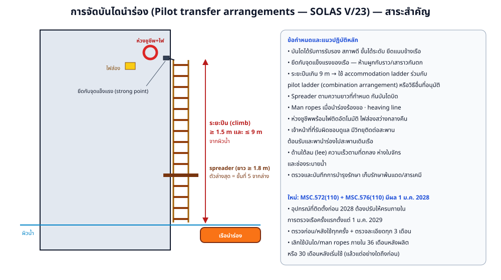

*ภาพที่ 3.8-12 สาระสำคัญของการจัดบันไดนำร่องตาม SOLAS V/23 (รวมข้อกำหนดใหม่ MSC.572(110)/MSC.576(110) ที่มีผล 1 ม.ค. 2028)*

การตกจากบันไดนำร่องยังเกิดขึ้นทุกปี และสาเหตุส่วนใหญ่เป็นเรื่องพื้นฐาน: เชือกบันไดเสื่อม บันไดยึดผิดวิธี (ผูกกับราวหรือใช้ shackle ผิด) ระดับไม่ถูก ไฟส่องไม่พอ เจ้าหน้าที่ไม่อยู่ — IMPA ทำการสำรวจประจำปีและพบการจัดที่ไม่ถูกต้องในสัดส่วนที่น่ากังวลทุกครั้ง

ข้อกำหนดหลัก (SOLAS V/23 และ A.1045(27)):

- บันไดได้รับการรับรอง (certified) อยู่ในสภาพดี ขั้นบันไดระดับ ตัวบันไดแนบกับข้างเรือ
- **ระยะปีน (climb)** ไม่น้อยกว่า **1.5 m** และไม่เกิน **9 m** — ถ้ามากกว่า 9 m ต้องใช้ **accommodation ladder ร่วมกับ pilot ladder (combination arrangement)** หรือวิธีอื่นที่ปลอดภัยและได้รับอนุมัติ
- ยึดบันไดกับ **จุดยึดที่แข็งแรง (strong points)** บนเรือ — ไม่ผูกกับราวกันตกหรือจุดที่ไม่ได้ออกแบบให้รับน้ำหนัก อุปกรณ์ยึด (shackles เชือกยึด) ต้องแข็งแรงอย่างน้อยเท่าเชือกข้าง (side ropes) ของบันได
- **Spreaders** ตามตำแหน่งที่กำหนด กันบันไดบิด
- **Man ropes** เมื่อนำร่องร้องขอ, **heaving line** พร้อม, **ห่วงชูชีพพร้อมไฟติดอัตโนมัติ**, **ไฟส่องสว่าง** ทั้งบันไดและจุดขึ้นเรือในเวลากลางคืน
- **เจ้าหน้าที่ที่รับผิดชอบ (responsible officer)** มีวิทยุติดต่อสะพานเดินเรือ ดูแลการติดตั้งและพานำร่องไปสะพานเดินเรือ
- เรือทำ lee ให้เรือนำร่อง ความเร็วตามที่สถานีนำร่องขอ ห่างจากช่องระบายน้ำ (overboard discharges) และใบจักร
- บันทึกการตรวจและการใช้งาน บำรุงรักษาและเก็บรักษาพ้นแดด/สารเคมี

**ข้อกำหนดใหม่** — IMO ได้รับรองการแก้ไข SOLAS V/23 และมาตรฐานสมรรถนะใหม่ของอุปกรณ์รับส่งนำร่อง ซึ่งมีผลตั้งแต่ปี **2028** (ส่วนของอุปกรณ์ที่ติดตั้งใหม่และบางส่วนกับเรือที่มีอยู่) — ตรวจวันบังคับใช้และข้อกำหนดล่าสุดของ Flag ก่อนสอบ

รายละเอียดที่ตรวจแล้ว (สรุปจากตัวข้อมติ ไม่ใช่ข้อความเต็ม):

| เรื่อง | MSC.572(110) แก้ SOLAS V/23 + MSC.576(110) *Performance standards for pilot transfer arrangements* |
|---|---|
| วันที่ | รับรองที่ MSC 110 (มิ.ย. 2025) — **มีผล 1 ม.ค. 2028** |
| อุปกรณ์ที่ติดตั้งก่อน 1 ม.ค. 2028 | ต้องปรับด้านการออกแบบ การติดตั้ง และการยึด ให้เป็นไปตามมาตรฐานใหม่ **ไม่เกินการตรวจเรือครั้งแรกตั้งแต่ 1 ม.ค. 2029** |
| การตรวจ การเก็บ การบำรุงรักษา การทำความคุ้นเคย | ใช้กับอุปกรณ์ **ทุกชุด** ตั้งแต่ 1 ม.ค. 2028 — responsible officer ตรวจ **ก่อนและหลังใช้ทุกครั้ง** และตรวจละเอียด **ทุก 3 เดือน** บันทึกใน log ของการตรวจ |
| อายุการใช้งาน | บันไดนำร่องและ man ropes (รวมของสำรอง) ต้องเลิกใช้เมื่อไม่เป็นไปตามมาตรฐาน หรือภายใน **36 เดือนนับจากวันผลิต** หรือ **30 เดือนนับจากวันเริ่มใช้** แล้วแต่อย่างใดถึงก่อน — ต้องมีบันไดสำรองและ man ropes สำรองที่เป็นไปตามมาตรฐานอย่างน้อยหนึ่งชุด และห้ามซ่อมหรือเปลี่ยนขั้นบันได |
| ระยะปีน | ยังคง 1.5–9 m ในทุกสภาพกินน้ำลึก/ทริม (รวมสภาพเรือเอียง 15° ในสภาพเบาที่สุด) — เกิน 9 m ใช้ combination arrangement |
| การยึด | ยึดกับ strong points ที่กำหนดด้วยอุปกรณ์ที่จับเชือกข้างแต่ละชุด (breaking strength ไม่น้อยกว่า 48 kN) — spreader ตัวล่างสุดอยู่ที่ **ขั้นที่ 5 นับจากล่าง** และยาวไม่น้อยกว่า 1.8 m |
| เอกสารเดิม | IMO ขอให้สมัชชายกเลิก A.1045(27) และ A.1108(29) **ตั้งแต่ 1 เม.ย. 2030** — ระหว่างนี้ยังเห็นทั้งสองแบบอ้างอิงได้ |

### 5.10 ทางขึ้นลงเรือ (Means of embarkation and disembarkation)

- **SOLAS II-1/3-9** และ MSC.1/Circ.1331 — gangway/accommodation ladder ต้องมีตาข่ายนิรภัย (safety net) ใต้ทางขึ้น ไฟส่องสว่าง ห่วงชูชีพพร้อมเชือกที่หัวบันได ทดสอบและตรวจตามกำหนด และมีป้ายน้ำหนักบรรทุก/มุมสูงสุด (ตัวกฎ II-1/3-9 มีผลกับเรือสร้างตั้งแต่ 1 ม.ค. 2010 แต่ข้อกำหนดการตรวจ บำรุงรักษา และป้ายเครื่องหมายใช้กับ **เรือทุกลำ** ส่วนรายละเอียดอุปกรณ์อยู่ในแนวทาง Circ.1331) — **MSC.1/Circ.1331/Rev.1** (MSC 110 อนุมัติ มิ.ย. 2025) ใช้แทนฉบับเดิม และปรับมาตรฐาน ISO ของบันได/gangway และกว้านสำหรับอุปกรณ์ที่ติดตั้งตั้งแต่ **1 ก.ค. 2026**
- **OOW ในท่า** ต้องปรับ gangway ตามระดับน้ำขึ้นลงและการกินน้ำลึกที่เปลี่ยนจากการขนถ่ายสินค้า — gangway ที่ลอยเหนือท่าหรือติดกับ bollard คือสาเหตุอุบัติเหตุที่พบบ่อย
- ควบคุมการเข้าออก (ISPS) ไปพร้อมกับความปลอดภัย — คนเฝ้า gangway ต้องอยู่ประจำ

### 5.11 การยกของและเครื่องยก (Manual handling and lifting appliances)

- **ยกด้วยมือ** — ประเมินน้ำหนักก่อน ยกด้วยขา หลังตรง ของชิดตัว ไม่บิดตัวขณะยก ขอคนช่วยหรือใช้เครื่องทุ่นแรง ระวังเรือโคลงขณะยก
- **เครื่องยก (cranes, derricks, chain blocks)** — ตรวจ certificate และ SWL ห้ามยกเกิน ใช้ slings/shackles ที่มีเครื่องหมาย ห้ามยืนใต้ของที่ยก ใช้ tag line ใช้สัญญาณมือมาตรฐานโดยคนให้สัญญาณคนเดียว — **SOLAS II-1/3-13** (มีผล 1 ม.ค. 2026) กำหนดข้อบังคับการออกแบบ การทดสอบ การตรวจ และการบำรุงรักษาเครื่องยกบนเรือและอุปกรณ์ยกเสริม (ดูบท 2.1)
- ระวังจุดหนีบ (pinch points) ระหว่างของกับโครงเรือ

### 5.12 การลื่น สะดุด หกล้ม และงานบนดาดฟ้าในสภาพอากาศเลว

- ลื่น/สะดุด/ล้ม เป็นอุบัติเหตุที่พบบ่อยที่สุดบนเรือ — ทำความสะอาดน้ำมัน/น้ำแข็ง/จารบี จัดเก็บเชือกและสายยาง ใช้รองเท้าพื้นกันลื่น จับราวบันได ("one hand for yourself, one for the ship")
- **ห้ามออกไปดาดฟ้าที่เปิดโล่งในสภาพอากาศเลว** โดยไม่ได้รับอนุญาตจากสะพานเดินเรือ — ต้องแจ้งก่อนออกและรายงานเมื่อกลับเข้ามา สวม lifejacket/work vest วิทยุ ไปเป็นคู่ ใช้เชือกนิรภัย (lifelines) ที่ขึงไว้ และสะพานเดินเรืออาจเปลี่ยนเข็ม/ลดความเร็วให้ระหว่างนั้น
- ปิดประตูกันน้ำและช่องเปิดที่ทนสภาพอากาศให้สนิท

### 5.13 สารเคมี เสียง ความร้อน และไฟฟ้า

- **สารเคมี** — ทุกสารต้องมี **SDS (Safety Data Sheet)** อ่านก่อนใช้ ใช้ PPE ตาม SDS เก็บในภาชนะติดฉลาก ไม่ผสมสารทำความสะอาด (เช่น สารฟอกขาวกับกรด/แอมโมเนีย เกิดก๊าซพิษ)
- **เสียง** — พื้นที่เสียงดังต้องมีป้ายและใช้ที่ครอบหู/ที่อุดหู (MSC.337(91)) ทำงานในห้องเครื่องนานต้องจำกัดเวลาสัมผัส
- **ความร้อน (heat stress)** — ห้องเครื่อง/ระวางในเขตร้อน ดื่มน้ำบ่อย พักเป็นระยะ สังเกตอาการเพื่อนร่วมงาน (ดูบท 3.5)
- **ไฟฟ้า** — เฉพาะผู้มีความสามารถทำงานไฟฟ้า ใช้ LOTO ใช้เครื่องมือหุ้มฉนวน ระวังอุปกรณ์ไฟฟ้าในพื้นที่อันตราย (ต้องเป็นชนิดป้องกันการระเบิด — intrinsically safe/Ex) เช่น ห้ามนำโทรศัพท์มือถือธรรมดาไปบนดาดฟ้าเรือบรรทุกน้ำมันขณะขนถ่าย

### 5.14 คณะกรรมการความปลอดภัย การรายงานอุบัติเหตุและ near miss

- **Safety committee / safety meeting** — ประชุมเป็นประจำ (มักเดือนละครั้ง ตาม SMS) ทบทวนอุบัติเหตุ near miss ผลการฝึก ข้อเสนอแนะ และเรื่องที่ลูกเรือกังวล มี **safety officer/safety representative** ที่ลูกเรือเลือก (ตามกฎหมาย Flag)
- **ISM Code ข้อ 9** — รายงาน วิเคราะห์ และแก้ไขข้อบกพร่อง อุบัติเหตุ และสถานการณ์อันตราย (non-conformities, accidents and hazardous occurrences) เพื่อปรับปรุงความปลอดภัย
- **Near miss** — เหตุการณ์ที่เกือบเกิดความสูญเสีย เป็นข้อมูลราคาถูกที่สุดในการป้องกันอุบัติเหตุ (หลัก "พีระมิดอุบัติเหตุ" — ใต้อุบัติเหตุร้ายแรง 1 ครั้งมีเหตุเล็กและ near miss จำนวนมาก) — บริษัทที่ดีใช้ **just culture** คือรายงานแล้วไม่ถูกลงโทษเพราะความผิดพลาดโดยสุจริต แต่ยังรับผิดชอบกับการฝ่าฝืนโดยเจตนา
- **การสอบสวน** — มุ่งหาสาเหตุราก (root cause) ไม่ใช่หาคนผิด — ภาพ Swiss cheese ในบท 1.2.2 อธิบายได้ดี; อุบัติเหตุร้ายแรงจะถูกสอบสวนโดยรัฐตาม Casualty Investigation Code (MSC.255(84))
- OOW มักเป็นคน **เขียนรายงานแรก** — เขียนข้อเท็จจริง เวลา สถานที่ ใครเกี่ยวข้อง อุปกรณ์ สิ่งที่ทำ ไม่เดา ไม่กล่าวโทษ และบันทึกใน log book

---

## 6. การปกป้องสิ่งแวดล้อมในงานประจำวัน

เกณฑ์ STCW ข้อที่สามคือ *"Procedures designed to safeguard the environment are observed at all times"* — คำว่า "at all times" หมายความว่าไม่ใช่เฉพาะตอนสูบน้ำมันหรือทิ้งขยะใหญ่ แต่รวมถึงงานเล็กทุกวัน (รายละเอียดกฎ MARPOL อยู่ในบท 3.1)

- **ขยะ** — คัดแยกตามป้ายและแผนจัดการขยะ (Garbage Management Plan) ห้ามทิ้งพลาสติกลงทะเลเด็ดขาด ไม่ปล่อยให้ขยะปลิวจากดาดฟ้า ผ้าเปื้อนน้ำมันเก็บแยก
- **งานบนดาดฟ้า** — อุด scuppers ก่อนงานที่อาจมีน้ำมัน/สีหก (เติมน้ำมันไฮดรอลิก ทาสี ถ่ายน้ำมันหล่อลื่น) เตรียมอุปกรณ์ซับ (SOPEP locker) ล้างดาดฟ้าโดยไม่ชะสารเคมี/เศษสินค้าลงทะเลในพื้นที่ที่ห้าม
- **สีและสารเคมี** — ห้ามล้างแปรง/ถังสีลงทะเล เก็บสารตามที่ SDS กำหนด
- **อุปกรณ์ไฮดรอลิก** — รอยรั่วของน้ำมันไฮดรอลิกจากกว้าน เครน ฝาระวาง เป็นแหล่งมลพิษที่พบบ่อย รายงานและซับทันที
- **น้ำท้องเรือ น้ำอับเฉา น้ำเสีย** — ไม่สูบ/ปล่อยโดยไม่ได้รับอนุญาตจากผู้รับผิดชอบและไม่บันทึก
- **รายงานทุกการรั่วไหล** ไม่ว่าเล็กแค่ไหน — การซ่อนเหตุมลพิษคือความผิดทางกฎหมายที่ร้ายแรงกว่าตัวเหตุเอง (ดูกรณี "magic pipe" ในบท 3.1)

---

## 7. ความรับผิดชอบทางสังคม (Social responsibilities)

PSSR (A-VI/1-4) กำหนดให้คนประจำเรือ "contribute to effective human relationships on board" และ "understand and take necessary actions to control fatigue" — ส่วนนี้คือเรื่องที่ทำให้คนหลายชาติหลายวัยอยู่ด้วยกันบนเหล็กยาวไม่กี่ร้อยเมตรได้หลายเดือนอย่างปลอดภัย

### 7.1 การสื่อสารบนเรือ

- **ภาษาทำงาน (working language)** — SOLAS V/14 กำหนดให้เรือทุกลำกำหนดภาษาทำงานและบันทึกใน log book ทุกคนต้องเข้าใจคำสั่งและรายงานด้านความปลอดภัยในภาษานั้น
- **IMO Standard Marine Communication Phrases (SMCP)** — ใช้สำหรับการสื่อสารภายนอกและภายในเรือที่เกี่ยวกับความปลอดภัย
- **Closed-loop communication** — ทวนคำสั่ง (read-back) แล้วรายงานเมื่อทำเสร็จ (ดูบท 1.2.2 และ 3.7)
- **ทำความเข้าใจคำสั่ง** — ถ้าไม่เข้าใจหรือคำสั่งดูไม่ปลอดภัย ต้องถามกลับทันที ไม่ทำไปโดยเดา; ฝั่งผู้สั่ง ใช้ประโยคสั้น เจาะจง หลีกเลี่ยงคำแสลง/ภาษาถิ่น
- **ข้อจำกัดที่ต้องรู้** — เสียงดัง วิทยุไม่ชัด สำเนียง ความเหนื่อย ความกลัวที่จะถาม (authority gradient)

### 7.2 ความสัมพันธ์ระหว่างบุคคลและลูกเรือหลายวัฒนธรรม

- เคารพความแตกต่างของศาสนา อาหาร วันหยุด ภาษา วิธีแสดงความเห็น — บางวัฒนธรรมไม่พูด "ไม่" กับหัวหน้าตรง ๆ ผู้นำต้องสร้างช่องทางให้พูด
- **ความขัดแย้ง** — จัดการเร็ว เป็นส่วนตัว ตามข้อเท็จจริง ไม่ปล่อยให้สะสม ถ้าเกินอำนาจแจ้งผู้บังคับบัญชา
- กิจกรรมสันทนาการ การทานอาหารร่วมกัน การเข้าถึงอินเทอร์เน็ตเพื่อติดต่อครอบครัว (MLC Reg 3.1 ฉบับแก้ไขปี 2022 มีผล 23 ธ.ค. 2024) มีผลจริงต่อขวัญกำลังใจและความปลอดภัย

### 7.3 การล่วงละเมิด การคุกคาม และการกลั่นแกล้ง (Harassment and bullying)

- **การแก้ไข STCW** (IMO Res. **MSC.560(108)** มีผล **1 ม.ค. 2026**) เพิ่มการป้องกันและการรับมือกับ **การล่วงละเมิดทางเพศ การคุกคามทางเพศ การกลั่นแกล้งและการคุกคาม (sexual assault, sexual harassment, bullying and harassment — SASH/SHB)** เข้าไปใน **ตาราง A-VI/1-4 (PSSR) ของ Basic training ซึ่งคนประจำเรือทุกคนต้องผ่าน** — การแก้ไขนี้ไม่ได้แก้ตารางสมรรถนะภาวะผู้นำของเจ้าหน้าที่ (การเติมเรื่องนี้ในสมรรถนะระดับปฏิบัติการและระดับบริหารยังเป็นข้อเสนอในการทบทวน STCW — ตรวจกับฉบับปัจจุบัน) ส่วนผู้ที่ได้ใบ PSSR ก่อน 2026 ต้องเรียนเพิ่มหรือไม่ ให้ดู circular ของ Flag
- MLC 2006 ก็มีการแก้ไขในเรื่องเดียวกันที่รับรองในปี 2025 — ตรวจวันมีผลบังคับใช้และข้อกำหนดของ Flag/บริษัท (รับรองโดยที่ประชุมใหญ่ ILO 6 มิ.ย. 2025 — ILO ระบุว่าจะ **มีผล 23 ธ.ค. 2027**: ห้ามความรุนแรงและการคุกคามทุกรูปแบบอย่างชัดเจนใน Reg 4.3 ให้เจ้าของเรือมีนโยบายป้องกันและช่องทางรายงาน และเสริมการรักษาความลับ/คุ้มครองผู้ร้องเรียนใน Reg 5.1.5 — ดูตารางในบท 3.7 ข้อ 1.5)
- พฤติกรรมที่ถือว่าเป็นการกลั่นแกล้ง/คุกคาม: ข่มขู่ ดูหมิ่น ทำให้อับอาย แยกตัวออกจากกลุ่ม มอบงานไม่เป็นธรรมโดยเจตนา การสัมผัส คำพูด ข้อความ หรือภาพที่มีนัยทางเพศโดยไม่ยินยอม
- ผลกระทบ: สุขภาพจิต สมาธิ ความปลอดภัย (คนที่ถูกกลั่นแกล้งมักไม่กล้ารายงานข้อผิดพลาด) และการลาออก
- **หน้าที่ของ OOW** — ไม่ทำเอง ไม่นิ่งเฉย หยุดพฤติกรรมเมื่อเห็น รับฟังผู้รายงาน เก็บเป็นความลับ ปกป้องจากการตอบโต้ รายงานตามขั้นตอนบริษัทและ **on-board complaint procedure (MLC Reg 5.1.5)** — ICS/ITF *Guidance on Eliminating Shipboard Harassment and Bullying* เป็นเอกสารอ้างอิงที่ดี

### 7.4 ความเหนื่อยล้าและชั่วโมงพัก (Fatigue and hours of rest)

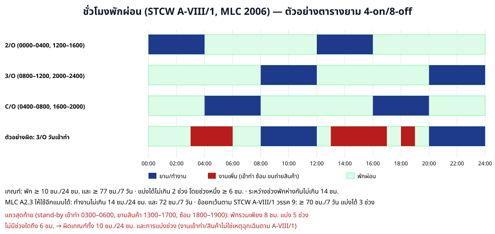

*ภาพที่ 3.8-13 ข้อกำหนดชั่วโมงพักตาม STCW A-VIII/1 และ MLC (ดูบท 1.2.1)*

- STCW A-VIII/1: พักอย่างน้อย **10 ชั่วโมงในทุก 24 ชั่วโมง** และ **77 ชั่วโมงในทุก 7 วัน** แบ่งได้ไม่เกิน 2 ช่วง ช่วงหนึ่งไม่น้อยกว่า **6 ชั่วโมง** ช่วงห่างระหว่างช่วงพักไม่เกิน **14 ชั่วโมง**
- การฝึกซ้อมต้องจัดให้รบกวนการพักน้อยที่สุด และถ้ารบกวนต้องให้พักชดเชย
- **บันทึกชั่วโมงทำงาน/พักตามจริง** — การบันทึกเท็จ ("ปรับตัวเลขให้ผ่าน") เป็นปัญหาที่ PSC และ Flag เข้มงวดมากขึ้น และทำลายระบบที่ออกแบบมาปกป้องเราเอง
- สัญญาณเตือน: หาวบ่อย สมาธิสั้น อ่านค่าผิด ลืม ตัดสินใจช้า — รายงานเมื่อรู้ตัวว่าเหนื่อยเกินกว่าจะเข้ายามได้อย่างปลอดภัย (MSC.1/Circ.1598)

### 7.5 แอลกอฮอล์และยาเสพติด (Drugs and alcohol)

- **STCW A-VIII/1** กำหนดเพดานแอลกอฮอล์ของนายเรือ เจ้าหน้าที่ และคนประจำเรือขณะปฏิบัติหน้าที่ด้านความปลอดภัย การรักษาความปลอดภัย และการป้องกันมลพิษ: ไม่เกิน **0.05% blood alcohol content (BAC)** หรือ **0.25 mg/l ในลมหายใจ** หรือปริมาณแอลกอฮอล์ที่ทำให้มีค่าเช่นนั้น
- บริษัทส่วนใหญ่มี **Drug and Alcohol Policy** ที่เข้มกว่า (บางบริษัทห้ามดื่มบนเรือเลย) และมีการสุ่มตรวจ — ฝ่าฝืนมักหมายถึงถูกส่งตัวกลับและเลิกจ้าง
- ยาที่แพทย์สั่งบางชนิดทำให้ง่วง — แจ้งผู้รับผิดชอบด้านการแพทย์ก่อนเข้ายาม
- ยาเสพติด: นอกจากความปลอดภัย ยังมีความเสี่ยงทางกฎหมายร้ายแรงในหลายประเทศ และเรืออาจถูกใช้ลักลอบขนโดยลูกเรือไม่รู้ตัว (ดู ISPS/การตรวจค้น)

### 7.6 สิทธิและหน้าที่ของคนประจำเรือ (Rights and obligations)

| สิทธิ (MLC 2006) | หน้าที่ของคนประจำเรือ |
|---|---|
| ข้อตกลงการจ้างงาน (SEA) ที่เข้าใจและได้รับสำเนา | ปฏิบัติตามคำสั่งที่ชอบด้วยกฎหมายของผู้บังคับบัญชา |
| ค่าจ้างครบตรงเวลา ส่งให้ครอบครัวได้ | ปฏิบัติตาม SMS กฎความปลอดภัยและการป้องกันมลพิษ |
| ชั่วโมงทำงาน/พักตามกำหนด และวันลา | มาปฏิบัติหน้าที่ตรงเวลาในสภาพพร้อม (fit for duty) |
| ที่พัก อาหาร น้ำดื่มที่ได้มาตรฐาน | ดูแลรักษาอุปกรณ์และที่พักของเรือ |
| การรักษาพยาบาลบนเรือและบนฝั่ง | รายงานอันตราย อุบัติเหตุ near miss และข้อบกพร่อง |
| การส่งตัวกลับ (repatriation) และหลักประกันทางการเงินกรณีถูกทอดทิ้ง | เคารพผู้อื่น ไม่ล่วงละเมิด กลั่นแกล้ง หรือเลือกปฏิบัติ |
| ขั้นตอนร้องเรียนบนเรือและบนฝั่งโดยไม่ถูกตอบโต้ (Reg 5.1.5) | ไม่ออกจากเรือโดยไม่ได้รับอนุญาต ปฏิบัติตามกฎหมายของรัฐเจ้าท่า |
| การปฏิบัติอย่างเป็นธรรมเมื่อเกิดอุบัติเหตุทางทะเล (IMO/ILO Guidelines on fair treatment of seafarers) | ให้ข้อมูลตามความจริงในการสอบสวน |

### 7.7 สุขภาพ สุขอนามัย และสุขภาพจิต

- สุขอนามัยส่วนตัวและที่พัก (โรคติดต่อแพร่เร็วในพื้นที่ปิด) ล้างมือ ทำความสะอาดห้องพัก/ห้องน้ำ
- โภชนาการ การออกกำลังกาย การนอนที่มีคุณภาพ
- **สุขภาพจิต (mental health and wellbeing)** — ความโดดเดี่ยว ห่างครอบครัว ความกดดันในงาน — สังเกตเพื่อนร่วมงานที่เปลี่ยนไป (เก็บตัว ไม่กิน นอนไม่หลับ ดื่มหนัก) พูดคุย และแนะนำแหล่งช่วยเหลือ เช่น บริการของบริษัท หรือสายด่วนสำหรับคนประจำเรือที่ให้บริการ 24 ชั่วโมง (เช่น ISWAN SeafarerHelp)
- โรคติดต่อทางเพศสัมพันธ์ มาลาเรียและโรคประจำถิ่นในท่าเรือที่ไป — ป้องกันตามคำแนะนำทางการแพทย์

### 7.8 การตระหนักด้านการรักษาความปลอดภัย (Security awareness)

ทุกคนต้องมี Security-awareness training (STCW A-VI/6) — รู้ระดับ MARSEC ปัจจุบัน ควบคุมการเข้าออก ตรวจบัตร ไม่ปล่อยคนแปลกหน้าเดินในเรือ รายงานสิ่งผิดปกติ (พัสดุไม่มีเจ้าของ คนแอบขึ้นเรือ ตราผนึกตู้ถูกทำลาย) และรู้ขั้นตอนเมื่อมีภัยคุกคาม (ดูบท 3.6)

---

## 8. ตัวอย่างจำลอง (Simulated case studies)

> ทุกเหตุการณ์ในส่วนนี้เป็น **ตัวอย่างจำลอง** เพื่อการฝึก ไม่ได้อ้างถึงเรือหรือบุคคลจริง ชื่อเรือเป็นเรือสมมุติที่ใช้ตลอดสมุดเล่มนี้

### 8.1 กรณีที่ 1 — ช่วงพักกาแฟที่เกือบมีคนตาย (MV Andaman Star, ทอดสมอรอเข้าท่า)

**สถานการณ์** — เรือบรรทุกสินค้าเทกอง (bulk carrier) MV Andaman Star ทอดสมอรอท่าว่าง ระวางเปล่า chief officer ออก permit ให้ bosun, AB และ OS เข้าตรวจ **forepeak tank** (ถังอับเฉาหัวเรือ ที่สูบน้ำออกแล้วและปิดมาหลายสัปดาห์) เพื่อดูรอยรั่วที่สงสัย — ระบายอากาศด้วยพัดลมเป่าลม 2 ชั่วโมง วัดบรรยากาศที่ 3 ระดับได้ค่าผ่านเกณฑ์ ทีมเข้าทำงานเวลา 0900 OOW (3/O) อยู่ยามทอดสมอบนสะพานเดินเรือ

| เวลา | เหตุการณ์ | จุดที่ผิด/ถูก |
|---|---|---|
| 0955 | ทีมขึ้นมาพักกาแฟ ปิดพัดลมเพราะเสียงดัง ทิ้งฝา manhole เปิดไว้ | ✗ หยุดระบายอากาศ — บรรยากาศในถังที่เป็นสนิมเปลี่ยนได้อีก |
| 1020 | OS กลับลงไปก่อนเพื่อเก็บไฟฉายที่ลืมไว้ ไม่บอกใคร ไม่วัดใหม่ ไม่มีเครื่องวัดส่วนบุคคล | ✗ เข้าคนเดียว ✗ ไม่วัดใหม่หลังพัก (MSC.581(110)) |
| 1024 | AB เดินมาที่ manhole เห็น OS นอนนิ่งที่ก้นบันไดชั้นสอง เริ่มก้าวลงบันได | ✗ กำลังจะเป็น "ผู้ช่วย" รายต่อไป |
| 1024 | bosun ที่เพิ่งมาถึงดึง AB ไว้ เรียกวิทยุ "Bridge, bridge, man down in forepeak tank!" | ✓ หยุดคนที่สอง ✓ แจ้งทันที |
| 1025 | 3/O กด **general alarm** ประกาศ "Emergency, enclosed space casualty, forepeak tank, rescue team muster forward" แจ้งนายเรือทางโทรศัพท์ | ✓ ปฏิบัติเริ่มแรกตามแผน |
| 1026 | 3/O สั่ง bosun ทางวิทยุ **ห้ามใครลงไป** เปิดพัดลมเป่าลมเข้าถังทันที ส่งคนนำ SCBA และอุปกรณ์กู้ภัยจากที่เก็บหัวเรือ | ✓ ระบายอากาศ ✓ ควบคุมจุดเกิดเหตุ |
| 1027 | 3/O เรียก chief officer ซึ่งเป็นหัวหน้าทีมกู้ภัยตาม muster list เตรียมห้องพยาบาล ออกซิเจน | ✓ follow-up |
| 1031 | ทีมกู้ภัย 2 คนสวม SCBA เข้าถัง ผูก harness กับผู้บาดเจ็บ ยกขึ้นด้วยรอก/tripod | ✓ ทีมที่ฝึกแล้วและมีอุปกรณ์ |
| 1040 | OS ออกมาถึงดาดฟ้า หายใจเอง ให้ออกซิเจน ปฐมพยาบาล | ✓ |
| 1045 | นายเรือติดต่อ TMAS ขอคำแนะนำ แจ้งตัวแทนเรือ (agent) ขอส่งตัวไปโรงพยาบาลบนฝั่ง | ✓ |
| 1100 | 3/O บันทึกเวลาทุกเหตุการณ์ใน log book; chief officer ระงับ permit และปิดถัง | ✓ |
| ภายหลัง | วัดบรรยากาศในถังหลังเหตุการณ์: O₂ ที่ก้นถังต่ำกว่าเกณฑ์อย่างชัดเจน | ยืนยันสาเหตุ |

**บทเรียน (debrief)**

1. ถ้าเรือปฏิบัติตาม MSC.581(110) — **ห้ามเข้าคนเดียว**, **วัดใหม่หลังหยุดระบายอากาศ/หลังพัก**, **ทุกคนพกเครื่องวัดส่วนบุคคล** — เหตุนี้จะไม่เกิด เครื่องวัดส่วนบุคคลจะส่งเสียงเตือนตั้งแต่ก้าวแรกที่ลงไป
2. ช่วงพักคือจุดอ่อนที่พบบ่อย — permit ควรระบุชัดว่า "เมื่อทุกคนออกจากถัง ปิดทางเข้าหรือมีคนเฝ้า และต้องวัดใหม่ก่อนกลับเข้า"
3. ช่วงเวลาที่อันตรายที่สุดคือ 30 วินาทีที่ AB เห็นเพื่อนนอนอยู่ — **การฝึก enclosed space rescue drill ทุก 2 เดือนมีไว้เพื่อสร้างนิสัยให้ "หยุด–แจ้ง–รอทีมที่มี SCBA"** ไม่ใช่เพื่อกรอกแบบฟอร์ม
4. OOW บนสะพานเดินเรือมีบทบาทสำคัญ แม้ไม่ได้อยู่ที่เกิดเหตุ: เป็นจุดสั่งการ สื่อสาร และบันทึก — ต้องรู้ว่ามี permit อะไรเปิดอยู่บ้างในเรือขณะนั้น
5. รายงานตาม ISM ข้อ 9 วิเคราะห์สาเหตุราก (ทำไม OS ถึงคิดว่าลงไปแป๊บเดียวไม่เป็นไร — วัฒนธรรมความปลอดภัย? การฝึก? ความเร่งรีบ?) และแชร์บทเรียนกับทั้งกองเรือ

### 8.2 กรณีที่ 2 — ตรวจบันไดนำร่องตอนกลางคืน (MV Andaman Pearl)

**สถานการณ์** — เรือคอนเทนเนอร์ MV Andaman Pearl (ฟรีบอร์ดขณะนั้นประมาณ 7.5 m) กำหนดรับนำร่อง 0200 ทางกราบซ้าย 2/O ได้รับมอบหมายเป็น responsible officer ที่จุดรับนำร่อง

**สิ่งที่ 2/O ทำและพบ (ตามลำดับ)**

1. 0130 — ตรวจบันไดก่อนลง: ขั้นบันไดไม่แตก ไม่ร้าว เชือกข้างไม่มีรอยถลอกหรือเสื่อม — **พบ spreader ตัวล่างหลวม** สั่ง AB เปลี่ยนบันไดเป็นชุดสำรองที่ตรวจแล้ว บันทึกไว้ส่งซ่อม
2. คำนวณระยะปีน: ฟรีบอร์ด 7.5 m และเรือโคลงเล็กน้อย — อยู่ในช่วง 1.5–9 m ใช้ pilot ladder อย่างเดียวได้ (ถ้าเกิน 9 m ต้องใช้ combination arrangement)
3. ยึดบันไดกับ strong points ที่กำหนด ไม่ใช้ราว ปรับระดับให้ขั้นล่างสุดอยู่ตามความสูงที่สถานีนำร่องขอ
4. ไฟส่องบันไดและผิวน้ำ (ไม่ส่องเข้าตาคนขับเรือนำร่อง) ห่วงชูชีพพร้อมไฟติดอัตโนมัติ heaving line วิทยุทดสอบกับสะพานเดินเรือ
5. 0150 — แจ้งสะพานเดินเรือ "Pilot ladder rigged port side, X m above water, ready" — สะพานเดินเรือทำ lee ปรับความเร็วตามที่สถานีขอ
6. 0200 — นำร่องขึ้นเรือ 2/O อยู่ที่จุดขึ้นเรือ พร้อม AB หนึ่งคน นำนำร่องไปสะพานเดินเรือ แล้วสั่งเก็บบันได (ไม่ทิ้งห้อยไว้)

**บทเรียน** — รายการตรวจข้างต้นเป็นงานพื้นฐาน แต่การสำรวจของ IMPA แสดงทุกปีว่ามีการจัดบันไดที่ไม่ถูกต้องอยู่ในสัดส่วนที่ไม่ควรมีเลย — นำร่องเสียชีวิตจากบันไดที่ "ใช้มาตลอดไม่เคยมีปัญหา"

### 8.3 ตัวอย่างการเขียนรายงาน near miss (จำลอง)

> **Near miss report — MV Andaman Pearl**
> **วันที่/เวลา:** (วันที่) 1415 LT · **สถานที่:** ท่าเรือสมมุติ, main deck หัวเรือกราบขวา · **ผู้รายงาน:** 3/O
> **เหตุการณ์:** ระหว่างปรับเชือก head line ด้วยกว้าน เชือกเส้นหนึ่งหลุดจาก bitt ดีดขึ้นและตกห่างจาก OS ประมาณ 1 m ไม่มีผู้บาดเจ็บ
> **สาเหตุเบื้องต้น:** เชือกถูกพันบน bitt ไม่ครบรอบตามวิธีที่ถูกต้อง OS ยืนอยู่ในแนวเชือกเพื่อดูการผ่อน
> **การแก้ไขทันที:** หยุดงาน ผูกเชือกใหม่ toolbox talk กับทีมเรื่องตำแหน่งยืนและวิธีพันเชือก
> **ข้อเสนอ:** ทบทวนการฝึกงานผูกเรือสำหรับลูกเรือใหม่ ทำเครื่องหมายแนวเชือกเพื่อเตือน (ไม่ใช่ "พื้นที่ปลอดภัย") และนำเข้าวาระประชุม safety committee

สังเกตว่ารายงานไม่มีคำว่า "OS ประมาท" — เขียนข้อเท็จจริงและเงื่อนไขที่ทำให้เกิดเหตุ ไม่ใช่หาคนผิด

---

## 9. Checklist ความปลอดภัยของ OOW (ใช้ในยามและในการเดินตรวจ)

**ก่อนรับยาม/ระหว่างยาม**
- [ ] รู้ว่ามี permit อะไรเปิดอยู่ (งานร้อน พื้นที่อับอากาศ งานที่สูง LOTO) และใครอยู่ที่ไหน
- [ ] รู้ว่ามีคนทำงานบนดาดฟ้า/นอกกราบหรือไม่ — สภาพอากาศเปลี่ยนต้องแจ้งเรียกกลับ
- [ ] ระบบเตือนภัย (fire detection, general alarm, BNWAS) ทำงานปกติ ไม่มีระบบถูกปิดโดยไม่แจ้ง
- [ ] ประตูกันน้ำและประตูกันไฟอยู่ในสถานะที่ถูกต้อง

**เดินตรวจ (safety round)**
- [ ] ทางหนีไฟโล่ง ป้ายและไฟฉุกเฉินครบ
- [ ] ถังดับเพลิง สายดับเพลิง EEBD อยู่ที่และพร้อม
- [ ] ไม่มีการขัดประตูกันไฟ ไม่มีผ้าเปื้อนน้ำมันวางทิ้ง
- [ ] ห้องพัก ห้องซักรีด ครัว — อุปกรณ์ไฟฟ้าไม่ถูกใช้ผิดวิธี
- [ ] gangway/บันได ตาข่ายนิรภัย ไฟ ห่วงชูชีพ (ในท่า)
- [ ] พื้นที่อับอากาศที่ไม่ได้ใช้งานปิดและมีป้ายเตือน

**เมื่อมีเหตุ**
- [ ] แจ้งเตือน → ปกป้องชีวิต → จำกัดเหตุ → รายงานนายเรือ → ทำตามแผน → นับคน → บันทึก

---

## 10. คำถามสอบปากเปล่า / สัมภาษณ์

**ถาม:** สมรรถนะ "Contribute to the safety of personnel and ship" ประกอบด้วยความรู้อะไรบ้าง และประเมินจากอะไร
**แนวตอบ:** Personal survival techniques, fire prevention and fire fighting, elementary first aid, personal safety and social responsibilities — ประเมินจากหลักฐานการฝึกที่ได้รับการรับรองตาม A-VI/1 ย่อหน้า 2 เกณฑ์คือใช้อุปกรณ์ป้องกันถูกต้อง ปฏิบัติตามขั้นตอนความปลอดภัยและการปกป้องสิ่งแวดล้อมตลอดเวลา และการปฏิบัติเริ่มแรก/ต่อเนื่องเมื่อมีเหตุเป็นไปตามแผนฉุกเฉิน

**ถาม:** Basic training ตาม STCW มีวิชาอะไร ต้องทบทวนวิชาไหนบ้าง
**แนวตอบ:** PST, FPFF, EFA, PSSR (A-VI/1) — PST และ FPFF ต้องแสดงหลักฐานรักษามาตรฐานทุก 5 ปี

**ถาม:** สัญญาณ general emergency alarm คืออะไร เมื่อได้ยินทำอย่างไร
**แนวตอบ:** สั้น 7 ครั้งหรือมากกว่าตามด้วยยาว 1 ครั้ง — ไปจุดรวมพลตาม muster list พร้อม lifejacket/immersion suit แต่งกายเหมาะสม รอคำสั่ง

**ถาม:** ลูกเรือใหม่ต้องได้รับการฝึกอะไรเมื่อขึ้นเรือ เมื่อไร
**แนวตอบ:** Safety familiarization ก่อนได้รับมอบหมายหน้าที่ และการฝึกใช้อุปกรณ์ช่วยชีวิตบนเรือโดยเร็วที่สุด ไม่เกิน 2 สัปดาห์หลังขึ้นเรือ (SOLAS III/19) — ถ้าลูกเรือเกิน 25% ไม่ได้ร่วมฝึกบนเรือนั้นในเดือนก่อน ต้องฝึก abandon ship และ fire drill ภายใน 24 ชั่วโมงหลังออกจากท่า

**ถาม:** อันตรายต่อผู้ที่ตกน้ำเย็นมีอะไรบ้างตามลำดับเวลา
**แนวตอบ:** Cold shock (นาทีแรก) → swim failure (10–30 นาที) → hypothermia (หลัง ~30 นาทีขึ้นไป) → circum-rescue collapse ระหว่าง/หลังถูกช่วย

**ถาม:** วิธีกระโดดจากเรือลงน้ำที่ถูกต้อง
**แนวตอบ:** ตรวจด้านล่าง มือหนึ่งปิดปากจมูก อีกมือจับปก lifejacket ตัวตรง มองไปข้างหน้า ไขว้ขา เท้าลงก่อน ใช้ความสูงต่ำที่สุดที่ทำได้ (อุปกรณ์ทดสอบให้รับการกระโดด 4.5 m) แล้วว่ายออกจากเรือ

**ถาม:** HELP และ huddle คืออะไร
**แนวตอบ:** HELP — ท่าลดการเสียความร้อนเมื่ออยู่คนเดียว งอเข่ากอดอก; huddle — หลายคนรวมกลุ่มหันหน้าเข้าหากัน ช่วยอบอุ่น ให้กำลังใจ และเห็นง่าย

**ถาม:** การปฏิบัติทันทีเมื่อขึ้นแพชูชีพ
**แนวตอบ:** Cut (ตัด painter) · Stream (ปล่อย sea anchor) · Close (ปิดทางเข้า) · Maintain (ตรวจรั่ว สูบลม ไล่น้ำ) แล้วต่อด้วยยาแก้เมาเรือ ปฐมพยาบาล ค้นหาผู้รอด เปิด EPIRB/SART ยามเฝ้า ปันส่วนน้ำ

**ถาม:** ทำไมไม่ให้ดื่มน้ำใน 24 ชั่วโมงแรกในแพ
**แนวตอบ:** ร่างกายมีน้ำสำรองอยู่ ถ้าให้ดื่มเร็วร่างกายจะขับออกเป็นปัสสาวะ — ยกเว้นผู้บาดเจ็บหรือป่วย หลังจากนั้นปันส่วนตามจำนวนที่มี ห้ามดื่มน้ำทะเลหรือปัสสาวะ

**ถาม:** การป้องกันอัคคีภัยในชีวิตประจำวันบนเรือมีอะไรบ้าง
**แนวตอบ:** สูบบุหรี่ในที่กำหนด เก็บผ้าเปื้อนน้ำมันในถังโลหะมีฝา ดูแลอุปกรณ์ไฟฟ้า/การชาร์จแบตเตอรี่ ทำความสะอาด hood ครัวและที่กรองขุยเครื่องอบผ้า ใช้ permit งานร้อน ไม่ขัดประตูกันไฟ รายงานรอยรั่วน้ำมัน

**ถาม:** พบผู้บาดเจ็บหมดสติในห้องสูบน้ำ/ถัง สิ่งแรกที่ทำคืออะไร
**แนวตอบ:** ห้ามเข้าไป — แจ้งเตือนทันที (วิทยุ/สัญญาณ) เรียกทีมกู้ภัยที่มี SCBA ระบายอากาศ ห้ามคนอื่นลงไป เตรียมการปฐมพยาบาลและออกซิเจน ทำตามแผน enclosed space rescue

**ถาม:** เกณฑ์บรรยากาศก่อนเข้าพื้นที่อับอากาศปัจจุบันคืออะไร อ้างอิงอะไร
**แนวตอบ:** ตาม IMO Res. MSC.581(110) (รับรอง 27 มิ.ย. 2025 ใช้แทน A.1050(27) ตั้งแต่ ธ.ค. 2025): O₂ 20.9% โดยปริมาตร (ค่าปกติของอากาศ), CO₂ ต่ำกว่า 0.5% (5,000 ppm), ก๊าซไวไฟต่ำกว่า 1% LFL, ก๊าซพิษต่ำกว่า 50% OEL — อ่านค่าคงที่หลายระดับ ด้วยเครื่องที่สอบเทียบแล้ว

**ถาม:** MSC.581(110) เปลี่ยนอะไรจาก A.1050(27)
**แนวตอบ:** ต้องมีทะเบียนพื้นที่อับอากาศของเรือ เพิ่มการวัด CO₂ ทุกคนที่เข้าพกเครื่องวัดส่วนบุคคล ห้ามเข้าคนเดียว permit อายุไม่เกิน 8 ชั่วโมง และต้องวัดใหม่หลังหยุดระบายอากาศหรือทีมออกมาพัก (ถ้าทุกคนออกแล้วทิ้งพื้นที่ไว้โดยไม่มีคนเฝ้า permit เป็นโมฆะ)

**ถาม:** ต้องฝึก enclosed space entry and rescue drill บ่อยแค่ไหน
**แนวตอบ:** อย่างน้อยทุก 2 เดือน (SOLAS III/19.3.6) และบันทึกไว้

**ถาม:** Permit to work คืออะไร งานไหนต้องมี
**แนวตอบ:** ระบบเอกสารควบคุมงานเสี่ยงสูงที่บังคับให้ประเมินความเสี่ยง เตรียมการ อนุมัติ และปิดงานอย่างเป็นระบบ — งานร้อน พื้นที่อับอากาศ งานที่สูง/นอกกราบ งานไฟฟ้า/แยกระบบ งานระบบแรงดัน งานใต้น้ำ การปิดระบบความปลอดภัย

**ถาม:** LOTO ทำอย่างไร ทำไมต้องใช้กุญแจส่วนตัว
**แนวตอบ:** เตรียม (ระบุพลังงานทั้งหมด) → แจ้ง → ปิด/แยก → ล็อกและติดป้าย → ทดสอบยืนยันว่าไม่มีพลังงาน → ทำงานเสร็จแล้วผู้ล็อกปลดเอง — กุญแจส่วนตัวทำให้ไม่มีใครเปิดระบบได้ขณะที่เรายังทำงานอยู่

**ถาม:** PPE อยู่ตรงไหนใน hierarchy of controls ทำไม
**แนวตอบ:** อันดับสุดท้าย — เพราะป้องกันเฉพาะผู้สวม ขึ้นกับการใช้ถูกวิธี และไม่ได้ลดอันตรายที่ต้นเหตุ ต้องใช้หลังมาตรการขจัด ทดแทน วิศวกรรม และขั้นตอนแล้ว

**ถาม:** ข้อกำหนดหลักของบันไดนำร่อง
**แนวตอบ:** บันไดรับรองแล้ว สภาพดี ระยะปีน 1.5–9 m (เกิน 9 m ใช้ combination arrangement) ยึดกับ strong points spreaders man ropes ตามที่นำร่องขอ ไฟส่อง ห่วงชูชีพพร้อมไฟ heaving line เจ้าหน้าที่รับผิดชอบที่ติดต่อสะพานเดินเรือได้ (SOLAS V/23, A.1045(27))

**ถาม:** ทำไมพื้นที่ snap-back ที่ทาสีบนดาดฟ้าจึงไม่พอ
**แนวตอบ:** เชือกที่ผ่าน fairlead/roller หลายจุดดีดได้ในทิศที่คาดไม่ถึง การทาสีอาจให้ความรู้สึกปลอดภัยที่ผิด — ให้ถือว่าพื้นที่ผูกเรือทั้งหมดเป็นพื้นที่อันตราย ลดคนที่ไม่จำเป็น และยืนห่างแนวเชือกตึง

**ถาม:** ค่าแอลกอฮอล์สูงสุดตาม STCW
**แนวตอบ:** ไม่เกิน 0.05% BAC หรือ 0.25 mg/l ในลมหายใจ ขณะปฏิบัติหน้าที่ด้านความปลอดภัย การรักษาความปลอดภัย และสิ่งแวดล้อม (A-VIII/1) — บริษัทอาจกำหนดเข้มกว่า

**ถาม:** ชั่วโมงพักขั้นต่ำตาม STCW
**แนวตอบ:** 10 ชั่วโมงในทุก 24 ชั่วโมง และ 77 ชั่วโมงในทุก 7 วัน แบ่งได้ไม่เกิน 2 ช่วง ช่วงหนึ่งอย่างน้อย 6 ชั่วโมง ห่างกันไม่เกิน 14 ชั่วโมง

**ถาม:** เรือแบบไหนต้องมี safety committee ตาม MLC
**แนวตอบ:** เรือที่มีคนประจำเรือตั้งแต่ 5 คนขึ้นไป (Standard A4.3.2(d))

**ถาม:** ถ้าลูกเรือร้องเรียนเรื่องถูกคุกคาม OOW ทำอย่างไร
**แนวตอบ:** รับฟังจริงจัง เก็บความลับ ปกป้องจากการตอบโต้ บันทึกข้อเท็จจริง รายงานตามขั้นตอนบริษัทและ on-board complaint procedure (MLC Reg 5.1.5) — การแก้ไข STCW ที่มีผล 1 ม.ค. 2026 (MSC.560(108)) เพิ่มการป้องกันและการรับมือกับการล่วงละเมิด/กลั่นแกล้งเข้าในการฝึก PSSR (ตาราง A-VI/1-4) ของคนประจำเรือทุกคน

**ถาม:** Near miss คืออะไร ทำไมต้องรายงาน
**แนวตอบ:** เหตุการณ์ที่เกือบทำให้เกิดการบาดเจ็บ ความเสียหาย หรือมลพิษ — เป็นสัญญาณเตือนล่วงหน้าที่ไม่มีต้นทุนความสูญเสีย การรายงานและวิเคราะห์ (ISM ข้อ 9) ช่วยแก้ไขก่อนเกิดอุบัติเหตุจริง ต้องเขียนตามข้อเท็จจริงและไม่กล่าวโทษ

**ถาม:** ทำงานบนดาดฟ้าในสภาพอากาศเลวต้องทำอย่างไร
**แนวตอบ:** ขออนุญาตสะพานเดินเรือ แจ้งก่อนออก/เมื่อกลับ ไปเป็นคู่ lifejacket/work vest วิทยุ ใช้ lifelines สะพานเดินเรืออาจปรับเข็ม/ความเร็วลดน้ำขึ้นดาดฟ้า

**ถาม:** ตามมาตรฐานใหม่ของ pilot transfer arrangements (MSC.576(110)) บันไดนำร่องต้องเลิกใช้เมื่อไร และต้องตรวจบ่อยแค่ไหน
**แนวตอบ:** เลิกใช้เมื่อไม่เป็นไปตามมาตรฐาน หรือภายใน 36 เดือนนับจากวันผลิต หรือ 30 เดือนนับจากวันเริ่มใช้ แล้วแต่อย่างใดถึงก่อน — responsible officer ตรวจก่อนและหลังใช้ทุกครั้ง และตรวจละเอียดทุก 3 เดือน บันทึกไว้ มีบันไดและ man ropes สำรองอย่างน้อยหนึ่งชุด — มีผล 1 ม.ค. 2028 (MSC.572(110) แก้ SOLAS V/23)

**ถาม:** Immersion suit ต้องทดสอบ air pressure test บ่อยแค่ไหน
**แนวตอบ:** ตาม MSC/Circ.1114 ทุกชุดไม่เกินทุก 3 ปี และถี่ขึ้นเมื่ออายุเกิน 10 ปี (รอบที่แน่นอนตามที่ Flag กำหนด) นอกเหนือจากการตรวจด้วยสายตาประจำเดือนตาม SOLAS III/20.7

**ถาม:** Enclosed space ตาม MSC.581(110) นิยามอย่างไร และทะเบียนพื้นที่อับอากาศต้องมีอะไร
**แนวตอบ:** พื้นที่ที่อาจมีบรรยากาศอันตรายหรือขาดออกซิเจน และมีช่องเข้าออกจำกัด หรือระบายอากาศไม่พอ หรือไม่ได้ออกแบบให้คนอยู่ต่อเนื่อง — ทะเบียนต้องระบุแผนผังและทางเข้าออก พื้นที่ที่เชื่อมต่อ อันตรายทางกายภาพและอันตรายเฉพาะของพื้นที่ วิธีลดความเสี่ยง เก็บทั้งบนเรือและฝั่ง และปรับปรุงหลังบรรทุกสินค้าที่อาจเปลี่ยนบรรยากาศ

**ถาม:** ตามการแก้ไข SOLAS II-1/3-8 เรือเก่าที่สร้างก่อน 2024 ต้องทำอะไรเรื่องเชือกผูกเรือ
**แนวตอบ:** ต้องมีแผนการตรวจและบำรุงรักษาอุปกรณ์ผูกเรือรวมถึงเชือกตาม MSC.1/Circ.1620 ระบุเชือกแต่ละเส้น บันทึกการตรวจและการเปลี่ยนตามเกณฑ์ของผู้ผลิต — ส่วนข้อกำหนดการออกแบบตาม Circ.1619 ใช้กับเรือ ≥ 3,000 GT ที่ทำสัญญาสร้างตั้งแต่ 1 ม.ค. 2024

---

*ก่อนหน้า ← [3.7 ภาวะผู้นำและการทำงานเป็นทีม](3.7-leadership-and-teamwork.md) · ถัดไป → [ภาคผนวก ก อภิธานศัพท์](../../appendices/A-glossary.md)*
